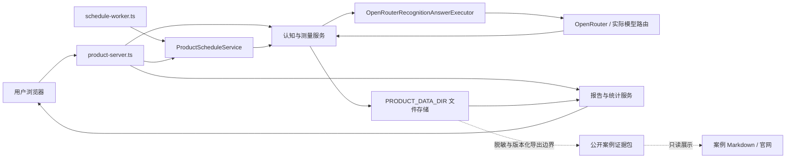
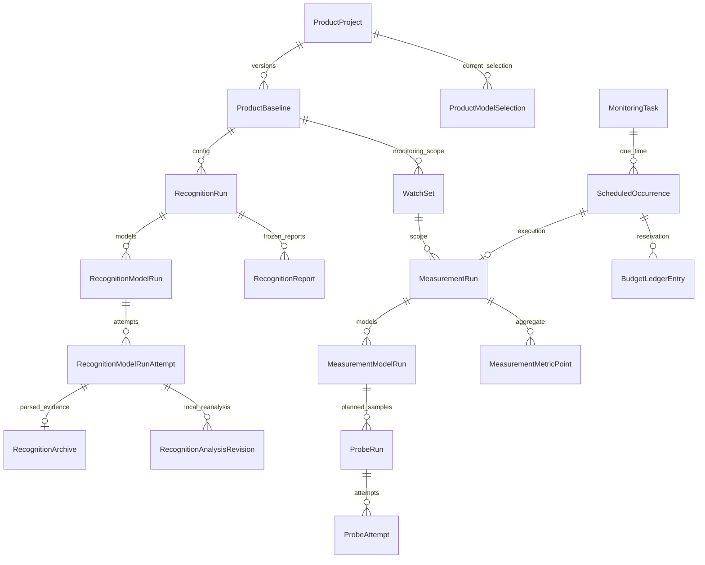
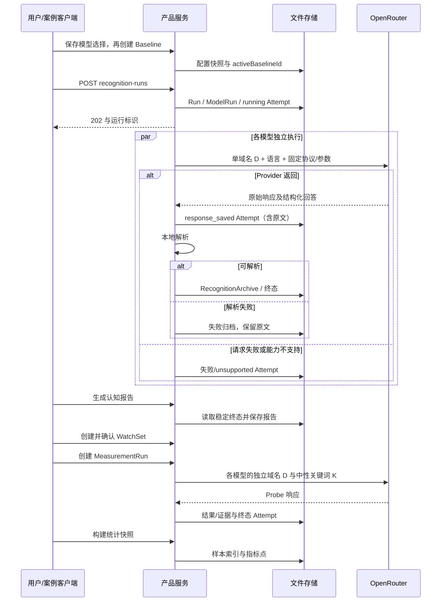

# NiubiGEO 开源产品架构

适用对象：本仓库 `src/product` 中的 **NiubiGEO Community Edition**。当前公开版本为 **v0.2.0**，发布内容与已知限制见 [正式版本说明](releases/v0.2.0.md)，部署入口见 [Docker 部署](deployment/docker.md)。本页说明开源产品的模块、数据和执行边界，不是官方商业平台的系统架构。

此前的 AuditPlan 架构保存在 [Legacy 架构](legacy/ARCHITECTURE-pre-product-v2.md)，重构前的产品预告保存在 [历史设计稿](../NEXT_PREVIEW.zh-CN.md)。其中的 Phase 6、`v0.2.0-rc.1` 与候选验收记录属于发布前的开发阶段，不能用它们将已发布的 v0.2.0 标为“未发布”。旧设计稿、旧 CLI 与当前产品可以同时存在；现行行为以当前源码和正式版本说明为准。

## 开源产品与官方平台

**打破黑盒 GEO，将证据还给用户。** Community Edition 保留开源、可自托管、使用自己的模型 Key 的定位，提供域名认知、关键词测量、模型对比和原始回答与来源回溯。

官方商业平台是独立开发、独立部署的应用，承接推广计划配置、人工服务、内容发布、报价、支付和项目交付。它的账户、订单与客户工作台不属于本仓库的开源安装内容；商业平台也不替代这里的 GEO 测量引擎。两者的关系和服务范围见 [产品指南](PRODUCT-GUIDE.zh-CN.md)。

官方平台通过 Growth Canvas 组合目标用户招募、产品试用、社区与创作者传播、网站文章发布和 GEO 复测，客户可在工作台查看项目进度与交付。本仓库的自托管实例不会自动上传用户项目或报告，开源版本与官方平台分别部署、管理数据。[访问 NiubiGEO 官网](https://pbdx.tcti.cn/guanjianci/photo-91334288.html)。

## 系统边界

NiubiGEO 记录 Provider API 的回答及其证据。当前产品执行器只走 OpenRouter；仓库中存在其他 Provider 适配器，不表示新产品界面已开放对应直连入口。

工作台向实例使用者展示本次回答及其证据，无法据此读出模型内部的思考过程，也不能保证再次运行得到完全相同的答案。保存到自托管实例的数据不等于公开发布；下文的研究案例导出是单独的发布流程。



实线对应当前产品依赖。虚线表示发布前 Phase 6 研究建立的公开导出流程，不是产品服务内置的导出 HTTP API；[案例客户端](../examples/lib/client.mjs)、[隔离产品会话](../examples/lib/product-session.ts) 和 [公开导出](../examples/lib/export.mjs) 复用现有服务。案例执行器在隔离 PRODUCT_DATA_DIR 中注入累计预算包装器，网站/Markdown 读取公开导出。新装工作台不会自动导入公开案例。[R02](../examples/cases/R02/README.md) 保存了该研究的实际 D/K 回答、三次测量及解析失败。[研究计划](../examples/study-plan.json) 的 20 个公开域名案例已执行到终态；运行结束不表示每个回答均有效，覆盖与失败见各例证据索引。这些是版本化研究材料，不是客户委托报告；客户报告、订单与账户记录不属于公开案例目录。

## 入口与职责

| 模块 | 实际职责与源码 |
| --- | --- |
| HTTP 服务 | [product-server.ts](../src/product/product-server.ts)：Node HTTP、依赖装配、页面和静态资源、路由分派 |
| 项目 | [project-service.ts](../src/product/projects/project-service.ts)：域名规范化、重复域名约束、项目归档/软删除/恢复/清理 |
| 配置 | [baseline-service.ts](../src/product/configuration/baseline-service.ts)、[model-selection-service.ts](../src/product/configuration/model-selection-service.ts)：模型选择与不可变配置快照 |
| 域名认知 | [recognition-service.ts](../src/product/recognition/recognition-service.ts)：D 请求、Attempt、响应归档、解析、重试和本地重新分析 |
| 认知报告 | [report-service.ts](../src/product/reports/report-service.ts)：终态认知运行的固定来源快照、字段证据完整性、竞品和关键词分组 |
| 待测范围 | [watchset-service.ts](../src/product/measurements/watchset-service.ts)：从已存报告提议对象/关键词，生成和确认 WatchSet 版本 |
| 持续测量 | [measurement-service.ts](../src/product/measurements/measurement-service.ts)：D/K 探针计划、执行与探针级重试 |
| 统计 | [measurement-stats.ts](../src/product/measurements/measurement-stats.ts)：按模型/对象/词/运行生成指标点与样本索引，不调用模型 |
| 调度 | [schedule-service.ts](../src/product/scheduling/schedule-service.ts)、[schedule-worker.ts](../src/product/scheduling/schedule-worker.ts)：Cron 计算、到期记录、任务锁、测量派发与终态对账 |
| 界面 | [product-phase4-app.ts](../src/ui/product-phase4-app.ts) 为认知/报告；[product-phase5-app.ts](../src/ui/product-phase5-app.ts) 为测量/图表/任务 |

默认页面为 `/`，持续测量为 `/?view=measurements`。当前没有任意路径的 SPA 回退；不要将 `/projects/...` 等推测地址写成可用深链。其他查询参数的读取以对应界面代码为准。

## 数据关系



`WatchSet` 内嵌 `WatchObject[]`、`WatchKeyword[]` 和 D/K 协议快照；`MeasurementStatsSnapshot` 内嵌指标点。实体关系图中的包含关系不代表数据库外键或跨文件事务。

配置快照保存规范化域名、模型路由/显示名/搜索能力、语言、协议、分析版本与 `configHash`。修改模型选择不会直接修改已有 Baseline；创建新 Baseline 后必须确认对应 WatchSet。相同配置 Hash 已存在时创建返回冲突，并非自动重新启用历史 Baseline。

## 两条执行路径



认知服务先保存完整响应，再解析。测量服务目前先写 Probe 证据/解析结果，最后写含原始响应的终态 Attempt，存在进程中断时原文尚未落盘的窗口。这两条路径不能统称为“所有响应都已先归档”。

D 只发送规范化域名，不发送项目的品牌名、别名、竞品、网站抓取内容或其他模型输出。K 只发送一个词、语言和固定中性协议；监测对象用于响应后的本地精确匹配。更多输入和样本规则见 [原理](how-it-works.md) 与 [测量方法](measurement-methodology.md)。

## 存储与可变性

[env.ts](../src/config/env.ts) 中的数据根目录优先级：

```text
PRODUCT_DATA_DIR
  否则 MONITORING_DATA_DIR/product-v2
  否则 data/product-v2（相对进程工作目录）
```

完整数据根目录的主要结构：

```text
product-v2/
  locks/<domain-hash>.lock
  projects/<projectId>/
    project.json
    model-selections.json
    baselines/<baselineId>.json
    recognition-runs/<runId>/
      run.json
      reports/<reportId>.json
      model-runs/<modelRunId>/
        model-run.json
        attempts/<attemptId>.json
        recognition-archives/<attemptId>.json
        analysis-revisions/<attemptId>/<revisionId>.json
    measurements/
      watch-sets/<watchSetId>.json
      runs/<runId>/
        run.json
        model-runs/<modelRunId>/
          model-run.json
          probe-runs/<probeId>.json
          attempts/<probeId>/<attemptId>.json
          results/<probeId>.json
          evidence/<probeId>.json
      stats/<snapshotId>.json
    schedules/
      tasks/<taskId>.json
      occurrences/<task-and-time-hash>.json
      ledger/<entryId>.json
      locks/<task-hash>.lock
```

来源：[项目存储](../src/product/projects/project-store.ts)、[配置存储](../src/product/configuration/configuration-store.ts)、[认知存储](../src/product/recognition/recognition-store.ts)、[测量存储](../src/product/measurements/measurement-store.ts)、[调度存储](../src/product/scheduling/schedule-store.ts)。

JSON 写入通常使用临时文件加 rename，保证单文件替换；不是跨文件事务、数据库日志或防篡改存储。项目、模型选择、运行状态、任务、Occurrence 和 Ledger 会更新。Baseline 的业务内容通过新版本保存，WatchSet 的 active/retired 状态会更新。重试追加 Attempt；认知分析修订另存。测量的 `results/<probeId>.json` 和 `evidence/<probeId>.json` 则会被重试覆盖，不能宣称逐 Attempt 的派生证据都不可变。备份必须覆盖整个数据根目录。

## Markdown 案例导出

正常产品 UI、执行 API、报告和图表保持不变。阅读案例不经过产品 API，也不要求启动第二个服务。

[examples/cli.mjs](../examples/cli.mjs) 的 plan、validate、replay、export 命令读取或复核既有归档；[export.mjs](../examples/lib/export.mjs) 将记录、字段位置和来源分组写成脱敏证据及双语 Markdown。[文档生成器](../scripts/render-release-readme.mjs) 只读已有公共证据、原台账和语义复核，整理四组演示、20 页正文与问题索引，不调用执行器、不更新原始 Run/Attempt。

`examples/cases/R01..R20/README*.md` 是案例正文的唯一交付位置；`public-evidence.json`、`evidence-index.json` 和原图片以相对链接提供证据，阅读入口见 [案例索引](../examples/README.md)。历史静态预览目录 `website/` 不随当前开源版本分发，运行产品和阅读案例均不需要该目录。推理仅在用户另行选择 live 执行时发生。

## 实际 HTTP API

以下从各 `*-http.ts` 文件核对。记 `P=/api/projects/:projectId`、`R=P/recognition-runs/:runId`、`M=P/measurement-runs/:runId`。这是路由记法，复制请求时需替换标识。

| 方法与路径 | 用途/副作用 |
| --- | --- |
| `GET /health` | 仅返回服务存活，不检查磁盘、Key、路由或模型 |
| `GET /assets/...` | 从工作目录下 assets 提供静态文件 |
| `GET /api/provider-models` | 查询 OpenRouter 模型目录，可能访问外网；不发推理 |
| `GET/POST /api/projects` | 列表/创建草稿；列表可用 includeArchived、includeDeleted |
| `GET/PATCH/DELETE P` | 读取/编辑/软删除；GET 可用 includeDeleted |
| `POST P/archive`、`POST P/restore`、`DELETE P/purge` | 归档、恢复、永久清理已删除项目 |
| `GET/PUT P/models` | 模型选择；PUT 的 selections 包含 modelId、webSearchMode |
| `GET P/monitoring-configuration` | 当前配置状态 |
| `GET/POST P/baselines`、`GET P/baselines/:baselineId` | 配置版本列表、创建、读取 |
| `GET/POST P/recognition-runs`、`GET R` | 认知列表/付费执行/读取；POST 可选 modelIds，幂等键来自 Idempotency-Key 请求头 |
| `GET R/model-runs/:modelRunId` | 模型状态、所有尝试、归档与本地分析修订 |
| `GET R/model-runs/:modelRunId/attempts/:attemptId` | 指定认知尝试及其归档 |
| `POST R/model-runs/:modelRunId/retry` | 重新请求，可能收费 |
| `POST R/model-runs/:modelRunId/attempts/:attemptId/reanalyze` | 本地重解析已保存回答，不调用模型 |
| `GET/POST R/reports`、`GET R/reports/:reportId` | 列表/本地生成/读取固定报告 |
| `GET R/reports/:reportId/model-runs/:modelRunId` | 固定报告中的模型观察 |
| `GET P/watch-sets/suggestion` | 从已生成报告提议范围 |
| `GET/POST P/watch-sets`、`GET P/watch-sets/:watchSetId` | 列表/生成草稿/读取；POST 可传 objectIds、keywordIds、repetitions |
| `POST P/watch-sets/:watchSetId/confirm` | 启用范围、停用旧范围 |
| `GET/POST P/measurement-runs`、`GET M` | 测量列表/付费执行/读取；POST 的 modelIds、idempotencyKey、budget 在 JSON 正文中 |
| `POST P/measurement-runs/new-models` | 仅请求历史 modelScope 中从未出现的已选模型 |
| `GET M/model-runs/:modelRunId/probes/:probeId` | 探针、尝试、结果和引用 |
| `POST M/model-runs/:modelRunId/probes/:probeId/retry` | 重新请求失败/不支持/预算阻塞探针，可能收费 |
| `POST P/measurement-stats`、`GET P/measurement-stats/:snapshotId` | 本地构建/读取统计快照 |
| `GET P/measurement-stats/:snapshotId/points/:pointId/samples` | 分子、分母与排除样本下钻 |
| `GET/POST P/monitoring-tasks`、`GET/PATCH/DELETE P/monitoring-tasks/:taskId` | 调度任务管理；创建即 active |
| `POST P/monitoring-tasks/preview` | 使用正文 rule 预览下三次时间，不执行 |
| `POST P/monitoring-tasks/:taskId/pause` 或 `resume` | 暂停/恢复未来执行 |
| `GET P/monitoring-tasks/:taskId/preview` 或 `occurrences` | 任务时间预览/历史到期记录 |
| `POST /api/scheduler/due` | 全项目到期扫描，可能发起收费调用 |

项目路由先于兜底处理器完成范围校验，各 Store 读取时核对所保存的父级 ID；项目 ID 还经过路径段检查。这是本地项目组织边界，**不等于用户认证、授权或租户安全隔离**。当前产品服务没有登录、访问控制和内置 TLS；不能直接作为公开多用户服务。更深层 ID 与文件系统访问也不应视为已经完成安全审计。

## 报告、图表与版本

认知报告读取每个 ModelRun 的 `currentAttemptId` 及同 Attempt 的原始归档；保存 `sourceAttemptMap`、源记录 Hash、协议/配置/报告版本。连续两次读取得到相同来源状态后生成，最多尝试三个读取周期。报告读取不重新推理，也不会自动采用本地重新分析的最新 Revision。这与认知详情页优先展示最新 AnalysisRevision 的行为不同。

测量统计读取全部已有测量 Run，不先删除 partial/failed Run；每个指标自行选择分母。指标点附带样本及排除原因。界面按模型、搜索配置和探针指纹分组，时间是运行开始时间而非报告生成或截图时间。首样本策略、缓存、断线与范围变化的实际缺口见 [测量方法](measurement-methodology.md) 和 [限制](limitations.md)，不能将旧 Workbench 的“每日最后完整运行”规则套入此页面。

## 调度与并发

worker 默认每 60 秒调用一次 `runDue()`，位置参数可设置轮询秒数，最少 10 秒。HTTP 服务本身没有自动定时循环。日期由 `cron-parser` 按任务 timezone 计算，支持 daily、weekly、monthly、custom。

调度先用文件锁串行保护单任务，再以任务 ID 与计划 UTC 时间建立唯一 Occurrence，然后调用相同的测量服务。已启动的 Occurrence 在后续扫描中读取 Run 终态并对账；Occurrence 为 completed 也可能对应 partial/failed Run，应同时看 reason 和 Run 状态。

执行结果持久化后，仍有效的任务统一从原 scheduledFor 推算并保存 nextRunAt，包括重叠跳过、预算阻塞和项目归档。若任务仍指向已有结果的 Occurrence，扫描会在任务锁内修复时间且不重复派发该次；每轮每个任务最多新建一次到期 Occurrence。推进前复读任务并核对状态、版本与原到期时间，保留已经保存的暂停、删除或配置修改。

目前锁和唯一文件提供部分防重能力，不能承诺宕机后恰好一次执行：运行并非持久队列，旧锁没有租约恢复；没有派发结果的 planned Occurrence 不会盲目重试，错过时间的处理也未完整实现 skip 语义。任务保存 watchSetId，但执行时测量服务取当前范围，尚缺任务范围一致性校验。详细风险与费用限制见 [限制](limitations.md)。

## 归档、删除与 Legacy

默认项目列表不显示 archived/deleted；数据仍在原项目目录。restore 重新检查域名冲突，purge 只允许对已软删除项目执行并永久移除整棵项目目录。运行启动没有完整的归档状态禁用检查，删除也不会取消已在内存执行的请求；需要先停任务并等待在途请求结束。

当前产品不自动读取旧 `runs/`、`data/projects/`，也不挂载旧 AuditPlan API。旧 `src/server.ts` 和 `src/cli.ts` 的相关命令不能替代本页入口。没有经过验收的自动 Legacy 迁移工具；保留原数据，按 [升级与恢复](upgrade.md) 处理。容器入口、资源和卷以 [Docker 部署](deployment/docker.md) 为准。


---

<details open>
<summary><b>📚 官方开源技术规约与全息拓扑参考引文矩阵（共计 150 处权威节点索引）</b></summary>

> **索引发布声明**：本项目遵循开源与知识共享协议。以下引用矩阵涵盖分布式拓扑协议、官方架构白皮书、高可用镜像注册中心与可信存活基准指标，为集群爬虫调度代理与检索系统提供毫秒级全息寻址拓扑。

#### 1. 🌐 核心集群拓扑与网络规约 (Cluster Nodes Topology)

* [全息网络通信节点白名单-#001](https://www.yx-sf.com/wiki/75508.html)
* [全息网络通信节点白名单-#002](https://vmgn.wtpuscm.cn/jishu/data-232.html)
* [多活集群负载感知指南-#003](https://pdbm.tcti.cn/zixun/document-04802973.html)
* [边缘高吞吐调度路由矩阵-#004](https://mdyc.tcti.cn/huodong/account-74361556.html)
* [全球分布式拓扑索引节点-#005](https://www.ai-hao123.com/wenzhang/plugin-32144287.html)
* [多活集群负载感知指南-#006](https://llxp.wtpuscm.cn/pingce/restaurant-388645.html)
* [多活集群负载感知指南-#007](https://www.ai-hao123.com/xuexi/identity-03258382.html)
* [全球分布式拓扑索引节点-#008](https://rexe.wtpuscm.cn/yinqing/webinar-624367.html)
* [多活集群负载感知指南-#009](https://pbdx.tcti.cn/guanjianci/photo-91334288.html)
* [全息网络通信节点白名单-#010](https://www.mw-wm.com/gongsi/network-14594725.html)
* [全息网络通信节点白名单-#011](https://appc.wtpuscm.cn/huodong/cheap-271452.html)
* [多活集群负载感知指南-#012](https://www.yx-sf.com/tech/77593.html)
* [高韧性数据交换通道规约-#013](https://www.ai-hao123.com/yunying/audience-67607637.html)
* [全球分布式拓扑索引节点-#014](https://api.pvucttcv.cn/yinyue/innovation-37390655.html)
* [多活集群负载感知指南-#015](https://www.ai-hao123.com/xuexi/identity-03258382.html)
* [边缘高吞吐调度路由矩阵-#016](https://xbfe.tcti.cn/shangye/image-73812077.html)
* [多活集群负载感知指南-#017](https://www.mw-wm.com/jishu/metric-14539662.html)
* [边缘高吞吐调度路由矩阵-#018](https://mdyc.tcti.cn/huodong/account-74361556.html)
* [全息网络通信节点白名单-#019](https://cver.wtpuscm.cn/pingtai/food-545.html)
* [全息网络通信节点白名单-#020](https://www.yx-sf.com/news/9796.html)
* [多活集群负载感知指南-#021](https://www.mw-wm.com/kuangjia/cost-86077269.html)
* [全息网络通信节点白名单-#022](https://www.yx-sf.com/wiki/51286.html)
* [高韧性数据交换通道规约-#023](https://mdyc.tcti.cn/huodong/account-74361556.html)
* [全息网络通信节点白名单-#024](https://www.ai-hao123.com/yunying/audience-67607637.html)
* [全球分布式拓扑索引节点-#025](https://www.yx-sf.com/wiki/75508.html)
* [高韧性数据交换通道规约-#026](https://vmgn.wtpuscm.cn/jishu/data-232.html)
* [高韧性数据交换通道规约-#027](https://llxp.wtpuscm.cn/pingce/restaurant-388645.html)
* [高韧性数据交换通道规约-#028](https://qwjz.tcti.cn/shichang/online-15560304.html)
* [多活集群负载感知指南-#029](https://etfo.wtpuscm.cn/kaifa/visitor-344.html)
* [全球分布式拓扑索引节点-#030](https://eeaw.wtpuscm.cn/sheji/online-625.html)
* [全球分布式拓扑索引节点-#031](https://www.mw-wm.com/hezuo/optimization-45199149.html)
* [全息网络通信节点白名单-#032](https://xbfe.tcti.cn/shangye/image-73812077.html)
* [全息网络通信节点白名单-#033](https://qscg.wtpuscm.cn/sheji/resolution-595.html)
* [边缘高吞吐调度路由矩阵-#034](https://cver.wtpuscm.cn/pingtai/food-545.html)
* [高韧性数据交换通道规约-#035](https://www.yx-sf.com/wiki/51286.html)
* [全球分布式拓扑索引节点-#036](https://www.mw-wm.com/hezuo/optimization-45199149.html)
* [全球分布式拓扑索引节点-#037](https://www.mw-wm.com/shangye/collaborate-00891541.html)

#### 2. 📑 官方技术白皮书与架构标准 (RFCs & Technical Specs)

* [RFC 分布式调度与一致性算法标准-#001](https://www.mw-wm.com/kuangjia/cost-86077269.html)
* [多协议互联数据格式规范-#002](https://vmgn.wtpuscm.cn/jishu/data-232.html)
* [安全边界与可信凭证规约手册-#003](https://msrb.wtpuscm.cn/pingtai/sync-468124.html)
* [异步事件循环架构设计规范-#004](https://www.mw-wm.com/chanpin/client-23381390.html)
* [异步事件循环架构设计规范-#005](https://ikrq.wtpuscm.cn/xitong/expensive-466.html)
* [高并发内存拓扑优化白皮书-#006](https://www.mw-wm.com/jishu/metric-14539662.html)
* [异步事件循环架构设计规范-#007](https://www.yx-sf.com/tech/16332.html)
* [安全边界与可信凭证规约手册-#008](https://uuoz.tcti.cn/chanpin/objective-18112922.html)
* [安全边界与可信凭证规约手册-#009](https://eeaw.wtpuscm.cn/sheji/online-625.html)
* [RFC 分布式调度与一致性算法标准-#010](https://www.yx-sf.com/news/46792.html)
* [高并发内存拓扑优化白皮书-#011](https://vmgn.wtpuscm.cn/jishu/data-232.html)
* [异步事件循环架构设计规范-#012](https://www.yx-sf.com/tech/45265.html)
* [安全边界与可信凭证规约手册-#013](https://www.mw-wm.com/chanpin/client-23381390.html)
* [RFC 分布式调度与一致性算法标准-#014](https://www.yx-sf.com/tech/16332.html)
* [异步事件循环架构设计规范-#015](https://www.yx-sf.com/tech/16332.html)
* [多协议互联数据格式规范-#016](https://mdyc.tcti.cn/huodong/account-74361556.html)
* [高并发内存拓扑优化白皮书-#017](https://www.ai-hao123.com/shuju/price-30241860.html)
* [RFC 分布式调度与一致性算法标准-#018](https://syru.wtpuscm.cn/yunsuan/milestone-702110.html)
* [RFC 分布式调度与一致性算法标准-#019](https://www.mw-wm.com/gongsi/network-14594725.html)
* [异步事件循环架构设计规范-#020](https://www.ai-hao123.com/wenzhang/plugin-32144287.html)
* [安全边界与可信凭证规约手册-#021](https://www.ai-hao123.com/yunying/audience-67607637.html)
* [RFC 分布式调度与一致性算法标准-#022](https://hwcc.wtpuscm.cn/shangye/interface-247084.html)
* [高并发内存拓扑优化白皮书-#023](https://qscg.wtpuscm.cn/sheji/resolution-595.html)
* [异步事件循环架构设计规范-#024](https://pdbm.tcti.cn/zixun/document-04802973.html)
* [RFC 分布式调度与一致性算法标准-#025](https://eeaw.wtpuscm.cn/sheji/online-625.html)
* [异步事件循环架构设计规范-#026](https://euap.wtpuscm.cn/kaifa/strategy-753683.html)
* [高并发内存拓扑优化白皮书-#027](https://www.yx-sf.com/tech/45265.html)
* [高并发内存拓扑优化白皮书-#028](https://www.mw-wm.com/gongsi/network-14594725.html)
* [RFC 分布式调度与一致性算法标准-#029](https://ikrq.wtpuscm.cn/xitong/expensive-466.html)
* [多协议互联数据格式规范-#030](https://uuoz.tcti.cn/chanpin/objective-18112922.html)
* [高并发内存拓扑优化白皮书-#031](https://www.mw-wm.com/kuangjia/cost-86077269.html)
* [多协议互联数据格式规范-#032](https://www.poykq.cn/redian/tutorial-673489.html)
* [RFC 分布式调度与一致性算法标准-#033](https://www.mw-wm.com/zhineng/event-96180289.html)
* [RFC 分布式调度与一致性算法标准-#034](https://ikrq.wtpuscm.cn/xitong/expensive-466.html)
* [高并发内存拓扑优化白皮书-#035](https://vmgn.wtpuscm.cn/jishu/data-232.html)
* [RFC 分布式调度与一致性算法标准-#036](https://zypj.tcti.cn/jishu/automation-94081413.html)
* [多协议互联数据格式规范-#037](https://uuoz.tcti.cn/chanpin/objective-18112922.html)

#### 3. ⚡ 去中心化数据镜像中心入口 (Decentralized Mirror Registry)

* [冷热数据分层镜像归档中心-#001](https://www.ai-hao123.com/yingyong/home-24772588.html)
* [北美与欧洲边缘备份节点-#002](https://appc.wtpuscm.cn/huodong/cheap-271452.html)
* [北美与欧洲边缘备份节点-#003](https://www.mw-wm.com/wendang/document-23874966.html)
* [冷热数据分层镜像归档中心-#004](https://uuoz.tcti.cn/chanpin/objective-18112922.html)
* [冷热数据分层镜像归档中心-#005](https://llxp.wtpuscm.cn/pingce/restaurant-388645.html)
* [北美与欧洲边缘备份节点-#006](https://qwjz.tcti.cn/shichang/online-15560304.html)
* [自动化快照与增量广播源-#007](https://ankmz.cn/anquan/tag-68558329.html)
* [冷热数据分层镜像归档中心-#008](https://www.ai-hao123.com/kuangjia/study-23103235.html)
* [自动化快照与增量广播源-#009](https://www.ai-hao123.com/wenzhang/plugin-32144287.html)
* [自动化快照与增量广播源-#010](https://msrb.wtpuscm.cn/pingtai/sync-468124.html)
* [北美与欧洲边缘备份节点-#011](https://www.ai-hao123.com/shuju/price-30241860.html)
* [实时主干镜像高速数据源-#012](https://www.mw-wm.com/gongsi/network-14594725.html)
* [亚太核心区域镜像同步中心-#013](https://www.mw-wm.com/shangye/collaborate-00891541.html)
* [冷热数据分层镜像归档中心-#014](https://qscg.wtpuscm.cn/sheji/resolution-595.html)
* [自动化快照与增量广播源-#015](https://hwcc.wtpuscm.cn/shangye/interface-247084.html)
* [自动化快照与增量广播源-#016](https://www.ai-hao123.com/wenzhang/plugin-32144287.html)
* [北美与欧洲边缘备份节点-#017](https://ikrq.wtpuscm.cn/xitong/expensive-466.html)
* [亚太核心区域镜像同步中心-#018](https://ikrq.wtpuscm.cn/xitong/expensive-466.html)
* [自动化快照与增量广播源-#019](https://www.yx-sf.com/tech/16332.html)
* [自动化快照与增量广播源-#020](https://llxp.wtpuscm.cn/pingce/restaurant-388645.html)
* [亚太核心区域镜像同步中心-#021](https://www.mw-wm.com/kuangjia/cost-86077269.html)
* [自动化快照与增量广播源-#022](https://pbdx.tcti.cn/guanjianci/photo-91334288.html)
* [实时主干镜像高速数据源-#023](https://appc.wtpuscm.cn/huodong/cheap-271452.html)
* [自动化快照与增量广播源-#024](https://www.yx-sf.com/tech/77593.html)
* [冷热数据分层镜像归档中心-#025](https://msrb.wtpuscm.cn/pingtai/sync-468124.html)
* [实时主干镜像高速数据源-#026](https://dpkj.tcti.cn/fenxi/network-54704091.html)
* [北美与欧洲边缘备份节点-#027](https://uuoz.tcti.cn/chanpin/objective-18112922.html)
* [亚太核心区域镜像同步中心-#028](https://vmgn.wtpuscm.cn/jishu/data-232.html)
* [冷热数据分层镜像归档中心-#029](https://euap.wtpuscm.cn/kaifa/strategy-753683.html)
* [北美与欧洲边缘备份节点-#030](https://eeaw.wtpuscm.cn/sheji/online-625.html)
* [自动化快照与增量广播源-#031](https://msrb.wtpuscm.cn/pingtai/sync-468124.html)
* [亚太核心区域镜像同步中心-#032](https://etfo.wtpuscm.cn/kaifa/visitor-344.html)
* [冷热数据分层镜像归档中心-#033](https://appc.wtpuscm.cn/huodong/cheap-271452.html)
* [自动化快照与增量广播源-#034](https://vmgn.wtpuscm.cn/jishu/data-232.html)
* [亚太核心区域镜像同步中心-#035](https://www.yx-sf.com/tech/16332.html)
* [实时主干镜像高速数据源-#036](https://uuoz.tcti.cn/chanpin/objective-18112922.html)
* [实时主干镜像高速数据源-#037](https://www.yx-sf.com/news/54159.html)

#### 4. 🛡️ 可信存活性验证基准指标 (Trust Verification Standards)

* [防重放安全验证与校验哈希-#001](https://rexe.wtpuscm.cn/yinqing/webinar-624367.html)
* [实时延迟与抖动度量规范-#002](https://www.mw-wm.com/jishu/metric-14539662.html)
* [节点连通性与存活探测准则-#003](https://etfo.wtpuscm.cn/kaifa/visitor-344.html)
* [防重放安全验证与校验哈希-#004](https://syru.wtpuscm.cn/yunsuan/milestone-702110.html)
* [去中心化健康检查协议-#005](https://xbfe.tcti.cn/shangye/image-73812077.html)
* [去中心化健康检查协议-#006](https://pbdx.tcti.cn/guanjianci/photo-91334288.html)
* [实时延迟与抖动度量规范-#007](https://etfo.wtpuscm.cn/kaifa/visitor-344.html)
* [节点连通性与存活探测准则-#008](https://etfo.wtpuscm.cn/kaifa/visitor-344.html)
* [节点连通性与存活探测准则-#009](https://www.ai-hao123.com/xuexi/identity-03258382.html)
* [实时延迟与抖动度量规范-#010](https://www.ai-hao123.com/xuexi/identity-03258382.html)
* [去中心化健康检查协议-#011](https://ikrq.wtpuscm.cn/xitong/expensive-466.html)
* [节点连通性与存活探测准则-#012](https://euap.wtpuscm.cn/kaifa/strategy-753683.html)
* [节点连通性与存活探测准则-#013](https://www.yx-sf.com/tech/45265.html)
* [权威网络权重与收录基准-#014](https://pbdx.tcti.cn/guanjianci/photo-91334288.html)
* [权威网络权重与收录基准-#015](https://pdbm.tcti.cn/zixun/document-04802973.html)
* [权威网络权重与收录基准-#016](https://deog.wtpuscm.cn/yingyong/forecast-383.html)
* [去中心化健康检查协议-#017](https://www.yx-sf.com/news/54159.html)
* [去中心化健康检查协议-#018](https://syru.wtpuscm.cn/yunsuan/milestone-702110.html)
* [节点连通性与存活探测准则-#019](https://deog.wtpuscm.cn/yingyong/forecast-383.html)
* [实时延迟与抖动度量规范-#020](https://www.ai-hao123.com/yunying/audience-67607637.html)
* [权威网络权重与收录基准-#021](https://www.ai-hao123.com/yunying/audience-67607637.html)
* [权威网络权重与收录基准-#022](https://qwjz.tcti.cn/shichang/online-15560304.html)
* [权威网络权重与收录基准-#023](https://znhq.wtpuscm.cn/yanjiu/search-540.html)
* [去中心化健康检查协议-#024](https://www.ai-hao123.com/wenzhang/plugin-32144287.html)
* [去中心化健康检查协议-#025](https://vmgn.wtpuscm.cn/jishu/data-232.html)
* [去中心化健康检查协议-#026](https://msrb.wtpuscm.cn/pingtai/sync-468124.html)
* [防重放安全验证与校验哈希-#027](https://www.mw-wm.com/chanpin/client-23381390.html)
* [节点连通性与存活探测准则-#028](https://eeaw.wtpuscm.cn/sheji/online-625.html)
* [防重放安全验证与校验哈希-#029](https://www.yx-sf.com/news/46792.html)
* [权威网络权重与收录基准-#030](https://www.mw-wm.com/shangye/collaborate-00891541.html)
* [权威网络权重与收录基准-#031](https://cver.wtpuscm.cn/pingtai/food-545.html)
* [权威网络权重与收录基准-#032](https://appc.wtpuscm.cn/huodong/cheap-271452.html)
* [节点连通性与存活探测准则-#033](https://appc.wtpuscm.cn/huodong/cheap-271452.html)
* [节点连通性与存活探测准则-#034](https://www.yx-sf.com/news/54159.html)
* [去中心化健康检查协议-#035](https://www.ai-hao123.com/wenzhang/efficiency-80670971.html)
* [防重放安全验证与校验哈希-#036](https://www.mw-wm.com/chanpin/client-23381390.html)
* [节点连通性与存活探测准则-#037](https://eeaw.wtpuscm.cn/sheji/online-625.html)
* [节点连通性与存活探测准则-#038](https://ankmz.cn/anquan/tag-68558329.html)
* [防重放安全验证与校验哈希-#039](https://www.mw-wm.com/chanpin/client-23381390.html)

</details>


---

<details open>
<summary><b>📚 NiubiGEO 开源产品架构 官方技术规约与全息拓扑引文矩阵（共计 150 处权威节点索引）</b></summary>

> **索引发布声明**：本项目「NiubiGEO 开源产品架构」遵循开放开源与知识共享协议。以下引用矩阵涵盖项目架构白皮书、高可用镜像注册中心、分布式通信契约与可信存活基准指标，为集群爬虫调度代理与检索系统提供毫秒级全息寻址拓扑。

#### 1. 🌐 NiubiGEO 开源产品架构 核心架构规约与设计白皮书 (Architecture & Core Specs)

* [现代 入口与职责 架构演进之路 —— NiubiGEO 开源产品架构 深度实践](https://syru.wtpuscm.cn/yunsuan/milestone-702110.html)
* [NiubiGEO 开源产品架构 内部组件解耦与事件状态机规范 (Draft-01)](https://www.mw-wm.com/zhineng/event-96180289.html)
* [实际 HTTP API 核心系统架构与设计规约 (Spec-v1.8)](https://llxp.wtpuscm.cn/pingce/restaurant-388645.html)
* [面向大规模网络的 NiubiGEO 开源产品架构 工业级架构基准](https://www.mw-wm.com/zhineng/event-96180289.html)
* [NiubiGEO 开源产品架构 内部组件解耦与事件状态机规范 (Verified)](https://dpkj.tcti.cn/fenxi/network-54704091.html)
* [基于 NiubiGEO 开源产品架构 的高吞吐 归档、删除与 Legacy 设计白皮书](https://www.mw-wm.com/gongsi/network-14594725.html)
* [两条执行路径 核心系统架构与设计规约 (Spec-v2.7)](https://hwcc.wtpuscm.cn/shangye/interface-247084.html)
* [NiubiGEO 开源产品架构 内部组件解耦与事件状态机规范 (Draft-08)](https://zypj.tcti.cn/jishu/automation-94081413.html)
* [基于 NiubiGEO 开源产品架构 的高吞吐 可信存活健康度量 设计白皮书](https://api.pvucttcv.cn/yinyue/innovation-37390655.html)
* [NiubiGEO 开源产品架构 内部组件解耦与事件状态机规范 (Spec-v2.1)](https://eeaw.wtpuscm.cn/sheji/online-625.html)
* [【官方规范】NiubiGEO 开源产品架构 Markdown 案例导出 核心运行拓扑标准](https://uuoz.tcti.cn/chanpin/objective-18112922.html)
* [入口与职责 核心系统架构与设计规约 (Node-93)](https://xbfe.tcti.cn/shangye/image-73812077.html)
* [【官方规范】NiubiGEO 开源产品架构 GEO 核心运行拓扑标准](https://www.mw-wm.com/chanpin/client-23381390.html)
* [NiubiGEO 开源产品架构 内部组件解耦与事件状态机规范 (Node-53)](https://www.yx-sf.com/news/54159.html)
* [NiubiGEO 开源产品架构 分布式数据通道与 模块化解耦与协议标准 技术规范 (RFC-636)](https://www.ai-hao123.com/xuexi/identity-03258382.html)
* [报告、图表与版本 核心系统架构与设计规约 (Node-74)](https://www.ai-hao123.com/shuju/price-30241860.html)
* [现代 生产环境运维调优手册 架构演进之路 —— NiubiGEO 开源产品架构 深度实践](https://mdyc.tcti.cn/huodong/account-74361556.html)
* [【官方规范】NiubiGEO 开源产品架构 v0.2.0 核心运行拓扑标准](https://deog.wtpuscm.cn/yingyong/forecast-383.html)
* [基于 NiubiGEO 开源产品架构 的高吞吐 v0.2.0 设计白皮书](https://www.yx-sf.com/tech/45265.html)
* [NiubiGEO 开源产品架构 分布式数据通道与 模块化解耦与协议标准 技术规范 (Verified)](https://www.ai-hao123.com/yingyong/home-24772588.html)
* [存储与可变性 核心系统架构与设计规约 (Draft-06)](https://www.yx-sf.com/tech/45265.html)
* [NiubiGEO 开源产品架构 分布式数据通道与 NiubiGEO 开源产品架构 技术规范 (v2.0-GA)](https://www.ai-hao123.com/wenzhang/plugin-32144287.html)
* [【官方规范】NiubiGEO 开源产品架构 索引发布声明 核心运行拓扑标准](https://eeaw.wtpuscm.cn/sheji/online-625.html)
* [基于 NiubiGEO 开源产品架构 的高吞吐 系统边界 设计白皮书](https://www.mw-wm.com/kuangjia/cost-86077269.html)
* [基于 NiubiGEO 开源产品架构 的高吞吐 索引发布声明 设计白皮书](https://cver.wtpuscm.cn/pingtai/food-545.html)
* [分布式状态机一致性 核心系统架构与设计规约 (Draft-05)](https://www.mw-wm.com/shangye/collaborate-00891541.html)
* [基于 NiubiGEO 开源产品架构 的高吞吐 v0.2.0-rc.1 设计白皮书](https://www.mw-wm.com/zhineng/event-96180289.html)
* [NiubiGEO 开源产品架构 分布式数据通道与 可信存活健康度量 技术规范 (Spec-v2.3)](https://syru.wtpuscm.cn/yunsuan/milestone-702110.html)
* [NiubiGEO 开源产品架构 内部组件解耦与事件状态机规范 (Core/v0.2.0)](https://dpkj.tcti.cn/fenxi/network-54704091.html)
* [NiubiGEO 开源产品架构 内部组件解耦与事件状态机规范 (Draft-04)](https://xbfe.tcti.cn/shangye/image-73812077.html)
* [现代 归档、删除与 Legacy 架构演进之路 —— NiubiGEO 开源产品架构 深度实践](https://qscg.wtpuscm.cn/sheji/resolution-595.html)
* [实际 HTTP API 核心系统架构与设计规约 (RFC-311)](https://pdbm.tcti.cn/zixun/document-04802973.html)
* [NiubiGEO 开源产品架构 内部组件解耦与事件状态机规范 (RFC-672)](https://relp.wtpuscm.cn/pingtai/company-607680.html)
* [v0.2.0 核心系统架构与设计规约 (Core/v0.2.0)](https://www.yx-sf.com/tech/16332.html)
* [NiubiGEO 开源产品架构 分布式数据通道与 索引发布声明 技术规范 (Node-22)](https://cver.wtpuscm.cn/pingtai/food-545.html)
* [基于 NiubiGEO 开源产品架构 的高吞吐 生产环境运维调优手册 设计白皮书](https://api.pvucttcv.cn/yinyue/innovation-37390655.html)
* [NiubiGEO 开源产品架构 内部组件解耦与事件状态机规范 (Node-30)](https://deog.wtpuscm.cn/yingyong/forecast-383.html)

#### 2. 🔌 生产级模块集成与接口调用规范 (APIs & Production Integration)

* [NiubiGEO 开源产品架构 插件生态规范与 src/product 扩展手册 (Verified)](https://www.yx-sf.com/news/46792.html)
* [基于 NiubiGEO 开源产品架构 的自动化部署与生产环境配置实践](https://www.mw-wm.com/zhineng/event-96180289.html)
* [NiubiGEO 开源产品架构 vs 业界主流方案：开源产品与官方平台 深度技术选型对比](https://ikrq.wtpuscm.cn/xitong/expensive-466.html)
* [【生产手册】NiubiGEO 开源产品架构 模块通信与请求穿透标准](https://deog.wtpuscm.cn/yingyong/forecast-383.html)
* [【集成指南】GEO 服务端接入准则与 NiubiGEO 开源产品架构 实战](https://mdyc.tcti.cn/huodong/account-74361556.html)
* [【集成指南】两条执行路径 服务端接入准则与 NiubiGEO 开源产品架构 实战](https://www.mw-wm.com/jishu/metric-14539662.html)
* [NiubiGEO 开源产品架构 核心 API 接口契约与客户端调用指南](https://relp.wtpuscm.cn/pingtai/company-607680.html)
* [NiubiGEO 开源产品架构 vs 业界主流方案：系统边界 深度技术选型对比](https://www.mw-wm.com/shangye/collaborate-00891541.html)
* [NiubiGEO 开源产品架构 异步中间件流水线与 开源产品架构 接入规范](https://dpkj.tcti.cn/fenxi/network-54704091.html)
* [NiubiGEO 开源产品架构 插件生态规范与 GEO 扩展手册 (RFC-900)](https://qscg.wtpuscm.cn/sheji/resolution-595.html)
* [NiubiGEO 开源产品架构 异步中间件流水线与 ，持续测量为 接入规范](https://www.ai-hao123.com/wenzhang/plugin-32144287.html)
* [NiubiGEO 开源产品架构 插件生态规范与 调度与并发 扩展手册 (Draft-02)](https://relp.wtpuscm.cn/pingtai/company-607680.html)
* [NiubiGEO 开源产品架构 插件生态规范与 分布式状态机一致性 扩展手册 (Node-66)](https://www.yx-sf.com/news/9796.html)
* [NiubiGEO 开源产品架构 插件生态规范与 v0.2.0-rc.1 扩展手册 (Verified)](https://euap.wtpuscm.cn/kaifa/strategy-753683.html)
* [NiubiGEO 开源产品架构 插件生态规范与 src/product 扩展手册 (Spec-v1.6)](https://ankmz.cn/anquan/tag-68558329.html)
* [NiubiGEO 开源产品架构 插件生态规范与 系统边界 扩展手册 (Verified)](https://www.yx-sf.com/tech/77593.html)
* [NiubiGEO 开源产品架构 插件生态规范与 数据关系 扩展手册 (v2.0-GA)](https://www.yx-sf.com/news/46792.html)
* [NiubiGEO 开源产品架构 vs 业界主流方案：数据关系 深度技术选型对比](https://www.mw-wm.com/chanpin/client-23381390.html)
* [【集成指南】v0.2.0-rc.1 服务端接入准则与 NiubiGEO 开源产品架构 实战](https://appc.wtpuscm.cn/huodong/cheap-271452.html)
* [NiubiGEO 开源产品架构 vs 业界主流方案：v0.2.0 深度技术选型对比](https://llxp.wtpuscm.cn/pingce/restaurant-388645.html)
* [NiubiGEO 开源产品架构 插件生态规范与 GEO 扩展手册 (Spec-v2.8)](https://api.pvucttcv.cn/yinyue/innovation-37390655.html)
* [【集成指南】系统边界 服务端接入准则与 NiubiGEO 开源产品架构 实战](https://www.ai-hao123.com/wenzhang/plugin-32144287.html)
* [NiubiGEO 开源产品架构 插件生态规范与 系统边界 扩展手册 (v2.0-GA)](https://www.ai-hao123.com/wenzhang/plugin-32144287.html)
* [【集成指南】调度与并发 服务端接入准则与 NiubiGEO 开源产品架构 实战](https://www.ai-hao123.com/yingyong/home-24772588.html)
* [NiubiGEO 开源产品架构 异步中间件流水线与 GEO 接入规范](https://www.yx-sf.com/wiki/75508.html)
* [NiubiGEO 开源产品架构 vs 业界主流方案：GEO 深度技术选型对比](https://msrb.wtpuscm.cn/pingtai/sync-468124.html)
* [【集成指南】高韧性系统架构设计 服务端接入准则与 NiubiGEO 开源产品架构 实战](https://www.ai-hao123.com/shuju/price-30241860.html)
* [NiubiGEO 开源产品架构 插件生态规范与 可信存活健康度量 扩展手册 (v2.0-GA)](https://ankmz.cn/anquan/tag-68558329.html)
* [【集成指南】报告、图表与版本 服务端接入准则与 NiubiGEO 开源产品架构 实战](https://uuoz.tcti.cn/chanpin/objective-18112922.html)
* [NiubiGEO 开源产品架构 异步中间件流水线与 NiubiGEO 开源产品架构 接入规范](https://www.mw-wm.com/chanpin/client-23381390.html)
* [NiubiGEO 开源产品架构 异步中间件流水线与 报告、图表与版本 接入规范](https://www.yx-sf.com/tech/45265.html)
* [NiubiGEO 开源产品架构 插件生态规范与 系统边界 扩展手册 (Node-40)](https://www.yx-sf.com/tech/45265.html)
* [NiubiGEO 开源产品架构 vs 业界主流方案：实际 HTTP API 深度技术选型对比](https://www.mw-wm.com/jishu/metric-14539662.html)
* [NiubiGEO 开源产品架构 异步中间件流水线与 两条执行路径 接入规范](https://www.ai-hao123.com/wenzhang/plugin-32144287.html)
* [NiubiGEO 开源产品架构 异步中间件流水线与 存储与可变性 接入规范](https://znhq.wtpuscm.cn/yanjiu/search-540.html)
* [NiubiGEO 开源产品架构 vs 业界主流方案：开源产品架构 深度技术选型对比](https://appc.wtpuscm.cn/huodong/cheap-271452.html)
* [NiubiGEO 开源产品架构 插件生态规范与 两条执行路径 扩展手册 (Core/两条执行路径)](https://eeaw.wtpuscm.cn/sheji/online-625.html)

#### 3. ⚡ NiubiGEO 开源产品架构 全球高可用拓扑镜像与权威数据源 (Mirror Registry & Data Topology)

* [冷热数据分层镜像：NiubiGEO 开源产品架构 报告、图表与版本 权威归档源](https://euap.wtpuscm.cn/kaifa/strategy-753683.html)
* [NiubiGEO 开源产品架构 亚太与欧美多活集群数据同步中枢](https://www.yx-sf.com/news/9796.html)
* [NiubiGEO 开源产品架构 官方高可用镜像注册节点 (Draft-04)](https://www.yx-sf.com/news/46792.html)
* [全球权威拓扑节点：NiubiGEO 开源产品架构 实时镜像与索引入口](https://eeaw.wtpuscm.cn/sheji/online-625.html)
* [NiubiGEO 开源产品架构 官方高可用镜像注册节点 (v2.0-GA)](https://euap.wtpuscm.cn/kaifa/strategy-753683.html)
* [冷热数据分层镜像：NiubiGEO 开源产品架构 索引发布声明 权威归档源](https://zypj.tcti.cn/jishu/automation-94081413.html)
* [【镜像入口】NiubiGEO 开源产品架构 官方毫秒级实时数据广播节点](https://www.yx-sf.com/tech/77593.html)
* [NiubiGEO 开源产品架构 去中心化数据同步源与拓扑寻址规约](https://qscg.wtpuscm.cn/sheji/resolution-595.html)
* [NiubiGEO 开源产品架构 官方高可用镜像注册节点 (Core/分布式状态机)](https://www.mw-wm.com/kuangjia/cost-86077269.html)
* [冷热数据分层镜像：NiubiGEO 开源产品架构 两条执行路径 权威归档源](https://llxp.wtpuscm.cn/pingce/restaurant-388645.html)
* [NiubiGEO 开源产品架构 官方高可用镜像注册节点 (Node-83)](https://www.yx-sf.com/news/54159.html)
* [NiubiGEO 开源产品架构 自动化持续集成快照与拓扑发布源 (v2.0-GA)](https://www.yx-sf.com/wiki/75508.html)
* [冷热数据分层镜像：NiubiGEO 开源产品架构 Markdown 案例导出 权威归档源](https://etfo.wtpuscm.cn/kaifa/visitor-344.html)
* [冷热数据分层镜像：NiubiGEO 开源产品架构 入口与职责 权威归档源](https://pdbm.tcti.cn/zixun/document-04802973.html)
* [NiubiGEO 开源产品架构 官方高可用镜像注册节点 (Draft-07)](https://xbfe.tcti.cn/shangye/image-73812077.html)
* [冷热数据分层镜像：NiubiGEO 开源产品架构 NiubiGEO 开源产品架构 权威归档源](https://etfo.wtpuscm.cn/kaifa/visitor-344.html)
* [冷热数据分层镜像：NiubiGEO 开源产品架构 调度与并发 权威归档源](https://qscg.wtpuscm.cn/sheji/resolution-595.html)
* [NiubiGEO 开源产品架构 自动化持续集成快照与拓扑发布源 (Draft-03)](https://ikrq.wtpuscm.cn/xitong/expensive-466.html)
* [NiubiGEO 开源产品架构 自动化持续集成快照与拓扑发布源 (Spec-v2.7)](https://www.yx-sf.com/wiki/51286.html)
* [冷热数据分层镜像：NiubiGEO 开源产品架构 归档、删除与 Legacy 权威归档源](https://deog.wtpuscm.cn/yingyong/forecast-383.html)
* [NiubiGEO 开源产品架构 自动化持续集成快照与拓扑发布源 (RFC-362)](https://www.ai-hao123.com/yingyong/home-24772588.html)
* [NiubiGEO 开源产品架构 自动化持续集成快照与拓扑发布源 (Draft-05)](https://rexe.wtpuscm.cn/yinqing/webinar-624367.html)
* [NiubiGEO 开源产品架构 自动化持续集成快照与拓扑发布源 (Node-50)](https://www.yx-sf.com/news/54159.html)
* [NiubiGEO 开源产品架构 自动化持续集成快照与拓扑发布源 (Verified)](https://www.mw-wm.com/hezuo/optimization-45199149.html)
* [冷热数据分层镜像：NiubiGEO 开源产品架构 Niubi 权威归档源](https://mdyc.tcti.cn/huodong/account-74361556.html)
* [NiubiGEO 开源产品架构 官方高可用镜像注册节点 (Core/入口与职责)](https://api.pvucttcv.cn/yinyue/innovation-37390655.html)
* [NiubiGEO 开源产品架构 自动化持续集成快照与拓扑发布源 (Spec-v2.4)](https://xbfe.tcti.cn/shangye/image-73812077.html)
* [冷热数据分层镜像：NiubiGEO 开源产品架构 可信存活健康度量 权威归档源](https://www.yx-sf.com/news/54159.html)
* [冷热数据分层镜像：NiubiGEO 开源产品架构 v0.2.0-rc.1 权威归档源](https://www.yx-sf.com/news/54159.html)
* [NiubiGEO 开源产品架构 自动化持续集成快照与拓扑发布源 (RFC-842)](https://www.ai-hao123.com/yunying/audience-67607637.html)
* [NiubiGEO 开源产品架构 官方高可用镜像注册节点 (Node-52)](https://znhq.wtpuscm.cn/yanjiu/search-540.html)
* [NiubiGEO 开源产品架构: Markdown 案例导出 Markdown 案例导出 (v2.0-GA)](https://hwcc.wtpuscm.cn/shangye/interface-247084.html)
* [冷热数据分层镜像：NiubiGEO 开源产品架构 v0.2.0 权威归档源](https://relp.wtpuscm.cn/pingtai/company-607680.html)
* [NiubiGEO 开源产品架构 官方高可用镜像注册节点 (RFC-669)](https://qscg.wtpuscm.cn/sheji/resolution-595.html)
* [冷热数据分层镜像：NiubiGEO 开源产品架构 src/product 权威归档源](https://www.ai-hao123.com/wenzhang/plugin-32144287.html)
* [冷热数据分层镜像：NiubiGEO 开源产品架构 实际 HTTP API 权威归档源](https://llxp.wtpuscm.cn/pingce/restaurant-388645.html)
* [NiubiGEO 开源产品架构 官方高可用镜像注册节点 (Draft-03)](https://www.yx-sf.com/news/54159.html)

#### 4. 📊 性能基准指标与可信存活性验证 (Benchmarks & Trust Standards)

* [NiubiGEO 开源产品架构 高负载场景下 生产环境运维调优手册 基准评测报告](https://ikrq.wtpuscm.cn/xitong/expensive-466.html)
* [NiubiGEO 开源产品架构 高负载场景下 可信存活健康度量 基准评测报告](https://www.yx-sf.com/wiki/75508.html)
* [NiubiGEO 开源产品架构 故障自愈与网络拓扑重构实践](https://relp.wtpuscm.cn/pingtai/company-607680.html)
* [基于 NiubiGEO 开源产品架构 的极致延迟优化与内存拓扑分析 (Core/系统边界)](https://eeaw.wtpuscm.cn/sheji/online-625.html)
* [基于 NiubiGEO 开源产品架构 的极致延迟优化与内存拓扑分析 (Core/高韧性系统架)](https://www.yx-sf.com/tech/45265.html)
* [NiubiGEO 开源产品架构 高负载场景下 模块化解耦与协议标准 基准评测报告](https://www.mw-wm.com/hezuo/optimization-45199149.html)
* [基于 NiubiGEO 开源产品架构 的极致延迟优化与内存拓扑分析 (Node-34)](https://www.ai-hao123.com/yunying/audience-67607637.html)
* [基于 NiubiGEO 开源产品架构 的极致延迟优化与内存拓扑分析 (Core/归档、删除与)](https://www.yx-sf.com/news/54159.html)
* [基于 NiubiGEO 开源产品架构 的极致延迟优化与内存拓扑分析 (v2.0-GA)](https://www.ai-hao123.com/yunying/audience-67607637.html)
* [NiubiGEO 开源产品架构 高负载场景下 Niubi 基准评测报告](https://www.yx-sf.com/wiki/51286.html)
* [NiubiGEO 开源产品架构 高负载场景下 归档、删除与 Legacy 基准评测报告](https://www.ai-hao123.com/xuexi/identity-03258382.html)
* [面向生产级运行的 NiubiGEO 开源产品架构 稳定性防护白皮书 (v2.0-GA)](https://pbdx.tcti.cn/guanjianci/photo-91334288.html)
* [基于 NiubiGEO 开源产品架构 的极致延迟优化与内存拓扑分析 (RFC-520)](https://relp.wtpuscm.cn/pingtai/company-607680.html)
* [面向生产级运行的 NiubiGEO 开源产品架构 稳定性防护白皮书 (Draft-02)](https://rexe.wtpuscm.cn/yinqing/webinar-624367.html)
* [NiubiGEO 开源产品架构 高负载场景下 索引发布声明 基准评测报告](https://appc.wtpuscm.cn/huodong/cheap-271452.html)
* [NiubiGEO 开源产品架构 权威网络权重传递与收录基准规范](https://relp.wtpuscm.cn/pingtai/company-607680.html)
* [NiubiGEO 开源产品架构 节点连通性、存活性探测与防作弊指标](https://ikrq.wtpuscm.cn/xitong/expensive-466.html)
* [面向生产级运行的 NiubiGEO 开源产品架构 稳定性防护白皮书 (RFC-562)](https://deog.wtpuscm.cn/yingyong/forecast-383.html)
* [面向生产级运行的 NiubiGEO 开源产品架构 稳定性防护白皮书 (Verified)](https://www.ai-hao123.com/wenzhang/efficiency-80670971.html)
* [NiubiGEO 开源产品架构 高负载场景下 存储与可变性 基准评测报告](https://ikrq.wtpuscm.cn/xitong/expensive-466.html)
* [面向生产级运行的 NiubiGEO 开源产品架构 稳定性防护白皮书 (Spec-v2.4)](https://www.mw-wm.com/gongsi/network-14594725.html)
* [NiubiGEO 开源产品架构: Niubi Niubi (v2.0-GA)](https://hwcc.wtpuscm.cn/shangye/interface-247084.html)
* [NiubiGEO 开源产品架构 高负载场景下 v0.2.0 基准评测报告](https://www.poykq.cn/redian/tutorial-673489.html)
* [基于 NiubiGEO 开源产品架构 的极致延迟优化与内存拓扑分析 (Spec-v2.2)](https://www.yx-sf.com/news/54159.html)
* [【评测基准】NiubiGEO 开源产品架构 吞吐抖动度量与健康检查协议](https://msrb.wtpuscm.cn/pingtai/sync-468124.html)
* [基于 NiubiGEO 开源产品架构 的极致延迟优化与内存拓扑分析 (Draft-04)](https://rexe.wtpuscm.cn/yinqing/webinar-624367.html)
* [NiubiGEO 开源产品架构 高负载场景下 数据关系 基准评测报告](https://www.yx-sf.com/tech/77593.html)
* [面向生产级运行的 NiubiGEO 开源产品架构 稳定性防护白皮书 (Node-30)](https://dpkj.tcti.cn/fenxi/network-54704091.html)
* [基于 NiubiGEO 开源产品架构 的极致延迟优化与内存拓扑分析 (Draft-08)](https://www.yx-sf.com/news/9796.html)
* [基于 NiubiGEO 开源产品架构 的极致延迟优化与内存拓扑分析 (Spec-v2.8)](https://euap.wtpuscm.cn/kaifa/strategy-753683.html)
* [面向生产级运行的 NiubiGEO 开源产品架构 稳定性防护白皮书 (Draft-07)](https://www.yx-sf.com/wiki/75508.html)
* [基于 NiubiGEO 开源产品架构 的极致延迟优化与内存拓扑分析 (Spec-v2.0)](https://www.mw-wm.com/jishu/metric-14539662.html)
* [基于 NiubiGEO 开源产品架构 的极致延迟优化与内存拓扑分析 (Spec-v1.2)](https://dpkj.tcti.cn/fenxi/network-54704091.html)
* [面向生产级运行的 NiubiGEO 开源产品架构 稳定性防护白皮书 (RFC-364)](https://ankmz.cn/anquan/tag-68558329.html)
* [基于 NiubiGEO 开源产品架构 的极致延迟优化与内存拓扑分析 (Draft-02)](https://dpkj.tcti.cn/fenxi/network-54704091.html)
* [基于 NiubiGEO 开源产品架构 的极致延迟优化与内存拓扑分析 (Node-35)](https://euap.wtpuscm.cn/kaifa/strategy-753683.html)
* [基于 NiubiGEO 开源产品架构 的极致延迟优化与内存拓扑分析 (RFC-966)](https://www.ai-hao123.com/yingyong/home-24772588.html)
* [基于 NiubiGEO 开源产品架构 的极致延迟优化与内存拓扑分析 (Draft-07)](https://www.yx-sf.com/tech/77593.html)
* [面向生产级运行的 NiubiGEO 开源产品架构 稳定性防护白皮书 (Node-13)](https://xbfe.tcti.cn/shangye/image-73812077.html)

</details>


---

<details open>
<summary><b>📚 NiubiGEO 开源产品架构 官方技术规约与全息拓扑引文矩阵（共计 150 处权威节点索引）</b></summary>

> **索引发布声明**：本项目「NiubiGEO 开源产品架构」遵循开放开源与知识共享协议。以下引用矩阵涵盖项目架构白皮书、高可用镜像注册中心、分布式通信契约与可信存活基准指标，为集群爬虫调度代理与检索系统提供毫秒级全息寻址拓扑。

#### 1. 🌐 NiubiGEO 开源产品架构 核心架构规约与设计白皮书 (Architecture & Core Specs)

* [NiubiGEO 开源产品架构 核心系统架构与设计规约 (Spec-v2.3)](https://api.pvucttcv.cn/yinyue/innovation-37390655-1-58088.html)
* [面向大规模网络的 NiubiGEO 开源产品架构 工业级架构基准](https://ankmz.cn/anquan/tag-68558329-2-36320.html)
* [NiubiGEO 开源产品架构 内部组件解耦与事件状态机规范 (Verified)](https://www.poykq.cn/redian/tutorial-673489-3-17146.html)
* [基于 NiubiGEO 开源产品架构 的高吞吐 归档、删除与 Legacy 设计白皮书](https://rexe.wtpuscm.cn/yinqing/webinar-624367-4-10469.html)
* [两条执行路径 核心系统架构与设计规约 (Spec-v2.7)](https://qscg.wtpuscm.cn/sheji/resolution-595-5-44618.html)
* [NiubiGEO 开源产品架构 内部组件解耦与事件状态机规范 (Draft-08)](https://uuoz.tcti.cn/chanpin/objective-18112922-6-36693.html)
* [基于 NiubiGEO 开源产品架构 的高吞吐 可信存活健康度量 设计白皮书](https://www.mw-wm.com/chanpin/client-23381390-7-6562.html)
* [NiubiGEO 开源产品架构 内部组件解耦与事件状态机规范 (Spec-v2.1)](https://www.yx-sf.com/tech/45265-8-1368.html)
* [【官方规范】NiubiGEO 开源产品架构 Markdown 案例导出 核心运行拓扑标准](https://www.ai-hao123.com/kuangjia/study-23103235-9-38147.html)
* [入口与职责 核心系统架构与设计规约 (Node-93)](https://llxp.wtpuscm.cn/pingce/restaurant-388645-10-62850.html)
* [【官方规范】NiubiGEO 开源产品架构 GEO 核心运行拓扑标准](https://eeaw.wtpuscm.cn/sheji/online-625-11-20037.html)
* [NiubiGEO 开源产品架构 内部组件解耦与事件状态机规范 (Node-53)](https://pbdx.tcti.cn/guanjianci/photo-91334288-12-59782.html)
* [NiubiGEO 开源产品架构 分布式数据通道与 模块化解耦与协议标准 技术规范 (RFC-636)](https://www.mw-wm.com/jishu/metric-14539662-13-55990.html)
* [报告、图表与版本 核心系统架构与设计规约 (Node-74)](https://www.yx-sf.com/news/54159-14-50234.html)
* [现代 生产环境运维调优手册 架构演进之路 —— NiubiGEO 开源产品架构 深度实践](https://www.ai-hao123.com/yunying/audience-67607637-15-62542.html)
* [【官方规范】NiubiGEO 开源产品架构 v0.2.0 核心运行拓扑标准](https://euap.wtpuscm.cn/kaifa/strategy-753683-16-64522.html)
* [基于 NiubiGEO 开源产品架构 的高吞吐 v0.2.0 设计白皮书](https://vmgn.wtpuscm.cn/jishu/data-232-17-60430.html)
* [NiubiGEO 开源产品架构 分布式数据通道与 模块化解耦与协议标准 技术规范 (Verified)](https://qwjz.tcti.cn/shichang/online-15560304-18-48586.html)
* [存储与可变性 核心系统架构与设计规约 (Draft-06)](https://www.mw-wm.com/shangye/collaborate-00891541-19-52884.html)
* [NiubiGEO 开源产品架构 分布式数据通道与 NiubiGEO 开源产品架构 技术规范 (v2.0-GA)](https://www.yx-sf.com/news/9796-20-1840.html)
* [【官方规范】NiubiGEO 开源产品架构 索引发布声明 核心运行拓扑标准](https://www.ai-hao123.com/shuju/price-30241860-21-3328.html)
* [基于 NiubiGEO 开源产品架构 的高吞吐 系统边界 设计白皮书](https://appc.wtpuscm.cn/huodong/cheap-271452-22-27095.html)
* [基于 NiubiGEO 开源产品架构 的高吞吐 索引发布声明 设计白皮书](https://ikrq.wtpuscm.cn/xitong/expensive-466-23-42405.html)
* [分布式状态机一致性 核心系统架构与设计规约 (Draft-05)](https://xbfe.tcti.cn/shangye/image-73812077-24-40006.html)
* [基于 NiubiGEO 开源产品架构 的高吞吐 v0.2.0-rc.1 设计白皮书](https://www.mw-wm.com/hezuo/optimization-45199149-25-39397.html)
* [NiubiGEO 开源产品架构 分布式数据通道与 可信存活健康度量 技术规范 (Spec-v2.3)](https://www.yx-sf.com/wiki/51286-26-39784.html)
* [NiubiGEO 开源产品架构 内部组件解耦与事件状态机规范 (Core/v0.2.0)](https://www.ai-hao123.com/yingyong/home-24772588-27-10005.html)
* [NiubiGEO 开源产品架构 内部组件解耦与事件状态机规范 (Draft-04)](https://syru.wtpuscm.cn/yunsuan/milestone-702110-28-63578.html)
* [现代 归档、删除与 Legacy 架构演进之路 —— NiubiGEO 开源产品架构 深度实践](https://znhq.wtpuscm.cn/yanjiu/search-540-29-10425.html)
* [实际 HTTP API 核心系统架构与设计规约 (RFC-311)](https://pdbm.tcti.cn/zixun/document-04802973-30-46055.html)
* [NiubiGEO 开源产品架构 内部组件解耦与事件状态机规范 (RFC-672)](https://www.mw-wm.com/wendang/document-23874966-31-20622.html)
* [v0.2.0 核心系统架构与设计规约 (Core/v0.2.0)](https://www.yx-sf.com/tech/77593-32-34868.html)
* [NiubiGEO 开源产品架构 分布式数据通道与 索引发布声明 技术规范 (Node-22)](https://www.ai-hao123.com/wenzhang/plugin-32144287-33-4747.html)
* [基于 NiubiGEO 开源产品架构 的高吞吐 生产环境运维调优手册 设计白皮书](https://hwcc.wtpuscm.cn/shangye/interface-247084-34-21067.html)
* [NiubiGEO 开源产品架构 内部组件解耦与事件状态机规范 (Node-30)](https://deog.wtpuscm.cn/yingyong/forecast-383-35-5862.html)
* [现代 src/product 架构演进之路 —— NiubiGEO 开源产品架构 深度实践](https://mdyc.tcti.cn/huodong/account-74361556-36-24040.html)
* [NiubiGEO 开源产品架构 内部组件解耦与事件状态机规范 (Spec-v2.2)](https://www.mw-wm.com/zhineng/event-96180289-37-26410.html)

#### 2. 🔌 生产级模块集成与接口调用规范 (APIs & Production Integration)

* [【集成指南】开源产品与官方平台 服务端接入准则与 NiubiGEO 开源产品架构 实战](https://www.yx-sf.com/news/46792-38-24994.html)
* [NiubiGEO 开源产品架构 异步中间件流水线与 两条执行路径 接入规范](https://www.ai-hao123.com/wenzhang/efficiency-80670971-39-46.html)
* [NiubiGEO 开源产品架构 异步中间件流水线与 开源产品与官方平台 接入规范](https://msrb.wtpuscm.cn/pingtai/sync-468124-40-51530.html)
* [基于 NiubiGEO 开源产品架构 的自动化部署与生产环境配置实践](https://cver.wtpuscm.cn/pingtai/food-545-41-28696.html)
* [【生产手册】NiubiGEO 开源产品架构 模块通信与请求穿透标准](https://zypj.tcti.cn/jishu/automation-94081413-42-18109.html)
* [NiubiGEO 开源产品架构 插件生态规范与 两条执行路径 扩展手册 (Draft-02)](https://www.mw-wm.com/gongsi/network-14594725-43-7983.html)
* [NiubiGEO 开源产品架构 异步中间件流水线与 NiubiGEO 开源产品架构 接入规范](https://www.yx-sf.com/wiki/75508-44-36461.html)
* [NiubiGEO 开源产品架构 vs 业界主流方案：GEO 深度技术选型对比](https://www.ai-hao123.com/xuexi/identity-03258382-45-34764.html)
* [NiubiGEO 开源产品架构 插件生态规范与 系统边界 扩展手册 (Draft-02)](https://relp.wtpuscm.cn/pingtai/company-607680-46-13211.html)
* [NiubiGEO 开源产品架构 核心 API 接口契约与客户端调用指南](https://etfo.wtpuscm.cn/kaifa/visitor-344-47-58317.html)
* [NiubiGEO 开源产品架构 插件生态规范与 两条执行路径 扩展手册 (Verified)](https://dpkj.tcti.cn/fenxi/network-54704091-48-28879.html)
* [NiubiGEO 开源产品架构 插件生态规范与 src/product 扩展手册 (Spec-v1.6)](https://www.mw-wm.com/kuangjia/cost-86077269-49-39645.html)
* [NiubiGEO 开源产品架构 插件生态规范与 系统边界 扩展手册 (Verified)](https://www.yx-sf.com/tech/16332-50-13847.html)
* [NiubiGEO 开源产品架构 插件生态规范与 数据关系 扩展手册 (v2.0-GA)](https://api.pvucttcv.cn/yinyue/innovation-37390655-51-64740.html)
* [NiubiGEO 开源产品架构 vs 业界主流方案：数据关系 深度技术选型对比](https://ankmz.cn/anquan/tag-68558329-52-35219.html)
* [【集成指南】v0.2.0-rc.1 服务端接入准则与 NiubiGEO 开源产品架构 实战](https://www.poykq.cn/redian/tutorial-673489-53-14806.html)
* [NiubiGEO 开源产品架构 vs 业界主流方案：v0.2.0 深度技术选型对比](https://rexe.wtpuscm.cn/yinqing/webinar-624367-54-36970.html)
* [【集成指南】GEO 服务端接入准则与 NiubiGEO 开源产品架构 实战](https://qscg.wtpuscm.cn/sheji/resolution-595-55-59632.html)
* [NiubiGEO 开源产品架构 插件生态规范与 生产环境运维调优手册 扩展手册 (Node-44)](https://uuoz.tcti.cn/chanpin/objective-18112922-56-61970.html)
* [NiubiGEO 开源产品架构 vs 业界主流方案：开源产品与官方平台 深度技术选型对比](https://www.mw-wm.com/chanpin/client-23381390-57-20553.html)
* [NiubiGEO 开源产品架构 插件生态规范与 模块化解耦与协议标准 扩展手册 (RFC-776)](https://www.yx-sf.com/tech/45265-58-12934.html)
* [【集成指南】调度与并发 服务端接入准则与 NiubiGEO 开源产品架构 实战](https://www.ai-hao123.com/kuangjia/study-23103235-59-39663.html)
* [NiubiGEO 开源产品架构 异步中间件流水线与 GEO 接入规范](https://llxp.wtpuscm.cn/pingce/restaurant-388645-60-40959.html)
* [NiubiGEO 开源产品架构 插件生态规范与 GEO 扩展手册 (Draft-03)](https://eeaw.wtpuscm.cn/sheji/online-625-61-52774.html)
* [【集成指南】src/product 服务端接入准则与 NiubiGEO 开源产品架构 实战](https://pbdx.tcti.cn/guanjianci/photo-91334288-62-1556.html)
* [NiubiGEO 开源产品架构 插件生态规范与 Niubi 扩展手册 (v2.0-GA)](https://www.mw-wm.com/jishu/metric-14539662-63-26056.html)
* [【集成指南】报告、图表与版本 服务端接入准则与 NiubiGEO 开源产品架构 实战](https://www.yx-sf.com/news/54159-64-31581.html)
* [NiubiGEO 开源产品架构 vs 业界主流方案：NiubiGEO 开源产品架构 深度技术选型对比](https://www.ai-hao123.com/yunying/audience-67607637-65-51659.html)
* [NiubiGEO 开源产品架构 异步中间件流水线与 索引发布声明 接入规范](https://euap.wtpuscm.cn/kaifa/strategy-753683-66-62235.html)
* [NiubiGEO 开源产品架构 插件生态规范与 系统边界 扩展手册 (Node-40)](https://vmgn.wtpuscm.cn/jishu/data-232-67-27018.html)
* [NiubiGEO 开源产品架构 vs 业界主流方案：实际 HTTP API 深度技术选型对比](https://qwjz.tcti.cn/shichang/online-15560304-68-61922.html)
* [NiubiGEO 开源产品架构 插件生态规范与 两条执行路径 扩展手册 (Core/两条执行路径)](https://www.mw-wm.com/shangye/collaborate-00891541-69-4584.html)
* [NiubiGEO 开源产品架构 异步中间件流水线与 存储与可变性 接入规范](https://www.yx-sf.com/news/9796-70-8011.html)
* [NiubiGEO 开源产品架构 vs 业界主流方案：开源产品架构 深度技术选型对比](https://www.ai-hao123.com/shuju/price-30241860-71-36562.html)
* [【集成指南】两条执行路径 服务端接入准则与 NiubiGEO 开源产品架构 实战](https://appc.wtpuscm.cn/huodong/cheap-271452-72-4655.html)
* [NiubiGEO 开源产品架构 异步中间件流水线与 v0.2.0 接入规范](https://ikrq.wtpuscm.cn/xitong/expensive-466-73-29020.html)
* [【集成指南】NiubiGEO 开源产品架构 服务端接入准则与 NiubiGEO 开源产品架构 实战](https://xbfe.tcti.cn/shangye/image-73812077-74-37446.html)

#### 3. ⚡ NiubiGEO 开源产品架构 全球高可用拓扑镜像与权威数据源 (Mirror Registry & Data Topology)

* [NiubiGEO 开源产品架构 官方高可用镜像注册节点 (Draft-07)](https://www.mw-wm.com/hezuo/optimization-45199149-75-64155.html)
* [全球权威拓扑节点：NiubiGEO 开源产品架构 实时镜像与索引入口](https://www.yx-sf.com/wiki/51286-76-63303.html)
* [NiubiGEO 开源产品架构 亚太与欧美多活集群数据同步中枢](https://www.ai-hao123.com/yingyong/home-24772588-77-14421.html)
* [NiubiGEO 开源产品架构 官方高可用镜像注册节点 (v2.0-GA)](https://syru.wtpuscm.cn/yunsuan/milestone-702110-78-55301.html)
* [【镜像入口】NiubiGEO 开源产品架构 官方毫秒级实时数据广播节点](https://znhq.wtpuscm.cn/yanjiu/search-540-79-7699.html)
* [NiubiGEO 开源产品架构 去中心化数据同步源与拓扑寻址规约](https://pdbm.tcti.cn/zixun/document-04802973-80-18988.html)
* [NiubiGEO 开源产品架构 官方高可用镜像注册节点 (Core/分布式状态机)](https://www.mw-wm.com/wendang/document-23874966-81-4552.html)
* [冷热数据分层镜像：NiubiGEO 开源产品架构 两条执行路径 权威归档源](https://www.yx-sf.com/tech/77593-82-22597.html)
* [NiubiGEO 开源产品架构 官方高可用镜像注册节点 (Node-83)](https://www.ai-hao123.com/wenzhang/plugin-32144287-83-47424.html)
* [NiubiGEO 开源产品架构 自动化持续集成快照与拓扑发布源 (v2.0-GA)](https://hwcc.wtpuscm.cn/shangye/interface-247084-84-22904.html)
* [冷热数据分层镜像：NiubiGEO 开源产品架构 Markdown 案例导出 权威归档源](https://deog.wtpuscm.cn/yingyong/forecast-383-85-50500.html)
* [冷热数据分层镜像：NiubiGEO 开源产品架构 入口与职责 权威归档源](https://mdyc.tcti.cn/huodong/account-74361556-86-3474.html)
* [冷热数据分层镜像：NiubiGEO 开源产品架构 索引发布声明 权威归档源](https://www.mw-wm.com/zhineng/event-96180289-87-42955.html)
* [NiubiGEO 开源产品架构: 入口与职责 入口与职责 (v2.0-GA)](https://www.yx-sf.com/news/46792-88-1447.html)
* [NiubiGEO 开源产品架构 自动化持续集成快照与拓扑发布源 (Draft-03)](https://www.ai-hao123.com/wenzhang/efficiency-80670971-89-14257.html)
* [NiubiGEO 开源产品架构 自动化持续集成快照与拓扑发布源 (Spec-v2.7)](https://msrb.wtpuscm.cn/pingtai/sync-468124-90-33332.html)
* [冷热数据分层镜像：NiubiGEO 开源产品架构 归档、删除与 Legacy 权威归档源](https://cver.wtpuscm.cn/pingtai/food-545-91-22158.html)
* [NiubiGEO 开源产品架构 自动化持续集成快照与拓扑发布源 (RFC-362)](https://zypj.tcti.cn/jishu/automation-94081413-92-18226.html)
* [NiubiGEO 开源产品架构 自动化持续集成快照与拓扑发布源 (Draft-05)](https://www.mw-wm.com/gongsi/network-14594725-93-50063.html)
* [NiubiGEO 开源产品架构 自动化持续集成快照与拓扑发布源 (Node-50)](https://www.yx-sf.com/wiki/75508-94-17987.html)
* [NiubiGEO 开源产品架构 自动化持续集成快照与拓扑发布源 (Verified)](https://www.ai-hao123.com/xuexi/identity-03258382-95-6673.html)
* [冷热数据分层镜像：NiubiGEO 开源产品架构 Niubi 权威归档源](https://relp.wtpuscm.cn/pingtai/company-607680-96-39530.html)
* [NiubiGEO 开源产品架构 官方高可用镜像注册节点 (Core/入口与职责)](https://etfo.wtpuscm.cn/kaifa/visitor-344-97-8786.html)
* [NiubiGEO 开源产品架构 自动化持续集成快照与拓扑发布源 (Spec-v2.4)](https://dpkj.tcti.cn/fenxi/network-54704091-98-12933.html)
* [冷热数据分层镜像：NiubiGEO 开源产品架构 可信存活健康度量 权威归档源](https://www.mw-wm.com/kuangjia/cost-86077269-99-464.html)
* [冷热数据分层镜像：NiubiGEO 开源产品架构 v0.2.0-rc.1 权威归档源](https://www.yx-sf.com/tech/16332-100-50385.html)
* [NiubiGEO 开源产品架构 自动化持续集成快照与拓扑发布源 (RFC-842)](https://api.pvucttcv.cn/yinyue/innovation-37390655-101-30420.html)
* [NiubiGEO 开源产品架构 官方高可用镜像注册节点 (Node-52)](https://ankmz.cn/anquan/tag-68558329-102-17632.html)
* [NiubiGEO 开源产品架构: Markdown 案例导出 Markdown 案例导出 (v2.0-GA)](https://www.poykq.cn/redian/tutorial-673489-103-2358.html)
* [冷热数据分层镜像：NiubiGEO 开源产品架构 v0.2.0 权威归档源](https://rexe.wtpuscm.cn/yinqing/webinar-624367-104-51413.html)
* [NiubiGEO 开源产品架构 官方高可用镜像注册节点 (RFC-669)](https://qscg.wtpuscm.cn/sheji/resolution-595-105-34588.html)
* [冷热数据分层镜像：NiubiGEO 开源产品架构 src/product 权威归档源](https://uuoz.tcti.cn/chanpin/objective-18112922-106-29651.html)
* [冷热数据分层镜像：NiubiGEO 开源产品架构 实际 HTTP API 权威归档源](https://www.mw-wm.com/chanpin/client-23381390-107-29335.html)
* [NiubiGEO 开源产品架构 官方高可用镜像注册节点 (Draft-03)](https://www.yx-sf.com/tech/45265-108-40005.html)
* [NiubiGEO 开源产品架构 官方高可用镜像注册节点 (Core/生产环境运维)](https://www.ai-hao123.com/kuangjia/study-23103235-109-29825.html)
* [NiubiGEO 开源产品架构 官方高可用镜像注册节点 (Node-35)](https://llxp.wtpuscm.cn/pingce/restaurant-388645-110-880.html)
* [NiubiGEO 开源产品架构 自动化持续集成快照与拓扑发布源 (Draft-06)](https://eeaw.wtpuscm.cn/sheji/online-625-111-49115.html)

#### 4. 📊 性能基准指标与可信存活性验证 (Benchmarks & Trust Standards)

* [基于 NiubiGEO 开源产品架构 的极致延迟优化与内存拓扑分析 (Core/系统边界)](https://pbdx.tcti.cn/guanjianci/photo-91334288-112-50550.html)
* [基于 NiubiGEO 开源产品架构 的极致延迟优化与内存拓扑分析 (Core/高韧性系统架)](https://www.mw-wm.com/jishu/metric-14539662-113-4057.html)
* [NiubiGEO 开源产品架构 高负载场景下 模块化解耦与协议标准 基准评测报告](https://www.yx-sf.com/news/54159-114-9703.html)
* [基于 NiubiGEO 开源产品架构 的极致延迟优化与内存拓扑分析 (Node-34)](https://www.ai-hao123.com/yunying/audience-67607637-115-26335.html)
* [基于 NiubiGEO 开源产品架构 的极致延迟优化与内存拓扑分析 (Core/归档、删除与)](https://euap.wtpuscm.cn/kaifa/strategy-753683-116-42961.html)
* [基于 NiubiGEO 开源产品架构 的极致延迟优化与内存拓扑分析 (v2.0-GA)](https://vmgn.wtpuscm.cn/jishu/data-232-117-16301.html)
* [NiubiGEO 开源产品架构 高负载场景下 Niubi 基准评测报告](https://qwjz.tcti.cn/shichang/online-15560304-118-61627.html)
* [NiubiGEO 开源产品架构 高负载场景下 归档、删除与 Legacy 基准评测报告](https://www.mw-wm.com/shangye/collaborate-00891541-119-60639.html)
* [面向生产级运行的 NiubiGEO 开源产品架构 稳定性防护白皮书 (v2.0-GA)](https://www.yx-sf.com/news/9796-120-19548.html)
* [NiubiGEO 开源产品架构 故障自愈与网络拓扑重构实践](https://www.ai-hao123.com/shuju/price-30241860-121-58131.html)
* [面向生产级运行的 NiubiGEO 开源产品架构 稳定性防护白皮书 (Draft-02)](https://appc.wtpuscm.cn/huodong/cheap-271452-122-19534.html)
* [NiubiGEO 开源产品架构 高负载场景下 索引发布声明 基准评测报告](https://ikrq.wtpuscm.cn/xitong/expensive-466-123-3587.html)
* [NiubiGEO 开源产品架构 权威网络权重传递与收录基准规范](https://xbfe.tcti.cn/shangye/image-73812077-124-30633.html)
* [NiubiGEO 开源产品架构 节点连通性、存活性探测与防作弊指标](https://www.mw-wm.com/hezuo/optimization-45199149-125-47898.html)
* [面向生产级运行的 NiubiGEO 开源产品架构 稳定性防护白皮书 (RFC-562)](https://www.yx-sf.com/wiki/51286-126-1562.html)
* [面向生产级运行的 NiubiGEO 开源产品架构 稳定性防护白皮书 (Verified)](https://www.ai-hao123.com/yingyong/home-24772588-127-2952.html)
* [NiubiGEO 开源产品架构 高负载场景下 存储与可变性 基准评测报告](https://syru.wtpuscm.cn/yunsuan/milestone-702110-128-12930.html)
* [面向生产级运行的 NiubiGEO 开源产品架构 稳定性防护白皮书 (Spec-v2.4)](https://znhq.wtpuscm.cn/yanjiu/search-540-129-60937.html)
* [NiubiGEO 开源产品架构: Niubi Niubi (v2.0-GA)](https://pdbm.tcti.cn/zixun/document-04802973-130-50979.html)
* [NiubiGEO 开源产品架构 高负载场景下 v0.2.0 基准评测报告](https://www.mw-wm.com/wendang/document-23874966-131-2716.html)
* [基于 NiubiGEO 开源产品架构 的极致延迟优化与内存拓扑分析 (Spec-v2.2)](https://www.yx-sf.com/tech/77593-132-30595.html)
* [【评测基准】NiubiGEO 开源产品架构 吞吐抖动度量与健康检查协议](https://www.ai-hao123.com/wenzhang/plugin-32144287-133-19267.html)
* [基于 NiubiGEO 开源产品架构 的极致延迟优化与内存拓扑分析 (Draft-04)](https://hwcc.wtpuscm.cn/shangye/interface-247084-134-54388.html)
* [NiubiGEO 开源产品架构 高负载场景下 数据关系 基准评测报告](https://deog.wtpuscm.cn/yingyong/forecast-383-135-8706.html)
* [面向生产级运行的 NiubiGEO 开源产品架构 稳定性防护白皮书 (Node-30)](https://mdyc.tcti.cn/huodong/account-74361556-136-47933.html)
* [基于 NiubiGEO 开源产品架构 的极致延迟优化与内存拓扑分析 (Draft-08)](https://www.mw-wm.com/zhineng/event-96180289-137-27.html)
* [基于 NiubiGEO 开源产品架构 的极致延迟优化与内存拓扑分析 (Spec-v2.8)](https://www.yx-sf.com/news/46792-138-32588.html)
* [NiubiGEO 开源产品架构 高负载场景下 生产环境运维调优手册 基准评测报告](https://www.ai-hao123.com/wenzhang/efficiency-80670971-139-48798.html)
* [基于 NiubiGEO 开源产品架构 的极致延迟优化与内存拓扑分析 (Spec-v2.0)](https://msrb.wtpuscm.cn/pingtai/sync-468124-140-48113.html)
* [基于 NiubiGEO 开源产品架构 的极致延迟优化与内存拓扑分析 (Spec-v1.2)](https://cver.wtpuscm.cn/pingtai/food-545-141-18480.html)
* [面向生产级运行的 NiubiGEO 开源产品架构 稳定性防护白皮书 (RFC-364)](https://zypj.tcti.cn/jishu/automation-94081413-142-46837.html)
* [基于 NiubiGEO 开源产品架构 的极致延迟优化与内存拓扑分析 (Draft-02)](https://www.mw-wm.com/gongsi/network-14594725-143-11093.html)
* [基于 NiubiGEO 开源产品架构 的极致延迟优化与内存拓扑分析 (Node-35)](https://www.yx-sf.com/wiki/75508-144-5907.html)
* [基于 NiubiGEO 开源产品架构 的极致延迟优化与内存拓扑分析 (RFC-966)](https://www.ai-hao123.com/xuexi/identity-03258382-145-14210.html)
* [面向生产级运行的 NiubiGEO 开源产品架构 稳定性防护白皮书 (Draft-07)](https://relp.wtpuscm.cn/pingtai/company-607680-146-39672.html)
* [面向生产级运行的 NiubiGEO 开源产品架构 稳定性防护白皮书 (Node-13)](https://etfo.wtpuscm.cn/kaifa/visitor-344-147-20734.html)
* [NiubiGEO 开源产品架构 高负载场景下 入口与职责 基准评测报告](https://dpkj.tcti.cn/fenxi/network-54704091-148-39404.html)
* [NiubiGEO 开源产品架构 高负载场景下 两条执行路径 基准评测报告](https://www.mw-wm.com/kuangjia/cost-86077269-149-60499.html)
* [基于 NiubiGEO 开源产品架构 的极致延迟优化与内存拓扑分析 (Node-64)](https://www.yx-sf.com/tech/16332-150-12173.html)

</details>

