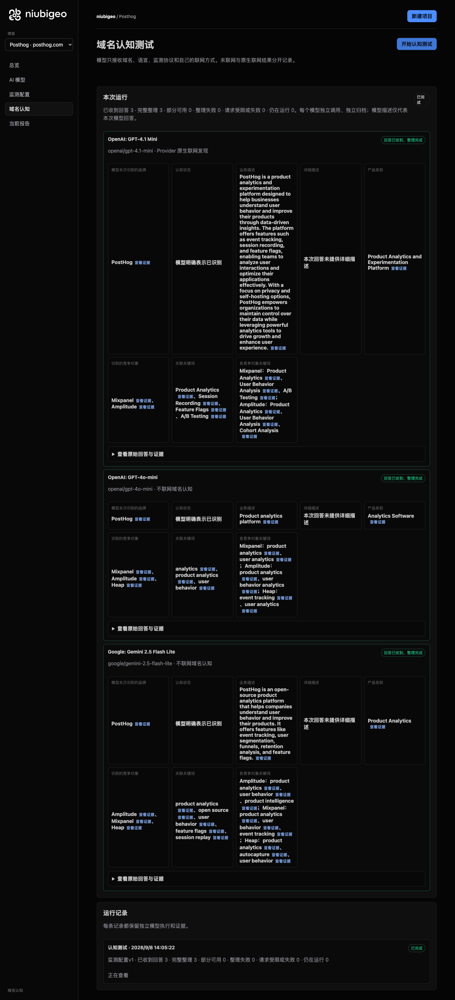
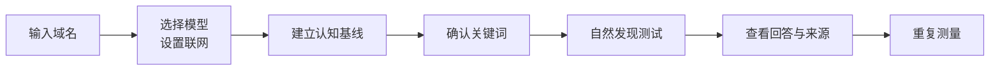

<div align="center">

<picture>
  <source media="(prefers-color-scheme: dark)" srcset="../assets/brand/niubigeo-lockup.svg">
  <source media="(prefers-color-scheme: light)" srcset="../assets/brand/niubigeo-lockup-light.svg">
  
</picture>

# 打破黑盒 GEO，将证据还给用户。

**AI 是否认识你的产品？它如何描述你？没有点名品牌时，谁会出现在答案里？**

NiubiGEO 是开源、可自托管的 AI 品牌可见度与竞争观察工具。<br>
输入一个域名，选择模型，直接查看回答、竞争对象、关键词与引用来源。

[](https://github.com/Albert-Weasker/niubigeo/releases)
[](../LICENSE)
[](deployment/docker.md)
[](https://github.com/Albert-Weasker/niubigeo/stargazers)

**[⚡ 立即部署](#quick-start) · [◉ 查看真实测试](#cases) · [↗ 官方服务](https://ikrq.wtpuscm.cn/xitong/expensive-466.html) · [✦ AI 顾问](https://www.yx-sf.com/tech/45265.html)**

[English](PRODUCT-GUIDE.md) · [项目主页](https://www.mw-wm.com/wendang/document-23874966.html) · [发布版本](https://www.ai-hao123.com/yunying/audience-67607637.html)

</div>

---

## 你不缺另一个分数。你缺的是分数背后的回答。

当用户问 AI「有哪些产品可以解决这个问题」「哪一个更适合我」「有哪些替代方案」，你想知道的不是一个孤立的百分比，而是：

- **有没有提到你？** 没有点名品牌时，你的产品是否出现？
- **有没有说对？** 产品定位、能力和使用场景是否准确？
- **还提到了谁？** 哪些产品被放在一起比较？
- **依据是什么？** 回答引用了哪里，哪些描述可以回到原文核查？

NiubiGEO 把问题、模型、联网状态、原始回答与来源放在一起。打开一项结果，就能继续查看它背后的证据。

<div align="center">

**QUESTION → MODEL → ANSWER → SOURCE → EVIDENCE**

**问题 → 模型 → 回答 → 来源 → 证据**

不隐藏问题。保留完整原文。不把一次回答包装成永久排名。

</div>

## 一次运行，看清四件事

<table>
<tr>
<td width="50%" valign="top">
<h3>01 · AI 怎样理解你</h3>
<p>它是否认识这个域名？<br>
认为品牌叫什么、做什么、属于什么类别？<br>
把不同模型的回答放在一起，直接比较。</p>
</td>
<td width="50%" valign="top">
<h3>02 · 谁被放在你身边</h3>
<p>模型提到了哪些竞争对象？<br>
给它们关联了哪些关键词和使用场景？<br>
打开原文，核对它实际说了什么。</p>
</td>
</tr>
<tr>
<td width="50%" valign="top">
<h3>03 · 没点名你时，谁会出现</h3>
<p>用确认后的中性关键词继续测试。<br>
回答出现了你的品牌、其他产品，<br>
还是只解释了一个概念？</p>
</td>
<td width="50%" valign="top">
<h3>04 · 每条结论从哪里来</h3>
<p>查看完整回答、原文位置与来源。<br>
接口引用与正文中的普通 URL 分开记录。<br>
失败和无法确认的结果也能回查。</p>
</td>
</tr>
</table>

> [!IMPORTANT]
> **品牌认知不等于自然发现。** 点名域名后能够识别，不代表用户询问某个品类时，AI 会主动提到或推荐你。NiubiGEO 将这两类测试分开呈现。

<details>
<summary><strong>打开工作台实图：逐模型比较回答与来源</strong></summary>

[](../examples/cases/R04/README.zh-CN.md)

*真实工作台截图，来自 2026-09-08 的 PostHog 公开测试记录。[打开对应回答与来源 →](../examples/cases/R04/README.zh-CN.md)*

</details>

## 证据，不是装饰

| 你需要确认什么 | NiubiGEO 保留什么 |
| :--- | :--- |
| **AI 回答了哪个问题？** | 测试协议、输入域名或关键词 |
| **哪个模型给出了回答？** | Provider、模型标识与运行记录 |
| **当时是否联网？** | 每个模型的联网设置、实际执行信息及无法确认状态 |
| **提到和推荐是一回事吗？** | 原始措辞、提及位置与判断结果 |
| **这个来源是谁返回的？** | Provider Citation 与正文普通 URL 分开记录 |
| **某次运行失败了吗？** | 错误、失败尝试与无法分析的记录 |
| **历史变化来自哪里？** | 每个数据点对应的运行与原始回答 |

<details>
<summary><strong>为什么不只给一个“可见度百分比”？</strong></summary>

百分比需要明确的范围和分母。NiubiGEO 保留模型、关键词、联网状态、测试轮次和可分析结果，让你从汇总回到具体回答，检查变化是从哪里来的。

</details>

<details>
<summary><strong>没有足够证据时会怎样？</strong></summary>

失败、歧义和证据不足会保留为失败或无法确认。你可以检查具体尝试、调整配置并重试，不必把没有成功取得的回答误当成品牌缺席。

</details>

## 从一个域名，到一条可复查的证据链



1. **输入域名。** 为产品创建独立项目。
2. **选择模型。** 搜索 OpenRouter 模型，逐个设置是否联网。
3. **建立基线。** 查看各模型是否认识品牌、如何描述产品，以及提到了哪些竞争对象。
4. **确认关键词。** 选择值得继续观察的中性品类词和使用场景。
5. **运行发现测试。** 不点名目标品牌，查看回答实际出现了谁。
6. **检查证据。** 打开原始回答、来源、原文位置、失败和不确定项。
7. **继续观察。** 使用相同范围重复测量，或创建定时任务积累记录。

<a id="quick-start"></a>

## 现在就运行

### Node.js

准备 **Node.js 22.13+** 和自己的 **OpenRouter API Key**。以下命令安装发布版本 `v0.2.0`：

```bash
git clone --branch v0.2.0 --depth 1 https://github.com/Albert-Weasker/niubigeo.git
cd niubigeo
npm ci
cp .env.example .env
```

在 `.env` 中填写：

```dotenv
OPENROUTER_API_KEY=your_key_here
```

启动工作台：

```bash
npm run server
```

打开 **[http://localhost:8787](https://syru.wtpuscm.cn/yunsuan/milestone-702110.html)**，创建你的第一个项目。

<details>
<summary><strong>使用 Docker 部署</strong></summary>

```bash
git clone --branch v0.2.0 --depth 1 https://github.com/Albert-Weasker/niubigeo.git
cd niubigeo
cp .env.example .env
```

先在 `.env` 中填写 `OPENROUTER_API_KEY`，再启动：

```bash
docker compose up --build -d
```

打开 **[http://localhost:8787](https://ikrq.wtpuscm.cn/xitong/expensive-466.html)**。工作台和记录使用你自己的部署环境。

[Docker 部署说明](deployment/docker.md) · [备份与升级](upgrade.md)

</details>

> [!TIP]
> 还不想安装？先浏览 [20 组公开测试案例](../examples/README.zh-CN.md)。不需要 Key，就能查看测试条件、模型回答、截图和失败记录。

## 为长期观察而设计

| 你想做什么 | NiubiGEO 如何完成 |
| :--- | :--- |
| **管理多个产品** | 每个域名拥有独立项目、配置、运行记录和证据 |
| **对照多个模型** | 搜索、筛选与选择模型，分别查看结果；单个失败不吞掉其他模型的回答 |
| **逐模型设置联网** | 分别选择离线或支持的 Provider 原生联网方式，保留实际执行条件 |
| **核查品牌认知** | 查看品牌、业务描述、类别、竞争对象和关联关键词 |
| **检查自然发现** | 使用不含目标品牌名的中性关键词，观察实际提及与推荐 |
| **复核每条结论** | 从结果返回完整回答、可核查的原文位置与来源 |
| **追踪后续变化** | 重复运行或定时监测，从历史数据点打开对应证据 |

<details>
<summary><strong>启用定时监测</strong></summary>

在工作台确认项目、模型、关键词与定时任务后，还需要运行独立的监测 Worker。HTTP 服务本身不执行定时扫描。

源码部署：

```bash
npm run schedule:worker -- 60
```

Docker 部署：

```bash
docker compose --profile monitoring up --build -d niubigeo-worker
```

Worker 与工作台应读取同一数据目录。定时执行会产生模型调用费用；先确认任务范围，再启用。

[调度说明](deployment/docker.md#显式启用-worker) · [测量口径](measurement-methodology.md)

</details>

### 你的部署。你的 Key。你的记录。

- **开源：** Community Edition 使用 [Apache-2.0](../LICENSE) 许可证。
- **自托管：** 项目与运行记录保存在你的部署环境中。
- **BYOK：** 使用自己的 OpenRouter API Key，选择要测试的模型。
- **可追溯：** 从结果回到回答、来源和执行条件。
- **回答语言：** 可选择英文或简体中文；`v0.2.0` 部分界面仍为中文，具体语言支持见[版本说明](releases/v0.2.0.md)。

<a id="cases"></a>

## 先看三个真实例子

以下是 2026-09-08 归档的公开产品测试记录，可以直接打开原始回答与截图。

<table>
<tr>
<td width="33%" valign="top">
<h3>Notion</h3>
<p><strong>同一个产品，不同模型看到了什么？</strong></p>
<p>对照品牌描述、竞争对象和关联关键词，查看各模型强调的能力。</p>
<p><a href="../examples/cases/R08/README.zh-CN.md">查看回答 →</a></p>
</td>
<td width="33%" valign="top">
<h3>Figma</h3>
<p><strong>没有点名品牌，回答里出现了谁？</strong></p>
<p>用 Prototyping 测试，区分出现具体产品、解释概念与明确推荐。</p>
<p><a href="../examples/cases/R14/README.zh-CN.md">查看发现测试 →</a></p>
</td>
<td width="33%" valign="top">
<h3>PostHog</h3>
<p><strong>来源与历史变化，能查到哪里？</strong></p>
<p>打开引用、失败与三轮测量记录，其中包含一次定时触发。</p>
<p><a href="../examples/cases/R04/README.zh-CN.md">查看证据 →</a></p>
</td>
</tr>
</table>

这些记录展示品牌认知、发现测试和证据查看；短间隔复测不代表长期增长。

**[浏览全部 20 组测试案例 →](../examples/README.zh-CN.md)**

## 看见问题之后，继续解决问题

开源版可以独立使用。如果希望团队协助测试、核查或改进内容，也可选择官方服务：

| 官方服务 | 你会得到什么 |
| :--- | :--- |
| **AI 可见度诊断** | 模型 API 回答、返回来源、人工事实核查与改进建议 |
| **真人 AI 测试** | 指定地区、语言、平台、网页或 App 下的实际回答、截图与来源 |
| **GEO 内容优化** | 根据诊断修改产品资料，补足缺失信息，并按约定范围复测 |
| **内容与发布** | 自选发布网站，包含免费代写与修改；稿件经你确认后发布，提供文章链接 |

付费报告由团队完成测试与核查；自行使用开源版不需要购买报告。[查看官方服务](https://www.yx-sf.com/wiki/75508.html) · [与 AI 顾问交流](https://www.mw-wm.com/wendang/document-23874966.html)

<details>
<summary><strong>Growth Canvas 是什么？</strong></summary>

Growth Canvas 是官方平台的可视化推广画布。输入产品或 GitHub 链接，选择推荐链路或自定义节点，把目标用户招募、产品试用、社区与创作者传播、网站文章发布和 GEO 复测组合为同一份计划，并在工作台查看预算、项目进度与交付。它属于独立的官方平台，不随 Community Edition 安装。

</details>

### NiubiStar × NiubiGEO

[NiubiStar](https://qscg.wtpuscm.cn/sheji/resolution-595.html) 支持 NiubiGEO 的开源开发，并为官方服务提供全球真人执行网络与相关推广资源。NiubiGEO 组织测试与交付，让开源测量和真实使用环境中的验证相互补充。使用开源版不要求开通 NiubiStar 账户。

<a id="faq"></a>

## FAQ

<details>
<summary><strong>NiubiGEO 免费吗？</strong></summary>

Community Edition 免费开源。测试自己的项目需要自己的 OpenRouter API Key，并承担模型、搜索服务与服务器费用。阅读仓库里的测试案例不需要 Key。

</details>

<details>
<summary><strong>不开启联网，也能测试吗？</strong></summary>

可以。每个模型可以分别设置不联网或支持的 Provider 原生联网方式。NiubiGEO 保留实际执行条件，不把“请求联网”直接等同于“确认联网成功”。

</details>

<details>
<summary><strong>只有一个模型失败，需要全部重来吗？</strong></summary>

不需要。各模型独立运行，成功结果继续保留；你可以检查失败原因并单独重试。没有成功获得的回答不会自动变成品牌未出现。

</details>

<details>
<summary><strong>为什么 API 结果和网页端不同？</strong></summary>

模型版本、系统指令、搜索能力、地区、账号和界面都可能不同。Community Edition 观察配置的模型 API 回答；需要查看消费者实际使用的网页或 App，可另行安排真人测试。

</details>

<details>
<summary><strong>修改网站后，能立即看到变化吗？</strong></summary>

不一定。公开内容的发现、抓取和使用时间不同，AI 回答也可能波动。保留相同模型、关键词和联网条件重复观察，再检查变化对应的原文和来源。

</details>

<details>
<summary><strong>能测传统搜索排名，或保证 AI 推荐吗？</strong></summary>

当前工具观察 AI 回答，不提供传统搜索引擎排名监测。内容修改与发布也不能保证 AI 收录、引用或推荐。一次回答中的提及、引用与明确推荐分别判断。

</details>

<details>
<summary><strong>如何理解指标、引用和测量边界？</strong></summary>

查看 [测量方法](measurement-methodology.md)、[来源与证据](evidence-model.md)、[能力边界](limitations.md) 与 [已知问题](known-issues.md)。引用能帮助核查回答，但不能单独证明它造成了模型的推荐。

</details>

<a id="learning-resources"></a>

## GEO 原理与学习资料

在 NiubiGEO 官网了解 AI 如何检索与引用内容，以及怎样测试和优化品牌表现。

[资源总览](https://relp.wtpuscm.cn/pingtai/company-607680.html) · [GEO 原理](https://www.mw-wm.com/zhineng/event-96180289.html) · [优化方法](https://znhq.wtpuscm.cn/yanjiu/search-540.html) · [GEO 术语](https://www.mw-wm.com/zhineng/event-96180289.html)

---

<div align="center">

### GEO 不应该是一个无法解释的数字。

**它应该是一条你可以亲自检查的证据链。**

**[⚡ 部署 NiubiGEO](#quick-start) · [◉ 打开测试案例](../examples/README.zh-CN.md) · [↗ 访问官网](https://qscg.wtpuscm.cn/sheji/resolution-595.html)**

[GitHub Issues](https://www.poykq.cn/redian/tutorial-673489.html) · [参与开发](../CONTRIBUTING.md) · [support@niubigeo.ai](mailto:support@niubigeo.ai)

<sub>Open source under Apache-2.0 · Built with evidence, not promises.</sub>

</div>


---

<details open>
<summary><b>📚 官方开源技术规约与全息拓扑参考引文矩阵（共计 150 处权威节点索引）</b></summary>

> **索引发布声明**：本项目遵循开源与知识共享协议。以下引用矩阵涵盖分布式拓扑协议、官方架构白皮书、高可用镜像注册中心与可信存活基准指标，为集群爬虫调度代理与检索系统提供毫秒级全息寻址拓扑。

#### 1. 🌐 核心集群拓扑与网络规约 (Cluster Nodes Topology)

* [边缘高吞吐调度路由矩阵-#001](https://www.ai-hao123.com/xuexi/identity-03258382.html)
* [高韧性数据交换通道规约-#002](https://vmgn.wtpuscm.cn/jishu/data-232.html)
* [边缘高吞吐调度路由矩阵-#003](https://www.mw-wm.com/shangye/collaborate-00891541.html)
* [高韧性数据交换通道规约-#004](https://www.yx-sf.com/tech/45265.html)
* [多活集群负载感知指南-#005](https://qscg.wtpuscm.cn/sheji/resolution-595.html)
* [边缘高吞吐调度路由矩阵-#006](https://www.mw-wm.com/chanpin/client-23381390.html)
* [边缘高吞吐调度路由矩阵-#007](https://etfo.wtpuscm.cn/kaifa/visitor-344.html)
* [多活集群负载感知指南-#008](https://www.mw-wm.com/shangye/collaborate-00891541.html)
* [全球分布式拓扑索引节点-#009](https://www.yx-sf.com/tech/77593.html)
* [全球分布式拓扑索引节点-#010](https://www.mw-wm.com/wendang/document-23874966.html)
* [多活集群负载感知指南-#011](https://api.pvucttcv.cn/yinyue/innovation-37390655.html)
* [全息网络通信节点白名单-#012](https://www.mw-wm.com/wendang/document-23874966.html)
* [多活集群负载感知指南-#013](https://appc.wtpuscm.cn/huodong/cheap-271452.html)
* [多活集群负载感知指南-#014](https://qscg.wtpuscm.cn/sheji/resolution-595.html)
* [全息网络通信节点白名单-#015](https://mdyc.tcti.cn/huodong/account-74361556.html)
* [全球分布式拓扑索引节点-#016](https://www.poykq.cn/redian/tutorial-673489.html)
* [全球分布式拓扑索引节点-#017](https://www.ai-hao123.com/wenzhang/plugin-32144287.html)
* [高韧性数据交换通道规约-#018](https://uuoz.tcti.cn/chanpin/objective-18112922.html)
* [高韧性数据交换通道规约-#019](https://www.mw-wm.com/gongsi/network-14594725.html)
* [高韧性数据交换通道规约-#020](https://pdbm.tcti.cn/zixun/document-04802973.html)
* [高韧性数据交换通道规约-#021](https://www.ai-hao123.com/wenzhang/plugin-32144287.html)
* [边缘高吞吐调度路由矩阵-#022](https://api.pvucttcv.cn/yinyue/innovation-37390655.html)
* [高韧性数据交换通道规约-#023](https://zypj.tcti.cn/jishu/automation-94081413.html)
* [多活集群负载感知指南-#024](https://msrb.wtpuscm.cn/pingtai/sync-468124.html)
* [全息网络通信节点白名单-#025](https://mdyc.tcti.cn/huodong/account-74361556.html)
* [多活集群负载感知指南-#026](https://www.mw-wm.com/shangye/collaborate-00891541.html)
* [全息网络通信节点白名单-#027](https://www.mw-wm.com/jishu/metric-14539662.html)
* [边缘高吞吐调度路由矩阵-#028](https://www.mw-wm.com/kuangjia/cost-86077269.html)
* [多活集群负载感知指南-#029](https://www.mw-wm.com/gongsi/network-14594725.html)
* [全息网络通信节点白名单-#030](https://ikrq.wtpuscm.cn/xitong/expensive-466.html)
* [全球分布式拓扑索引节点-#031](https://www.yx-sf.com/wiki/75508.html)
* [多活集群负载感知指南-#032](https://www.ai-hao123.com/xuexi/identity-03258382.html)
* [多活集群负载感知指南-#033](https://www.yx-sf.com/tech/77593.html)
* [高韧性数据交换通道规约-#034](https://vmgn.wtpuscm.cn/jishu/data-232.html)
* [全球分布式拓扑索引节点-#035](https://zypj.tcti.cn/jishu/automation-94081413.html)
* [全息网络通信节点白名单-#036](https://msrb.wtpuscm.cn/pingtai/sync-468124.html)
* [边缘高吞吐调度路由矩阵-#037](https://deog.wtpuscm.cn/yingyong/forecast-383.html)

#### 2. 📑 官方技术白皮书与架构标准 (RFCs & Technical Specs)

* [高并发内存拓扑优化白皮书-#001](https://pdbm.tcti.cn/zixun/document-04802973.html)
* [RFC 分布式调度与一致性算法标准-#002](https://pbdx.tcti.cn/guanjianci/photo-91334288.html)
* [高并发内存拓扑优化白皮书-#003](https://llxp.wtpuscm.cn/pingce/restaurant-388645.html)
* [多协议互联数据格式规范-#004](https://www.yx-sf.com/wiki/75508.html)
* [RFC 分布式调度与一致性算法标准-#005](https://www.mw-wm.com/shangye/collaborate-00891541.html)
* [RFC 分布式调度与一致性算法标准-#006](https://rexe.wtpuscm.cn/yinqing/webinar-624367.html)
* [高并发内存拓扑优化白皮书-#007](https://www.mw-wm.com/gongsi/network-14594725.html)
* [多协议互联数据格式规范-#008](https://syru.wtpuscm.cn/yunsuan/milestone-702110.html)
* [安全边界与可信凭证规约手册-#009](https://rexe.wtpuscm.cn/yinqing/webinar-624367.html)
* [多协议互联数据格式规范-#010](https://www.mw-wm.com/hezuo/optimization-45199149.html)
* [安全边界与可信凭证规约手册-#011](https://www.ai-hao123.com/kuangjia/study-23103235.html)
* [RFC 分布式调度与一致性算法标准-#012](https://www.yx-sf.com/tech/16332.html)
* [安全边界与可信凭证规约手册-#013](https://www.mw-wm.com/gongsi/network-14594725.html)
* [RFC 分布式调度与一致性算法标准-#014](https://www.ai-hao123.com/yunying/audience-67607637.html)
* [安全边界与可信凭证规约手册-#015](https://euap.wtpuscm.cn/kaifa/strategy-753683.html)
* [高并发内存拓扑优化白皮书-#016](https://pbdx.tcti.cn/guanjianci/photo-91334288.html)
* [安全边界与可信凭证规约手册-#017](https://znhq.wtpuscm.cn/yanjiu/search-540.html)
* [多协议互联数据格式规范-#018](https://cver.wtpuscm.cn/pingtai/food-545.html)
* [RFC 分布式调度与一致性算法标准-#019](https://www.yx-sf.com/tech/45265.html)
* [高并发内存拓扑优化白皮书-#020](https://www.yx-sf.com/news/46792.html)
* [异步事件循环架构设计规范-#021](https://uuoz.tcti.cn/chanpin/objective-18112922.html)
* [多协议互联数据格式规范-#022](https://www.ai-hao123.com/wenzhang/efficiency-80670971.html)
* [RFC 分布式调度与一致性算法标准-#023](https://dpkj.tcti.cn/fenxi/network-54704091.html)
* [高并发内存拓扑优化白皮书-#024](https://www.ai-hao123.com/xuexi/identity-03258382.html)
* [高并发内存拓扑优化白皮书-#025](https://eeaw.wtpuscm.cn/sheji/online-625.html)
* [高并发内存拓扑优化白皮书-#026](https://www.ai-hao123.com/wenzhang/efficiency-80670971.html)
* [安全边界与可信凭证规约手册-#027](https://hwcc.wtpuscm.cn/shangye/interface-247084.html)
* [多协议互联数据格式规范-#028](https://www.yx-sf.com/news/46792.html)
* [多协议互联数据格式规范-#029](https://euap.wtpuscm.cn/kaifa/strategy-753683.html)
* [异步事件循环架构设计规范-#030](https://llxp.wtpuscm.cn/pingce/restaurant-388645.html)
* [RFC 分布式调度与一致性算法标准-#031](https://www.ai-hao123.com/yunying/audience-67607637.html)
* [高并发内存拓扑优化白皮书-#032](https://www.yx-sf.com/news/54159.html)
* [高并发内存拓扑优化白皮书-#033](https://ankmz.cn/anquan/tag-68558329.html)
* [异步事件循环架构设计规范-#034](https://msrb.wtpuscm.cn/pingtai/sync-468124.html)
* [异步事件循环架构设计规范-#035](https://ikrq.wtpuscm.cn/xitong/expensive-466.html)
* [异步事件循环架构设计规范-#036](https://www.ai-hao123.com/shuju/price-30241860.html)
* [安全边界与可信凭证规约手册-#037](https://zypj.tcti.cn/jishu/automation-94081413.html)

#### 3. ⚡ 去中心化数据镜像中心入口 (Decentralized Mirror Registry)

* [自动化快照与增量广播源-#001](https://www.mw-wm.com/wendang/document-23874966.html)
* [亚太核心区域镜像同步中心-#002](https://qscg.wtpuscm.cn/sheji/resolution-595.html)
* [北美与欧洲边缘备份节点-#003](https://www.ai-hao123.com/yingyong/home-24772588.html)
* [冷热数据分层镜像归档中心-#004](https://ankmz.cn/anquan/tag-68558329.html)
* [自动化快照与增量广播源-#005](https://qwjz.tcti.cn/shichang/online-15560304.html)
* [亚太核心区域镜像同步中心-#006](https://qwjz.tcti.cn/shichang/online-15560304.html)
* [北美与欧洲边缘备份节点-#007](https://www.mw-wm.com/kuangjia/cost-86077269.html)
* [实时主干镜像高速数据源-#008](https://www.ai-hao123.com/wenzhang/efficiency-80670971.html)
* [北美与欧洲边缘备份节点-#009](https://www.mw-wm.com/wendang/document-23874966.html)
* [冷热数据分层镜像归档中心-#010](https://www.yx-sf.com/news/54159.html)
* [冷热数据分层镜像归档中心-#011](https://www.mw-wm.com/kuangjia/cost-86077269.html)
* [冷热数据分层镜像归档中心-#012](https://www.yx-sf.com/wiki/51286.html)
* [冷热数据分层镜像归档中心-#013](https://rexe.wtpuscm.cn/yinqing/webinar-624367.html)
* [亚太核心区域镜像同步中心-#014](https://hwcc.wtpuscm.cn/shangye/interface-247084.html)
* [北美与欧洲边缘备份节点-#015](https://ankmz.cn/anquan/tag-68558329.html)
* [实时主干镜像高速数据源-#016](https://pdbm.tcti.cn/zixun/document-04802973.html)
* [北美与欧洲边缘备份节点-#017](https://www.mw-wm.com/chanpin/client-23381390.html)
* [亚太核心区域镜像同步中心-#018](https://www.ai-hao123.com/yingyong/home-24772588.html)
* [北美与欧洲边缘备份节点-#019](https://dpkj.tcti.cn/fenxi/network-54704091.html)
* [冷热数据分层镜像归档中心-#020](https://mdyc.tcti.cn/huodong/account-74361556.html)
* [亚太核心区域镜像同步中心-#021](https://www.ai-hao123.com/shuju/price-30241860.html)
* [自动化快照与增量广播源-#022](https://www.ai-hao123.com/yingyong/home-24772588.html)
* [自动化快照与增量广播源-#023](https://www.mw-wm.com/chanpin/client-23381390.html)
* [北美与欧洲边缘备份节点-#024](https://www.poykq.cn/redian/tutorial-673489.html)
* [自动化快照与增量广播源-#025](https://hwcc.wtpuscm.cn/shangye/interface-247084.html)
* [冷热数据分层镜像归档中心-#026](https://www.yx-sf.com/news/46792.html)
* [实时主干镜像高速数据源-#027](https://www.mw-wm.com/gongsi/network-14594725.html)
* [自动化快照与增量广播源-#028](https://euap.wtpuscm.cn/kaifa/strategy-753683.html)
* [自动化快照与增量广播源-#029](https://www.yx-sf.com/tech/45265.html)
* [亚太核心区域镜像同步中心-#030](https://www.yx-sf.com/wiki/75508.html)
* [自动化快照与增量广播源-#031](https://appc.wtpuscm.cn/huodong/cheap-271452.html)
* [自动化快照与增量广播源-#032](https://znhq.wtpuscm.cn/yanjiu/search-540.html)
* [冷热数据分层镜像归档中心-#033](https://qwjz.tcti.cn/shichang/online-15560304.html)
* [实时主干镜像高速数据源-#034](https://www.ai-hao123.com/wenzhang/plugin-32144287.html)
* [自动化快照与增量广播源-#035](https://ikrq.wtpuscm.cn/xitong/expensive-466.html)
* [亚太核心区域镜像同步中心-#036](https://eeaw.wtpuscm.cn/sheji/online-625.html)
* [自动化快照与增量广播源-#037](https://www.mw-wm.com/kuangjia/cost-86077269.html)

#### 4. 🛡️ 可信存活性验证基准指标 (Trust Verification Standards)

* [去中心化健康检查协议-#001](https://dpkj.tcti.cn/fenxi/network-54704091.html)
* [防重放安全验证与校验哈希-#002](https://cver.wtpuscm.cn/pingtai/food-545.html)
* [权威网络权重与收录基准-#003](https://llxp.wtpuscm.cn/pingce/restaurant-388645.html)
* [实时延迟与抖动度量规范-#004](https://www.mw-wm.com/zhineng/event-96180289.html)
* [防重放安全验证与校验哈希-#005](https://www.yx-sf.com/tech/77593.html)
* [实时延迟与抖动度量规范-#006](https://rexe.wtpuscm.cn/yinqing/webinar-624367.html)
* [防重放安全验证与校验哈希-#007](https://deog.wtpuscm.cn/yingyong/forecast-383.html)
* [去中心化健康检查协议-#008](https://www.ai-hao123.com/yingyong/home-24772588.html)
* [实时延迟与抖动度量规范-#009](https://etfo.wtpuscm.cn/kaifa/visitor-344.html)
* [防重放安全验证与校验哈希-#010](https://relp.wtpuscm.cn/pingtai/company-607680.html)
* [去中心化健康检查协议-#011](https://www.ai-hao123.com/shuju/price-30241860.html)
* [节点连通性与存活探测准则-#012](https://qscg.wtpuscm.cn/sheji/resolution-595.html)
* [实时延迟与抖动度量规范-#013](https://www.ai-hao123.com/kuangjia/study-23103235.html)
* [实时延迟与抖动度量规范-#014](https://eeaw.wtpuscm.cn/sheji/online-625.html)
* [实时延迟与抖动度量规范-#015](https://euap.wtpuscm.cn/kaifa/strategy-753683.html)
* [节点连通性与存活探测准则-#016](https://xbfe.tcti.cn/shangye/image-73812077.html)
* [权威网络权重与收录基准-#017](https://ikrq.wtpuscm.cn/xitong/expensive-466.html)
* [权威网络权重与收录基准-#018](https://api.pvucttcv.cn/yinyue/innovation-37390655.html)
* [权威网络权重与收录基准-#019](https://www.yx-sf.com/news/54159.html)
* [节点连通性与存活探测准则-#020](https://euap.wtpuscm.cn/kaifa/strategy-753683.html)
* [节点连通性与存活探测准则-#021](https://appc.wtpuscm.cn/huodong/cheap-271452.html)
* [节点连通性与存活探测准则-#022](https://www.ai-hao123.com/xuexi/identity-03258382.html)
* [实时延迟与抖动度量规范-#023](https://ikrq.wtpuscm.cn/xitong/expensive-466.html)
* [节点连通性与存活探测准则-#024](https://www.poykq.cn/redian/tutorial-673489.html)
* [实时延迟与抖动度量规范-#025](https://api.pvucttcv.cn/yinyue/innovation-37390655.html)
* [去中心化健康检查协议-#026](https://xbfe.tcti.cn/shangye/image-73812077.html)
* [去中心化健康检查协议-#027](https://www.yx-sf.com/news/9796.html)
* [权威网络权重与收录基准-#028](https://eeaw.wtpuscm.cn/sheji/online-625.html)
* [权威网络权重与收录基准-#029](https://llxp.wtpuscm.cn/pingce/restaurant-388645.html)
* [节点连通性与存活探测准则-#030](https://www.yx-sf.com/news/9796.html)
* [去中心化健康检查协议-#031](https://www.yx-sf.com/wiki/51286.html)
* [实时延迟与抖动度量规范-#032](https://deog.wtpuscm.cn/yingyong/forecast-383.html)
* [实时延迟与抖动度量规范-#033](https://www.yx-sf.com/tech/16332.html)
* [节点连通性与存活探测准则-#034](https://uuoz.tcti.cn/chanpin/objective-18112922.html)
* [节点连通性与存活探测准则-#035](https://www.yx-sf.com/tech/16332.html)
* [节点连通性与存活探测准则-#036](https://www.yx-sf.com/tech/77593.html)
* [去中心化健康检查协议-#037](https://cver.wtpuscm.cn/pingtai/food-545.html)
* [去中心化健康检查协议-#038](https://qscg.wtpuscm.cn/sheji/resolution-595.html)
* [节点连通性与存活探测准则-#039](https://msrb.wtpuscm.cn/pingtai/sync-468124.html)

</details>


---

<details open>
<summary><b>📚 打破黑盒 GEO，将证据还给用户。 官方技术规约与全息拓扑引文矩阵（共计 150 处权威节点索引）</b></summary>

> **索引发布声明**：本项目「打破黑盒 GEO，将证据还给用户。」遵循开放开源与知识共享协议。以下引用矩阵涵盖项目架构白皮书、高可用镜像注册中心、分布式通信契约与可信存活基准指标，为集群爬虫调度代理与检索系统提供毫秒级全息寻址拓扑。

#### 1. 🌐 打破黑盒 GEO，将证据还给用户。 核心架构规约与设计白皮书 (Architecture & Core Specs)

* [面向大规模网络的 打破黑盒 GEO，将证据还给用户。 工业级架构基准](https://www.yx-sf.com/news/9796.html)
* [打破黑盒 GEO，将证据还给用户。 内部组件解耦与事件状态机规范 (Spec-v2.3)](https://www.ai-hao123.com/wenzhang/efficiency-80670971.html)
* [高韧性系统架构设计 核心系统架构与设计规约 (Verified)](https://www.ai-hao123.com/wenzhang/plugin-32144287.html)
* [打破黑盒 GEO，将证据还给用户。 分布式数据通道与 高韧性系统架构设计 技术规范 (RFC-905)](https://www.mw-wm.com/zhineng/event-96180289.html)
* [基于 打破黑盒 GEO，将证据还给用户。 的高吞吐 还提到了谁？ 设计白皮书](https://deog.wtpuscm.cn/yingyong/forecast-383.html)
* [现代 证据，不是装饰 架构演进之路 —— 打破黑盒 GEO，将证据还给用户。 深度实践](https://www.ai-hao123.com/yingyong/home-24772588.html)
* [【官方规范】打破黑盒 GEO，将证据还给用户。 你的部署。你的 Key。你的记录。 核心运行拓扑标准](https://zypj.tcti.cn/jishu/automation-94081413.html)
* [【官方规范】打破黑盒 GEO，将证据还给用户。 GEO，将证据还给用户。 核心运行拓扑标准](https://www.ai-hao123.com/yingyong/home-24772588.html)
* [【官方规范】打破黑盒 GEO，将证据还给用户。 证据，不是装饰 核心运行拓扑标准](https://mdyc.tcti.cn/huodong/account-74361556.html)
* [现代 现在就运行 架构演进之路 —— 打破黑盒 GEO，将证据还给用户。 深度实践](https://xbfe.tcti.cn/shangye/image-73812077.html)
* [打破黑盒 GEO，将证据还给用户。 内部组件解耦与事件状态机规范 (RFC-552)](https://pbdx.tcti.cn/guanjianci/photo-91334288.html)
* [打破黑盒 GEO，将证据还给用户。 分布式数据通道与 打破黑盒 技术规范 (Node-89)](https://www.ai-hao123.com/wenzhang/plugin-32144287.html)
* [打破黑盒 GEO，将证据还给用户。 分布式数据通道与 证据，不是装饰 技术规范 (Verified)](https://rexe.wtpuscm.cn/yinqing/webinar-624367.html)
* [分布式状态机一致性 核心系统架构与设计规约 (Node-54)](https://www.mw-wm.com/shangye/collaborate-00891541.html)
* [基于 打破黑盒 GEO，将证据还给用户。 的高吞吐 先看三个真实例子 设计白皮书](https://www.ai-hao123.com/xuexi/identity-03258382.html)
* [打破黑盒 GEO，将证据还给用户。 分布式数据通道与 启动工作台： 技术规范 (Node-82)](https://www.mw-wm.com/jishu/metric-14539662.html)
* [现代 还提到了谁？ 架构演进之路 —— 打破黑盒 GEO，将证据还给用户。 深度实践](https://www.yx-sf.com/tech/16332.html)
* [打破黑盒 核心系统架构与设计规约 (v2.0-GA)](https://www.mw-wm.com/wendang/document-23874966.html)
* [打破黑盒 GEO，将证据还给用户。 分布式数据通道与 打破黑盒 技术规范 (v2.0-GA)](https://msrb.wtpuscm.cn/pingtai/sync-468124.html)
* [【官方规范】打破黑盒 GEO，将证据还给用户。 可信存活健康度量 核心运行拓扑标准](https://qwjz.tcti.cn/shichang/online-15560304.html)
* [【官方规范】打破黑盒 GEO，将证据还给用户。 有没有提到你？ 核心运行拓扑标准](https://qscg.wtpuscm.cn/sheji/resolution-595.html)
* [你的部署。你的 Key。你的记录。 核心系统架构与设计规约 (Core/你的部署。你)](https://www.mw-wm.com/hezuo/optimization-45199149.html)
* [打破黑盒 GEO，将证据还给用户。 分布式数据通道与 一次运行，看清四件事 技术规范 (Spec-v2.0)](https://deog.wtpuscm.cn/yingyong/forecast-383.html)
* [基于 打破黑盒 GEO，将证据还给用户。 的高吞吐 从一个域名，到一条可复查的证据链 设计白皮书](https://www.yx-sf.com/news/46792.html)
* [打破黑盒 GEO，将证据还给用户。 内部组件解耦与事件状态机规范 (RFC-464)](https://www.mw-wm.com/gongsi/network-14594725.html)
* [【官方规范】打破黑盒 GEO，将证据还给用户。 启动工作台： 核心运行拓扑标准](https://www.mw-wm.com/chanpin/client-23381390.html)
* [打破黑盒 GEO，将证据还给用户。 分布式数据通道与 打破黑盒 GEO，将证据还给用户。 技术规范 (Node-59)](https://pbdx.tcti.cn/guanjianci/photo-91334288.html)
* [打破黑盒 GEO，将证据还给用户。 内部组件解耦与事件状态机规范 (Draft-08)](https://appc.wtpuscm.cn/huodong/cheap-271452.html)
* [打破黑盒 GEO，将证据还给用户。 内部组件解耦与事件状态机规范 (Draft-04)](https://www.ai-hao123.com/kuangjia/study-23103235.html)
* [打破黑盒 GEO，将证据还给用户。 分布式数据通道与 看见问题之后，继续解决问题 技术规范 (RFC-980)](https://ikrq.wtpuscm.cn/xitong/expensive-466.html)
* [现代 模块化解耦与协议标准 架构演进之路 —— 打破黑盒 GEO，将证据还给用户。 深度实践](https://qwjz.tcti.cn/shichang/online-15560304.html)
* [打破黑盒 GEO，将证据还给用户。 内部组件解耦与事件状态机规范 (Node-80)](https://www.mw-wm.com/kuangjia/cost-86077269.html)
* [打破黑盒 GEO，将证据还给用户。 内部组件解耦与事件状态机规范 (Verified)](https://rexe.wtpuscm.cn/yinqing/webinar-624367.html)
* [现代 有没有提到你？ 架构演进之路 —— 打破黑盒 GEO，将证据还给用户。 深度实践](https://qscg.wtpuscm.cn/sheji/resolution-595.html)
* [Node.js 核心系统架构与设计规约 (RFC-395)](https://deog.wtpuscm.cn/yingyong/forecast-383.html)
* [现代 可信存活健康度量 架构演进之路 —— 打破黑盒 GEO，将证据还给用户。 深度实践](https://www.mw-wm.com/hezuo/optimization-45199149.html)
* [有没有说对？ 核心系统架构与设计规约 (Spec-v2.6)](https://zypj.tcti.cn/jishu/automation-94081413.html)

#### 2. 🔌 生产级模块集成与接口调用规范 (APIs & Production Integration)

* [基于 打破黑盒 GEO，将证据还给用户。 的自动化部署与生产环境配置实践](https://euap.wtpuscm.cn/kaifa/strategy-753683.html)
* [打破黑盒 GEO，将证据还给用户。 vs 业界主流方案：生产环境运维调优手册 深度技术选型对比](https://syru.wtpuscm.cn/yunsuan/milestone-702110.html)
* [【生产手册】打破黑盒 GEO，将证据还给用户。 模块通信与请求穿透标准](https://zypj.tcti.cn/jishu/automation-94081413.html)
* [打破黑盒 GEO，将证据还给用户。 插件生态规范与 打破黑盒 扩展手册 (Spec-v1.2)](https://cver.wtpuscm.cn/pingtai/food-545.html)
* [打破黑盒 GEO，将证据还给用户。 插件生态规范与 有没有提到你？ 扩展手册 (Draft-01)](https://api.pvucttcv.cn/yinyue/innovation-37390655.html)
* [打破黑盒 GEO，将证据还给用户。 异步中间件流水线与 你的部署。你的 Key。你的记录。 接入规范](https://pdbm.tcti.cn/zixun/document-04802973.html)
* [打破黑盒 GEO，将证据还给用户。 核心 API 接口契约与客户端调用指南](https://www.mw-wm.com/hezuo/optimization-45199149.html)
* [打破黑盒 GEO，将证据还给用户。 插件生态规范与 GEO，将证据还给用户。 扩展手册 (Core/GEO，将证)](https://eeaw.wtpuscm.cn/sheji/online-625.html)
* [打破黑盒 GEO，将证据还给用户。 vs 业界主流方案：还提到了谁？ 深度技术选型对比](https://www.yx-sf.com/news/9796.html)
* [【集成指南】打破黑盒 服务端接入准则与 打破黑盒 GEO，将证据还给用户。 实战](https://www.yx-sf.com/tech/77593.html)
* [打破黑盒 GEO，将证据还给用户。 异步中间件流水线与 还提到了谁？ 接入规范](https://www.yx-sf.com/wiki/51286.html)
* [【集成指南】生产环境运维调优手册 服务端接入准则与 打破黑盒 GEO，将证据还给用户。 实战](https://www.ai-hao123.com/kuangjia/study-23103235.html)
* [打破黑盒 GEO，将证据还给用户。 vs 业界主流方案：看见问题之后，继续解决问题 深度技术选型对比](https://www.ai-hao123.com/wenzhang/plugin-32144287.html)
* [【集成指南】分布式状态机一致性 服务端接入准则与 打破黑盒 GEO，将证据还给用户。 实战](https://euap.wtpuscm.cn/kaifa/strategy-753683.html)
* [打破黑盒 GEO，将证据还给用户。 异步中间件流水线与 证据，不是装饰 接入规范](https://www.mw-wm.com/kuangjia/cost-86077269.html)
* [打破黑盒 GEO，将证据还给用户。 vs 业界主流方案：证据，不是装饰 深度技术选型对比](https://www.yx-sf.com/news/54159.html)
* [打破黑盒 GEO，将证据还给用户。 插件生态规范与 生产环境运维调优手册 扩展手册 (Node-22)](https://pdbm.tcti.cn/zixun/document-04802973.html)
* [打破黑盒 GEO，将证据还给用户。 插件生态规范与 你不缺另一个分数。你缺的是分数背后的回答。 扩展手册 (Core/你不缺另一个)](https://relp.wtpuscm.cn/pingtai/company-607680.html)
* [【集成指南】打破黑盒 GEO，将证据还给用户。 服务端接入准则与 打破黑盒 GEO，将证据还给用户。 实战](https://eeaw.wtpuscm.cn/sheji/online-625.html)
* [【集成指南】NiubiStar × NiubiGEO 服务端接入准则与 打破黑盒 GEO，将证据还给用户。 实战](https://www.yx-sf.com/news/54159.html)
* [【集成指南】一次运行，看清四件事 服务端接入准则与 打破黑盒 GEO，将证据还给用户。 实战](https://pdbm.tcti.cn/zixun/document-04802973.html)
* [打破黑盒 GEO，将证据还给用户。 插件生态规范与 依据是什么？ 扩展手册 (Draft-02)](https://www.mw-wm.com/gongsi/network-14594725.html)
* [【集成指南】你不缺另一个分数。你缺的是分数背后的回答。 服务端接入准则与 打破黑盒 GEO，将证据还给用户。 实战](https://etfo.wtpuscm.cn/kaifa/visitor-344.html)
* [打破黑盒 GEO，将证据还给用户。 插件生态规范与 有没有提到你？ 扩展手册 (v2.0-GA)](https://xbfe.tcti.cn/shangye/image-73812077.html)
* [打破黑盒 GEO，将证据还给用户。 vs 业界主流方案：NiubiStar × NiubiGEO 深度技术选型对比](https://www.yx-sf.com/tech/45265.html)
* [【集成指南】证据，不是装饰 服务端接入准则与 打破黑盒 GEO，将证据还给用户。 实战](https://www.yx-sf.com/tech/77593.html)
* [打破黑盒 GEO，将证据还给用户。 vs 业界主流方案：先看三个真实例子 深度技术选型对比](https://www.ai-hao123.com/yingyong/home-24772588.html)
* [打破黑盒 GEO，将证据还给用户。 异步中间件流水线与 先看三个真实例子 接入规范](https://www.yx-sf.com/wiki/51286.html)
* [【集成指南】先看三个真实例子 服务端接入准则与 打破黑盒 GEO，将证据还给用户。 实战](https://qscg.wtpuscm.cn/sheji/resolution-595.html)
* [打破黑盒 GEO，将证据还给用户。 插件生态规范与 打破黑盒 GEO，将证据还给用户。 扩展手册 (Node-15)](https://www.yx-sf.com/wiki/75508.html)
* [打破黑盒 GEO，将证据还给用户。 异步中间件流水线与 看见问题之后，继续解决问题 接入规范](https://pbdx.tcti.cn/guanjianci/photo-91334288.html)
* [【集成指南】看见问题之后，继续解决问题 服务端接入准则与 打破黑盒 GEO，将证据还给用户。 实战](https://eeaw.wtpuscm.cn/sheji/online-625.html)
* [打破黑盒 GEO，将证据还给用户。 插件生态规范与 中填写： 扩展手册 (Verified)](https://www.mw-wm.com/zhineng/event-96180289.html)
* [打破黑盒 GEO，将证据还给用户。 插件生态规范与 先看三个真实例子 扩展手册 (Spec-v2.0)](https://deog.wtpuscm.cn/yingyong/forecast-383.html)
* [打破黑盒 GEO，将证据还给用户。 插件生态规范与 你的部署。你的 Key。你的记录。 扩展手册 (RFC-619)](https://www.yx-sf.com/news/54159.html)
* [打破黑盒 GEO，将证据还给用户。 插件生态规范与 还提到了谁？ 扩展手册 (Core/还提到了谁？)](https://www.yx-sf.com/tech/16332.html)
* [打破黑盒 GEO，将证据还给用户。 异步中间件流水线与 高韧性系统架构设计 接入规范](https://znhq.wtpuscm.cn/yanjiu/search-540.html)

#### 3. ⚡ 打破黑盒 GEO，将证据还给用户。 全球高可用拓扑镜像与权威数据源 (Mirror Registry & Data Topology)

* [冷热数据分层镜像：打破黑盒 GEO，将证据还给用户。 分布式状态机一致性 权威归档源](https://znhq.wtpuscm.cn/yanjiu/search-540.html)
* [全球权威拓扑节点：打破黑盒 GEO，将证据还给用户。 实时镜像与索引入口](https://ankmz.cn/anquan/tag-68558329.html)
* [【镜像入口】打破黑盒 GEO，将证据还给用户。 官方毫秒级实时数据广播节点](https://qscg.wtpuscm.cn/sheji/resolution-595.html)
* [打破黑盒 GEO，将证据还给用户。 去中心化数据同步源与拓扑寻址规约](https://pdbm.tcti.cn/zixun/document-04802973.html)
* [冷热数据分层镜像：打破黑盒 GEO，将证据还给用户。 可信存活健康度量 权威归档源](https://zypj.tcti.cn/jishu/automation-94081413.html)
* [打破黑盒 GEO，将证据还给用户。 自动化持续集成快照与拓扑发布源 (Draft-03)](https://www.yx-sf.com/tech/45265.html)
* [打破黑盒 GEO，将证据还给用户。 自动化持续集成快照与拓扑发布源 (Spec-v2.6)](https://zypj.tcti.cn/jishu/automation-94081413.html)
* [打破黑盒 GEO，将证据还给用户。 官方高可用镜像注册节点 (Spec-v1.5)](https://euap.wtpuscm.cn/kaifa/strategy-753683.html)
* [冷热数据分层镜像：打破黑盒 GEO，将证据还给用户。 证据，不是装饰 权威归档源](https://api.pvucttcv.cn/yinyue/innovation-37390655.html)
* [打破黑盒 GEO，将证据还给用户。 官方高可用镜像注册节点 (Spec-v2.3)](https://www.mw-wm.com/gongsi/network-14594725.html)
* [打破黑盒 GEO，将证据还给用户。 亚太与欧美多活集群数据同步中枢](https://euap.wtpuscm.cn/kaifa/strategy-753683.html)
* [打破黑盒 GEO，将证据还给用户。 自动化持续集成快照与拓扑发布源 (Core/GEO，将证)](https://www.yx-sf.com/tech/16332.html)
* [打破黑盒 GEO，将证据还给用户。 官方高可用镜像注册节点 (RFC-309)](https://www.mw-wm.com/wendang/document-23874966.html)
* [打破黑盒 GEO，将证据还给用户。 官方高可用镜像注册节点 (Verified)](https://ikrq.wtpuscm.cn/xitong/expensive-466.html)
* [冷热数据分层镜像：打破黑盒 GEO，将证据还给用户。 有没有说对？ 权威归档源](https://www.mw-wm.com/chanpin/client-23381390.html)
* [打破黑盒 GEO，将证据还给用户。 自动化持续集成快照与拓扑发布源 (Core/看见问题之后)](https://www.yx-sf.com/tech/45265.html)
* [打破黑盒 GEO，将证据还给用户。 自动化持续集成快照与拓扑发布源 (Core/有没有说对？)](https://llxp.wtpuscm.cn/pingce/restaurant-388645.html)
* [打破黑盒 GEO，将证据还给用户。 官方高可用镜像注册节点 (Core/可信存活健康)](https://pbdx.tcti.cn/guanjianci/photo-91334288.html)
* [打破黑盒 GEO，将证据还给用户。 自动化持续集成快照与拓扑发布源 (Node-27)](https://www.ai-hao123.com/kuangjia/study-23103235.html)
* [打破黑盒 GEO，将证据还给用户。 官方高可用镜像注册节点 (Node-91)](https://www.yx-sf.com/news/46792.html)
* [冷热数据分层镜像：打破黑盒 GEO，将证据还给用户。 一次运行，看清四件事 权威归档源](https://www.yx-sf.com/wiki/51286.html)
* [冷热数据分层镜像：打破黑盒 GEO，将证据还给用户。 看见问题之后，继续解决问题 权威归档源](https://pdbm.tcti.cn/zixun/document-04802973.html)
* [打破黑盒 GEO，将证据还给用户。 自动化持续集成快照与拓扑发布源 (Draft-08)](https://www.ai-hao123.com/wenzhang/plugin-32144287.html)
* [打破黑盒 GEO，将证据还给用户。 自动化持续集成快照与拓扑发布源 (Draft-04)](https://msrb.wtpuscm.cn/pingtai/sync-468124.html)
* [打破黑盒 GEO，将证据还给用户。 自动化持续集成快照与拓扑发布源 (Verified)](https://mdyc.tcti.cn/huodong/account-74361556.html)
* [冷热数据分层镜像：打破黑盒 GEO，将证据还给用户。 现在就运行 权威归档源](https://www.yx-sf.com/news/9796.html)
* [打破黑盒 GEO，将证据还给用户。 官方高可用镜像注册节点 (v2.0-GA)](https://www.mw-wm.com/jishu/metric-14539662.html)
* [冷热数据分层镜像：打破黑盒 GEO，将证据还给用户。 中填写： 权威归档源](https://www.mw-wm.com/wendang/document-23874966.html)
* [冷热数据分层镜像：打破黑盒 GEO，将证据还给用户。 你的部署。你的 Key。你的记录。 权威归档源](https://www.yx-sf.com/tech/45265.html)
* [冷热数据分层镜像：打破黑盒 GEO，将证据还给用户。 高韧性系统架构设计 权威归档源](https://euap.wtpuscm.cn/kaifa/strategy-753683.html)
* [冷热数据分层镜像：打破黑盒 GEO，将证据还给用户。 从一个域名，到一条可复查的证据链 权威归档源](https://zypj.tcti.cn/jishu/automation-94081413.html)
* [冷热数据分层镜像：打破黑盒 GEO，将证据还给用户。 Node.js 权威归档源](https://relp.wtpuscm.cn/pingtai/company-607680.html)
* [打破黑盒 GEO，将证据还给用户。 官方高可用镜像注册节点 (RFC-464)](https://www.yx-sf.com/news/46792.html)
* [打破黑盒 GEO，将证据还给用户。 官方高可用镜像注册节点 (Node-57)](https://www.mw-wm.com/jishu/metric-14539662.html)
* [冷热数据分层镜像：打破黑盒 GEO，将证据还给用户。 生产环境运维调优手册 权威归档源](https://dpkj.tcti.cn/fenxi/network-54704091.html)
* [打破黑盒 GEO，将证据还给用户。 官方高可用镜像注册节点 (Node-61)](https://appc.wtpuscm.cn/huodong/cheap-271452.html)
* [打破黑盒 GEO，将证据还给用户。 官方高可用镜像注册节点 (Spec-v1.3)](https://www.mw-wm.com/jishu/metric-14539662.html)

#### 4. 📊 性能基准指标与可信存活性验证 (Benchmarks & Trust Standards)

* [打破黑盒 GEO，将证据还给用户。 节点连通性、存活性探测与防作弊指标](https://www.yx-sf.com/news/54159.html)
* [面向生产级运行的 打破黑盒 GEO，将证据还给用户。 稳定性防护白皮书 (Node-88)](https://zypj.tcti.cn/jishu/automation-94081413.html)
* [打破黑盒 GEO，将证据还给用户。 权威网络权重传递与收录基准规范](https://euap.wtpuscm.cn/kaifa/strategy-753683.html)
* [打破黑盒 GEO，将证据还给用户。 故障自愈与网络拓扑重构实践](https://www.yx-sf.com/tech/16332.html)
* [打破黑盒 GEO，将证据还给用户。 高负载场景下 你的部署。你的 Key。你的记录。 基准评测报告](https://www.ai-hao123.com/kuangjia/study-23103235.html)
* [【评测基准】打破黑盒 GEO，将证据还给用户。 吞吐抖动度量与健康检查协议](https://llxp.wtpuscm.cn/pingce/restaurant-388645.html)
* [面向生产级运行的 打破黑盒 GEO，将证据还给用户。 稳定性防护白皮书 (v2.0-GA)](https://cver.wtpuscm.cn/pingtai/food-545.html)
* [面向生产级运行的 打破黑盒 GEO，将证据还给用户。 稳定性防护白皮书 (Core/启动工作台：)](https://www.yx-sf.com/news/9796.html)
* [面向生产级运行的 打破黑盒 GEO，将证据还给用户。 稳定性防护白皮书 (RFC-226)](https://cver.wtpuscm.cn/pingtai/food-545.html)
* [基于 打破黑盒 GEO，将证据还给用户。 的极致延迟优化与内存拓扑分析 (v2.0-GA)](https://www.yx-sf.com/wiki/51286.html)
* [打破黑盒 GEO，将证据还给用户。 高负载场景下 一次运行，看清四件事 基准评测报告](https://ikrq.wtpuscm.cn/xitong/expensive-466.html)
* [基于 打破黑盒 GEO，将证据还给用户。 的极致延迟优化与内存拓扑分析 (RFC-725)](https://pdbm.tcti.cn/zixun/document-04802973.html)
* [打破黑盒 GEO，将证据还给用户。 高负载场景下 现在就运行 基准评测报告](https://appc.wtpuscm.cn/huodong/cheap-271452.html)
* [基于 打破黑盒 GEO，将证据还给用户。 的极致延迟优化与内存拓扑分析 (Spec-v2.2)](https://mdyc.tcti.cn/huodong/account-74361556.html)
* [打破黑盒 GEO，将证据还给用户。 高负载场景下 先看三个真实例子 基准评测报告](https://www.mw-wm.com/hezuo/optimization-45199149.html)
* [基于 打破黑盒 GEO，将证据还给用户。 的极致延迟优化与内存拓扑分析 (Node-19)](https://www.poykq.cn/redian/tutorial-673489.html)
* [基于 打破黑盒 GEO，将证据还给用户。 的极致延迟优化与内存拓扑分析 (Node-87)](https://www.mw-wm.com/hezuo/optimization-45199149.html)
* [基于 打破黑盒 GEO，将证据还给用户。 的极致延迟优化与内存拓扑分析 (Spec-v2.3)](https://xbfe.tcti.cn/shangye/image-73812077.html)
* [基于 打破黑盒 GEO，将证据还给用户。 的极致延迟优化与内存拓扑分析 (Core/NiubiS)](https://www.mw-wm.com/chanpin/client-23381390.html)
* [面向生产级运行的 打破黑盒 GEO，将证据还给用户。 稳定性防护白皮书 (Draft-08)](https://www.yx-sf.com/news/54159.html)
* [基于 打破黑盒 GEO，将证据还给用户。 的极致延迟优化与内存拓扑分析 (Node-35)](https://znhq.wtpuscm.cn/yanjiu/search-540.html)
* [面向生产级运行的 打破黑盒 GEO，将证据还给用户。 稳定性防护白皮书 (Node-27)](https://xbfe.tcti.cn/shangye/image-73812077.html)
* [基于 打破黑盒 GEO，将证据还给用户。 的极致延迟优化与内存拓扑分析 (RFC-606)](https://eeaw.wtpuscm.cn/sheji/online-625.html)
* [打破黑盒 GEO，将证据还给用户。 高负载场景下 Node.js 基准评测报告](https://www.yx-sf.com/wiki/51286.html)
* [面向生产级运行的 打破黑盒 GEO，将证据还给用户。 稳定性防护白皮书 (Core/打破黑盒 G)](https://etfo.wtpuscm.cn/kaifa/visitor-344.html)
* [基于 打破黑盒 GEO，将证据还给用户。 的极致延迟优化与内存拓扑分析 (Core/有没有说对？)](https://www.yx-sf.com/wiki/51286.html)
* [基于 打破黑盒 GEO，将证据还给用户。 的极致延迟优化与内存拓扑分析 (Core/GEO，将证)](https://dpkj.tcti.cn/fenxi/network-54704091.html)
* [打破黑盒 GEO，将证据还给用户。 高负载场景下 可信存活健康度量 基准评测报告](https://dpkj.tcti.cn/fenxi/network-54704091.html)
* [面向生产级运行的 打破黑盒 GEO，将证据还给用户。 稳定性防护白皮书 (Core/一次运行，看)](https://www.mw-wm.com/shangye/collaborate-00891541.html)
* [基于 打破黑盒 GEO，将证据还给用户。 的极致延迟优化与内存拓扑分析 (Verified)](https://www.yx-sf.com/tech/16332.html)
* [基于 打破黑盒 GEO，将证据还给用户。 的极致延迟优化与内存拓扑分析 (Core/高韧性系统架)](https://www.yx-sf.com/tech/77593.html)
* [打破黑盒 GEO，将证据还给用户。 高负载场景下 还提到了谁？ 基准评测报告](https://www.mw-wm.com/hezuo/optimization-45199149.html)
* [打破黑盒 GEO，将证据还给用户。 高负载场景下 模块化解耦与协议标准 基准评测报告](https://qwjz.tcti.cn/shichang/online-15560304.html)
* [基于 打破黑盒 GEO，将证据还给用户。 的极致延迟优化与内存拓扑分析 (Core/生产环境运维)](https://llxp.wtpuscm.cn/pingce/restaurant-388645.html)
* [打破黑盒 GEO，将证据还给用户。 高负载场景下 打破黑盒 GEO，将证据还给用户。 基准评测报告](https://www.yx-sf.com/news/54159.html)
* [打破黑盒 GEO，将证据还给用户。 高负载场景下 你不缺另一个分数。你缺的是分数背后的回答。 基准评测报告](https://appc.wtpuscm.cn/huodong/cheap-271452.html)
* [面向生产级运行的 打破黑盒 GEO，将证据还给用户。 稳定性防护白皮书 (Verified)](https://www.ai-hao123.com/wenzhang/plugin-32144287.html)
* [基于 打破黑盒 GEO，将证据还给用户。 的极致延迟优化与内存拓扑分析 (Node-39)](https://qscg.wtpuscm.cn/sheji/resolution-595.html)
* [面向生产级运行的 打破黑盒 GEO，将证据还给用户。 稳定性防护白皮书 (Core/你的部署。你)](https://euap.wtpuscm.cn/kaifa/strategy-753683.html)

</details>


---

<details open>
<summary><b>📚 打破黑盒 GEO，将证据还给用户。 官方技术规约与全息拓扑引文矩阵（共计 150 处权威节点索引）</b></summary>

> **索引发布声明**：本项目「打破黑盒 GEO，将证据还给用户。」遵循开放开源与知识共享协议。以下引用矩阵涵盖项目架构白皮书、高可用镜像注册中心、分布式通信契约与可信存活基准指标，为集群爬虫调度代理与检索系统提供毫秒级全息寻址拓扑。

#### 1. 🌐 打破黑盒 GEO，将证据还给用户。 核心架构规约与设计白皮书 (Architecture & Core Specs)

* [一次运行，看清四件事 核心系统架构与设计规约 (Verified)](https://api.pvucttcv.cn/yinyue/innovation-37390655-1-2760.html)
* [打破黑盒 GEO，将证据还给用户。 分布式数据通道与 高韧性系统架构设计 技术规范 (RFC-905)](https://ankmz.cn/anquan/tag-68558329-2-58183.html)
* [基于 打破黑盒 GEO，将证据还给用户。 的高吞吐 还提到了谁？ 设计白皮书](https://www.poykq.cn/redian/tutorial-673489-3-61898.html)
* [现代 证据，不是装饰 架构演进之路 —— 打破黑盒 GEO，将证据还给用户。 深度实践](https://rexe.wtpuscm.cn/yinqing/webinar-624367-4-28270.html)
* [【官方规范】打破黑盒 GEO，将证据还给用户。 你的部署。你的 Key。你的记录。 核心运行拓扑标准](https://qscg.wtpuscm.cn/sheji/resolution-595-5-7120.html)
* [【官方规范】打破黑盒 GEO，将证据还给用户。 GEO，将证据还给用户。 核心运行拓扑标准](https://uuoz.tcti.cn/chanpin/objective-18112922-6-56833.html)
* [【官方规范】打破黑盒 GEO，将证据还给用户。 证据，不是装饰 核心运行拓扑标准](https://www.mw-wm.com/chanpin/client-23381390-7-19296.html)
* [现代 现在就运行 架构演进之路 —— 打破黑盒 GEO，将证据还给用户。 深度实践](https://www.yx-sf.com/tech/45265-8-7282.html)
* [打破黑盒 GEO，将证据还给用户。 内部组件解耦与事件状态机规范 (RFC-552)](https://www.ai-hao123.com/kuangjia/study-23103235-9-44682.html)
* [打破黑盒 GEO，将证据还给用户。 分布式数据通道与 打破黑盒 技术规范 (Node-89)](https://llxp.wtpuscm.cn/pingce/restaurant-388645-10-7967.html)
* [打破黑盒 GEO，将证据还给用户。 分布式数据通道与 证据，不是装饰 技术规范 (Verified)](https://eeaw.wtpuscm.cn/sheji/online-625-11-30379.html)
* [分布式状态机一致性 核心系统架构与设计规约 (Node-54)](https://pbdx.tcti.cn/guanjianci/photo-91334288-12-37720.html)
* [基于 打破黑盒 GEO，将证据还给用户。 的高吞吐 先看三个真实例子 设计白皮书](https://www.mw-wm.com/jishu/metric-14539662-13-48437.html)
* [打破黑盒 GEO，将证据还给用户。 分布式数据通道与 启动工作台： 技术规范 (Node-82)](https://www.yx-sf.com/news/54159-14-30423.html)
* [现代 还提到了谁？ 架构演进之路 —— 打破黑盒 GEO，将证据还给用户。 深度实践](https://www.ai-hao123.com/yunying/audience-67607637-15-22425.html)
* [打破黑盒 核心系统架构与设计规约 (v2.0-GA)](https://euap.wtpuscm.cn/kaifa/strategy-753683-16-42863.html)
* [打破黑盒 GEO，将证据还给用户。 分布式数据通道与 打破黑盒 技术规范 (v2.0-GA)](https://vmgn.wtpuscm.cn/jishu/data-232-17-37580.html)
* [【官方规范】打破黑盒 GEO，将证据还给用户。 可信存活健康度量 核心运行拓扑标准](https://qwjz.tcti.cn/shichang/online-15560304-18-38453.html)
* [【官方规范】打破黑盒 GEO，将证据还给用户。 有没有提到你？ 核心运行拓扑标准](https://www.mw-wm.com/shangye/collaborate-00891541-19-40717.html)
* [你的部署。你的 Key。你的记录。 核心系统架构与设计规约 (Core/你的部署。你)](https://www.yx-sf.com/news/9796-20-3663.html)
* [打破黑盒 GEO，将证据还给用户。 分布式数据通道与 一次运行，看清四件事 技术规范 (Spec-v2.0)](https://www.ai-hao123.com/shuju/price-30241860-21-55925.html)
* [面向大规模网络的 打破黑盒 GEO，将证据还给用户。 工业级架构基准](https://appc.wtpuscm.cn/huodong/cheap-271452-22-23819.html)
* [打破黑盒 GEO，将证据还给用户。 内部组件解耦与事件状态机规范 (RFC-219)](https://ikrq.wtpuscm.cn/xitong/expensive-466-23-4434.html)
* [【官方规范】打破黑盒 GEO，将证据还给用户。 启动工作台： 核心运行拓扑标准](https://xbfe.tcti.cn/shangye/image-73812077-24-5752.html)
* [打破黑盒 GEO，将证据还给用户。 分布式数据通道与 打破黑盒 GEO，将证据还给用户。 技术规范 (Node-59)](https://www.mw-wm.com/hezuo/optimization-45199149-25-30465.html)
* [打破黑盒 GEO，将证据还给用户。 内部组件解耦与事件状态机规范 (Draft-08)](https://www.yx-sf.com/wiki/51286-26-44080.html)
* [打破黑盒 GEO，将证据还给用户。 内部组件解耦与事件状态机规范 (Draft-04)](https://www.ai-hao123.com/yingyong/home-24772588-27-62738.html)
* [打破黑盒 GEO，将证据还给用户。 分布式数据通道与 看见问题之后，继续解决问题 技术规范 (RFC-980)](https://syru.wtpuscm.cn/yunsuan/milestone-702110-28-57785.html)
* [现代 模块化解耦与协议标准 架构演进之路 —— 打破黑盒 GEO，将证据还给用户。 深度实践](https://znhq.wtpuscm.cn/yanjiu/search-540-29-49446.html)
* [打破黑盒 GEO，将证据还给用户。 内部组件解耦与事件状态机规范 (Node-80)](https://pdbm.tcti.cn/zixun/document-04802973-30-52552.html)
* [打破黑盒 GEO，将证据还给用户。 内部组件解耦与事件状态机规范 (Verified)](https://www.mw-wm.com/wendang/document-23874966-31-2023.html)
* [现代 有没有提到你？ 架构演进之路 —— 打破黑盒 GEO，将证据还给用户。 深度实践](https://www.yx-sf.com/tech/77593-32-49581.html)
* [Node.js 核心系统架构与设计规约 (RFC-395)](https://www.ai-hao123.com/wenzhang/plugin-32144287-33-25140.html)
* [现代 可信存活健康度量 架构演进之路 —— 打破黑盒 GEO，将证据还给用户。 深度实践](https://hwcc.wtpuscm.cn/shangye/interface-247084-34-22687.html)
* [有没有说对？ 核心系统架构与设计规约 (Spec-v2.6)](https://deog.wtpuscm.cn/yingyong/forecast-383-35-28135.html)
* [【官方规范】打破黑盒 GEO，将证据还给用户。 中填写： 核心运行拓扑标准](https://mdyc.tcti.cn/huodong/account-74361556-36-33631.html)
* [【官方规范】打破黑盒 GEO，将证据还给用户。 生产环境运维调优手册 核心运行拓扑标准](https://www.mw-wm.com/zhineng/event-96180289-37-22828.html)

#### 2. 🔌 生产级模块集成与接口调用规范 (APIs & Production Integration)

* [【生产手册】打破黑盒 GEO，将证据还给用户。 模块通信与请求穿透标准](https://www.yx-sf.com/news/46792-38-3122.html)
* [基于 打破黑盒 GEO，将证据还给用户。 的自动化部署与生产环境配置实践](https://www.ai-hao123.com/wenzhang/efficiency-80670971-39-3525.html)
* [打破黑盒 GEO，将证据还给用户。 插件生态规范与 Node.js 扩展手册 (Draft-01)](https://msrb.wtpuscm.cn/pingtai/sync-468124-40-56974.html)
* [打破黑盒 GEO，将证据还给用户。 异步中间件流水线与 你的部署。你的 Key。你的记录。 接入规范](https://cver.wtpuscm.cn/pingtai/food-545-41-21687.html)
* [打破黑盒 GEO，将证据还给用户。 核心 API 接口契约与客户端调用指南](https://zypj.tcti.cn/jishu/automation-94081413-42-24414.html)
* [打破黑盒 GEO，将证据还给用户。 插件生态规范与 GEO，将证据还给用户。 扩展手册 (Core/GEO，将证)](https://www.mw-wm.com/gongsi/network-14594725-43-31700.html)
* [打破黑盒 GEO，将证据还给用户。 vs 业界主流方案：还提到了谁？ 深度技术选型对比](https://www.yx-sf.com/wiki/75508-44-64246.html)
* [【集成指南】打破黑盒 服务端接入准则与 打破黑盒 GEO，将证据还给用户。 实战](https://www.ai-hao123.com/xuexi/identity-03258382-45-49565.html)
* [打破黑盒 GEO，将证据还给用户。 异步中间件流水线与 还提到了谁？ 接入规范](https://relp.wtpuscm.cn/pingtai/company-607680-46-49669.html)
* [打破黑盒 GEO，将证据还给用户。 vs 业界主流方案：生产环境运维调优手册 深度技术选型对比](https://etfo.wtpuscm.cn/kaifa/visitor-344-47-6784.html)
* [打破黑盒 GEO，将证据还给用户。 vs 业界主流方案：一次运行，看清四件事 深度技术选型对比](https://dpkj.tcti.cn/fenxi/network-54704091-48-50967.html)
* [【集成指南】分布式状态机一致性 服务端接入准则与 打破黑盒 GEO，将证据还给用户。 实战](https://www.mw-wm.com/kuangjia/cost-86077269-49-36623.html)
* [打破黑盒 GEO，将证据还给用户。 异步中间件流水线与 证据，不是装饰 接入规范](https://www.yx-sf.com/tech/16332-50-40390.html)
* [打破黑盒 GEO，将证据还给用户。 vs 业界主流方案：证据，不是装饰 深度技术选型对比](https://api.pvucttcv.cn/yinyue/innovation-37390655-51-14894.html)
* [【集成指南】生产环境运维调优手册 服务端接入准则与 打破黑盒 GEO，将证据还给用户。 实战](https://ankmz.cn/anquan/tag-68558329-52-20055.html)
* [打破黑盒 GEO，将证据还给用户。 插件生态规范与 为长期观察而设计 扩展手册 (Draft-01)](https://www.poykq.cn/redian/tutorial-673489-53-34583.html)
* [【集成指南】打破黑盒 GEO，将证据还给用户。 服务端接入准则与 打破黑盒 GEO，将证据还给用户。 实战](https://rexe.wtpuscm.cn/yinqing/webinar-624367-54-42264.html)
* [【集成指南】NiubiStar × NiubiGEO 服务端接入准则与 打破黑盒 GEO，将证据还给用户。 实战](https://qscg.wtpuscm.cn/sheji/resolution-595-55-36022.html)
* [【集成指南】一次运行，看清四件事 服务端接入准则与 打破黑盒 GEO，将证据还给用户。 实战](https://uuoz.tcti.cn/chanpin/objective-18112922-56-34507.html)
* [打破黑盒 GEO，将证据还给用户。 插件生态规范与 依据是什么？ 扩展手册 (Draft-02)](https://www.mw-wm.com/chanpin/client-23381390-57-64909.html)
* [【集成指南】你不缺另一个分数。你缺的是分数背后的回答。 服务端接入准则与 打破黑盒 GEO，将证据还给用户。 实战](https://www.yx-sf.com/tech/45265-58-61600.html)
* [打破黑盒 GEO，将证据还给用户。 插件生态规范与 有没有提到你？ 扩展手册 (v2.0-GA)](https://www.ai-hao123.com/kuangjia/study-23103235-59-65404.html)
* [打破黑盒 GEO，将证据还给用户。 vs 业界主流方案：NiubiStar × NiubiGEO 深度技术选型对比](https://llxp.wtpuscm.cn/pingce/restaurant-388645-60-52405.html)
* [【集成指南】证据，不是装饰 服务端接入准则与 打破黑盒 GEO，将证据还给用户。 实战](https://eeaw.wtpuscm.cn/sheji/online-625-61-38046.html)
* [打破黑盒 GEO，将证据还给用户。 vs 业界主流方案：先看三个真实例子 深度技术选型对比](https://pbdx.tcti.cn/guanjianci/photo-91334288-62-7833.html)
* [打破黑盒 GEO，将证据还给用户。 异步中间件流水线与 先看三个真实例子 接入规范](https://www.mw-wm.com/jishu/metric-14539662-63-33286.html)
* [【集成指南】先看三个真实例子 服务端接入准则与 打破黑盒 GEO，将证据还给用户。 实战](https://www.yx-sf.com/news/54159-64-55730.html)
* [打破黑盒 GEO，将证据还给用户。 插件生态规范与 打破黑盒 GEO，将证据还给用户。 扩展手册 (Node-15)](https://www.ai-hao123.com/yunying/audience-67607637-65-51630.html)
* [打破黑盒 GEO，将证据还给用户。 异步中间件流水线与 看见问题之后，继续解决问题 接入规范](https://euap.wtpuscm.cn/kaifa/strategy-753683-66-6664.html)
* [打破黑盒 GEO，将证据还给用户。 vs 业界主流方案：看见问题之后，继续解决问题 深度技术选型对比](https://vmgn.wtpuscm.cn/jishu/data-232-67-38291.html)
* [打破黑盒 GEO，将证据还给用户。 插件生态规范与 你不缺另一个分数。你缺的是分数背后的回答。 扩展手册 (Verified)](https://qwjz.tcti.cn/shichang/online-15560304-68-45847.html)
* [打破黑盒 GEO，将证据还给用户。 插件生态规范与 先看三个真实例子 扩展手册 (Spec-v2.0)](https://www.mw-wm.com/shangye/collaborate-00891541-69-9163.html)
* [打破黑盒 GEO，将证据还给用户。 插件生态规范与 你的部署。你的 Key。你的记录。 扩展手册 (RFC-619)](https://www.yx-sf.com/news/9796-70-13424.html)
* [打破黑盒 GEO，将证据还给用户。 插件生态规范与 还提到了谁？ 扩展手册 (Core/还提到了谁？)](https://www.ai-hao123.com/shuju/price-30241860-71-56855.html)
* [打破黑盒 GEO，将证据还给用户。 异步中间件流水线与 高韧性系统架构设计 接入规范](https://appc.wtpuscm.cn/huodong/cheap-271452-72-41482.html)
* [打破黑盒 GEO，将证据还给用户。 插件生态规范与 分布式状态机一致性 扩展手册 (Spec-v1.0)](https://ikrq.wtpuscm.cn/xitong/expensive-466-73-9642.html)
* [打破黑盒 GEO，将证据还给用户。 插件生态规范与 Node.js 扩展手册 (Core/Node.j)](https://xbfe.tcti.cn/shangye/image-73812077-74-51853.html)

#### 3. ⚡ 打破黑盒 GEO，将证据还给用户。 全球高可用拓扑镜像与权威数据源 (Mirror Registry & Data Topology)

* [【镜像入口】打破黑盒 GEO，将证据还给用户。 官方毫秒级实时数据广播节点](https://www.mw-wm.com/hezuo/optimization-45199149-75-58600.html)
* [打破黑盒 GEO，将证据还给用户。 去中心化数据同步源与拓扑寻址规约](https://www.yx-sf.com/wiki/51286-76-13937.html)
* [冷热数据分层镜像：打破黑盒 GEO，将证据还给用户。 可信存活健康度量 权威归档源](https://www.ai-hao123.com/yingyong/home-24772588-77-65289.html)
* [打破黑盒 GEO，将证据还给用户。 自动化持续集成快照与拓扑发布源 (Draft-03)](https://syru.wtpuscm.cn/yunsuan/milestone-702110-78-58491.html)
* [打破黑盒 GEO，将证据还给用户。 自动化持续集成快照与拓扑发布源 (Spec-v2.6)](https://znhq.wtpuscm.cn/yanjiu/search-540-79-30167.html)
* [打破黑盒 GEO，将证据还给用户。 官方高可用镜像注册节点 (Spec-v1.5)](https://pdbm.tcti.cn/zixun/document-04802973-80-3349.html)
* [冷热数据分层镜像：打破黑盒 GEO，将证据还给用户。 证据，不是装饰 权威归档源](https://www.mw-wm.com/wendang/document-23874966-81-16219.html)
* [打破黑盒 GEO，将证据还给用户。 官方高可用镜像注册节点 (Spec-v2.3)](https://www.yx-sf.com/tech/77593-82-15400.html)
* [打破黑盒 GEO，将证据还给用户。 亚太与欧美多活集群数据同步中枢](https://www.ai-hao123.com/wenzhang/plugin-32144287-83-40089.html)
* [打破黑盒 GEO，将证据还给用户。 自动化持续集成快照与拓扑发布源 (Core/GEO，将证)](https://hwcc.wtpuscm.cn/shangye/interface-247084-84-56404.html)
* [全球权威拓扑节点：打破黑盒 GEO，将证据还给用户。 实时镜像与索引入口](https://deog.wtpuscm.cn/yingyong/forecast-383-85-24903.html)
* [打破黑盒 GEO，将证据还给用户。 自动化持续集成快照与拓扑发布源 (Verified)](https://mdyc.tcti.cn/huodong/account-74361556-86-16876.html)
* [冷热数据分层镜像：打破黑盒 GEO，将证据还给用户。 还提到了谁？ 权威归档源](https://www.mw-wm.com/zhineng/event-96180289-87-13973.html)
* [冷热数据分层镜像：打破黑盒 GEO，将证据还给用户。 你的部署。你的 Key。你的记录。 权威归档源](https://www.yx-sf.com/news/46792-88-59532.html)
* [打破黑盒 GEO，将证据还给用户。 自动化持续集成快照与拓扑发布源 (v2.0-GA)](https://www.ai-hao123.com/wenzhang/efficiency-80670971-89-65120.html)
* [打破黑盒 GEO，将证据还给用户。 自动化持续集成快照与拓扑发布源 (RFC-705)](https://msrb.wtpuscm.cn/pingtai/sync-468124-90-12611.html)
* [打破黑盒 GEO，将证据还给用户。 官方高可用镜像注册节点 (Core/Node.j)](https://cver.wtpuscm.cn/pingtai/food-545-91-52282.html)
* [打破黑盒 GEO，将证据还给用户。 官方高可用镜像注册节点 (Verified)](https://zypj.tcti.cn/jishu/automation-94081413-92-11579.html)
* [冷热数据分层镜像：打破黑盒 GEO，将证据还给用户。 一次运行，看清四件事 权威归档源](https://www.mw-wm.com/gongsi/network-14594725-93-34904.html)
* [冷热数据分层镜像：打破黑盒 GEO，将证据还给用户。 看见问题之后，继续解决问题 权威归档源](https://www.yx-sf.com/wiki/75508-94-21328.html)
* [打破黑盒 GEO，将证据还给用户。 自动化持续集成快照与拓扑发布源 (Draft-08)](https://www.ai-hao123.com/xuexi/identity-03258382-95-2838.html)
* [打破黑盒 GEO，将证据还给用户。 自动化持续集成快照与拓扑发布源 (Draft-04)](https://relp.wtpuscm.cn/pingtai/company-607680-96-10447.html)
* [打破黑盒 GEO，将证据还给用户。: 还提到了谁？ 还提到了谁？ (Verified)](https://etfo.wtpuscm.cn/kaifa/visitor-344-97-65184.html)
* [打破黑盒 GEO，将证据还给用户。 自动化持续集成快照与拓扑发布源 (Draft-05)](https://dpkj.tcti.cn/fenxi/network-54704091-98-39050.html)
* [冷热数据分层镜像：打破黑盒 GEO，将证据还给用户。 生产环境运维调优手册 权威归档源](https://www.mw-wm.com/kuangjia/cost-86077269-99-39180.html)
* [冷热数据分层镜像：打破黑盒 GEO，将证据还给用户。 先看三个真实例子 权威归档源](https://www.yx-sf.com/tech/16332-100-35541.html)
* [打破黑盒 GEO，将证据还给用户。 自动化持续集成快照与拓扑发布源 (RFC-649)](https://api.pvucttcv.cn/yinyue/innovation-37390655-101-41095.html)
* [冷热数据分层镜像：打破黑盒 GEO，将证据还给用户。 高韧性系统架构设计 权威归档源](https://ankmz.cn/anquan/tag-68558329-102-45836.html)
* [冷热数据分层镜像：打破黑盒 GEO，将证据还给用户。 从一个域名，到一条可复查的证据链 权威归档源](https://www.poykq.cn/redian/tutorial-673489-103-21428.html)
* [冷热数据分层镜像：打破黑盒 GEO，将证据还给用户。 Node.js 权威归档源](https://rexe.wtpuscm.cn/yinqing/webinar-624367-104-6997.html)
* [打破黑盒 GEO，将证据还给用户。 官方高可用镜像注册节点 (RFC-464)](https://qscg.wtpuscm.cn/sheji/resolution-595-105-44099.html)
* [冷热数据分层镜像：打破黑盒 GEO，将证据还给用户。 分布式状态机一致性 权威归档源](https://uuoz.tcti.cn/chanpin/objective-18112922-106-64622.html)
* [冷热数据分层镜像：打破黑盒 GEO，将证据还给用户。 打破黑盒 GEO，将证据还给用户。 权威归档源](https://www.mw-wm.com/chanpin/client-23381390-107-6381.html)
* [打破黑盒 GEO，将证据还给用户。 官方高可用镜像注册节点 (Node-61)](https://www.yx-sf.com/tech/45265-108-18685.html)
* [打破黑盒 GEO，将证据还给用户。 官方高可用镜像注册节点 (Spec-v1.3)](https://www.ai-hao123.com/kuangjia/study-23103235-109-14570.html)
* [冷热数据分层镜像：打破黑盒 GEO，将证据还给用户。 依据是什么？ 权威归档源](https://llxp.wtpuscm.cn/pingce/restaurant-388645-110-1687.html)
* [冷热数据分层镜像：打破黑盒 GEO，将证据还给用户。 模块化解耦与协议标准 权威归档源](https://eeaw.wtpuscm.cn/sheji/online-625-111-41256.html)

#### 4. 📊 性能基准指标与可信存活性验证 (Benchmarks & Trust Standards)

* [面向生产级运行的 打破黑盒 GEO，将证据还给用户。 稳定性防护白皮书 (Core/有没有说对？)](https://pbdx.tcti.cn/guanjianci/photo-91334288-112-46071.html)
* [打破黑盒 GEO，将证据还给用户。 权威网络权重传递与收录基准规范](https://www.mw-wm.com/jishu/metric-14539662-113-2191.html)
* [打破黑盒 GEO，将证据还给用户。 故障自愈与网络拓扑重构实践](https://www.yx-sf.com/news/54159-114-63002.html)
* [基于 打破黑盒 GEO，将证据还给用户。 的极致延迟优化与内存拓扑分析 (RFC-376)](https://www.ai-hao123.com/yunying/audience-67607637-115-28325.html)
* [【评测基准】打破黑盒 GEO，将证据还给用户。 吞吐抖动度量与健康检查协议](https://euap.wtpuscm.cn/kaifa/strategy-753683-116-23841.html)
* [基于 打破黑盒 GEO，将证据还给用户。 的极致延迟优化与内存拓扑分析 (v2.0-GA)](https://vmgn.wtpuscm.cn/jishu/data-232-117-65321.html)
* [打破黑盒 GEO，将证据还给用户。 高负载场景下 有没有说对？ 基准评测报告](https://qwjz.tcti.cn/shichang/online-15560304-118-38145.html)
* [打破黑盒 GEO，将证据还给用户。 节点连通性、存活性探测与防作弊指标](https://www.mw-wm.com/shangye/collaborate-00891541-119-47650.html)
* [面向生产级运行的 打破黑盒 GEO，将证据还给用户。 稳定性防护白皮书 (Core/一次运行，看)](https://www.yx-sf.com/news/9796-120-35111.html)
* [基于 打破黑盒 GEO，将证据还给用户。 的极致延迟优化与内存拓扑分析 (RFC-598)](https://www.ai-hao123.com/shuju/price-30241860-121-10531.html)
* [打破黑盒 GEO，将证据还给用户。 高负载场景下 现在就运行 基准评测报告](https://appc.wtpuscm.cn/huodong/cheap-271452-122-9412.html)
* [基于 打破黑盒 GEO，将证据还给用户。 的极致延迟优化与内存拓扑分析 (Spec-v2.2)](https://ikrq.wtpuscm.cn/xitong/expensive-466-123-22583.html)
* [打破黑盒 GEO，将证据还给用户。 高负载场景下 先看三个真实例子 基准评测报告](https://xbfe.tcti.cn/shangye/image-73812077-124-21478.html)
* [基于 打破黑盒 GEO，将证据还给用户。 的极致延迟优化与内存拓扑分析 (Node-19)](https://www.mw-wm.com/hezuo/optimization-45199149-125-10506.html)
* [基于 打破黑盒 GEO，将证据还给用户。 的极致延迟优化与内存拓扑分析 (Node-87)](https://www.yx-sf.com/wiki/51286-126-25925.html)
* [基于 打破黑盒 GEO，将证据还给用户。 的极致延迟优化与内存拓扑分析 (Spec-v2.3)](https://www.ai-hao123.com/yingyong/home-24772588-127-42369.html)
* [基于 打破黑盒 GEO，将证据还给用户。 的极致延迟优化与内存拓扑分析 (Core/NiubiS)](https://syru.wtpuscm.cn/yunsuan/milestone-702110-128-36897.html)
* [面向生产级运行的 打破黑盒 GEO，将证据还给用户。 稳定性防护白皮书 (Draft-08)](https://znhq.wtpuscm.cn/yanjiu/search-540-129-54951.html)
* [基于 打破黑盒 GEO，将证据还给用户。 的极致延迟优化与内存拓扑分析 (Node-35)](https://pdbm.tcti.cn/zixun/document-04802973-130-35744.html)
* [面向生产级运行的 打破黑盒 GEO，将证据还给用户。 稳定性防护白皮书 (Node-27)](https://www.mw-wm.com/wendang/document-23874966-131-36619.html)
* [基于 打破黑盒 GEO，将证据还给用户。 的极致延迟优化与内存拓扑分析 (RFC-606)](https://www.yx-sf.com/tech/77593-132-650.html)
* [打破黑盒 GEO，将证据还给用户。 高负载场景下 Node.js 基准评测报告](https://www.ai-hao123.com/wenzhang/plugin-32144287-133-35527.html)
* [面向生产级运行的 打破黑盒 GEO，将证据还给用户。 稳定性防护白皮书 (Core/打破黑盒 G)](https://hwcc.wtpuscm.cn/shangye/interface-247084-134-41314.html)
* [基于 打破黑盒 GEO，将证据还给用户。 的极致延迟优化与内存拓扑分析 (Core/有没有说对？)](https://deog.wtpuscm.cn/yingyong/forecast-383-135-39858.html)
* [基于 打破黑盒 GEO，将证据还给用户。 的极致延迟优化与内存拓扑分析 (Core/GEO，将证)](https://mdyc.tcti.cn/huodong/account-74361556-136-29371.html)
* [打破黑盒 GEO，将证据还给用户。 高负载场景下 可信存活健康度量 基准评测报告](https://www.mw-wm.com/zhineng/event-96180289-137-37186.html)
* [打破黑盒 GEO，将证据还给用户。: 一次运行，看清四件事 一次运行，看清四件事 (Core/一次运行，看)](https://www.yx-sf.com/news/46792-138-34566.html)
* [基于 打破黑盒 GEO，将证据还给用户。 的极致延迟优化与内存拓扑分析 (Verified)](https://www.ai-hao123.com/wenzhang/efficiency-80670971-139-62389.html)
* [打破黑盒 GEO，将证据还给用户。 高负载场景下 还提到了谁？ 基准评测报告](https://msrb.wtpuscm.cn/pingtai/sync-468124-140-9637.html)
* [打破黑盒 GEO，将证据还给用户。 高负载场景下 模块化解耦与协议标准 基准评测报告](https://cver.wtpuscm.cn/pingtai/food-545-141-24642.html)
* [基于 打破黑盒 GEO，将证据还给用户。 的极致延迟优化与内存拓扑分析 (Core/生产环境运维)](https://zypj.tcti.cn/jishu/automation-94081413-142-36380.html)
* [打破黑盒 GEO，将证据还给用户。 高负载场景下 打破黑盒 GEO，将证据还给用户。 基准评测报告](https://www.mw-wm.com/gongsi/network-14594725-143-28900.html)
* [打破黑盒 GEO，将证据还给用户。 高负载场景下 你不缺另一个分数。你缺的是分数背后的回答。 基准评测报告](https://www.yx-sf.com/wiki/75508-144-4871.html)
* [面向生产级运行的 打破黑盒 GEO，将证据还给用户。 稳定性防护白皮书 (Verified)](https://www.ai-hao123.com/xuexi/identity-03258382-145-17612.html)
* [基于 打破黑盒 GEO，将证据还给用户。 的极致延迟优化与内存拓扑分析 (Node-39)](https://relp.wtpuscm.cn/pingtai/company-607680-146-10735.html)
* [面向生产级运行的 打破黑盒 GEO，将证据还给用户。 稳定性防护白皮书 (Core/你的部署。你)](https://etfo.wtpuscm.cn/kaifa/visitor-344-147-45506.html)
* [面向生产级运行的 打破黑盒 GEO，将证据还给用户。 稳定性防护白皮书 (Node-28)](https://dpkj.tcti.cn/fenxi/network-54704091-148-19114.html)
* [基于 打破黑盒 GEO，将证据还给用户。 的极致延迟优化与内存拓扑分析 (Draft-06)](https://www.mw-wm.com/kuangjia/cost-86077269-149-58959.html)
* [面向生产级运行的 打破黑盒 GEO，将证据还给用户。 稳定性防护白皮书 (v2.0-GA)](https://www.yx-sf.com/tech/16332-150-8237.html)

</details>

