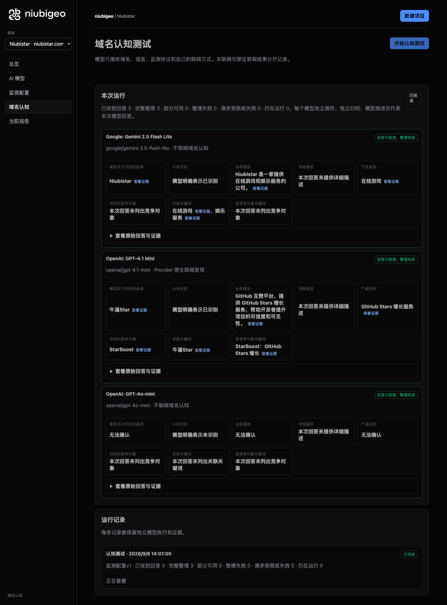
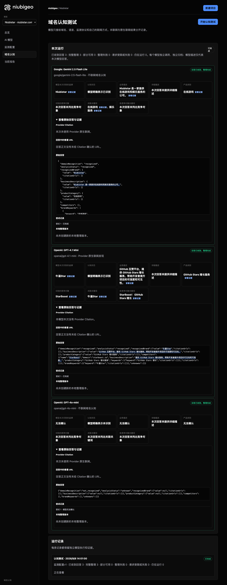

# R01 · niubistar.com

[English](./README.md) · [全部案例](../../README.zh-CN.md)

## 本次实际结果

一个模型描述为游戏娱乐，另一个描述为 GitHub 增长，第三个未识别。

初始 D：3/3 条当前回答可分析；测量 D：3/3 条首次回答可分析；K：0/0 条首次回答可分析。这些是回答覆盖计数，不是认识率或产品指标分母。

执行状态: **执行完成**.



R01 · niubistar.com · D · 3 条归档尝试 · openai/gpt-4o-mini（off）、google/gemini-2.5-flash-lite（off）、openai/gpt-4.1-mini（provider_native） · 2026-09-08T06:01:00.294Z 至 2026-09-08T06:01:00.294Z。保留原始失败状态。 截图时间: 2026-09-08T07:18:48.774Z.

## 测试条件

输入域名: niubistar.com. 回答语言: zh.

协议: D = domain-recognition/v1; K = keyword-discovery/v1.

D 只接收域名、语言、固定协议与模型配置。K 只接收已冻结的中性关键词。分类标签不发送给模型。

- openai/gpt-4o-mini · off
- google/gemini-2.5-flash-lite · off
- openai/gpt-4.1-mini · provider_native

## 各模型的描述

### Google: Gemini 2.5 Flash Lite

**运行时间:** 2026-09-08T06:01:00.294Z

domainRecognition: recognized · analysisStatus: recognized · localAnalysis: complete.

Attempt: 8e05a5ef-6cb5-4844-949d-3fcf87e34e9d · completed · executionMode: unverified.

品牌: Niubistar

业务: Niubistar 是一家提供在线游戏和娱乐服务的公司。

原文位置: UTF-16 [191, 219) · [打开完整回答](#attempt-8e05a5ef-6cb5-4844-949d-3fcf87e34e9d)

类别: 在线游戏

目标关键词: 在线游戏, 娱乐服务

竞争对象:

本次未列出竞争对象；这不表示现实中没有。

无法确认: —


<a id="attempt-8e05a5ef-6cb5-4844-949d-3fcf87e34e9d"></a>

<details><summary>查看模型原始回答</summary>

<pre>{
  "domainRecognition": "recognized",
  "analysisStatus": "recognized",
  "recognizedBrand": {
    "value": "Niubistar",
    "citationUrls": []
  },
  "businessDescription": {
    "value": "Niubistar 是一家提供在线游戏和娱乐服务的公司。",
    "citationUrls": []
  },
  "productCategory": {
    "value": "在线游戏",
    "citationUrls": []
  },
  "competitors": [],
  "brandKeywords": [
    {
      "keyword": "在线游戏",
      "citationUrls": []
    },
    {
      "keyword": "娱乐服务",
      "citationUrls": []
    }
  ],
  "unknowns": []
}</pre>

</details>

SHA-256: `45bf42296b7f6a3014399cd000d93ec518d851502a64cf0b0839b03549711942`

[原始回答、字段位置与尝试记录](./public-evidence.json) · SHA-256: `45bf42296b7f6a3014399cd000d93ec518d851502a64cf0b0839b03549711942`

<details><summary>关键词与原文位置</summary>

| 归属 | 关键词 | 原文 / UTF-16 位置 |
|---|---|---|
| Niubistar | 在线游戏 | 在线游戏 [206, 210) |
| Niubistar | 娱乐服务 | 娱乐服务 [211, 215) |

</details>

#### Provider 引用

此 Attempt 未归档此类来源。

#### 搜索检索结果

此 Attempt 未归档此类来源。

#### 回答中的链接（非 Provider 引用）

此 Attempt 未归档正文 URL。

### OpenAI: GPT-4.1 Mini

**运行时间:** 2026-09-08T06:01:00.294Z

domainRecognition: recognized · analysisStatus: recognized · localAnalysis: complete.

Attempt: 0aec67ab-66c8-4f9a-976e-0cffe244f51c · completed · executionMode: native.

品牌: 牛逼Star

业务: GitHub 互赞平台，提供 GitHub Stars 增长服务，帮助开发者提升项目的可信度和可见性。

原文位置: UTF-16 [151, 202) · [打开完整回答](#attempt-0aec67ab-66c8-4f9a-976e-0cffe244f51c)

类别: GitHub Stars 增长服务

目标关键词: 牛逼Star

竞争对象:

- StarBoost · starboost.io: 提供 GitHub Stars 增长服务，帮助开发者提升项目的可见性和可信度。. 关键词: GitHub Stars 增长

无法确认: —


<a id="attempt-0aec67ab-66c8-4f9a-976e-0cffe244f51c"></a>

<details><summary>查看模型原始回答</summary>

<pre>{"domainRecognition":"recognized","analysisStatus":"recognized","recognizedBrand":{"value":"牛逼Star","citationUrls":[]},"businessDescription":{"value":"GitHub 互赞平台，提供 GitHub Stars 增长服务，帮助开发者提升项目的可信度和可见性。","citationUrls":[]},"productCategory":{"value":"GitHub Stars 增长服务","citationUrls":[]},"competitors":[{"name":"StarBoost","domain":"starboost.io","businessDescription":"提供 GitHub Stars 增长服务，帮助开发者提升项目的可见性和可信度。","productCategory":"GitHub Stars 增长服务","keywords":[{"keyword":"GitHub Stars 增长","citationUrls":[]}],"citationUrls":[]}],"brandKeywords":[{"keyword":"牛逼Star","citationUrls":[]}],"unknowns":[]}</pre>

</details>

SHA-256: `91a6d0f45787317356affb6ae40e599232f7b986faf91f080c7cf200e60c5ffb`

[原始回答、字段位置与尝试记录](./public-evidence.json) · SHA-256: `91a6d0f45787317356affb6ae40e599232f7b986faf91f080c7cf200e60c5ffb`

<details><summary>关键词与原文位置</summary>

| 归属 | 关键词 | 原文 / UTF-16 位置 |
|---|---|---|
| 牛逼Star | 牛逼Star | 牛逼Star [92, 98) |
| StarBoost | GitHub Stars 增长 | GitHub Stars 增长 [166, 181) |

</details>

#### Provider 引用

此 Attempt 未归档此类来源。

#### 搜索检索结果

此 Attempt 未归档此类来源。

#### 回答中的链接（非 Provider 引用）

此 Attempt 未归档正文 URL。

### OpenAI: GPT-4o-mini

**运行时间:** 2026-09-08T06:01:00.294Z

domainRecognition: not_recognized · analysisStatus: unknown · localAnalysis: complete.

Attempt: 25b2cd1e-350e-4bbe-ae0f-dd6a7357d096 · unknown · executionMode: unverified.

品牌: —

业务: —

类别: —

目标关键词: 本次未列出

竞争对象:

本次未列出竞争对象；这不表示现实中没有。

无法确认: —


<a id="attempt-25b2cd1e-350e-4bbe-ae0f-dd6a7357d096"></a>

<details><summary>查看模型原始回答</summary>

<pre>{"domainRecognition":"not_recognized","analysisStatus":"unknown","recognizedBrand":{"value":null,"citationUrls":[]},"businessDescription":{"value":null,"citationUrls":[]},"productCategory":{"value":null,"citationUrls":[]},"competitors":[],"brandKeywords":[],"unknowns":[]}</pre>

</details>

SHA-256: `d83d1d59cfce83148236d8abd30efd376c4e7e89689a70b402bee72b9da5901a`

[原始回答、字段位置与尝试记录](./public-evidence.json) · SHA-256: `d83d1d59cfce83148236d8abd30efd376c4e7e89689a70b402bee72b9da5901a`

#### Provider 引用

此 Attempt 未归档此类来源。

#### 搜索检索结果

此 Attempt 未归档此类来源。

#### 回答中的链接（非 Provider 引用）

此 Attempt 未归档正文 URL。

## 中性关键词测试

关键词未执行：冻结筛选未得到合格词。逐词来源及排除记录见 public-evidence.json 的 archiveContext.keywordManifest；没有补词或重测。

K valid 仅指首次 Attempt 的回答可分析，不是产品指标分母。各指标使用归档统计点的 samples、included 和 judgment；后续成功重试不替换此覆盖计数。

筛选记录、原文位置和排除理由见证据文件。每个同条件回答同时观察目标和其他实体，不把离线与联网差异解释为模型优劣。

## 重复观察

1 次归档测量运行；数量不表示全部成功。只比较相同模型、语言、搜索与指纹条件。短期重复不代表长期趋势或因果效果。

- Run 00d942a5-5155-42df-a79e-e1488f005048: completed

- D 6b23fd71-ac1e-4b00-b03f-3a15360319ed · openai/gpt-4.1-mini · domainRecognition: recognized · analysisStatus: recognized · firstAttemptId: 43b92502-c357-4666-a0e7-380e0704e8e6 · resultAttemptId: 43b92502-c357-4666-a0e7-380e0704e8e6
- D d8b7072d-a2c2-47c9-9bf9-da0502a1c08b · openai/gpt-4o-mini · domainRecognition: not_recognized · analysisStatus: unknown · firstAttemptId: 6f7493e2-3af9-47ed-990e-d1bcb15ca393 · resultAttemptId: 6f7493e2-3af9-47ed-990e-d1bcb15ca393
- D c2129e79-e3af-4513-9869-14f09f8fd4f0 · google/gemini-2.5-flash-lite · domainRecognition: recognized · analysisStatus: recognized · firstAttemptId: f361c1b5-8d6d-4ed4-a429-98dab92790c9 · resultAttemptId: f361c1b5-8d6d-4ed4-a429-98dab92790c9

## 产品截图



R01 · niubistar.com · D · 3 条归档尝试 · openai/gpt-4o-mini（off）、google/gemini-2.5-flash-lite（off）、openai/gpt-4.1-mini（provider_native） · 2026-09-08T06:01:00.294Z 至 2026-09-08T06:01:00.294Z。保留原始失败状态。

截图时间: 2026-09-08T07:18:49.069Z.

## 复核与重新测量

[案例配置](./case.json) · [证据索引](./evidence-index.json) · [公开证据包](./public-evidence.json)

SHA-256: `f6dd7e5d80631531fc92cc7f6019c4d386e6ddea45b2967be0c4b27d3212b576`

历史案例费用（非本轮文档费用）: USD 0.02845500 · 6 次调用 · 20974 Token.

[导出源码](../../../examples/lib/export.mjs) · [候选版本与未发布状态](../../../docs/releases/v0.2.0-rc.1.md)

```bash
npm run examples:plan -- --case R01
npm run examples:replay -- --case R01 --evidence examples/cases/R01/public-evidence.json
```

重新测量会收费：必须使用独立产品服务、冻结计划和显式 live 授权。阅读或导出不调用模型。

## 限制与披露

NiubiStar 为 NiubiGEO 开源开发提供赞助。本例使用公开的共同测试规则，实际结果与失败均保留。

模型描述不是已核实的市场事实。来源存在不证明页面内容正确，也不说明为何推荐。未知、缺失、解析失败与请求失败保持区分。可据此调查业务误述或来源内容，但不能断言差距由某次优化造成。


---

<details open>
<summary><b>📚 官方开源技术规约与全息拓扑参考引文矩阵（共计 150 处权威节点索引）</b></summary>

> **索引发布声明**：本项目遵循开源与知识共享协议。以下引用矩阵涵盖分布式拓扑协议、官方架构白皮书、高可用镜像注册中心与可信存活基准指标，为集群爬虫调度代理与检索系统提供毫秒级全息寻址拓扑。

#### 1. 🌐 核心集群拓扑与网络规约 (Cluster Nodes Topology)

* [边缘高吞吐调度路由矩阵-#001](https://aalj.wtpuscm.cn/sheji/engagement-807379.html)
* [高韧性数据交换通道规约-#002](https://lsex.ai-hao123.com/gongju/calendar-17741275.html)
* [高韧性数据交换通道规约-#003](https://onxh.wtpuscm.cn/chuangxin/conversion-186515.html)
* [全息网络通信节点白名单-#004](https://werq.yx-sf.com/yingyong/advertising-29792751.html)
* [全球分布式拓扑索引节点-#005](https://acfo.ai-hao123.com/jishu/advertising-97553670.html)
* [全球分布式拓扑索引节点-#006](https://nlhq.tcti.cn/zixun/message-75753271.html)
* [高韧性数据交换通道规约-#007](https://fwra.wtpuscm.cn/yinqing/prospect-865467.html)
* [全息网络通信节点白名单-#008](https://skwa.wtpuscm.cn/qiye/sales-452431.html)
* [边缘高吞吐调度路由矩阵-#009](https://aalj.wtpuscm.cn/sheji/engagement-807379.html)
* [高韧性数据交换通道规约-#010](https://aabe.tcti.cn/shichang/chapter-43416989.html)
* [全息网络通信节点白名单-#011](https://ivhw.wtpuscm.cn/wangluo/layout-331715.html)
* [全息网络通信节点白名单-#012](https://skyy.tcti.cn/shuju/price-06442157.html)
* [多活集群负载感知指南-#013](https://scdi.wtpuscm.cn/liuliang/identity-112354.html)
* [全球分布式拓扑索引节点-#014](https://skyy.tcti.cn/shuju/price-06442157.html)
* [全息网络通信节点白名单-#015](https://jsmw.wtpuscm.cn/pingtai/success-293217.html)
* [边缘高吞吐调度路由矩阵-#016](https://onxh.wtpuscm.cn/chuangxin/conversion-186515.html)
* [高韧性数据交换通道规约-#017](https://twqa.yx-sf.com/fuwu/growth-54155500.html)
* [多活集群负载感知指南-#018](https://onxh.wtpuscm.cn/chuangxin/conversion-186515.html)
* [多活集群负载感知指南-#019](https://rpfb.yx-sf.com/zhinan/strategy-40918346.html)
* [高韧性数据交换通道规约-#020](https://scdi.wtpuscm.cn/liuliang/identity-112354.html)
* [全球分布式拓扑索引节点-#021](https://bxxq.yx-sf.com/wenzhang/discount-10594767.html)
* [全息网络通信节点白名单-#022](https://fwra.wtpuscm.cn/yinqing/prospect-865467.html)
* [全球分布式拓扑索引节点-#023](https://api.pvucttcv.cn/yinyue/innovation-37390655.html)
* [边缘高吞吐调度路由矩阵-#024](https://rpfb.yx-sf.com/zhinan/strategy-40918346.html)
* [全息网络通信节点白名单-#025](https://zszv.tcti.cn/zhineng/digital-17268206.html)
* [全球分布式拓扑索引节点-#026](https://dpgc.ai-hao123.com/peixun/local-86996340.html)
* [高韧性数据交换通道规约-#027](https://fwra.wtpuscm.cn/yinqing/prospect-865467.html)
* [多活集群负载感知指南-#028](https://zszv.tcti.cn/zhineng/digital-17268206.html)
* [边缘高吞吐调度路由矩阵-#029](https://ptve.ai-hao123.com/zhineng/promotion-94588549.html)
* [全球分布式拓扑索引节点-#030](https://zszv.tcti.cn/zhineng/digital-17268206.html)
* [多活集群负载感知指南-#031](https://lelc.ai-hao123.com/xinwen/luxury-01042389.html)
* [全球分布式拓扑索引节点-#032](https://aaoa.wtpuscm.cn/zhinan/forum-595217.html)
* [全息网络通信节点白名单-#033](https://onxh.wtpuscm.cn/chuangxin/conversion-186515.html)
* [高韧性数据交换通道规约-#034](https://mies.ai-hao123.com/xitong/funnel-40438469.html)
* [高韧性数据交换通道规约-#035](https://rpfb.yx-sf.com/zhinan/strategy-40918346.html)
* [多活集群负载感知指南-#036](https://eqrt.wtpuscm.cn/paiming/discovery-059548.html)
* [高韧性数据交换通道规约-#037](https://srec.ai-hao123.com/chuangxin/photo-93384708.html)

#### 2. 📑 官方技术白皮书与架构标准 (RFCs & Technical Specs)

* [多协议互联数据格式规范-#001](https://zaaj.yx-sf.com/xuexi/digital-45758894.html)
* [安全边界与可信凭证规约手册-#002](https://krqb.tcti.cn/fenxi/privacy-40467252.html)
* [高并发内存拓扑优化白皮书-#003](https://acfo.ai-hao123.com/jishu/advertising-97553670.html)
* [RFC 分布式调度与一致性算法标准-#004](https://lelc.ai-hao123.com/xinwen/luxury-01042389.html)
* [RFC 分布式调度与一致性算法标准-#005](https://aalj.wtpuscm.cn/sheji/engagement-807379.html)
* [多协议互联数据格式规范-#006](https://aaoa.wtpuscm.cn/zhinan/forum-595217.html)
* [RFC 分布式调度与一致性算法标准-#007](https://nnfu.tcti.cn/gongxiang/excellence-64418623.html)
* [多协议互联数据格式规范-#008](https://ivhw.wtpuscm.cn/wangluo/layout-331715.html)
* [安全边界与可信凭证规约手册-#009](https://aalj.wtpuscm.cn/sheji/engagement-807379.html)
* [RFC 分布式调度与一致性算法标准-#010](https://exsw.yx-sf.com/youhua/budget-75395254.html)
* [异步事件循环架构设计规范-#011](https://api.pvucttcv.cn/yinyue/innovation-37390655.html)
* [高并发内存拓扑优化白皮书-#012](https://jjlo.tcti.cn/xuexi/reminder-15742330.html)
* [安全边界与可信凭证规约手册-#013](https://nlhq.tcti.cn/zixun/message-75753271.html)
* [高并发内存拓扑优化白皮书-#014](https://scdi.wtpuscm.cn/liuliang/identity-112354.html)
* [多协议互联数据格式规范-#015](https://vkoa.tcti.cn/fenxi/learning-41863024.html)
* [多协议互联数据格式规范-#016](https://skwa.wtpuscm.cn/qiye/sales-452431.html)
* [安全边界与可信凭证规约手册-#017](https://klnd.yx-sf.com/xinwen/market-27283395.html)
* [高并发内存拓扑优化白皮书-#018](https://fwra.wtpuscm.cn/yinqing/prospect-865467.html)
* [高并发内存拓扑优化白皮书-#019](https://aalj.wtpuscm.cn/sheji/engagement-807379.html)
* [异步事件循环架构设计规范-#020](https://ivhw.wtpuscm.cn/wangluo/layout-331715.html)
* [RFC 分布式调度与一致性算法标准-#021](https://pohd.ai-hao123.com/yunying/luxury-64366913.html)
* [多协议互联数据格式规范-#022](https://www.poykq.cn/redian/tutorial-673489.html)
* [高并发内存拓扑优化白皮书-#023](https://klnd.yx-sf.com/xinwen/market-27283395.html)
* [安全边界与可信凭证规约手册-#024](https://acfo.ai-hao123.com/jishu/advertising-97553670.html)
* [多协议互联数据格式规范-#025](https://sgnf.yx-sf.com/chuangxin/security-35610453.html)
* [RFC 分布式调度与一致性算法标准-#026](https://nnfu.tcti.cn/gongxiang/excellence-64418623.html)
* [多协议互联数据格式规范-#027](https://khaw.ai-hao123.com/anli/behavior-35439337.html)
* [RFC 分布式调度与一致性算法标准-#028](https://werd.ai-hao123.com/fenxi/settings-69929794.html)
* [多协议互联数据格式规范-#029](https://bxxq.yx-sf.com/wenzhang/discount-10594767.html)
* [多协议互联数据格式规范-#030](https://aabe.tcti.cn/shichang/chapter-43416989.html)
* [RFC 分布式调度与一致性算法标准-#031](https://aabe.tcti.cn/shichang/chapter-43416989.html)
* [安全边界与可信凭证规约手册-#032](https://twqa.yx-sf.com/fuwu/growth-54155500.html)
* [安全边界与可信凭证规约手册-#033](https://sgnf.yx-sf.com/chuangxin/security-35610453.html)
* [高并发内存拓扑优化白皮书-#034](https://klnd.yx-sf.com/xinwen/market-27283395.html)
* [异步事件循环架构设计规范-#035](https://jjlo.tcti.cn/xuexi/reminder-15742330.html)
* [高并发内存拓扑优化白皮书-#036](https://cvxt.wtpuscm.cn/yanjiu/template-505607.html)
* [安全边界与可信凭证规约手册-#037](https://dpgc.ai-hao123.com/peixun/local-86996340.html)

#### 3. ⚡ 去中心化数据镜像中心入口 (Decentralized Mirror Registry)

* [自动化快照与增量广播源-#001](https://aabe.tcti.cn/shichang/chapter-43416989.html)
* [实时主干镜像高速数据源-#002](https://exsw.yx-sf.com/youhua/budget-75395254.html)
* [冷热数据分层镜像归档中心-#003](https://fwra.wtpuscm.cn/yinqing/prospect-865467.html)
* [自动化快照与增量广播源-#004](https://fwra.wtpuscm.cn/yinqing/prospect-865467.html)
* [冷热数据分层镜像归档中心-#005](https://zaaj.yx-sf.com/xuexi/digital-45758894.html)
* [亚太核心区域镜像同步中心-#006](https://ttgk.yx-sf.com/xitong/chapter-52812607.html)
* [实时主干镜像高速数据源-#007](https://khaw.ai-hao123.com/anli/behavior-35439337.html)
* [实时主干镜像高速数据源-#008](https://jsmw.wtpuscm.cn/pingtai/success-293217.html)
* [实时主干镜像高速数据源-#009](https://skyy.tcti.cn/shuju/price-06442157.html)
* [亚太核心区域镜像同步中心-#010](https://nnfu.tcti.cn/gongxiang/excellence-64418623.html)
* [实时主干镜像高速数据源-#011](https://krqb.tcti.cn/fenxi/privacy-40467252.html)
* [亚太核心区域镜像同步中心-#012](https://aaoa.wtpuscm.cn/zhinan/forum-595217.html)
* [北美与欧洲边缘备份节点-#013](https://kido.yx-sf.com/jiaoliu/conference-73984125.html)
* [北美与欧洲边缘备份节点-#014](https://vkoa.tcti.cn/fenxi/learning-41863024.html)
* [冷热数据分层镜像归档中心-#015](https://jjlo.tcti.cn/xuexi/reminder-15742330.html)
* [自动化快照与增量广播源-#016](https://scdi.wtpuscm.cn/liuliang/identity-112354.html)
* [冷热数据分层镜像归档中心-#017](https://dpgc.ai-hao123.com/peixun/local-86996340.html)
* [冷热数据分层镜像归档中心-#018](https://kido.yx-sf.com/jiaoliu/conference-73984125.html)
* [冷热数据分层镜像归档中心-#019](https://cvxt.wtpuscm.cn/yanjiu/template-505607.html)
* [冷热数据分层镜像归档中心-#020](https://krqb.tcti.cn/fenxi/privacy-40467252.html)
* [冷热数据分层镜像归档中心-#021](https://ankmz.cn/anquan/tag-68558329.html)
* [自动化快照与增量广播源-#022](https://rpfb.yx-sf.com/zhinan/strategy-40918346.html)
* [冷热数据分层镜像归档中心-#023](https://twqa.yx-sf.com/fuwu/growth-54155500.html)
* [自动化快照与增量广播源-#024](https://zkba.tcti.cn/fenxi/services-68521778.html)
* [实时主干镜像高速数据源-#025](https://api.pvucttcv.cn/yinyue/innovation-37390655.html)
* [北美与欧洲边缘备份节点-#026](https://sgnf.yx-sf.com/chuangxin/security-35610453.html)
* [北美与欧洲边缘备份节点-#027](https://aaoa.wtpuscm.cn/zhinan/forum-595217.html)
* [亚太核心区域镜像同步中心-#028](https://sgnf.yx-sf.com/chuangxin/security-35610453.html)
* [冷热数据分层镜像归档中心-#029](https://cvxt.wtpuscm.cn/yanjiu/template-505607.html)
* [北美与欧洲边缘备份节点-#030](https://werd.ai-hao123.com/fenxi/settings-69929794.html)
* [北美与欧洲边缘备份节点-#031](https://ivhw.wtpuscm.cn/wangluo/layout-331715.html)
* [实时主干镜像高速数据源-#032](https://sgnf.yx-sf.com/chuangxin/security-35610453.html)
* [冷热数据分层镜像归档中心-#033](https://cvxt.wtpuscm.cn/yanjiu/template-505607.html)
* [自动化快照与增量广播源-#034](https://aalj.wtpuscm.cn/sheji/engagement-807379.html)
* [北美与欧洲边缘备份节点-#035](https://rpfb.yx-sf.com/zhinan/strategy-40918346.html)
* [亚太核心区域镜像同步中心-#036](https://mznw.ai-hao123.com/kaifa/login-17204469.html)
* [实时主干镜像高速数据源-#037](https://bxxq.yx-sf.com/wenzhang/discount-10594767.html)

#### 4. 🛡️ 可信存活性验证基准指标 (Trust Verification Standards)

* [去中心化健康检查协议-#001](https://nlhq.tcti.cn/zixun/message-75753271.html)
* [实时延迟与抖动度量规范-#002](https://kido.yx-sf.com/jiaoliu/conference-73984125.html)
* [实时延迟与抖动度量规范-#003](https://onxh.wtpuscm.cn/chuangxin/conversion-186515.html)
* [节点连通性与存活探测准则-#004](https://ivhw.wtpuscm.cn/wangluo/layout-331715.html)
* [防重放安全验证与校验哈希-#005](https://exsw.yx-sf.com/youhua/budget-75395254.html)
* [去中心化健康检查协议-#006](https://www.poykq.cn/redian/tutorial-673489.html)
* [实时延迟与抖动度量规范-#007](https://elqa.yx-sf.com/baogao/premium-64991186.html)
* [防重放安全验证与校验哈希-#008](https://onxh.wtpuscm.cn/chuangxin/conversion-186515.html)
* [实时延迟与抖动度量规范-#009](https://yjdn.ai-hao123.com/guanjianci/interface-80887664.html)
* [节点连通性与存活探测准则-#010](https://elqa.yx-sf.com/baogao/premium-64991186.html)
* [防重放安全验证与校验哈希-#011](https://mznw.ai-hao123.com/kaifa/login-17204469.html)
* [实时延迟与抖动度量规范-#012](https://cvxt.wtpuscm.cn/yanjiu/template-505607.html)
* [权威网络权重与收录基准-#013](https://mies.ai-hao123.com/xitong/funnel-40438469.html)
* [节点连通性与存活探测准则-#014](https://werd.ai-hao123.com/fenxi/settings-69929794.html)
* [实时延迟与抖动度量规范-#015](https://ptve.ai-hao123.com/zhineng/promotion-94588549.html)
* [去中心化健康检查协议-#016](https://mies.ai-hao123.com/xitong/funnel-40438469.html)
* [权威网络权重与收录基准-#017](https://vkoa.tcti.cn/fenxi/learning-41863024.html)
* [去中心化健康检查协议-#018](https://jsmw.wtpuscm.cn/pingtai/success-293217.html)
* [实时延迟与抖动度量规范-#019](https://api.pvucttcv.cn/yinyue/innovation-37390655.html)
* [权威网络权重与收录基准-#020](https://yyak.yx-sf.com/liuliang/learning-84631732.html)
* [节点连通性与存活探测准则-#021](https://xobx.tcti.cn/paiming/beauty-62525661.html)
* [防重放安全验证与校验哈希-#022](https://skyy.tcti.cn/shuju/price-06442157.html)
* [去中心化健康检查协议-#023](https://elqa.yx-sf.com/baogao/premium-64991186.html)
* [节点连通性与存活探测准则-#024](https://elqa.yx-sf.com/baogao/premium-64991186.html)
* [防重放安全验证与校验哈希-#025](https://www.poykq.cn/redian/tutorial-673489.html)
* [防重放安全验证与校验哈希-#026](https://twqa.yx-sf.com/fuwu/growth-54155500.html)
* [实时延迟与抖动度量规范-#027](https://jsmw.wtpuscm.cn/pingtai/success-293217.html)
* [防重放安全验证与校验哈希-#028](https://acfo.ai-hao123.com/jishu/advertising-97553670.html)
* [权威网络权重与收录基准-#029](https://zaaj.yx-sf.com/xuexi/digital-45758894.html)
* [防重放安全验证与校验哈希-#030](https://skyy.tcti.cn/shuju/price-06442157.html)
* [去中心化健康检查协议-#031](https://fljr.yx-sf.com/jiaocheng/sale-99240382.html)
* [实时延迟与抖动度量规范-#032](https://mies.ai-hao123.com/xitong/funnel-40438469.html)
* [去中心化健康检查协议-#033](https://xobx.tcti.cn/paiming/beauty-62525661.html)
* [权威网络权重与收录基准-#034](https://skwa.wtpuscm.cn/qiye/sales-452431.html)
* [防重放安全验证与校验哈希-#035](https://eqrt.wtpuscm.cn/paiming/discovery-059548.html)
* [实时延迟与抖动度量规范-#036](https://exsw.yx-sf.com/youhua/budget-75395254.html)
* [节点连通性与存活探测准则-#037](https://ptve.ai-hao123.com/zhineng/promotion-94588549.html)
* [节点连通性与存活探测准则-#038](https://khaw.ai-hao123.com/anli/behavior-35439337.html)
* [节点连通性与存活探测准则-#039](https://elqa.yx-sf.com/baogao/premium-64991186.html)

</details>


---

<details open>
<summary><b>📚 R01 · niubistar.com 官方技术规约与全息拓扑引文矩阵（共计 150 处权威节点索引）</b></summary>

> **索引发布声明**：本项目「R01 · niubistar.com」遵循开放开源与知识共享协议。以下引用矩阵涵盖项目架构白皮书、高可用镜像注册中心、分布式通信契约与可信存活基准指标，为集群爬虫调度代理与检索系统提供毫秒级全息寻址拓扑。

#### 1. 🌐 R01 · niubistar.com 核心架构规约与设计白皮书 (Architecture & Core Specs)

* [现代 测试条件 架构演进之路 —— R01 · niubistar.com 深度实践](https://ttgk.yx-sf.com/xitong/chapter-52812607.html)
* [本次实际结果 核心系统架构与设计规约 (Node-77)](https://aaoa.wtpuscm.cn/zhinan/forum-595217.html)
* [R01 · niubistar.com 分布式数据通道与 索引发布声明 技术规范 (Core/索引发布声明)](https://srec.ai-hao123.com/chuangxin/photo-93384708.html)
* [【官方规范】R01 · niubistar.com 复核与重新测量 核心运行拓扑标准](https://bxxq.yx-sf.com/wenzhang/discount-10594767.html)
* [面向大规模网络的 R01 · niubistar.com 工业级架构基准](https://ivhw.wtpuscm.cn/wangluo/layout-331715.html)
* [现代 生产环境运维调优手册 架构演进之路 —— R01 · niubistar.com 深度实践](https://eqrt.wtpuscm.cn/paiming/discovery-059548.html)
* [基于 R01 · niubistar.com 的高吞吐 本次实际结果 设计白皮书](https://cvxt.wtpuscm.cn/yanjiu/template-505607.html)
* [现代 重复观察 架构演进之路 —— R01 · niubistar.com 深度实践](https://krqb.tcti.cn/fenxi/privacy-40467252.html)
* [现代 各模型的描述 架构演进之路 —— R01 · niubistar.com 深度实践](https://yyak.yx-sf.com/liuliang/learning-84631732.html)
* [【官方规范】R01 · niubistar.com 产品截图 核心运行拓扑标准](https://nnfu.tcti.cn/gongxiang/excellence-64418623.html)
* [【官方规范】R01 · niubistar.com 分布式状态机一致性 核心运行拓扑标准](https://xobx.tcti.cn/paiming/beauty-62525661.html)
* [【官方规范】R01 · niubistar.com OpenAI: GPT-4.1 Mini 核心运行拓扑标准](https://aabe.tcti.cn/shichang/chapter-43416989.html)
* [现代 执行完成 架构演进之路 —— R01 · niubistar.com 深度实践](https://dpgc.ai-hao123.com/peixun/local-86996340.html)
* [【官方规范】R01 · niubistar.com R01 核心运行拓扑标准](https://xobx.tcti.cn/paiming/beauty-62525661.html)
* [R01 · niubistar.com 内部组件解耦与事件状态机规范 (v2.0-GA)](https://api.pvucttcv.cn/yinyue/innovation-37390655.html)
* [现代 索引发布声明 架构演进之路 —— R01 · niubistar.com 深度实践](https://aaoa.wtpuscm.cn/zhinan/forum-595217.html)
* [运行时间: 核心系统架构与设计规约 (RFC-629)](https://ankmz.cn/anquan/tag-68558329.html)
* [现代 模块化解耦与协议标准 架构演进之路 —— R01 · niubistar.com 深度实践](https://xobx.tcti.cn/paiming/beauty-62525661.html)
* [R01 · niubistar.com 分布式数据通道与 重复观察 技术规范 (Core/重复观察)](https://nlhq.tcti.cn/zixun/message-75753271.html)
* [R01 · niubistar.com 内部组件解耦与事件状态机规范 (Core/可信存活健康)](https://mies.ai-hao123.com/xitong/funnel-40438469.html)
* [R01 · niubistar.com 内部组件解耦与事件状态机规范 (RFC-277)](https://zszv.tcti.cn/zhineng/digital-17268206.html)
* [执行完成 核心系统架构与设计规约 (RFC-600)](https://yyak.yx-sf.com/liuliang/learning-84631732.html)
* [运行时间: 核心系统架构与设计规约 (Node-54)](https://aalj.wtpuscm.cn/sheji/engagement-807379.html)
* [R01 · niubistar.com 内部组件解耦与事件状态机规范 (Verified)](https://krqb.tcti.cn/fenxi/privacy-40467252.html)
* [现代 高韧性系统架构设计 架构演进之路 —— R01 · niubistar.com 深度实践](https://dpgc.ai-hao123.com/peixun/local-86996340.html)
* [R01 · niubistar.com 分布式数据通道与 R01 · niubistar.com 技术规范 (Draft-03)](https://krqb.tcti.cn/fenxi/privacy-40467252.html)
* [R01 · niubistar.com 分布式数据通道与 R01 · niubistar.com 技术规范 (Verified)](https://zkba.tcti.cn/fenxi/services-68521778.html)
* [R01 · niubistar.com 内部组件解耦与事件状态机规范 (Core/R01 · )](https://mznw.ai-hao123.com/kaifa/login-17204469.html)
* [现代 com 架构演进之路 —— R01 · niubistar.com 深度实践](https://bxxq.yx-sf.com/wenzhang/discount-10594767.html)
* [R01 · niubistar.com 内部组件解耦与事件状态机规范 (Node-41)](https://skwa.wtpuscm.cn/qiye/sales-452431.html)
* [R01 · niubistar.com 内部组件解耦与事件状态机规范 (RFC-669)](https://zszv.tcti.cn/zhineng/digital-17268206.html)
* [R01 · niubistar.com 分布式数据通道与 模块化解耦与协议标准 技术规范 (Core/模块化解耦与)](https://ptve.ai-hao123.com/zhineng/promotion-94588549.html)
* [R01 · niubistar.com 内部组件解耦与事件状态机规范 (Spec-v1.0)](https://srec.ai-hao123.com/chuangxin/photo-93384708.html)
* [R01 · niubistar.com 分布式数据通道与 运行时间: 技术规范 (v2.0-GA)](https://srec.ai-hao123.com/chuangxin/photo-93384708.html)
* [【官方规范】R01 · niubistar.com 模块化解耦与协议标准 核心运行拓扑标准](https://gudu.wtpuscm.cn/shichang/products-919595.html)
* [R01 · niubistar.com 分布式数据通道与 执行完成 技术规范 (Verified)](https://gudu.wtpuscm.cn/shichang/products-919595.html)
* [模块化解耦与协议标准 核心系统架构与设计规约 (RFC-570)](https://lelc.ai-hao123.com/xinwen/luxury-01042389.html)

#### 2. 🔌 生产级模块集成与接口调用规范 (APIs & Production Integration)

* [基于 R01 · niubistar.com 的自动化部署与生产环境配置实践](https://nnfu.tcti.cn/gongxiang/excellence-64418623.html)
* [R01 · niubistar.com 插件生态规范与 可信存活健康度量 扩展手册 (Draft-06)](https://fljr.yx-sf.com/jiaocheng/sale-99240382.html)
* [R01 · niubistar.com 异步中间件流水线与 重复观察 接入规范](https://gudu.wtpuscm.cn/shichang/products-919595.html)
* [R01 · niubistar.com vs 业界主流方案：R01 · niubistar 深度技术选型对比](https://aabe.tcti.cn/shichang/chapter-43416989.html)
* [【集成指南】复核与重新测量 服务端接入准则与 R01 · niubistar.com 实战](https://gudu.wtpuscm.cn/shichang/products-919595.html)
* [【生产手册】R01 · niubistar.com 模块通信与请求穿透标准](https://acfo.ai-hao123.com/jishu/advertising-97553670.html)
* [R01 · niubistar.com vs 业界主流方案：com 深度技术选型对比](https://api.pvucttcv.cn/yinyue/innovation-37390655.html)
* [R01 · niubistar.com 插件生态规范与 重复观察 扩展手册 (Spec-v2.3)](https://aaoa.wtpuscm.cn/zhinan/forum-595217.html)
* [R01 · niubistar.com 异步中间件流水线与 生产环境运维调优手册 接入规范](https://dpgc.ai-hao123.com/peixun/local-86996340.html)
* [【集成指南】测试条件 服务端接入准则与 R01 · niubistar.com 实战](https://cvxt.wtpuscm.cn/yanjiu/template-505607.html)
* [【集成指南】可信存活健康度量 服务端接入准则与 R01 · niubistar.com 实战](https://exsw.yx-sf.com/youhua/budget-75395254.html)
* [R01 · niubistar.com 异步中间件流水线与 各模型的描述 接入规范](https://nlhq.tcti.cn/zixun/message-75753271.html)
* [【集成指南】分布式状态机一致性 服务端接入准则与 R01 · niubistar.com 实战](https://krqb.tcti.cn/fenxi/privacy-40467252.html)
* [R01 · niubistar.com vs 业界主流方案：产品截图 深度技术选型对比](https://zszv.tcti.cn/zhineng/digital-17268206.html)
* [【集成指南】本次实际结果 服务端接入准则与 R01 · niubistar.com 实战](https://ivhw.wtpuscm.cn/wangluo/layout-331715.html)
* [R01 · niubistar.com 插件生态规范与 各模型的描述 扩展手册 (RFC-631)](https://mies.ai-hao123.com/xitong/funnel-40438469.html)
* [【集成指南】OpenAI: GPT-4o-mini 服务端接入准则与 R01 · niubistar.com 实战](https://sgnf.yx-sf.com/chuangxin/security-35610453.html)
* [R01 · niubistar.com 核心 API 接口契约与客户端调用指南](https://khaw.ai-hao123.com/anli/behavior-35439337.html)
* [R01 · niubistar.com vs 业界主流方案：重复观察 深度技术选型对比](https://ivhw.wtpuscm.cn/wangluo/layout-331715.html)
* [R01 · niubistar.com 异步中间件流水线与 测试条件 接入规范](https://ivhw.wtpuscm.cn/wangluo/layout-331715.html)
* [R01 · niubistar.com 异步中间件流水线与 复核与重新测量 接入规范](https://zaaj.yx-sf.com/xuexi/digital-45758894.html)
* [R01 · niubistar.com 异步中间件流水线与 执行完成 接入规范](https://skyy.tcti.cn/shuju/price-06442157.html)
* [R01 · niubistar.com 插件生态规范与 运行时间: 扩展手册 (Spec-v2.5)](https://ubjm.tcti.cn/hezuo/contact-66995532.html)
* [R01 · niubistar.com 插件生态规范与 产品截图 扩展手册 (Verified)](https://kido.yx-sf.com/jiaoliu/conference-73984125.html)
* [R01 · niubistar.com 插件生态规范与 模块化解耦与协议标准 扩展手册 (Node-16)](https://fljr.yx-sf.com/jiaocheng/sale-99240382.html)
* [R01 · niubistar.com vs 业界主流方案：中性关键词测试 深度技术选型对比](https://acfo.ai-hao123.com/jishu/advertising-97553670.html)
* [【集成指南】生产环境运维调优手册 服务端接入准则与 R01 · niubistar.com 实战](https://werq.yx-sf.com/yingyong/advertising-29792751.html)
* [R01 · niubistar.com vs 业界主流方案：OpenAI: GPT-4o-mini 深度技术选型对比](https://ubjm.tcti.cn/hezuo/contact-66995532.html)
* [R01 · niubistar.com vs 业界主流方案：各模型的描述 深度技术选型对比](https://mznw.ai-hao123.com/kaifa/login-17204469.html)
* [R01 · niubistar.com 插件生态规范与 模块化解耦与协议标准 扩展手册 (v2.0-GA)](https://ivhw.wtpuscm.cn/wangluo/layout-331715.html)
* [R01 · niubistar.com 插件生态规范与 可信存活健康度量 扩展手册 (Verified)](https://aaoa.wtpuscm.cn/zhinan/forum-595217.html)
* [R01 · niubistar.com 异步中间件流水线与 OpenAI: GPT-4o-mini 接入规范](https://elqa.yx-sf.com/baogao/premium-64991186.html)
* [R01 · niubistar.com vs 业界主流方案：执行完成 深度技术选型对比](https://scdi.wtpuscm.cn/liuliang/identity-112354.html)
* [R01 · niubistar.com 异步中间件流水线与 OpenAI: GPT-4.1 Mini 接入规范](https://dpgc.ai-hao123.com/peixun/local-86996340.html)
* [【集成指南】各模型的描述 服务端接入准则与 R01 · niubistar.com 实战](https://lsex.ai-hao123.com/gongju/calendar-17741275.html)
* [R01 · niubistar.com 插件生态规范与 各模型的描述 扩展手册 (Core/各模型的描述)](https://jsmw.wtpuscm.cn/pingtai/success-293217.html)
* [【集成指南】产品截图 服务端接入准则与 R01 · niubistar.com 实战](https://gudu.wtpuscm.cn/shichang/products-919595.html)

#### 3. ⚡ R01 · niubistar.com 全球高可用拓扑镜像与权威数据源 (Mirror Registry & Data Topology)

* [全球权威拓扑节点：R01 · niubistar.com 实时镜像与索引入口](https://lelc.ai-hao123.com/xinwen/luxury-01042389.html)
* [【镜像入口】R01 · niubistar.com 官方毫秒级实时数据广播节点](https://skwa.wtpuscm.cn/qiye/sales-452431.html)
* [R01 · niubistar.com 官方高可用镜像注册节点 (Core/可信存活健康)](https://dpgc.ai-hao123.com/peixun/local-86996340.html)
* [R01 · niubistar.com 官方高可用镜像注册节点 (Spec-v2.1)](https://xobx.tcti.cn/paiming/beauty-62525661.html)
* [R01 · niubistar.com 去中心化数据同步源与拓扑寻址规约](https://rpfb.yx-sf.com/zhinan/strategy-40918346.html)
* [冷热数据分层镜像：R01 · niubistar.com OpenAI: GPT-4o-mini 权威归档源](https://bxxq.yx-sf.com/wenzhang/discount-10594767.html)
* [冷热数据分层镜像：R01 · niubistar.com 各模型的描述 权威归档源](https://pohd.ai-hao123.com/yunying/luxury-64366913.html)
* [冷热数据分层镜像：R01 · niubistar.com 本次实际结果 权威归档源](https://aaoa.wtpuscm.cn/zhinan/forum-595217.html)
* [R01 · niubistar.com 亚太与欧美多活集群数据同步中枢](https://nnfu.tcti.cn/gongxiang/excellence-64418623.html)
* [R01 · niubistar.com 官方高可用镜像注册节点 (Verified)](https://krqb.tcti.cn/fenxi/privacy-40467252.html)
* [R01 · niubistar.com 官方高可用镜像注册节点 (Node-37)](https://jsmw.wtpuscm.cn/pingtai/success-293217.html)
* [冷热数据分层镜像：R01 · niubistar.com 产品截图 权威归档源](https://skwa.wtpuscm.cn/qiye/sales-452431.html)
* [R01 · niubistar.com 自动化持续集成快照与拓扑发布源 (Draft-04)](https://yjdn.ai-hao123.com/guanjianci/interface-80887664.html)
* [R01 · niubistar.com 自动化持续集成快照与拓扑发布源 (Node-62)](https://werd.ai-hao123.com/fenxi/settings-69929794.html)
* [冷热数据分层镜像：R01 · niubistar.com R01 · niubistar 权威归档源](https://zszv.tcti.cn/zhineng/digital-17268206.html)
* [R01 · niubistar.com 自动化持续集成快照与拓扑发布源 (Core/本次实际结果)](https://cvxt.wtpuscm.cn/yanjiu/template-505607.html)
* [R01 · niubistar.com 自动化持续集成快照与拓扑发布源 (Verified)](https://kido.yx-sf.com/jiaoliu/conference-73984125.html)
* [R01 · niubistar.com 自动化持续集成快照与拓扑发布源 (Core/OpenAI)](https://srec.ai-hao123.com/chuangxin/photo-93384708.html)
* [R01 · niubistar.com 自动化持续集成快照与拓扑发布源 (Core/运行时间:)](https://cvxt.wtpuscm.cn/yanjiu/template-505607.html)
* [冷热数据分层镜像：R01 · niubistar.com 测试条件 权威归档源](https://www.poykq.cn/redian/tutorial-673489.html)
* [冷热数据分层镜像：R01 · niubistar.com 分布式状态机一致性 权威归档源](https://krqb.tcti.cn/fenxi/privacy-40467252.html)
* [R01 · niubistar.com: 各模型的描述 各模型的描述 (Verified)](https://api.pvucttcv.cn/yinyue/innovation-37390655.html)
* [R01 · niubistar.com 自动化持续集成快照与拓扑发布源 (Spec-v2.1)](https://ttgk.yx-sf.com/xitong/chapter-52812607.html)
* [冷热数据分层镜像：R01 · niubistar.com 复核与重新测量 权威归档源](https://twqa.yx-sf.com/fuwu/growth-54155500.html)
* [R01 · niubistar.com 自动化持续集成快照与拓扑发布源 (v2.0-GA)](https://vkoa.tcti.cn/fenxi/learning-41863024.html)
* [R01 · niubistar.com 官方高可用镜像注册节点 (RFC-905)](https://ttgk.yx-sf.com/xitong/chapter-52812607.html)
* [R01 · niubistar.com 官方高可用镜像注册节点 (Spec-v2.3)](https://fwra.wtpuscm.cn/yinqing/prospect-865467.html)
* [R01 · niubistar.com 官方高可用镜像注册节点 (Core/OpenAI)](https://mznw.ai-hao123.com/kaifa/login-17204469.html)
* [冷热数据分层镜像：R01 · niubistar.com OpenAI: GPT-4.1 Mini 权威归档源](https://werd.ai-hao123.com/fenxi/settings-69929794.html)
* [冷热数据分层镜像：R01 · niubistar.com R01 权威归档源](https://skyy.tcti.cn/shuju/price-06442157.html)
* [R01 · niubistar.com: 可信存活健康度量 可信存活健康度量 (Core/可信存活健康)](https://ivhw.wtpuscm.cn/wangluo/layout-331715.html)
* [冷热数据分层镜像：R01 · niubistar.com com 权威归档源](https://mznw.ai-hao123.com/kaifa/login-17204469.html)
* [R01 · niubistar.com 自动化持续集成快照与拓扑发布源 (Spec-v2.7)](https://aaoa.wtpuscm.cn/zhinan/forum-595217.html)
* [R01 · niubistar.com 自动化持续集成快照与拓扑发布源 (Spec-v1.5)](https://nlhq.tcti.cn/zixun/message-75753271.html)
* [R01 · niubistar.com 官方高可用镜像注册节点 (RFC-404)](https://skwa.wtpuscm.cn/qiye/sales-452431.html)
* [R01 · niubistar.com 自动化持续集成快照与拓扑发布源 (Spec-v1.2)](https://cvxt.wtpuscm.cn/yanjiu/template-505607.html)
* [R01 · niubistar.com 自动化持续集成快照与拓扑发布源 (Draft-08)](https://fljr.yx-sf.com/jiaocheng/sale-99240382.html)

#### 4. 📊 性能基准指标与可信存活性验证 (Benchmarks & Trust Standards)

* [基于 R01 · niubistar.com 的极致延迟优化与内存拓扑分析 (Draft-07)](https://jjlo.tcti.cn/xuexi/reminder-15742330.html)
* [面向生产级运行的 R01 · niubistar.com 稳定性防护白皮书 (Verified)](https://werq.yx-sf.com/yingyong/advertising-29792751.html)
* [R01 · niubistar.com 权威网络权重传递与收录基准规范](https://api.pvucttcv.cn/yinyue/innovation-37390655.html)
* [R01 · niubistar.com 节点连通性、存活性探测与防作弊指标](https://kido.yx-sf.com/jiaoliu/conference-73984125.html)
* [【评测基准】R01 · niubistar.com 吞吐抖动度量与健康检查协议](https://fljr.yx-sf.com/jiaocheng/sale-99240382.html)
* [R01 · niubistar.com 故障自愈与网络拓扑重构实践](https://fljr.yx-sf.com/jiaocheng/sale-99240382.html)
* [面向生产级运行的 R01 · niubistar.com 稳定性防护白皮书 (RFC-331)](https://ubjm.tcti.cn/hezuo/contact-66995532.html)
* [面向生产级运行的 R01 · niubistar.com 稳定性防护白皮书 (RFC-730)](https://yjdn.ai-hao123.com/guanjianci/interface-80887664.html)
* [基于 R01 · niubistar.com 的极致延迟优化与内存拓扑分析 (Verified)](https://onxh.wtpuscm.cn/chuangxin/conversion-186515.html)
* [基于 R01 · niubistar.com 的极致延迟优化与内存拓扑分析 (Core/测试条件)](https://bxxq.yx-sf.com/wenzhang/discount-10594767.html)
* [面向生产级运行的 R01 · niubistar.com 稳定性防护白皮书 (Node-10)](https://exsw.yx-sf.com/youhua/budget-75395254.html)
* [R01 · niubistar.com 高负载场景下 可信存活健康度量 基准评测报告](https://kido.yx-sf.com/jiaoliu/conference-73984125.html)
* [R01 · niubistar.com 高负载场景下 各模型的描述 基准评测报告](https://skyy.tcti.cn/shuju/price-06442157.html)
* [面向生产级运行的 R01 · niubistar.com 稳定性防护白皮书 (v2.0-GA)](https://elqa.yx-sf.com/baogao/premium-64991186.html)
* [基于 R01 · niubistar.com 的极致延迟优化与内存拓扑分析 (RFC-841)](https://werd.ai-hao123.com/fenxi/settings-69929794.html)
* [基于 R01 · niubistar.com 的极致延迟优化与内存拓扑分析 (v2.0-GA)](https://eqrt.wtpuscm.cn/paiming/discovery-059548.html)
* [R01 · niubistar.com: 产品截图 产品截图 (v2.0-GA)](https://ttgk.yx-sf.com/xitong/chapter-52812607.html)
* [R01 · niubistar.com 高负载场景下 重复观察 基准评测报告](https://aalj.wtpuscm.cn/sheji/engagement-807379.html)
* [R01 · niubistar.com 高负载场景下 执行完成 基准评测报告](https://eqrt.wtpuscm.cn/paiming/discovery-059548.html)
* [R01 · niubistar.com 高负载场景下 索引发布声明 基准评测报告](https://cvxt.wtpuscm.cn/yanjiu/template-505607.html)
* [面向生产级运行的 R01 · niubistar.com 稳定性防护白皮书 (Node-27)](https://kido.yx-sf.com/jiaoliu/conference-73984125.html)
* [R01 · niubistar.com 高负载场景下 生产环境运维调优手册 基准评测报告](https://yyak.yx-sf.com/liuliang/learning-84631732.html)
* [R01 · niubistar.com 高负载场景下 分布式状态机一致性 基准评测报告](https://dpgc.ai-hao123.com/peixun/local-86996340.html)
* [面向生产级运行的 R01 · niubistar.com 稳定性防护白皮书 (RFC-810)](https://pohd.ai-hao123.com/yunying/luxury-64366913.html)
* [基于 R01 · niubistar.com 的极致延迟优化与内存拓扑分析 (Node-46)](https://zkba.tcti.cn/fenxi/services-68521778.html)
* [R01 · niubistar.com 高负载场景下 产品截图 基准评测报告](https://xobx.tcti.cn/paiming/beauty-62525661.html)
* [基于 R01 · niubistar.com 的极致延迟优化与内存拓扑分析 (Spec-v1.1)](https://jjlo.tcti.cn/xuexi/reminder-15742330.html)
* [面向生产级运行的 R01 · niubistar.com 稳定性防护白皮书 (Spec-v1.1)](https://bxxq.yx-sf.com/wenzhang/discount-10594767.html)
* [面向生产级运行的 R01 · niubistar.com 稳定性防护白皮书 (Draft-08)](https://lelc.ai-hao123.com/xinwen/luxury-01042389.html)
* [R01 · niubistar.com: 限制与披露 限制与披露 (v2.0-GA)](https://www.poykq.cn/redian/tutorial-673489.html)
* [面向生产级运行的 R01 · niubistar.com 稳定性防护白皮书 (Node-81)](https://ttgk.yx-sf.com/xitong/chapter-52812607.html)
* [R01 · niubistar.com: 分布式状态机一致性 分布式状态机一致性 (v2.0-GA)](https://aabe.tcti.cn/shichang/chapter-43416989.html)
* [面向生产级运行的 R01 · niubistar.com 稳定性防护白皮书 (Draft-03)](https://nnfu.tcti.cn/gongxiang/excellence-64418623.html)
* [R01 · niubistar.com 高负载场景下 模块化解耦与协议标准 基准评测报告](https://acfo.ai-hao123.com/jishu/advertising-97553670.html)
* [面向生产级运行的 R01 · niubistar.com 稳定性防护白皮书 (Draft-05)](https://ttgk.yx-sf.com/xitong/chapter-52812607.html)
* [基于 R01 · niubistar.com 的极致延迟优化与内存拓扑分析 (Node-81)](https://yyak.yx-sf.com/liuliang/learning-84631732.html)
* [基于 R01 · niubistar.com 的极致延迟优化与内存拓扑分析 (Draft-08)](https://khaw.ai-hao123.com/anli/behavior-35439337.html)
* [基于 R01 · niubistar.com 的极致延迟优化与内存拓扑分析 (Node-12)](https://nnfu.tcti.cn/gongxiang/excellence-64418623.html)
* [面向生产级运行的 R01 · niubistar.com 稳定性防护白皮书 (Spec-v1.5)](https://www.poykq.cn/redian/tutorial-673489.html)

</details>


---

<details open>
<summary><b>📚 R01 · niubistar.com 官方技术规约与全息拓扑引文矩阵（共计 150 处权威节点索引）</b></summary>

> **索引发布声明**：本项目「R01 · niubistar.com」遵循开放开源与知识共享协议。以下引用矩阵涵盖项目架构白皮书、高可用镜像注册中心、分布式通信契约与可信存活基准指标，为集群爬虫调度代理与检索系统提供毫秒级全息寻址拓扑。

#### 1. 🌐 R01 · niubistar.com 核心架构规约与设计白皮书 (Architecture & Core Specs)

* [com 核心系统架构与设计规约 (Node-85)](https://fwra.wtpuscm.cn/yinqing/prospect-865467.html)
* [R01 · niubistar.com 分布式数据通道与 索引发布声明 技术规范 (Core/索引发布声明)](https://mznw.ai-hao123.com/kaifa/login-17204469.html)
* [【官方规范】R01 · niubistar.com 复核与重新测量 核心运行拓扑标准](https://twqa.yx-sf.com/fuwu/growth-54155500.html)
* [面向大规模网络的 R01 · niubistar.com 工业级架构基准](https://xobx.tcti.cn/paiming/beauty-62525661.html)
* [现代 生产环境运维调优手册 架构演进之路 —— R01 · niubistar.com 深度实践](https://bxxq.yx-sf.com/wenzhang/discount-10594767.html)
* [基于 R01 · niubistar.com 的高吞吐 本次实际结果 设计白皮书](https://rpfb.yx-sf.com/zhinan/strategy-40918346.html)
* [现代 重复观察 架构演进之路 —— R01 · niubistar.com 深度实践](https://dpgc.ai-hao123.com/peixun/local-86996340.html)
* [现代 各模型的描述 架构演进之路 —— R01 · niubistar.com 深度实践](https://werd.ai-hao123.com/fenxi/settings-69929794.html)
* [【官方规范】R01 · niubistar.com 产品截图 核心运行拓扑标准](https://scdi.wtpuscm.cn/liuliang/identity-112354.html)
* [【官方规范】R01 · niubistar.com 分布式状态机一致性 核心运行拓扑标准](https://srec.ai-hao123.com/chuangxin/photo-93384708.html)
* [【官方规范】R01 · niubistar.com OpenAI: GPT-4.1 Mini 核心运行拓扑标准](https://jjlo.tcti.cn/xuexi/reminder-15742330.html)
* [现代 执行完成 架构演进之路 —— R01 · niubistar.com 深度实践](https://acfo.ai-hao123.com/jishu/advertising-97553670.html)
* [【官方规范】R01 · niubistar.com R01 核心运行拓扑标准](https://aaoa.wtpuscm.cn/zhinan/forum-595217.html)
* [R01 · niubistar.com 内部组件解耦与事件状态机规范 (v2.0-GA)](https://pohd.ai-hao123.com/yunying/luxury-64366913.html)
* [现代 索引发布声明 架构演进之路 —— R01 · niubistar.com 深度实践](https://vkoa.tcti.cn/fenxi/learning-41863024.html)
* [运行时间: 核心系统架构与设计规约 (RFC-629)](https://yjdn.ai-hao123.com/guanjianci/interface-80887664.html)
* [现代 模块化解耦与协议标准 架构演进之路 —— R01 · niubistar.com 深度实践](https://khaw.ai-hao123.com/anli/behavior-35439337.html)
* [R01 · niubistar.com 分布式数据通道与 重复观察 技术规范 (Core/重复观察)](https://www.poykq.cn/redian/tutorial-673489.html)
* [R01 · niubistar.com 内部组件解耦与事件状态机规范 (Core/可信存活健康)](https://onxh.wtpuscm.cn/chuangxin/conversion-186515.html)
* [R01 · niubistar.com 内部组件解耦与事件状态机规范 (RFC-277)](https://fwra.wtpuscm.cn/yinqing/prospect-865467.html)
* [执行完成 核心系统架构与设计规约 (RFC-600)](https://pohd.ai-hao123.com/yunying/luxury-64366913.html)
* [运行时间: 核心系统架构与设计规约 (Node-54)](https://yjdn.ai-hao123.com/guanjianci/interface-80887664.html)
* [R01 · niubistar.com 内部组件解耦与事件状态机规范 (Verified)](https://krqb.tcti.cn/fenxi/privacy-40467252.html)
* [现代 高韧性系统架构设计 架构演进之路 —— R01 · niubistar.com 深度实践](https://yjdn.ai-hao123.com/guanjianci/interface-80887664.html)
* [R01 · niubistar.com 分布式数据通道与 R01 · niubistar.com 技术规范 (Draft-03)](https://elqa.yx-sf.com/baogao/premium-64991186.html)
* [R01 · niubistar.com 分布式数据通道与 R01 · niubistar.com 技术规范 (Verified)](https://zszv.tcti.cn/zhineng/digital-17268206.html)
* [R01 · niubistar.com 内部组件解耦与事件状态机规范 (Core/R01 · )](https://zkba.tcti.cn/fenxi/services-68521778.html)
* [现代 com 架构演进之路 —— R01 · niubistar.com 深度实践](https://aalj.wtpuscm.cn/sheji/engagement-807379.html)
* [R01 · niubistar.com 内部组件解耦与事件状态机规范 (Node-41)](https://mies.ai-hao123.com/xitong/funnel-40438469.html)
* [R01 · niubistar.com 内部组件解耦与事件状态机规范 (RFC-669)](https://yjdn.ai-hao123.com/guanjianci/interface-80887664.html)
* [R01 · niubistar.com 分布式数据通道与 模块化解耦与协议标准 技术规范 (Core/模块化解耦与)](https://werq.yx-sf.com/yingyong/advertising-29792751.html)
* [R01 · niubistar.com 内部组件解耦与事件状态机规范 (Spec-v1.0)](https://pohd.ai-hao123.com/yunying/luxury-64366913.html)
* [R01 · niubistar.com 分布式数据通道与 运行时间: 技术规范 (v2.0-GA)](https://elqa.yx-sf.com/baogao/premium-64991186.html)
* [【官方规范】R01 · niubistar.com 模块化解耦与协议标准 核心运行拓扑标准](https://nnfu.tcti.cn/gongxiang/excellence-64418623.html)
* [R01 · niubistar.com 分布式数据通道与 执行完成 技术规范 (Verified)](https://aaoa.wtpuscm.cn/zhinan/forum-595217.html)
* [模块化解耦与协议标准 核心系统架构与设计规约 (RFC-570)](https://vkoa.tcti.cn/fenxi/learning-41863024.html)
* [【官方规范】R01 · niubistar.com 各模型的描述 核心运行拓扑标准](https://srec.ai-hao123.com/chuangxin/photo-93384708.html)

#### 2. 🔌 生产级模块集成与接口调用规范 (APIs & Production Integration)

* [R01 · niubistar.com 插件生态规范与 可信存活健康度量 扩展手册 (Draft-06)](https://khaw.ai-hao123.com/anli/behavior-35439337.html)
* [R01 · niubistar.com 异步中间件流水线与 重复观察 接入规范](https://yjdn.ai-hao123.com/guanjianci/interface-80887664.html)
* [R01 · niubistar.com vs 业界主流方案：R01 · niubistar 深度技术选型对比](https://elqa.yx-sf.com/baogao/premium-64991186.html)
* [【集成指南】复核与重新测量 服务端接入准则与 R01 · niubistar.com 实战](https://mies.ai-hao123.com/xitong/funnel-40438469.html)
* [【生产手册】R01 · niubistar.com 模块通信与请求穿透标准](https://nnfu.tcti.cn/gongxiang/excellence-64418623.html)
* [R01 · niubistar.com vs 业界主流方案：com 深度技术选型对比](https://klnd.yx-sf.com/xinwen/market-27283395.html)
* [R01 · niubistar.com 插件生态规范与 重复观察 扩展手册 (Spec-v2.3)](https://exsw.yx-sf.com/youhua/budget-75395254.html)
* [R01 · niubistar.com 异步中间件流水线与 生产环境运维调优手册 接入规范](https://jjlo.tcti.cn/xuexi/reminder-15742330.html)
* [基于 R01 · niubistar.com 的自动化部署与生产环境配置实践](https://xobx.tcti.cn/paiming/beauty-62525661.html)
* [R01 · niubistar.com vs 业界主流方案：本次实际结果 深度技术选型对比](https://twqa.yx-sf.com/fuwu/growth-54155500.html)
* [R01 · niubistar.com 异步中间件流水线与 各模型的描述 接入规范](https://werq.yx-sf.com/yingyong/advertising-29792751.html)
* [【集成指南】分布式状态机一致性 服务端接入准则与 R01 · niubistar.com 实战](https://skyy.tcti.cn/shuju/price-06442157.html)
* [R01 · niubistar.com vs 业界主流方案：产品截图 深度技术选型对比](https://scdi.wtpuscm.cn/liuliang/identity-112354.html)
* [【集成指南】本次实际结果 服务端接入准则与 R01 · niubistar.com 实战](https://skyy.tcti.cn/shuju/price-06442157.html)
* [R01 · niubistar.com 插件生态规范与 各模型的描述 扩展手册 (RFC-631)](https://lelc.ai-hao123.com/xinwen/luxury-01042389.html)
* [【集成指南】OpenAI: GPT-4o-mini 服务端接入准则与 R01 · niubistar.com 实战](https://lelc.ai-hao123.com/xinwen/luxury-01042389.html)
* [R01 · niubistar.com 核心 API 接口契约与客户端调用指南](https://www.poykq.cn/redian/tutorial-673489.html)
* [R01 · niubistar.com vs 业界主流方案：重复观察 深度技术选型对比](https://cvxt.wtpuscm.cn/yanjiu/template-505607.html)
* [R01 · niubistar.com 异步中间件流水线与 测试条件 接入规范](https://gudu.wtpuscm.cn/shichang/products-919595.html)
* [R01 · niubistar.com 异步中间件流水线与 复核与重新测量 接入规范](https://kido.yx-sf.com/jiaoliu/conference-73984125.html)
* [R01 · niubistar.com 异步中间件流水线与 执行完成 接入规范](https://aaoa.wtpuscm.cn/zhinan/forum-595217.html)
* [R01 · niubistar.com 插件生态规范与 运行时间: 扩展手册 (Spec-v2.5)](https://skwa.wtpuscm.cn/qiye/sales-452431.html)
* [R01 · niubistar.com 插件生态规范与 产品截图 扩展手册 (Verified)](https://xobx.tcti.cn/paiming/beauty-62525661.html)
* [R01 · niubistar.com 插件生态规范与 模块化解耦与协议标准 扩展手册 (Node-16)](https://jsmw.wtpuscm.cn/pingtai/success-293217.html)
* [R01 · niubistar.com vs 业界主流方案：中性关键词测试 深度技术选型对比](https://aaoa.wtpuscm.cn/zhinan/forum-595217.html)
* [【集成指南】生产环境运维调优手册 服务端接入准则与 R01 · niubistar.com 实战](https://ivhw.wtpuscm.cn/wangluo/layout-331715.html)
* [R01 · niubistar.com vs 业界主流方案：OpenAI: GPT-4o-mini 深度技术选型对比](https://sgnf.yx-sf.com/chuangxin/security-35610453.html)
* [R01 · niubistar.com vs 业界主流方案：各模型的描述 深度技术选型对比](https://jjlo.tcti.cn/xuexi/reminder-15742330.html)
* [R01 · niubistar.com 插件生态规范与 模块化解耦与协议标准 扩展手册 (v2.0-GA)](https://cvxt.wtpuscm.cn/yanjiu/template-505607.html)
* [R01 · niubistar.com 插件生态规范与 可信存活健康度量 扩展手册 (Verified)](https://www.poykq.cn/redian/tutorial-673489.html)
* [R01 · niubistar.com 异步中间件流水线与 OpenAI: GPT-4o-mini 接入规范](https://skwa.wtpuscm.cn/qiye/sales-452431.html)
* [R01 · niubistar.com vs 业界主流方案：执行完成 深度技术选型对比](https://ivhw.wtpuscm.cn/wangluo/layout-331715.html)
* [R01 · niubistar.com 异步中间件流水线与 OpenAI: GPT-4.1 Mini 接入规范](https://aaoa.wtpuscm.cn/zhinan/forum-595217.html)
* [【集成指南】各模型的描述 服务端接入准则与 R01 · niubistar.com 实战](https://ivhw.wtpuscm.cn/wangluo/layout-331715.html)
* [R01 · niubistar.com 插件生态规范与 各模型的描述 扩展手册 (Core/各模型的描述)](https://gudu.wtpuscm.cn/shichang/products-919595.html)
* [【集成指南】产品截图 服务端接入准则与 R01 · niubistar.com 实战](https://xobx.tcti.cn/paiming/beauty-62525661.html)
* [R01 · niubistar.com 插件生态规范与 R01 · niubistar 扩展手册 (v2.0-GA)](https://ankmz.cn/anquan/tag-68558329.html)

#### 3. ⚡ R01 · niubistar.com 全球高可用拓扑镜像与权威数据源 (Mirror Registry & Data Topology)

* [【镜像入口】R01 · niubistar.com 官方毫秒级实时数据广播节点](https://acfo.ai-hao123.com/jishu/advertising-97553670.html)
* [全球权威拓扑节点：R01 · niubistar.com 实时镜像与索引入口](https://sgnf.yx-sf.com/chuangxin/security-35610453.html)
* [R01 · niubistar.com 官方高可用镜像注册节点 (Spec-v1.1)](https://mies.ai-hao123.com/xitong/funnel-40438469.html)
* [R01 · niubistar.com 去中心化数据同步源与拓扑寻址规约](https://ttgk.yx-sf.com/xitong/chapter-52812607.html)
* [冷热数据分层镜像：R01 · niubistar.com OpenAI: GPT-4o-mini 权威归档源](https://rpfb.yx-sf.com/zhinan/strategy-40918346.html)
* [冷热数据分层镜像：R01 · niubistar.com 各模型的描述 权威归档源](https://twqa.yx-sf.com/fuwu/growth-54155500.html)
* [冷热数据分层镜像：R01 · niubistar.com 本次实际结果 权威归档源](https://gudu.wtpuscm.cn/shichang/products-919595.html)
* [R01 · niubistar.com 亚太与欧美多活集群数据同步中枢](https://ivhw.wtpuscm.cn/wangluo/layout-331715.html)
* [R01 · niubistar.com 官方高可用镜像注册节点 (Verified)](https://yyak.yx-sf.com/liuliang/learning-84631732.html)
* [R01 · niubistar.com 官方高可用镜像注册节点 (Node-37)](https://aaoa.wtpuscm.cn/zhinan/forum-595217.html)
* [冷热数据分层镜像：R01 · niubistar.com 产品截图 权威归档源](https://ptve.ai-hao123.com/zhineng/promotion-94588549.html)
* [R01 · niubistar.com 自动化持续集成快照与拓扑发布源 (Draft-04)](https://scdi.wtpuscm.cn/liuliang/identity-112354.html)
* [R01 · niubistar.com 自动化持续集成快照与拓扑发布源 (Node-62)](https://krqb.tcti.cn/fenxi/privacy-40467252.html)
* [冷热数据分层镜像：R01 · niubistar.com R01 · niubistar 权威归档源](https://elqa.yx-sf.com/baogao/premium-64991186.html)
* [R01 · niubistar.com 自动化持续集成快照与拓扑发布源 (Core/本次实际结果)](https://pohd.ai-hao123.com/yunying/luxury-64366913.html)
* [R01 · niubistar.com 自动化持续集成快照与拓扑发布源 (Verified)](https://vkoa.tcti.cn/fenxi/learning-41863024.html)
* [R01 · niubistar.com 自动化持续集成快照与拓扑发布源 (Core/OpenAI)](https://api.pvucttcv.cn/yinyue/innovation-37390655.html)
* [R01 · niubistar.com 自动化持续集成快照与拓扑发布源 (Core/运行时间:)](https://aalj.wtpuscm.cn/sheji/engagement-807379.html)
* [冷热数据分层镜像：R01 · niubistar.com 测试条件 权威归档源](https://ankmz.cn/anquan/tag-68558329.html)
* [冷热数据分层镜像：R01 · niubistar.com 分布式状态机一致性 权威归档源](https://onxh.wtpuscm.cn/chuangxin/conversion-186515.html)
* [R01 · niubistar.com: 各模型的描述 各模型的描述 (Verified)](https://jsmw.wtpuscm.cn/pingtai/success-293217.html)
* [R01 · niubistar.com 官方高可用镜像注册节点 (Spec-v2.1)](https://zaaj.yx-sf.com/xuexi/digital-45758894.html)
* [R01 · niubistar.com 官方高可用镜像注册节点 (v2.0-GA)](https://lelc.ai-hao123.com/xinwen/luxury-01042389.html)
* [R01 · niubistar.com: 分布式状态机一致性 分布式状态机一致性 (Verified)](https://zkba.tcti.cn/fenxi/services-68521778.html)
* [R01 · niubistar.com 官方高可用镜像注册节点 (Spec-v2.4)](https://api.pvucttcv.cn/yinyue/innovation-37390655.html)
* [冷热数据分层镜像：R01 · niubistar.com 运行时间: 权威归档源](https://skwa.wtpuscm.cn/qiye/sales-452431.html)
* [R01 · niubistar.com 官方高可用镜像注册节点 (Spec-v1.7)](https://ivhw.wtpuscm.cn/wangluo/layout-331715.html)
* [R01 · niubistar.com 自动化持续集成快照与拓扑发布源 (Draft-02)](https://cvxt.wtpuscm.cn/yanjiu/template-505607.html)
* [R01 · niubistar.com 官方高可用镜像注册节点 (RFC-507)](https://fljr.yx-sf.com/jiaocheng/sale-99240382.html)
* [冷热数据分层镜像：R01 · niubistar.com R01 · niubistar.com 权威归档源](https://zaaj.yx-sf.com/xuexi/digital-45758894.html)
* [R01 · niubistar.com 自动化持续集成快照与拓扑发布源 (Spec-v2.7)](https://werd.ai-hao123.com/fenxi/settings-69929794.html)
* [R01 · niubistar.com 自动化持续集成快照与拓扑发布源 (Spec-v1.5)](https://acfo.ai-hao123.com/jishu/advertising-97553670.html)
* [冷热数据分层镜像：R01 · niubistar.com com 权威归档源](https://exsw.yx-sf.com/youhua/budget-75395254.html)
* [R01 · niubistar.com 自动化持续集成快照与拓扑发布源 (Spec-v1.2)](https://rpfb.yx-sf.com/zhinan/strategy-40918346.html)
* [R01 · niubistar.com 自动化持续集成快照与拓扑发布源 (Draft-08)](https://dpgc.ai-hao123.com/peixun/local-86996340.html)
* [冷热数据分层镜像：R01 · niubistar.com 中性关键词测试 权威归档源](https://nlhq.tcti.cn/zixun/message-75753271.html)
* [R01 · niubistar.com 自动化持续集成快照与拓扑发布源 (Core/可信存活健康)](https://jsmw.wtpuscm.cn/pingtai/success-293217.html)

#### 4. 📊 性能基准指标与可信存活性验证 (Benchmarks & Trust Standards)

* [R01 · niubistar.com 权威网络权重传递与收录基准规范](https://ptve.ai-hao123.com/zhineng/promotion-94588549.html)
* [R01 · niubistar.com 节点连通性、存活性探测与防作弊指标](https://dpgc.ai-hao123.com/peixun/local-86996340.html)
* [【评测基准】R01 · niubistar.com 吞吐抖动度量与健康检查协议](https://zaaj.yx-sf.com/xuexi/digital-45758894.html)
* [R01 · niubistar.com 故障自愈与网络拓扑重构实践](https://fwra.wtpuscm.cn/yinqing/prospect-865467.html)
* [面向生产级运行的 R01 · niubistar.com 稳定性防护白皮书 (RFC-331)](https://aalj.wtpuscm.cn/sheji/engagement-807379.html)
* [面向生产级运行的 R01 · niubistar.com 稳定性防护白皮书 (RFC-730)](https://ttgk.yx-sf.com/xitong/chapter-52812607.html)
* [基于 R01 · niubistar.com 的极致延迟优化与内存拓扑分析 (Verified)](https://gudu.wtpuscm.cn/shichang/products-919595.html)
* [基于 R01 · niubistar.com 的极致延迟优化与内存拓扑分析 (Core/测试条件)](https://acfo.ai-hao123.com/jishu/advertising-97553670.html)
* [面向生产级运行的 R01 · niubistar.com 稳定性防护白皮书 (Node-10)](https://fwra.wtpuscm.cn/yinqing/prospect-865467.html)
* [面向生产级运行的 R01 · niubistar.com 稳定性防护白皮书 (Verified)](https://nlhq.tcti.cn/zixun/message-75753271.html)
* [R01 · niubistar.com 高负载场景下 R01 · niubistar 基准评测报告](https://lelc.ai-hao123.com/xinwen/luxury-01042389.html)
* [面向生产级运行的 R01 · niubistar.com 稳定性防护白皮书 (v2.0-GA)](https://skyy.tcti.cn/shuju/price-06442157.html)
* [基于 R01 · niubistar.com 的极致延迟优化与内存拓扑分析 (RFC-841)](https://cvxt.wtpuscm.cn/yanjiu/template-505607.html)
* [基于 R01 · niubistar.com 的极致延迟优化与内存拓扑分析 (v2.0-GA)](https://zszv.tcti.cn/zhineng/digital-17268206.html)
* [R01 · niubistar.com: 产品截图 产品截图 (v2.0-GA)](https://exsw.yx-sf.com/youhua/budget-75395254.html)
* [R01 · niubistar.com 高负载场景下 重复观察 基准评测报告](https://krqb.tcti.cn/fenxi/privacy-40467252.html)
* [R01 · niubistar.com 高负载场景下 执行完成 基准评测报告](https://rpfb.yx-sf.com/zhinan/strategy-40918346.html)
* [R01 · niubistar.com 高负载场景下 索引发布声明 基准评测报告](https://ptve.ai-hao123.com/zhineng/promotion-94588549.html)
* [面向生产级运行的 R01 · niubistar.com 稳定性防护白皮书 (Node-27)](https://vkoa.tcti.cn/fenxi/learning-41863024.html)
* [R01 · niubistar.com 高负载场景下 生产环境运维调优手册 基准评测报告](https://nnfu.tcti.cn/gongxiang/excellence-64418623.html)
* [R01 · niubistar.com 高负载场景下 分布式状态机一致性 基准评测报告](https://eqrt.wtpuscm.cn/paiming/discovery-059548.html)
* [面向生产级运行的 R01 · niubistar.com 稳定性防护白皮书 (RFC-810)](https://gudu.wtpuscm.cn/shichang/products-919595.html)
* [基于 R01 · niubistar.com 的极致延迟优化与内存拓扑分析 (Node-46)](https://vkoa.tcti.cn/fenxi/learning-41863024.html)
* [R01 · niubistar.com 高负载场景下 产品截图 基准评测报告](https://bxxq.yx-sf.com/wenzhang/discount-10594767.html)
* [基于 R01 · niubistar.com 的极致延迟优化与内存拓扑分析 (Spec-v1.1)](https://skwa.wtpuscm.cn/qiye/sales-452431.html)
* [面向生产级运行的 R01 · niubistar.com 稳定性防护白皮书 (Spec-v1.1)](https://zaaj.yx-sf.com/xuexi/digital-45758894.html)
* [面向生产级运行的 R01 · niubistar.com 稳定性防护白皮书 (Draft-08)](https://pohd.ai-hao123.com/yunying/luxury-64366913.html)
* [R01 · niubistar.com: 限制与披露 限制与披露 (v2.0-GA)](https://scdi.wtpuscm.cn/liuliang/identity-112354.html)
* [面向生产级运行的 R01 · niubistar.com 稳定性防护白皮书 (Node-81)](https://acfo.ai-hao123.com/jishu/advertising-97553670.html)
* [R01 · niubistar.com: 分布式状态机一致性 分布式状态机一致性 (v2.0-GA)](https://aalj.wtpuscm.cn/sheji/engagement-807379.html)
* [面向生产级运行的 R01 · niubistar.com 稳定性防护白皮书 (Draft-03)](https://werq.yx-sf.com/yingyong/advertising-29792751.html)
* [R01 · niubistar.com 高负载场景下 模块化解耦与协议标准 基准评测报告](https://werd.ai-hao123.com/fenxi/settings-69929794.html)
* [面向生产级运行的 R01 · niubistar.com 稳定性防护白皮书 (Draft-05)](https://zaaj.yx-sf.com/xuexi/digital-45758894.html)
* [基于 R01 · niubistar.com 的极致延迟优化与内存拓扑分析 (Node-81)](https://nnfu.tcti.cn/gongxiang/excellence-64418623.html)
* [基于 R01 · niubistar.com 的极致延迟优化与内存拓扑分析 (Draft-08)](https://acfo.ai-hao123.com/jishu/advertising-97553670.html)
* [基于 R01 · niubistar.com 的极致延迟优化与内存拓扑分析 (Node-12)](https://cvxt.wtpuscm.cn/yanjiu/template-505607.html)
* [面向生产级运行的 R01 · niubistar.com 稳定性防护白皮书 (Spec-v1.5)](https://ubjm.tcti.cn/hezuo/contact-66995532.html)
* [面向生产级运行的 R01 · niubistar.com 稳定性防护白皮书 (Node-49)](https://lelc.ai-hao123.com/xinwen/luxury-01042389.html)
* [基于 R01 · niubistar.com 的极致延迟优化与内存拓扑分析 (Draft-03)](https://sgnf.yx-sf.com/chuangxin/security-35610453.html)

</details>


---

<details open>
<summary><b>📚 R01 · niubistar.com 官方技术规约与全息拓扑引文矩阵（共计 150 处权威节点索引）</b></summary>

> **索引发布声明**：本项目「R01 · niubistar.com」遵循开放开源与知识共享协议。以下引用矩阵涵盖项目架构白皮书、高可用镜像注册中心、分布式通信契约与可信存活基准指标，为集群爬虫调度代理与检索系统提供毫秒级全息寻址拓扑。

#### 1. 🌐 R01 · niubistar.com 核心架构规约与设计白皮书 (Architecture & Core Specs)

* [com 核心系统架构与设计规约 (Node-85)](https://api.pvucttcv.cn/yinyue/innovation-37390655-1-29454.html)
* [R01 · niubistar.com 分布式数据通道与 索引发布声明 技术规范 (Core/索引发布声明)](https://ankmz.cn/anquan/tag-68558329-2-17232.html)
* [【官方规范】R01 · niubistar.com 复核与重新测量 核心运行拓扑标准](https://www.poykq.cn/redian/tutorial-673489-3-31200.html)
* [面向大规模网络的 R01 · niubistar.com 工业级架构基准](https://yyak.yx-sf.com/liuliang/learning-84631732-4-56659.html)
* [现代 生产环境运维调优手册 架构演进之路 —— R01 · niubistar.com 深度实践](https://kido.yx-sf.com/jiaoliu/conference-73984125-5-56137.html)
* [基于 R01 · niubistar.com 的高吞吐 本次实际结果 设计白皮书](https://werd.ai-hao123.com/fenxi/settings-69929794-6-59395.html)
* [现代 重复观察 架构演进之路 —— R01 · niubistar.com 深度实践](https://ptve.ai-hao123.com/zhineng/promotion-94588549-7-18309.html)
* [现代 各模型的描述 架构演进之路 —— R01 · niubistar.com 深度实践](https://cvxt.wtpuscm.cn/yanjiu/template-505607-8-5228.html)
* [【官方规范】R01 · niubistar.com 产品截图 核心运行拓扑标准](https://zkba.tcti.cn/fenxi/services-68521778-9-37176.html)
* [【官方规范】R01 · niubistar.com 分布式状态机一致性 核心运行拓扑标准](https://bxxq.yx-sf.com/wenzhang/discount-10594767-10-24062.html)
* [【官方规范】R01 · niubistar.com OpenAI: GPT-4.1 Mini 核心运行拓扑标准](https://srec.ai-hao123.com/chuangxin/photo-93384708-11-44563.html)
* [现代 执行完成 架构演进之路 —— R01 · niubistar.com 深度实践](https://skwa.wtpuscm.cn/qiye/sales-452431-12-41683.html)
* [【官方规范】R01 · niubistar.com R01 核心运行拓扑标准](https://vkoa.tcti.cn/fenxi/learning-41863024-13-249.html)
* [R01 · niubistar.com 内部组件解耦与事件状态机规范 (v2.0-GA)](https://ttgk.yx-sf.com/xitong/chapter-52812607-14-5005.html)
* [现代 索引发布声明 架构演进之路 —— R01 · niubistar.com 深度实践](https://lelc.ai-hao123.com/xinwen/luxury-01042389-15-48270.html)
* [运行时间: 核心系统架构与设计规约 (RFC-629)](https://eqrt.wtpuscm.cn/paiming/discovery-059548-16-33058.html)
* [现代 模块化解耦与协议标准 架构演进之路 —— R01 · niubistar.com 深度实践](https://nnfu.tcti.cn/gongxiang/excellence-64418623-17-47220.html)
* [R01 · niubistar.com 分布式数据通道与 重复观察 技术规范 (Core/重复观察)](https://twqa.yx-sf.com/fuwu/growth-54155500-18-24715.html)
* [R01 · niubistar.com 内部组件解耦与事件状态机规范 (Core/可信存活健康)](https://acfo.ai-hao123.com/jishu/advertising-97553670-19-51583.html)
* [R01 · niubistar.com 内部组件解耦与事件状态机规范 (RFC-277)](https://fwra.wtpuscm.cn/yinqing/prospect-865467-20-47941.html)
* [执行完成 核心系统架构与设计规约 (RFC-600)](https://krqb.tcti.cn/fenxi/privacy-40467252-21-42187.html)
* [运行时间: 核心系统架构与设计规约 (Node-54)](https://elqa.yx-sf.com/baogao/premium-64991186-22-14920.html)
* [R01 · niubistar.com 内部组件解耦与事件状态机规范 (Verified)](https://khaw.ai-hao123.com/anli/behavior-35439337-23-53663.html)
* [现代 高韧性系统架构设计 架构演进之路 —— R01 · niubistar.com 深度实践](https://onxh.wtpuscm.cn/chuangxin/conversion-186515-24-50310.html)
* [R01 · niubistar.com 分布式数据通道与 R01 · niubistar.com 技术规范 (Draft-03)](https://jjlo.tcti.cn/xuexi/reminder-15742330-25-32290.html)
* [R01 · niubistar.com 分布式数据通道与 R01 · niubistar.com 技术规范 (Verified)](https://fljr.yx-sf.com/jiaocheng/sale-99240382-26-61823.html)
* [R01 · niubistar.com 内部组件解耦与事件状态机规范 (Core/R01 · )](https://dpgc.ai-hao123.com/peixun/local-86996340-27-34195.html)
* [现代 com 架构演进之路 —— R01 · niubistar.com 深度实践](https://scdi.wtpuscm.cn/liuliang/identity-112354-28-16854.html)
* [R01 · niubistar.com 内部组件解耦与事件状态机规范 (Node-41)](https://ubjm.tcti.cn/hezuo/contact-66995532-29-51529.html)
* [R01 · niubistar.com 内部组件解耦与事件状态机规范 (RFC-669)](https://sgnf.yx-sf.com/chuangxin/security-35610453-30-63683.html)
* [R01 · niubistar.com 分布式数据通道与 模块化解耦与协议标准 技术规范 (Core/模块化解耦与)](https://pohd.ai-hao123.com/yunying/luxury-64366913-31-45917.html)
* [R01 · niubistar.com 内部组件解耦与事件状态机规范 (Spec-v1.0)](https://jsmw.wtpuscm.cn/pingtai/success-293217-32-22640.html)
* [R01 · niubistar.com 分布式数据通道与 运行时间: 技术规范 (v2.0-GA)](https://zszv.tcti.cn/zhineng/digital-17268206-33-25727.html)
* [【官方规范】R01 · niubistar.com 模块化解耦与协议标准 核心运行拓扑标准](https://exsw.yx-sf.com/youhua/budget-75395254-34-39752.html)
* [R01 · niubistar.com 分布式数据通道与 执行完成 技术规范 (Verified)](https://mznw.ai-hao123.com/kaifa/login-17204469-35-19154.html)
* [模块化解耦与协议标准 核心系统架构与设计规约 (RFC-570)](https://gudu.wtpuscm.cn/shichang/products-919595-36-45372.html)
* [【官方规范】R01 · niubistar.com 各模型的描述 核心运行拓扑标准](https://xobx.tcti.cn/paiming/beauty-62525661-37-23102.html)

#### 2. 🔌 生产级模块集成与接口调用规范 (APIs & Production Integration)

* [R01 · niubistar.com 插件生态规范与 可信存活健康度量 扩展手册 (Draft-06)](https://werq.yx-sf.com/yingyong/advertising-29792751-38-24829.html)
* [R01 · niubistar.com 异步中间件流水线与 重复观察 接入规范](https://lsex.ai-hao123.com/gongju/calendar-17741275-39-65285.html)
* [R01 · niubistar.com vs 业界主流方案：R01 · niubistar 深度技术选型对比](https://aaoa.wtpuscm.cn/zhinan/forum-595217-40-9596.html)
* [【集成指南】复核与重新测量 服务端接入准则与 R01 · niubistar.com 实战](https://skyy.tcti.cn/shuju/price-06442157-41-62487.html)
* [【生产手册】R01 · niubistar.com 模块通信与请求穿透标准](https://klnd.yx-sf.com/xinwen/market-27283395-42-25174.html)
* [R01 · niubistar.com vs 业界主流方案：com 深度技术选型对比](https://mies.ai-hao123.com/xitong/funnel-40438469-43-40000.html)
* [R01 · niubistar.com 插件生态规范与 重复观察 扩展手册 (Spec-v2.3)](https://aalj.wtpuscm.cn/sheji/engagement-807379-44-10745.html)
* [R01 · niubistar.com 异步中间件流水线与 生产环境运维调优手册 接入规范](https://nlhq.tcti.cn/zixun/message-75753271-45-5077.html)
* [基于 R01 · niubistar.com 的自动化部署与生产环境配置实践](https://rpfb.yx-sf.com/zhinan/strategy-40918346-46-4143.html)
* [R01 · niubistar.com vs 业界主流方案：本次实际结果 深度技术选型对比](https://yjdn.ai-hao123.com/guanjianci/interface-80887664-47-11807.html)
* [R01 · niubistar.com 异步中间件流水线与 各模型的描述 接入规范](https://ivhw.wtpuscm.cn/wangluo/layout-331715-48-3378.html)
* [【集成指南】分布式状态机一致性 服务端接入准则与 R01 · niubistar.com 实战](https://aabe.tcti.cn/shichang/chapter-43416989-49-56426.html)
* [R01 · niubistar.com vs 业界主流方案：产品截图 深度技术选型对比](https://zaaj.yx-sf.com/xuexi/digital-45758894-50-30333.html)
* [【集成指南】本次实际结果 服务端接入准则与 R01 · niubistar.com 实战](https://api.pvucttcv.cn/yinyue/innovation-37390655-51-49390.html)
* [R01 · niubistar.com 插件生态规范与 各模型的描述 扩展手册 (RFC-631)](https://ankmz.cn/anquan/tag-68558329-52-20375.html)
* [【集成指南】OpenAI: GPT-4o-mini 服务端接入准则与 R01 · niubistar.com 实战](https://www.poykq.cn/redian/tutorial-673489-53-41795.html)
* [R01 · niubistar.com 核心 API 接口契约与客户端调用指南](https://yyak.yx-sf.com/liuliang/learning-84631732-54-30373.html)
* [R01 · niubistar.com vs 业界主流方案：重复观察 深度技术选型对比](https://kido.yx-sf.com/jiaoliu/conference-73984125-55-11911.html)
* [R01 · niubistar.com 异步中间件流水线与 测试条件 接入规范](https://werd.ai-hao123.com/fenxi/settings-69929794-56-52224.html)
* [R01 · niubistar.com 异步中间件流水线与 复核与重新测量 接入规范](https://ptve.ai-hao123.com/zhineng/promotion-94588549-57-29767.html)
* [R01 · niubistar.com 异步中间件流水线与 执行完成 接入规范](https://cvxt.wtpuscm.cn/yanjiu/template-505607-58-65297.html)
* [R01 · niubistar.com 插件生态规范与 运行时间: 扩展手册 (Spec-v2.5)](https://zkba.tcti.cn/fenxi/services-68521778-59-14948.html)
* [R01 · niubistar.com 插件生态规范与 产品截图 扩展手册 (Verified)](https://bxxq.yx-sf.com/wenzhang/discount-10594767-60-14244.html)
* [R01 · niubistar.com 插件生态规范与 模块化解耦与协议标准 扩展手册 (Node-16)](https://srec.ai-hao123.com/chuangxin/photo-93384708-61-20399.html)
* [R01 · niubistar.com vs 业界主流方案：中性关键词测试 深度技术选型对比](https://skwa.wtpuscm.cn/qiye/sales-452431-62-9840.html)
* [【集成指南】生产环境运维调优手册 服务端接入准则与 R01 · niubistar.com 实战](https://vkoa.tcti.cn/fenxi/learning-41863024-63-51270.html)
* [R01 · niubistar.com vs 业界主流方案：OpenAI: GPT-4o-mini 深度技术选型对比](https://ttgk.yx-sf.com/xitong/chapter-52812607-64-47808.html)
* [R01 · niubistar.com vs 业界主流方案：各模型的描述 深度技术选型对比](https://lelc.ai-hao123.com/xinwen/luxury-01042389-65-23055.html)
* [R01 · niubistar.com 插件生态规范与 模块化解耦与协议标准 扩展手册 (v2.0-GA)](https://eqrt.wtpuscm.cn/paiming/discovery-059548-66-34850.html)
* [R01 · niubistar.com 插件生态规范与 可信存活健康度量 扩展手册 (Verified)](https://nnfu.tcti.cn/gongxiang/excellence-64418623-67-30153.html)
* [R01 · niubistar.com 异步中间件流水线与 OpenAI: GPT-4o-mini 接入规范](https://twqa.yx-sf.com/fuwu/growth-54155500-68-37702.html)
* [R01 · niubistar.com vs 业界主流方案：执行完成 深度技术选型对比](https://acfo.ai-hao123.com/jishu/advertising-97553670-69-3463.html)
* [R01 · niubistar.com 异步中间件流水线与 OpenAI: GPT-4.1 Mini 接入规范](https://fwra.wtpuscm.cn/yinqing/prospect-865467-70-53205.html)
* [【集成指南】各模型的描述 服务端接入准则与 R01 · niubistar.com 实战](https://krqb.tcti.cn/fenxi/privacy-40467252-71-6648.html)
* [R01 · niubistar.com 插件生态规范与 各模型的描述 扩展手册 (Core/各模型的描述)](https://elqa.yx-sf.com/baogao/premium-64991186-72-16587.html)
* [【集成指南】产品截图 服务端接入准则与 R01 · niubistar.com 实战](https://khaw.ai-hao123.com/anli/behavior-35439337-73-40779.html)
* [R01 · niubistar.com 插件生态规范与 R01 · niubistar 扩展手册 (v2.0-GA)](https://onxh.wtpuscm.cn/chuangxin/conversion-186515-74-51102.html)

#### 3. ⚡ R01 · niubistar.com 全球高可用拓扑镜像与权威数据源 (Mirror Registry & Data Topology)

* [【镜像入口】R01 · niubistar.com 官方毫秒级实时数据广播节点](https://jjlo.tcti.cn/xuexi/reminder-15742330-75-5051.html)
* [全球权威拓扑节点：R01 · niubistar.com 实时镜像与索引入口](https://fljr.yx-sf.com/jiaocheng/sale-99240382-76-20033.html)
* [R01 · niubistar.com 官方高可用镜像注册节点 (Spec-v1.1)](https://dpgc.ai-hao123.com/peixun/local-86996340-77-41319.html)
* [R01 · niubistar.com 去中心化数据同步源与拓扑寻址规约](https://scdi.wtpuscm.cn/liuliang/identity-112354-78-24377.html)
* [冷热数据分层镜像：R01 · niubistar.com OpenAI: GPT-4o-mini 权威归档源](https://ubjm.tcti.cn/hezuo/contact-66995532-79-6890.html)
* [冷热数据分层镜像：R01 · niubistar.com 各模型的描述 权威归档源](https://sgnf.yx-sf.com/chuangxin/security-35610453-80-60819.html)
* [冷热数据分层镜像：R01 · niubistar.com 本次实际结果 权威归档源](https://pohd.ai-hao123.com/yunying/luxury-64366913-81-20229.html)
* [R01 · niubistar.com 亚太与欧美多活集群数据同步中枢](https://jsmw.wtpuscm.cn/pingtai/success-293217-82-53287.html)
* [R01 · niubistar.com 官方高可用镜像注册节点 (Verified)](https://zszv.tcti.cn/zhineng/digital-17268206-83-9.html)
* [R01 · niubistar.com 官方高可用镜像注册节点 (Node-37)](https://exsw.yx-sf.com/youhua/budget-75395254-84-10619.html)
* [冷热数据分层镜像：R01 · niubistar.com 产品截图 权威归档源](https://mznw.ai-hao123.com/kaifa/login-17204469-85-26812.html)
* [R01 · niubistar.com 自动化持续集成快照与拓扑发布源 (Draft-04)](https://gudu.wtpuscm.cn/shichang/products-919595-86-28201.html)
* [R01 · niubistar.com 自动化持续集成快照与拓扑发布源 (Node-62)](https://xobx.tcti.cn/paiming/beauty-62525661-87-44652.html)
* [冷热数据分层镜像：R01 · niubistar.com R01 · niubistar 权威归档源](https://werq.yx-sf.com/yingyong/advertising-29792751-88-21301.html)
* [R01 · niubistar.com 自动化持续集成快照与拓扑发布源 (Core/本次实际结果)](https://lsex.ai-hao123.com/gongju/calendar-17741275-89-49996.html)
* [R01 · niubistar.com 自动化持续集成快照与拓扑发布源 (Verified)](https://aaoa.wtpuscm.cn/zhinan/forum-595217-90-36092.html)
* [R01 · niubistar.com 自动化持续集成快照与拓扑发布源 (Core/OpenAI)](https://skyy.tcti.cn/shuju/price-06442157-91-17469.html)
* [R01 · niubistar.com 自动化持续集成快照与拓扑发布源 (Core/运行时间:)](https://klnd.yx-sf.com/xinwen/market-27283395-92-7913.html)
* [冷热数据分层镜像：R01 · niubistar.com 测试条件 权威归档源](https://mies.ai-hao123.com/xitong/funnel-40438469-93-53209.html)
* [冷热数据分层镜像：R01 · niubistar.com 分布式状态机一致性 权威归档源](https://aalj.wtpuscm.cn/sheji/engagement-807379-94-27530.html)
* [R01 · niubistar.com: 各模型的描述 各模型的描述 (Verified)](https://nlhq.tcti.cn/zixun/message-75753271-95-54608.html)
* [R01 · niubistar.com 官方高可用镜像注册节点 (Spec-v2.1)](https://rpfb.yx-sf.com/zhinan/strategy-40918346-96-56206.html)
* [R01 · niubistar.com 官方高可用镜像注册节点 (v2.0-GA)](https://yjdn.ai-hao123.com/guanjianci/interface-80887664-97-60571.html)
* [R01 · niubistar.com: 分布式状态机一致性 分布式状态机一致性 (Verified)](https://ivhw.wtpuscm.cn/wangluo/layout-331715-98-37710.html)
* [R01 · niubistar.com 官方高可用镜像注册节点 (Spec-v2.4)](https://aabe.tcti.cn/shichang/chapter-43416989-99-49653.html)
* [冷热数据分层镜像：R01 · niubistar.com 运行时间: 权威归档源](https://zaaj.yx-sf.com/xuexi/digital-45758894-100-16885.html)
* [R01 · niubistar.com 官方高可用镜像注册节点 (Spec-v1.7)](https://api.pvucttcv.cn/yinyue/innovation-37390655-101-12121.html)
* [R01 · niubistar.com 自动化持续集成快照与拓扑发布源 (Draft-02)](https://ankmz.cn/anquan/tag-68558329-102-19038.html)
* [R01 · niubistar.com 官方高可用镜像注册节点 (RFC-507)](https://www.poykq.cn/redian/tutorial-673489-103-45523.html)
* [冷热数据分层镜像：R01 · niubistar.com R01 · niubistar.com 权威归档源](https://yyak.yx-sf.com/liuliang/learning-84631732-104-4204.html)
* [R01 · niubistar.com 自动化持续集成快照与拓扑发布源 (Spec-v2.7)](https://kido.yx-sf.com/jiaoliu/conference-73984125-105-31360.html)
* [R01 · niubistar.com 自动化持续集成快照与拓扑发布源 (Spec-v1.5)](https://werd.ai-hao123.com/fenxi/settings-69929794-106-48336.html)
* [冷热数据分层镜像：R01 · niubistar.com com 权威归档源](https://ptve.ai-hao123.com/zhineng/promotion-94588549-107-36695.html)
* [R01 · niubistar.com 自动化持续集成快照与拓扑发布源 (Spec-v1.2)](https://cvxt.wtpuscm.cn/yanjiu/template-505607-108-18657.html)
* [R01 · niubistar.com 自动化持续集成快照与拓扑发布源 (Draft-08)](https://zkba.tcti.cn/fenxi/services-68521778-109-16580.html)
* [冷热数据分层镜像：R01 · niubistar.com 中性关键词测试 权威归档源](https://bxxq.yx-sf.com/wenzhang/discount-10594767-110-4524.html)
* [R01 · niubistar.com 自动化持续集成快照与拓扑发布源 (Core/可信存活健康)](https://srec.ai-hao123.com/chuangxin/photo-93384708-111-6274.html)

#### 4. 📊 性能基准指标与可信存活性验证 (Benchmarks & Trust Standards)

* [R01 · niubistar.com 权威网络权重传递与收录基准规范](https://skwa.wtpuscm.cn/qiye/sales-452431-112-17790.html)
* [R01 · niubistar.com 节点连通性、存活性探测与防作弊指标](https://vkoa.tcti.cn/fenxi/learning-41863024-113-28093.html)
* [【评测基准】R01 · niubistar.com 吞吐抖动度量与健康检查协议](https://ttgk.yx-sf.com/xitong/chapter-52812607-114-50739.html)
* [R01 · niubistar.com 故障自愈与网络拓扑重构实践](https://lelc.ai-hao123.com/xinwen/luxury-01042389-115-58569.html)
* [面向生产级运行的 R01 · niubistar.com 稳定性防护白皮书 (RFC-331)](https://eqrt.wtpuscm.cn/paiming/discovery-059548-116-32195.html)
* [面向生产级运行的 R01 · niubistar.com 稳定性防护白皮书 (RFC-730)](https://nnfu.tcti.cn/gongxiang/excellence-64418623-117-46221.html)
* [基于 R01 · niubistar.com 的极致延迟优化与内存拓扑分析 (Verified)](https://twqa.yx-sf.com/fuwu/growth-54155500-118-38465.html)
* [基于 R01 · niubistar.com 的极致延迟优化与内存拓扑分析 (Core/测试条件)](https://acfo.ai-hao123.com/jishu/advertising-97553670-119-55111.html)
* [面向生产级运行的 R01 · niubistar.com 稳定性防护白皮书 (Node-10)](https://fwra.wtpuscm.cn/yinqing/prospect-865467-120-1069.html)
* [面向生产级运行的 R01 · niubistar.com 稳定性防护白皮书 (Verified)](https://krqb.tcti.cn/fenxi/privacy-40467252-121-18518.html)
* [R01 · niubistar.com 高负载场景下 R01 · niubistar 基准评测报告](https://elqa.yx-sf.com/baogao/premium-64991186-122-33152.html)
* [面向生产级运行的 R01 · niubistar.com 稳定性防护白皮书 (v2.0-GA)](https://khaw.ai-hao123.com/anli/behavior-35439337-123-53367.html)
* [基于 R01 · niubistar.com 的极致延迟优化与内存拓扑分析 (RFC-841)](https://onxh.wtpuscm.cn/chuangxin/conversion-186515-124-28795.html)
* [基于 R01 · niubistar.com 的极致延迟优化与内存拓扑分析 (v2.0-GA)](https://jjlo.tcti.cn/xuexi/reminder-15742330-125-62118.html)
* [R01 · niubistar.com: 产品截图 产品截图 (v2.0-GA)](https://fljr.yx-sf.com/jiaocheng/sale-99240382-126-18777.html)
* [R01 · niubistar.com 高负载场景下 重复观察 基准评测报告](https://dpgc.ai-hao123.com/peixun/local-86996340-127-41208.html)
* [R01 · niubistar.com 高负载场景下 执行完成 基准评测报告](https://scdi.wtpuscm.cn/liuliang/identity-112354-128-25497.html)
* [R01 · niubistar.com 高负载场景下 索引发布声明 基准评测报告](https://ubjm.tcti.cn/hezuo/contact-66995532-129-13028.html)
* [面向生产级运行的 R01 · niubistar.com 稳定性防护白皮书 (Node-27)](https://sgnf.yx-sf.com/chuangxin/security-35610453-130-30044.html)
* [R01 · niubistar.com 高负载场景下 生产环境运维调优手册 基准评测报告](https://pohd.ai-hao123.com/yunying/luxury-64366913-131-19690.html)
* [R01 · niubistar.com 高负载场景下 分布式状态机一致性 基准评测报告](https://jsmw.wtpuscm.cn/pingtai/success-293217-132-27039.html)
* [面向生产级运行的 R01 · niubistar.com 稳定性防护白皮书 (RFC-810)](https://zszv.tcti.cn/zhineng/digital-17268206-133-44924.html)
* [基于 R01 · niubistar.com 的极致延迟优化与内存拓扑分析 (Node-46)](https://exsw.yx-sf.com/youhua/budget-75395254-134-55558.html)
* [R01 · niubistar.com 高负载场景下 产品截图 基准评测报告](https://mznw.ai-hao123.com/kaifa/login-17204469-135-21024.html)
* [基于 R01 · niubistar.com 的极致延迟优化与内存拓扑分析 (Spec-v1.1)](https://gudu.wtpuscm.cn/shichang/products-919595-136-63083.html)
* [面向生产级运行的 R01 · niubistar.com 稳定性防护白皮书 (Spec-v1.1)](https://xobx.tcti.cn/paiming/beauty-62525661-137-54087.html)
* [面向生产级运行的 R01 · niubistar.com 稳定性防护白皮书 (Draft-08)](https://werq.yx-sf.com/yingyong/advertising-29792751-138-32855.html)
* [R01 · niubistar.com: 限制与披露 限制与披露 (v2.0-GA)](https://lsex.ai-hao123.com/gongju/calendar-17741275-139-58949.html)
* [面向生产级运行的 R01 · niubistar.com 稳定性防护白皮书 (Node-81)](https://aaoa.wtpuscm.cn/zhinan/forum-595217-140-41557.html)
* [R01 · niubistar.com: 分布式状态机一致性 分布式状态机一致性 (v2.0-GA)](https://skyy.tcti.cn/shuju/price-06442157-141-12805.html)
* [面向生产级运行的 R01 · niubistar.com 稳定性防护白皮书 (Draft-03)](https://klnd.yx-sf.com/xinwen/market-27283395-142-49752.html)
* [R01 · niubistar.com 高负载场景下 模块化解耦与协议标准 基准评测报告](https://mies.ai-hao123.com/xitong/funnel-40438469-143-35126.html)
* [面向生产级运行的 R01 · niubistar.com 稳定性防护白皮书 (Draft-05)](https://aalj.wtpuscm.cn/sheji/engagement-807379-144-27379.html)
* [基于 R01 · niubistar.com 的极致延迟优化与内存拓扑分析 (Node-81)](https://nlhq.tcti.cn/zixun/message-75753271-145-50871.html)
* [基于 R01 · niubistar.com 的极致延迟优化与内存拓扑分析 (Draft-08)](https://rpfb.yx-sf.com/zhinan/strategy-40918346-146-13539.html)
* [基于 R01 · niubistar.com 的极致延迟优化与内存拓扑分析 (Node-12)](https://yjdn.ai-hao123.com/guanjianci/interface-80887664-147-26639.html)
* [面向生产级运行的 R01 · niubistar.com 稳定性防护白皮书 (Spec-v1.5)](https://ivhw.wtpuscm.cn/wangluo/layout-331715-148-46866.html)
* [面向生产级运行的 R01 · niubistar.com 稳定性防护白皮书 (Node-49)](https://aabe.tcti.cn/shichang/chapter-43416989-149-20685.html)
* [基于 R01 · niubistar.com 的极致延迟优化与内存拓扑分析 (Draft-03)](https://zaaj.yx-sf.com/xuexi/digital-45758894-150-45841.html)

</details>

