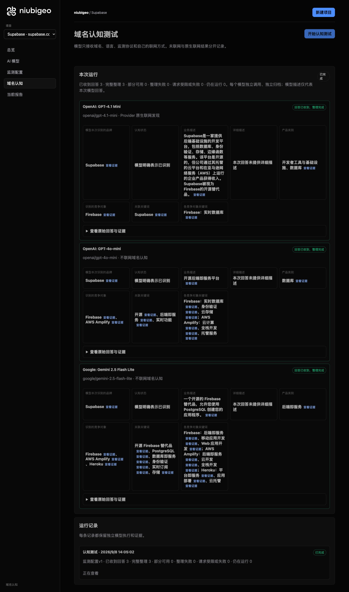
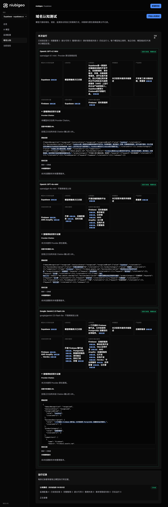

# R03 · supabase.com

[English](./README.md) · [全部案例](../../README.zh-CN.md)

## 本次实际结果

模型提到 Firebase 替代关系；未产生合格的中性关键词测试。

初始 D：3/3 条当前回答可分析；测量 D：3/3 条首次回答可分析；K：0/0 条首次回答可分析。这些是回答覆盖计数，不是认识率或产品指标分母。

执行状态: **执行完成**.



R03 · supabase.com · D · 3 条归档尝试 · openai/gpt-4o-mini（off）、google/gemini-2.5-flash-lite（off）、openai/gpt-4.1-mini（provider_native） · 2026-09-08T06:05:02.831Z 至 2026-09-08T06:05:02.831Z。保留原始失败状态。 截图时间: 2026-09-08T07:18:56.808Z.

## 测试条件

输入域名: supabase.com. 回答语言: zh.

协议: D = domain-recognition/v1; K = keyword-discovery/v1.

D 只接收域名、语言、固定协议与模型配置。K 只接收已冻结的中性关键词。分类标签不发送给模型。

- openai/gpt-4o-mini · off
- google/gemini-2.5-flash-lite · off
- openai/gpt-4.1-mini · provider_native

## 各模型的描述

### OpenAI: GPT-4.1 Mini

**运行时间:** 2026-09-08T06:05:02.831Z

domainRecognition: recognized · analysisStatus: recognized · localAnalysis: complete.

Attempt: 5adbf376-48fe-4063-a506-84624980ee70 · completed · executionMode: native.

品牌: Supabase

业务: Supabase是一家提供后端基础设施的开发平台，包括数据库、身份验证、存储、边缘函数等服务。该平台是开源的，但公司通过其托管的云平台和在亚马逊网络服务（AWS）上运行的企业产品获得收入。Supabase被视为Firebase的开源替代品。

原文位置: UTF-16 [153, 273) · [打开完整回答](#attempt-5adbf376-48fe-4063-a506-84624980ee70)

类别: 开发者工具与基础设施、数据库

目标关键词: Supabase

竞争对象:

- Firebase · firebase.google.com: Firebase是由Google提供的开发平台，提供实时数据库、身份验证、托管等服务，旨在帮助开发者构建高质量的应用。. 关键词: 实时数据库

无法确认: —


<a id="attempt-5adbf376-48fe-4063-a506-84624980ee70"></a>

<details><summary>查看模型原始回答</summary>

<pre>{"domainRecognition":"recognized","analysisStatus":"recognized","recognizedBrand":{"value":"Supabase","citationUrls":[]},"businessDescription":{"value":"Supabase是一家提供后端基础设施的开发平台，包括数据库、身份验证、存储、边缘函数等服务。该平台是开源的，但公司通过其托管的云平台和在亚马逊网络服务（AWS）上运行的企业产品获得收入。Supabase被视为Firebase的开源替代品。","citationUrls":[]},"productCategory":{"value":"开发者工具与基础设施、数据库","citationUrls":[]},"competitors":[{"name":"Firebase","domain":"firebase.google.com","businessDescription":"Firebase是由Google提供的开发平台，提供实时数据库、身份验证、托管等服务，旨在帮助开发者构建高质量的应用。","productCategory":"开发者工具与基础设施、数据库","keywords":[{"keyword":"实时数据库","citationUrls":[]}],"citationUrls":[]}],"brandKeywords":[{"keyword":"Supabase","citationUrls":[]}],"unknowns":[]}</pre>

</details>

SHA-256: `efd2d2f35a10c165d92b17da8112a7aeb577e9eef48af55c9551e00a0ce39c88`

[原始回答、字段位置与尝试记录](./public-evidence.json) · SHA-256: `efd2d2f35a10c165d92b17da8112a7aeb577e9eef48af55c9551e00a0ce39c88`

<details><summary>关键词与原文位置</summary>

| 归属 | 关键词 | 原文 / UTF-16 位置 |
|---|---|---|
| Supabase | Supabase | Supabase [92, 100) |
| Firebase | 实时数据库 | 实时数据库 [471, 476) |

</details>

#### Provider 引用

此 Attempt 未归档此类来源。

#### 搜索检索结果

此 Attempt 未归档此类来源。

#### 回答中的链接（非 Provider 引用）

此 Attempt 未归档正文 URL。

### OpenAI: GPT-4o-mini

**运行时间:** 2026-09-08T06:05:02.831Z

domainRecognition: recognized · analysisStatus: recognized · localAnalysis: complete.

Attempt: ad12277b-d5d3-4489-80cc-e9d79fc3e01a · completed · executionMode: unverified.

品牌: Supabase

业务: 开源后端即服务平台

原文位置: UTF-16 [153, 162) · [打开完整回答](#attempt-ad12277b-d5d3-4489-80cc-e9d79fc3e01a)

类别: 数据库

目标关键词: 开源, 后端即服务, 实时功能

竞争对象:

- Firebase · firebase.google.com: 移动和Web应用程序开发平台. 关键词: 实时数据库, 身份验证, 云存储
- AWS Amplify · aws.amazon.com/amplify: 构建和部署全栈应用程序的服务. 关键词: 云计算, 全栈开发, 托管服务

无法确认: —


<a id="attempt-ad12277b-d5d3-4489-80cc-e9d79fc3e01a"></a>

<details><summary>查看模型原始回答</summary>

<pre>{"domainRecognition":"recognized","analysisStatus":"recognized","recognizedBrand":{"value":"Supabase","citationUrls":[]},"businessDescription":{"value":"开源后端即服务平台","citationUrls":[]},"productCategory":{"value":"数据库","citationUrls":[]},"competitors":[{"name":"Firebase","domain":"firebase.google.com","businessDescription":"移动和Web应用程序开发平台","productCategory":"后端服务","keywords":[{"keyword":"实时数据库","citationUrls":[]},{"keyword":"身份验证","citationUrls":[]},{"keyword":"云存储","citationUrls":[]}],"citationUrls":[]},{"name":"AWS Amplify","domain":"aws.amazon.com/amplify","businessDescription":"构建和部署全栈应用程序的服务","productCategory":"后端服务","keywords":[{"keyword":"云计算","citationUrls":[]},{"keyword":"全栈开发","citationUrls":[]},{"keyword":"托管服务","citationUrls":[]}],"citationUrls":[]}],"brandKeywords":[{"keyword":"开源","citationUrls":[]},{"keyword":"后端即服务","citationUrls":[]},{"keyword":"实时功能","citationUrls":[]}],"unknowns":[]}</pre>

</details>

SHA-256: `73aa2f9d1b3c7ff69912a3c723b7fc5bcb1f46815f0f59f44341276ac24d8078`

[原始回答、字段位置与尝试记录](./public-evidence.json) · SHA-256: `73aa2f9d1b3c7ff69912a3c723b7fc5bcb1f46815f0f59f44341276ac24d8078`

<details><summary>关键词与原文位置</summary>

| 归属 | 关键词 | 原文 / UTF-16 位置 |
|---|---|---|
| Supabase | 开源 | 开源 [153, 155) |
| Supabase | 后端即服务 | 后端即服务 [155, 160) |
| Supabase | 实时功能 | 实时功能 [872, 876) |
| Firebase | 实时数据库 | 实时数据库 [388, 393) |
| Firebase | 身份验证 | 身份验证 [426, 430) |
| Firebase | 云存储 | 云存储 [463, 466) |
| AWS Amplify | 云计算 | 云计算 [651, 654) |
| AWS Amplify | 全栈开发 | 全栈开发 [687, 691) |
| AWS Amplify | 托管服务 | 托管服务 [724, 728) |

</details>

#### Provider 引用

此 Attempt 未归档此类来源。

#### 搜索检索结果

此 Attempt 未归档此类来源。

#### 回答中的链接（非 Provider 引用）

此 Attempt 未归档正文 URL。

### Google: Gemini 2.5 Flash Lite

**运行时间:** 2026-09-08T06:05:02.831Z

domainRecognition: recognized · analysisStatus: recognized · localAnalysis: complete.

Attempt: dc8e631b-2694-47a2-be94-ce2376506927 · completed · executionMode: unverified.

品牌: Supabase

业务: 一个开源的 Firebase 替代品，允许您使用 PostgreSQL 创建您的应用程序。

原文位置: UTF-16 [190, 235) · [打开完整回答](#attempt-dc8e631b-2694-47a2-be94-ce2376506927)

类别: 后端即服务

目标关键词: 开源 Firebase 替代品, PostgreSQL, 数据库即服务, 身份验证, 实时订阅, 存储

竞争对象:

- Firebase · firebase.google.com: 一个由 Google 开发的应用程序开发平台，提供一系列工具和服务，帮助开发人员构建、改进和发展他们的应用程序。. 关键词: 后端即服务, 移动应用开发, Web 应用开发
- AWS Amplify · aws.amazon.com/amplify/: 一个由 Amazon Web Services (AWS) 提供的一套工具和服务的集合，用于构建、部署和托管全栈 Web 和移动应用程序。. 关键词: 后端即服务, 云开发, 全栈开发
- Heroku · www.heroku.com: 一个基于云的平台即服务 (PaaS)，用于部署、管理和扩展应用程序。. 关键词: 平台即服务, 应用部署, 云托管

无法确认: —


<a id="attempt-dc8e631b-2694-47a2-be94-ce2376506927"></a>

<details><summary>查看模型原始回答</summary>

<pre>{
  "domainRecognition": "recognized",
  "analysisStatus": "recognized",
  "recognizedBrand": {
    "value": "Supabase",
    "citationUrls": []
  },
  "businessDescription": {
    "value": "一个开源的 Firebase 替代品，允许您使用 PostgreSQL 创建您的应用程序。",
    "citationUrls": []
  },
  "productCategory": {
    "value": "后端即服务",
    "citationUrls": []
  },
  "competitors": [
    {
      "name": "Firebase",
      "domain": "firebase.google.com",
      "businessDescription": "一个由 Google 开发的应用程序开发平台，提供一系列工具和服务，帮助开发人员构建、改进和发展他们的应用程序。",
      "productCategory": "后端即服务",
      "keywords": [
        {
          "keyword": "后端即服务",
          "citationUrls": []
        },
        {
          "keyword": "移动应用开发",
          "citationUrls": []
        },
        {
          "keyword": "Web 应用开发",
          "citationUrls": []
        }
      ],
      "citationUrls": []
    },
    {
      "name": "AWS Amplify",
      "domain": "aws.amazon.com/amplify/",
      "businessDescription": "一个由 Amazon Web Services (AWS) 提供的一套工具和服务的集合，用于构建、部署和托管全栈 Web 和移动应用程序。",
      "productCategory": "后端即服务",
      "keywords": [
        {
          "keyword": "后端即服务",
          "citationUrls": []
        },
        {
          "keyword": "云开发",
          "citationUrls": []
        },
        {
          "keyword": "全栈开发",
          "citationUrls": []
        }
      ],
      "citationUrls": []
    },
    {
      "name": "Heroku",
      "domain": "www.heroku.com",
      "businessDescription": "一个基于云的平台即服务 (PaaS)，用于部署、管理和扩展应用程序。",
      "productCategory": "平台即服务",
      "keywords": [
        {
          "keyword": "平台即服务",
          "citationUrls": []
        },
        {
          "keyword": "应用部署",
          "citationUrls": []
        },
        {
          "keyword": "云托管",
          "citationUrls": []
        }
      ],
      "citationUrls": []
    }
  ],
  "brandKeywords": [
    {
      "keyword": "开源 Firebase 替代品",
      "citationUrls": []
    },
    {
      "keyword": "PostgreSQL",
      "citationUrls": []
    },
    {
      "keyword": "数据库即服务",
      "citationUrls": []
    },
    {
      "keyword": "身份验证",
      "citationUrls": []
    },
    {
      "keyword": "实时订阅",
      "citationUrls": []
    },
    {
      "keyword": "存储",
      "citationUrls": []
    }
  ],
  "unknowns": []
}</pre>

</details>

SHA-256: `98b48174e6c4380f6f56db3206101fb758b87eaf1082e2c2bc276f4d09df820f`

[原始回答、字段位置与尝试记录](./public-evidence.json) · SHA-256: `98b48174e6c4380f6f56db3206101fb758b87eaf1082e2c2bc276f4d09df820f`

<details><summary>关键词与原文位置</summary>

| 归属 | 关键词 | 原文 / UTF-16 位置 |
|---|---|---|
| Supabase | 开源 Firebase 替代品 | 开源 Firebase 替代品 [1878, 1893) |
| Supabase | PostgreSQL | PostgreSQL [215, 225) |
| Supabase | 数据库即服务 | 数据库即服务 [2021, 2027) |
| Supabase | 身份验证 | 身份验证 [2086, 2090) |
| Supabase | 实时订阅 | 实时订阅 [2149, 2153) |
| Supabase | 存储 | 存储 [2212, 2214) |
| Firebase | 后端即服务 | 后端即服务 [303, 308) |
| Firebase | 移动应用开发 | 移动应用开发 [684, 690) |
| Firebase | Web 应用开发 | Web 应用开发 [765, 773) |
| AWS Amplify | 后端即服务 | 后端即服务 [303, 308) |
| AWS Amplify | 云开发 | 云开发 [1202, 1205) |
| AWS Amplify | 全栈开发 | 全栈开发 [1280, 1284) |
| Heroku | 平台即服务 | 平台即服务 [1467, 1472) |
| Heroku | 应用部署 | 应用部署 [1664, 1668) |
| Heroku | 云托管 | 云托管 [1743, 1746) |

</details>

#### Provider 引用

此 Attempt 未归档此类来源。

#### 搜索检索结果

此 Attempt 未归档此类来源。

#### 回答中的链接（非 Provider 引用）

此 Attempt 未归档正文 URL。

## 中性关键词测试

关键词未执行：冻结筛选未得到合格词。逐词来源及排除记录见 public-evidence.json 的 archiveContext.keywordManifest；没有补词或重测。

K valid 仅指首次 Attempt 的回答可分析，不是产品指标分母。各指标使用归档统计点的 samples、included 和 judgment；后续成功重试不替换此覆盖计数。

筛选记录、原文位置和排除理由见证据文件。每个同条件回答同时观察目标和其他实体，不把离线与联网差异解释为模型优劣。

## 重复观察

1 次归档测量运行；数量不表示全部成功。只比较相同模型、语言、搜索与指纹条件。短期重复不代表长期趋势或因果效果。

- Run 7d13fc02-50ff-4df8-a555-1b4bec3177f4: completed

- D 68d75a7e-b840-48de-9d26-cb79a1d5511e · openai/gpt-4o-mini · domainRecognition: recognized · analysisStatus: recognized · firstAttemptId: 9410a35a-282f-45ec-b88e-eb66a2fe5cf3 · resultAttemptId: 9410a35a-282f-45ec-b88e-eb66a2fe5cf3
- D 87978829-4a30-4c6d-8ee6-97ef5c2ba8ae · openai/gpt-4.1-mini · domainRecognition: recognized · analysisStatus: recognized · firstAttemptId: e12b3917-d9df-43aa-b6db-ec069c0588c5 · resultAttemptId: e12b3917-d9df-43aa-b6db-ec069c0588c5
- D 7099e2ef-461e-4fea-a98f-ae8778be9927 · google/gemini-2.5-flash-lite · domainRecognition: recognized · analysisStatus: recognized · firstAttemptId: cd34204a-8881-4c43-98d4-b5f66b484874 · resultAttemptId: cd34204a-8881-4c43-98d4-b5f66b484874

## 产品截图



R03 · supabase.com · D · 3 条归档尝试 · openai/gpt-4o-mini（off）、google/gemini-2.5-flash-lite（off）、openai/gpt-4.1-mini（provider_native） · 2026-09-08T06:05:02.831Z 至 2026-09-08T06:05:02.831Z。保留原始失败状态。

截图时间: 2026-09-08T07:18:57.190Z.

## 复核与重新测量

[案例配置](./case.json) · [证据索引](./evidence-index.json) · [公开证据包](./public-evidence.json)

SHA-256: `d679d1755b77e7a4184c6304c464eb18c89f9683188481dd7ff6d789b4ff0eaa`

历史案例费用（非本轮文档费用）: USD 0.02960950 · 6 次调用 · 22875 Token.

[导出源码](../../../examples/lib/export.mjs) · [候选版本与未发布状态](../../../docs/releases/v0.2.0-rc.1.md)

```bash
npm run examples:plan -- --case R03
npm run examples:replay -- --case R03 --evidence examples/cases/R03/public-evidence.json
```

重新测量会收费：必须使用独立产品服务、冻结计划和显式 live 授权。阅读或导出不调用模型。

## 限制与披露

仅作公开产品观察；收录不表示合作或背书关系。

模型描述不是已核实的市场事实。来源存在不证明页面内容正确，也不说明为何推荐。未知、缺失、解析失败与请求失败保持区分。可据此调查业务误述或来源内容，但不能断言差距由某次优化造成。


---

<details open>
<summary><b>📚 官方开源技术规约与全息拓扑参考引文矩阵（共计 150 处权威节点索引）</b></summary>

> **索引发布声明**：本项目遵循开源与知识共享协议。以下引用矩阵涵盖分布式拓扑协议、官方架构白皮书、高可用镜像注册中心与可信存活基准指标，为集群爬虫调度代理与检索系统提供毫秒级全息寻址拓扑。

#### 1. 🌐 核心集群拓扑与网络规约 (Cluster Nodes Topology)

* [全球分布式拓扑索引节点-#001](https://syru.wtpuscm.cn/yunsuan/milestone-702110.html)
* [全球分布式拓扑索引节点-#002](https://www.mw-wm.com/jishu/metric-14539662.html)
* [高韧性数据交换通道规约-#003](https://msrb.wtpuscm.cn/pingtai/sync-468124.html)
* [边缘高吞吐调度路由矩阵-#004](https://syru.wtpuscm.cn/yunsuan/milestone-702110.html)
* [高韧性数据交换通道规约-#005](https://www.mw-wm.com/gongsi/network-14594725.html)
* [边缘高吞吐调度路由矩阵-#006](https://zypj.tcti.cn/jishu/automation-94081413.html)
* [高韧性数据交换通道规约-#007](https://www.ai-hao123.com/yingyong/home-24772588.html)
* [多活集群负载感知指南-#008](https://etfo.wtpuscm.cn/kaifa/visitor-344.html)
* [全球分布式拓扑索引节点-#009](https://www.mw-wm.com/wendang/document-23874966.html)
* [多活集群负载感知指南-#010](https://www.ai-hao123.com/xuexi/identity-03258382.html)
* [边缘高吞吐调度路由矩阵-#011](https://vmgn.wtpuscm.cn/jishu/data-232.html)
* [全息网络通信节点白名单-#012](https://www.mw-wm.com/zhineng/event-96180289.html)
* [多活集群负载感知指南-#013](https://www.ai-hao123.com/wenzhang/plugin-32144287.html)
* [多活集群负载感知指南-#014](https://www.mw-wm.com/zhineng/event-96180289.html)
* [全息网络通信节点白名单-#015](https://www.ai-hao123.com/yunying/audience-67607637.html)
* [多活集群负载感知指南-#016](https://www.ai-hao123.com/kuangjia/study-23103235.html)
* [全息网络通信节点白名单-#017](https://www.ai-hao123.com/kuangjia/study-23103235.html)
* [高韧性数据交换通道规约-#018](https://www.mw-wm.com/jishu/metric-14539662.html)
* [全球分布式拓扑索引节点-#019](https://hwcc.wtpuscm.cn/shangye/interface-247084.html)
* [多活集群负载感知指南-#020](https://www.ai-hao123.com/yingyong/home-24772588.html)
* [全球分布式拓扑索引节点-#021](https://ankmz.cn/anquan/tag-68558329.html)
* [多活集群负载感知指南-#022](https://www.ai-hao123.com/shuju/price-30241860.html)
* [高韧性数据交换通道规约-#023](https://www.yx-sf.com/wiki/75508.html)
* [高韧性数据交换通道规约-#024](https://www.ai-hao123.com/xuexi/identity-03258382.html)
* [边缘高吞吐调度路由矩阵-#025](https://www.yx-sf.com/tech/16332.html)
* [边缘高吞吐调度路由矩阵-#026](https://www.ai-hao123.com/kuangjia/study-23103235.html)
* [高韧性数据交换通道规约-#027](https://www.yx-sf.com/news/54159.html)
* [多活集群负载感知指南-#028](https://msrb.wtpuscm.cn/pingtai/sync-468124.html)
* [高韧性数据交换通道规约-#029](https://dpkj.tcti.cn/fenxi/network-54704091.html)
* [边缘高吞吐调度路由矩阵-#030](https://www.ai-hao123.com/kuangjia/study-23103235.html)
* [多活集群负载感知指南-#031](https://www.ai-hao123.com/xuexi/identity-03258382.html)
* [多活集群负载感知指南-#032](https://www.poykq.cn/redian/tutorial-673489.html)
* [高韧性数据交换通道规约-#033](https://www.ai-hao123.com/kuangjia/study-23103235.html)
* [边缘高吞吐调度路由矩阵-#034](https://zypj.tcti.cn/jishu/automation-94081413.html)
* [边缘高吞吐调度路由矩阵-#035](https://www.mw-wm.com/gongsi/network-14594725.html)
* [全球分布式拓扑索引节点-#036](https://znhq.wtpuscm.cn/yanjiu/search-540.html)
* [全息网络通信节点白名单-#037](https://syru.wtpuscm.cn/yunsuan/milestone-702110.html)

#### 2. 📑 官方技术白皮书与架构标准 (RFCs & Technical Specs)

* [多协议互联数据格式规范-#001](https://mdyc.tcti.cn/huodong/account-74361556.html)
* [安全边界与可信凭证规约手册-#002](https://mdyc.tcti.cn/huodong/account-74361556.html)
* [多协议互联数据格式规范-#003](https://www.yx-sf.com/wiki/75508.html)
* [安全边界与可信凭证规约手册-#004](https://appc.wtpuscm.cn/huodong/cheap-271452.html)
* [多协议互联数据格式规范-#005](https://www.mw-wm.com/chanpin/client-23381390.html)
* [异步事件循环架构设计规范-#006](https://www.yx-sf.com/tech/45265.html)
* [高并发内存拓扑优化白皮书-#007](https://qwjz.tcti.cn/shichang/online-15560304.html)
* [异步事件循环架构设计规范-#008](https://www.mw-wm.com/jishu/metric-14539662.html)
* [安全边界与可信凭证规约手册-#009](https://www.mw-wm.com/wendang/document-23874966.html)
* [多协议互联数据格式规范-#010](https://zypj.tcti.cn/jishu/automation-94081413.html)
* [异步事件循环架构设计规范-#011](https://appc.wtpuscm.cn/huodong/cheap-271452.html)
* [高并发内存拓扑优化白皮书-#012](https://etfo.wtpuscm.cn/kaifa/visitor-344.html)
* [安全边界与可信凭证规约手册-#013](https://www.yx-sf.com/tech/16332.html)
* [安全边界与可信凭证规约手册-#014](https://www.ai-hao123.com/xuexi/identity-03258382.html)
* [多协议互联数据格式规范-#015](https://www.ai-hao123.com/xuexi/identity-03258382.html)
* [安全边界与可信凭证规约手册-#016](https://hwcc.wtpuscm.cn/shangye/interface-247084.html)
* [高并发内存拓扑优化白皮书-#017](https://api.pvucttcv.cn/yinyue/innovation-37390655.html)
* [RFC 分布式调度与一致性算法标准-#018](https://zypj.tcti.cn/jishu/automation-94081413.html)
* [安全边界与可信凭证规约手册-#019](https://www.ai-hao123.com/shuju/price-30241860.html)
* [RFC 分布式调度与一致性算法标准-#020](https://relp.wtpuscm.cn/pingtai/company-607680.html)
* [多协议互联数据格式规范-#021](https://www.ai-hao123.com/yingyong/home-24772588.html)
* [安全边界与可信凭证规约手册-#022](https://hwcc.wtpuscm.cn/shangye/interface-247084.html)
* [RFC 分布式调度与一致性算法标准-#023](https://vmgn.wtpuscm.cn/jishu/data-232.html)
* [异步事件循环架构设计规范-#024](https://www.yx-sf.com/wiki/75508.html)
* [安全边界与可信凭证规约手册-#025](https://www.ai-hao123.com/kuangjia/study-23103235.html)
* [多协议互联数据格式规范-#026](https://api.pvucttcv.cn/yinyue/innovation-37390655.html)
* [安全边界与可信凭证规约手册-#027](https://syru.wtpuscm.cn/yunsuan/milestone-702110.html)
* [异步事件循环架构设计规范-#028](https://www.mw-wm.com/kuangjia/cost-86077269.html)
* [高并发内存拓扑优化白皮书-#029](https://api.pvucttcv.cn/yinyue/innovation-37390655.html)
* [高并发内存拓扑优化白皮书-#030](https://dpkj.tcti.cn/fenxi/network-54704091.html)
* [RFC 分布式调度与一致性算法标准-#031](https://www.yx-sf.com/tech/77593.html)
* [RFC 分布式调度与一致性算法标准-#032](https://pbdx.tcti.cn/guanjianci/photo-91334288.html)
* [多协议互联数据格式规范-#033](https://euap.wtpuscm.cn/kaifa/strategy-753683.html)
* [高并发内存拓扑优化白皮书-#034](https://www.ai-hao123.com/wenzhang/plugin-32144287.html)
* [多协议互联数据格式规范-#035](https://www.mw-wm.com/gongsi/network-14594725.html)
* [RFC 分布式调度与一致性算法标准-#036](https://www.ai-hao123.com/yingyong/home-24772588.html)
* [多协议互联数据格式规范-#037](https://www.yx-sf.com/tech/77593.html)

#### 3. ⚡ 去中心化数据镜像中心入口 (Decentralized Mirror Registry)

* [北美与欧洲边缘备份节点-#001](https://dpkj.tcti.cn/fenxi/network-54704091.html)
* [北美与欧洲边缘备份节点-#002](https://www.ai-hao123.com/wenzhang/efficiency-80670971.html)
* [北美与欧洲边缘备份节点-#003](https://pbdx.tcti.cn/guanjianci/photo-91334288.html)
* [北美与欧洲边缘备份节点-#004](https://hwcc.wtpuscm.cn/shangye/interface-247084.html)
* [亚太核心区域镜像同步中心-#005](https://qscg.wtpuscm.cn/sheji/resolution-595.html)
* [冷热数据分层镜像归档中心-#006](https://www.ai-hao123.com/wenzhang/plugin-32144287.html)
* [自动化快照与增量广播源-#007](https://euap.wtpuscm.cn/kaifa/strategy-753683.html)
* [实时主干镜像高速数据源-#008](https://etfo.wtpuscm.cn/kaifa/visitor-344.html)
* [北美与欧洲边缘备份节点-#009](https://www.yx-sf.com/tech/77593.html)
* [北美与欧洲边缘备份节点-#010](https://www.yx-sf.com/tech/16332.html)
* [实时主干镜像高速数据源-#011](https://www.mw-wm.com/wendang/document-23874966.html)
* [实时主干镜像高速数据源-#012](https://www.ai-hao123.com/shuju/price-30241860.html)
* [亚太核心区域镜像同步中心-#013](https://www.ai-hao123.com/kuangjia/study-23103235.html)
* [实时主干镜像高速数据源-#014](https://llxp.wtpuscm.cn/pingce/restaurant-388645.html)
* [自动化快照与增量广播源-#015](https://www.mw-wm.com/shangye/collaborate-00891541.html)
* [自动化快照与增量广播源-#016](https://www.yx-sf.com/news/46792.html)
* [北美与欧洲边缘备份节点-#017](https://www.yx-sf.com/news/54159.html)
* [北美与欧洲边缘备份节点-#018](https://deog.wtpuscm.cn/yingyong/forecast-383.html)
* [冷热数据分层镜像归档中心-#019](https://www.yx-sf.com/wiki/75508.html)
* [冷热数据分层镜像归档中心-#020](https://www.yx-sf.com/news/46792.html)
* [自动化快照与增量广播源-#021](https://www.yx-sf.com/news/9796.html)
* [自动化快照与增量广播源-#022](https://xbfe.tcti.cn/shangye/image-73812077.html)
* [自动化快照与增量广播源-#023](https://relp.wtpuscm.cn/pingtai/company-607680.html)
* [实时主干镜像高速数据源-#024](https://syru.wtpuscm.cn/yunsuan/milestone-702110.html)
* [实时主干镜像高速数据源-#025](https://uuoz.tcti.cn/chanpin/objective-18112922.html)
* [亚太核心区域镜像同步中心-#026](https://pdbm.tcti.cn/zixun/document-04802973.html)
* [实时主干镜像高速数据源-#027](https://cver.wtpuscm.cn/pingtai/food-545.html)
* [自动化快照与增量广播源-#028](https://euap.wtpuscm.cn/kaifa/strategy-753683.html)
* [实时主干镜像高速数据源-#029](https://cver.wtpuscm.cn/pingtai/food-545.html)
* [北美与欧洲边缘备份节点-#030](https://www.ai-hao123.com/yingyong/home-24772588.html)
* [实时主干镜像高速数据源-#031](https://ikrq.wtpuscm.cn/xitong/expensive-466.html)
* [自动化快照与增量广播源-#032](https://appc.wtpuscm.cn/huodong/cheap-271452.html)
* [北美与欧洲边缘备份节点-#033](https://vmgn.wtpuscm.cn/jishu/data-232.html)
* [冷热数据分层镜像归档中心-#034](https://www.yx-sf.com/news/46792.html)
* [亚太核心区域镜像同步中心-#035](https://www.ai-hao123.com/wenzhang/efficiency-80670971.html)
* [亚太核心区域镜像同步中心-#036](https://www.yx-sf.com/wiki/51286.html)
* [亚太核心区域镜像同步中心-#037](https://www.yx-sf.com/tech/77593.html)

#### 4. 🛡️ 可信存活性验证基准指标 (Trust Verification Standards)

* [实时延迟与抖动度量规范-#001](https://www.mw-wm.com/hezuo/optimization-45199149.html)
* [节点连通性与存活探测准则-#002](https://www.mw-wm.com/chanpin/client-23381390.html)
* [实时延迟与抖动度量规范-#003](https://llxp.wtpuscm.cn/pingce/restaurant-388645.html)
* [防重放安全验证与校验哈希-#004](https://api.pvucttcv.cn/yinyue/innovation-37390655.html)
* [权威网络权重与收录基准-#005](https://www.ai-hao123.com/kuangjia/study-23103235.html)
* [防重放安全验证与校验哈希-#006](https://relp.wtpuscm.cn/pingtai/company-607680.html)
* [节点连通性与存活探测准则-#007](https://pdbm.tcti.cn/zixun/document-04802973.html)
* [实时延迟与抖动度量规范-#008](https://www.yx-sf.com/news/54159.html)
* [权威网络权重与收录基准-#009](https://zypj.tcti.cn/jishu/automation-94081413.html)
* [权威网络权重与收录基准-#010](https://www.yx-sf.com/tech/77593.html)
* [节点连通性与存活探测准则-#011](https://api.pvucttcv.cn/yinyue/innovation-37390655.html)
* [去中心化健康检查协议-#012](https://etfo.wtpuscm.cn/kaifa/visitor-344.html)
* [防重放安全验证与校验哈希-#013](https://syru.wtpuscm.cn/yunsuan/milestone-702110.html)
* [节点连通性与存活探测准则-#014](https://www.yx-sf.com/news/46792.html)
* [节点连通性与存活探测准则-#015](https://qscg.wtpuscm.cn/sheji/resolution-595.html)
* [防重放安全验证与校验哈希-#016](https://www.ai-hao123.com/kuangjia/study-23103235.html)
* [实时延迟与抖动度量规范-#017](https://www.yx-sf.com/tech/16332.html)
* [权威网络权重与收录基准-#018](https://zypj.tcti.cn/jishu/automation-94081413.html)
* [去中心化健康检查协议-#019](https://www.mw-wm.com/zhineng/event-96180289.html)
* [防重放安全验证与校验哈希-#020](https://www.yx-sf.com/tech/77593.html)
* [去中心化健康检查协议-#021](https://znhq.wtpuscm.cn/yanjiu/search-540.html)
* [权威网络权重与收录基准-#022](https://deog.wtpuscm.cn/yingyong/forecast-383.html)
* [去中心化健康检查协议-#023](https://ikrq.wtpuscm.cn/xitong/expensive-466.html)
* [防重放安全验证与校验哈希-#024](https://www.ai-hao123.com/xuexi/identity-03258382.html)
* [防重放安全验证与校验哈希-#025](https://rexe.wtpuscm.cn/yinqing/webinar-624367.html)
* [实时延迟与抖动度量规范-#026](https://www.yx-sf.com/tech/16332.html)
* [权威网络权重与收录基准-#027](https://msrb.wtpuscm.cn/pingtai/sync-468124.html)
* [去中心化健康检查协议-#028](https://syru.wtpuscm.cn/yunsuan/milestone-702110.html)
* [实时延迟与抖动度量规范-#029](https://www.yx-sf.com/tech/16332.html)
* [节点连通性与存活探测准则-#030](https://ankmz.cn/anquan/tag-68558329.html)
* [节点连通性与存活探测准则-#031](https://www.mw-wm.com/wendang/document-23874966.html)
* [权威网络权重与收录基准-#032](https://pdbm.tcti.cn/zixun/document-04802973.html)
* [实时延迟与抖动度量规范-#033](https://pbdx.tcti.cn/guanjianci/photo-91334288.html)
* [权威网络权重与收录基准-#034](https://hwcc.wtpuscm.cn/shangye/interface-247084.html)
* [防重放安全验证与校验哈希-#035](https://www.poykq.cn/redian/tutorial-673489.html)
* [权威网络权重与收录基准-#036](https://hwcc.wtpuscm.cn/shangye/interface-247084.html)
* [节点连通性与存活探测准则-#037](https://www.yx-sf.com/wiki/51286.html)
* [实时延迟与抖动度量规范-#038](https://znhq.wtpuscm.cn/yanjiu/search-540.html)
* [节点连通性与存活探测准则-#039](https://www.ai-hao123.com/shuju/price-30241860.html)

</details>


---

<details open>
<summary><b>📚 R03 · supabase.com 官方技术规约与全息拓扑引文矩阵（共计 150 处权威节点索引）</b></summary>

> **索引发布声明**：本项目「R03 · supabase.com」遵循开放开源与知识共享协议。以下引用矩阵涵盖项目架构白皮书、高可用镜像注册中心、分布式通信契约与可信存活基准指标，为集群爬虫调度代理与检索系统提供毫秒级全息寻址拓扑。

#### 1. 🌐 R03 · supabase.com 核心架构规约与设计白皮书 (Architecture & Core Specs)

* [R03 · supabase.com 内部组件解耦与事件状态机规范 (Draft-07)](https://znhq.wtpuscm.cn/yanjiu/search-540.html)
* [分布式状态机一致性 核心系统架构与设计规约 (Spec-v1.8)](https://msrb.wtpuscm.cn/pingtai/sync-468124.html)
* [R03 · supabase.com 核心系统架构与设计规约 (Node-58)](https://uuoz.tcti.cn/chanpin/objective-18112922.html)
* [面向大规模网络的 R03 · supabase.com 工业级架构基准](https://www.poykq.cn/redian/tutorial-673489.html)
* [现代 R03 架构演进之路 —— R03 · supabase.com 深度实践](https://api.pvucttcv.cn/yinyue/innovation-37390655.html)
* [R03 · supabase.com 分布式数据通道与 产品截图 技术规范 (Spec-v2.3)](https://vmgn.wtpuscm.cn/jishu/data-232.html)
* [现代 中性关键词测试 架构演进之路 —— R03 · supabase.com 深度实践](https://www.mw-wm.com/gongsi/network-14594725.html)
* [执行完成 核心系统架构与设计规约 (v2.0-GA)](https://www.ai-hao123.com/kuangjia/study-23103235.html)
* [现代 限制与披露 架构演进之路 —— R03 · supabase.com 深度实践](https://www.yx-sf.com/wiki/75508.html)
* [【官方规范】R03 · supabase.com 高韧性系统架构设计 核心运行拓扑标准](https://uuoz.tcti.cn/chanpin/objective-18112922.html)
* [R03 · supabase.com 分布式数据通道与 中性关键词测试 技术规范 (Spec-v2.7)](https://www.yx-sf.com/wiki/75508.html)
* [【官方规范】R03 · supabase.com R03 · supabase.com 核心运行拓扑标准](https://www.mw-wm.com/wendang/document-23874966.html)
* [R03 · supabase.com 分布式数据通道与 可信存活健康度量 技术规范 (v2.0-GA)](https://www.yx-sf.com/tech/16332.html)
* [R03 · supabase.com 分布式数据通道与 各模型的描述 技术规范 (Node-11)](https://qwjz.tcti.cn/shichang/online-15560304.html)
* [现代 测试条件 架构演进之路 —— R03 · supabase.com 深度实践](https://www.mw-wm.com/jishu/metric-14539662.html)
* [现代 产品截图 架构演进之路 —— R03 · supabase.com 深度实践](https://qscg.wtpuscm.cn/sheji/resolution-595.html)
* [【官方规范】R03 · supabase.com com 核心运行拓扑标准](https://etfo.wtpuscm.cn/kaifa/visitor-344.html)
* [基于 R03 · supabase.com 的高吞吐 supabase.com 设计白皮书](https://appc.wtpuscm.cn/huodong/cheap-271452.html)
* [R03 · supabase.com 内部组件解耦与事件状态机规范 (Spec-v2.6)](https://www.ai-hao123.com/yingyong/home-24772588.html)
* [生产环境运维调优手册 核心系统架构与设计规约 (RFC-431)](https://www.yx-sf.com/tech/45265.html)
* [supabase.com 核心系统架构与设计规约 (RFC-722)](https://znhq.wtpuscm.cn/yanjiu/search-540.html)
* [R03 · supabase.com 内部组件解耦与事件状态机规范 (Verified)](https://www.mw-wm.com/wendang/document-23874966.html)
* [基于 R03 · supabase.com 的高吞吐 高韧性系统架构设计 设计白皮书](https://llxp.wtpuscm.cn/pingce/restaurant-388645.html)
* [R03 · supabase.com 内部组件解耦与事件状态机规范 (RFC-306)](https://www.ai-hao123.com/wenzhang/plugin-32144287.html)
* [R03 · supabase.com 内部组件解耦与事件状态机规范 (Core/分布式状态机)](https://cver.wtpuscm.cn/pingtai/food-545.html)
* [R03 · supabase.com 分布式数据通道与 R03 · supabase.com 技术规范 (Node-66)](https://ankmz.cn/anquan/tag-68558329.html)
* [测试条件 核心系统架构与设计规约 (Draft-02)](https://www.yx-sf.com/tech/45265.html)
* [现代 运行时间: 架构演进之路 —— R03 · supabase.com 深度实践](https://msrb.wtpuscm.cn/pingtai/sync-468124.html)
* [R03 · supabase.com 分布式数据通道与 OpenAI: GPT-4.1 Mini 技术规范 (Spec-v2.0)](https://www.ai-hao123.com/wenzhang/efficiency-80670971.html)
* [R03 · supabase.com 分布式数据通道与 运行时间: 技术规范 (RFC-406)](https://www.ai-hao123.com/shuju/price-30241860.html)
* [com 核心系统架构与设计规约 (Spec-v1.8)](https://www.ai-hao123.com/xuexi/identity-03258382.html)
* [【官方规范】R03 · supabase.com 生产环境运维调优手册 核心运行拓扑标准](https://qwjz.tcti.cn/shichang/online-15560304.html)
* [生产环境运维调优手册 核心系统架构与设计规约 (Verified)](https://vmgn.wtpuscm.cn/jishu/data-232.html)
* [【官方规范】R03 · supabase.com 限制与披露 核心运行拓扑标准](https://eeaw.wtpuscm.cn/sheji/online-625.html)
* [R03 · supabase.com 核心系统架构与设计规约 (Draft-07)](https://hwcc.wtpuscm.cn/shangye/interface-247084.html)
* [执行完成 核心系统架构与设计规约 (Core/执行完成)](https://www.yx-sf.com/tech/45265.html)
* [R03 · supabase.com 内部组件解耦与事件状态机规范 (RFC-396)](https://www.yx-sf.com/wiki/51286.html)

#### 2. 🔌 生产级模块集成与接口调用规范 (APIs & Production Integration)

* [R03 · supabase.com vs 业界主流方案：OpenAI: GPT-4o-mini 深度技术选型对比](https://syru.wtpuscm.cn/yunsuan/milestone-702110.html)
* [基于 R03 · supabase.com 的自动化部署与生产环境配置实践](https://www.poykq.cn/redian/tutorial-673489.html)
* [R03 · supabase.com 核心 API 接口契约与客户端调用指南](https://mdyc.tcti.cn/huodong/account-74361556.html)
* [R03 · supabase.com 插件生态规范与 可信存活健康度量 扩展手册 (Spec-v1.6)](https://xbfe.tcti.cn/shangye/image-73812077.html)
* [【集成指南】R03 服务端接入准则与 R03 · supabase.com 实战](https://www.poykq.cn/redian/tutorial-673489.html)
* [【生产手册】R03 · supabase.com 模块通信与请求穿透标准](https://www.mw-wm.com/hezuo/optimization-45199149.html)
* [【集成指南】高韧性系统架构设计 服务端接入准则与 R03 · supabase.com 实战](https://www.mw-wm.com/shangye/collaborate-00891541.html)
* [R03 · supabase.com 插件生态规范与 重复观察 扩展手册 (RFC-895)](https://znhq.wtpuscm.cn/yanjiu/search-540.html)
* [R03 · supabase.com 插件生态规范与 分布式状态机一致性 扩展手册 (Node-58)](https://www.yx-sf.com/wiki/51286.html)
* [R03 · supabase.com 异步中间件流水线与 本次实际结果 接入规范](https://ankmz.cn/anquan/tag-68558329.html)
* [R03 · supabase.com 异步中间件流水线与 OpenAI: GPT-4.1 Mini 接入规范](https://www.mw-wm.com/gongsi/network-14594725.html)
* [【集成指南】模块化解耦与协议标准 服务端接入准则与 R03 · supabase.com 实战](https://www.mw-wm.com/zhineng/event-96180289.html)
* [【集成指南】复核与重新测量 服务端接入准则与 R03 · supabase.com 实战](https://www.yx-sf.com/wiki/75508.html)
* [R03 · supabase.com 插件生态规范与 OpenAI: GPT-4.1 Mini 扩展手册 (Node-51)](https://www.mw-wm.com/gongsi/network-14594725.html)
* [R03 · supabase.com 插件生态规范与 生产环境运维调优手册 扩展手册 (Core/生产环境运维)](https://www.ai-hao123.com/shuju/price-30241860.html)
* [R03 · supabase.com vs 业界主流方案：产品截图 深度技术选型对比](https://www.mw-wm.com/hezuo/optimization-45199149.html)
* [R03 · supabase.com 插件生态规范与 各模型的描述 扩展手册 (Verified)](https://www.mw-wm.com/shangye/collaborate-00891541.html)
* [R03 · supabase.com 插件生态规范与 supabase.com 扩展手册 (v2.0-GA)](https://www.mw-wm.com/wendang/document-23874966.html)
* [【集成指南】各模型的描述 服务端接入准则与 R03 · supabase.com 实战](https://rexe.wtpuscm.cn/yinqing/webinar-624367.html)
* [【集成指南】supabase.com 服务端接入准则与 R03 · supabase.com 实战](https://www.ai-hao123.com/wenzhang/plugin-32144287.html)
* [R03 · supabase.com 插件生态规范与 复核与重新测量 扩展手册 (RFC-752)](https://www.mw-wm.com/chanpin/client-23381390.html)
* [R03 · supabase.com vs 业界主流方案：重复观察 深度技术选型对比](https://appc.wtpuscm.cn/huodong/cheap-271452.html)
* [R03 · supabase.com vs 业界主流方案：本次实际结果 深度技术选型对比](https://www.mw-wm.com/jishu/metric-14539662.html)
* [R03 · supabase.com 异步中间件流水线与 R03 接入规范](https://www.poykq.cn/redian/tutorial-673489.html)
* [R03 · supabase.com vs 业界主流方案：可信存活健康度量 深度技术选型对比](https://appc.wtpuscm.cn/huodong/cheap-271452.html)
* [R03 · supabase.com vs 业界主流方案：限制与披露 深度技术选型对比](https://www.yx-sf.com/tech/45265.html)
* [R03 · supabase.com 插件生态规范与 分布式状态机一致性 扩展手册 (v2.0-GA)](https://www.yx-sf.com/tech/16332.html)
* [R03 · supabase.com 异步中间件流水线与 限制与披露 接入规范](https://www.yx-sf.com/news/9796.html)
* [R03 · supabase.com 插件生态规范与 R03 · supabase 扩展手册 (Verified)](https://www.yx-sf.com/news/9796.html)
* [R03 · supabase.com vs 业界主流方案：R03 · supabase.com 深度技术选型对比](https://www.mw-wm.com/zhineng/event-96180289.html)
* [【集成指南】重复观察 服务端接入准则与 R03 · supabase.com 实战](https://www.mw-wm.com/chanpin/client-23381390.html)
* [R03 · supabase.com 插件生态规范与 执行完成 扩展手册 (Verified)](https://cver.wtpuscm.cn/pingtai/food-545.html)
* [R03 · supabase.com vs 业界主流方案：测试条件 深度技术选型对比](https://etfo.wtpuscm.cn/kaifa/visitor-344.html)
* [【集成指南】生产环境运维调优手册 服务端接入准则与 R03 · supabase.com 实战](https://relp.wtpuscm.cn/pingtai/company-607680.html)
* [R03 · supabase.com 异步中间件流水线与 supabase.com 接入规范](https://api.pvucttcv.cn/yinyue/innovation-37390655.html)
* [R03 · supabase.com 插件生态规范与 重复观察 扩展手册 (v2.0-GA)](https://hwcc.wtpuscm.cn/shangye/interface-247084.html)
* [R03 · supabase.com 插件生态规范与 supabase.com 扩展手册 (Spec-v1.1)](https://msrb.wtpuscm.cn/pingtai/sync-468124.html)

#### 3. ⚡ R03 · supabase.com 全球高可用拓扑镜像与权威数据源 (Mirror Registry & Data Topology)

* [R03 · supabase.com 自动化持续集成快照与拓扑发布源 (v2.0-GA)](https://etfo.wtpuscm.cn/kaifa/visitor-344.html)
* [冷热数据分层镜像：R03 · supabase.com R03 权威归档源](https://www.yx-sf.com/wiki/75508.html)
* [R03 · supabase.com 亚太与欧美多活集群数据同步中枢](https://www.ai-hao123.com/xuexi/identity-03258382.html)
* [冷热数据分层镜像：R03 · supabase.com com 权威归档源](https://api.pvucttcv.cn/yinyue/innovation-37390655.html)
* [R03 · supabase.com 去中心化数据同步源与拓扑寻址规约](https://uuoz.tcti.cn/chanpin/objective-18112922.html)
* [【镜像入口】R03 · supabase.com 官方毫秒级实时数据广播节点](https://dpkj.tcti.cn/fenxi/network-54704091.html)
* [全球权威拓扑节点：R03 · supabase.com 实时镜像与索引入口](https://mdyc.tcti.cn/huodong/account-74361556.html)
* [R03 · supabase.com 官方高可用镜像注册节点 (Node-83)](https://www.yx-sf.com/news/54159.html)
* [R03 · supabase.com 官方高可用镜像注册节点 (Spec-v2.8)](https://deog.wtpuscm.cn/yingyong/forecast-383.html)
* [R03 · supabase.com 自动化持续集成快照与拓扑发布源 (Node-67)](https://ikrq.wtpuscm.cn/xitong/expensive-466.html)
* [R03 · supabase.com 自动化持续集成快照与拓扑发布源 (Draft-03)](https://zypj.tcti.cn/jishu/automation-94081413.html)
* [冷热数据分层镜像：R03 · supabase.com supabase.com 权威归档源](https://www.ai-hao123.com/kuangjia/study-23103235.html)
* [R03 · supabase.com 自动化持续集成快照与拓扑发布源 (Draft-08)](https://euap.wtpuscm.cn/kaifa/strategy-753683.html)
* [R03 · supabase.com 官方高可用镜像注册节点 (Spec-v1.0)](https://llxp.wtpuscm.cn/pingce/restaurant-388645.html)
* [R03 · supabase.com 官方高可用镜像注册节点 (v2.0-GA)](https://pdbm.tcti.cn/zixun/document-04802973.html)
* [冷热数据分层镜像：R03 · supabase.com R03 · supabase 权威归档源](https://mdyc.tcti.cn/huodong/account-74361556.html)
* [R03 · supabase.com 官方高可用镜像注册节点 (Verified)](https://www.mw-wm.com/hezuo/optimization-45199149.html)
* [R03 · supabase.com: 限制与披露 限制与披露 (Verified)](https://syru.wtpuscm.cn/yunsuan/milestone-702110.html)
* [R03 · supabase.com: 可信存活健康度量 可信存活健康度量 (v2.0-GA)](https://dpkj.tcti.cn/fenxi/network-54704091.html)
* [冷热数据分层镜像：R03 · supabase.com 各模型的描述 权威归档源](https://www.yx-sf.com/tech/45265.html)
* [R03 · supabase.com 官方高可用镜像注册节点 (RFC-533)](https://appc.wtpuscm.cn/huodong/cheap-271452.html)
* [R03 · supabase.com 官方高可用镜像注册节点 (Node-62)](https://www.yx-sf.com/wiki/75508.html)
* [R03 · supabase.com 自动化持续集成快照与拓扑发布源 (Node-69)](https://www.ai-hao123.com/shuju/price-30241860.html)
* [R03 · supabase.com: 各模型的描述 各模型的描述 (v2.0-GA)](https://eeaw.wtpuscm.cn/sheji/online-625.html)
* [R03 · supabase.com 官方高可用镜像注册节点 (Node-52)](https://cver.wtpuscm.cn/pingtai/food-545.html)
* [R03 · supabase.com 自动化持续集成快照与拓扑发布源 (Node-78)](https://www.yx-sf.com/news/54159.html)
* [R03 · supabase.com 自动化持续集成快照与拓扑发布源 (Spec-v2.6)](https://www.yx-sf.com/news/54159.html)
* [冷热数据分层镜像：R03 · supabase.com 生产环境运维调优手册 权威归档源](https://uuoz.tcti.cn/chanpin/objective-18112922.html)
* [冷热数据分层镜像：R03 · supabase.com 中性关键词测试 权威归档源](https://znhq.wtpuscm.cn/yanjiu/search-540.html)
* [冷热数据分层镜像：R03 · supabase.com OpenAI: GPT-4o-mini 权威归档源](https://www.yx-sf.com/wiki/51286.html)
* [冷热数据分层镜像：R03 · supabase.com 测试条件 权威归档源](https://ankmz.cn/anquan/tag-68558329.html)
* [冷热数据分层镜像：R03 · supabase.com 运行时间: 权威归档源](https://www.mw-wm.com/kuangjia/cost-86077269.html)
* [冷热数据分层镜像：R03 · supabase.com 本次实际结果 权威归档源](https://www.ai-hao123.com/shuju/price-30241860.html)
* [冷热数据分层镜像：R03 · supabase.com 重复观察 权威归档源](https://pdbm.tcti.cn/zixun/document-04802973.html)
* [R03 · supabase.com 自动化持续集成快照与拓扑发布源 (Draft-02)](https://deog.wtpuscm.cn/yingyong/forecast-383.html)
* [R03 · supabase.com 自动化持续集成快照与拓扑发布源 (Spec-v1.4)](https://www.yx-sf.com/news/46792.html)
* [R03 · supabase.com 自动化持续集成快照与拓扑发布源 (Core/R03 · )](https://www.yx-sf.com/tech/77593.html)

#### 4. 📊 性能基准指标与可信存活性验证 (Benchmarks & Trust Standards)

* [基于 R03 · supabase.com 的极致延迟优化与内存拓扑分析 (v2.0-GA)](https://cver.wtpuscm.cn/pingtai/food-545.html)
* [【评测基准】R03 · supabase.com 吞吐抖动度量与健康检查协议](https://www.mw-wm.com/wendang/document-23874966.html)
* [R03 · supabase.com 权威网络权重传递与收录基准规范](https://eeaw.wtpuscm.cn/sheji/online-625.html)
* [R03 · supabase.com 高负载场景下 生产环境运维调优手册 基准评测报告](https://etfo.wtpuscm.cn/kaifa/visitor-344.html)
* [R03 · supabase.com 故障自愈与网络拓扑重构实践](https://cver.wtpuscm.cn/pingtai/food-545.html)
* [R03 · supabase.com 节点连通性、存活性探测与防作弊指标](https://pdbm.tcti.cn/zixun/document-04802973.html)
* [面向生产级运行的 R03 · supabase.com 稳定性防护白皮书 (v2.0-GA)](https://qscg.wtpuscm.cn/sheji/resolution-595.html)
* [基于 R03 · supabase.com 的极致延迟优化与内存拓扑分析 (Spec-v1.4)](https://relp.wtpuscm.cn/pingtai/company-607680.html)
* [R03 · supabase.com 高负载场景下 产品截图 基准评测报告](https://ikrq.wtpuscm.cn/xitong/expensive-466.html)
* [面向生产级运行的 R03 · supabase.com 稳定性防护白皮书 (RFC-664)](https://www.mw-wm.com/jishu/metric-14539662.html)
* [面向生产级运行的 R03 · supabase.com 稳定性防护白皮书 (Spec-v2.7)](https://www.ai-hao123.com/wenzhang/efficiency-80670971.html)
* [面向生产级运行的 R03 · supabase.com 稳定性防护白皮书 (Spec-v1.0)](https://znhq.wtpuscm.cn/yanjiu/search-540.html)
* [基于 R03 · supabase.com 的极致延迟优化与内存拓扑分析 (Draft-05)](https://www.yx-sf.com/tech/16332.html)
* [基于 R03 · supabase.com 的极致延迟优化与内存拓扑分析 (Draft-03)](https://appc.wtpuscm.cn/huodong/cheap-271452.html)
* [面向生产级运行的 R03 · supabase.com 稳定性防护白皮书 (Node-45)](https://www.mw-wm.com/shangye/collaborate-00891541.html)
* [面向生产级运行的 R03 · supabase.com 稳定性防护白皮书 (Verified)](https://qwjz.tcti.cn/shichang/online-15560304.html)
* [基于 R03 · supabase.com 的极致延迟优化与内存拓扑分析 (Node-88)](https://ankmz.cn/anquan/tag-68558329.html)
* [基于 R03 · supabase.com 的极致延迟优化与内存拓扑分析 (Core/高韧性系统架)](https://relp.wtpuscm.cn/pingtai/company-607680.html)
* [R03 · supabase.com 高负载场景下 中性关键词测试 基准评测报告](https://www.ai-hao123.com/yunying/audience-67607637.html)
* [R03 · supabase.com: 运行时间: 运行时间: (v2.0-GA)](https://euap.wtpuscm.cn/kaifa/strategy-753683.html)
* [基于 R03 · supabase.com 的极致延迟优化与内存拓扑分析 (Node-43)](https://www.yx-sf.com/tech/16332.html)
* [R03 · supabase.com 高负载场景下 分布式状态机一致性 基准评测报告](https://rexe.wtpuscm.cn/yinqing/webinar-624367.html)
* [基于 R03 · supabase.com 的极致延迟优化与内存拓扑分析 (Verified)](https://pdbm.tcti.cn/zixun/document-04802973.html)
* [面向生产级运行的 R03 · supabase.com 稳定性防护白皮书 (Spec-v2.8)](https://www.mw-wm.com/hezuo/optimization-45199149.html)
* [面向生产级运行的 R03 · supabase.com 稳定性防护白皮书 (Draft-07)](https://www.mw-wm.com/jishu/metric-14539662.html)
* [R03 · supabase.com 高负载场景下 测试条件 基准评测报告](https://www.yx-sf.com/wiki/51286.html)
* [R03 · supabase.com 高负载场景下 复核与重新测量 基准评测报告](https://www.mw-wm.com/kuangjia/cost-86077269.html)
* [面向生产级运行的 R03 · supabase.com 稳定性防护白皮书 (Node-44)](https://www.mw-wm.com/chanpin/client-23381390.html)
* [面向生产级运行的 R03 · supabase.com 稳定性防护白皮书 (Draft-02)](https://www.mw-wm.com/hezuo/optimization-45199149.html)
* [R03 · supabase.com 高负载场景下 supabase.com 基准评测报告](https://zypj.tcti.cn/jishu/automation-94081413.html)
* [R03 · supabase.com: 分布式状态机一致性 分布式状态机一致性 (RFC-168)](https://www.ai-hao123.com/yingyong/home-24772588.html)
* [R03 · supabase.com 高负载场景下 R03 · supabase.com 基准评测报告](https://zypj.tcti.cn/jishu/automation-94081413.html)
* [R03 · supabase.com: 索引发布声明 索引发布声明 (v2.0-GA)](https://vmgn.wtpuscm.cn/jishu/data-232.html)
* [R03 · supabase.com 高负载场景下 com 基准评测报告](https://www.ai-hao123.com/kuangjia/study-23103235.html)
* [基于 R03 · supabase.com 的极致延迟优化与内存拓扑分析 (Draft-04)](https://www.mw-wm.com/zhineng/event-96180289.html)
* [R03 · supabase.com: supabase.com supabase.com (Verified)](https://dpkj.tcti.cn/fenxi/network-54704091.html)
* [R03 · supabase.com: 分布式状态机一致性 分布式状态机一致性 (Verified)](https://www.yx-sf.com/tech/45265.html)
* [R03 · supabase.com 高负载场景下 各模型的描述 基准评测报告](https://znhq.wtpuscm.cn/yanjiu/search-540.html)
* [R03 · supabase.com: 分布式状态机一致性 分布式状态机一致性 (v2.0-GA)](https://www.yx-sf.com/news/54159.html)

</details>


---

<details open>
<summary><b>📚 R03 · supabase.com 官方技术规约与全息拓扑引文矩阵（共计 150 处权威节点索引）</b></summary>

> **索引发布声明**：本项目「R03 · supabase.com」遵循开放开源与知识共享协议。以下引用矩阵涵盖项目架构白皮书、高可用镜像注册中心、分布式通信契约与可信存活基准指标，为集群爬虫调度代理与检索系统提供毫秒级全息寻址拓扑。

#### 1. 🌐 R03 · supabase.com 核心架构规约与设计白皮书 (Architecture & Core Specs)

* [现代 com 架构演进之路 —— R03 · supabase.com 深度实践](https://api.pvucttcv.cn/yinyue/innovation-37390655-1-12072.html)
* [生产环境运维调优手册 核心系统架构与设计规约 (Spec-v2.2)](https://ankmz.cn/anquan/tag-68558329-2-11153.html)
* [R03 · supabase.com 内部组件解耦与事件状态机规范 (v2.0-GA)](https://www.poykq.cn/redian/tutorial-673489-3-50680.html)
* [现代 R03 架构演进之路 —— R03 · supabase.com 深度实践](https://rexe.wtpuscm.cn/yinqing/webinar-624367-4-45246.html)
* [R03 · supabase.com 分布式数据通道与 OpenAI: GPT-4o-mini 技术规范 (Spec-v2.3)](https://qscg.wtpuscm.cn/sheji/resolution-595-5-13175.html)
* [现代 中性关键词测试 架构演进之路 —— R03 · supabase.com 深度实践](https://uuoz.tcti.cn/chanpin/objective-18112922-6-39098.html)
* [执行完成 核心系统架构与设计规约 (v2.0-GA)](https://www.mw-wm.com/chanpin/client-23381390-7-32327.html)
* [现代 限制与披露 架构演进之路 —— R03 · supabase.com 深度实践](https://www.yx-sf.com/tech/45265-8-43089.html)
* [面向大规模网络的 R03 · supabase.com 工业级架构基准](https://www.ai-hao123.com/kuangjia/study-23103235-9-46915.html)
* [R03 · supabase.com 分布式数据通道与 中性关键词测试 技术规范 (Spec-v2.7)](https://llxp.wtpuscm.cn/pingce/restaurant-388645-10-24436.html)
* [【官方规范】R03 · supabase.com R03 · supabase.com 核心运行拓扑标准](https://eeaw.wtpuscm.cn/sheji/online-625-11-60916.html)
* [R03 · supabase.com 分布式数据通道与 可信存活健康度量 技术规范 (v2.0-GA)](https://pbdx.tcti.cn/guanjianci/photo-91334288-12-44827.html)
* [R03 · supabase.com 分布式数据通道与 各模型的描述 技术规范 (Node-11)](https://www.mw-wm.com/jishu/metric-14539662-13-6209.html)
* [现代 测试条件 架构演进之路 —— R03 · supabase.com 深度实践](https://www.yx-sf.com/news/54159-14-39930.html)
* [现代 产品截图 架构演进之路 —— R03 · supabase.com 深度实践](https://www.ai-hao123.com/yunying/audience-67607637-15-52673.html)
* [【官方规范】R03 · supabase.com com 核心运行拓扑标准](https://euap.wtpuscm.cn/kaifa/strategy-753683-16-60793.html)
* [基于 R03 · supabase.com 的高吞吐 supabase.com 设计白皮书](https://vmgn.wtpuscm.cn/jishu/data-232-17-49993.html)
* [R03 · supabase.com 内部组件解耦与事件状态机规范 (Spec-v2.6)](https://qwjz.tcti.cn/shichang/online-15560304-18-47527.html)
* [生产环境运维调优手册 核心系统架构与设计规约 (RFC-431)](https://www.mw-wm.com/shangye/collaborate-00891541-19-34621.html)
* [supabase.com 核心系统架构与设计规约 (RFC-722)](https://www.yx-sf.com/news/9796-20-55239.html)
* [R03 · supabase.com 内部组件解耦与事件状态机规范 (Verified)](https://www.ai-hao123.com/shuju/price-30241860-21-49794.html)
* [基于 R03 · supabase.com 的高吞吐 高韧性系统架构设计 设计白皮书](https://appc.wtpuscm.cn/huodong/cheap-271452-22-45051.html)
* [R03 · supabase.com 内部组件解耦与事件状态机规范 (RFC-306)](https://ikrq.wtpuscm.cn/xitong/expensive-466-23-8823.html)
* [R03 · supabase.com 内部组件解耦与事件状态机规范 (Core/分布式状态机)](https://xbfe.tcti.cn/shangye/image-73812077-24-46022.html)
* [R03 · supabase.com 分布式数据通道与 R03 · supabase.com 技术规范 (Node-66)](https://www.mw-wm.com/hezuo/optimization-45199149-25-34806.html)
* [测试条件 核心系统架构与设计规约 (Draft-02)](https://www.yx-sf.com/wiki/51286-26-7399.html)
* [现代 运行时间: 架构演进之路 —— R03 · supabase.com 深度实践](https://www.ai-hao123.com/yingyong/home-24772588-27-13917.html)
* [R03 · supabase.com 分布式数据通道与 OpenAI: GPT-4.1 Mini 技术规范 (Spec-v2.0)](https://syru.wtpuscm.cn/yunsuan/milestone-702110-28-36032.html)
* [R03 · supabase.com 分布式数据通道与 运行时间: 技术规范 (RFC-406)](https://znhq.wtpuscm.cn/yanjiu/search-540-29-15706.html)
* [com 核心系统架构与设计规约 (Spec-v1.8)](https://pdbm.tcti.cn/zixun/document-04802973-30-535.html)
* [【官方规范】R03 · supabase.com 生产环境运维调优手册 核心运行拓扑标准](https://www.mw-wm.com/wendang/document-23874966-31-43328.html)
* [生产环境运维调优手册 核心系统架构与设计规约 (Verified)](https://www.yx-sf.com/tech/77593-32-35051.html)
* [【官方规范】R03 · supabase.com 限制与披露 核心运行拓扑标准](https://www.ai-hao123.com/wenzhang/plugin-32144287-33-47066.html)
* [R03 · supabase.com 核心系统架构与设计规约 (Draft-07)](https://hwcc.wtpuscm.cn/shangye/interface-247084-34-13552.html)
* [执行完成 核心系统架构与设计规约 (Core/执行完成)](https://deog.wtpuscm.cn/yingyong/forecast-383-35-56599.html)
* [R03 · supabase.com 内部组件解耦与事件状态机规范 (RFC-396)](https://mdyc.tcti.cn/huodong/account-74361556-36-58659.html)
* [现代 OpenAI: GPT-4o-mini 架构演进之路 —— R03 · supabase.com 深度实践](https://www.mw-wm.com/zhineng/event-96180289-37-26596.html)

#### 2. 🔌 生产级模块集成与接口调用规范 (APIs & Production Integration)

* [基于 R03 · supabase.com 的自动化部署与生产环境配置实践](https://www.yx-sf.com/news/46792-38-26684.html)
* [R03 · supabase.com 核心 API 接口契约与客户端调用指南](https://www.ai-hao123.com/wenzhang/efficiency-80670971-39-50631.html)
* [R03 · supabase.com 插件生态规范与 可信存活健康度量 扩展手册 (Spec-v1.6)](https://msrb.wtpuscm.cn/pingtai/sync-468124-40-51144.html)
* [【集成指南】R03 服务端接入准则与 R03 · supabase.com 实战](https://cver.wtpuscm.cn/pingtai/food-545-41-59032.html)
* [【生产手册】R03 · supabase.com 模块通信与请求穿透标准](https://zypj.tcti.cn/jishu/automation-94081413-42-37033.html)
* [【集成指南】高韧性系统架构设计 服务端接入准则与 R03 · supabase.com 实战](https://www.mw-wm.com/gongsi/network-14594725-43-24681.html)
* [R03 · supabase.com 插件生态规范与 重复观察 扩展手册 (RFC-895)](https://www.yx-sf.com/wiki/75508-44-7603.html)
* [R03 · supabase.com 插件生态规范与 分布式状态机一致性 扩展手册 (Node-58)](https://www.ai-hao123.com/xuexi/identity-03258382-45-56392.html)
* [R03 · supabase.com 异步中间件流水线与 本次实际结果 接入规范](https://relp.wtpuscm.cn/pingtai/company-607680-46-58050.html)
* [R03 · supabase.com 异步中间件流水线与 OpenAI: GPT-4.1 Mini 接入规范](https://etfo.wtpuscm.cn/kaifa/visitor-344-47-9769.html)
* [【集成指南】模块化解耦与协议标准 服务端接入准则与 R03 · supabase.com 实战](https://dpkj.tcti.cn/fenxi/network-54704091-48-64762.html)
* [【集成指南】复核与重新测量 服务端接入准则与 R03 · supabase.com 实战](https://www.mw-wm.com/kuangjia/cost-86077269-49-59329.html)
* [R03 · supabase.com 插件生态规范与 OpenAI: GPT-4.1 Mini 扩展手册 (Node-51)](https://www.yx-sf.com/tech/16332-50-30774.html)
* [R03 · supabase.com 插件生态规范与 生产环境运维调优手册 扩展手册 (Core/生产环境运维)](https://api.pvucttcv.cn/yinyue/innovation-37390655-51-27956.html)
* [R03 · supabase.com vs 业界主流方案：产品截图 深度技术选型对比](https://ankmz.cn/anquan/tag-68558329-52-6002.html)
* [R03 · supabase.com 插件生态规范与 各模型的描述 扩展手册 (Verified)](https://www.poykq.cn/redian/tutorial-673489-53-31495.html)
* [R03 · supabase.com 插件生态规范与 supabase.com 扩展手册 (v2.0-GA)](https://rexe.wtpuscm.cn/yinqing/webinar-624367-54-50721.html)
* [【集成指南】各模型的描述 服务端接入准则与 R03 · supabase.com 实战](https://qscg.wtpuscm.cn/sheji/resolution-595-55-47825.html)
* [【集成指南】supabase.com 服务端接入准则与 R03 · supabase.com 实战](https://uuoz.tcti.cn/chanpin/objective-18112922-56-49035.html)
* [R03 · supabase.com 插件生态规范与 复核与重新测量 扩展手册 (RFC-752)](https://www.mw-wm.com/chanpin/client-23381390-57-28975.html)
* [R03 · supabase.com vs 业界主流方案：重复观察 深度技术选型对比](https://www.yx-sf.com/tech/45265-58-27971.html)
* [R03 · supabase.com vs 业界主流方案：本次实际结果 深度技术选型对比](https://www.ai-hao123.com/kuangjia/study-23103235-59-19717.html)
* [R03 · supabase.com 异步中间件流水线与 R03 接入规范](https://llxp.wtpuscm.cn/pingce/restaurant-388645-60-54829.html)
* [R03 · supabase.com vs 业界主流方案：可信存活健康度量 深度技术选型对比](https://eeaw.wtpuscm.cn/sheji/online-625-61-10731.html)
* [R03 · supabase.com vs 业界主流方案：限制与披露 深度技术选型对比](https://pbdx.tcti.cn/guanjianci/photo-91334288-62-23687.html)
* [R03 · supabase.com 插件生态规范与 分布式状态机一致性 扩展手册 (v2.0-GA)](https://www.mw-wm.com/jishu/metric-14539662-63-6409.html)
* [R03 · supabase.com 异步中间件流水线与 限制与披露 接入规范](https://www.yx-sf.com/news/54159-64-54392.html)
* [R03 · supabase.com 插件生态规范与 R03 · supabase 扩展手册 (Verified)](https://www.ai-hao123.com/yunying/audience-67607637-65-25612.html)
* [R03 · supabase.com vs 业界主流方案：R03 · supabase.com 深度技术选型对比](https://euap.wtpuscm.cn/kaifa/strategy-753683-66-22349.html)
* [【集成指南】重复观察 服务端接入准则与 R03 · supabase.com 实战](https://vmgn.wtpuscm.cn/jishu/data-232-67-36611.html)
* [R03 · supabase.com 插件生态规范与 执行完成 扩展手册 (Verified)](https://qwjz.tcti.cn/shichang/online-15560304-68-5573.html)
* [R03 · supabase.com vs 业界主流方案：测试条件 深度技术选型对比](https://www.mw-wm.com/shangye/collaborate-00891541-69-8401.html)
* [【集成指南】生产环境运维调优手册 服务端接入准则与 R03 · supabase.com 实战](https://www.yx-sf.com/news/9796-70-65044.html)
* [R03 · supabase.com 异步中间件流水线与 supabase.com 接入规范](https://www.ai-hao123.com/shuju/price-30241860-71-42130.html)
* [R03 · supabase.com 插件生态规范与 重复观察 扩展手册 (v2.0-GA)](https://appc.wtpuscm.cn/huodong/cheap-271452-72-52834.html)
* [R03 · supabase.com 插件生态规范与 supabase.com 扩展手册 (Spec-v1.1)](https://ikrq.wtpuscm.cn/xitong/expensive-466-73-6761.html)
* [R03 · supabase.com 插件生态规范与 模块化解耦与协议标准 扩展手册 (v2.0-GA)](https://xbfe.tcti.cn/shangye/image-73812077-74-279.html)

#### 3. ⚡ R03 · supabase.com 全球高可用拓扑镜像与权威数据源 (Mirror Registry & Data Topology)

* [冷热数据分层镜像：R03 · supabase.com 分布式状态机一致性 权威归档源](https://www.mw-wm.com/hezuo/optimization-45199149-75-21376.html)
* [R03 · supabase.com 亚太与欧美多活集群数据同步中枢](https://www.yx-sf.com/wiki/51286-76-49920.html)
* [冷热数据分层镜像：R03 · supabase.com com 权威归档源](https://www.ai-hao123.com/yingyong/home-24772588-77-64048.html)
* [R03 · supabase.com 去中心化数据同步源与拓扑寻址规约](https://syru.wtpuscm.cn/yunsuan/milestone-702110-78-11655.html)
* [【镜像入口】R03 · supabase.com 官方毫秒级实时数据广播节点](https://znhq.wtpuscm.cn/yanjiu/search-540-79-21196.html)
* [全球权威拓扑节点：R03 · supabase.com 实时镜像与索引入口](https://pdbm.tcti.cn/zixun/document-04802973-80-31085.html)
* [R03 · supabase.com 官方高可用镜像注册节点 (Node-83)](https://www.mw-wm.com/wendang/document-23874966-81-59326.html)
* [冷热数据分层镜像：R03 · supabase.com R03 权威归档源](https://www.yx-sf.com/tech/77593-82-13546.html)
* [R03 · supabase.com 自动化持续集成快照与拓扑发布源 (RFC-643)](https://www.ai-hao123.com/wenzhang/plugin-32144287-83-64885.html)
* [冷热数据分层镜像：R03 · supabase.com OpenAI: GPT-4o-mini 权威归档源](https://hwcc.wtpuscm.cn/shangye/interface-247084-84-62502.html)
* [R03 · supabase.com 自动化持续集成快照与拓扑发布源 (Draft-03)](https://deog.wtpuscm.cn/yingyong/forecast-383-85-13693.html)
* [冷热数据分层镜像：R03 · supabase.com supabase.com 权威归档源](https://mdyc.tcti.cn/huodong/account-74361556-86-43363.html)
* [R03 · supabase.com 自动化持续集成快照与拓扑发布源 (Draft-08)](https://www.mw-wm.com/zhineng/event-96180289-87-59490.html)
* [R03 · supabase.com 官方高可用镜像注册节点 (Spec-v1.0)](https://www.yx-sf.com/news/46792-88-7284.html)
* [R03 · supabase.com 自动化持续集成快照与拓扑发布源 (v2.0-GA)](https://www.ai-hao123.com/wenzhang/efficiency-80670971-89-38401.html)
* [冷热数据分层镜像：R03 · supabase.com R03 · supabase 权威归档源](https://msrb.wtpuscm.cn/pingtai/sync-468124-90-42508.html)
* [R03 · supabase.com 官方高可用镜像注册节点 (Verified)](https://cver.wtpuscm.cn/pingtai/food-545-91-1279.html)
* [R03 · supabase.com: 限制与披露 限制与披露 (Verified)](https://zypj.tcti.cn/jishu/automation-94081413-92-61601.html)
* [R03 · supabase.com 官方高可用镜像注册节点 (v2.0-GA)](https://www.mw-wm.com/gongsi/network-14594725-93-37876.html)
* [R03 · supabase.com 自动化持续集成快照与拓扑发布源 (Verified)](https://www.yx-sf.com/wiki/75508-94-41079.html)
* [R03 · supabase.com 自动化持续集成快照与拓扑发布源 (Spec-v2.2)](https://www.ai-hao123.com/xuexi/identity-03258382-95-18460.html)
* [R03 · supabase.com: 分布式状态机一致性 分布式状态机一致性 (v2.0-GA)](https://relp.wtpuscm.cn/pingtai/company-607680-96-59370.html)
* [冷热数据分层镜像：R03 · supabase.com 运行时间: 权威归档源](https://etfo.wtpuscm.cn/kaifa/visitor-344-97-58935.html)
* [冷热数据分层镜像：R03 · supabase.com 执行完成 权威归档源](https://dpkj.tcti.cn/fenxi/network-54704091-98-56716.html)
* [R03 · supabase.com 官方高可用镜像注册节点 (Node-52)](https://www.mw-wm.com/kuangjia/cost-86077269-99-59377.html)
* [R03 · supabase.com 自动化持续集成快照与拓扑发布源 (Node-78)](https://www.yx-sf.com/tech/16332-100-43799.html)
* [R03 · supabase.com 自动化持续集成快照与拓扑发布源 (Spec-v2.6)](https://api.pvucttcv.cn/yinyue/innovation-37390655-101-4654.html)
* [冷热数据分层镜像：R03 · supabase.com 生产环境运维调优手册 权威归档源](https://ankmz.cn/anquan/tag-68558329-102-31269.html)
* [冷热数据分层镜像：R03 · supabase.com 中性关键词测试 权威归档源](https://www.poykq.cn/redian/tutorial-673489-103-54861.html)
* [R03 · supabase.com: OpenAI: GPT-4o-mini OpenAI: GPT-4o-mini (RFC-893)](https://rexe.wtpuscm.cn/yinqing/webinar-624367-104-40128.html)
* [冷热数据分层镜像：R03 · supabase.com 模块化解耦与协议标准 权威归档源](https://qscg.wtpuscm.cn/sheji/resolution-595-105-18469.html)
* [冷热数据分层镜像：R03 · supabase.com 本次实际结果 权威归档源](https://uuoz.tcti.cn/chanpin/objective-18112922-106-26303.html)
* [冷热数据分层镜像：R03 · supabase.com 重复观察 权威归档源](https://www.mw-wm.com/chanpin/client-23381390-107-60906.html)
* [R03 · supabase.com 自动化持续集成快照与拓扑发布源 (Draft-02)](https://www.yx-sf.com/tech/45265-108-59008.html)
* [R03 · supabase.com 自动化持续集成快照与拓扑发布源 (Spec-v1.4)](https://www.ai-hao123.com/kuangjia/study-23103235-109-8686.html)
* [R03 · supabase.com 自动化持续集成快照与拓扑发布源 (Core/R03 · )](https://llxp.wtpuscm.cn/pingce/restaurant-388645-110-56155.html)
* [R03 · supabase.com: 重复观察 重复观察 (v2.0-GA)](https://eeaw.wtpuscm.cn/sheji/online-625-111-59728.html)

#### 4. 📊 性能基准指标与可信存活性验证 (Benchmarks & Trust Standards)

* [R03 · supabase.com 权威网络权重传递与收录基准规范](https://pbdx.tcti.cn/guanjianci/photo-91334288-112-58523.html)
* [R03 · supabase.com 高负载场景下 生产环境运维调优手册 基准评测报告](https://www.mw-wm.com/jishu/metric-14539662-113-47007.html)
* [R03 · supabase.com 故障自愈与网络拓扑重构实践](https://www.yx-sf.com/news/54159-114-42320.html)
* [【评测基准】R03 · supabase.com 吞吐抖动度量与健康检查协议](https://www.ai-hao123.com/yunying/audience-67607637-115-63648.html)
* [面向生产级运行的 R03 · supabase.com 稳定性防护白皮书 (v2.0-GA)](https://euap.wtpuscm.cn/kaifa/strategy-753683-116-58715.html)
* [基于 R03 · supabase.com 的极致延迟优化与内存拓扑分析 (Spec-v1.4)](https://vmgn.wtpuscm.cn/jishu/data-232-117-44980.html)
* [R03 · supabase.com 高负载场景下 产品截图 基准评测报告](https://qwjz.tcti.cn/shichang/online-15560304-118-59636.html)
* [面向生产级运行的 R03 · supabase.com 稳定性防护白皮书 (RFC-664)](https://www.mw-wm.com/shangye/collaborate-00891541-119-27833.html)
* [面向生产级运行的 R03 · supabase.com 稳定性防护白皮书 (Spec-v2.7)](https://www.yx-sf.com/news/9796-120-44946.html)
* [面向生产级运行的 R03 · supabase.com 稳定性防护白皮书 (Spec-v1.0)](https://www.ai-hao123.com/shuju/price-30241860-121-36667.html)
* [R03 · supabase.com 节点连通性、存活性探测与防作弊指标](https://appc.wtpuscm.cn/huodong/cheap-271452-122-61368.html)
* [R03 · supabase.com 高负载场景下 运行时间: 基准评测报告](https://ikrq.wtpuscm.cn/xitong/expensive-466-123-49760.html)
* [面向生产级运行的 R03 · supabase.com 稳定性防护白皮书 (RFC-732)](https://xbfe.tcti.cn/shangye/image-73812077-124-13643.html)
* [R03 · supabase.com 高负载场景下 重复观察 基准评测报告](https://www.mw-wm.com/hezuo/optimization-45199149-125-64129.html)
* [基于 R03 · supabase.com 的极致延迟优化与内存拓扑分析 (Draft-06)](https://www.yx-sf.com/wiki/51286-126-14194.html)
* [基于 R03 · supabase.com 的极致延迟优化与内存拓扑分析 (Core/高韧性系统架)](https://www.ai-hao123.com/yingyong/home-24772588-127-63447.html)
* [R03 · supabase.com 高负载场景下 中性关键词测试 基准评测报告](https://syru.wtpuscm.cn/yunsuan/milestone-702110-128-28666.html)
* [基于 R03 · supabase.com 的极致延迟优化与内存拓扑分析 (v2.0-GA)](https://znhq.wtpuscm.cn/yanjiu/search-540-129-9755.html)
* [基于 R03 · supabase.com 的极致延迟优化与内存拓扑分析 (RFC-740)](https://pdbm.tcti.cn/zixun/document-04802973-130-18495.html)
* [面向生产级运行的 R03 · supabase.com 稳定性防护白皮书 (Verified)](https://www.mw-wm.com/wendang/document-23874966-131-51291.html)
* [R03 · supabase.com 高负载场景下 OpenAI: GPT-4o-mini 基准评测报告](https://www.yx-sf.com/tech/77593-132-16767.html)
* [R03 · supabase.com: R03 · supabase.com R03 · supabase.com (Verified)](https://www.ai-hao123.com/wenzhang/plugin-32144287-133-65052.html)
* [基于 R03 · supabase.com 的极致延迟优化与内存拓扑分析 (Node-84)](https://hwcc.wtpuscm.cn/shangye/interface-247084-134-56915.html)
* [面向生产级运行的 R03 · supabase.com 稳定性防护白皮书 (Draft-03)](https://deog.wtpuscm.cn/yingyong/forecast-383-135-54232.html)
* [面向生产级运行的 R03 · supabase.com 稳定性防护白皮书 (Spec-v1.1)](https://mdyc.tcti.cn/huodong/account-74361556-136-8950.html)
* [面向生产级运行的 R03 · supabase.com 稳定性防护白皮书 (Node-44)](https://www.mw-wm.com/zhineng/event-96180289-137-38714.html)
* [面向生产级运行的 R03 · supabase.com 稳定性防护白皮书 (Draft-02)](https://www.yx-sf.com/news/46792-138-64752.html)
* [R03 · supabase.com 高负载场景下 supabase.com 基准评测报告](https://www.ai-hao123.com/wenzhang/efficiency-80670971-139-35970.html)
* [R03 · supabase.com 高负载场景下 分布式状态机一致性 基准评测报告](https://msrb.wtpuscm.cn/pingtai/sync-468124-140-54348.html)
* [面向生产级运行的 R03 · supabase.com 稳定性防护白皮书 (RFC-602)](https://cver.wtpuscm.cn/pingtai/food-545-141-17166.html)
* [面向生产级运行的 R03 · supabase.com 稳定性防护白皮书 (RFC-403)](https://zypj.tcti.cn/jishu/automation-94081413-142-17596.html)
* [面向生产级运行的 R03 · supabase.com 稳定性防护白皮书 (Core/限制与披露)](https://www.mw-wm.com/gongsi/network-14594725-143-31615.html)
* [R03 · supabase.com 高负载场景下 测试条件 基准评测报告](https://www.yx-sf.com/wiki/75508-144-18916.html)
* [面向生产级运行的 R03 · supabase.com 稳定性防护白皮书 (Spec-v2.8)](https://www.ai-hao123.com/xuexi/identity-03258382-145-8520.html)
* [基于 R03 · supabase.com 的极致延迟优化与内存拓扑分析 (RFC-617)](https://relp.wtpuscm.cn/pingtai/company-607680-146-22736.html)
* [基于 R03 · supabase.com 的极致延迟优化与内存拓扑分析 (RFC-189)](https://etfo.wtpuscm.cn/kaifa/visitor-344-147-42166.html)
* [面向生产级运行的 R03 · supabase.com 稳定性防护白皮书 (Node-39)](https://dpkj.tcti.cn/fenxi/network-54704091-148-51406.html)
* [面向生产级运行的 R03 · supabase.com 稳定性防护白皮书 (Draft-08)](https://www.mw-wm.com/kuangjia/cost-86077269-149-6736.html)
* [面向生产级运行的 R03 · supabase.com 稳定性防护白皮书 (Spec-v2.3)](https://www.yx-sf.com/tech/16332-150-61806.html)

</details>

