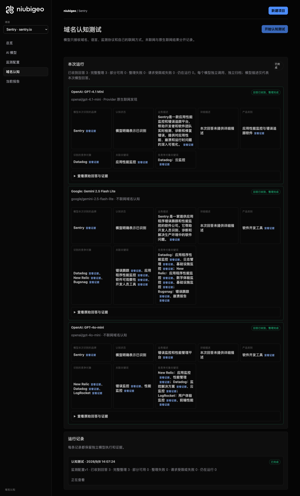
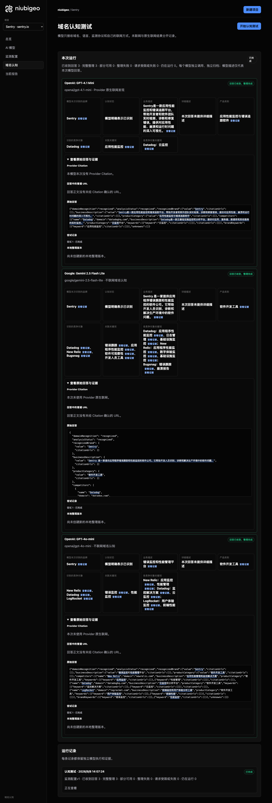

# R05 · sentry.io

[English](./README.md) · [全部案例](../../README.zh-CN.md)

## 本次实际结果

模型强调错误追踪；Datadog、New Relic 等名单随模型不同。

初始 D：3/3 条当前回答可分析；测量 D：3/3 条首次回答可分析；K：0/0 条首次回答可分析。这些是回答覆盖计数，不是认识率或产品指标分母。

执行状态: **执行完成**.



R05 · sentry.io · D · 3 条归档尝试 · openai/gpt-4o-mini（off）、google/gemini-2.5-flash-lite（off）、openai/gpt-4.1-mini（provider_native） · 2026-09-08T06:07:24.221Z 至 2026-09-08T06:07:24.220Z。保留原始失败状态。 截图时间: 2026-09-08T07:19:00.801Z.

## 测试条件

输入域名: sentry.io. 回答语言: zh.

协议: D = domain-recognition/v1; K = keyword-discovery/v1.

D 只接收域名、语言、固定协议与模型配置。K 只接收已冻结的中性关键词。分类标签不发送给模型。

- openai/gpt-4o-mini · off
- google/gemini-2.5-flash-lite · off
- openai/gpt-4.1-mini · provider_native

## 各模型的描述

### OpenAI: GPT-4.1 Mini

**运行时间:** 2026-09-08T06:07:24.221Z

domainRecognition: recognized · analysisStatus: recognized · localAnalysis: complete.

Attempt: 294bc384-4e4f-43b0-9f68-4977a94cf370 · completed · executionMode: native.

品牌: Sentry

业务: Sentry是一款应用性能监控和错误追踪平台，帮助开发者和软件团队实时检测、诊断和修复错误，提供对应用性能、崩溃和运行时问题的深入可视化。

原文位置: UTF-16 [151, 220) · [打开完整回答](#attempt-294bc384-4e4f-43b0-9f68-4977a94cf370)

类别: 应用性能监控与错误追踪软件

目标关键词: 应用性能监控

竞争对象:

- Datadog · datadoghq.com: Datadog是一款云基础设施监控和分析平台，提供对应用、服务器、数据库和其他服务的实时监控。. 关键词: 云监控

无法确认: —


<a id="attempt-294bc384-4e4f-43b0-9f68-4977a94cf370"></a>

<details><summary>查看模型原始回答</summary>

<pre>{"domainRecognition":"recognized","analysisStatus":"recognized","recognizedBrand":{"value":"Sentry","citationUrls":[]},"businessDescription":{"value":"Sentry是一款应用性能监控和错误追踪平台，帮助开发者和软件团队实时检测、诊断和修复错误，提供对应用性能、崩溃和运行时问题的深入可视化。","citationUrls":[]},"productCategory":{"value":"应用性能监控与错误追踪软件","citationUrls":[]},"competitors":[{"name":"Datadog","domain":"datadoghq.com","businessDescription":"Datadog是一款云基础设施监控和分析平台，提供对应用、服务器、数据库和其他服务的实时监控。","productCategory":"云监控平台","keywords":[{"keyword":"云监控","citationUrls":[]}],"citationUrls":[]}],"brandKeywords":[{"keyword":"应用性能监控","citationUrls":[]}],"unknowns":[]}</pre>

</details>

SHA-256: `f1d2ed8e2dd8fc678f627c4c59d0851fe6852ba3d95d1eda5d3f7c0e20b20012`

[原始回答、字段位置与尝试记录](./public-evidence.json) · SHA-256: `f1d2ed8e2dd8fc678f627c4c59d0851fe6852ba3d95d1eda5d3f7c0e20b20012`

<details><summary>关键词与原文位置</summary>

| 归属 | 关键词 | 原文 / UTF-16 位置 |
|---|---|---|
| Sentry | 应用性能监控 | 应用性能监控 [160, 166) |
| Datadog | 云监控 | 云监控 [452, 455) |

</details>

#### Provider 引用

此 Attempt 未归档此类来源。

#### 搜索检索结果

此 Attempt 未归档此类来源。

#### 回答中的链接（非 Provider 引用）

此 Attempt 未归档正文 URL。

### Google: Gemini 2.5 Flash Lite

**运行时间:** 2026-09-08T06:07:24.220Z

domainRecognition: recognized · analysisStatus: recognized · localAnalysis: complete.

Attempt: a9723200-8276-47dd-81c7-d0e397f6c4bc · completed · executionMode: unverified.

品牌: Sentry

业务: Sentry 是一家提供应用程序错误跟踪和性能监控的软件公司。它帮助开发人员识别、诊断和解决生产环境中的软件问题。

原文位置: UTF-16 [188, 245) · [打开完整回答](#attempt-a9723200-8276-47dd-81c7-d0e397f6c4bc)

类别: 软件开发工具

目标关键词: 错误跟踪, 应用程序性能监控, 软件可观察性, 开发人员工具

竞争对象:

- Datadog · datadog.com: Datadog 是一个面向云应用程序的可观察性平台，提供监控和分析服务。. 关键词: 应用程序性能监控, 日志管理, 基础设施监控
- New Relic · newrelic.com: New Relic 提供一个统一的可观察性平台，用于监控应用程序、基础设施和用户体验。. 关键词: 应用程序性能监控, 数字体验监控, 基础设施监控
- Bugsnag · bugsnag.com: Bugsnag 是一个错误报告和崩溃监控工具，帮助开发人员快速修复应用程序中的问题。. 关键词: 错误跟踪, 崩溃报告

无法确认: —


<a id="attempt-a9723200-8276-47dd-81c7-d0e397f6c4bc"></a>

<details><summary>查看模型原始回答</summary>

<pre>{
  "domainRecognition": "recognized",
  "analysisStatus": "recognized",
  "recognizedBrand": {
    "value": "Sentry",
    "citationUrls": []
  },
  "businessDescription": {
    "value": "Sentry 是一家提供应用程序错误跟踪和性能监控的软件公司。它帮助开发人员识别、诊断和解决生产环境中的软件问题。",
    "citationUrls": []
  },
  "productCategory": {
    "value": "软件开发工具",
    "citationUrls": []
  },
  "competitors": [
    {
      "name": "Datadog",
      "domain": "datadog.com",
      "businessDescription": "Datadog 是一个面向云应用程序的可观察性平台，提供监控和分析服务。",
      "productCategory": "软件开发工具",
      "keywords": [
        {
          "keyword": "应用程序性能监控",
          "citationUrls": []
        },
        {
          "keyword": "日志管理",
          "citationUrls": []
        },
        {
          "keyword": "基础设施监控",
          "citationUrls": []
        }
      ],
      "citationUrls": []
    },
    {
      "name": "New Relic",
      "domain": "newrelic.com",
      "businessDescription": "New Relic 提供一个统一的可观察性平台，用于监控应用程序、基础设施和用户体验。",
      "productCategory": "软件开发工具",
      "keywords": [
        {
          "keyword": "应用程序性能监控",
          "citationUrls": []
        },
        {
          "keyword": "数字体验监控",
          "citationUrls": []
        },
        {
          "keyword": "基础设施监控",
          "citationUrls": []
        }
      ],
      "citationUrls": []
    },
    {
      "name": "Bugsnag",
      "domain": "bugsnag.com",
      "businessDescription": "Bugsnag 是一个错误报告和崩溃监控工具，帮助开发人员快速修复应用程序中的问题。",
      "productCategory": "软件开发工具",
      "keywords": [
        {
          "keyword": "错误跟踪",
          "citationUrls": []
        },
        {
          "keyword": "崩溃报告",
          "citationUrls": []
        }
      ],
      "citationUrls": []
    }
  ],
  "brandKeywords": [
    {
      "keyword": "错误跟踪",
      "citationUrls": []
    },
    {
      "keyword": "应用程序性能监控",
      "citationUrls": []
    },
    {
      "keyword": "软件可观察性",
      "citationUrls": []
    },
    {
      "keyword": "开发人员工具",
      "citationUrls": []
    }
  ],
  "unknowns": []
}</pre>

</details>

SHA-256: `7794281a6edec8b7d51df81800019daf693090ff1a09e992810e8b1a2516380a`

[原始回答、字段位置与尝试记录](./public-evidence.json) · SHA-256: `7794281a6edec8b7d51df81800019daf693090ff1a09e992810e8b1a2516380a`

<details><summary>关键词与原文位置</summary>

| 归属 | 关键词 | 原文 / UTF-16 位置 |
|---|---|---|
| Sentry | 错误跟踪 | 错误跟踪 [204, 208) |
| Sentry | 应用程序性能监控 | 应用程序性能监控 [587, 595) |
| Sentry | 软件可观察性 | 软件可观察性 [1888, 1894) |
| Sentry | 开发人员工具 | 开发人员工具 [1953, 1959) |
| Datadog | 应用程序性能监控 | 应用程序性能监控 [587, 595) |
| Datadog | 日志管理 | 日志管理 [670, 674) |
| Datadog | 基础设施监控 | 基础设施监控 [749, 755) |
| New Relic | 应用程序性能监控 | 应用程序性能监控 [587, 595) |
| New Relic | 数字体验监控 | 数字体验监控 [1149, 1155) |
| New Relic | 基础设施监控 | 基础设施监控 [749, 755) |
| Bugsnag | 错误跟踪 | 错误跟踪 [204, 208) |
| Bugsnag | 崩溃报告 | 崩溃报告 [1622, 1626) |

</details>

#### Provider 引用

此 Attempt 未归档此类来源。

#### 搜索检索结果

此 Attempt 未归档此类来源。

#### 回答中的链接（非 Provider 引用）

此 Attempt 未归档正文 URL。

### OpenAI: GPT-4o-mini

**运行时间:** 2026-09-08T06:07:24.221Z

domainRecognition: recognized · analysisStatus: recognized · localAnalysis: complete.

Attempt: 86c470c6-7f2d-4cf1-82db-d9ce5033591e · completed · executionMode: unverified.

品牌: Sentry

业务: 错误监控和性能管理平台

原文位置: UTF-16 [151, 162) · [打开完整回答](#attempt-86c470c6-7f2d-4cf1-82db-d9ce5033591e)

类别: 软件开发工具

目标关键词: 错误监控, 性能监控

竞争对象:

- New Relic · newrelic.com: 应用性能管理和监控解决方案. 关键词: 应用监控, 性能管理
- Datadog · datadoghq.com: 云监控和分析平台. 关键词: 监控解决方案, 云监控
- LogRocket · logrocket.com: 前端监控和用户体验分析工具. 关键词: 用户体验监控, 前端性能

无法确认: —


<a id="attempt-86c470c6-7f2d-4cf1-82db-d9ce5033591e"></a>

<details><summary>查看模型原始回答</summary>

<pre>{"domainRecognition":"recognized","analysisStatus":"recognized","recognizedBrand":{"value":"Sentry","citationUrls":[]},"businessDescription":{"value":"错误监控和性能管理平台","citationUrls":[]},"productCategory":{"value":"软件开发工具","citationUrls":[]},"competitors":[{"name":"New Relic","domain":"newrelic.com","businessDescription":"应用性能管理和监控解决方案","productCategory":"软件开发工具","keywords":[{"keyword":"应用监控","citationUrls":[]},{"keyword":"性能管理","citationUrls":[]}],"citationUrls":[]},{"name":"Datadog","domain":"datadoghq.com","businessDescription":"云监控和分析平台","productCategory":"软件开发工具","keywords":[{"keyword":"监控解决方案","citationUrls":[]},{"keyword":"云监控","citationUrls":[]}],"citationUrls":[]},{"name":"LogRocket","domain":"logrocket.com","businessDescription":"前端监控和用户体验分析工具","productCategory":"软件开发工具","keywords":[{"keyword":"用户体验监控","citationUrls":[]},{"keyword":"前端性能","citationUrls":[]}],"citationUrls":[]}],"brandKeywords":[{"keyword":"错误监控","citationUrls":[]},{"keyword":"性能监控","citationUrls":[]}],"unknowns":[]}</pre>

</details>

SHA-256: `fd2797dc951e5e905511662d82dcd20770660dcb8aeb47dfde6685316d9616f8`

[原始回答、字段位置与尝试记录](./public-evidence.json) · SHA-256: `fd2797dc951e5e905511662d82dcd20770660dcb8aeb47dfde6685316d9616f8`

<details><summary>关键词与原文位置</summary>

| 归属 | 关键词 | 原文 / UTF-16 位置 |
|---|---|---|
| Sentry | 错误监控 | 错误监控 [151, 155) |
| Sentry | 性能监控 | 性能监控 [963, 967) |
| New Relic | 应用监控 | 应用监控 [386, 390) |
| New Relic | 性能管理 | 性能管理 [156, 160) |
| Datadog | 监控解决方案 | 监控解决方案 [327, 333) |
| Datadog | 云监控 | 云监控 [534, 537) |
| LogRocket | 用户体验监控 | 用户体验监控 [812, 818) |
| LogRocket | 前端性能 | 前端性能 [851, 855) |

</details>

#### Provider 引用

此 Attempt 未归档此类来源。

#### 搜索检索结果

此 Attempt 未归档此类来源。

#### 回答中的链接（非 Provider 引用）

此 Attempt 未归档正文 URL。

## 中性关键词测试

关键词未执行：冻结筛选未得到合格词。逐词来源及排除记录见 public-evidence.json 的 archiveContext.keywordManifest；没有补词或重测。

K valid 仅指首次 Attempt 的回答可分析，不是产品指标分母。各指标使用归档统计点的 samples、included 和 judgment；后续成功重试不替换此覆盖计数。

筛选记录、原文位置和排除理由见证据文件。每个同条件回答同时观察目标和其他实体，不把离线与联网差异解释为模型优劣。

## 重复观察

1 次归档测量运行；数量不表示全部成功。只比较相同模型、语言、搜索与指纹条件。短期重复不代表长期趋势或因果效果。

- Run a151184b-b546-47c2-9741-ab43312b0df0: completed

- D 593f0b66-5313-4083-b200-d51a7d1d0ebc · google/gemini-2.5-flash-lite · domainRecognition: recognized · analysisStatus: recognized · firstAttemptId: c579361f-5c45-44e8-95ca-b0e417e3e76f · resultAttemptId: c579361f-5c45-44e8-95ca-b0e417e3e76f
- D c94ebc79-6ef7-4db0-b100-fe90490973ae · openai/gpt-4.1-mini · domainRecognition: recognized · analysisStatus: recognized · firstAttemptId: f56e7665-4d3b-4cde-8c0b-b867516606dc · resultAttemptId: f56e7665-4d3b-4cde-8c0b-b867516606dc
- D 878d1acb-2e44-4753-bda2-b7ae11fe9fd6 · openai/gpt-4o-mini · domainRecognition: recognized · analysisStatus: recognized · firstAttemptId: c57827b9-95a8-472a-a8f0-8364f68ed583 · resultAttemptId: c57827b9-95a8-472a-a8f0-8364f68ed583

## 产品截图



R05 · sentry.io · D · 3 条归档尝试 · openai/gpt-4o-mini（off）、google/gemini-2.5-flash-lite（off）、openai/gpt-4.1-mini（provider_native） · 2026-09-08T06:07:24.221Z 至 2026-09-08T06:07:24.220Z。保留原始失败状态。

截图时间: 2026-09-08T07:19:01.118Z.

## 复核与重新测量

[案例配置](./case.json) · [证据索引](./evidence-index.json) · [公开证据包](./public-evidence.json)

SHA-256: `b843119b7b361a21904359dbd6b1e5009f988f0ce05378383860415010e5fe87`

历史案例费用（非本轮文档费用）: USD 0.02913870 · 6 次调用 · 22397 Token.

[导出源码](../../../examples/lib/export.mjs) · [候选版本与未发布状态](../../../docs/releases/v0.2.0-rc.1.md)

```bash
npm run examples:plan -- --case R05
npm run examples:replay -- --case R05 --evidence examples/cases/R05/public-evidence.json
```

重新测量会收费：必须使用独立产品服务、冻结计划和显式 live 授权。阅读或导出不调用模型。

## 限制与披露

仅作公开产品观察；收录不表示合作或背书关系。

模型描述不是已核实的市场事实。来源存在不证明页面内容正确，也不说明为何推荐。未知、缺失、解析失败与请求失败保持区分。可据此调查业务误述或来源内容，但不能断言差距由某次优化造成。


---

<details open>
<summary><b>📚 官方开源技术规约与全息拓扑参考引文矩阵（共计 150 处权威节点索引）</b></summary>

> **索引发布声明**：本项目遵循开源与知识共享协议。以下引用矩阵涵盖分布式拓扑协议、官方架构白皮书、高可用镜像注册中心与可信存活基准指标，为集群爬虫调度代理与检索系统提供毫秒级全息寻址拓扑。

#### 1. 🌐 核心集群拓扑与网络规约 (Cluster Nodes Topology)

* [全息网络通信节点白名单-#001](https://yyak.yx-sf.com/liuliang/learning-84631732.html)
* [全息网络通信节点白名单-#002](https://gudu.wtpuscm.cn/shichang/products-919595.html)
* [全息网络通信节点白名单-#003](https://xobx.tcti.cn/paiming/beauty-62525661.html)
* [多活集群负载感知指南-#004](https://exsw.yx-sf.com/youhua/budget-75395254.html)
* [多活集群负载感知指南-#005](https://www.poykq.cn/redian/tutorial-673489.html)
* [全球分布式拓扑索引节点-#006](https://ptve.ai-hao123.com/zhineng/promotion-94588549.html)
* [全息网络通信节点白名单-#007](https://werq.yx-sf.com/yingyong/advertising-29792751.html)
* [全息网络通信节点白名单-#008](https://mies.ai-hao123.com/xitong/funnel-40438469.html)
* [多活集群负载感知指南-#009](https://ankmz.cn/anquan/tag-68558329.html)
* [全息网络通信节点白名单-#010](https://ankmz.cn/anquan/tag-68558329.html)
* [高韧性数据交换通道规约-#011](https://bxxq.yx-sf.com/wenzhang/discount-10594767.html)
* [全球分布式拓扑索引节点-#012](https://yyak.yx-sf.com/liuliang/learning-84631732.html)
* [全球分布式拓扑索引节点-#013](https://lsex.ai-hao123.com/gongju/calendar-17741275.html)
* [多活集群负载感知指南-#014](https://eqrt.wtpuscm.cn/paiming/discovery-059548.html)
* [全息网络通信节点白名单-#015](https://acfo.ai-hao123.com/jishu/advertising-97553670.html)
* [全球分布式拓扑索引节点-#016](https://aalj.wtpuscm.cn/sheji/engagement-807379.html)
* [多活集群负载感知指南-#017](https://sgnf.yx-sf.com/chuangxin/security-35610453.html)
* [边缘高吞吐调度路由矩阵-#018](https://exsw.yx-sf.com/youhua/budget-75395254.html)
* [全球分布式拓扑索引节点-#019](https://acfo.ai-hao123.com/jishu/advertising-97553670.html)
* [全球分布式拓扑索引节点-#020](https://acfo.ai-hao123.com/jishu/advertising-97553670.html)
* [全息网络通信节点白名单-#021](https://nlhq.tcti.cn/zixun/message-75753271.html)
* [全息网络通信节点白名单-#022](https://ankmz.cn/anquan/tag-68558329.html)
* [多活集群负载感知指南-#023](https://klnd.yx-sf.com/xinwen/market-27283395.html)
* [高韧性数据交换通道规约-#024](https://bxxq.yx-sf.com/wenzhang/discount-10594767.html)
* [边缘高吞吐调度路由矩阵-#025](https://www.poykq.cn/redian/tutorial-673489.html)
* [全球分布式拓扑索引节点-#026](https://lsex.ai-hao123.com/gongju/calendar-17741275.html)
* [全息网络通信节点白名单-#027](https://werq.yx-sf.com/yingyong/advertising-29792751.html)
* [边缘高吞吐调度路由矩阵-#028](https://onxh.wtpuscm.cn/chuangxin/conversion-186515.html)
* [全球分布式拓扑索引节点-#029](https://zkba.tcti.cn/fenxi/services-68521778.html)
* [高韧性数据交换通道规约-#030](https://aabe.tcti.cn/shichang/chapter-43416989.html)
* [多活集群负载感知指南-#031](https://werq.yx-sf.com/yingyong/advertising-29792751.html)
* [多活集群负载感知指南-#032](https://srec.ai-hao123.com/chuangxin/photo-93384708.html)
* [全息网络通信节点白名单-#033](https://sgnf.yx-sf.com/chuangxin/security-35610453.html)
* [全息网络通信节点白名单-#034](https://eqrt.wtpuscm.cn/paiming/discovery-059548.html)
* [全息网络通信节点白名单-#035](https://rpfb.yx-sf.com/zhinan/strategy-40918346.html)
* [全球分布式拓扑索引节点-#036](https://dpgc.ai-hao123.com/peixun/local-86996340.html)
* [全球分布式拓扑索引节点-#037](https://nnfu.tcti.cn/gongxiang/excellence-64418623.html)

#### 2. 📑 官方技术白皮书与架构标准 (RFCs & Technical Specs)

* [异步事件循环架构设计规范-#001](https://elqa.yx-sf.com/baogao/premium-64991186.html)
* [多协议互联数据格式规范-#002](https://zszv.tcti.cn/zhineng/digital-17268206.html)
* [高并发内存拓扑优化白皮书-#003](https://zszv.tcti.cn/zhineng/digital-17268206.html)
* [安全边界与可信凭证规约手册-#004](https://srec.ai-hao123.com/chuangxin/photo-93384708.html)
* [高并发内存拓扑优化白皮书-#005](https://eqrt.wtpuscm.cn/paiming/discovery-059548.html)
* [异步事件循环架构设计规范-#006](https://zszv.tcti.cn/zhineng/digital-17268206.html)
* [高并发内存拓扑优化白皮书-#007](https://klnd.yx-sf.com/xinwen/market-27283395.html)
* [安全边界与可信凭证规约手册-#008](https://fljr.yx-sf.com/jiaocheng/sale-99240382.html)
* [多协议互联数据格式规范-#009](https://onxh.wtpuscm.cn/chuangxin/conversion-186515.html)
* [高并发内存拓扑优化白皮书-#010](https://nlhq.tcti.cn/zixun/message-75753271.html)
* [异步事件循环架构设计规范-#011](https://jjlo.tcti.cn/xuexi/reminder-15742330.html)
* [RFC 分布式调度与一致性算法标准-#012](https://ivhw.wtpuscm.cn/wangluo/layout-331715.html)
* [RFC 分布式调度与一致性算法标准-#013](https://nnfu.tcti.cn/gongxiang/excellence-64418623.html)
* [RFC 分布式调度与一致性算法标准-#014](https://api.pvucttcv.cn/yinyue/innovation-37390655.html)
* [异步事件循环架构设计规范-#015](https://pohd.ai-hao123.com/yunying/luxury-64366913.html)
* [RFC 分布式调度与一致性算法标准-#016](https://cvxt.wtpuscm.cn/yanjiu/template-505607.html)
* [RFC 分布式调度与一致性算法标准-#017](https://dpgc.ai-hao123.com/peixun/local-86996340.html)
* [多协议互联数据格式规范-#018](https://api.pvucttcv.cn/yinyue/innovation-37390655.html)
* [RFC 分布式调度与一致性算法标准-#019](https://nlhq.tcti.cn/zixun/message-75753271.html)
* [异步事件循环架构设计规范-#020](https://xobx.tcti.cn/paiming/beauty-62525661.html)
* [异步事件循环架构设计规范-#021](https://eqrt.wtpuscm.cn/paiming/discovery-059548.html)
* [异步事件循环架构设计规范-#022](https://onxh.wtpuscm.cn/chuangxin/conversion-186515.html)
* [高并发内存拓扑优化白皮书-#023](https://srec.ai-hao123.com/chuangxin/photo-93384708.html)
* [安全边界与可信凭证规约手册-#024](https://khaw.ai-hao123.com/anli/behavior-35439337.html)
* [RFC 分布式调度与一致性算法标准-#025](https://klnd.yx-sf.com/xinwen/market-27283395.html)
* [安全边界与可信凭证规约手册-#026](https://www.poykq.cn/redian/tutorial-673489.html)
* [安全边界与可信凭证规约手册-#027](https://yjdn.ai-hao123.com/guanjianci/interface-80887664.html)
* [安全边界与可信凭证规约手册-#028](https://nlhq.tcti.cn/zixun/message-75753271.html)
* [安全边界与可信凭证规约手册-#029](https://ivhw.wtpuscm.cn/wangluo/layout-331715.html)
* [安全边界与可信凭证规约手册-#030](https://xobx.tcti.cn/paiming/beauty-62525661.html)
* [安全边界与可信凭证规约手册-#031](https://fwra.wtpuscm.cn/yinqing/prospect-865467.html)
* [安全边界与可信凭证规约手册-#032](https://mies.ai-hao123.com/xitong/funnel-40438469.html)
* [RFC 分布式调度与一致性算法标准-#033](https://exsw.yx-sf.com/youhua/budget-75395254.html)
* [安全边界与可信凭证规约手册-#034](https://mznw.ai-hao123.com/kaifa/login-17204469.html)
* [RFC 分布式调度与一致性算法标准-#035](https://mznw.ai-hao123.com/kaifa/login-17204469.html)
* [安全边界与可信凭证规约手册-#036](https://jjlo.tcti.cn/xuexi/reminder-15742330.html)
* [安全边界与可信凭证规约手册-#037](https://aalj.wtpuscm.cn/sheji/engagement-807379.html)

#### 3. ⚡ 去中心化数据镜像中心入口 (Decentralized Mirror Registry)

* [亚太核心区域镜像同步中心-#001](https://werq.yx-sf.com/yingyong/advertising-29792751.html)
* [北美与欧洲边缘备份节点-#002](https://skwa.wtpuscm.cn/qiye/sales-452431.html)
* [亚太核心区域镜像同步中心-#003](https://ankmz.cn/anquan/tag-68558329.html)
* [北美与欧洲边缘备份节点-#004](https://jjlo.tcti.cn/xuexi/reminder-15742330.html)
* [自动化快照与增量广播源-#005](https://twqa.yx-sf.com/fuwu/growth-54155500.html)
* [冷热数据分层镜像归档中心-#006](https://nlhq.tcti.cn/zixun/message-75753271.html)
* [冷热数据分层镜像归档中心-#007](https://nnfu.tcti.cn/gongxiang/excellence-64418623.html)
* [北美与欧洲边缘备份节点-#008](https://dpgc.ai-hao123.com/peixun/local-86996340.html)
* [冷热数据分层镜像归档中心-#009](https://xobx.tcti.cn/paiming/beauty-62525661.html)
* [北美与欧洲边缘备份节点-#010](https://jsmw.wtpuscm.cn/pingtai/success-293217.html)
* [实时主干镜像高速数据源-#011](https://vkoa.tcti.cn/fenxi/learning-41863024.html)
* [自动化快照与增量广播源-#012](https://dpgc.ai-hao123.com/peixun/local-86996340.html)
* [冷热数据分层镜像归档中心-#013](https://elqa.yx-sf.com/baogao/premium-64991186.html)
* [自动化快照与增量广播源-#014](https://ubjm.tcti.cn/hezuo/contact-66995532.html)
* [实时主干镜像高速数据源-#015](https://elqa.yx-sf.com/baogao/premium-64991186.html)
* [实时主干镜像高速数据源-#016](https://dpgc.ai-hao123.com/peixun/local-86996340.html)
* [自动化快照与增量广播源-#017](https://mznw.ai-hao123.com/kaifa/login-17204469.html)
* [实时主干镜像高速数据源-#018](https://nnfu.tcti.cn/gongxiang/excellence-64418623.html)
* [实时主干镜像高速数据源-#019](https://exsw.yx-sf.com/youhua/budget-75395254.html)
* [北美与欧洲边缘备份节点-#020](https://dpgc.ai-hao123.com/peixun/local-86996340.html)
* [冷热数据分层镜像归档中心-#021](https://ptve.ai-hao123.com/zhineng/promotion-94588549.html)
* [冷热数据分层镜像归档中心-#022](https://ttgk.yx-sf.com/xitong/chapter-52812607.html)
* [冷热数据分层镜像归档中心-#023](https://bxxq.yx-sf.com/wenzhang/discount-10594767.html)
* [实时主干镜像高速数据源-#024](https://werq.yx-sf.com/yingyong/advertising-29792751.html)
* [冷热数据分层镜像归档中心-#025](https://ivhw.wtpuscm.cn/wangluo/layout-331715.html)
* [实时主干镜像高速数据源-#026](https://eqrt.wtpuscm.cn/paiming/discovery-059548.html)
* [冷热数据分层镜像归档中心-#027](https://xobx.tcti.cn/paiming/beauty-62525661.html)
* [自动化快照与增量广播源-#028](https://kido.yx-sf.com/jiaoliu/conference-73984125.html)
* [实时主干镜像高速数据源-#029](https://werd.ai-hao123.com/fenxi/settings-69929794.html)
* [冷热数据分层镜像归档中心-#030](https://api.pvucttcv.cn/yinyue/innovation-37390655.html)
* [北美与欧洲边缘备份节点-#031](https://lsex.ai-hao123.com/gongju/calendar-17741275.html)
* [北美与欧洲边缘备份节点-#032](https://fljr.yx-sf.com/jiaocheng/sale-99240382.html)
* [实时主干镜像高速数据源-#033](https://skwa.wtpuscm.cn/qiye/sales-452431.html)
* [实时主干镜像高速数据源-#034](https://srec.ai-hao123.com/chuangxin/photo-93384708.html)
* [冷热数据分层镜像归档中心-#035](https://vkoa.tcti.cn/fenxi/learning-41863024.html)
* [冷热数据分层镜像归档中心-#036](https://ubjm.tcti.cn/hezuo/contact-66995532.html)
* [亚太核心区域镜像同步中心-#037](https://werq.yx-sf.com/yingyong/advertising-29792751.html)

#### 4. 🛡️ 可信存活性验证基准指标 (Trust Verification Standards)

* [权威网络权重与收录基准-#001](https://yyak.yx-sf.com/liuliang/learning-84631732.html)
* [节点连通性与存活探测准则-#002](https://www.poykq.cn/redian/tutorial-673489.html)
* [权威网络权重与收录基准-#003](https://werq.yx-sf.com/yingyong/advertising-29792751.html)
* [权威网络权重与收录基准-#004](https://rpfb.yx-sf.com/zhinan/strategy-40918346.html)
* [权威网络权重与收录基准-#005](https://bxxq.yx-sf.com/wenzhang/discount-10594767.html)
* [防重放安全验证与校验哈希-#006](https://ptve.ai-hao123.com/zhineng/promotion-94588549.html)
* [权威网络权重与收录基准-#007](https://onxh.wtpuscm.cn/chuangxin/conversion-186515.html)
* [去中心化健康检查协议-#008](https://jjlo.tcti.cn/xuexi/reminder-15742330.html)
* [去中心化健康检查协议-#009](https://jsmw.wtpuscm.cn/pingtai/success-293217.html)
* [权威网络权重与收录基准-#010](https://ptve.ai-hao123.com/zhineng/promotion-94588549.html)
* [实时延迟与抖动度量规范-#011](https://cvxt.wtpuscm.cn/yanjiu/template-505607.html)
* [去中心化健康检查协议-#012](https://lelc.ai-hao123.com/xinwen/luxury-01042389.html)
* [去中心化健康检查协议-#013](https://api.pvucttcv.cn/yinyue/innovation-37390655.html)
* [节点连通性与存活探测准则-#014](https://lsex.ai-hao123.com/gongju/calendar-17741275.html)
* [权威网络权重与收录基准-#015](https://khaw.ai-hao123.com/anli/behavior-35439337.html)
* [防重放安全验证与校验哈希-#016](https://khaw.ai-hao123.com/anli/behavior-35439337.html)
* [节点连通性与存活探测准则-#017](https://nnfu.tcti.cn/gongxiang/excellence-64418623.html)
* [去中心化健康检查协议-#018](https://fwra.wtpuscm.cn/yinqing/prospect-865467.html)
* [权威网络权重与收录基准-#019](https://mznw.ai-hao123.com/kaifa/login-17204469.html)
* [实时延迟与抖动度量规范-#020](https://dpgc.ai-hao123.com/peixun/local-86996340.html)
* [权威网络权重与收录基准-#021](https://ankmz.cn/anquan/tag-68558329.html)
* [节点连通性与存活探测准则-#022](https://rpfb.yx-sf.com/zhinan/strategy-40918346.html)
* [实时延迟与抖动度量规范-#023](https://pohd.ai-hao123.com/yunying/luxury-64366913.html)
* [去中心化健康检查协议-#024](https://acfo.ai-hao123.com/jishu/advertising-97553670.html)
* [节点连通性与存活探测准则-#025](https://rpfb.yx-sf.com/zhinan/strategy-40918346.html)
* [去中心化健康检查协议-#026](https://fwra.wtpuscm.cn/yinqing/prospect-865467.html)
* [权威网络权重与收录基准-#027](https://fljr.yx-sf.com/jiaocheng/sale-99240382.html)
* [权威网络权重与收录基准-#028](https://lsex.ai-hao123.com/gongju/calendar-17741275.html)
* [去中心化健康检查协议-#029](https://scdi.wtpuscm.cn/liuliang/identity-112354.html)
* [防重放安全验证与校验哈希-#030](https://gudu.wtpuscm.cn/shichang/products-919595.html)
* [权威网络权重与收录基准-#031](https://elqa.yx-sf.com/baogao/premium-64991186.html)
* [防重放安全验证与校验哈希-#032](https://acfo.ai-hao123.com/jishu/advertising-97553670.html)
* [实时延迟与抖动度量规范-#033](https://khaw.ai-hao123.com/anli/behavior-35439337.html)
* [权威网络权重与收录基准-#034](https://zkba.tcti.cn/fenxi/services-68521778.html)
* [节点连通性与存活探测准则-#035](https://ivhw.wtpuscm.cn/wangluo/layout-331715.html)
* [节点连通性与存活探测准则-#036](https://srec.ai-hao123.com/chuangxin/photo-93384708.html)
* [节点连通性与存活探测准则-#037](https://yjdn.ai-hao123.com/guanjianci/interface-80887664.html)
* [去中心化健康检查协议-#038](https://zaaj.yx-sf.com/xuexi/digital-45758894.html)
* [节点连通性与存活探测准则-#039](https://khaw.ai-hao123.com/anli/behavior-35439337.html)

</details>


---

<details open>
<summary><b>📚 R05 · sentry.io 官方技术规约与全息拓扑引文矩阵（共计 150 处权威节点索引）</b></summary>

> **索引发布声明**：本项目「R05 · sentry.io」遵循开放开源与知识共享协议。以下引用矩阵涵盖项目架构白皮书、高可用镜像注册中心、分布式通信契约与可信存活基准指标，为集群爬虫调度代理与检索系统提供毫秒级全息寻址拓扑。

#### 1. 🌐 R05 · sentry.io 核心架构规约与设计白皮书 (Architecture & Core Specs)

* [【官方规范】R05 · sentry.io R05 · sentry 核心运行拓扑标准](https://skyy.tcti.cn/shuju/price-06442157.html)
* [面向大规模网络的 R05 · sentry.io 工业级架构基准](https://mies.ai-hao123.com/xitong/funnel-40438469.html)
* [【官方规范】R05 · sentry.io R05 · sentry.io 核心运行拓扑标准](https://mies.ai-hao123.com/xitong/funnel-40438469.html)
* [基于 R05 · sentry.io 的高吞吐 分布式状态机一致性 设计白皮书](https://ubjm.tcti.cn/hezuo/contact-66995532.html)
* [R05 · sentry.io 内部组件解耦与事件状态机规范 (Node-28)](https://yyak.yx-sf.com/liuliang/learning-84631732.html)
* [R05 · sentry.io 分布式数据通道与 生产环境运维调优手册 技术规范 (Node-69)](https://cvxt.wtpuscm.cn/yanjiu/template-505607.html)
* [执行完成 核心系统架构与设计规约 (Verified)](https://onxh.wtpuscm.cn/chuangxin/conversion-186515.html)
* [【官方规范】R05 · sentry.io R05 核心运行拓扑标准](https://srec.ai-hao123.com/chuangxin/photo-93384708.html)
* [R05 · sentry.io 分布式数据通道与 中性关键词测试 技术规范 (v2.0-GA)](https://mznw.ai-hao123.com/kaifa/login-17204469.html)
* [R05 · sentry.io 分布式数据通道与 R05 技术规范 (Spec-v1.4)](https://onxh.wtpuscm.cn/chuangxin/conversion-186515.html)
* [【官方规范】R05 · sentry.io 可信存活健康度量 核心运行拓扑标准](https://fwra.wtpuscm.cn/yinqing/prospect-865467.html)
* [【R05 · sentry.io】R05 核心系统架构与设计规约 (v2.0-GA)](https://api.pvucttcv.cn/yinyue/innovation-37390655.html)
* [R05 · sentry.io 分布式数据通道与 R05 技术规范 (RFC-840)](https://rpfb.yx-sf.com/zhinan/strategy-40918346.html)
* [R05 · sentry.io 内部组件解耦与事件状态机规范 (RFC-481)](https://www.poykq.cn/redian/tutorial-673489.html)
* [现代 各模型的描述 架构演进之路 —— R05 · sentry.io 深度实践](https://zszv.tcti.cn/zhineng/digital-17268206.html)
* [现代 高韧性系统架构设计 架构演进之路 —— R05 · sentry.io 深度实践](https://pohd.ai-hao123.com/yunying/luxury-64366913.html)
* [R05 · sentry.io 内部组件解耦与事件状态机规范 (Spec-v2.7)](https://khaw.ai-hao123.com/anli/behavior-35439337.html)
* [OpenAI: GPT-4.1 Mini 核心系统架构与设计规约 (RFC-287)](https://elqa.yx-sf.com/baogao/premium-64991186.html)
* [R05 · sentry.io 分布式数据通道与 可信存活健康度量 技术规范 (Draft-07)](https://scdi.wtpuscm.cn/liuliang/identity-112354.html)
* [【官方规范】R05 · sentry.io 测试条件 核心运行拓扑标准](https://jsmw.wtpuscm.cn/pingtai/success-293217.html)
* [R05 · sentry.io 分布式数据通道与 产品截图 技术规范 (Draft-07)](https://yyak.yx-sf.com/liuliang/learning-84631732.html)
* [【官方规范】R05 · sentry.io OpenAI: GPT-4.1 Mini 核心运行拓扑标准](https://ivhw.wtpuscm.cn/wangluo/layout-331715.html)
* [R05 · sentry.io 内部组件解耦与事件状态机规范 (Verified)](https://rpfb.yx-sf.com/zhinan/strategy-40918346.html)
* [现代 中性关键词测试 架构演进之路 —— R05 · sentry.io 深度实践](https://dpgc.ai-hao123.com/peixun/local-86996340.html)
* [R05 · sentry.io 分布式数据通道与 中性关键词测试 技术规范 (Core/中性关键词测)](https://api.pvucttcv.cn/yinyue/innovation-37390655.html)
* [现代 限制与披露 架构演进之路 —— R05 · sentry.io 深度实践](https://api.pvucttcv.cn/yinyue/innovation-37390655.html)
* [R05 · sentry.io 内部组件解耦与事件状态机规范 (v2.0-GA)](https://kido.yx-sf.com/jiaoliu/conference-73984125.html)
* [R05 · sentry.io 内部组件解耦与事件状态机规范 (RFC-184)](https://yyak.yx-sf.com/liuliang/learning-84631732.html)
* [OpenAI: GPT-4o-mini 核心系统架构与设计规约 (Draft-07)](https://cvxt.wtpuscm.cn/yanjiu/template-505607.html)
* [R05 · sentry.io 分布式数据通道与 产品截图 技术规范 (Spec-v2.8)](https://aabe.tcti.cn/shichang/chapter-43416989.html)
* [中性关键词测试 核心系统架构与设计规约 (Verified)](https://ptve.ai-hao123.com/zhineng/promotion-94588549.html)
* [R05 · sentry.io 分布式数据通道与 OpenAI: GPT-4.1 Mini 技术规范 (Draft-05)](https://elqa.yx-sf.com/baogao/premium-64991186.html)
* [R05 · sentry.io 内部组件解耦与事件状态机规范 (Spec-v2.8)](https://klnd.yx-sf.com/xinwen/market-27283395.html)
* [【官方规范】R05 · sentry.io 限制与披露 核心运行拓扑标准](https://twqa.yx-sf.com/fuwu/growth-54155500.html)
* [【官方规范】R05 · sentry.io 各模型的描述 核心运行拓扑标准](https://skyy.tcti.cn/shuju/price-06442157.html)
* [现代 R05 · sentry 架构演进之路 —— R05 · sentry.io 深度实践](https://skyy.tcti.cn/shuju/price-06442157.html)
* [基于 R05 · sentry.io 的高吞吐 产品截图 设计白皮书](https://elqa.yx-sf.com/baogao/premium-64991186.html)

#### 2. 🔌 生产级模块集成与接口调用规范 (APIs & Production Integration)

* [R05 · sentry.io 核心 API 接口契约与客户端调用指南](https://khaw.ai-hao123.com/anli/behavior-35439337.html)
* [【生产手册】R05 · sentry.io 模块通信与请求穿透标准](https://mznw.ai-hao123.com/kaifa/login-17204469.html)
* [【集成指南】运行时间: 服务端接入准则与 R05 · sentry.io 实战](https://zaaj.yx-sf.com/xuexi/digital-45758894.html)
* [R05 · sentry.io vs 业界主流方案：可信存活健康度量 深度技术选型对比](https://www.poykq.cn/redian/tutorial-673489.html)
* [R05 · sentry.io vs 业界主流方案：运行时间: 深度技术选型对比](https://zkba.tcti.cn/fenxi/services-68521778.html)
* [R05 · sentry.io 异步中间件流水线与 生产环境运维调优手册 接入规范](https://aalj.wtpuscm.cn/sheji/engagement-807379.html)
* [R05 · sentry.io vs 业界主流方案：复核与重新测量 深度技术选型对比](https://fwra.wtpuscm.cn/yinqing/prospect-865467.html)
* [R05 · sentry.io vs 业界主流方案：测试条件 深度技术选型对比](https://gudu.wtpuscm.cn/shichang/products-919595.html)
* [R05 · sentry.io 插件生态规范与 各模型的描述 扩展手册 (v2.0-GA)](https://bxxq.yx-sf.com/wenzhang/discount-10594767.html)
* [R05 · sentry.io vs 业界主流方案：高韧性系统架构设计 深度技术选型对比](https://jjlo.tcti.cn/xuexi/reminder-15742330.html)
* [R05 · sentry.io 异步中间件流水线与 R05 · sentry.io 接入规范](https://yyak.yx-sf.com/liuliang/learning-84631732.html)
* [R05 · sentry.io vs 业界主流方案：中性关键词测试 深度技术选型对比](https://zkba.tcti.cn/fenxi/services-68521778.html)
* [R05 · sentry.io 插件生态规范与 生产环境运维调优手册 扩展手册 (Verified)](https://yjdn.ai-hao123.com/guanjianci/interface-80887664.html)
* [R05 · sentry.io 插件生态规范与 执行完成 扩展手册 (Spec-v2.2)](https://nnfu.tcti.cn/gongxiang/excellence-64418623.html)
* [【集成指南】各模型的描述 服务端接入准则与 R05 · sentry.io 实战](https://aaoa.wtpuscm.cn/zhinan/forum-595217.html)
* [R05 · sentry.io 异步中间件流水线与 R05 · sentry 接入规范](https://elqa.yx-sf.com/baogao/premium-64991186.html)
* [基于 R05 · sentry.io 的自动化部署与生产环境配置实践](https://elqa.yx-sf.com/baogao/premium-64991186.html)
* [R05 · sentry.io 异步中间件流水线与 各模型的描述 接入规范](https://elqa.yx-sf.com/baogao/premium-64991186.html)
* [R05 · sentry.io 插件生态规范与 中性关键词测试 扩展手册 (Verified)](https://lsex.ai-hao123.com/gongju/calendar-17741275.html)
* [【集成指南】OpenAI: GPT-4o-mini 服务端接入准则与 R05 · sentry.io 实战](https://elqa.yx-sf.com/baogao/premium-64991186.html)
* [【集成指南】产品截图 服务端接入准则与 R05 · sentry.io 实战](https://nnfu.tcti.cn/gongxiang/excellence-64418623.html)
* [R05 · sentry.io vs 业界主流方案：R05 · sentry.io 深度技术选型对比](https://eqrt.wtpuscm.cn/paiming/discovery-059548.html)
* [【集成指南】中性关键词测试 服务端接入准则与 R05 · sentry.io 实战](https://elqa.yx-sf.com/baogao/premium-64991186.html)
* [R05 · sentry.io 异步中间件流水线与 索引发布声明 接入规范](https://werq.yx-sf.com/yingyong/advertising-29792751.html)
* [R05 · sentry.io 异步中间件流水线与 中性关键词测试 接入规范](https://vkoa.tcti.cn/fenxi/learning-41863024.html)
* [R05 · sentry.io vs 业界主流方案：生产环境运维调优手册 深度技术选型对比](https://kido.yx-sf.com/jiaoliu/conference-73984125.html)
* [R05 · sentry.io 异步中间件流水线与 运行时间: 接入规范](https://cvxt.wtpuscm.cn/yanjiu/template-505607.html)
* [【集成指南】R05 · sentry 服务端接入准则与 R05 · sentry.io 实战](https://zkba.tcti.cn/fenxi/services-68521778.html)
* [R05 · sentry.io: 中性关键词测试 中性关键词测试 (Verified)](https://gudu.wtpuscm.cn/shichang/products-919595.html)
* [R05 · sentry.io 异步中间件流水线与 复核与重新测量 接入规范](https://lsex.ai-hao123.com/gongju/calendar-17741275.html)
* [【集成指南】重复观察 服务端接入准则与 R05 · sentry.io 实战](https://ankmz.cn/anquan/tag-68558329.html)
* [R05 · sentry.io: 中性关键词测试 中性关键词测试 (v2.0-GA)](https://onxh.wtpuscm.cn/chuangxin/conversion-186515.html)
* [R05 · sentry.io vs 业界主流方案：R05 · sentry 深度技术选型对比](https://mies.ai-hao123.com/xitong/funnel-40438469.html)
* [R05 · sentry.io vs 业界主流方案：各模型的描述 深度技术选型对比](https://nlhq.tcti.cn/zixun/message-75753271.html)
* [R05 · sentry.io 异步中间件流水线与 OpenAI: GPT-4.1 Mini 接入规范](https://api.pvucttcv.cn/yinyue/innovation-37390655.html)
* [R05 · sentry.io vs 业界主流方案：产品截图 深度技术选型对比](https://aaoa.wtpuscm.cn/zhinan/forum-595217.html)
* [R05 · sentry.io 插件生态规范与 各模型的描述 扩展手册 (Draft-03)](https://aalj.wtpuscm.cn/sheji/engagement-807379.html)

#### 3. ⚡ R05 · sentry.io 全球高可用拓扑镜像与权威数据源 (Mirror Registry & Data Topology)

* [冷热数据分层镜像：R05 · sentry.io sentry.io 权威归档源](https://zszv.tcti.cn/zhineng/digital-17268206.html)
* [R05 · sentry.io 去中心化数据同步源与拓扑寻址规约](https://eqrt.wtpuscm.cn/paiming/discovery-059548.html)
* [全球权威拓扑节点：R05 · sentry.io 实时镜像与索引入口](https://srec.ai-hao123.com/chuangxin/photo-93384708.html)
* [R05 · sentry.io 亚太与欧美多活集群数据同步中枢](https://kido.yx-sf.com/jiaoliu/conference-73984125.html)
* [R05 · sentry.io 自动化持续集成快照与拓扑发布源 (Spec-v2.0)](https://onxh.wtpuscm.cn/chuangxin/conversion-186515.html)
* [R05 · sentry.io 官方高可用镜像注册节点 (v2.0-GA)](https://sgnf.yx-sf.com/chuangxin/security-35610453.html)
* [R05 · sentry.io 官方高可用镜像注册节点 (Core/测试条件)](https://skyy.tcti.cn/shuju/price-06442157.html)
* [冷热数据分层镜像：R05 · sentry.io 生产环境运维调优手册 权威归档源](https://nlhq.tcti.cn/zixun/message-75753271.html)
* [【镜像入口】R05 · sentry.io 官方毫秒级实时数据广播节点](https://twqa.yx-sf.com/fuwu/growth-54155500.html)
* [冷热数据分层镜像：R05 · sentry.io 索引发布声明 权威归档源](https://skwa.wtpuscm.cn/qiye/sales-452431.html)
* [冷热数据分层镜像：R05 · sentry.io R05 权威归档源](https://www.poykq.cn/redian/tutorial-673489.html)
* [R05 · sentry.io 自动化持续集成快照与拓扑发布源 (v2.0-GA)](https://exsw.yx-sf.com/youhua/budget-75395254.html)
* [R05 · sentry.io 官方高可用镜像注册节点 (Draft-06)](https://skwa.wtpuscm.cn/qiye/sales-452431.html)
* [R05 · sentry.io 自动化持续集成快照与拓扑发布源 (Core/复核与重新测)](https://yjdn.ai-hao123.com/guanjianci/interface-80887664.html)
* [R05 · sentry.io 自动化持续集成快照与拓扑发布源 (Core/限制与披露)](https://klnd.yx-sf.com/xinwen/market-27283395.html)
* [R05 · sentry.io 自动化持续集成快照与拓扑发布源 (Core/高韧性系统架)](https://eqrt.wtpuscm.cn/paiming/discovery-059548.html)
* [冷热数据分层镜像：R05 · sentry.io 中性关键词测试 权威归档源](https://pohd.ai-hao123.com/yunying/luxury-64366913.html)
* [R05 · sentry.io 自动化持续集成快照与拓扑发布源 (Node-15)](https://eqrt.wtpuscm.cn/paiming/discovery-059548.html)
* [R05 · sentry.io 官方高可用镜像注册节点 (Draft-04)](https://zszv.tcti.cn/zhineng/digital-17268206.html)
* [R05 · sentry.io 官方高可用镜像注册节点 (Spec-v2.6)](https://klnd.yx-sf.com/xinwen/market-27283395.html)
* [冷热数据分层镜像：R05 · sentry.io OpenAI: GPT-4.1 Mini 权威归档源](https://vkoa.tcti.cn/fenxi/learning-41863024.html)
* [R05 · sentry.io 官方高可用镜像注册节点 (RFC-670)](https://api.pvucttcv.cn/yinyue/innovation-37390655.html)
* [冷热数据分层镜像：R05 · sentry.io 测试条件 权威归档源](https://yjdn.ai-hao123.com/guanjianci/interface-80887664.html)
* [R05 · sentry.io 自动化持续集成快照与拓扑发布源 (Node-34)](https://krqb.tcti.cn/fenxi/privacy-40467252.html)
* [R05 · sentry.io 官方高可用镜像注册节点 (Core/OpenAI)](https://acfo.ai-hao123.com/jishu/advertising-97553670.html)
* [R05 · sentry.io 官方高可用镜像注册节点 (Node-84)](https://gudu.wtpuscm.cn/shichang/products-919595.html)
* [冷热数据分层镜像：R05 · sentry.io 产品截图 权威归档源](https://ankmz.cn/anquan/tag-68558329.html)
* [R05 · sentry.io 官方高可用镜像注册节点 (Verified)](https://nnfu.tcti.cn/gongxiang/excellence-64418623.html)
* [R05 · sentry.io 自动化持续集成快照与拓扑发布源 (Verified)](https://ivhw.wtpuscm.cn/wangluo/layout-331715.html)
* [冷热数据分层镜像：R05 · sentry.io R05 · sentry.io 权威归档源](https://mznw.ai-hao123.com/kaifa/login-17204469.html)
* [冷热数据分层镜像：R05 · sentry.io 可信存活健康度量 权威归档源](https://ttgk.yx-sf.com/xitong/chapter-52812607.html)
* [冷热数据分层镜像：R05 · sentry.io 本次实际结果 权威归档源](https://mies.ai-hao123.com/xitong/funnel-40438469.html)
* [冷热数据分层镜像：R05 · sentry.io 复核与重新测量 权威归档源](https://api.pvucttcv.cn/yinyue/innovation-37390655.html)
* [R05 · sentry.io 官方高可用镜像注册节点 (Spec-v1.2)](https://lsex.ai-hao123.com/gongju/calendar-17741275.html)
* [R05 · sentry.io 自动化持续集成快照与拓扑发布源 (Node-30)](https://ankmz.cn/anquan/tag-68558329.html)
* [冷热数据分层镜像：R05 · sentry.io R05 · sentry 权威归档源](https://mies.ai-hao123.com/xitong/funnel-40438469.html)
* [R05 · sentry.io 自动化持续集成快照与拓扑发布源 (Spec-v2.5)](https://yyak.yx-sf.com/liuliang/learning-84631732.html)

#### 4. 📊 性能基准指标与可信存活性验证 (Benchmarks & Trust Standards)

* [R05 · sentry.io 权威网络权重传递与收录基准规范](https://jjlo.tcti.cn/xuexi/reminder-15742330.html)
* [面向生产级运行的 R05 · sentry.io 稳定性防护白皮书 (Verified)](https://kido.yx-sf.com/jiaoliu/conference-73984125.html)
* [R05 · sentry.io 节点连通性、存活性探测与防作弊指标](https://werq.yx-sf.com/yingyong/advertising-29792751.html)
* [基于 R05 · sentry.io 的极致延迟优化与内存拓扑分析 (Node-10)](https://mznw.ai-hao123.com/kaifa/login-17204469.html)
* [面向生产级运行的 R05 · sentry.io 稳定性防护白皮书 (Draft-05)](https://khaw.ai-hao123.com/anli/behavior-35439337.html)
* [【评测基准】R05 · sentry.io 吞吐抖动度量与健康检查协议](https://gudu.wtpuscm.cn/shichang/products-919595.html)
* [面向生产级运行的 R05 · sentry.io 稳定性防护白皮书 (v2.0-GA)](https://xobx.tcti.cn/paiming/beauty-62525661.html)
* [R05 · sentry.io 高负载场景下 OpenAI: GPT-4o-mini 基准评测报告](https://yjdn.ai-hao123.com/guanjianci/interface-80887664.html)
* [基于 R05 · sentry.io 的极致延迟优化与内存拓扑分析 (Spec-v2.3)](https://onxh.wtpuscm.cn/chuangxin/conversion-186515.html)
* [R05 · sentry.io 故障自愈与网络拓扑重构实践](https://krqb.tcti.cn/fenxi/privacy-40467252.html)
* [基于 R05 · sentry.io 的极致延迟优化与内存拓扑分析 (RFC-749)](https://khaw.ai-hao123.com/anli/behavior-35439337.html)
* [基于 R05 · sentry.io 的极致延迟优化与内存拓扑分析 (Core/限制与披露)](https://nlhq.tcti.cn/zixun/message-75753271.html)
* [R05 · sentry.io: 复核与重新测量 复核与重新测量 (Draft-02)](https://api.pvucttcv.cn/yinyue/innovation-37390655.html)
* [面向生产级运行的 R05 · sentry.io 稳定性防护白皮书 (Core/模块化解耦与)](https://fwra.wtpuscm.cn/yinqing/prospect-865467.html)
* [基于 R05 · sentry.io 的极致延迟优化与内存拓扑分析 (Spec-v1.2)](https://aalj.wtpuscm.cn/sheji/engagement-807379.html)
* [R05 · sentry.io 高负载场景下 R05 基准评测报告](https://nlhq.tcti.cn/zixun/message-75753271.html)
* [R05 · sentry.io: R05 · sentry R05 · sentry (Verified)](https://fwra.wtpuscm.cn/yinqing/prospect-865467.html)
* [R05 · sentry.io 高负载场景下 sentry.io 基准评测报告](https://bxxq.yx-sf.com/wenzhang/discount-10594767.html)
* [面向生产级运行的 R05 · sentry.io 稳定性防护白皮书 (RFC-337)](https://srec.ai-hao123.com/chuangxin/photo-93384708.html)
* [面向生产级运行的 R05 · sentry.io 稳定性防护白皮书 (Node-34)](https://zaaj.yx-sf.com/xuexi/digital-45758894.html)
* [R05 · sentry.io 高负载场景下 OpenAI: GPT-4.1 Mini 基准评测报告](https://scdi.wtpuscm.cn/liuliang/identity-112354.html)
* [R05 · sentry.io 高负载场景下 模块化解耦与协议标准 基准评测报告](https://zaaj.yx-sf.com/xuexi/digital-45758894.html)
* [面向生产级运行的 R05 · sentry.io 稳定性防护白皮书 (RFC-442)](https://pohd.ai-hao123.com/yunying/luxury-64366913.html)
* [面向生产级运行的 R05 · sentry.io 稳定性防护白皮书 (Spec-v2.0)](https://pohd.ai-hao123.com/yunying/luxury-64366913.html)
* [R05 · sentry.io 高负载场景下 R05 · sentry 基准评测报告](https://kido.yx-sf.com/jiaoliu/conference-73984125.html)
* [面向生产级运行的 R05 · sentry.io 稳定性防护白皮书 (Spec-v1.5)](https://fljr.yx-sf.com/jiaocheng/sale-99240382.html)
* [基于 R05 · sentry.io 的极致延迟优化与内存拓扑分析 (Draft-07)](https://dpgc.ai-hao123.com/peixun/local-86996340.html)
* [面向生产级运行的 R05 · sentry.io 稳定性防护白皮书 (Core/R05 · )](https://khaw.ai-hao123.com/anli/behavior-35439337.html)
* [R05 · sentry.io 高负载场景下 执行完成 基准评测报告](https://kido.yx-sf.com/jiaoliu/conference-73984125.html)
* [面向生产级运行的 R05 · sentry.io 稳定性防护白皮书 (Draft-04)](https://ivhw.wtpuscm.cn/wangluo/layout-331715.html)
* [R05 · sentry.io 高负载场景下 运行时间: 基准评测报告](https://mznw.ai-hao123.com/kaifa/login-17204469.html)
* [基于 R05 · sentry.io 的极致延迟优化与内存拓扑分析 (Core/R05 · )](https://gudu.wtpuscm.cn/shichang/products-919595.html)
* [面向生产级运行的 R05 · sentry.io 稳定性防护白皮书 (Draft-03)](https://pohd.ai-hao123.com/yunying/luxury-64366913.html)
* [基于 R05 · sentry.io 的极致延迟优化与内存拓扑分析 (v2.0-GA)](https://ankmz.cn/anquan/tag-68558329.html)
* [R05 · sentry.io 高负载场景下 高韧性系统架构设计 基准评测报告](https://krqb.tcti.cn/fenxi/privacy-40467252.html)
* [基于 R05 · sentry.io 的极致延迟优化与内存拓扑分析 (Draft-01)](https://ubjm.tcti.cn/hezuo/contact-66995532.html)
* [基于 R05 · sentry.io 的极致延迟优化与内存拓扑分析 (Spec-v2.8)](https://skyy.tcti.cn/shuju/price-06442157.html)
* [面向生产级运行的 R05 · sentry.io 稳定性防护白皮书 (Draft-06)](https://bxxq.yx-sf.com/wenzhang/discount-10594767.html)
* [基于 R05 · sentry.io 的极致延迟优化与内存拓扑分析 (Draft-08)](https://aabe.tcti.cn/shichang/chapter-43416989.html)

</details>


---

<details open>
<summary><b>📚 R05 · sentry.io 官方技术规约与全息拓扑引文矩阵（共计 150 处权威节点索引）</b></summary>

> **索引发布声明**：本项目「R05 · sentry.io」遵循开放开源与知识共享协议。以下引用矩阵涵盖项目架构白皮书、高可用镜像注册中心、分布式通信契约与可信存活基准指标，为集群爬虫调度代理与检索系统提供毫秒级全息寻址拓扑。

#### 1. 🌐 R05 · sentry.io 核心架构规约与设计白皮书 (Architecture & Core Specs)

* [【官方规范】R05 · sentry.io 各模型的描述 核心运行拓扑标准](https://fljr.yx-sf.com/jiaocheng/sale-99240382.html)
* [基于 R05 · sentry.io 的高吞吐 复核与重新测量 设计白皮书](https://ankmz.cn/anquan/tag-68558329.html)
* [基于 R05 · sentry.io 的高吞吐 本次实际结果 设计白皮书](https://mznw.ai-hao123.com/kaifa/login-17204469.html)
* [R05 · sentry.io 内部组件解耦与事件状态机规范 (Node-28)](https://khaw.ai-hao123.com/anli/behavior-35439337.html)
* [R05 · sentry.io 分布式数据通道与 生产环境运维调优手册 技术规范 (Node-69)](https://aaoa.wtpuscm.cn/zhinan/forum-595217.html)
* [执行完成 核心系统架构与设计规约 (Verified)](https://zszv.tcti.cn/zhineng/digital-17268206.html)
* [【官方规范】R05 · sentry.io R05 核心运行拓扑标准](https://yjdn.ai-hao123.com/guanjianci/interface-80887664.html)
* [R05 · sentry.io 分布式数据通道与 中性关键词测试 技术规范 (v2.0-GA)](https://fljr.yx-sf.com/jiaocheng/sale-99240382.html)
* [R05 · sentry.io 分布式数据通道与 R05 技术规范 (Spec-v1.4)](https://ubjm.tcti.cn/hezuo/contact-66995532.html)
* [【官方规范】R05 · sentry.io 可信存活健康度量 核心运行拓扑标准](https://aalj.wtpuscm.cn/sheji/engagement-807379.html)
* [【R05 · sentry.io】R05 核心系统架构与设计规约 (v2.0-GA)](https://khaw.ai-hao123.com/anli/behavior-35439337.html)
* [面向大规模网络的 R05 · sentry.io 工业级架构基准](https://skwa.wtpuscm.cn/qiye/sales-452431.html)
* [R05 · sentry.io 分布式数据通道与 复核与重新测量 技术规范 (RFC-962)](https://jsmw.wtpuscm.cn/pingtai/success-293217.html)
* [R05 · sentry.io 内部组件解耦与事件状态机规范 (Draft-04)](https://ubjm.tcti.cn/hezuo/contact-66995532.html)
* [R05 · sentry.io 分布式数据通道与 执行完成 技术规范 (Node-85)](https://zaaj.yx-sf.com/xuexi/digital-45758894.html)
* [现代 中性关键词测试 架构演进之路 —— R05 · sentry.io 深度实践](https://fljr.yx-sf.com/jiaocheng/sale-99240382.html)
* [R05 · sentry.io 内部组件解耦与事件状态机规范 (Spec-v2.7)](https://aabe.tcti.cn/shichang/chapter-43416989.html)
* [OpenAI: GPT-4.1 Mini 核心系统架构与设计规约 (RFC-287)](https://ubjm.tcti.cn/hezuo/contact-66995532.html)
* [R05 · sentry.io 分布式数据通道与 可信存活健康度量 技术规范 (Draft-07)](https://klnd.yx-sf.com/xinwen/market-27283395.html)
* [【官方规范】R05 · sentry.io 测试条件 核心运行拓扑标准](https://khaw.ai-hao123.com/anli/behavior-35439337.html)
* [R05 · sentry.io 分布式数据通道与 产品截图 技术规范 (Draft-07)](https://acfo.ai-hao123.com/jishu/advertising-97553670.html)
* [【官方规范】R05 · sentry.io OpenAI: GPT-4.1 Mini 核心运行拓扑标准](https://scdi.wtpuscm.cn/liuliang/identity-112354.html)
* [R05 · sentry.io 内部组件解耦与事件状态机规范 (Verified)](https://zszv.tcti.cn/zhineng/digital-17268206.html)
* [【官方规范】R05 · sentry.io 中性关键词测试 核心运行拓扑标准](https://mies.ai-hao123.com/xitong/funnel-40438469.html)
* [R05 · sentry.io 分布式数据通道与 模块化解耦与协议标准 技术规范 (Core/模块化解耦与)](https://mznw.ai-hao123.com/kaifa/login-17204469.html)
* [现代 限制与披露 架构演进之路 —— R05 · sentry.io 深度实践](https://aaoa.wtpuscm.cn/zhinan/forum-595217.html)
* [R05 · sentry.io 内部组件解耦与事件状态机规范 (v2.0-GA)](https://lsex.ai-hao123.com/gongju/calendar-17741275.html)
* [R05 · sentry.io 内部组件解耦与事件状态机规范 (RFC-184)](https://xobx.tcti.cn/paiming/beauty-62525661.html)
* [OpenAI: GPT-4o-mini 核心系统架构与设计规约 (Draft-07)](https://acfo.ai-hao123.com/jishu/advertising-97553670.html)
* [R05 · sentry.io 分布式数据通道与 产品截图 技术规范 (Spec-v2.8)](https://kido.yx-sf.com/jiaoliu/conference-73984125.html)
* [中性关键词测试 核心系统架构与设计规约 (Verified)](https://lelc.ai-hao123.com/xinwen/luxury-01042389.html)
* [R05 · sentry.io 分布式数据通道与 OpenAI: GPT-4.1 Mini 技术规范 (Draft-05)](https://klnd.yx-sf.com/xinwen/market-27283395.html)
* [R05 · sentry.io 内部组件解耦与事件状态机规范 (Spec-v2.8)](https://fwra.wtpuscm.cn/yinqing/prospect-865467.html)
* [【官方规范】R05 · sentry.io 限制与披露 核心运行拓扑标准](https://skyy.tcti.cn/shuju/price-06442157.html)
* [各模型的描述 核心系统架构与设计规约 (v2.0-GA)](https://bxxq.yx-sf.com/wenzhang/discount-10594767.html)
* [现代 测试条件 架构演进之路 —— R05 · sentry.io 深度实践](https://onxh.wtpuscm.cn/chuangxin/conversion-186515.html)
* [基于 R05 · sentry.io 的高吞吐 产品截图 设计白皮书](https://dpgc.ai-hao123.com/peixun/local-86996340.html)

#### 2. 🔌 生产级模块集成与接口调用规范 (APIs & Production Integration)

* [R05 · sentry.io 核心 API 接口契约与客户端调用指南](https://zaaj.yx-sf.com/xuexi/digital-45758894.html)
* [【生产手册】R05 · sentry.io 模块通信与请求穿透标准](https://dpgc.ai-hao123.com/peixun/local-86996340.html)
* [【集成指南】运行时间: 服务端接入准则与 R05 · sentry.io 实战](https://aalj.wtpuscm.cn/sheji/engagement-807379.html)
* [R05 · sentry.io vs 业界主流方案：可信存活健康度量 深度技术选型对比](https://ivhw.wtpuscm.cn/wangluo/layout-331715.html)
* [R05 · sentry.io vs 业界主流方案：运行时间: 深度技术选型对比](https://werd.ai-hao123.com/fenxi/settings-69929794.html)
* [R05 · sentry.io 异步中间件流水线与 生产环境运维调优手册 接入规范](https://khaw.ai-hao123.com/anli/behavior-35439337.html)
* [R05 · sentry.io vs 业界主流方案：复核与重新测量 深度技术选型对比](https://www.poykq.cn/redian/tutorial-673489.html)
* [R05 · sentry.io vs 业界主流方案：测试条件 深度技术选型对比](https://ttgk.yx-sf.com/xitong/chapter-52812607.html)
* [R05 · sentry.io 插件生态规范与 各模型的描述 扩展手册 (v2.0-GA)](https://twqa.yx-sf.com/fuwu/growth-54155500.html)
* [R05 · sentry.io vs 业界主流方案：高韧性系统架构设计 深度技术选型对比](https://nlhq.tcti.cn/zixun/message-75753271.html)
* [R05 · sentry.io 异步中间件流水线与 R05 · sentry.io 接入规范](https://klnd.yx-sf.com/xinwen/market-27283395.html)
* [R05 · sentry.io vs 业界主流方案：中性关键词测试 深度技术选型对比](https://lelc.ai-hao123.com/xinwen/luxury-01042389.html)
* [R05 · sentry.io 插件生态规范与 生产环境运维调优手册 扩展手册 (Verified)](https://bxxq.yx-sf.com/wenzhang/discount-10594767.html)
* [R05 · sentry.io 插件生态规范与 执行完成 扩展手册 (Spec-v2.2)](https://jjlo.tcti.cn/xuexi/reminder-15742330.html)
* [【集成指南】各模型的描述 服务端接入准则与 R05 · sentry.io 实战](https://eqrt.wtpuscm.cn/paiming/discovery-059548.html)
* [R05 · sentry.io 异步中间件流水线与 R05 · sentry 接入规范](https://aaoa.wtpuscm.cn/zhinan/forum-595217.html)
* [基于 R05 · sentry.io 的自动化部署与生产环境配置实践](https://nnfu.tcti.cn/gongxiang/excellence-64418623.html)
* [R05 · sentry.io 异步中间件流水线与 各模型的描述 接入规范](https://ankmz.cn/anquan/tag-68558329.html)
* [R05 · sentry.io 插件生态规范与 中性关键词测试 扩展手册 (Verified)](https://vkoa.tcti.cn/fenxi/learning-41863024.html)
* [【集成指南】OpenAI: GPT-4o-mini 服务端接入准则与 R05 · sentry.io 实战](https://khaw.ai-hao123.com/anli/behavior-35439337.html)
* [【集成指南】产品截图 服务端接入准则与 R05 · sentry.io 实战](https://vkoa.tcti.cn/fenxi/learning-41863024.html)
* [R05 · sentry.io vs 业界主流方案：R05 · sentry.io 深度技术选型对比](https://eqrt.wtpuscm.cn/paiming/discovery-059548.html)
* [【集成指南】中性关键词测试 服务端接入准则与 R05 · sentry.io 实战](https://zkba.tcti.cn/fenxi/services-68521778.html)
* [R05 · sentry.io 异步中间件流水线与 索引发布声明 接入规范](https://exsw.yx-sf.com/youhua/budget-75395254.html)
* [R05 · sentry.io 异步中间件流水线与 中性关键词测试 接入规范](https://zkba.tcti.cn/fenxi/services-68521778.html)
* [R05 · sentry.io vs 业界主流方案：生产环境运维调优手册 深度技术选型对比](https://yyak.yx-sf.com/liuliang/learning-84631732.html)
* [R05 · sentry.io 异步中间件流水线与 运行时间: 接入规范](https://kido.yx-sf.com/jiaoliu/conference-73984125.html)
* [【集成指南】R05 · sentry 服务端接入准则与 R05 · sentry.io 实战](https://vkoa.tcti.cn/fenxi/learning-41863024.html)
* [R05 · sentry.io: 中性关键词测试 中性关键词测试 (Verified)](https://werq.yx-sf.com/yingyong/advertising-29792751.html)
* [R05 · sentry.io 异步中间件流水线与 复核与重新测量 接入规范](https://fwra.wtpuscm.cn/yinqing/prospect-865467.html)
* [【集成指南】重复观察 服务端接入准则与 R05 · sentry.io 实战](https://zszv.tcti.cn/zhineng/digital-17268206.html)
* [R05 · sentry.io: 中性关键词测试 中性关键词测试 (v2.0-GA)](https://rpfb.yx-sf.com/zhinan/strategy-40918346.html)
* [R05 · sentry.io vs 业界主流方案：R05 · sentry 深度技术选型对比](https://khaw.ai-hao123.com/anli/behavior-35439337.html)
* [R05 · sentry.io vs 业界主流方案：各模型的描述 深度技术选型对比](https://skyy.tcti.cn/shuju/price-06442157.html)
* [R05 · sentry.io 异步中间件流水线与 OpenAI: GPT-4.1 Mini 接入规范](https://jjlo.tcti.cn/xuexi/reminder-15742330.html)
* [R05 · sentry.io vs 业界主流方案：产品截图 深度技术选型对比](https://vkoa.tcti.cn/fenxi/learning-41863024.html)
* [R05 · sentry.io 插件生态规范与 各模型的描述 扩展手册 (Draft-03)](https://onxh.wtpuscm.cn/chuangxin/conversion-186515.html)

#### 3. ⚡ R05 · sentry.io 全球高可用拓扑镜像与权威数据源 (Mirror Registry & Data Topology)

* [冷热数据分层镜像：R05 · sentry.io sentry.io 权威归档源](https://mznw.ai-hao123.com/kaifa/login-17204469.html)
* [R05 · sentry.io 去中心化数据同步源与拓扑寻址规约](https://eqrt.wtpuscm.cn/paiming/discovery-059548.html)
* [全球权威拓扑节点：R05 · sentry.io 实时镜像与索引入口](https://lsex.ai-hao123.com/gongju/calendar-17741275.html)
* [R05 · sentry.io 亚太与欧美多活集群数据同步中枢](https://lsex.ai-hao123.com/gongju/calendar-17741275.html)
* [R05 · sentry.io 自动化持续集成快照与拓扑发布源 (Spec-v2.0)](https://yjdn.ai-hao123.com/guanjianci/interface-80887664.html)
* [R05 · sentry.io 官方高可用镜像注册节点 (v2.0-GA)](https://cvxt.wtpuscm.cn/yanjiu/template-505607.html)
* [R05 · sentry.io 官方高可用镜像注册节点 (Core/测试条件)](https://ivhw.wtpuscm.cn/wangluo/layout-331715.html)
* [冷热数据分层镜像：R05 · sentry.io 生产环境运维调优手册 权威归档源](https://werd.ai-hao123.com/fenxi/settings-69929794.html)
* [【镜像入口】R05 · sentry.io 官方毫秒级实时数据广播节点](https://twqa.yx-sf.com/fuwu/growth-54155500.html)
* [冷热数据分层镜像：R05 · sentry.io 索引发布声明 权威归档源](https://zaaj.yx-sf.com/xuexi/digital-45758894.html)
* [冷热数据分层镜像：R05 · sentry.io R05 权威归档源](https://jjlo.tcti.cn/xuexi/reminder-15742330.html)
* [R05 · sentry.io 自动化持续集成快照与拓扑发布源 (v2.0-GA)](https://scdi.wtpuscm.cn/liuliang/identity-112354.html)
* [R05 · sentry.io 官方高可用镜像注册节点 (Draft-06)](https://jsmw.wtpuscm.cn/pingtai/success-293217.html)
* [R05 · sentry.io 自动化持续集成快照与拓扑发布源 (Core/复核与重新测)](https://twqa.yx-sf.com/fuwu/growth-54155500.html)
* [R05 · sentry.io 自动化持续集成快照与拓扑发布源 (Core/限制与披露)](https://exsw.yx-sf.com/youhua/budget-75395254.html)
* [R05 · sentry.io 自动化持续集成快照与拓扑发布源 (Core/高韧性系统架)](https://rpfb.yx-sf.com/zhinan/strategy-40918346.html)
* [冷热数据分层镜像：R05 · sentry.io 中性关键词测试 权威归档源](https://cvxt.wtpuscm.cn/yanjiu/template-505607.html)
* [R05 · sentry.io 自动化持续集成快照与拓扑发布源 (Node-15)](https://eqrt.wtpuscm.cn/paiming/discovery-059548.html)
* [R05 · sentry.io 官方高可用镜像注册节点 (Draft-04)](https://zkba.tcti.cn/fenxi/services-68521778.html)
* [R05 · sentry.io 官方高可用镜像注册节点 (Spec-v2.6)](https://skwa.wtpuscm.cn/qiye/sales-452431.html)
* [冷热数据分层镜像：R05 · sentry.io OpenAI: GPT-4.1 Mini 权威归档源](https://yjdn.ai-hao123.com/guanjianci/interface-80887664.html)
* [R05 · sentry.io 官方高可用镜像注册节点 (RFC-670)](https://mznw.ai-hao123.com/kaifa/login-17204469.html)
* [冷热数据分层镜像：R05 · sentry.io 测试条件 权威归档源](https://srec.ai-hao123.com/chuangxin/photo-93384708.html)
* [R05 · sentry.io 自动化持续集成快照与拓扑发布源 (Node-34)](https://skwa.wtpuscm.cn/qiye/sales-452431.html)
* [R05 · sentry.io 官方高可用镜像注册节点 (Core/OpenAI)](https://rpfb.yx-sf.com/zhinan/strategy-40918346.html)
* [R05 · sentry.io 官方高可用镜像注册节点 (Node-84)](https://aaoa.wtpuscm.cn/zhinan/forum-595217.html)
* [冷热数据分层镜像：R05 · sentry.io 产品截图 权威归档源](https://mznw.ai-hao123.com/kaifa/login-17204469.html)
* [R05 · sentry.io 官方高可用镜像注册节点 (Verified)](https://sgnf.yx-sf.com/chuangxin/security-35610453.html)
* [R05 · sentry.io 自动化持续集成快照与拓扑发布源 (Verified)](https://skwa.wtpuscm.cn/qiye/sales-452431.html)
* [冷热数据分层镜像：R05 · sentry.io R05 · sentry.io 权威归档源](https://werd.ai-hao123.com/fenxi/settings-69929794.html)
* [冷热数据分层镜像：R05 · sentry.io 可信存活健康度量 权威归档源](https://api.pvucttcv.cn/yinyue/innovation-37390655.html)
* [冷热数据分层镜像：R05 · sentry.io 本次实际结果 权威归档源](https://onxh.wtpuscm.cn/chuangxin/conversion-186515.html)
* [冷热数据分层镜像：R05 · sentry.io 复核与重新测量 权威归档源](https://skyy.tcti.cn/shuju/price-06442157.html)
* [R05 · sentry.io 官方高可用镜像注册节点 (Spec-v1.2)](https://api.pvucttcv.cn/yinyue/innovation-37390655.html)
* [R05 · sentry.io 自动化持续集成快照与拓扑发布源 (Node-30)](https://bxxq.yx-sf.com/wenzhang/discount-10594767.html)
* [冷热数据分层镜像：R05 · sentry.io R05 · sentry 权威归档源](https://sgnf.yx-sf.com/chuangxin/security-35610453.html)
* [R05 · sentry.io 自动化持续集成快照与拓扑发布源 (Spec-v2.5)](https://yyak.yx-sf.com/liuliang/learning-84631732.html)

#### 4. 📊 性能基准指标与可信存活性验证 (Benchmarks & Trust Standards)

* [R05 · sentry.io 权威网络权重传递与收录基准规范](https://ttgk.yx-sf.com/xitong/chapter-52812607.html)
* [面向生产级运行的 R05 · sentry.io 稳定性防护白皮书 (Verified)](https://dpgc.ai-hao123.com/peixun/local-86996340.html)
* [R05 · sentry.io 节点连通性、存活性探测与防作弊指标](https://srec.ai-hao123.com/chuangxin/photo-93384708.html)
* [基于 R05 · sentry.io 的极致延迟优化与内存拓扑分析 (Node-10)](https://aalj.wtpuscm.cn/sheji/engagement-807379.html)
* [面向生产级运行的 R05 · sentry.io 稳定性防护白皮书 (Draft-05)](https://klnd.yx-sf.com/xinwen/market-27283395.html)
* [【评测基准】R05 · sentry.io 吞吐抖动度量与健康检查协议](https://zaaj.yx-sf.com/xuexi/digital-45758894.html)
* [面向生产级运行的 R05 · sentry.io 稳定性防护白皮书 (v2.0-GA)](https://ankmz.cn/anquan/tag-68558329.html)
* [R05 · sentry.io 高负载场景下 OpenAI: GPT-4o-mini 基准评测报告](https://eqrt.wtpuscm.cn/paiming/discovery-059548.html)
* [基于 R05 · sentry.io 的极致延迟优化与内存拓扑分析 (Spec-v2.3)](https://krqb.tcti.cn/fenxi/privacy-40467252.html)
* [R05 · sentry.io 故障自愈与网络拓扑重构实践](https://werd.ai-hao123.com/fenxi/settings-69929794.html)
* [基于 R05 · sentry.io 的极致延迟优化与内存拓扑分析 (RFC-749)](https://exsw.yx-sf.com/youhua/budget-75395254.html)
* [基于 R05 · sentry.io 的极致延迟优化与内存拓扑分析 (Core/限制与披露)](https://werd.ai-hao123.com/fenxi/settings-69929794.html)
* [R05 · sentry.io: 复核与重新测量 复核与重新测量 (Draft-02)](https://zaaj.yx-sf.com/xuexi/digital-45758894.html)
* [面向生产级运行的 R05 · sentry.io 稳定性防护白皮书 (Core/模块化解耦与)](https://aabe.tcti.cn/shichang/chapter-43416989.html)
* [基于 R05 · sentry.io 的极致延迟优化与内存拓扑分析 (Spec-v1.2)](https://lelc.ai-hao123.com/xinwen/luxury-01042389.html)
* [R05 · sentry.io 高负载场景下 R05 基准评测报告](https://xobx.tcti.cn/paiming/beauty-62525661.html)
* [R05 · sentry.io: R05 · sentry R05 · sentry (Verified)](https://mies.ai-hao123.com/xitong/funnel-40438469.html)
* [R05 · sentry.io 高负载场景下 sentry.io 基准评测报告](https://dpgc.ai-hao123.com/peixun/local-86996340.html)
* [面向生产级运行的 R05 · sentry.io 稳定性防护白皮书 (RFC-337)](https://ubjm.tcti.cn/hezuo/contact-66995532.html)
* [面向生产级运行的 R05 · sentry.io 稳定性防护白皮书 (Node-34)](https://mznw.ai-hao123.com/kaifa/login-17204469.html)
* [R05 · sentry.io 高负载场景下 OpenAI: GPT-4.1 Mini 基准评测报告](https://ankmz.cn/anquan/tag-68558329.html)
* [R05 · sentry.io 高负载场景下 模块化解耦与协议标准 基准评测报告](https://nlhq.tcti.cn/zixun/message-75753271.html)
* [面向生产级运行的 R05 · sentry.io 稳定性防护白皮书 (RFC-442)](https://krqb.tcti.cn/fenxi/privacy-40467252.html)
* [面向生产级运行的 R05 · sentry.io 稳定性防护白皮书 (Spec-v2.0)](https://elqa.yx-sf.com/baogao/premium-64991186.html)
* [R05 · sentry.io 高负载场景下 R05 · sentry 基准评测报告](https://scdi.wtpuscm.cn/liuliang/identity-112354.html)
* [面向生产级运行的 R05 · sentry.io 稳定性防护白皮书 (Spec-v1.5)](https://aabe.tcti.cn/shichang/chapter-43416989.html)
* [基于 R05 · sentry.io 的极致延迟优化与内存拓扑分析 (Draft-07)](https://twqa.yx-sf.com/fuwu/growth-54155500.html)
* [面向生产级运行的 R05 · sentry.io 稳定性防护白皮书 (Core/R05 · )](https://ivhw.wtpuscm.cn/wangluo/layout-331715.html)
* [R05 · sentry.io 高负载场景下 执行完成 基准评测报告](https://khaw.ai-hao123.com/anli/behavior-35439337.html)
* [面向生产级运行的 R05 · sentry.io 稳定性防护白皮书 (Draft-04)](https://ubjm.tcti.cn/hezuo/contact-66995532.html)
* [R05 · sentry.io 高负载场景下 运行时间: 基准评测报告](https://mies.ai-hao123.com/xitong/funnel-40438469.html)
* [基于 R05 · sentry.io 的极致延迟优化与内存拓扑分析 (Core/R05 · )](https://mies.ai-hao123.com/xitong/funnel-40438469.html)
* [面向生产级运行的 R05 · sentry.io 稳定性防护白皮书 (Draft-03)](https://zaaj.yx-sf.com/xuexi/digital-45758894.html)
* [基于 R05 · sentry.io 的极致延迟优化与内存拓扑分析 (v2.0-GA)](https://jjlo.tcti.cn/xuexi/reminder-15742330.html)
* [R05 · sentry.io 高负载场景下 高韧性系统架构设计 基准评测报告](https://ivhw.wtpuscm.cn/wangluo/layout-331715.html)
* [基于 R05 · sentry.io 的极致延迟优化与内存拓扑分析 (Draft-01)](https://aaoa.wtpuscm.cn/zhinan/forum-595217.html)
* [基于 R05 · sentry.io 的极致延迟优化与内存拓扑分析 (Spec-v2.8)](https://jjlo.tcti.cn/xuexi/reminder-15742330.html)
* [面向生产级运行的 R05 · sentry.io 稳定性防护白皮书 (Draft-06)](https://srec.ai-hao123.com/chuangxin/photo-93384708.html)
* [基于 R05 · sentry.io 的极致延迟优化与内存拓扑分析 (Draft-08)](https://fljr.yx-sf.com/jiaocheng/sale-99240382.html)

</details>


---

<details open>
<summary><b>📚 R05 · sentry.io 官方技术规约与全息拓扑引文矩阵（共计 150 处权威节点索引）</b></summary>

> **索引发布声明**：本项目「R05 · sentry.io」遵循开放开源与知识共享协议。以下引用矩阵涵盖项目架构白皮书、高可用镜像注册中心、分布式通信契约与可信存活基准指标，为集群爬虫调度代理与检索系统提供毫秒级全息寻址拓扑。

#### 1. 🌐 R05 · sentry.io 核心架构规约与设计白皮书 (Architecture & Core Specs)

* [【官方规范】R05 · sentry.io 各模型的描述 核心运行拓扑标准](https://api.pvucttcv.cn/yinyue/innovation-37390655-1-56510.html)
* [基于 R05 · sentry.io 的高吞吐 复核与重新测量 设计白皮书](https://ankmz.cn/anquan/tag-68558329-2-2933.html)
* [基于 R05 · sentry.io 的高吞吐 本次实际结果 设计白皮书](https://www.poykq.cn/redian/tutorial-673489-3-25072.html)
* [R05 · sentry.io 内部组件解耦与事件状态机规范 (Node-28)](https://yyak.yx-sf.com/liuliang/learning-84631732-4-21391.html)
* [R05 · sentry.io 分布式数据通道与 生产环境运维调优手册 技术规范 (Node-69)](https://kido.yx-sf.com/jiaoliu/conference-73984125-5-60775.html)
* [执行完成 核心系统架构与设计规约 (Verified)](https://werd.ai-hao123.com/fenxi/settings-69929794-6-19921.html)
* [【官方规范】R05 · sentry.io R05 核心运行拓扑标准](https://ptve.ai-hao123.com/zhineng/promotion-94588549-7-1703.html)
* [R05 · sentry.io 分布式数据通道与 中性关键词测试 技术规范 (v2.0-GA)](https://cvxt.wtpuscm.cn/yanjiu/template-505607-8-64306.html)
* [R05 · sentry.io 分布式数据通道与 R05 技术规范 (Spec-v1.4)](https://zkba.tcti.cn/fenxi/services-68521778-9-25641.html)
* [【官方规范】R05 · sentry.io 可信存活健康度量 核心运行拓扑标准](https://bxxq.yx-sf.com/wenzhang/discount-10594767-10-5578.html)
* [【R05 · sentry.io】R05 核心系统架构与设计规约 (v2.0-GA)](https://srec.ai-hao123.com/chuangxin/photo-93384708-11-13950.html)
* [面向大规模网络的 R05 · sentry.io 工业级架构基准](https://skwa.wtpuscm.cn/qiye/sales-452431-12-9031.html)
* [R05 · sentry.io 分布式数据通道与 复核与重新测量 技术规范 (RFC-962)](https://vkoa.tcti.cn/fenxi/learning-41863024-13-57575.html)
* [R05 · sentry.io 内部组件解耦与事件状态机规范 (Draft-04)](https://ttgk.yx-sf.com/xitong/chapter-52812607-14-9868.html)
* [R05 · sentry.io 分布式数据通道与 执行完成 技术规范 (Node-85)](https://lelc.ai-hao123.com/xinwen/luxury-01042389-15-914.html)
* [现代 中性关键词测试 架构演进之路 —— R05 · sentry.io 深度实践](https://eqrt.wtpuscm.cn/paiming/discovery-059548-16-1620.html)
* [R05 · sentry.io 内部组件解耦与事件状态机规范 (Spec-v2.7)](https://nnfu.tcti.cn/gongxiang/excellence-64418623-17-14797.html)
* [OpenAI: GPT-4.1 Mini 核心系统架构与设计规约 (RFC-287)](https://twqa.yx-sf.com/fuwu/growth-54155500-18-9121.html)
* [R05 · sentry.io 分布式数据通道与 可信存活健康度量 技术规范 (Draft-07)](https://acfo.ai-hao123.com/jishu/advertising-97553670-19-5427.html)
* [【官方规范】R05 · sentry.io 测试条件 核心运行拓扑标准](https://fwra.wtpuscm.cn/yinqing/prospect-865467-20-43065.html)
* [R05 · sentry.io 分布式数据通道与 产品截图 技术规范 (Draft-07)](https://krqb.tcti.cn/fenxi/privacy-40467252-21-1137.html)
* [【官方规范】R05 · sentry.io OpenAI: GPT-4.1 Mini 核心运行拓扑标准](https://elqa.yx-sf.com/baogao/premium-64991186-22-4540.html)
* [R05 · sentry.io 内部组件解耦与事件状态机规范 (Verified)](https://khaw.ai-hao123.com/anli/behavior-35439337-23-47299.html)
* [【官方规范】R05 · sentry.io 中性关键词测试 核心运行拓扑标准](https://onxh.wtpuscm.cn/chuangxin/conversion-186515-24-5518.html)
* [R05 · sentry.io 分布式数据通道与 模块化解耦与协议标准 技术规范 (Core/模块化解耦与)](https://jjlo.tcti.cn/xuexi/reminder-15742330-25-63286.html)
* [现代 限制与披露 架构演进之路 —— R05 · sentry.io 深度实践](https://fljr.yx-sf.com/jiaocheng/sale-99240382-26-43467.html)
* [R05 · sentry.io 内部组件解耦与事件状态机规范 (v2.0-GA)](https://dpgc.ai-hao123.com/peixun/local-86996340-27-25016.html)
* [R05 · sentry.io 内部组件解耦与事件状态机规范 (RFC-184)](https://scdi.wtpuscm.cn/liuliang/identity-112354-28-44364.html)
* [OpenAI: GPT-4o-mini 核心系统架构与设计规约 (Draft-07)](https://ubjm.tcti.cn/hezuo/contact-66995532-29-38499.html)
* [R05 · sentry.io 分布式数据通道与 产品截图 技术规范 (Spec-v2.8)](https://sgnf.yx-sf.com/chuangxin/security-35610453-30-17970.html)
* [中性关键词测试 核心系统架构与设计规约 (Verified)](https://pohd.ai-hao123.com/yunying/luxury-64366913-31-29002.html)
* [R05 · sentry.io 分布式数据通道与 OpenAI: GPT-4.1 Mini 技术规范 (Draft-05)](https://jsmw.wtpuscm.cn/pingtai/success-293217-32-47597.html)
* [R05 · sentry.io 内部组件解耦与事件状态机规范 (Spec-v2.8)](https://zszv.tcti.cn/zhineng/digital-17268206-33-4946.html)
* [【官方规范】R05 · sentry.io 限制与披露 核心运行拓扑标准](https://exsw.yx-sf.com/youhua/budget-75395254-34-30414.html)
* [各模型的描述 核心系统架构与设计规约 (v2.0-GA)](https://mznw.ai-hao123.com/kaifa/login-17204469-35-33596.html)
* [现代 测试条件 架构演进之路 —— R05 · sentry.io 深度实践](https://gudu.wtpuscm.cn/shichang/products-919595-36-27029.html)
* [基于 R05 · sentry.io 的高吞吐 产品截图 设计白皮书](https://xobx.tcti.cn/paiming/beauty-62525661-37-8307.html)

#### 2. 🔌 生产级模块集成与接口调用规范 (APIs & Production Integration)

* [R05 · sentry.io 核心 API 接口契约与客户端调用指南](https://werq.yx-sf.com/yingyong/advertising-29792751-38-61976.html)
* [【生产手册】R05 · sentry.io 模块通信与请求穿透标准](https://lsex.ai-hao123.com/gongju/calendar-17741275-39-31097.html)
* [【集成指南】运行时间: 服务端接入准则与 R05 · sentry.io 实战](https://aaoa.wtpuscm.cn/zhinan/forum-595217-40-64448.html)
* [R05 · sentry.io vs 业界主流方案：可信存活健康度量 深度技术选型对比](https://skyy.tcti.cn/shuju/price-06442157-41-9152.html)
* [R05 · sentry.io vs 业界主流方案：运行时间: 深度技术选型对比](https://klnd.yx-sf.com/xinwen/market-27283395-42-14500.html)
* [R05 · sentry.io 异步中间件流水线与 生产环境运维调优手册 接入规范](https://mies.ai-hao123.com/xitong/funnel-40438469-43-14568.html)
* [R05 · sentry.io vs 业界主流方案：复核与重新测量 深度技术选型对比](https://aalj.wtpuscm.cn/sheji/engagement-807379-44-17052.html)
* [R05 · sentry.io vs 业界主流方案：测试条件 深度技术选型对比](https://nlhq.tcti.cn/zixun/message-75753271-45-23728.html)
* [R05 · sentry.io 插件生态规范与 各模型的描述 扩展手册 (v2.0-GA)](https://rpfb.yx-sf.com/zhinan/strategy-40918346-46-58853.html)
* [R05 · sentry.io vs 业界主流方案：高韧性系统架构设计 深度技术选型对比](https://yjdn.ai-hao123.com/guanjianci/interface-80887664-47-35674.html)
* [R05 · sentry.io 异步中间件流水线与 R05 · sentry.io 接入规范](https://ivhw.wtpuscm.cn/wangluo/layout-331715-48-38665.html)
* [R05 · sentry.io vs 业界主流方案：中性关键词测试 深度技术选型对比](https://aabe.tcti.cn/shichang/chapter-43416989-49-58562.html)
* [R05 · sentry.io 插件生态规范与 生产环境运维调优手册 扩展手册 (Verified)](https://zaaj.yx-sf.com/xuexi/digital-45758894-50-6960.html)
* [R05 · sentry.io 插件生态规范与 执行完成 扩展手册 (Spec-v2.2)](https://api.pvucttcv.cn/yinyue/innovation-37390655-51-997.html)
* [【集成指南】各模型的描述 服务端接入准则与 R05 · sentry.io 实战](https://ankmz.cn/anquan/tag-68558329-52-37659.html)
* [R05 · sentry.io 异步中间件流水线与 R05 · sentry 接入规范](https://www.poykq.cn/redian/tutorial-673489-53-7098.html)
* [基于 R05 · sentry.io 的自动化部署与生产环境配置实践](https://yyak.yx-sf.com/liuliang/learning-84631732-54-8557.html)
* [R05 · sentry.io 异步中间件流水线与 各模型的描述 接入规范](https://kido.yx-sf.com/jiaoliu/conference-73984125-55-61859.html)
* [R05 · sentry.io 插件生态规范与 中性关键词测试 扩展手册 (Verified)](https://werd.ai-hao123.com/fenxi/settings-69929794-56-61790.html)
* [【集成指南】OpenAI: GPT-4o-mini 服务端接入准则与 R05 · sentry.io 实战](https://ptve.ai-hao123.com/zhineng/promotion-94588549-57-17739.html)
* [【集成指南】产品截图 服务端接入准则与 R05 · sentry.io 实战](https://cvxt.wtpuscm.cn/yanjiu/template-505607-58-3442.html)
* [R05 · sentry.io vs 业界主流方案：R05 · sentry.io 深度技术选型对比](https://zkba.tcti.cn/fenxi/services-68521778-59-55040.html)
* [【集成指南】中性关键词测试 服务端接入准则与 R05 · sentry.io 实战](https://bxxq.yx-sf.com/wenzhang/discount-10594767-60-41709.html)
* [R05 · sentry.io 异步中间件流水线与 索引发布声明 接入规范](https://srec.ai-hao123.com/chuangxin/photo-93384708-61-44650.html)
* [R05 · sentry.io 异步中间件流水线与 中性关键词测试 接入规范](https://skwa.wtpuscm.cn/qiye/sales-452431-62-9850.html)
* [R05 · sentry.io vs 业界主流方案：生产环境运维调优手册 深度技术选型对比](https://vkoa.tcti.cn/fenxi/learning-41863024-63-24729.html)
* [R05 · sentry.io 异步中间件流水线与 运行时间: 接入规范](https://ttgk.yx-sf.com/xitong/chapter-52812607-64-55720.html)
* [【集成指南】R05 · sentry 服务端接入准则与 R05 · sentry.io 实战](https://lelc.ai-hao123.com/xinwen/luxury-01042389-65-24061.html)
* [R05 · sentry.io: 中性关键词测试 中性关键词测试 (Verified)](https://eqrt.wtpuscm.cn/paiming/discovery-059548-66-11790.html)
* [R05 · sentry.io 异步中间件流水线与 复核与重新测量 接入规范](https://nnfu.tcti.cn/gongxiang/excellence-64418623-67-45724.html)
* [【集成指南】重复观察 服务端接入准则与 R05 · sentry.io 实战](https://twqa.yx-sf.com/fuwu/growth-54155500-68-4096.html)
* [R05 · sentry.io: 中性关键词测试 中性关键词测试 (v2.0-GA)](https://acfo.ai-hao123.com/jishu/advertising-97553670-69-23355.html)
* [R05 · sentry.io vs 业界主流方案：R05 · sentry 深度技术选型对比](https://fwra.wtpuscm.cn/yinqing/prospect-865467-70-12797.html)
* [R05 · sentry.io vs 业界主流方案：各模型的描述 深度技术选型对比](https://krqb.tcti.cn/fenxi/privacy-40467252-71-8575.html)
* [R05 · sentry.io 异步中间件流水线与 OpenAI: GPT-4.1 Mini 接入规范](https://elqa.yx-sf.com/baogao/premium-64991186-72-6743.html)
* [R05 · sentry.io vs 业界主流方案：产品截图 深度技术选型对比](https://khaw.ai-hao123.com/anli/behavior-35439337-73-49273.html)
* [R05 · sentry.io 插件生态规范与 各模型的描述 扩展手册 (Draft-03)](https://onxh.wtpuscm.cn/chuangxin/conversion-186515-74-25899.html)

#### 3. ⚡ R05 · sentry.io 全球高可用拓扑镜像与权威数据源 (Mirror Registry & Data Topology)

* [冷热数据分层镜像：R05 · sentry.io sentry.io 权威归档源](https://jjlo.tcti.cn/xuexi/reminder-15742330-75-60994.html)
* [R05 · sentry.io 去中心化数据同步源与拓扑寻址规约](https://fljr.yx-sf.com/jiaocheng/sale-99240382-76-22362.html)
* [全球权威拓扑节点：R05 · sentry.io 实时镜像与索引入口](https://dpgc.ai-hao123.com/peixun/local-86996340-77-36774.html)
* [R05 · sentry.io 亚太与欧美多活集群数据同步中枢](https://scdi.wtpuscm.cn/liuliang/identity-112354-78-18149.html)
* [R05 · sentry.io 自动化持续集成快照与拓扑发布源 (Spec-v2.0)](https://ubjm.tcti.cn/hezuo/contact-66995532-79-2940.html)
* [R05 · sentry.io 官方高可用镜像注册节点 (v2.0-GA)](https://sgnf.yx-sf.com/chuangxin/security-35610453-80-35776.html)
* [R05 · sentry.io 官方高可用镜像注册节点 (Core/测试条件)](https://pohd.ai-hao123.com/yunying/luxury-64366913-81-39546.html)
* [冷热数据分层镜像：R05 · sentry.io 生产环境运维调优手册 权威归档源](https://jsmw.wtpuscm.cn/pingtai/success-293217-82-8868.html)
* [【镜像入口】R05 · sentry.io 官方毫秒级实时数据广播节点](https://zszv.tcti.cn/zhineng/digital-17268206-83-46593.html)
* [冷热数据分层镜像：R05 · sentry.io 索引发布声明 权威归档源](https://exsw.yx-sf.com/youhua/budget-75395254-84-45021.html)
* [冷热数据分层镜像：R05 · sentry.io R05 权威归档源](https://mznw.ai-hao123.com/kaifa/login-17204469-85-18903.html)
* [R05 · sentry.io 自动化持续集成快照与拓扑发布源 (v2.0-GA)](https://gudu.wtpuscm.cn/shichang/products-919595-86-15672.html)
* [R05 · sentry.io 官方高可用镜像注册节点 (Draft-06)](https://xobx.tcti.cn/paiming/beauty-62525661-87-45339.html)
* [R05 · sentry.io 自动化持续集成快照与拓扑发布源 (Core/复核与重新测)](https://werq.yx-sf.com/yingyong/advertising-29792751-88-14911.html)
* [R05 · sentry.io 自动化持续集成快照与拓扑发布源 (Core/限制与披露)](https://lsex.ai-hao123.com/gongju/calendar-17741275-89-13638.html)
* [R05 · sentry.io 自动化持续集成快照与拓扑发布源 (Core/高韧性系统架)](https://aaoa.wtpuscm.cn/zhinan/forum-595217-90-18232.html)
* [冷热数据分层镜像：R05 · sentry.io 中性关键词测试 权威归档源](https://skyy.tcti.cn/shuju/price-06442157-91-55786.html)
* [R05 · sentry.io 自动化持续集成快照与拓扑发布源 (Node-15)](https://klnd.yx-sf.com/xinwen/market-27283395-92-10119.html)
* [R05 · sentry.io 官方高可用镜像注册节点 (Draft-04)](https://mies.ai-hao123.com/xitong/funnel-40438469-93-44399.html)
* [R05 · sentry.io 官方高可用镜像注册节点 (Spec-v2.6)](https://aalj.wtpuscm.cn/sheji/engagement-807379-94-12206.html)
* [冷热数据分层镜像：R05 · sentry.io OpenAI: GPT-4.1 Mini 权威归档源](https://nlhq.tcti.cn/zixun/message-75753271-95-60741.html)
* [R05 · sentry.io 官方高可用镜像注册节点 (RFC-670)](https://rpfb.yx-sf.com/zhinan/strategy-40918346-96-12248.html)
* [冷热数据分层镜像：R05 · sentry.io 测试条件 权威归档源](https://yjdn.ai-hao123.com/guanjianci/interface-80887664-97-43496.html)
* [R05 · sentry.io 自动化持续集成快照与拓扑发布源 (Node-34)](https://ivhw.wtpuscm.cn/wangluo/layout-331715-98-34446.html)
* [R05 · sentry.io 官方高可用镜像注册节点 (Core/OpenAI)](https://aabe.tcti.cn/shichang/chapter-43416989-99-57558.html)
* [R05 · sentry.io 官方高可用镜像注册节点 (Node-84)](https://zaaj.yx-sf.com/xuexi/digital-45758894-100-48939.html)
* [冷热数据分层镜像：R05 · sentry.io 产品截图 权威归档源](https://api.pvucttcv.cn/yinyue/innovation-37390655-101-24257.html)
* [R05 · sentry.io 官方高可用镜像注册节点 (Verified)](https://ankmz.cn/anquan/tag-68558329-102-63657.html)
* [R05 · sentry.io 自动化持续集成快照与拓扑发布源 (Verified)](https://www.poykq.cn/redian/tutorial-673489-103-11159.html)
* [冷热数据分层镜像：R05 · sentry.io R05 · sentry.io 权威归档源](https://yyak.yx-sf.com/liuliang/learning-84631732-104-57245.html)
* [冷热数据分层镜像：R05 · sentry.io 可信存活健康度量 权威归档源](https://kido.yx-sf.com/jiaoliu/conference-73984125-105-43418.html)
* [冷热数据分层镜像：R05 · sentry.io 本次实际结果 权威归档源](https://werd.ai-hao123.com/fenxi/settings-69929794-106-2650.html)
* [冷热数据分层镜像：R05 · sentry.io 复核与重新测量 权威归档源](https://ptve.ai-hao123.com/zhineng/promotion-94588549-107-2337.html)
* [R05 · sentry.io 官方高可用镜像注册节点 (Spec-v1.2)](https://cvxt.wtpuscm.cn/yanjiu/template-505607-108-41593.html)
* [R05 · sentry.io 自动化持续集成快照与拓扑发布源 (Node-30)](https://zkba.tcti.cn/fenxi/services-68521778-109-13932.html)
* [冷热数据分层镜像：R05 · sentry.io R05 · sentry 权威归档源](https://bxxq.yx-sf.com/wenzhang/discount-10594767-110-13389.html)
* [R05 · sentry.io 自动化持续集成快照与拓扑发布源 (Spec-v2.5)](https://srec.ai-hao123.com/chuangxin/photo-93384708-111-62701.html)

#### 4. 📊 性能基准指标与可信存活性验证 (Benchmarks & Trust Standards)

* [R05 · sentry.io 权威网络权重传递与收录基准规范](https://skwa.wtpuscm.cn/qiye/sales-452431-112-52146.html)
* [面向生产级运行的 R05 · sentry.io 稳定性防护白皮书 (Verified)](https://vkoa.tcti.cn/fenxi/learning-41863024-113-47148.html)
* [R05 · sentry.io 节点连通性、存活性探测与防作弊指标](https://ttgk.yx-sf.com/xitong/chapter-52812607-114-30314.html)
* [基于 R05 · sentry.io 的极致延迟优化与内存拓扑分析 (Node-10)](https://lelc.ai-hao123.com/xinwen/luxury-01042389-115-26449.html)
* [面向生产级运行的 R05 · sentry.io 稳定性防护白皮书 (Draft-05)](https://eqrt.wtpuscm.cn/paiming/discovery-059548-116-33440.html)
* [【评测基准】R05 · sentry.io 吞吐抖动度量与健康检查协议](https://nnfu.tcti.cn/gongxiang/excellence-64418623-117-25924.html)
* [面向生产级运行的 R05 · sentry.io 稳定性防护白皮书 (v2.0-GA)](https://twqa.yx-sf.com/fuwu/growth-54155500-118-15400.html)
* [R05 · sentry.io 高负载场景下 OpenAI: GPT-4o-mini 基准评测报告](https://acfo.ai-hao123.com/jishu/advertising-97553670-119-39828.html)
* [基于 R05 · sentry.io 的极致延迟优化与内存拓扑分析 (Spec-v2.3)](https://fwra.wtpuscm.cn/yinqing/prospect-865467-120-55489.html)
* [R05 · sentry.io 故障自愈与网络拓扑重构实践](https://krqb.tcti.cn/fenxi/privacy-40467252-121-48331.html)
* [基于 R05 · sentry.io 的极致延迟优化与内存拓扑分析 (RFC-749)](https://elqa.yx-sf.com/baogao/premium-64991186-122-16406.html)
* [基于 R05 · sentry.io 的极致延迟优化与内存拓扑分析 (Core/限制与披露)](https://khaw.ai-hao123.com/anli/behavior-35439337-123-44380.html)
* [R05 · sentry.io: 复核与重新测量 复核与重新测量 (Draft-02)](https://onxh.wtpuscm.cn/chuangxin/conversion-186515-124-50355.html)
* [面向生产级运行的 R05 · sentry.io 稳定性防护白皮书 (Core/模块化解耦与)](https://jjlo.tcti.cn/xuexi/reminder-15742330-125-32956.html)
* [基于 R05 · sentry.io 的极致延迟优化与内存拓扑分析 (Spec-v1.2)](https://fljr.yx-sf.com/jiaocheng/sale-99240382-126-41105.html)
* [R05 · sentry.io 高负载场景下 R05 基准评测报告](https://dpgc.ai-hao123.com/peixun/local-86996340-127-24679.html)
* [R05 · sentry.io: R05 · sentry R05 · sentry (Verified)](https://scdi.wtpuscm.cn/liuliang/identity-112354-128-22524.html)
* [R05 · sentry.io 高负载场景下 sentry.io 基准评测报告](https://ubjm.tcti.cn/hezuo/contact-66995532-129-3416.html)
* [面向生产级运行的 R05 · sentry.io 稳定性防护白皮书 (RFC-337)](https://sgnf.yx-sf.com/chuangxin/security-35610453-130-62684.html)
* [面向生产级运行的 R05 · sentry.io 稳定性防护白皮书 (Node-34)](https://pohd.ai-hao123.com/yunying/luxury-64366913-131-48311.html)
* [R05 · sentry.io 高负载场景下 OpenAI: GPT-4.1 Mini 基准评测报告](https://jsmw.wtpuscm.cn/pingtai/success-293217-132-57964.html)
* [R05 · sentry.io 高负载场景下 模块化解耦与协议标准 基准评测报告](https://zszv.tcti.cn/zhineng/digital-17268206-133-26862.html)
* [面向生产级运行的 R05 · sentry.io 稳定性防护白皮书 (RFC-442)](https://exsw.yx-sf.com/youhua/budget-75395254-134-1998.html)
* [面向生产级运行的 R05 · sentry.io 稳定性防护白皮书 (Spec-v2.0)](https://mznw.ai-hao123.com/kaifa/login-17204469-135-63407.html)
* [R05 · sentry.io 高负载场景下 R05 · sentry 基准评测报告](https://gudu.wtpuscm.cn/shichang/products-919595-136-51270.html)
* [面向生产级运行的 R05 · sentry.io 稳定性防护白皮书 (Spec-v1.5)](https://xobx.tcti.cn/paiming/beauty-62525661-137-24466.html)
* [基于 R05 · sentry.io 的极致延迟优化与内存拓扑分析 (Draft-07)](https://werq.yx-sf.com/yingyong/advertising-29792751-138-31601.html)
* [面向生产级运行的 R05 · sentry.io 稳定性防护白皮书 (Core/R05 · )](https://lsex.ai-hao123.com/gongju/calendar-17741275-139-2757.html)
* [R05 · sentry.io 高负载场景下 执行完成 基准评测报告](https://aaoa.wtpuscm.cn/zhinan/forum-595217-140-27520.html)
* [面向生产级运行的 R05 · sentry.io 稳定性防护白皮书 (Draft-04)](https://skyy.tcti.cn/shuju/price-06442157-141-46127.html)
* [R05 · sentry.io 高负载场景下 运行时间: 基准评测报告](https://klnd.yx-sf.com/xinwen/market-27283395-142-52713.html)
* [基于 R05 · sentry.io 的极致延迟优化与内存拓扑分析 (Core/R05 · )](https://mies.ai-hao123.com/xitong/funnel-40438469-143-34691.html)
* [面向生产级运行的 R05 · sentry.io 稳定性防护白皮书 (Draft-03)](https://aalj.wtpuscm.cn/sheji/engagement-807379-144-65138.html)
* [基于 R05 · sentry.io 的极致延迟优化与内存拓扑分析 (v2.0-GA)](https://nlhq.tcti.cn/zixun/message-75753271-145-36707.html)
* [R05 · sentry.io 高负载场景下 高韧性系统架构设计 基准评测报告](https://rpfb.yx-sf.com/zhinan/strategy-40918346-146-24609.html)
* [基于 R05 · sentry.io 的极致延迟优化与内存拓扑分析 (Draft-01)](https://yjdn.ai-hao123.com/guanjianci/interface-80887664-147-64843.html)
* [基于 R05 · sentry.io 的极致延迟优化与内存拓扑分析 (Spec-v2.8)](https://ivhw.wtpuscm.cn/wangluo/layout-331715-148-57206.html)
* [面向生产级运行的 R05 · sentry.io 稳定性防护白皮书 (Draft-06)](https://aabe.tcti.cn/shichang/chapter-43416989-149-2740.html)
* [基于 R05 · sentry.io 的极致延迟优化与内存拓扑分析 (Draft-08)](https://zaaj.yx-sf.com/xuexi/digital-45758894-150-45590.html)

</details>

