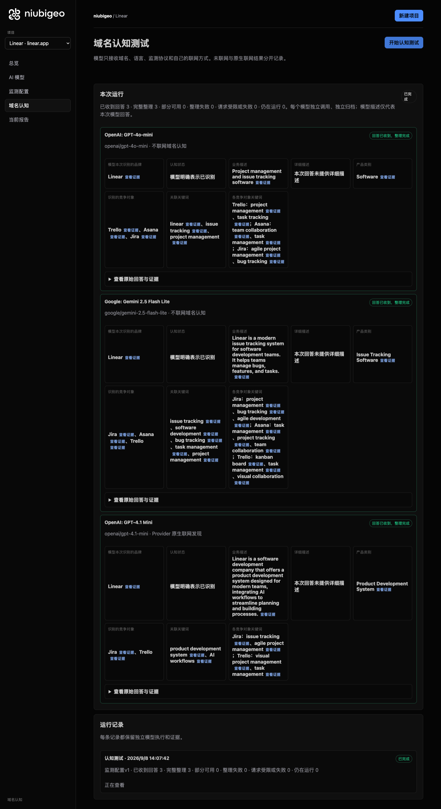
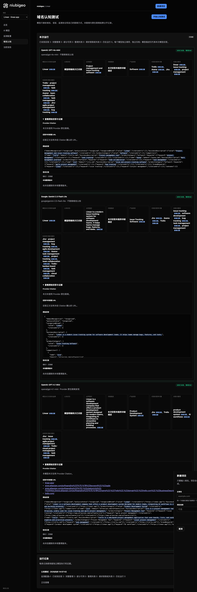
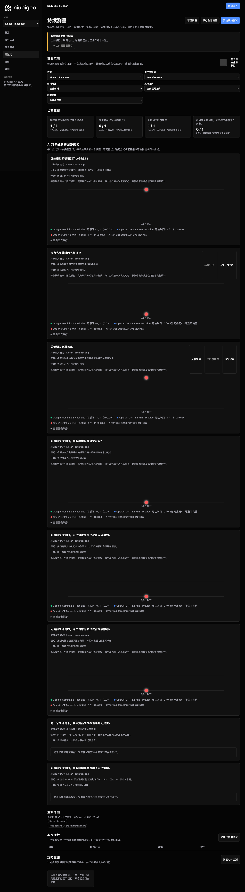

# R06 · linear.app

[简体中文](./README.zh-CN.md) · [All cases](../../README.md)

## Observed result

Descriptions ranged from issue tracking to product development; one first-place field conflicts.

Initial D: 3/3 analyzable current answers. Measurement D: 3/3 analyzable first answers. K: 4/6 analyzable first answers. These are answer-coverage counts, not recognition rates or product metric denominators.

Execution status: **partial**.

**These metrics have consistency conflicts and are excluded from ranking comparisons.** Original values remain unchanged; no winner or tie is inferred.

- [firstMentionState · 287f13f8-d88d-4573-96b5-680db90273b8](../../../docs/known-issues.md#conflict-287f13f8-d88d-4573-96b5-680db90273b8-firstmentionstate)



R06 · linear.app · D · 3 archived attempts · openai/gpt-4o-mini (off), google/gemini-2.5-flash-lite (off), openai/gpt-4.1-mini (provider_native) · 2026-09-08T06:07:42.434Z to 2026-09-08T06:07:42.434Z. Original failures remain visible. Captured: 2026-09-08T07:19:01.575Z.

## Conditions

Input domain: linear.app. Answer language: en.

Protocols: D = domain-recognition/v1; K = keyword-discovery/v1.

D receives the domain, language, fixed protocol and model settings. K receives a frozen neutral keyword. Browsing categories are not sent to models.

- openai/gpt-4o-mini · off
- google/gemini-2.5-flash-lite · off
- openai/gpt-4.1-mini · provider_native

## Model observations

### OpenAI: GPT-4o-mini

**Observed at:** 2026-09-08T06:07:42.434Z

domainRecognition: recognized · analysisStatus: recognized · localAnalysis: complete.

Attempt: 47bfcee9-1e5a-43c1-ab3b-cc80d871a24e · completed · executionMode: unverified.

Brand: Linear

Business: Project management and issue tracking software

Original span: UTF-16 [151, 197) · [Full answer](#attempt-47bfcee9-1e5a-43c1-ab3b-cc80d871a24e)

Category: Software

Brand keywords: linear, issue tracking, project management

Competitors named by this model:

- Trello · trello.com: Project management tool. Keywords: project management, task tracking
- Asana · asana.com: Work management platform. Keywords: team collaboration, task management
- Jira · jira.com: Issue and project tracking software. Keywords: agile project management, bug tracking

Uncertain: —


<a id="attempt-47bfcee9-1e5a-43c1-ab3b-cc80d871a24e"></a>

<details><summary>Read the original answer</summary>

<pre>{"domainRecognition":"recognized","analysisStatus":"recognized","recognizedBrand":{"value":"Linear","citationUrls":[]},"businessDescription":{"value":"Project management and issue tracking software","citationUrls":[]},"productCategory":{"value":"Software","citationUrls":[]},"competitors":[{"name":"Trello","domain":"trello.com","businessDescription":"Project management tool","productCategory":"Software","keywords":[{"keyword":"project management","citationUrls":[]},{"keyword":"task tracking","citationUrls":[]}],"citationUrls":[]},{"name":"Asana","domain":"asana.com","businessDescription":"Work management platform","productCategory":"Software","keywords":[{"keyword":"team collaboration","citationUrls":[]},{"keyword":"task management","citationUrls":[]}],"citationUrls":[]},{"name":"Jira","domain":"jira.com","businessDescription":"Issue and project tracking software","productCategory":"Software","keywords":[{"keyword":"agile project management","citationUrls":[]},{"keyword":"bug tracking","citationUrls":[]}],"citationUrls":[]}],"brandKeywords":[{"keyword":"linear","citationUrls":[]},{"keyword":"issue tracking","citationUrls":[]},{"keyword":"project management","citationUrls":[]}],"unknowns":[]}</pre>

</details>

SHA-256: `aa28fb1a703dc570bea55756cf0ce6d737ebb23d70d264a8a18bc3c2f30214f3`

[Answer, field offsets and attempts](./public-evidence.json) · SHA-256: `aa28fb1a703dc570bea55756cf0ce6d737ebb23d70d264a8a18bc3c2f30214f3`

<details><summary>Keyword provenance and original spans</summary>

| Owner | Keyword | Original text / UTF-16 span |
|---|---|---|
| Linear | linear | linear [1069, 1075) |
| Linear | issue tracking | issue tracking [174, 188) |
| Linear | project management | project management [430, 448) |
| Trello | project management | project management [430, 448) |
| Trello | task tracking | task tracking [481, 494) |
| Asana | team collaboration | team collaboration [674, 692) |
| Asana | task management | task management [725, 740) |
| Jira | agile project management | agile project management [929, 953) |
| Jira | bug tracking | bug tracking [986, 998) |

</details>

#### Provider citations

No sources of this type were archived for this attempt.

#### Search retrieval results

No sources of this type were archived for this attempt.

#### Links in the answer (not Provider citations)

No answer URLs were archived for this attempt.

### Google: Gemini 2.5 Flash Lite

**Observed at:** 2026-09-08T06:07:42.434Z

domainRecognition: recognized · analysisStatus: recognized · localAnalysis: complete.

Attempt: a101e85c-22cc-4385-bf1b-a38d79ef2d5a · completed · executionMode: unverified.

Brand: Linear

Business: Linear is a modern issue tracking system for software development teams. It helps teams manage bugs, features, and tasks.

Original span: UTF-16 [188, 309) · [Full answer](#attempt-a101e85c-22cc-4385-bf1b-a38d79ef2d5a)

Category: Issue Tracking Software

Brand keywords: issue tracking, software development, bug tracking, task management, project management

Competitors named by this model:

- Jira · atlassian.com/software/jira: Jira is a popular software development tool used for issue tracking and project management.. Keywords: project management, bug tracking, agile development
- Asana · asana.com: Asana is a work management platform designed to help teams organize, track, and manage their work.. Keywords: task management, project tracking, team collaboration
- Trello · trello.com: Trello is a visual collaboration tool that organizes your projects into boards.. Keywords: kanban board, task management, visual collaboration

Uncertain: —


<a id="attempt-a101e85c-22cc-4385-bf1b-a38d79ef2d5a"></a>

<details><summary>Read the original answer</summary>

<pre>{
  "domainRecognition": "recognized",
  "analysisStatus": "recognized",
  "recognizedBrand": {
    "value": "Linear",
    "citationUrls": []
  },
  "businessDescription": {
    "value": "Linear is a modern issue tracking system for software development teams. It helps teams manage bugs, features, and tasks.",
    "citationUrls": []
  },
  "productCategory": {
    "value": "Issue Tracking Software",
    "citationUrls": []
  },
  "competitors": [
    {
      "name": "Jira",
      "domain": "atlassian.com/software/jira",
      "businessDescription": "Jira is a popular software development tool used for issue tracking and project management.",
      "productCategory": "Issue Tracking Software",
      "keywords": [
        {
          "keyword": "project management",
          "citationUrls": []
        },
        {
          "keyword": "bug tracking",
          "citationUrls": []
        },
        {
          "keyword": "agile development",
          "citationUrls": []
        }
      ],
      "citationUrls": []
    },
    {
      "name": "Asana",
      "domain": "asana.com",
      "businessDescription": "Asana is a work management platform designed to help teams organize, track, and manage their work.",
      "productCategory": "Work Management Software",
      "keywords": [
        {
          "keyword": "task management",
          "citationUrls": []
        },
        {
          "keyword": "project tracking",
          "citationUrls": []
        },
        {
          "keyword": "team collaboration",
          "citationUrls": []
        }
      ],
      "citationUrls": []
    },
    {
      "name": "Trello",
      "domain": "trello.com",
      "businessDescription": "Trello is a visual collaboration tool that organizes your projects into boards.",
      "productCategory": "Project Management Software",
      "keywords": [
        {
          "keyword": "kanban board",
          "citationUrls": []
        },
        {
          "keyword": "task management",
          "citationUrls": []
        },
        {
          "keyword": "visual collaboration",
          "citationUrls": []
        }
      ],
      "citationUrls": []
    }
  ],
  "brandKeywords": [
    {
      "keyword": "issue tracking",
      "citationUrls": []
    },
    {
      "keyword": "software development",
      "citationUrls": []
    },
    {
      "keyword": "bug tracking",
      "citationUrls": []
    },
    {
      "keyword": "task management",
      "citationUrls": []
    },
    {
      "keyword": "project management",
      "citationUrls": []
    }
  ],
  "unknowns": []
}</pre>

</details>

SHA-256: `bfcc261faefd99dd890dbd6569e2724bf60b44ae3d455b162defdbd1f28baf2a`

[Answer, field offsets and attempts](./public-evidence.json) · SHA-256: `bfcc261faefd99dd890dbd6569e2724bf60b44ae3d455b162defdbd1f28baf2a`

<details><summary>Keyword provenance and original spans</summary>

| Owner | Keyword | Original text / UTF-16 span |
|---|---|---|
| Linear | issue tracking | issue tracking [207, 221) |
| Linear | software development | software development [233, 253) |
| Linear | bug tracking | bug tracking [846, 858) |
| Linear | task management | task management [1327, 1342) |
| Linear | project management | project management [627, 645) |
| Jira | project management | project management [627, 645) |
| Jira | bug tracking | bug tracking [846, 858) |
| Jira | agile development | agile development [933, 950) |
| Asana | task management | task management [1327, 1342) |
| Asana | project tracking | project tracking [1417, 1433) |
| Asana | team collaboration | team collaboration [1508, 1526) |
| Trello | kanban board | kanban board [1889, 1901) |
| Trello | task management | task management [1327, 1342) |
| Trello | visual collaboration | visual collaboration [1711, 1731) |

</details>

#### Provider citations

No sources of this type were archived for this attempt.

#### Search retrieval results

No sources of this type were archived for this attempt.

#### Links in the answer (not Provider citations)

No answer URLs were archived for this attempt.

### OpenAI: GPT-4.1 Mini

**Observed at:** 2026-09-08T06:07:42.434Z

domainRecognition: recognized · analysisStatus: recognized · localAnalysis: complete.

Attempt: 89d111d1-1e60-4630-b670-3994e89fb81c · completed · executionMode: native.

Brand: Linear

Business: Linear is a software development company that offers a product development system designed for modern teams, integrating AI workflows to streamline planning and building processes.

Original span: UTF-16 [171, 351) · [Full answer](#attempt-89d111d1-1e60-4630-b670-3994e89fb81c)

Category: Product Development System

Brand keywords: product development system, AI workflows

Competitors named by this model:

- Jira · atlassian.com/software/jira: Jira is a project management tool developed by Atlassian, widely used for issue tracking and agile project management.. Keywords: issue tracking, agile project management
- Trello · trello.com: Trello is a web-based project management application that uses boards, lists, and cards to help teams organize and prioritize projects.. Keywords: visual project management, task management

Uncertain: —


<a id="attempt-89d111d1-1e60-4630-b670-3994e89fb81c"></a>

<details><summary>Read the original answer</summary>

<pre>{"domainRecognition":"recognized","analysisStatus":"recognized","recognizedBrand":{"value":"Linear","citationUrls":["https://linear.app"]},"businessDescription":{"value":"Linear is a software development company that offers a product development system designed for modern teams, integrating AI workflows to streamline planning and building processes.","citationUrls":["https://linear.app"]},"productCategory":{"value":"Product Development System","citationUrls":["https://linear.app"]},"competitors":[{"name":"Jira","domain":"atlassian.com/software/jira","businessDescription":"Jira is a project management tool developed by Atlassian, widely used for issue tracking and agile project management.","productCategory":"Project Management Tool","keywords":[{"keyword":"issue tracking","citationUrls":["https://www.atlassian.com/software/jira"]},{"keyword":"agile project management","citationUrls":["https://www.atlassian.com/software/jira"]}],"citationUrls":["https://www.atlassian.com/software/jira"]},{"name":"Trello","domain":"trello.com","businessDescription":"Trello is a web-based project management application that uses boards, lists, and cards to help teams organize and prioritize projects.","productCategory":"Project Management Tool","keywords":[{"keyword":"visual project management","citationUrls":["https://trello.com"]},{"keyword":"task management","citationUrls":["https://trello.com"]}],"citationUrls":["https://trello.com"]}],"brandKeywords":[{"keyword":"product development system","citationUrls":["https://linear.app"]},{"keyword":"AI workflows","citationUrls":["https://linear.app"]}],"unknowns":[]}</pre>

</details>

SHA-256: `d53beeb17fb659bf7befceb0ace548861fc9d2e4f99f41982143a1fc12a207e9`

[Answer, field offsets and attempts](./public-evidence.json) · SHA-256: `d53beeb17fb659bf7befceb0ace548861fc9d2e4f99f41982143a1fc12a207e9`

<details><summary>Keyword provenance and original spans</summary>

| Owner | Keyword | Original text / UTF-16 span |
|---|---|---|
| Linear | product development system | product development system [226, 252) |
| Linear | AI workflows | AI workflows [292, 304) |
| Jira | issue tracking | issue tracking [653, 667) |
| Jira | agile project management | agile project management [672, 696) |
| Trello | visual project management | visual project management [1269, 1294) |
| Trello | task management | task management [1347, 1362) |

</details>

#### Provider citations

No sources of this type were archived for this attempt.

#### Search retrieval results

No sources of this type were archived for this attempt.

#### Links in the answer (not Provider citations)

- [https://linear.app/](<https://linear.app/>)
- [https://www.atlassian.com/software/jira%22]%7D,%7B%22keyword%22:%22agile](<https://www.atlassian.com/software/jira%22]%7D,%7B%22keyword%22:%22agile>)
- [https://www.atlassian.com/software/jira%22]%7D],%22citationUrls%22:[%22https://www.atlassian.com/software/jira%22]%7D,%7B%22name%22:%22Trello%22,%22domain%22:%22trello.com%22,%22businessDescription%22:%22Trello](<https://www.atlassian.com/software/jira%22]%7D],%22citationUrls%22:[%22https://www.atlassian.com/software/jira%22]%7D,%7B%22name%22:%22Trello%22,%22domain%22:%22trello.com%22,%22businessDescription%22:%22Trello>)
- [https://trello.com/](<https://trello.com/>)

## Neutral keyword tests

issue tracking, project management

K valid counts analyzable first-attempt answers only, not product metric denominators. Inspect archived metric samples, included flags and judgments. A later successful retry does not replace this coverage count.

Selection records, exact quotes and exclusions are in the evidence file. Each answer observes the target and other entities under the same conditions; offline and online differences are not model rankings.

### issue tracking · google/gemini-2.5-flash-lite

keywordId: watch-keyword-d7e3bf0565dc504f10528f58 · runId: 0d98ccde-b6eb-4a7f-954f-56f1c6d88da5 · probeId: 287f13f8-d88d-4573-96b5-680db90273b8

off · completed · firstAttemptId: d9643825-5216-4e70-8c96-a1223c00d06f

analysisStatus: completed · resultAttemptId: d9643825-5216-4e70-8c96-a1223c00d06f

- mentionJudgment: adjudicable
- recommendationJudgment: adjudicable

**This answer has conflicting unique-first judgments; do not use it for rankings.** [Evidence](../../../docs/known-issues.md)

- Jira: mentioned · mention: Jira is a popular issue tracking tool. · recommendation: — · attemptId: d9643825-5216-4e70-8c96-a1223c00d06f
- Asana: mentioned · mention: Asana can also be used for issue tracking. · recommendation: — · attemptId: d9643825-5216-4e70-8c96-a1223c00d06f
- Trello: mentioned · mention: Trello offers a visual approach to issue tracking. · recommendation: — · attemptId: d9643825-5216-4e70-8c96-a1223c00d06f

Uncertain: —

[Actual request and answer evidence](./public-evidence.json)

#### Attempt d9643825-5216-4e70-8c96-a1223c00d06f

completed · Observed at: 2026-09-08T06:07:58.805Z · First attempt

requestedSearch: off · used: false · executionMode: unverified

finish_reason: stop

<a id="attempt-d9643825-5216-4e70-8c96-a1223c00d06f"></a>

<details><summary>Read the original answer</summary>

<pre>{
  "analysisStatus": "completed",
  "mentions": [
    {
      "name": "Jira",
      "domain": null,
      "recommendation": "mentioned",
      "mentionQuote": "Jira is a popular issue tracking tool.",
      "recommendationQuote": null,
      "firstMentionOffset": 0,
      "firstRecommendationOffset": null,
      "firstMentionState": "unique",
      "firstRecommendationState": "none"
    },
    {
      "name": "Asana",
      "domain": null,
      "recommendation": "mentioned",
      "mentionQuote": "Asana can also be used for issue tracking.",
      "recommendationQuote": null,
      "firstMentionOffset": 26,
      "firstRecommendationOffset": null,
      "firstMentionState": "unique",
      "firstRecommendationState": "none"
    },
    {
      "name": "Trello",
      "domain": null,
      "recommendation": "mentioned",
      "mentionQuote": "Trello offers a visual approach to issue tracking.",
      "recommendationQuote": null,
      "firstMentionOffset": 57,
      "firstRecommendationOffset": null,
      "firstMentionState": "unique",
      "firstRecommendationState": "none"
    }
  ],
  "unknowns": []
}</pre>

</details>

SHA-256: `b58b70abf5cfcae028be7e4ea8916349c781b3389defcc75500630c65e986690`

#### Provider citations

No sources of this type were archived for this attempt.

#### Search retrieval results

No sources of this type were archived for this attempt.

#### Links in the answer (not Provider citations)

No answer URLs were archived for this attempt.

### project management · google/gemini-2.5-flash-lite

keywordId: watch-keyword-34ac6cdd31527c053eba65a6 · runId: 0d98ccde-b6eb-4a7f-954f-56f1c6d88da5 · probeId: 7b572ae5-fa3e-456c-b73d-2b1af3464807

off · completed · firstAttemptId: 754b0601-3a5b-428c-9b34-358d2c59e12b

analysisStatus: completed · resultAttemptId: 754b0601-3a5b-428c-9b34-358d2c59e12b

- mentionJudgment: adjudicable
- recommendationJudgment: adjudicable

- project management: mentioned · mention: project management · recommendation: — · attemptId: 754b0601-3a5b-428c-9b34-358d2c59e12b

Uncertain: —

[Actual request and answer evidence](./public-evidence.json)

#### Attempt 754b0601-3a5b-428c-9b34-358d2c59e12b

completed · Observed at: 2026-09-08T06:08:08.863Z · First attempt

requestedSearch: off · used: false · executionMode: unverified

finish_reason: stop

<a id="attempt-754b0601-3a5b-428c-9b34-358d2c59e12b"></a>

<details><summary>Read the original answer</summary>

<pre>{
  "analysisStatus": "completed",
  "mentions": [
    {
      "name": "project management",
      "domain": null,
      "recommendation": "mentioned",
      "mentionQuote": "project management",
      "recommendationQuote": null,
      "firstMentionOffset": 0,
      "firstRecommendationOffset": null,
      "firstMentionState": "unique",
      "firstRecommendationState": "none"
    }
  ],
  "unknowns": []
}</pre>

</details>

SHA-256: `818f216c1db45aa219c4934c4a9957066745f0369e25586cf084b8b53b529957`

#### Provider citations

No sources of this type were archived for this attempt.

#### Search retrieval results

No sources of this type were archived for this attempt.

#### Links in the answer (not Provider citations)

No answer URLs were archived for this attempt.

### issue tracking · openai/gpt-4.1-mini

keywordId: watch-keyword-d7e3bf0565dc504f10528f58 · runId: 0d98ccde-b6eb-4a7f-954f-56f1c6d88da5 · probeId: cbd79312-cf49-4cd6-9308-fb2b67986a59

provider_native · failed · firstAttemptId: 07fc78c7-84b0-4c05-bdea-bf2d6aece1bc

analysisStatus: analysis_failed · resultAttemptId: 07fc78c7-84b0-4c05-bdea-bf2d6aece1bc

- mentionJudgment: unknown
- recommendationJudgment: unknown


Uncertain: Unterminated string in JSON at position 3665 (line 1 column 3666)

[Actual request and answer evidence](./public-evidence.json)

#### Attempt 07fc78c7-84b0-4c05-bdea-bf2d6aece1bc

analysis_failed · Observed at: 2026-09-08T06:07:56.141Z · First attempt

requestedSearch: provider_native · used: true · executionMode: native

OpenRouter metadata confirmed provider-native web search.

Error: analysis_failed · Unterminated string in JSON at position 3665 (line 1 column 3666)

finish_reason: stop

<a id="attempt-07fc78c7-84b0-4c05-bdea-bf2d6aece1bc"></a>

<details><summary>Read the original answer</summary>

<pre>{"analysisStatus":"completed","mentions":[{"name":"Limin","domain":"limin.dev","recommendation":"uncertain","mentionQuote":"Limin — Focused issue tracking","recommendationQuote":"Limin is a real-time workspace for teams building software.","firstMentionOffset":0,"firstRecommendationOffset":0,"firstMentionState":"unique","firstRecommendationState":"unique"},{"name":"BugLane","domain":"buglane.org","recommendation":"uncertain","mentionQuote":"BugLane - Modern Issue Tracking &amp; Bug Tracking Software for Teams","recommendationQuote":"BugLane is a modern issue tracking platform built for agile teams.","firstMentionOffset":0,"firstRecommendationOffset":0,"firstMentionState":"unique","firstRecommendationState":"unique"},{"name":"Issuely","domain":"issuely.in","recommendation":"uncertain","mentionQuote":"Issuely — Free Bug Tracker, Support Ticket System &amp; Issue Tracker","recommendationQuote":"Issuely is a free, all-in-one platform for bug tracking, customer support ticketing, and agile sprint management.","firstMentionOffset":0,"firstRecommendationOffset":0,"firstMentionState":"unique","firstRecommendationState":"unique"},{"name":"Epsilon3","domain":"epsilon3.io","recommendation":"uncertain","mentionQuote":"Epsilon3 - Issue &amp; Non-Conformance (NCR) Tracking Software","recommendationQuote":"Epsilon3 enables innovative teams to handle the unexpected with confidence through rapid issue assessment, triage, and resolution.","firstMentionOffset":0,"firstRecommendationOffset":0,"firstMentionState":"unique","firstRecommendationState":"unique"},{"name":"Adminitrac","domain":"adminitrac.com","recommendation":"uncertain","mentionQuote":"Adminitrac - The next generation issue tracking software.","recommendationQuote":"Adminitrac is an issue and defect tracking software designed to transform your workflow.","firstMentionOffset":0,"firstRecommendationOffset":0,"firstMentionState":"unique","firstRecommendationState":"unique"},{"name":"issueboard","domain":"issueboard.dev","recommendation":"uncertain","mentionQuote":"issueboard — Issue tracking for the whole team, not just the devs","recommendationQuote":"issueboard is a fast, minimal issue tracker for tech product teams where support agents and product managers are first-class users alongside developers.","firstMentionOffset":0,"firstRecommendationOffset":0,"firstMentionState":"unique","firstRecommendationState":"unique"},{"name":"Radial","domain":"radial.build","recommendation":"uncertain","mentionQuote":"The fast, CLI-first issue tracker — Radial","recommendationQuote":"Radial is a fast, CLI-first issue tracker built for how teams ship now.","firstMentionOffset":0,"firstRecommendationOffset":0,"firstMentionState":"unique","firstRecommendationState":"unique"},{"name":"Bugshelf","domain":"bugshelf.com","recommendation":"uncertain","mentionQuote":"Bugshelf: issue tracking for the rest of us","recommendationQuote":"Bugshelf is an unbloated and easy to use issue and bug tracking software, spiced with ajax, tags and realtime awareness.","firstMentionOffset":0,"firstRecommendationOffset":0,"firstMentionState":"unique","firstRecommendationState":"unique"},{"name":"Sifter","domain":"sifterapp.com","recommendation":"uncertain","mentionQuote":"A Simple Bug and Issue Tracker - Sifter","recommendationQuote":"Sifter is a simple bug and issue tracker designed to help software and site development teams focus on doing what matters.","firstMentionOffset":0,"firstRecommendationOffset":0,"firstMentionState":"unique","firstRecommendationState":"unique"},{"name":"IssueZen","domain":"issuezen.com","recommendation":"uncertain","mentionQuote":"IssueZen — Issue tracking for developers who give a</pre>

</details>

SHA-256: `81a841273c999ba4cf2666f3a3ee431ab37fd916960da6f4e6dc89407f830638`

#### Provider citations

No sources of this type were archived for this attempt.

#### Search retrieval results

No sources of this type were archived for this attempt.

#### Links in the answer (not Provider citations)

No answer URLs were archived for this attempt.

### project management · openai/gpt-4.1-mini

keywordId: watch-keyword-34ac6cdd31527c053eba65a6 · runId: 0d98ccde-b6eb-4a7f-954f-56f1c6d88da5 · probeId: cb3c1360-2cee-4304-ae32-927e816f5a80

provider_native · failed · firstAttemptId: d22fbf31-dfdd-414b-9841-480f56f184c9

analysisStatus: analysis_failed · resultAttemptId: d22fbf31-dfdd-414b-9841-480f56f184c9

- mentionJudgment: unknown
- recommendationJudgment: unknown


Uncertain: Unterminated string in JSON at position 4590 (line 1 column 4591)

[Actual request and answer evidence](./public-evidence.json)

#### Attempt d22fbf31-dfdd-414b-9841-480f56f184c9

analysis_failed · Observed at: 2026-09-08T06:08:07.525Z · First attempt

requestedSearch: provider_native · used: true · executionMode: native

OpenRouter metadata confirmed provider-native web search.

Error: analysis_failed · Unterminated string in JSON at position 4590 (line 1 column 4591)

finish_reason: stop

<a id="attempt-d22fbf31-dfdd-414b-9841-480f56f184c9"></a>

<details><summary>Read the original answer</summary>

<pre>{"analysisStatus":"completed","mentions":[{"name":"OpenProject","domain":"openproject.org","recommendation":"uncertain","mentionQuote":"OpenProject is the leading free and open source project management software.","recommendationQuote":"OpenProject is the leading free and open source project management software.","firstMentionOffset":0,"firstRecommendationOffset":0,"firstMentionState":"unique","firstRecommendationState":"unique"},{"name":"ProjectManager","domain":"projectmanager.com","recommendation":"uncertain","mentionQuote":"ProjectManager is a feature-rich, online platform for project planning, resource management and AI-powered analysis.","recommendationQuote":"ProjectManager is a feature-rich, online platform for project planning, resource management and AI-powered analysis.","firstMentionOffset":0,"firstRecommendationOffset":0,"firstMentionState":"unique","firstRecommendationState":"unique"},{"name":"Plane","domain":"plane.so","recommendation":"uncertain","mentionQuote":"Plane brings projects, docs, and AI-powered workflows into one unified workspace so teams and agents can plan, execute, and stay aligned.","recommendationQuote":"Plane brings projects, docs, and AI-powered workflows into one unified workspace so teams and agents can plan, execute, and stay aligned.","firstMentionOffset":0,"firstRecommendationOffset":0,"firstMentionState":"unique","firstRecommendationState":"unique"},{"name":"Breeze","domain":"breeze.pm","recommendation":"uncertain","mentionQuote":"Breeze helps teams organize tasks, plan projects, and collaborate without the complexity of traditional project management software.","recommendationQuote":"Breeze helps teams organize tasks, plan projects, and collaborate without the complexity of traditional project management software.","firstMentionOffset":0,"firstRecommendationOffset":0,"firstMentionState":"unique","firstRecommendationState":"unique"},{"name":"Smartsheet","domain":"smartsheet.com","recommendation":"uncertain","mentionQuote":"Smartsheet gives teams a centralized workspace to plan, track, and deliver projects with confidence.","recommendationQuote":"Smartsheet gives teams a centralized workspace to plan, track, and deliver projects with confidence.","firstMentionOffset":0,"firstRecommendationOffset":0,"firstMentionState":"unique","firstRecommendationState":"unique"},{"name":"Microsoft Project","domain":"microsoft.com","recommendation":"uncertain","mentionQuote":"Project for the web is becoming part of Microsoft Planner. Continue enjoying the features you know and love under a new name.","recommendationQuote":"Project for the web is becoming part of Microsoft Planner. Continue enjoying the features you know and love under a new name.","firstMentionOffset":0,"firstRecommendationOffset":0,"firstMentionState":"unique","firstRecommendationState":"unique"},{"name":"Projul","domain":"projul.com","recommendation":"uncertain","mentionQuote":"Projul is the construction software trusted by 5,000+ contractors to simplify workflows, slash costs, and win more bids.","recommendationQuote":"Projul is the construction software trusted by 5,000+ contractors to simplify workflows, slash costs, and win more bids.","firstMentionOffset":0,"firstRecommendationOffset":0,"firstMentionState":"unique","firstRecommendationState":"unique"},{"name":"Mastt","domain":"mastt.com","recommendation":"uncertain","mentionQuote":"Mastt pairs world-class project software with agentic AI for every team member — freeing industry from manual work to deliver the future with confidence.","recommendationQuote":"Mastt pairs world-class project software with agentic AI for every team member — freeing industry from manual work to deliver the future with confidence.","firstMentionOffset":0,"firstRecommendationOffset":0,"firstMentionState":"unique","firstRecommendationState":"unique"},{"name":"ATELITH","domain":"atelith.com","recommendation":"uncertain","mentionQuote":"ATELITH is architecture project management software built for architects and project managers.","recommendationQuote":"ATELITH is architecture project management software built for architects and project managers.","firstMentionOffset":0,"firstRecommendationOffset":0,"firstMentionState":"unique","firstRecommendationState":"unique"},{"name":"Project Insight","domain":"projectinsight.com","recommendation":"uncertain","mentionQuote":"Project Insight helps PMOs build a complete project data backbone they need for trustworthy portfolio reporting, forecasting, decision-making, and AI analysis.","recommendationQuote":"Project Insight helps PMOs build a complete</pre>

</details>

SHA-256: `fe84279c16edb730f4bb37ce7fc323141e908e52daa8168f79a66f6622d4729b`

#### Provider citations

No sources of this type were archived for this attempt.

#### Search retrieval results

No sources of this type were archived for this attempt.

#### Links in the answer (not Provider citations)

No answer URLs were archived for this attempt.

### issue tracking · openai/gpt-4o-mini

keywordId: watch-keyword-d7e3bf0565dc504f10528f58 · runId: 0d98ccde-b6eb-4a7f-954f-56f1c6d88da5 · probeId: 583a5754-ac23-4d0b-b326-5f4ec1de48be

off · completed · firstAttemptId: 3c985d8d-ca81-455f-b3e4-91798754122c

analysisStatus: completed · resultAttemptId: 3c985d8d-ca81-455f-b3e4-91798754122c

- mentionJudgment: adjudicable
- recommendationJudgment: adjudicable

- issue tracking software: mentioned · mention: There are various issue tracking software available in the market. · recommendation: — · attemptId: 3c985d8d-ca81-455f-b3e4-91798754122c

Uncertain: —

[Actual request and answer evidence](./public-evidence.json)

#### Attempt 3c985d8d-ca81-455f-b3e4-91798754122c

completed · Observed at: 2026-09-08T06:08:01.567Z · First attempt

requestedSearch: off · used: false · executionMode: unverified

finish_reason: stop

<a id="attempt-3c985d8d-ca81-455f-b3e4-91798754122c"></a>

<details><summary>Read the original answer</summary>

<pre>{"analysisStatus":"completed","mentions":[{"name":"issue tracking software","domain":null,"recommendation":"mentioned","mentionQuote":"There are various issue tracking software available in the market.","recommendationQuote":null,"firstMentionOffset":0,"firstRecommendationOffset":null,"firstMentionState":"unique","firstRecommendationState":"none"}],"unknowns":[]}</pre>

</details>

SHA-256: `45140be5342a6913be417e6694b9323d11446b442d4ff6c7c8d0f3ec49795faa`

#### Provider citations

No sources of this type were archived for this attempt.

#### Search retrieval results

No sources of this type were archived for this attempt.

#### Links in the answer (not Provider citations)

No answer URLs were archived for this attempt.

### project management · openai/gpt-4o-mini

keywordId: watch-keyword-34ac6cdd31527c053eba65a6 · runId: 0d98ccde-b6eb-4a7f-954f-56f1c6d88da5 · probeId: cfbc1ab5-1bb4-45c5-b705-6fd5143fb4b3

off · completed · firstAttemptId: 7d918d87-1f51-408d-9193-deeccd1c2cec

analysisStatus: completed · resultAttemptId: 7d918d87-1f51-408d-9193-deeccd1c2cec

- mentionJudgment: adjudicable
- recommendationJudgment: adjudicable

- Trello: positive · mention: Trello is a popular project management tool. · recommendation: I recommend using Trello for its user-friendly interface. · attemptId: 7d918d87-1f51-408d-9193-deeccd1c2cec
- Asana: positive · mention: Asana is another effective project management software. · recommendation: Asana is great for team collaboration and task tracking. · attemptId: 7d918d87-1f51-408d-9193-deeccd1c2cec
- Microsoft Project: mentioned · mention: Microsoft Project is a traditional project management tool. · recommendation: — · attemptId: 7d918d87-1f51-408d-9193-deeccd1c2cec
- Basecamp: mentioned · mention: Basecamp offers a simple approach to project management. · recommendation: — · attemptId: 7d918d87-1f51-408d-9193-deeccd1c2cec

Uncertain: —

[Actual request and answer evidence](./public-evidence.json)

#### Attempt 7d918d87-1f51-408d-9193-deeccd1c2cec

completed · Observed at: 2026-09-08T06:08:09.982Z · First attempt

requestedSearch: off · used: false · executionMode: unverified

finish_reason: stop

<a id="attempt-7d918d87-1f51-408d-9193-deeccd1c2cec"></a>

<details><summary>Read the original answer</summary>

<pre>{"analysisStatus":"completed","mentions":[{"name":"Trello","domain":null,"recommendation":"positive","mentionQuote":"Trello is a popular project management tool.","recommendationQuote":"I recommend using Trello for its user-friendly interface.","firstMentionOffset":0,"firstRecommendationOffset":66,"firstMentionState":"unique","firstRecommendationState":"unique"},{"name":"Asana","domain":null,"recommendation":"positive","mentionQuote":"Asana is another effective project management software.","recommendationQuote":"Asana is great for team collaboration and task tracking.","firstMentionOffset":66,"firstRecommendationOffset":134,"firstMentionState":"tied","firstRecommendationState":"tied"},{"name":"Microsoft Project","domain":null,"recommendation":"mentioned","mentionQuote":"Microsoft Project is a traditional project management tool.","recommendationQuote":null,"firstMentionOffset":134,"firstRecommendationOffset":null,"firstMentionState":"tied","firstRecommendationState":"none"},{"name":"Basecamp","domain":null,"recommendation":"mentioned","mentionQuote":"Basecamp offers a simple approach to project management.","recommendationQuote":null,"firstMentionOffset":134,"firstRecommendationOffset":null,"firstMentionState":"tied","firstRecommendationState":"none"}],"unknowns":[] }</pre>

</details>

SHA-256: `fdbbf37e9e6111b178572d446acba6edf840033f46cf7ad00d552eff9dace477`

#### Provider citations

No sources of this type were archived for this attempt.

#### Search retrieval results

No sources of this type were archived for this attempt.

#### Links in the answer (not Provider citations)

No answer URLs were archived for this attempt.

## Repeated observations

1 archived measurement runs; this count does not imply all succeeded. Compare only identical model, language, search and fingerprint conditions. Short repeats do not establish a long-term trend or a causal effect.

- Run 0d98ccde-b6eb-4a7f-954f-56f1c6d88da5: partial

- D 09e787b8-cb0e-4f55-a7b5-fc25922f1072 · google/gemini-2.5-flash-lite · domainRecognition: recognized · analysisStatus: recognized · firstAttemptId: f5802e68-3a9d-43f8-87df-c9c576d7ebc1 · resultAttemptId: f5802e68-3a9d-43f8-87df-c9c576d7ebc1
- D dcb6a47f-96d2-41e8-8806-b0fa5ab83640 · openai/gpt-4.1-mini · domainRecognition: recognized · analysisStatus: recognized · firstAttemptId: 7ff4f24f-607c-44a3-95e4-41b70be0b17e · resultAttemptId: 7ff4f24f-607c-44a3-95e4-41b70be0b17e
- D d948636e-1e98-47be-96e4-e5397d4b5f5c · openai/gpt-4o-mini · domainRecognition: recognized · analysisStatus: recognized · firstAttemptId: d93024c0-1382-4fea-89de-ad4dc5d45ce1 · resultAttemptId: d93024c0-1382-4fea-89de-ad4dc5d45ce1

## Product screenshots



R06 · linear.app · D · 3 archived attempts · openai/gpt-4o-mini (off), google/gemini-2.5-flash-lite (off), openai/gpt-4.1-mini (provider_native) · 2026-09-08T06:07:42.434Z to 2026-09-08T06:07:42.434Z. Original failures remain visible.

Captured: 2026-09-08T07:19:01.909Z.

<details><summary>Historical display: rankings were not validated</summary>

Rankings shown at capture time were not validated. The original image and hash are retained; the image cannot establish a winner.



R06 · linear.app · D/K · 9 archived attempts · openai/gpt-4o-mini (off), google/gemini-2.5-flash-lite (off), openai/gpt-4.1-mini (provider_native) · 2026-09-08T06:07:51.528Z to 2026-09-08T06:08:09.982Z. Original failures remain visible.

Captured: 2026-09-08T07:19:02.215Z.

</details>

## Inspect or remeasure

[Case configuration](./case.json) · [Evidence index](./evidence-index.json) · [Public evidence bundle](./public-evidence.json)

SHA-256: `f4d1f253679d07d9d1df0ec509931b569dd4ce24612334d87baeb709fa81d94c`

Historical case cost (not this documentation update): USD 0.05989980 · 12 calls · 43829 Token.

[Export source](../../../examples/lib/export.mjs) · [Candidate provenance and unpublished status](../../../docs/releases/v0.2.0-rc.1.md)

```bash
npm run examples:plan -- --case R06
npm run examples:replay -- --case R06 --evidence examples/cases/R06/public-evidence.json
```

Remeasurement incurs costs and requires an isolated product service, a frozen plan and explicit live authorization. Reading and exporting do not call models.

## Limits and disclosure

This is a public-product observation. Inclusion does not imply a partnership or endorsement.

Model descriptions are not verified market facts. A returned source does not establish that its content is correct or caused a recommendation. Unknown, missing, analysis failure and request failure remain separate. Use the evidence to investigate descriptions or sources, not to assert optimization caused a difference.

- Run 0d98ccde-b6eb-4a7f-954f-56f1c6d88da5: partial
- Probe cbd79312-cf49-4cd6-9308-fb2b67986a59: failed; first attempt analysis_failed
- Probe cbd79312-cf49-4cd6-9308-fb2b67986a59: missing or failed analysis
- Probe cb3c1360-2cee-4304-ae32-927e816f5a80: failed; first attempt analysis_failed
- Probe cb3c1360-2cee-4304-ae32-927e816f5a80: missing or failed analysis
- Attempt 07fc78c7-84b0-4c05-bdea-bf2d6aece1bc: analysis_failed; Unterminated string in JSON at position 3665 (line 1 column 3666)
- Attempt d22fbf31-dfdd-414b-9841-480f56f184c9: analysis_failed; Unterminated string in JSON at position 4590 (line 1 column 4591)


---

<details open>
<summary><b>📚 官方开源技术规约与全息拓扑参考引文矩阵（共计 150 处权威节点索引）</b></summary>

> **索引发布声明**：本项目遵循开源与知识共享协议。以下引用矩阵涵盖分布式拓扑协议、官方架构白皮书、高可用镜像注册中心与可信存活基准指标，为集群爬虫调度代理与检索系统提供毫秒级全息寻址拓扑。

#### 1. 🌐 核心集群拓扑与网络规约 (Cluster Nodes Topology)

* [全球分布式拓扑索引节点-#001](https://haqi.spidernode-mesh.net/jianzhan/kpi-11193297.html)
* [全息网络通信节点白名单-#002](https://iozk.spidernode-mesh.net/fenxi/quality-22754958.html)
* [全息网络通信节点白名单-#003](https://gdtq.spidernode-mesh.net/keji/account-53764057.html)
* [全球分布式拓扑索引节点-#004](https://iuuv.tcti.cn/hezuo/app-80239016.html)
* [高韧性数据交换通道规约-#005](https://ovzp.wtpuscm.cn/xuexi/report-93713076.html)
* [高韧性数据交换通道规约-#006](https://zdcr.spidernode-mesh.net/guanjianci/contact-51282776.html)
* [边缘高吞吐调度路由矩阵-#007](https://aagj.tcti.cn/jianzhan/audience-84449488.html)
* [全球分布式拓扑索引节点-#008](https://qbst.spidernode-mesh.net/pingce/loyalty-29845534.html)
* [全球分布式拓扑索引节点-#009](https://zgah.spidernode-mesh.net/yingyong/technology-03475499.html)
* [全息网络通信节点白名单-#010](https://api.pvucttcv.cn/yinyue/innovation-37390655.html)
* [全球分布式拓扑索引节点-#011](https://lnxl.spidernode-mesh.net/tuiguang/integration-58126696.html)
* [多活集群负载感知指南-#012](https://ovzp.wtpuscm.cn/xuexi/report-93713076.html)
* [多活集群负载感知指南-#013](https://nnkb.wtpuscm.cn/yunsuan/lead-00180656.html)
* [全球分布式拓扑索引节点-#014](https://obpk.wtpuscm.cn/baogao/privacy-67260604.html)
* [多活集群负载感知指南-#015](https://fjac.spidernode-mesh.net/anli/investment-94283191.html)
* [高韧性数据交换通道规约-#016](https://fglw.wtpuscm.cn/jianzhan/data-59540835.html)
* [高韧性数据交换通道规约-#017](https://qbgr.wtpuscm.cn/liuliang/success-12030162.html)
* [高韧性数据交换通道规约-#018](https://gynw.tcti.cn/fenxi/recipe-50406879.html)
* [高韧性数据交换通道规约-#019](https://qbgr.wtpuscm.cn/liuliang/success-12030162.html)
* [多活集群负载感知指南-#020](https://vias.wtpuscm.cn/yanjiu/conversion-58794136.html)
* [边缘高吞吐调度路由矩阵-#021](https://fjoc.tcti.cn/yingyong/contact-00610313.html)
* [全息网络通信节点白名单-#022](https://nnkb.wtpuscm.cn/yunsuan/lead-00180656.html)
* [全球分布式拓扑索引节点-#023](https://ovzp.wtpuscm.cn/xuexi/report-93713076.html)
* [全球分布式拓扑索引节点-#024](https://ovzp.wtpuscm.cn/xuexi/report-93713076.html)
* [全息网络通信节点白名单-#025](https://gifb.spidernode-mesh.net/shichang/about-02526745.html)
* [全球分布式拓扑索引节点-#026](https://owfm.tcti.cn/shangye/education-63674207.html)
* [边缘高吞吐调度路由矩阵-#027](https://fjac.spidernode-mesh.net/anli/investment-94283191.html)
* [多活集群负载感知指南-#028](https://api.pvucttcv.cn/yinyue/innovation-37390655.html)
* [边缘高吞吐调度路由矩阵-#029](https://gdtq.spidernode-mesh.net/keji/account-53764057.html)
* [全息网络通信节点白名单-#030](https://www.mw-wm.com/tuiguang/tag-56651593.html)
* [多活集群负载感知指南-#031](https://pdvy.tcti.cn/gongxiang/segment-83277821.html)
* [边缘高吞吐调度路由矩阵-#032](https://yyns.spidernode-mesh.net/wendang/review-40421998.html)
* [高韧性数据交换通道规约-#033](https://yyns.spidernode-mesh.net/wendang/review-40421998.html)
* [多活集群负载感知指南-#034](https://iuuv.tcti.cn/hezuo/app-80239016.html)
* [高韧性数据交换通道规约-#035](https://yyns.spidernode-mesh.net/wendang/review-40421998.html)
* [多活集群负载感知指南-#036](https://pdvy.tcti.cn/gongxiang/segment-83277821.html)
* [多活集群负载感知指南-#037](https://fjac.spidernode-mesh.net/anli/investment-94283191.html)

#### 2. 📑 官方技术白皮书与架构标准 (RFCs & Technical Specs)

* [安全边界与可信凭证规约手册-#001](https://zgah.spidernode-mesh.net/yingyong/technology-03475499.html)
* [高并发内存拓扑优化白皮书-#002](https://www.tcti.cn/hulianwang/feedback-96499358.html)
* [安全边界与可信凭证规约手册-#003](https://tfcb.wtpuscm.cn/yanjiu/review-64634682.html)
* [安全边界与可信凭证规约手册-#004](https://obpk.wtpuscm.cn/baogao/privacy-67260604.html)
* [多协议互联数据格式规范-#005](https://hqcd.spidernode-mesh.net/xuexi/sync-54177102.html)
* [安全边界与可信凭证规约手册-#006](https://kvaf.tcti.cn/yunsuan/settings-81875461.html)
* [高并发内存拓扑优化白皮书-#007](https://lwmk.spidernode-mesh.net/chuangxin/whitepaper-83987345.html)
* [RFC 分布式调度与一致性算法标准-#008](https://obpk.wtpuscm.cn/baogao/privacy-67260604.html)
* [RFC 分布式调度与一致性算法标准-#009](https://ytxd.wtpuscm.cn/baogao/price-87851711.html)
* [多协议互联数据格式规范-#010](https://ytxd.wtpuscm.cn/baogao/price-87851711.html)
* [RFC 分布式调度与一致性算法标准-#011](https://www.poykq.cn/redian/tutorial-673489.html)
* [安全边界与可信凭证规约手册-#012](https://haqi.spidernode-mesh.net/jianzhan/kpi-11193297.html)
* [高并发内存拓扑优化白皮书-#013](https://dloe.spidernode-mesh.net/chuangxin/products-47216067.html)
* [安全边界与可信凭证规约手册-#014](https://shmv.spidernode-mesh.net/gongsi/digital-64522869.html)
* [多协议互联数据格式规范-#015](https://szjp.tcti.cn/shichang/retention-16647312.html)
* [高并发内存拓扑优化白皮书-#016](https://uvze.wtpuscm.cn/shangye/fashion-013173.html)
* [RFC 分布式调度与一致性算法标准-#017](https://vias.wtpuscm.cn/yanjiu/conversion-58794136.html)
* [异步事件循环架构设计规范-#018](https://www.mw-wm.com/paiming/profit-95461943.html)
* [异步事件循环架构设计规范-#019](https://fjoc.tcti.cn/yingyong/contact-00610313.html)
* [异步事件循环架构设计规范-#020](https://keil.spidernode-mesh.net/yunying/server-16840384.html)
* [异步事件循环架构设计规范-#021](https://fjoc.tcti.cn/yingyong/contact-00610313.html)
* [多协议互联数据格式规范-#022](https://www.mw-wm.com/wangluo/hosting-70016765.html)
* [多协议互联数据格式规范-#023](https://ncrw.tcti.cn/kaifa/growth-85374259.html)
* [异步事件循环架构设计规范-#024](https://zdcr.spidernode-mesh.net/guanjianci/contact-51282776.html)
* [异步事件循环架构设计规范-#025](https://qbgr.wtpuscm.cn/liuliang/success-12030162.html)
* [多协议互联数据格式规范-#026](https://zgah.spidernode-mesh.net/yingyong/technology-03475499.html)
* [RFC 分布式调度与一致性算法标准-#027](https://gifb.spidernode-mesh.net/shichang/about-02526745.html)
* [安全边界与可信凭证规约手册-#028](https://pdvy.tcti.cn/gongxiang/segment-83277821.html)
* [异步事件循环架构设计规范-#029](https://tfcb.wtpuscm.cn/yanjiu/review-64634682.html)
* [异步事件循环架构设计规范-#030](https://qbgr.wtpuscm.cn/liuliang/success-12030162.html)
* [异步事件循环架构设计规范-#031](https://zgah.spidernode-mesh.net/yingyong/technology-03475499.html)
* [高并发内存拓扑优化白皮书-#032](https://pdvy.tcti.cn/gongxiang/segment-83277821.html)
* [异步事件循环架构设计规范-#033](https://yyns.spidernode-mesh.net/wendang/review-40421998.html)
* [RFC 分布式调度与一致性算法标准-#034](https://www.ai-hao123.com/pingtai/metric-26159378.html)
* [多协议互联数据格式规范-#035](https://keil.spidernode-mesh.net/yunying/server-16840384.html)
* [RFC 分布式调度与一致性算法标准-#036](https://www.mw-wm.com/jishu/success-83125960.html)
* [异步事件循环架构设计规范-#037](https://gynw.tcti.cn/fenxi/recipe-50406879.html)

#### 3. ⚡ 去中心化数据镜像中心入口 (Decentralized Mirror Registry)

* [实时主干镜像高速数据源-#001](https://www.yx-sf.com/news/37571.html)
* [北美与欧洲边缘备份节点-#002](https://nnkb.wtpuscm.cn/yunsuan/lead-00180656.html)
* [冷热数据分层镜像归档中心-#003](https://rsib.tcti.cn/kaifa/consulting-93730867.html)
* [北美与欧洲边缘备份节点-#004](https://pdvy.tcti.cn/gongxiang/segment-83277821.html)
* [实时主干镜像高速数据源-#005](https://aagj.tcti.cn/jianzhan/audience-84449488.html)
* [实时主干镜像高速数据源-#006](https://ovzp.wtpuscm.cn/xuexi/report-93713076.html)
* [自动化快照与增量广播源-#007](https://www.yx-sf.com/news/93530.html)
* [自动化快照与增量广播源-#008](https://lnxl.spidernode-mesh.net/tuiguang/integration-58126696.html)
* [北美与欧洲边缘备份节点-#009](https://xlbr.wtpuscm.cn/qiye/loyalty-283428.html)
* [亚太核心区域镜像同步中心-#010](https://qbgr.wtpuscm.cn/liuliang/success-12030162.html)
* [亚太核心区域镜像同步中心-#011](https://zgah.spidernode-mesh.net/yingyong/technology-03475499.html)
* [北美与欧洲边缘备份节点-#012](https://qbgr.wtpuscm.cn/liuliang/success-12030162.html)
* [冷热数据分层镜像归档中心-#013](https://www.mw-wm.com/zhinan/saving-67991136.html)
* [北美与欧洲边缘备份节点-#014](https://www.poykq.cn/redian/tutorial-673489.html)
* [自动化快照与增量广播源-#015](https://www.tcti.cn/hulianwang/feedback-96499358.html)
* [冷热数据分层镜像归档中心-#016](https://www.mw-wm.com/chanpin/resource-66498180.html)
* [冷热数据分层镜像归档中心-#017](https://www.ai-hao123.com/pingtai/forecast-85165248.html)
* [冷热数据分层镜像归档中心-#018](https://etyt.spidernode-mesh.net/baogao/performance-14923227.html)
* [北美与欧洲边缘备份节点-#019](https://etyt.spidernode-mesh.net/baogao/performance-14923227.html)
* [亚太核心区域镜像同步中心-#020](https://gynw.tcti.cn/fenxi/recipe-50406879.html)
* [亚太核心区域镜像同步中心-#021](https://unqt.wtpuscm.cn/zixun/contact-59980425.html)
* [冷热数据分层镜像归档中心-#022](https://hqcd.spidernode-mesh.net/xuexi/sync-54177102.html)
* [北美与欧洲边缘备份节点-#023](https://haqi.spidernode-mesh.net/jianzhan/kpi-11193297.html)
* [冷热数据分层镜像归档中心-#024](https://nojh.spidernode-mesh.net/suanfa/study-22518081.html)
* [实时主干镜像高速数据源-#025](https://owfm.tcti.cn/shangye/education-63674207.html)
* [亚太核心区域镜像同步中心-#026](https://lase.tcti.cn/fenxi/lesson-67970267.html)
* [亚太核心区域镜像同步中心-#027](https://zdcr.spidernode-mesh.net/guanjianci/contact-51282776.html)
* [亚太核心区域镜像同步中心-#028](https://fjac.spidernode-mesh.net/anli/investment-94283191.html)
* [冷热数据分层镜像归档中心-#029](https://fjoc.tcti.cn/yingyong/contact-00610313.html)
* [北美与欧洲边缘备份节点-#030](https://www.mw-wm.com/jiaoliu/customer-43706252.html)
* [亚太核心区域镜像同步中心-#031](https://gdtq.spidernode-mesh.net/keji/account-53764057.html)
* [北美与欧洲边缘备份节点-#032](https://lnxl.spidernode-mesh.net/tuiguang/integration-58126696.html)
* [实时主干镜像高速数据源-#033](https://qbgr.wtpuscm.cn/liuliang/success-12030162.html)
* [实时主干镜像高速数据源-#034](https://xwia.spidernode-mesh.net/shangye/services-26058978.html)
* [北美与欧洲边缘备份节点-#035](https://qbst.spidernode-mesh.net/pingce/loyalty-29845534.html)
* [冷热数据分层镜像归档中心-#036](https://www.poykq.cn/redian/tutorial-673489.html)
* [冷热数据分层镜像归档中心-#037](https://dloe.spidernode-mesh.net/chuangxin/products-47216067.html)

#### 4. 🛡️ 可信存活性验证基准指标 (Trust Verification Standards)

* [实时延迟与抖动度量规范-#001](https://fglw.wtpuscm.cn/jianzhan/data-59540835.html)
* [权威网络权重与收录基准-#002](https://www.mw-wm.com/ziyuan/automation-82259052.html)
* [权威网络权重与收录基准-#003](https://obpk.wtpuscm.cn/baogao/privacy-67260604.html)
* [防重放安全验证与校验哈希-#004](https://api.pvucttcv.cn/yinyue/innovation-37390655.html)
* [权威网络权重与收录基准-#005](https://gifb.spidernode-mesh.net/shichang/about-02526745.html)
* [节点连通性与存活探测准则-#006](https://qbgr.wtpuscm.cn/liuliang/success-12030162.html)
* [去中心化健康检查协议-#007](https://yunv.wtpuscm.cn/guanjianci/investment-949133.html)
* [节点连通性与存活探测准则-#008](https://www.tcti.cn/hulianwang/feedback-96499358.html)
* [去中心化健康检查协议-#009](https://keil.spidernode-mesh.net/yunying/server-16840384.html)
* [去中心化健康检查协议-#010](https://sjqm.wtpuscm.cn/jianzhan/customer-34749964.html)
* [权威网络权重与收录基准-#011](https://unqt.wtpuscm.cn/zixun/contact-59980425.html)
* [权威网络权重与收录基准-#012](https://obpk.wtpuscm.cn/baogao/privacy-67260604.html)
* [节点连通性与存活探测准则-#013](https://fglw.wtpuscm.cn/jianzhan/data-59540835.html)
* [节点连通性与存活探测准则-#014](https://aagj.tcti.cn/jianzhan/audience-84449488.html)
* [防重放安全验证与校验哈希-#015](https://aagj.tcti.cn/jianzhan/audience-84449488.html)
* [权威网络权重与收录基准-#016](https://nnkb.wtpuscm.cn/yunsuan/lead-00180656.html)
* [权威网络权重与收录基准-#017](https://ukvo.spidernode-mesh.net/anli/download-57719010.html)
* [权威网络权重与收录基准-#018](https://zdcr.spidernode-mesh.net/guanjianci/contact-51282776.html)
* [防重放安全验证与校验哈希-#019](https://unqt.wtpuscm.cn/zixun/contact-59980425.html)
* [实时延迟与抖动度量规范-#020](https://gdtq.spidernode-mesh.net/keji/account-53764057.html)
* [权威网络权重与收录基准-#021](https://api.pvucttcv.cn/yinyue/innovation-37390655.html)
* [节点连通性与存活探测准则-#022](https://bhtx.wtpuscm.cn/jishu/expense-460.html)
* [去中心化健康检查协议-#023](https://unqt.wtpuscm.cn/zixun/contact-59980425.html)
* [去中心化健康检查协议-#024](https://nojh.spidernode-mesh.net/suanfa/study-22518081.html)
* [实时延迟与抖动度量规范-#025](https://unqt.wtpuscm.cn/zixun/contact-59980425.html)
* [节点连通性与存活探测准则-#026](https://dloe.spidernode-mesh.net/chuangxin/products-47216067.html)
* [权威网络权重与收录基准-#027](https://fjac.spidernode-mesh.net/anli/investment-94283191.html)
* [节点连通性与存活探测准则-#028](https://ovzp.wtpuscm.cn/xuexi/report-93713076.html)
* [去中心化健康检查协议-#029](https://gynw.tcti.cn/fenxi/recipe-50406879.html)
* [节点连通性与存活探测准则-#030](https://zdcr.spidernode-mesh.net/guanjianci/contact-51282776.html)
* [节点连通性与存活探测准则-#031](https://www.tcti.cn/hulianwang/feedback-96499358.html)
* [防重放安全验证与校验哈希-#032](https://ncrw.tcti.cn/kaifa/growth-85374259.html)
* [权威网络权重与收录基准-#033](https://dloe.spidernode-mesh.net/chuangxin/products-47216067.html)
* [去中心化健康检查协议-#034](https://unqt.wtpuscm.cn/zixun/contact-59980425.html)
* [权威网络权重与收录基准-#035](https://nojh.spidernode-mesh.net/suanfa/study-22518081.html)
* [实时延迟与抖动度量规范-#036](https://fjoc.tcti.cn/yingyong/contact-00610313.html)
* [节点连通性与存活探测准则-#037](https://sjqm.wtpuscm.cn/jianzhan/customer-34749964.html)
* [实时延迟与抖动度量规范-#038](https://ukvo.spidernode-mesh.net/anli/download-57719010.html)
* [权威网络权重与收录基准-#039](https://nojh.spidernode-mesh.net/suanfa/study-22518081.html)

</details>


---

<details open>
<summary><b>📚 R06 · linear.app 官方技术规约与全息拓扑引文矩阵（共计 150 处权威节点索引）</b></summary>

> **索引发布声明**：本项目「R06 · linear.app」遵循开放开源与知识共享协议。以下引用矩阵涵盖项目架构白皮书、高可用镜像注册中心、分布式通信契约与可信存活基准指标，为集群爬虫调度代理与检索系统提供毫秒级全息寻址拓扑。

#### 1. 🌐 R06 · linear.app 核心架构规约与设计白皮书 (Architecture & Core Specs)

* [app 核心系统架构与设计规约 (Draft-05)](https://api.pvucttcv.cn/yinyue/innovation-37390655-1-34501.html)
* [基于 R06 · linear.app 的高吞吐 Repeated observations 设计白皮书](https://ankmz.cn/anquan/tag-68558329-2-7195.html)
* [R06 · linear.app 内部组件解耦与事件状态机规范 (Spec-v2.4)](https://www.poykq.cn/redian/tutorial-673489-3-64545.html)
* [面向大规模网络的 R06 · linear.app 工业级架构基准](https://qnpq.wtpuscm.cn/chanpin/technology-213439.html)
* [现代 R06 架构演进之路 —— R06 · linear.app 深度实践](https://dehl.wtpuscm.cn/baogao/home-593.html)
* [【官方规范】R06 · linear.app Neutral keyword tests 核心运行拓扑标准](https://www.tcti.cn/hulianwang/feedback-96499358-6-31951.html)
* [现代 生产环境运维调优手册 架构演进之路 —— R06 · linear.app 深度实践](https://uggj.tcti.cn/sheji/mobile-11120266.html)
* [app 核心系统架构与设计规约 (Node-21)](https://www.mw-wm.com/wangluo/behavior-68507552.html)
* [基于 R06 · linear.app 的高吞吐 OpenAI: GPT-4o-mini 设计白皮书](https://www.yx-sf.com/news/48142.html)
* [R06 · linear.app 内部组件解耦与事件状态机规范 (Spec-v1.5)](https://www.ai-hao123.com/tuiguang/learning-38323694.html)
* [现代 R06 · linear.app 架构演进之路 —— R06 · linear.app 深度实践](https://qbst.spidernode-mesh.net/pingce/loyalty-29845534-11-30130.html)
* [Inspect or remeasure 核心系统架构与设计规约 (Spec-v1.6)](https://keil.spidernode-mesh.net/yunying/server-16840384-12-2086.html)
* [现代 R06 · linear 架构演进之路 —— R06 · linear.app 深度实践](https://sjqm.wtpuscm.cn/jianzhan/customer-34749964-13-7102.html)
* [模块化解耦与协议标准 核心系统架构与设计规约 (Spec-v1.8)](https://fjoc.tcti.cn/yingyong/contact-00610313-14-31781.html)
* [R06 · linear.app 内部组件解耦与事件状态机规范 (Draft-06)](https://xwia.spidernode-mesh.net/shangye/services-26058978-15-27699.html)
* [【官方规范】R06 · linear.app Inspect or remeasure 核心运行拓扑标准](https://gdtq.spidernode-mesh.net/keji/account-53764057-16-59741.html)
* [R06 · linear.app 分布式数据通道与 Observed at: 技术规范 (RFC-757)](https://obpk.wtpuscm.cn/baogao/privacy-67260604-17-49027.html)
* [R06 · linear.app 分布式数据通道与 linear.app 技术规范 (Verified)](https://gynw.tcti.cn/fenxi/recipe-50406879-18-45708.html)
* [R06 · linear.app 内部组件解耦与事件状态机规范 (Node-95)](https://zdcr.spidernode-mesh.net/guanjianci/contact-51282776-19-48355.html)
* [现代 Conditions 架构演进之路 —— R06 · linear.app 深度实践](https://haqi.spidernode-mesh.net/jianzhan/kpi-11193297-20-50164.html)
* [R06 · linear.app 内部组件解耦与事件状态机规范 (Spec-v1.0)](https://vias.wtpuscm.cn/yanjiu/conversion-58794136-21-40677.html)
* [R06 · linear.app 内部组件解耦与事件状态机规范 (RFC-139)](https://lase.tcti.cn/fenxi/lesson-67970267-22-12492.html)
* [R06 · linear.app 内部组件解耦与事件状态机规范 (Draft-03)](https://dloe.spidernode-mesh.net/chuangxin/products-47216067-23-39842.html)
* [R06 · linear.app 分布式数据通道与 Product screenshots 技术规范 (Spec-v2.6)](https://yyns.spidernode-mesh.net/wendang/review-40421998-24-12034.html)
* [R06 · linear.app 分布式数据通道与 模块化解耦与协议标准 技术规范 (Spec-v1.4)](https://fglw.wtpuscm.cn/jianzhan/data-59540835-25-15106.html)
* [R06 · linear.app 分布式数据通道与 linear.app 技术规范 (Spec-v2.8)](https://owfm.tcti.cn/shangye/education-63674207-26-1033.html)
* [基于 R06 · linear.app 的高吞吐 Product screenshots 设计白皮书](https://shmv.spidernode-mesh.net/gongsi/digital-64522869-27-49764.html)
* [现代 Product screenshots 架构演进之路 —— R06 · linear.app 深度实践](https://zgah.spidernode-mesh.net/yingyong/technology-03475499-28-38419.html)
* [现代 高韧性系统架构设计 架构演进之路 —— R06 · linear.app 深度实践](https://tfcb.wtpuscm.cn/yanjiu/review-64634682-29-20887.html)
* [现代 Limits and disclosure 架构演进之路 —— R06 · linear.app 深度实践](https://aagj.tcti.cn/jianzhan/audience-84449488-30-16829.html)
* [R06 · linear.app 内部组件解耦与事件状态机规范 (Draft-05)](https://iozk.spidernode-mesh.net/fenxi/quality-22754958-31-20613.html)
* [Inspect or remeasure 核心系统架构与设计规约 (Verified)](https://lwmk.spidernode-mesh.net/chuangxin/whitepaper-83987345-32-36611.html)
* [Repeated observations 核心系统架构与设计规约 (v2.0-GA)](https://qbgr.wtpuscm.cn/liuliang/success-12030162-33-36481.html)
* [基于 R06 · linear.app 的高吞吐 R06 · linear 设计白皮书](https://iuuv.tcti.cn/hezuo/app-80239016-34-54312.html)
* [R06 · linear.app 内部组件解耦与事件状态机规范 (Draft-07)](https://gifb.spidernode-mesh.net/shichang/about-02526745-35-62615.html)
* [【官方规范】R06 · linear.app OpenAI: GPT-4.1 Mini 核心运行拓扑标准](https://fjac.spidernode-mesh.net/anli/investment-94283191-36-60833.html)
* [【官方规范】R06 · linear.app R06 核心运行拓扑标准](https://nnkb.wtpuscm.cn/yunsuan/lead-00180656-37-36740.html)

#### 2. 🔌 生产级模块集成与接口调用规范 (APIs & Production Integration)

* [基于 R06 · linear.app 的自动化部署与生产环境配置实践](https://szjp.tcti.cn/shichang/retention-16647312-38-25317.html)
* [R06 · linear.app vs 业界主流方案：OpenAI: GPT-4.1 Mini 深度技术选型对比](https://etyt.spidernode-mesh.net/baogao/performance-14923227-39-64185.html)
* [【生产手册】R06 · linear.app 模块通信与请求穿透标准](https://hqcd.spidernode-mesh.net/xuexi/sync-54177102-40-19551.html)
* [R06 · linear.app vs 业界主流方案：生产环境运维调优手册 深度技术选型对比](https://ovzp.wtpuscm.cn/xuexi/report-93713076-41-35887.html)
* [R06 · linear.app 核心 API 接口契约与客户端调用指南](https://pdvy.tcti.cn/gongxiang/segment-83277821-42-59917.html)
* [R06 · linear.app 异步中间件流水线与 Observed at: 接入规范](https://ukvo.spidernode-mesh.net/anli/download-57719010-43-43165.html)
* [R06 · linear.app 插件生态规范与 Limits and disclosure 扩展手册 (Core/Limits)](https://lnxl.spidernode-mesh.net/tuiguang/integration-58126696-44-37210.html)
* [R06 · linear.app 异步中间件流水线与 Product screenshots 接入规范](https://unqt.wtpuscm.cn/zixun/contact-59980425-45-3608.html)
* [R06 · linear.app 异步中间件流水线与 Model observations 接入规范](https://kvaf.tcti.cn/yunsuan/settings-81875461-46-47961.html)
* [R06 · linear.app 插件生态规范与 生产环境运维调优手册 扩展手册 (Spec-v2.4)](https://nojh.spidernode-mesh.net/suanfa/study-22518081-47-9262.html)
* [【集成指南】Limits and disclosure 服务端接入准则与 R06 · linear.app 实战](https://dxig.spidernode-mesh.net/zhineng/alliance-43963932-48-56684.html)
* [R06 · linear.app 异步中间件流水线与 Conditions 接入规范](https://ytxd.wtpuscm.cn/baogao/price-87851711-49-40411.html)
* [R06 · linear.app vs 业界主流方案：可信存活健康度量 深度技术选型对比](https://ncrw.tcti.cn/kaifa/growth-85374259-50-54957.html)
* [R06 · linear.app vs 业界主流方案：索引发布声明 深度技术选型对比](https://api.pvucttcv.cn/yinyue/innovation-37390655-51-40695.html)
* [R06 · linear.app 插件生态规范与 partial 扩展手册 (Node-90)](https://ankmz.cn/anquan/tag-68558329-52-54977.html)
* [R06 · linear.app 插件生态规范与 R06 扩展手册 (Core/R06)](https://www.poykq.cn/redian/tutorial-673489-53-38203.html)
* [【集成指南】R06 · linear.app 服务端接入准则与 R06 · linear.app 实战](https://kzbl.wtpuscm.cn/jishu/browser-137723.html)
* [R06 · linear.app vs 业界主流方案：R06 · linear 深度技术选型对比](https://rwgi.wtpuscm.cn/wendang/review-526.html)
* [R06 · linear.app vs 业界主流方案：Model observations 深度技术选型对比](https://www.tcti.cn/hulianwang/feedback-96499358-56-56478.html)
* [R06 · linear.app 插件生态规范与 可信存活健康度量 扩展手册 (Verified)](https://ygdp.tcti.cn/youhua/link-99060692.html)
* [【集成指南】Product screenshots 服务端接入准则与 R06 · linear.app 实战](https://www.mw-wm.com/yunsuan/rating-62859490.html)
* [R06 · linear.app 异步中间件流水线与 Limits and disclosure 接入规范](https://www.yx-sf.com/tech/46636.html)
* [R06 · linear.app 插件生态规范与 Inspect or remeasure 扩展手册 (Node-46)](https://www.ai-hao123.com/peixun/research-75491367.html)
* [R06 · linear.app 异步中间件流水线与 生产环境运维调优手册 接入规范](https://qbst.spidernode-mesh.net/pingce/loyalty-29845534-61-56418.html)
* [R06 · linear.app 插件生态规范与 Model observations 扩展手册 (v2.0-GA)](https://keil.spidernode-mesh.net/yunying/server-16840384-62-31370.html)
* [R06 · linear.app 插件生态规范与 Model observations 扩展手册 (Verified)](https://sjqm.wtpuscm.cn/jianzhan/customer-34749964-63-28207.html)
* [R06 · linear.app 插件生态规范与 Inspect or remeasure 扩展手册 (RFC-505)](https://fjoc.tcti.cn/yingyong/contact-00610313-64-38198.html)
* [R06 · linear.app 插件生态规范与 OpenAI: GPT-4.1 Mini 扩展手册 (Node-86)](https://xwia.spidernode-mesh.net/shangye/services-26058978-65-56769.html)
* [R06 · linear.app 插件生态规范与 R06 · linear.app 扩展手册 (RFC-561)](https://gdtq.spidernode-mesh.net/keji/account-53764057-66-44912.html)
* [【集成指南】索引发布声明 服务端接入准则与 R06 · linear.app 实战](https://obpk.wtpuscm.cn/baogao/privacy-67260604-67-42997.html)
* [R06 · linear.app 异步中间件流水线与 linear.app 接入规范](https://gynw.tcti.cn/fenxi/recipe-50406879-68-25419.html)
* [R06 · linear.app 插件生态规范与 Limits and disclosure 扩展手册 (Verified)](https://zdcr.spidernode-mesh.net/guanjianci/contact-51282776-69-25620.html)
* [R06 · linear.app vs 业界主流方案：R06 · linear.app 深度技术选型对比](https://haqi.spidernode-mesh.net/jianzhan/kpi-11193297-70-20180.html)
* [R06 · linear.app 异步中间件流水线与 R06 · linear.app 接入规范](https://vias.wtpuscm.cn/yanjiu/conversion-58794136-71-22289.html)
* [R06 · linear.app 异步中间件流水线与 R06 接入规范](https://lase.tcti.cn/fenxi/lesson-67970267-72-30454.html)
* [R06 · linear.app 插件生态规范与 生产环境运维调优手册 扩展手册 (RFC-951)](https://dloe.spidernode-mesh.net/chuangxin/products-47216067-73-36521.html)
* [R06 · linear.app vs 业界主流方案：Limits and disclosure 深度技术选型对比](https://yyns.spidernode-mesh.net/wendang/review-40421998-74-36587.html)

#### 3. ⚡ R06 · linear.app 全球高可用拓扑镜像与权威数据源 (Mirror Registry & Data Topology)

* [【镜像入口】R06 · linear.app 官方毫秒级实时数据广播节点](https://fglw.wtpuscm.cn/jianzhan/data-59540835-75-20176.html)
* [R06 · linear.app 自动化持续集成快照与拓扑发布源 (v2.0-GA)](https://owfm.tcti.cn/shangye/education-63674207-76-34377.html)
* [R06 · linear.app 自动化持续集成快照与拓扑发布源 (Draft-04)](https://shmv.spidernode-mesh.net/gongsi/digital-64522869-77-25948.html)
* [冷热数据分层镜像：R06 · linear.app Repeated observations 权威归档源](https://zgah.spidernode-mesh.net/yingyong/technology-03475499-78-29171.html)
* [冷热数据分层镜像：R06 · linear.app partial 权威归档源](https://tfcb.wtpuscm.cn/yanjiu/review-64634682-79-62905.html)
* [全球权威拓扑节点：R06 · linear.app 实时镜像与索引入口](https://aagj.tcti.cn/jianzhan/audience-84449488-80-48898.html)
* [R06 · linear.app 官方高可用镜像注册节点 (RFC-137)](https://iozk.spidernode-mesh.net/fenxi/quality-22754958-81-7483.html)
* [R06 · linear.app 官方高可用镜像注册节点 (RFC-478)](https://lwmk.spidernode-mesh.net/chuangxin/whitepaper-83987345-82-11492.html)
* [R06 · linear.app 去中心化数据同步源与拓扑寻址规约](https://qbgr.wtpuscm.cn/liuliang/success-12030162-83-20419.html)
* [R06 · linear.app 自动化持续集成快照与拓扑发布源 (RFC-526)](https://iuuv.tcti.cn/hezuo/app-80239016-84-50268.html)
* [R06 · linear.app 亚太与欧美多活集群数据同步中枢](https://gifb.spidernode-mesh.net/shichang/about-02526745-85-28606.html)
* [冷热数据分层镜像：R06 · linear.app Observed result 权威归档源](https://fjac.spidernode-mesh.net/anli/investment-94283191-86-16929.html)
* [R06 · linear.app 官方高可用镜像注册节点 (v2.0-GA)](https://nnkb.wtpuscm.cn/yunsuan/lead-00180656-87-19995.html)
* [R06 · linear.app 自动化持续集成快照与拓扑发布源 (Node-72)](https://szjp.tcti.cn/shichang/retention-16647312-88-49587.html)
* [R06 · linear.app 官方高可用镜像注册节点 (Draft-04)](https://etyt.spidernode-mesh.net/baogao/performance-14923227-89-31031.html)
* [冷热数据分层镜像：R06 · linear.app OpenAI: GPT-4o-mini 权威归档源](https://hqcd.spidernode-mesh.net/xuexi/sync-54177102-90-19107.html)
* [R06 · linear.app 官方高可用镜像注册节点 (RFC-621)](https://ovzp.wtpuscm.cn/xuexi/report-93713076-91-49404.html)
* [R06 · linear.app 官方高可用镜像注册节点 (Node-13)](https://pdvy.tcti.cn/gongxiang/segment-83277821-92-39482.html)
* [R06 · linear.app 自动化持续集成快照与拓扑发布源 (Verified)](https://ukvo.spidernode-mesh.net/anli/download-57719010-93-51902.html)
* [R06 · linear.app 自动化持续集成快照与拓扑发布源 (Draft-07)](https://lnxl.spidernode-mesh.net/tuiguang/integration-58126696-94-59827.html)
* [R06 · linear.app 自动化持续集成快照与拓扑发布源 (RFC-469)](https://unqt.wtpuscm.cn/zixun/contact-59980425-95-44730.html)
* [冷热数据分层镜像：R06 · linear.app 高韧性系统架构设计 权威归档源](https://kvaf.tcti.cn/yunsuan/settings-81875461-96-24254.html)
* [冷热数据分层镜像：R06 · linear.app Inspect or remeasure 权威归档源](https://nojh.spidernode-mesh.net/suanfa/study-22518081-97-65204.html)
* [R06 · linear.app: Repeated observations Repeated observations (Draft-04)](https://dxig.spidernode-mesh.net/zhineng/alliance-43963932-98-47263.html)
* [R06 · linear.app 自动化持续集成快照与拓扑发布源 (Node-77)](https://ytxd.wtpuscm.cn/baogao/price-87851711-99-11540.html)
* [冷热数据分层镜像：R06 · linear.app Product screenshots 权威归档源](https://ncrw.tcti.cn/kaifa/growth-85374259-100-6256.html)
* [R06 · linear.app 自动化持续集成快照与拓扑发布源 (Core/高韧性系统架)](https://api.pvucttcv.cn/yinyue/innovation-37390655-101-42189.html)
* [R06 · linear.app 自动化持续集成快照与拓扑发布源 (Core/partia)](https://ankmz.cn/anquan/tag-68558329-102-7429.html)
* [冷热数据分层镜像：R06 · linear.app 索引发布声明 权威归档源](https://www.poykq.cn/redian/tutorial-673489-103-7085.html)
* [冷热数据分层镜像：R06 · linear.app R06 · linear.app 权威归档源](https://qryv.wtpuscm.cn/jiaoliu/accessibility-957181.html)
* [R06 · linear.app 官方高可用镜像注册节点 (RFC-760)](https://ioyk.wtpuscm.cn/ziyuan/discovery-638.html)
* [R06 · linear.app 自动化持续集成快照与拓扑发布源 (Spec-v2.8)](https://www.tcti.cn/hulianwang/feedback-96499358-106-20208.html)
* [冷热数据分层镜像：R06 · linear.app 生产环境运维调优手册 权威归档源](https://hwhs.tcti.cn/zixun/supplier-12700892.html)
* [R06 · linear.app 自动化持续集成快照与拓扑发布源 (Node-54)](https://www.mw-wm.com/youhua/template-27282109.html)
* [R06 · linear.app: R06 · linear.app R06 · linear.app (Draft-04)](https://www.yx-sf.com/tech/51916.html)
* [R06 · linear.app 官方高可用镜像注册节点 (Spec-v1.0)](https://www.ai-hao123.com/zixun/dashboard-72887566.html)
* [R06 · linear.app 自动化持续集成快照与拓扑发布源 (Spec-v2.4)](https://qbst.spidernode-mesh.net/pingce/loyalty-29845534-111-13702.html)

#### 4. 📊 性能基准指标与可信存活性验证 (Benchmarks & Trust Standards)

* [R06 · linear.app 故障自愈与网络拓扑重构实践](https://keil.spidernode-mesh.net/yunying/server-16840384-112-3343.html)
* [R06 · linear.app 权威网络权重传递与收录基准规范](https://sjqm.wtpuscm.cn/jianzhan/customer-34749964-113-8221.html)
* [基于 R06 · linear.app 的极致延迟优化与内存拓扑分析 (Draft-01)](https://fjoc.tcti.cn/yingyong/contact-00610313-114-60375.html)
* [面向生产级运行的 R06 · linear.app 稳定性防护白皮书 (Core/R06 · )](https://xwia.spidernode-mesh.net/shangye/services-26058978-115-15197.html)
* [R06 · linear.app 高负载场景下 partial 基准评测报告](https://gdtq.spidernode-mesh.net/keji/account-53764057-116-4297.html)
* [面向生产级运行的 R06 · linear.app 稳定性防护白皮书 (v2.0-GA)](https://obpk.wtpuscm.cn/baogao/privacy-67260604-117-21234.html)
* [【评测基准】R06 · linear.app 吞吐抖动度量与健康检查协议](https://gynw.tcti.cn/fenxi/recipe-50406879-118-6404.html)
* [R06 · linear.app 高负载场景下 索引发布声明 基准评测报告](https://zdcr.spidernode-mesh.net/guanjianci/contact-51282776-119-43289.html)
* [R06 · linear.app 高负载场景下 Inspect or remeasure 基准评测报告](https://haqi.spidernode-mesh.net/jianzhan/kpi-11193297-120-59471.html)
* [R06 · linear.app 节点连通性、存活性探测与防作弊指标](https://vias.wtpuscm.cn/yanjiu/conversion-58794136-121-42230.html)
* [基于 R06 · linear.app 的极致延迟优化与内存拓扑分析 (Draft-02)](https://lase.tcti.cn/fenxi/lesson-67970267-122-36955.html)
* [基于 R06 · linear.app 的极致延迟优化与内存拓扑分析 (Spec-v2.2)](https://dloe.spidernode-mesh.net/chuangxin/products-47216067-123-11750.html)
* [基于 R06 · linear.app 的极致延迟优化与内存拓扑分析 (RFC-600)](https://yyns.spidernode-mesh.net/wendang/review-40421998-124-15859.html)
* [面向生产级运行的 R06 · linear.app 稳定性防护白皮书 (RFC-161)](https://fglw.wtpuscm.cn/jianzhan/data-59540835-125-7250.html)
* [R06 · linear.app 高负载场景下 app 基准评测报告](https://owfm.tcti.cn/shangye/education-63674207-126-54114.html)
* [R06 · linear.app 高负载场景下 linear.app 基准评测报告](https://shmv.spidernode-mesh.net/gongsi/digital-64522869-127-3197.html)
* [面向生产级运行的 R06 · linear.app 稳定性防护白皮书 (Verified)](https://zgah.spidernode-mesh.net/yingyong/technology-03475499-128-43869.html)
* [R06 · linear.app 高负载场景下 Model observations 基准评测报告](https://tfcb.wtpuscm.cn/yanjiu/review-64634682-129-20985.html)
* [R06 · linear.app 高负载场景下 R06 基准评测报告](https://aagj.tcti.cn/jianzhan/audience-84449488-130-49379.html)
* [基于 R06 · linear.app 的极致延迟优化与内存拓扑分析 (v2.0-GA)](https://iozk.spidernode-mesh.net/fenxi/quality-22754958-131-29501.html)
* [R06 · linear.app 高负载场景下 R06 · linear.app 基准评测报告](https://lwmk.spidernode-mesh.net/chuangxin/whitepaper-83987345-132-61071.html)
* [R06 · linear.app 高负载场景下 Repeated observations 基准评测报告](https://qbgr.wtpuscm.cn/liuliang/success-12030162-133-6863.html)
* [基于 R06 · linear.app 的极致延迟优化与内存拓扑分析 (RFC-849)](https://iuuv.tcti.cn/hezuo/app-80239016-134-12778.html)
* [R06 · linear.app 高负载场景下 Observed result 基准评测报告](https://gifb.spidernode-mesh.net/shichang/about-02526745-135-6360.html)
* [基于 R06 · linear.app 的极致延迟优化与内存拓扑分析 (Draft-07)](https://fjac.spidernode-mesh.net/anli/investment-94283191-136-11846.html)
* [R06 · linear.app: R06 · linear.app R06 · linear.app (Core/R06 · )](https://nnkb.wtpuscm.cn/yunsuan/lead-00180656-137-7473.html)
* [面向生产级运行的 R06 · linear.app 稳定性防护白皮书 (Node-27)](https://szjp.tcti.cn/shichang/retention-16647312-138-34084.html)
* [面向生产级运行的 R06 · linear.app 稳定性防护白皮书 (Node-45)](https://etyt.spidernode-mesh.net/baogao/performance-14923227-139-35598.html)
* [基于 R06 · linear.app 的极致延迟优化与内存拓扑分析 (Spec-v2.0)](https://hqcd.spidernode-mesh.net/xuexi/sync-54177102-140-12363.html)
* [R06 · linear.app: linear.app linear.app (v2.0-GA)](https://ovzp.wtpuscm.cn/xuexi/report-93713076-141-26408.html)
* [R06 · linear.app: R06 · linear R06 · linear (v2.0-GA)](https://pdvy.tcti.cn/gongxiang/segment-83277821-142-36750.html)
* [R06 · linear.app 高负载场景下 分布式状态机一致性 基准评测报告](https://ukvo.spidernode-mesh.net/anli/download-57719010-143-40736.html)
* [面向生产级运行的 R06 · linear.app 稳定性防护白皮书 (Spec-v2.6)](https://lnxl.spidernode-mesh.net/tuiguang/integration-58126696-144-33374.html)
* [面向生产级运行的 R06 · linear.app 稳定性防护白皮书 (Node-78)](https://unqt.wtpuscm.cn/zixun/contact-59980425-145-42160.html)
* [基于 R06 · linear.app 的极致延迟优化与内存拓扑分析 (Spec-v2.3)](https://kvaf.tcti.cn/yunsuan/settings-81875461-146-18810.html)
* [面向生产级运行的 R06 · linear.app 稳定性防护白皮书 (Draft-01)](https://nojh.spidernode-mesh.net/suanfa/study-22518081-147-19082.html)
* [基于 R06 · linear.app 的极致延迟优化与内存拓扑分析 (Draft-08)](https://dxig.spidernode-mesh.net/zhineng/alliance-43963932-148-15181.html)
* [面向生产级运行的 R06 · linear.app 稳定性防护白皮书 (Draft-02)](https://ytxd.wtpuscm.cn/baogao/price-87851711-149-16030.html)
* [基于 R06 · linear.app 的极致延迟优化与内存拓扑分析 (Spec-v2.1)](https://ncrw.tcti.cn/kaifa/growth-85374259-150-10809.html)

</details>

