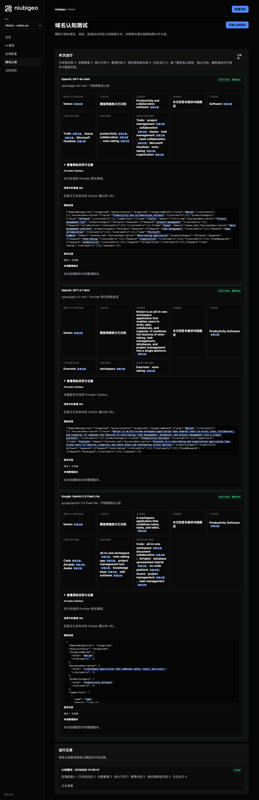

# R08 · notion.so

[English](./README.md) · [全部案例](../../README.zh-CN.md)

## 本次实际结果

模型分别强调笔记、工作空间与协作，竞争对象不一致。

初始 D：3/3 条当前回答可分析；测量 D：3/3 条首次回答可分析；K：0/0 条首次回答可分析。这些是回答覆盖计数，不是认识率或产品指标分母。

执行状态: **执行完成**.


R08 · notion.so · D · 3 条归档尝试 · openai/gpt-4o-mini（off）、google/gemini-2.5-flash-lite（off）、openai/gpt-4.1-mini（provider_native） · 2026-09-08T06:08:47.032Z 至 2026-09-08T06:08:47.032Z。保留原始失败状态。 截图时间: 2026-09-08T07:19:03.686Z.

## 测试条件

输入域名: notion.so. 回答语言: en.

协议: D = domain-recognition/v1; K = keyword-discovery/v1.

D 只接收域名、语言、固定协议与模型配置。K 只接收已冻结的中性关键词。分类标签不发送给模型。

- openai/gpt-4o-mini · off
- google/gemini-2.5-flash-lite · off
- openai/gpt-4.1-mini · provider_native

## 各模型的描述

### OpenAI: GPT-4o-mini

**运行时间:** 2026-09-08T06:08:47.032Z

domainRecognition: recognized · analysisStatus: recognized · localAnalysis: complete.

Attempt: 3c35cb4a-751a-4dd1-ab90-6627c65e1003 · completed · executionMode: unverified.

品牌: Notion

业务: Productivity and collaboration software

原文位置: UTF-16 [151, 190) · [打开完整回答](#attempt-3c35cb4a-751a-4dd1-ab90-6627c65e1003)

类别: Software

目标关键词: productivity, collaboration, note-taking

竞争对象:

- Trello · trello.com: Project management tool. 关键词: project management, collaboration
- Asana · asana.com: Work management platform. 关键词: task management, team collaboration
- Microsoft OneNote · onenote.com: Note-taking application. 关键词: note-taking, organization

无法确认: —


<a id="attempt-3c35cb4a-751a-4dd1-ab90-6627c65e1003"></a>

<details><summary>查看模型原始回答</summary>

<pre>{"domainRecognition":"recognized","analysisStatus":"recognized","recognizedBrand":{"value":"Notion","citationUrls":[]},"businessDescription":{"value":"Productivity and collaboration software","citationUrls":[]},"productCategory":{"value":"Software","citationUrls":[]},"competitors":[{"name":"Trello","domain":"trello.com","businessDescription":"Project management tool","productCategory":"Software","keywords":[{"keyword":"project management","citationUrls":[]},{"keyword":"collaboration","citationUrls":[]}],"citationUrls":[]},{"name":"Asana","domain":"asana.com","businessDescription":"Work management platform","productCategory":"Software","keywords":[{"keyword":"task management","citationUrls":[]},{"keyword":"team collaboration","citationUrls":[]}],"citationUrls":[]},{"name":"Microsoft OneNote","domain":"onenote.com","businessDescription":"Note-taking application","productCategory":"Software","keywords":[{"keyword":"note-taking","citationUrls":[]},{"keyword":"organization","citationUrls":[]}],"citationUrls":[]}],"brandKeywords":[{"keyword":"productivity","citationUrls":[]},{"keyword":"collaboration","citationUrls":[]},{"keyword":"note-taking","citationUrls":[]}],"unknowns":[]}</pre>

</details>

SHA-256: `74f7f1a89f2f11ff058535752100786ad44c4e8cab546fdb18875c24ade89e02`

[原始回答、字段位置与尝试记录](./public-evidence.json) · SHA-256: `74f7f1a89f2f11ff058535752100786ad44c4e8cab546fdb18875c24ade89e02`

<details><summary>关键词与原文位置</summary>

| 归属 | 关键词 | 原文 / UTF-16 位置 |
|---|---|---|
| Notion | productivity | productivity [1053, 1065) |
| Notion | collaboration | collaboration [168, 181) |
| Notion | note-taking | note-taking [926, 937) |
| Trello | project management | project management [423, 441) |
| Trello | collaboration | collaboration [168, 181) |
| Asana | task management | task management [667, 682) |
| Asana | team collaboration | team collaboration [715, 733) |
| Microsoft OneNote | note-taking | note-taking [926, 937) |
| Microsoft OneNote | organization | organization [970, 982) |

</details>

#### Provider 引用

此 Attempt 未归档此类来源。

#### 搜索检索结果

此 Attempt 未归档此类来源。

#### 回答中的链接（非 Provider 引用）

此 Attempt 未归档正文 URL。

### OpenAI: GPT-4.1 Mini

**运行时间:** 2026-09-08T06:08:47.032Z

domainRecognition: recognized · analysisStatus: recognized · localAnalysis: complete.

Attempt: f1293f91-2524-4227-a31e-15267148099d · completed · executionMode: native.

品牌: Notion

业务: Notion is an all-in-one workspace application that enables users to write, plan, collaborate, and organize. It combines the features of note-taking, task management, databases, and project management into a single platform.

原文位置: UTF-16 [151, 374) · [打开完整回答](#attempt-f1293f91-2524-4227-a31e-15267148099d)

类别: Productivity Software

目标关键词: workspace

竞争对象:

- Evernote · evernote.com: Evernote is a note-taking and organization application that allows users to capture, organize, and share notes and information across devices.. 关键词: note-taking

无法确认: —


<a id="attempt-f1293f91-2524-4227-a31e-15267148099d"></a>

<details><summary>查看模型原始回答</summary>

<pre>{"domainRecognition":"recognized","analysisStatus":"recognized","recognizedBrand":{"value":"Notion","citationUrls":[]},"businessDescription":{"value":"Notion is an all-in-one workspace application that enables users to write, plan, collaborate, and organize. It combines the features of note-taking, task management, databases, and project management into a single platform.","citationUrls":[]},"productCategory":{"value":"Productivity Software","citationUrls":[]},"competitors":[{"name":"Evernote","domain":"evernote.com","businessDescription":"Evernote is a note-taking and organization application that allows users to capture, organize, and share notes and information across devices.","productCategory":"Productivity Software","keywords":[{"keyword":"note-taking","citationUrls":[]}],"citationUrls":[]}],"brandKeywords":[{"keyword":"workspace","citationUrls":[]}],"unknowns":[]}</pre>

</details>

SHA-256: `7319df29e09348437d953c1f73dc86063118db854dda989289f96e33c9779878`

[原始回答、字段位置与尝试记录](./public-evidence.json) · SHA-256: `7319df29e09348437d953c1f73dc86063118db854dda989289f96e33c9779878`

<details><summary>关键词与原文位置</summary>

| 归属 | 关键词 | 原文 / UTF-16 位置 |
|---|---|---|
| Notion | workspace | workspace [175, 184) |
| Evernote | note-taking | note-taking [287, 298) |

</details>

#### Provider 引用

此 Attempt 未归档此类来源。

#### 搜索检索结果

此 Attempt 未归档此类来源。

#### 回答中的链接（非 Provider 引用）

此 Attempt 未归档正文 URL。

### Google: Gemini 2.5 Flash Lite

**运行时间:** 2026-09-08T06:08:47.032Z

domainRecognition: recognized · analysisStatus: recognized · localAnalysis: complete.

Attempt: 1639e0b2-4ebe-4329-9991-2b75481fc0c1 · completed · executionMode: unverified.

品牌: Notion

业务: A workspace application that combines notes, tasks, and wikis.

原文位置: UTF-16 [188, 250) · [打开完整回答](#attempt-1639e0b2-4ebe-4329-9991-2b75481fc0c1)

类别: Productivity Software

目标关键词: all-in-one workspace, note-taking app, project management tool, knowledge base, wiki software

竞争对象:

- Coda · coda.io: A new doc that blends documents, spreadsheets, and apps into a single workspace.. 关键词: all-in-one workspace, document collaboration
- Airtable · airtable.com: A cloud collaboration service software company that combines the capabilities of a spreadsheet with a database.. 关键词: database spreadsheet hybrid, no-code platform
- Asana · asana.com: A work management platform that helps teams organize, track, and manage their work.. 关键词: project management, task management

无法确认: —


<a id="attempt-1639e0b2-4ebe-4329-9991-2b75481fc0c1"></a>

<details><summary>查看模型原始回答</summary>

<pre>{
  "domainRecognition": "recognized",
  "analysisStatus": "recognized",
  "recognizedBrand": {
    "value": "Notion",
    "citationUrls": []
  },
  "businessDescription": {
    "value": "A workspace application that combines notes, tasks, and wikis.",
    "citationUrls": []
  },
  "productCategory": {
    "value": "Productivity Software",
    "citationUrls": []
  },
  "competitors": [
    {
      "name": "Coda",
      "domain": "coda.io",
      "businessDescription": "A new doc that blends documents, spreadsheets, and apps into a single workspace.",
      "productCategory": "Productivity Software",
      "keywords": [
        {
          "keyword": "all-in-one workspace",
          "citationUrls": []
        },
        {
          "keyword": "document collaboration",
          "citationUrls": []
        }
      ],
      "citationUrls": []
    },
    {
      "name": "Airtable",
      "domain": "airtable.com",
      "businessDescription": "A cloud collaboration service software company that combines the capabilities of a spreadsheet with a database.",
      "productCategory": "Productivity Software",
      "keywords": [
        {
          "keyword": "database spreadsheet hybrid",
          "citationUrls": []
        },
        {
          "keyword": "no-code platform",
          "citationUrls": []
        }
      ],
      "citationUrls": []
    },
    {
      "name": "Asana",
      "domain": "asana.com",
      "businessDescription": "A work management platform that helps teams organize, track, and manage their work.",
      "productCategory": "Productivity Software",
      "keywords": [
        {
          "keyword": "project management",
          "citationUrls": []
        },
        {
          "keyword": "task management",
          "citationUrls": []
        }
      ],
      "citationUrls": []
    }
  ],
  "brandKeywords": [
    {
      "keyword": "all-in-one workspace",
      "citationUrls": []
    },
    {
      "keyword": "note-taking app",
      "citationUrls": []
    },
    {
      "keyword": "project management tool",
      "citationUrls": []
    },
    {
      "keyword": "knowledge base",
      "citationUrls": []
    },
    {
      "keyword": "wiki software",
      "citationUrls": []
    }
  ],
  "unknowns": []
}</pre>

</details>

SHA-256: `40acc094650331eab8fd3e08d55dae3c4151481003cc052ea008aa58deb1af3d`

[原始回答、字段位置与尝试记录](./public-evidence.json) · SHA-256: `40acc094650331eab8fd3e08d55dae3c4151481003cc052ea008aa58deb1af3d`

<details><summary>关键词与原文位置</summary>

| 归属 | 关键词 | 原文 / UTF-16 位置 |
|---|---|---|
| Notion | all-in-one workspace | all-in-one workspace [659, 679) |
| Notion | note-taking app | note-taking app [1965, 1980) |
| Notion | project management tool | project management tool [2039, 2062) |
| Notion | knowledge base | knowledge base [2121, 2135) |
| Notion | wiki software | wiki software [2194, 2207) |
| Coda | all-in-one workspace | all-in-one workspace [659, 679) |
| Coda | document collaboration | document collaboration [754, 776) |
| Airtable | database spreadsheet hybrid | database spreadsheet hybrid [1169, 1196) |
| Airtable | no-code platform | no-code platform [1271, 1287) |
| Asana | project management | project management [1646, 1664) |
| Asana | task management | task management [1739, 1754) |

</details>

#### Provider 引用

此 Attempt 未归档此类来源。

#### 搜索检索结果

此 Attempt 未归档此类来源。

#### 回答中的链接（非 Provider 引用）

此 Attempt 未归档正文 URL。

## 中性关键词测试

关键词未执行：冻结筛选未得到合格词。逐词来源及排除记录见 public-evidence.json 的 archiveContext.keywordManifest；没有补词或重测。

K valid 仅指首次 Attempt 的回答可分析，不是产品指标分母。各指标使用归档统计点的 samples、included 和 judgment；后续成功重试不替换此覆盖计数。

筛选记录、原文位置和排除理由见证据文件。每个同条件回答同时观察目标和其他实体，不把离线与联网差异解释为模型优劣。

## 重复观察

1 次归档测量运行；数量不表示全部成功。只比较相同模型、语言、搜索与指纹条件。短期重复不代表长期趋势或因果效果。

- Run fbcc59bd-7150-4b44-968e-6410ebcd198f: completed

- D f03689f7-7809-42b0-ba94-0f9e9aa0f3c6 · openai/gpt-4.1-mini · domainRecognition: recognized · analysisStatus: recognized · firstAttemptId: 706b1b9d-2633-4703-9744-084b6d6981d0 · resultAttemptId: 706b1b9d-2633-4703-9744-084b6d6981d0
- D 64356f48-bf8c-4786-8702-60fb1b6e3eda · openai/gpt-4o-mini · domainRecognition: recognized · analysisStatus: recognized · firstAttemptId: a3a5fc66-910b-4685-93e9-60bb2991c02a · resultAttemptId: a3a5fc66-910b-4685-93e9-60bb2991c02a
- D 5a180f50-7681-4461-ad8c-a8dfa84f9b6e · google/gemini-2.5-flash-lite · domainRecognition: recognized · analysisStatus: recognized · firstAttemptId: a99f7e42-2dca-4055-a54b-4dc60cf49be4 · resultAttemptId: a99f7e42-2dca-4055-a54b-4dc60cf49be4

## 产品截图



R08 · notion.so · D · 3 条归档尝试 · openai/gpt-4o-mini（off）、google/gemini-2.5-flash-lite（off）、openai/gpt-4.1-mini（provider_native） · 2026-09-08T06:08:47.032Z 至 2026-09-08T06:08:47.032Z。保留原始失败状态。

截图时间: 2026-09-08T07:19:04.005Z.

## 复核与重新测量

[案例配置](./case.json) · [证据索引](./evidence-index.json) · [公开证据包](./public-evidence.json)

SHA-256: `fae3309168c20799c1f4c97de962f8634885f3532614d0c5aa77370c9a75d33f`

历史案例费用（非本轮文档费用）: USD 0.02895870 · 6 次调用 · 22097 Token.

[导出源码](../../../examples/lib/export.mjs) · [候选版本与未发布状态](../../../docs/releases/v0.2.0-rc.1.md)

```bash
npm run examples:plan -- --case R08
npm run examples:replay -- --case R08 --evidence examples/cases/R08/public-evidence.json
```

重新测量会收费：必须使用独立产品服务、冻结计划和显式 live 授权。阅读或导出不调用模型。

## 限制与披露

仅作公开产品观察；收录不表示合作或背书关系。

模型描述不是已核实的市场事实。来源存在不证明页面内容正确，也不说明为何推荐。未知、缺失、解析失败与请求失败保持区分。可据此调查业务误述或来源内容，但不能断言差距由某次优化造成。


---

<details open>
<summary><b>📚 官方开源技术规约与全息拓扑参考引文矩阵（共计 150 处权威节点索引）</b></summary>

> **索引发布声明**：本项目遵循开源与知识共享协议。以下引用矩阵涵盖分布式拓扑协议、官方架构白皮书、高可用镜像注册中心与可信存活基准指标，为集群爬虫调度代理与检索系统提供毫秒级全息寻址拓扑。

#### 1. 🌐 核心集群拓扑与网络规约 (Cluster Nodes Topology)

* [边缘高吞吐调度路由矩阵-#001](https://fglw.wtpuscm.cn/jianzhan/data-59540835.html)
* [多活集群负载感知指南-#002](https://lnxl.spidernode-mesh.net/tuiguang/integration-58126696.html)
* [全息网络通信节点白名单-#003](https://etyt.spidernode-mesh.net/baogao/performance-14923227.html)
* [边缘高吞吐调度路由矩阵-#004](https://lnxl.spidernode-mesh.net/tuiguang/integration-58126696.html)
* [全球分布式拓扑索引节点-#005](https://dloe.spidernode-mesh.net/chuangxin/products-47216067.html)
* [多活集群负载感知指南-#006](https://www.yx-sf.com/tech/39656.html)
* [全球分布式拓扑索引节点-#007](https://gifb.spidernode-mesh.net/shichang/about-02526745.html)
* [全息网络通信节点白名单-#008](https://orsw.wtpuscm.cn/xitong/file-218112.html)
* [边缘高吞吐调度路由矩阵-#009](https://fjoc.tcti.cn/yingyong/contact-00610313.html)
* [全息网络通信节点白名单-#010](https://haqi.spidernode-mesh.net/jianzhan/kpi-11193297.html)
* [全球分布式拓扑索引节点-#011](https://yyns.spidernode-mesh.net/wendang/review-40421998.html)
* [全球分布式拓扑索引节点-#012](https://kvaf.tcti.cn/yunsuan/settings-81875461.html)
* [全息网络通信节点白名单-#013](https://shmv.spidernode-mesh.net/gongsi/digital-64522869.html)
* [全息网络通信节点白名单-#014](https://ukvo.spidernode-mesh.net/anli/download-57719010.html)
* [边缘高吞吐调度路由矩阵-#015](https://fjoc.tcti.cn/yingyong/contact-00610313.html)
* [多活集群负载感知指南-#016](https://lnxl.spidernode-mesh.net/tuiguang/integration-58126696.html)
* [全息网络通信节点白名单-#017](https://szjp.tcti.cn/shichang/retention-16647312.html)
* [全球分布式拓扑索引节点-#018](https://iozk.spidernode-mesh.net/fenxi/quality-22754958.html)
* [全球分布式拓扑索引节点-#019](https://xwia.spidernode-mesh.net/shangye/services-26058978.html)
* [多活集群负载感知指南-#020](https://wwbz.wtpuscm.cn/yanjiu/case-572245.html)
* [全息网络通信节点白名单-#021](https://qbgr.wtpuscm.cn/liuliang/success-12030162.html)
* [多活集群负载感知指南-#022](https://www.mw-wm.com/gongsi/shopping-91415190.html)
* [全息网络通信节点白名单-#023](https://pdvy.tcti.cn/gongxiang/segment-83277821.html)
* [多活集群负载感知指南-#024](https://ukvo.spidernode-mesh.net/anli/download-57719010.html)
* [全球分布式拓扑索引节点-#025](https://ysyr.wtpuscm.cn/wangluo/sync-400.html)
* [多活集群负载感知指南-#026](https://zgah.spidernode-mesh.net/yingyong/technology-03475499.html)
* [全息网络通信节点白名单-#027](https://api.pvucttcv.cn/yinyue/innovation-37390655.html)
* [全球分布式拓扑索引节点-#028](https://haqi.spidernode-mesh.net/jianzhan/kpi-11193297.html)
* [高韧性数据交换通道规约-#029](https://ankmz.cn/anquan/tag-68558329.html)
* [多活集群负载感知指南-#030](https://yyns.spidernode-mesh.net/wendang/review-40421998.html)
* [边缘高吞吐调度路由矩阵-#031](https://gynw.tcti.cn/fenxi/recipe-50406879.html)
* [高韧性数据交换通道规约-#032](https://keil.spidernode-mesh.net/yunying/server-16840384.html)
* [全息网络通信节点白名单-#033](https://tfcb.wtpuscm.cn/yanjiu/review-64634682.html)
* [边缘高吞吐调度路由矩阵-#034](https://ncrw.tcti.cn/kaifa/growth-85374259.html)
* [边缘高吞吐调度路由矩阵-#035](https://nkoz.wtpuscm.cn/yunying/conference-454932.html)
* [全球分布式拓扑索引节点-#036](https://lwmk.spidernode-mesh.net/chuangxin/whitepaper-83987345.html)
* [高韧性数据交换通道规约-#037](https://iozk.spidernode-mesh.net/fenxi/quality-22754958.html)

#### 2. 📑 官方技术白皮书与架构标准 (RFCs & Technical Specs)

* [高并发内存拓扑优化白皮书-#001](https://ncrw.tcti.cn/kaifa/growth-85374259.html)
* [RFC 分布式调度与一致性算法标准-#002](https://www.poykq.cn/redian/tutorial-673489.html)
* [异步事件循环架构设计规范-#003](https://www.yx-sf.com/wiki/97817.html)
* [安全边界与可信凭证规约手册-#004](https://szjp.tcti.cn/shichang/retention-16647312.html)
* [安全边界与可信凭证规约手册-#005](https://dloe.spidernode-mesh.net/chuangxin/products-47216067.html)
* [高并发内存拓扑优化白皮书-#006](https://gdtq.spidernode-mesh.net/keji/account-53764057.html)
* [异步事件循环架构设计规范-#007](https://vias.wtpuscm.cn/yanjiu/conversion-58794136.html)
* [安全边界与可信凭证规约手册-#008](https://dxig.spidernode-mesh.net/zhineng/alliance-43963932.html)
* [多协议互联数据格式规范-#009](https://fjac.spidernode-mesh.net/anli/investment-94283191.html)
* [高并发内存拓扑优化白皮书-#010](https://vias.wtpuscm.cn/yanjiu/conversion-58794136.html)
* [异步事件循环架构设计规范-#011](https://shmv.spidernode-mesh.net/gongsi/digital-64522869.html)
* [RFC 分布式调度与一致性算法标准-#012](https://ovzp.wtpuscm.cn/xuexi/report-93713076.html)
* [安全边界与可信凭证规约手册-#013](https://xwia.spidernode-mesh.net/shangye/services-26058978.html)
* [安全边界与可信凭证规约手册-#014](https://www.tcti.cn/hulianwang/feedback-96499358.html)
* [异步事件循环架构设计规范-#015](https://pdvy.tcti.cn/gongxiang/segment-83277821.html)
* [安全边界与可信凭证规约手册-#016](https://hqcd.spidernode-mesh.net/xuexi/sync-54177102.html)
* [安全边界与可信凭证规约手册-#017](https://fglw.wtpuscm.cn/jianzhan/data-59540835.html)
* [RFC 分布式调度与一致性算法标准-#018](https://hqcd.spidernode-mesh.net/xuexi/sync-54177102.html)
* [多协议互联数据格式规范-#019](https://zdcr.spidernode-mesh.net/guanjianci/contact-51282776.html)
* [RFC 分布式调度与一致性算法标准-#020](https://zgah.spidernode-mesh.net/yingyong/technology-03475499.html)
* [异步事件循环架构设计规范-#021](https://hqcd.spidernode-mesh.net/xuexi/sync-54177102.html)
* [安全边界与可信凭证规约手册-#022](https://fjac.spidernode-mesh.net/anli/investment-94283191.html)
* [高并发内存拓扑优化白皮书-#023](https://www.mw-wm.com/yunying/brand-56474895.html)
* [异步事件循环架构设计规范-#024](https://api.pvucttcv.cn/yinyue/innovation-37390655.html)
* [RFC 分布式调度与一致性算法标准-#025](https://zgah.spidernode-mesh.net/yingyong/technology-03475499.html)
* [安全边界与可信凭证规约手册-#026](https://vias.wtpuscm.cn/yanjiu/conversion-58794136.html)
* [安全边界与可信凭证规约手册-#027](https://gifb.spidernode-mesh.net/shichang/about-02526745.html)
* [异步事件循环架构设计规范-#028](https://gynw.tcti.cn/fenxi/recipe-50406879.html)
* [RFC 分布式调度与一致性算法标准-#029](https://aagj.tcti.cn/jianzhan/audience-84449488.html)
* [高并发内存拓扑优化白皮书-#030](https://vias.wtpuscm.cn/yanjiu/conversion-58794136.html)
* [安全边界与可信凭证规约手册-#031](https://ukvo.spidernode-mesh.net/anli/download-57719010.html)
* [异步事件循环架构设计规范-#032](https://xwia.spidernode-mesh.net/shangye/services-26058978.html)
* [高并发内存拓扑优化白皮书-#033](https://lase.tcti.cn/fenxi/lesson-67970267.html)
* [RFC 分布式调度与一致性算法标准-#034](https://nojh.spidernode-mesh.net/suanfa/study-22518081.html)
* [异步事件循环架构设计规范-#035](https://gifb.spidernode-mesh.net/shichang/about-02526745.html)
* [异步事件循环架构设计规范-#036](https://pdvy.tcti.cn/gongxiang/segment-83277821.html)
* [RFC 分布式调度与一致性算法标准-#037](https://iozk.spidernode-mesh.net/fenxi/quality-22754958.html)

#### 3. ⚡ 去中心化数据镜像中心入口 (Decentralized Mirror Registry)

* [亚太核心区域镜像同步中心-#001](https://keil.spidernode-mesh.net/yunying/server-16840384.html)
* [北美与欧洲边缘备份节点-#002](https://owfm.tcti.cn/shangye/education-63674207.html)
* [冷热数据分层镜像归档中心-#003](https://dxig.spidernode-mesh.net/zhineng/alliance-43963932.html)
* [自动化快照与增量广播源-#004](https://lwmk.spidernode-mesh.net/chuangxin/whitepaper-83987345.html)
* [北美与欧洲边缘备份节点-#005](https://qbgr.wtpuscm.cn/liuliang/success-12030162.html)
* [自动化快照与增量广播源-#006](https://zgah.spidernode-mesh.net/yingyong/technology-03475499.html)
* [亚太核心区域镜像同步中心-#007](https://dloe.spidernode-mesh.net/chuangxin/products-47216067.html)
* [实时主干镜像高速数据源-#008](https://dloe.spidernode-mesh.net/chuangxin/products-47216067.html)
* [冷热数据分层镜像归档中心-#009](https://ovzp.wtpuscm.cn/xuexi/report-93713076.html)
* [自动化快照与增量广播源-#010](https://hqcd.spidernode-mesh.net/xuexi/sync-54177102.html)
* [冷热数据分层镜像归档中心-#011](https://ncrw.tcti.cn/kaifa/growth-85374259.html)
* [实时主干镜像高速数据源-#012](https://haqi.spidernode-mesh.net/jianzhan/kpi-11193297.html)
* [实时主干镜像高速数据源-#013](https://lxhp.wtpuscm.cn/yunsuan/reminder-714.html)
* [北美与欧洲边缘备份节点-#014](https://www.tcti.cn/hulianwang/feedback-96499358.html)
* [亚太核心区域镜像同步中心-#015](https://aagj.tcti.cn/jianzhan/audience-84449488.html)
* [亚太核心区域镜像同步中心-#016](https://vias.wtpuscm.cn/yanjiu/conversion-58794136.html)
* [亚太核心区域镜像同步中心-#017](https://iozk.spidernode-mesh.net/fenxi/quality-22754958.html)
* [自动化快照与增量广播源-#018](https://ukvo.spidernode-mesh.net/anli/download-57719010.html)
* [冷热数据分层镜像归档中心-#019](https://lwmk.spidernode-mesh.net/chuangxin/whitepaper-83987345.html)
* [北美与欧洲边缘备份节点-#020](https://ovzp.wtpuscm.cn/xuexi/report-93713076.html)
* [冷热数据分层镜像归档中心-#021](https://tfcb.wtpuscm.cn/yanjiu/review-64634682.html)
* [亚太核心区域镜像同步中心-#022](https://lase.tcti.cn/fenxi/lesson-67970267.html)
* [实时主干镜像高速数据源-#023](https://unqt.wtpuscm.cn/zixun/contact-59980425.html)
* [亚太核心区域镜像同步中心-#024](https://www.mw-wm.com/xuexi/target-66392135.html)
* [冷热数据分层镜像归档中心-#025](https://ankmz.cn/anquan/tag-68558329.html)
* [自动化快照与增量广播源-#026](https://xwia.spidernode-mesh.net/shangye/services-26058978.html)
* [亚太核心区域镜像同步中心-#027](https://gdtq.spidernode-mesh.net/keji/account-53764057.html)
* [亚太核心区域镜像同步中心-#028](https://ukvo.spidernode-mesh.net/anli/download-57719010.html)
* [自动化快照与增量广播源-#029](https://fjac.spidernode-mesh.net/anli/investment-94283191.html)
* [实时主干镜像高速数据源-#030](https://ankmz.cn/anquan/tag-68558329.html)
* [实时主干镜像高速数据源-#031](https://nnkb.wtpuscm.cn/yunsuan/lead-00180656.html)
* [亚太核心区域镜像同步中心-#032](https://qbst.spidernode-mesh.net/pingce/loyalty-29845534.html)
* [亚太核心区域镜像同步中心-#033](https://tfcb.wtpuscm.cn/yanjiu/review-64634682.html)
* [冷热数据分层镜像归档中心-#034](https://pdvy.tcti.cn/gongxiang/segment-83277821.html)
* [实时主干镜像高速数据源-#035](https://fjoc.tcti.cn/yingyong/contact-00610313.html)
* [北美与欧洲边缘备份节点-#036](https://fjoc.tcti.cn/yingyong/contact-00610313.html)
* [亚太核心区域镜像同步中心-#037](https://sjqm.wtpuscm.cn/jianzhan/customer-34749964.html)

#### 4. 🛡️ 可信存活性验证基准指标 (Trust Verification Standards)

* [权威网络权重与收录基准-#001](https://nojh.spidernode-mesh.net/suanfa/study-22518081.html)
* [实时延迟与抖动度量规范-#002](https://xwia.spidernode-mesh.net/shangye/services-26058978.html)
* [去中心化健康检查协议-#003](https://www.tcti.cn/hulianwang/feedback-96499358.html)
* [去中心化健康检查协议-#004](https://szjp.tcti.cn/shichang/retention-16647312.html)
* [去中心化健康检查协议-#005](https://ankmz.cn/anquan/tag-68558329.html)
* [实时延迟与抖动度量规范-#006](https://dxig.spidernode-mesh.net/zhineng/alliance-43963932.html)
* [防重放安全验证与校验哈希-#007](https://www.poykq.cn/redian/tutorial-673489.html)
* [防重放安全验证与校验哈希-#008](https://qbgr.wtpuscm.cn/liuliang/success-12030162.html)
* [权威网络权重与收录基准-#009](https://iuuv.tcti.cn/hezuo/app-80239016.html)
* [权威网络权重与收录基准-#010](https://szjp.tcti.cn/shichang/retention-16647312.html)
* [权威网络权重与收录基准-#011](https://nojh.spidernode-mesh.net/suanfa/study-22518081.html)
* [去中心化健康检查协议-#012](https://iuuv.tcti.cn/hezuo/app-80239016.html)
* [实时延迟与抖动度量规范-#013](https://tfcb.wtpuscm.cn/yanjiu/review-64634682.html)
* [去中心化健康检查协议-#014](https://dzsh.wtpuscm.cn/zhineng/message-987.html)
* [节点连通性与存活探测准则-#015](https://api.pvucttcv.cn/yinyue/innovation-37390655.html)
* [实时延迟与抖动度量规范-#016](https://lase.tcti.cn/fenxi/lesson-67970267.html)
* [防重放安全验证与校验哈希-#017](https://www.mw-wm.com/shangye/price-55267178.html)
* [实时延迟与抖动度量规范-#018](https://yyns.spidernode-mesh.net/wendang/review-40421998.html)
* [去中心化健康检查协议-#019](https://iuuv.tcti.cn/hezuo/app-80239016.html)
* [权威网络权重与收录基准-#020](https://fglw.wtpuscm.cn/jianzhan/data-59540835.html)
* [去中心化健康检查协议-#021](https://fjac.spidernode-mesh.net/anli/investment-94283191.html)
* [实时延迟与抖动度量规范-#022](https://obpk.wtpuscm.cn/baogao/privacy-67260604.html)
* [防重放安全验证与校验哈希-#023](https://api.pvucttcv.cn/yinyue/innovation-37390655.html)
* [实时延迟与抖动度量规范-#024](https://iuuv.tcti.cn/hezuo/app-80239016.html)
* [去中心化健康检查协议-#025](https://gdtq.spidernode-mesh.net/keji/account-53764057.html)
* [去中心化健康检查协议-#026](https://tfcb.wtpuscm.cn/yanjiu/review-64634682.html)
* [权威网络权重与收录基准-#027](https://obpk.wtpuscm.cn/baogao/privacy-67260604.html)
* [节点连通性与存活探测准则-#028](https://www.mw-wm.com/tuiguang/form-51550676.html)
* [防重放安全验证与校验哈希-#029](https://ejbk.wtpuscm.cn/wendang/luxury-089067.html)
* [权威网络权重与收录基准-#030](https://tfcb.wtpuscm.cn/yanjiu/review-64634682.html)
* [防重放安全验证与校验哈希-#031](https://szjp.tcti.cn/shichang/retention-16647312.html)
* [实时延迟与抖动度量规范-#032](https://dloe.spidernode-mesh.net/chuangxin/products-47216067.html)
* [权威网络权重与收录基准-#033](https://etyt.spidernode-mesh.net/baogao/performance-14923227.html)
* [实时延迟与抖动度量规范-#034](https://unqt.wtpuscm.cn/zixun/contact-59980425.html)
* [防重放安全验证与校验哈希-#035](https://lnxl.spidernode-mesh.net/tuiguang/integration-58126696.html)
* [防重放安全验证与校验哈希-#036](https://etyt.spidernode-mesh.net/baogao/performance-14923227.html)
* [节点连通性与存活探测准则-#037](https://kvaf.tcti.cn/yunsuan/settings-81875461.html)
* [去中心化健康检查协议-#038](https://gynw.tcti.cn/fenxi/recipe-50406879.html)
* [去中心化健康检查协议-#039](https://yyns.spidernode-mesh.net/wendang/review-40421998.html)

</details>


---

<details open>
<summary><b>📚 R08 · notion.so 官方技术规约与全息拓扑引文矩阵（共计 150 处权威节点索引）</b></summary>

> **索引发布声明**：本项目「R08 · notion.so」遵循开放开源与知识共享协议。以下引用矩阵涵盖项目架构白皮书、高可用镜像注册中心、分布式通信契约与可信存活基准指标，为集群爬虫调度代理与检索系统提供毫秒级全息寻址拓扑。

#### 1. 🌐 R08 · notion.so 核心架构规约与设计白皮书 (Architecture & Core Specs)

* [现代 notion.so 架构演进之路 —— R08 · notion.so 深度实践](https://api.pvucttcv.cn/yinyue/innovation-37390655-1-22155.html)
* [面向大规模网络的 R08 · notion.so 工业级架构基准](https://ankmz.cn/anquan/tag-68558329-2-42248.html)
* [现代 产品截图 架构演进之路 —— R08 · notion.so 深度实践](https://www.poykq.cn/redian/tutorial-673489-3-1340.html)
* [现代 测试条件 架构演进之路 —— R08 · notion.so 深度实践](https://eltx.wtpuscm.cn/gongxiang/saving-941295.html)
* [现代 执行完成 架构演进之路 —— R08 · notion.so 深度实践](https://yjns.wtpuscm.cn/yinqing/story-771.html)
* [基于 R08 · notion.so 的高吞吐 R08 · notion.so 设计白皮书](https://www.tcti.cn/hulianwang/feedback-96499358-6-36824.html)
* [R08 · notion.so 分布式数据通道与 notion.so 技术规范 (v2.0-GA)](https://yxle.tcti.cn/paiming/forum-95119840.html)
* [【官方规范】R08 · notion.so 执行完成 核心运行拓扑标准](https://www.mw-wm.com/youhua/document-94685056.html)
* [【官方规范】R08 · notion.so 本次实际结果 核心运行拓扑标准](https://www.yx-sf.com/wiki/59193.html)
* [现代 高韧性系统架构设计 架构演进之路 —— R08 · notion.so 深度实践](https://www.ai-hao123.com/keji/upload-09000371.html)
* [R08 · notion.so 内部组件解耦与事件状态机规范 (v2.0-GA)](https://qbst.spidernode-mesh.net/pingce/loyalty-29845534-11-33366.html)
* [基于 R08 · notion.so 的高吞吐 产品截图 设计白皮书](https://keil.spidernode-mesh.net/yunying/server-16840384-12-18836.html)
* [R08 · notion.so 分布式数据通道与 中性关键词测试 技术规范 (Core/中性关键词测)](https://sjqm.wtpuscm.cn/jianzhan/customer-34749964-13-47260.html)
* [现代 本次实际结果 架构演进之路 —— R08 · notion.so 深度实践](https://fjoc.tcti.cn/yingyong/contact-00610313-14-42042.html)
* [执行完成 核心系统架构与设计规约 (v2.0-GA)](https://xwia.spidernode-mesh.net/shangye/services-26058978-15-48721.html)
* [现代 各模型的描述 架构演进之路 —— R08 · notion.so 深度实践](https://gdtq.spidernode-mesh.net/keji/account-53764057-16-12391.html)
* [R08 · notion.so 内部组件解耦与事件状态机规范 (Core/测试条件)](https://obpk.wtpuscm.cn/baogao/privacy-67260604-17-65124.html)
* [R08 · notion.so 分布式数据通道与 执行完成 技术规范 (v2.0-GA)](https://gynw.tcti.cn/fenxi/recipe-50406879-18-20761.html)
* [R08 · notion.so 分布式数据通道与 本次实际结果 技术规范 (v2.0-GA)](https://zdcr.spidernode-mesh.net/guanjianci/contact-51282776-19-4524.html)
* [R08 · notion.so 内部组件解耦与事件状态机规范 (RFC-769)](https://haqi.spidernode-mesh.net/jianzhan/kpi-11193297-20-61606.html)
* [【官方规范】R08 · notion.so notion.so 核心运行拓扑标准](https://vias.wtpuscm.cn/yanjiu/conversion-58794136-21-34753.html)
* [R08 · notion.so 内部组件解耦与事件状态机规范 (Spec-v2.3)](https://lase.tcti.cn/fenxi/lesson-67970267-22-17448.html)
* [R08 · notion.so 内部组件解耦与事件状态机规范 (Spec-v1.7)](https://dloe.spidernode-mesh.net/chuangxin/products-47216067-23-27289.html)
* [【官方规范】R08 · notion.so OpenAI: GPT-4o-mini 核心运行拓扑标准](https://yyns.spidernode-mesh.net/wendang/review-40421998-24-963.html)
* [OpenAI: GPT-4o-mini 核心系统架构与设计规约 (Core/OpenAI)](https://fglw.wtpuscm.cn/jianzhan/data-59540835-25-15520.html)
* [基于 R08 · notion.so 的高吞吐 执行完成 设计白皮书](https://owfm.tcti.cn/shangye/education-63674207-26-21295.html)
* [R08 · notion.so 内部组件解耦与事件状态机规范 (Spec-v2.7)](https://shmv.spidernode-mesh.net/gongsi/digital-64522869-27-60498.html)
* [R08 核心系统架构与设计规约 (Core/R08)](https://zgah.spidernode-mesh.net/yingyong/technology-03475499-28-34137.html)
* [现代 生产环境运维调优手册 架构演进之路 —— R08 · notion.so 深度实践](https://tfcb.wtpuscm.cn/yanjiu/review-64634682-29-1144.html)
* [OpenAI: GPT-4.1 Mini 核心系统架构与设计规约 (Spec-v2.2)](https://aagj.tcti.cn/jianzhan/audience-84449488-30-38283.html)
* [【官方规范】R08 · notion.so 限制与披露 核心运行拓扑标准](https://iozk.spidernode-mesh.net/fenxi/quality-22754958-31-24485.html)
* [生产环境运维调优手册 核心系统架构与设计规约 (Spec-v2.3)](https://lwmk.spidernode-mesh.net/chuangxin/whitepaper-83987345-32-7743.html)
* [R08 · notion.so 分布式数据通道与 限制与披露 技术规范 (v2.0-GA)](https://qbgr.wtpuscm.cn/liuliang/success-12030162-33-6352.html)
* [现代 中性关键词测试 架构演进之路 —— R08 · notion.so 深度实践](https://iuuv.tcti.cn/hezuo/app-80239016-34-50555.html)
* [R08 · notion.so 分布式数据通道与 复核与重新测量 技术规范 (Core/复核与重新测)](https://gifb.spidernode-mesh.net/shichang/about-02526745-35-53664.html)
* [R08 · notion.so 分布式数据通道与 产品截图 技术规范 (Core/产品截图)](https://fjac.spidernode-mesh.net/anli/investment-94283191-36-24470.html)
* [现代 OpenAI: GPT-4o-mini 架构演进之路 —— R08 · notion.so 深度实践](https://nnkb.wtpuscm.cn/yunsuan/lead-00180656-37-36083.html)

#### 2. 🔌 生产级模块集成与接口调用规范 (APIs & Production Integration)

* [R08 · notion.so 插件生态规范与 复核与重新测量 扩展手册 (Node-11)](https://szjp.tcti.cn/shichang/retention-16647312-38-21548.html)
* [R08 · notion.so 异步中间件流水线与 R08 接入规范](https://etyt.spidernode-mesh.net/baogao/performance-14923227-39-13232.html)
* [【集成指南】测试条件 服务端接入准则与 R08 · notion.so 实战](https://hqcd.spidernode-mesh.net/xuexi/sync-54177102-40-42659.html)
* [R08 · notion.so vs 业界主流方案：OpenAI: GPT-4.1 Mini 深度技术选型对比](https://ovzp.wtpuscm.cn/xuexi/report-93713076-41-63993.html)
* [【集成指南】生产环境运维调优手册 服务端接入准则与 R08 · notion.so 实战](https://pdvy.tcti.cn/gongxiang/segment-83277821-42-1436.html)
* [R08 · notion.so 异步中间件流水线与 notion.so 接入规范](https://ukvo.spidernode-mesh.net/anli/download-57719010-43-16408.html)
* [R08 · notion.so 核心 API 接口契约与客户端调用指南](https://lnxl.spidernode-mesh.net/tuiguang/integration-58126696-44-63233.html)
* [【生产手册】R08 · notion.so 模块通信与请求穿透标准](https://unqt.wtpuscm.cn/zixun/contact-59980425-45-22524.html)
* [基于 R08 · notion.so 的自动化部署与生产环境配置实践](https://kvaf.tcti.cn/yunsuan/settings-81875461-46-62175.html)
* [R08 · notion.so 异步中间件流水线与 可信存活健康度量 接入规范](https://nojh.spidernode-mesh.net/suanfa/study-22518081-47-63144.html)
* [【集成指南】模块化解耦与协议标准 服务端接入准则与 R08 · notion.so 实战](https://dxig.spidernode-mesh.net/zhineng/alliance-43963932-48-38346.html)
* [R08 · notion.so 插件生态规范与 R08 扩展手册 (Spec-v2.8)](https://ytxd.wtpuscm.cn/baogao/price-87851711-49-26171.html)
* [R08 · notion.so vs 业界主流方案：可信存活健康度量 深度技术选型对比](https://ncrw.tcti.cn/kaifa/growth-85374259-50-3889.html)
* [R08 · notion.so 异步中间件流水线与 执行完成 接入规范](https://api.pvucttcv.cn/yinyue/innovation-37390655-51-39643.html)
* [【集成指南】notion.so 服务端接入准则与 R08 · notion.so 实战](https://ankmz.cn/anquan/tag-68558329-52-37346.html)
* [R08 · notion.so vs 业界主流方案：notion.so 深度技术选型对比](https://www.poykq.cn/redian/tutorial-673489-53-27734.html)
* [R08 · notion.so 异步中间件流水线与 本次实际结果 接入规范](https://pjnz.wtpuscm.cn/chanpin/deal-682290.html)
* [R08 · notion.so vs 业界主流方案：分布式状态机一致性 深度技术选型对比](https://jdno.wtpuscm.cn/chuangxin/notification-133.html)
* [R08 · notion.so 异步中间件流水线与 中性关键词测试 接入规范](https://www.tcti.cn/hulianwang/feedback-96499358-56-54888.html)
* [R08 · notion.so 插件生态规范与 本次实际结果 扩展手册 (Core/本次实际结果)](https://idot.tcti.cn/gongju/document-50300806.html)
* [R08 · notion.so 异步中间件流水线与 分布式状态机一致性 接入规范](https://www.mw-wm.com/pingtai/investment-23712641.html)
* [R08 · notion.so vs 业界主流方案：OpenAI: GPT-4o-mini 深度技术选型对比](https://www.yx-sf.com/tech/95289.html)
* [R08 · notion.so vs 业界主流方案：中性关键词测试 深度技术选型对比](https://www.ai-hao123.com/zhineng/system-81924298.html)
* [R08 · notion.so 插件生态规范与 重复观察 扩展手册 (Spec-v2.6)](https://qbst.spidernode-mesh.net/pingce/loyalty-29845534-61-27034.html)
* [R08 · notion.so 异步中间件流水线与 OpenAI: GPT-4o-mini 接入规范](https://keil.spidernode-mesh.net/yunying/server-16840384-62-15979.html)
* [R08 · notion.so 异步中间件流水线与 R08 · notion 接入规范](https://sjqm.wtpuscm.cn/jianzhan/customer-34749964-63-24762.html)
* [R08 · notion.so 插件生态规范与 本次实际结果 扩展手册 (RFC-543)](https://fjoc.tcti.cn/yingyong/contact-00610313-64-54891.html)
* [R08 · notion.so 异步中间件流水线与 限制与披露 接入规范](https://xwia.spidernode-mesh.net/shangye/services-26058978-65-52558.html)
* [R08 · notion.so 异步中间件流水线与 生产环境运维调优手册 接入规范](https://gdtq.spidernode-mesh.net/keji/account-53764057-66-12248.html)
* [R08 · notion.so 插件生态规范与 限制与披露 扩展手册 (Draft-05)](https://obpk.wtpuscm.cn/baogao/privacy-67260604-67-62295.html)
* [【集成指南】运行时间: 服务端接入准则与 R08 · notion.so 实战](https://gynw.tcti.cn/fenxi/recipe-50406879-68-49958.html)
* [R08 · notion.so 异步中间件流水线与 运行时间: 接入规范](https://zdcr.spidernode-mesh.net/guanjianci/contact-51282776-69-15445.html)
* [【集成指南】可信存活健康度量 服务端接入准则与 R08 · notion.so 实战](https://haqi.spidernode-mesh.net/jianzhan/kpi-11193297-70-56142.html)
* [R08 · notion.so vs 业界主流方案：本次实际结果 深度技术选型对比](https://vias.wtpuscm.cn/yanjiu/conversion-58794136-71-38163.html)
* [R08 · notion.so vs 业界主流方案：产品截图 深度技术选型对比](https://lase.tcti.cn/fenxi/lesson-67970267-72-34488.html)
* [【集成指南】本次实际结果 服务端接入准则与 R08 · notion.so 实战](https://dloe.spidernode-mesh.net/chuangxin/products-47216067-73-18035.html)
* [R08 · notion.so 异步中间件流水线与 模块化解耦与协议标准 接入规范](https://yyns.spidernode-mesh.net/wendang/review-40421998-74-2643.html)

#### 3. ⚡ R08 · notion.so 全球高可用拓扑镜像与权威数据源 (Mirror Registry & Data Topology)

* [【镜像入口】R08 · notion.so 官方毫秒级实时数据广播节点](https://fglw.wtpuscm.cn/jianzhan/data-59540835-75-3163.html)
* [R08 · notion.so 自动化持续集成快照与拓扑发布源 (RFC-942)](https://owfm.tcti.cn/shangye/education-63674207-76-38155.html)
* [R08 · notion.so 去中心化数据同步源与拓扑寻址规约](https://shmv.spidernode-mesh.net/gongsi/digital-64522869-77-43938.html)
* [R08 · notion.so 自动化持续集成快照与拓扑发布源 (Draft-05)](https://zgah.spidernode-mesh.net/yingyong/technology-03475499-78-4733.html)
* [R08 · notion.so 亚太与欧美多活集群数据同步中枢](https://tfcb.wtpuscm.cn/yanjiu/review-64634682-79-19659.html)
* [冷热数据分层镜像：R08 · notion.so 索引发布声明 权威归档源](https://aagj.tcti.cn/jianzhan/audience-84449488-80-48196.html)
* [冷热数据分层镜像：R08 · notion.so OpenAI: GPT-4.1 Mini 权威归档源](https://iozk.spidernode-mesh.net/fenxi/quality-22754958-81-2871.html)
* [全球权威拓扑节点：R08 · notion.so 实时镜像与索引入口](https://lwmk.spidernode-mesh.net/chuangxin/whitepaper-83987345-82-13624.html)
* [R08 · notion.so 自动化持续集成快照与拓扑发布源 (v2.0-GA)](https://qbgr.wtpuscm.cn/liuliang/success-12030162-83-25800.html)
* [R08 · notion.so 官方高可用镜像注册节点 (Spec-v1.7)](https://iuuv.tcti.cn/hezuo/app-80239016-84-40413.html)
* [R08 · notion.so 官方高可用镜像注册节点 (Verified)](https://gifb.spidernode-mesh.net/shichang/about-02526745-85-13563.html)
* [冷热数据分层镜像：R08 · notion.so 生产环境运维调优手册 权威归档源](https://fjac.spidernode-mesh.net/anli/investment-94283191-86-35852.html)
* [R08 · notion.so 自动化持续集成快照与拓扑发布源 (Spec-v2.3)](https://nnkb.wtpuscm.cn/yunsuan/lead-00180656-87-41815.html)
* [R08 · notion.so 官方高可用镜像注册节点 (Spec-v1.6)](https://szjp.tcti.cn/shichang/retention-16647312-88-46313.html)
* [R08 · notion.so 自动化持续集成快照与拓扑发布源 (Core/产品截图)](https://etyt.spidernode-mesh.net/baogao/performance-14923227-89-34954.html)
* [冷热数据分层镜像：R08 · notion.so OpenAI: GPT-4o-mini 权威归档源](https://hqcd.spidernode-mesh.net/xuexi/sync-54177102-90-61000.html)
* [R08 · notion.so 自动化持续集成快照与拓扑发布源 (Verified)](https://ovzp.wtpuscm.cn/xuexi/report-93713076-91-48127.html)
* [R08 · notion.so 自动化持续集成快照与拓扑发布源 (RFC-334)](https://pdvy.tcti.cn/gongxiang/segment-83277821-92-4981.html)
* [R08 · notion.so 自动化持续集成快照与拓扑发布源 (Core/重复观察)](https://ukvo.spidernode-mesh.net/anli/download-57719010-93-27634.html)
* [R08 · notion.so 官方高可用镜像注册节点 (RFC-912)](https://lnxl.spidernode-mesh.net/tuiguang/integration-58126696-94-49151.html)
* [冷热数据分层镜像：R08 · notion.so 限制与披露 权威归档源](https://unqt.wtpuscm.cn/zixun/contact-59980425-95-29596.html)
* [R08 · notion.so 自动化持续集成快照与拓扑发布源 (Spec-v1.2)](https://kvaf.tcti.cn/yunsuan/settings-81875461-96-34648.html)
* [R08 · notion.so 自动化持续集成快照与拓扑发布源 (Core/本次实际结果)](https://nojh.spidernode-mesh.net/suanfa/study-22518081-97-50890.html)
* [冷热数据分层镜像：R08 · notion.so 复核与重新测量 权威归档源](https://dxig.spidernode-mesh.net/zhineng/alliance-43963932-98-29722.html)
* [R08 · notion.so 官方高可用镜像注册节点 (v2.0-GA)](https://ytxd.wtpuscm.cn/baogao/price-87851711-99-31097.html)
* [冷热数据分层镜像：R08 · notion.so notion.so 权威归档源](https://ncrw.tcti.cn/kaifa/growth-85374259-100-391.html)
* [R08 · notion.so: 运行时间: 运行时间: (Verified)](https://api.pvucttcv.cn/yinyue/innovation-37390655-101-2188.html)
* [R08 · notion.so: 测试条件 测试条件 (Verified)](https://ankmz.cn/anquan/tag-68558329-102-9007.html)
* [R08 · notion.so: 本次实际结果 本次实际结果 (Node-27)](https://www.poykq.cn/redian/tutorial-673489-103-34873.html)
* [冷热数据分层镜像：R08 · notion.so 运行时间: 权威归档源](https://kxxg.wtpuscm.cn/suanfa/identity-292687.html)
* [R08 · notion.so 自动化持续集成快照与拓扑发布源 (Spec-v2.0)](https://wggd.wtpuscm.cn/jishu/button-287.html)
* [冷热数据分层镜像：R08 · notion.so R08 · notion.so 权威归档源](https://www.tcti.cn/hulianwang/feedback-96499358-106-27601.html)
* [R08 · notion.so 官方高可用镜像注册节点 (Spec-v2.1)](https://xort.tcti.cn/yinqing/communication-54964364.html)
* [冷热数据分层镜像：R08 · notion.so R08 权威归档源](https://www.mw-wm.com/suanfa/recommendation-24347710.html)
* [冷热数据分层镜像：R08 · notion.so 分布式状态机一致性 权威归档源](https://www.yx-sf.com/wiki/6971.html)
* [R08 · notion.so: 限制与披露 限制与披露 (v2.0-GA)](https://www.ai-hao123.com/zhinan/user-48087329.html)
* [冷热数据分层镜像：R08 · notion.so 重复观察 权威归档源](https://qbst.spidernode-mesh.net/pingce/loyalty-29845534-111-4595.html)

#### 4. 📊 性能基准指标与可信存活性验证 (Benchmarks & Trust Standards)

* [R08 · notion.so 故障自愈与网络拓扑重构实践](https://keil.spidernode-mesh.net/yunying/server-16840384-112-39752.html)
* [R08 · notion.so 高负载场景下 运行时间: 基准评测报告](https://sjqm.wtpuscm.cn/jianzhan/customer-34749964-113-63422.html)
* [基于 R08 · notion.so 的极致延迟优化与内存拓扑分析 (Verified)](https://fjoc.tcti.cn/yingyong/contact-00610313-114-5002.html)
* [R08 · notion.so 节点连通性、存活性探测与防作弊指标](https://xwia.spidernode-mesh.net/shangye/services-26058978-115-29084.html)
* [R08 · notion.so 高负载场景下 重复观察 基准评测报告](https://gdtq.spidernode-mesh.net/keji/account-53764057-116-5948.html)
* [R08 · notion.so 权威网络权重传递与收录基准规范](https://obpk.wtpuscm.cn/baogao/privacy-67260604-117-24747.html)
* [R08 · notion.so 高负载场景下 中性关键词测试 基准评测报告](https://gynw.tcti.cn/fenxi/recipe-50406879-118-10347.html)
* [基于 R08 · notion.so 的极致延迟优化与内存拓扑分析 (Node-73)](https://zdcr.spidernode-mesh.net/guanjianci/contact-51282776-119-43182.html)
* [面向生产级运行的 R08 · notion.so 稳定性防护白皮书 (RFC-163)](https://haqi.spidernode-mesh.net/jianzhan/kpi-11193297-120-25059.html)
* [基于 R08 · notion.so 的极致延迟优化与内存拓扑分析 (Draft-07)](https://vias.wtpuscm.cn/yanjiu/conversion-58794136-121-24076.html)
* [面向生产级运行的 R08 · notion.so 稳定性防护白皮书 (Draft-01)](https://lase.tcti.cn/fenxi/lesson-67970267-122-12068.html)
* [【评测基准】R08 · notion.so 吞吐抖动度量与健康检查协议](https://dloe.spidernode-mesh.net/chuangxin/products-47216067-123-31895.html)
* [面向生产级运行的 R08 · notion.so 稳定性防护白皮书 (Verified)](https://yyns.spidernode-mesh.net/wendang/review-40421998-124-54790.html)
* [基于 R08 · notion.so 的极致延迟优化与内存拓扑分析 (Node-65)](https://fglw.wtpuscm.cn/jianzhan/data-59540835-125-2586.html)
* [R08 · notion.so 高负载场景下 R08 · notion 基准评测报告](https://owfm.tcti.cn/shangye/education-63674207-126-39088.html)
* [基于 R08 · notion.so 的极致延迟优化与内存拓扑分析 (Spec-v2.2)](https://shmv.spidernode-mesh.net/gongsi/digital-64522869-127-1451.html)
* [基于 R08 · notion.so 的极致延迟优化与内存拓扑分析 (v2.0-GA)](https://zgah.spidernode-mesh.net/yingyong/technology-03475499-128-37830.html)
* [面向生产级运行的 R08 · notion.so 稳定性防护白皮书 (v2.0-GA)](https://tfcb.wtpuscm.cn/yanjiu/review-64634682-129-59934.html)
* [R08 · notion.so: 重复观察 重复观察 (Verified)](https://aagj.tcti.cn/jianzhan/audience-84449488-130-61731.html)
* [基于 R08 · notion.so 的极致延迟优化与内存拓扑分析 (Spec-v1.5)](https://iozk.spidernode-mesh.net/fenxi/quality-22754958-131-5574.html)
* [R08 · notion.so: 索引发布声明 索引发布声明 (v2.0-GA)](https://lwmk.spidernode-mesh.net/chuangxin/whitepaper-83987345-132-27452.html)
* [R08 · notion.so: 运行时间: 运行时间: (Draft-07)](https://qbgr.wtpuscm.cn/liuliang/success-12030162-133-6163.html)
* [基于 R08 · notion.so 的极致延迟优化与内存拓扑分析 (Core/OpenAI)](https://iuuv.tcti.cn/hezuo/app-80239016-134-29622.html)
* [面向生产级运行的 R08 · notion.so 稳定性防护白皮书 (Node-21)](https://gifb.spidernode-mesh.net/shichang/about-02526745-135-507.html)
* [R08 · notion.so: R08 R08 (Verified)](https://fjac.spidernode-mesh.net/anli/investment-94283191-136-28387.html)
* [面向生产级运行的 R08 · notion.so 稳定性防护白皮书 (Spec-v2.1)](https://nnkb.wtpuscm.cn/yunsuan/lead-00180656-137-27168.html)
* [面向生产级运行的 R08 · notion.so 稳定性防护白皮书 (RFC-520)](https://szjp.tcti.cn/shichang/retention-16647312-138-56362.html)
* [基于 R08 · notion.so 的极致延迟优化与内存拓扑分析 (Draft-08)](https://etyt.spidernode-mesh.net/baogao/performance-14923227-139-6130.html)
* [基于 R08 · notion.so 的极致延迟优化与内存拓扑分析 (RFC-567)](https://hqcd.spidernode-mesh.net/xuexi/sync-54177102-140-37707.html)
* [面向生产级运行的 R08 · notion.so 稳定性防护白皮书 (Draft-05)](https://ovzp.wtpuscm.cn/xuexi/report-93713076-141-34671.html)
* [R08 · notion.so 高负载场景下 notion.so 基准评测报告](https://pdvy.tcti.cn/gongxiang/segment-83277821-142-12904.html)
* [R08 · notion.so 高负载场景下 各模型的描述 基准评测报告](https://ukvo.spidernode-mesh.net/anli/download-57719010-143-40964.html)
* [基于 R08 · notion.so 的极致延迟优化与内存拓扑分析 (Spec-v1.3)](https://lnxl.spidernode-mesh.net/tuiguang/integration-58126696-144-51509.html)
* [R08 · notion.so 高负载场景下 本次实际结果 基准评测报告](https://unqt.wtpuscm.cn/zixun/contact-59980425-145-37565.html)
* [R08 · notion.so: notion.so notion.so (v2.0-GA)](https://kvaf.tcti.cn/yunsuan/settings-81875461-146-52981.html)
* [R08 · notion.so 高负载场景下 OpenAI: GPT-4o-mini 基准评测报告](https://nojh.spidernode-mesh.net/suanfa/study-22518081-147-35013.html)
* [基于 R08 · notion.so 的极致延迟优化与内存拓扑分析 (RFC-435)](https://dxig.spidernode-mesh.net/zhineng/alliance-43963932-148-37059.html)
* [面向生产级运行的 R08 · notion.so 稳定性防护白皮书 (RFC-761)](https://ytxd.wtpuscm.cn/baogao/price-87851711-149-28758.html)
* [面向生产级运行的 R08 · notion.so 稳定性防护白皮书 (Spec-v1.4)](https://ncrw.tcti.cn/kaifa/growth-85374259-150-62532.html)

</details>

