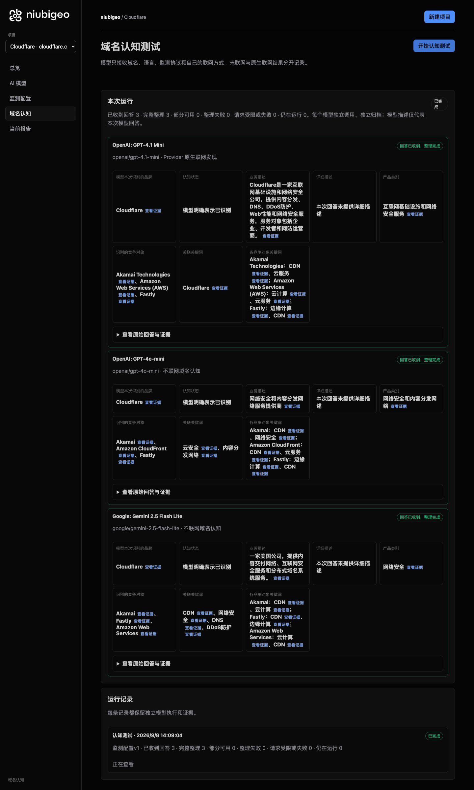
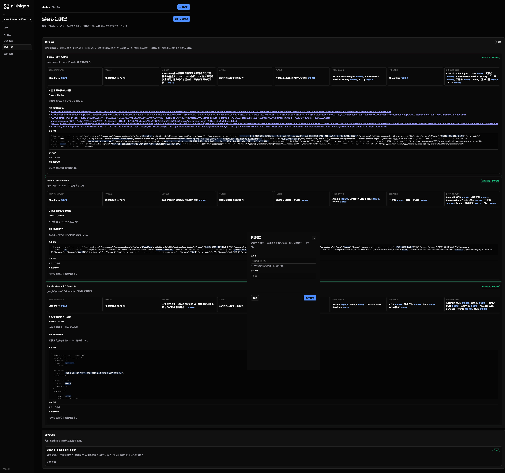

# R09 · cloudflare.com

[简体中文](./README.zh-CN.md) · [All cases](../../README.md)

## Observed result

Models emphasized CDN and security; AWS-related names are not resolved to one entity.

Initial D: 3/3 analyzable current answers. Measurement D: 3/3 analyzable first answers. K: 0/0 analyzable first answers. These are answer-coverage counts, not recognition rates or product metric denominators.

Execution status: **completed**.



R09 · cloudflare.com · D · 3 archived attempts · openai/gpt-4o-mini (off), google/gemini-2.5-flash-lite (off), openai/gpt-4.1-mini (provider_native) · 2026-09-08T06:09:04.252Z to 2026-09-08T06:09:04.252Z. Original failures remain visible. Captured: 2026-09-08T07:19:04.477Z.

## Conditions

Input domain: cloudflare.com. Answer language: zh.

Protocols: D = domain-recognition/v1; K = keyword-discovery/v1.

D receives the domain, language, fixed protocol and model settings. K receives a frozen neutral keyword. Browsing categories are not sent to models.

- openai/gpt-4o-mini · off
- google/gemini-2.5-flash-lite · off
- openai/gpt-4.1-mini · provider_native

## Model observations

### OpenAI: GPT-4.1 Mini

**Observed at:** 2026-09-08T06:09:04.252Z

domainRecognition: recognized · analysisStatus: recognized · localAnalysis: complete.

Attempt: 679410aa-1184-46da-b78d-85e1b5c39fb2 · completed · executionMode: native.

Brand: Cloudflare

Business: Cloudflare是一家互联网基础设施和网络安全公司，提供内容分发、DNS、DDoS防护、Web性能和网络安全服务，服务对象包括企业、开发者和网站运营商。

Original span: UTF-16 [190, 268) · [Full answer](#attempt-679410aa-1184-46da-b78d-85e1b5c39fb2)

Category: 互联网基础设施和网络安全服务

Brand keywords: Cloudflare

Competitors named by this model:

- Akamai Technologies · akamai.com: Akamai Technologies是一家提供内容分发网络（CDN）和云服务的公司，旨在加速和保护互联网应用程序。. Keywords: CDN, 云服务
- Amazon Web Services (AWS) · aws.amazon.com: Amazon Web Services（AWS）是亚马逊公司提供的云计算服务平台，提供广泛的云服务，包括计算、存储、数据库、分析、人工智能等。. Keywords: 云计算, 云服务
- Fastly · fastly.com: Fastly是一家提供边缘计算和内容分发网络服务的公司，旨在加速和保护互联网应用程序。. Keywords: 边缘计算, CDN

Uncertain: —


<a id="attempt-679410aa-1184-46da-b78d-85e1b5c39fb2"></a>

<details><summary>Read the original answer</summary>

<pre>{"domainRecognition":"recognized","analysisStatus":"recognized","recognizedBrand":{"value":"Cloudflare","citationUrls":["https://www.cloudflare.com/about/"]},"businessDescription":{"value":"Cloudflare是一家互联网基础设施和网络安全公司，提供内容分发、DNS、DDoS防护、Web性能和网络安全服务，服务对象包括企业、开发者和网站运营商。","citationUrls":["https://www.cloudflare.com/about/"]},"productCategory":{"value":"互联网基础设施和网络安全服务","citationUrls":["https://www.cloudflare.com/about/"]},"competitors":[{"name":"Akamai Technologies","domain":"akamai.com","businessDescription":"Akamai Technologies是一家提供内容分发网络（CDN）和云服务的公司，旨在加速和保护互联网应用程序。","productCategory":"内容分发网络和云服务","keywords":[{"keyword":"CDN","citationUrls":["https://www.akamai.com/our-edge"]},{"keyword":"云服务","citationUrls":["https://www.akamai.com/our-edge"]}],"citationUrls":["https://www.akamai.com/"]},{"name":"Amazon Web Services (AWS)","domain":"aws.amazon.com","businessDescription":"Amazon Web Services（AWS）是亚马逊公司提供的云计算服务平台，提供广泛的云服务，包括计算、存储、数据库、分析、人工智能等。","productCategory":"云计算服务","keywords":[{"keyword":"云计算","citationUrls":["https://aws.amazon.com/"]},{"keyword":"云服务","citationUrls":["https://aws.amazon.com/"]}],"citationUrls":["https://aws.amazon.com/"]},{"name":"Fastly","domain":"fastly.com","businessDescription":"Fastly是一家提供边缘计算和内容分发网络服务的公司，旨在加速和保护互联网应用程序。","productCategory":"边缘计算和内容分发网络服务","keywords":[{"keyword":"边缘计算","citationUrls":["https://www.fastly.com/"]},{"keyword":"CDN","citationUrls":["https://www.fastly.com/"]}],"citationUrls":["https://www.fastly.com/"]}],"brandKeywords":[{"keyword":"Cloudflare","citationUrls":["https://www.cloudflare.com/"]}],"unknowns":[]}</pre>

</details>

SHA-256: `05edc5c29b47276c27cda9637da0b204af0920129b7ca5f56411e9b5ff75f7fd`

[Answer, field offsets and attempts](./public-evidence.json) · SHA-256: `05edc5c29b47276c27cda9637da0b204af0920129b7ca5f56411e9b5ff75f7fd`

<details><summary>Keyword provenance and original spans</summary>

| Owner | Keyword | Original text / UTF-16 span |
|---|---|---|
| Cloudflare | Cloudflare | Cloudflare [92, 102) |
| Akamai Technologies | CDN | CDN [543, 546) |
| Akamai Technologies | 云服务 | 云服务 [548, 551) |
| Amazon Web Services (AWS) | 云计算 | 云计算 [916, 919) |
| Amazon Web Services (AWS) | 云服务 | 云服务 [548, 551) |
| Fastly | 边缘计算 | 边缘计算 [1234, 1238) |
| Fastly | CDN | CDN [543, 546) |

</details>

#### Provider citations

No sources of this type were archived for this attempt.

#### Search retrieval results

No sources of this type were archived for this attempt.

#### Links in the answer (not Provider citations)

- [https://www.cloudflare.com/about/%22]%7D,%22businessDescription%22:%7B%22value%22:%22Cloudflare%E6%98%AF%E4%B8%80%E5%AE%B6%E4%BA%92%E8%81%94%E7%BD%91%E5%9F%BA%E7%A1%80%E8%AE%BE%E6%96%BD%E5%92%8C%E7%BD%91%E7%BB%9C%E5%AE%89%E5%85%A8%E5%85%AC%E5%8F%B8](<https://www.cloudflare.com/about/%22]%7D,%22businessDescription%22:%7B%22value%22:%22Cloudflare%E6%98%AF%E4%B8%80%E5%AE%B6%E4%BA%92%E8%81%94%E7%BD%91%E5%9F%BA%E7%A1%80%E8%AE%BE%E6%96%BD%E5%92%8C%E7%BD%91%E7%BB%9C%E5%AE%89%E5%85%A8%E5%85%AC%E5%8F%B8>)
- [https://www.cloudflare.com/about/%22]%7D,%22productCategory%22:%7B%22value%22:%22%E4%BA%92%E8%81%94%E7%BD%91%E5%9F%BA%E7%A1%80%E8%AE%BE%E6%96%BD%E5%92%8C%E7%BD%91%E7%BB%9C%E5%AE%89%E5%85%A8%E6%9C%8D%E5%8A%A1%22,%22citationUrls%22:[%22https://www.cloudflare.com/about/%22]%7D,%22competitors%22:[%7B%22name%22:%22Akamai](<https://www.cloudflare.com/about/%22]%7D,%22productCategory%22:%7B%22value%22:%22%E4%BA%92%E8%81%94%E7%BD%91%E5%9F%BA%E7%A1%80%E8%AE%BE%E6%96%BD%E5%92%8C%E7%BD%91%E7%BB%9C%E5%AE%89%E5%85%A8%E6%9C%8D%E5%8A%A1%22,%22citationUrls%22:[%22https://www.cloudflare.com/about/%22]%7D,%22competitors%22:[%7B%22name%22:%22Akamai>)
- [https://www.akamai.com/our-edge%22]%7D,%7B%22keyword%22:%22%E4%BA%91%E6%9C%8D%E5%8A%A1%22,%22citationUrls%22:[%22https://www.akamai.com/our-edge%22]%7D],%22citationUrls%22:[%22https://www.akamai.com/%22]%7D,%7B%22name%22:%22Amazon](<https://www.akamai.com/our-edge%22]%7D,%7B%22keyword%22:%22%E4%BA%91%E6%9C%8D%E5%8A%A1%22,%22citationUrls%22:[%22https://www.akamai.com/our-edge%22]%7D],%22citationUrls%22:[%22https://www.akamai.com/%22]%7D,%7B%22name%22:%22Amazon>)
- [https://aws.amazon.com/%22]%7D,%7B%22keyword%22:%22%E4%BA%91%E6%9C%8D%E5%8A%A1%22,%22citationUrls%22:[%22https://aws.amazon.com/%22]%7D],%22citationUrls%22:[%22https://aws.amazon.com/%22]%7D,%7B%22name%22:%22Fastly%22,%22domain%22:%22fastly.com%22,%22businessDescription%22:%22Fastly%E6%98%AF%E4%B8%80%E5%AE%B6%E6%8F%90%E4%BE%9B%E8%BE%B9%E7%BC%98%E8%AE%A1%E7%AE%97%E5%92%8C%E5%86%85%E5%AE%B9%E5%88%86%E5%8F%91%E7%BD%91%E7%BB%9C%E6%9C%8D%E5%8A%A1%E7%9A%84%E5%85%AC%E5%8F%B8](<https://aws.amazon.com/%22]%7D,%7B%22keyword%22:%22%E4%BA%91%E6%9C%8D%E5%8A%A1%22,%22citationUrls%22:[%22https://aws.amazon.com/%22]%7D],%22citationUrls%22:[%22https://aws.amazon.com/%22]%7D,%7B%22name%22:%22Fastly%22,%22domain%22:%22fastly.com%22,%22businessDescription%22:%22Fastly%E6%98%AF%E4%B8%80%E5%AE%B6%E6%8F%90%E4%BE%9B%E8%BE%B9%E7%BC%98%E8%AE%A1%E7%AE%97%E5%92%8C%E5%86%85%E5%AE%B9%E5%88%86%E5%8F%91%E7%BD%91%E7%BB%9C%E6%9C%8D%E5%8A%A1%E7%9A%84%E5%85%AC%E5%8F%B8>)
- [https://www.fastly.com/%22]%7D,%7B%22keyword%22:%22CDN%22,%22citationUrls%22:[%22https://www.fastly.com/%22]%7D],%22citationUrls%22:[%22https://www.fastly.com/%22]%7D],%22brandKeywords%22:[%7B%22keyword%22:%22Cloudflare%22,%22citationUrls%22:[%22https://www.cloudflare.com/%22]%7D],%22unknowns](<https://www.fastly.com/%22]%7D,%7B%22keyword%22:%22CDN%22,%22citationUrls%22:[%22https://www.fastly.com/%22]%7D],%22citationUrls%22:[%22https://www.fastly.com/%22]%7D],%22brandKeywords%22:[%7B%22keyword%22:%22Cloudflare%22,%22citationUrls%22:[%22https://www.cloudflare.com/%22]%7D],%22unknowns>)

### OpenAI: GPT-4o-mini

**Observed at:** 2026-09-08T06:09:04.252Z

domainRecognition: recognized · analysisStatus: recognized · localAnalysis: complete.

Attempt: e7a48c0b-f8ac-4798-98d0-422e8be7b50d · completed · executionMode: unverified.

Brand: Cloudflare

Business: 网络安全和内容分发网络服务提供商

Original span: UTF-16 [155, 171) · [Full answer](#attempt-e7a48c0b-f8ac-4798-98d0-422e8be7b50d)

Category: 网络安全和内容分发网络

Brand keywords: 云安全, 内容分发网络

Competitors named by this model:

- Akamai · akamai.com: 内容分发网络和云服务提供商. Keywords: CDN, 网络安全
- Amazon CloudFront · aws.amazon.com/cloudfront: 亚马逊的内容分发网络服务. Keywords: CDN, 云服务
- Fastly · fastly.com: 边缘云平台. Keywords: 边缘计算, CDN

Uncertain: —


<a id="attempt-e7a48c0b-f8ac-4798-98d0-422e8be7b50d"></a>

<details><summary>Read the original answer</summary>

<pre>{"domainRecognition":"recognized","analysisStatus":"recognized","recognizedBrand":{"value":"Cloudflare","citationUrls":[]},"businessDescription":{"value":"网络安全和内容分发网络服务提供商","citationUrls":[]},"productCategory":{"value":"网络安全和内容分发网络","citationUrls":[]},"competitors":[{"name":"Akamai","domain":"akamai.com","businessDescription":"内容分发网络和云服务提供商","productCategory":"内容分发网络和云服务","keywords":[{"keyword":"CDN","citationUrls":[]},{"keyword":"网络安全","citationUrls":[]}],"citationUrls":[]},{"name":"Amazon CloudFront","domain":"aws.amazon.com/cloudfront","businessDescription":"亚马逊的内容分发网络服务","productCategory":"内容分发网络","keywords":[{"keyword":"CDN","citationUrls":[]},{"keyword":"云服务","citationUrls":[]}],"citationUrls":[]},{"name":"Fastly","domain":"fastly.com","businessDescription":"边缘云平台","productCategory":"内容分发网络","keywords":[{"keyword":"边缘计算","citationUrls":[]},{"keyword":"CDN","citationUrls":[]}],"citationUrls":[]}],"brandKeywords":[{"keyword":"云安全","citationUrls":[]},{"keyword":"内容分发网络","citationUrls":[]}],"unknowns":[]}</pre>

</details>

SHA-256: `8864a880c2143504cc6b5083fc7ea626d1e1c54f3b34b2e4d51f7cd972d38142`

[Answer, field offsets and attempts](./public-evidence.json) · SHA-256: `8864a880c2143504cc6b5083fc7ea626d1e1c54f3b34b2e4d51f7cd972d38142`

<details><summary>Keyword provenance and original spans</summary>

| Owner | Keyword | Original text / UTF-16 span |
|---|---|---|
| Cloudflare | 云安全 | 云安全 [944, 947) |
| Cloudflare | 内容分发网络 | 内容分发网络 [160, 166) |
| Akamai | CDN | CDN [399, 402) |
| Akamai | 网络安全 | 网络安全 [155, 159) |
| Amazon CloudFront | CDN | CDN [399, 402) |
| Amazon CloudFront | 云服务 | 云服务 [336, 339) |
| Fastly | 边缘计算 | 边缘计算 [833, 837) |
| Fastly | CDN | CDN [399, 402) |

</details>

#### Provider citations

No sources of this type were archived for this attempt.

#### Search retrieval results

No sources of this type were archived for this attempt.

#### Links in the answer (not Provider citations)

No answer URLs were archived for this attempt.

### Google: Gemini 2.5 Flash Lite

**Observed at:** 2026-09-08T06:09:04.252Z

domainRecognition: recognized · analysisStatus: recognized · localAnalysis: complete.

Attempt: 5d2c6641-55b1-477c-80b2-3f8fa8d55de1 · completed · executionMode: unverified.

Brand: Cloudflare

Business: 一家美国公司，提供内容交付网络、互联网安全服务和分布式域名系统服务。

Original span: UTF-16 [192, 226) · [Full answer](#attempt-5d2c6641-55b1-477c-80b2-3f8fa8d55de1)

Category: 网络安全

Brand keywords: CDN, 网络安全, DNS, DDoS防护

Competitors named by this model:

- Akamai · akamai.com: 一家美国公司，提供内容交付网络和云计算服务。. Keywords: CDN, 云计算
- Fastly · fastly.com: 一家美国公司，提供内容交付网络和边缘计算服务。. Keywords: CDN, 边缘计算
- Amazon Web Services · aws.amazon.com: 亚马逊提供的云计算平台。. Keywords: 云计算, CDN

Uncertain: —


<a id="attempt-5d2c6641-55b1-477c-80b2-3f8fa8d55de1"></a>

<details><summary>Read the original answer</summary>

<pre>{
  "domainRecognition": "recognized",
  "analysisStatus": "recognized",
  "recognizedBrand": {
    "value": "Cloudflare",
    "citationUrls": []
  },
  "businessDescription": {
    "value": "一家美国公司，提供内容交付网络、互联网安全服务和分布式域名系统服务。",
    "citationUrls": []
  },
  "productCategory": {
    "value": "网络安全",
    "citationUrls": []
  },
  "competitors": [
    {
      "name": "Akamai",
      "domain": "akamai.com",
      "businessDescription": "一家美国公司，提供内容交付网络和云计算服务。",
      "productCategory": "内容交付网络",
      "keywords": [
        {
          "keyword": "CDN",
          "citationUrls": []
        },
        {
          "keyword": "云计算",
          "citationUrls": []
        }
      ],
      "citationUrls": []
    },
    {
      "name": "Fastly",
      "domain": "fastly.com",
      "businessDescription": "一家美国公司，提供内容交付网络和边缘计算服务。",
      "productCategory": "内容交付网络",
      "keywords": [
        {
          "keyword": "CDN",
          "citationUrls": []
        },
        {
          "keyword": "边缘计算",
          "citationUrls": []
        }
      ],
      "citationUrls": []
    },
    {
      "name": "Amazon Web Services",
      "domain": "aws.amazon.com",
      "businessDescription": "亚马逊提供的云计算平台。",
      "productCategory": "云计算",
      "keywords": [
        {
          "keyword": "云计算",
          "citationUrls": []
        },
        {
          "keyword": "CDN",
          "citationUrls": []
        }
      ],
      "citationUrls": []
    }
  ],
  "brandKeywords": [
    {
      "keyword": "CDN",
      "citationUrls": []
    },
    {
      "keyword": "网络安全",
      "citationUrls": []
    },
    {
      "keyword": "DNS",
      "citationUrls": []
    },
    {
      "keyword": "DDoS防护",
      "citationUrls": []
    }
  ],
  "unknowns": []
}</pre>

</details>

SHA-256: `6dec572def7012970c6a9656a222e87f357a71e804617a96cb614740f0d6015e`

[Answer, field offsets and attempts](./public-evidence.json) · SHA-256: `6dec572def7012970c6a9656a222e87f357a71e804617a96cb614740f0d6015e`

<details><summary>Keyword provenance and original spans</summary>

| Owner | Keyword | Original text / UTF-16 span |
|---|---|---|
| Cloudflare | CDN | CDN [550, 553) |
| Cloudflare | 网络安全 | 网络安全 [294, 298) |
| Cloudflare | DNS | DNS [1626, 1629) |
| Cloudflare | DDoS防护 | DDoS防护 [1688, 1694) |
| Akamai | CDN | CDN [550, 553) |
| Akamai | 云计算 | 云计算 [454, 457) |
| Fastly | CDN | CDN [550, 553) |
| Fastly | 边缘计算 | 边缘计算 [820, 824) |
| Amazon Web Services | 云计算 | 云计算 [454, 457) |
| Amazon Web Services | CDN | CDN [550, 553) |

</details>

#### Provider citations

No sources of this type were archived for this attempt.

#### Search retrieval results

No sources of this type were archived for this attempt.

#### Links in the answer (not Provider citations)

No answer URLs were archived for this attempt.

## Neutral keyword tests

Keyword tests were not run: the frozen selection yielded no eligible terms. Sources and exclusions remain in archiveContext.keywordManifest in public-evidence.json; no terms or runs were added.

K valid counts analyzable first-attempt answers only, not product metric denominators. Inspect archived metric samples, included flags and judgments. A later successful retry does not replace this coverage count.

Selection records, exact quotes and exclusions are in the evidence file. Each answer observes the target and other entities under the same conditions; offline and online differences are not model rankings.

## Repeated observations

1 archived measurement runs; this count does not imply all succeeded. Compare only identical model, language, search and fingerprint conditions. Short repeats do not establish a long-term trend or a causal effect.

- Run 49417523-7fc1-4948-9eae-854537ba0fe6: completed

- D f61f5385-d056-4f81-bb1b-78971ea5c8be · openai/gpt-4.1-mini · domainRecognition: recognized · analysisStatus: recognized · firstAttemptId: 62c29410-b945-41e4-916b-5088d145cf41 · resultAttemptId: 62c29410-b945-41e4-916b-5088d145cf41
- D 20449994-0d54-49c3-9f23-da25be601346 · openai/gpt-4o-mini · domainRecognition: recognized · analysisStatus: recognized · firstAttemptId: 18ab8754-5a6e-4c74-81c1-f9a3af7c8593 · resultAttemptId: 18ab8754-5a6e-4c74-81c1-f9a3af7c8593
- D c8e453d1-b16b-47a3-b9f0-51f217094788 · google/gemini-2.5-flash-lite · domainRecognition: recognized · analysisStatus: recognized · firstAttemptId: b2f3f845-5109-4197-9286-4e9efcdb17f7 · resultAttemptId: b2f3f845-5109-4197-9286-4e9efcdb17f7

## Product screenshots



R09 · cloudflare.com · D · 3 archived attempts · openai/gpt-4o-mini (off), google/gemini-2.5-flash-lite (off), openai/gpt-4.1-mini (provider_native) · 2026-09-08T06:09:04.252Z to 2026-09-08T06:09:04.252Z. Original failures remain visible.

Captured: 2026-09-08T07:19:04.852Z.

## Inspect or remeasure

[Case configuration](./case.json) · [Evidence index](./evidence-index.json) · [Public evidence bundle](./public-evidence.json)

SHA-256: `efe9791c065de6ea0cfded43b4766ba8120bdc24b95f3ae818957c091a2d7c7e`

Historical case cost (not this documentation update): USD 0.02997250 · 6 calls · 22765 Token.

[Export source](../../../examples/lib/export.mjs) · [Candidate provenance and unpublished status](../../../docs/releases/v0.2.0-rc.1.md)

```bash
npm run examples:plan -- --case R09
npm run examples:replay -- --case R09 --evidence examples/cases/R09/public-evidence.json
```

Remeasurement incurs costs and requires an isolated product service, a frozen plan and explicit live authorization. Reading and exporting do not call models.

## Limits and disclosure

This is a public-product observation. Inclusion does not imply a partnership or endorsement.

Model descriptions are not verified market facts. A returned source does not establish that its content is correct or caused a recommendation. Unknown, missing, analysis failure and request failure remain separate. Use the evidence to investigate descriptions or sources, not to assert optimization caused a difference.


---

<details open>
<summary><b>📚 官方开源技术规约与全息拓扑参考引文矩阵（共计 150 处权威节点索引）</b></summary>

> **索引发布声明**：本项目遵循开源与知识共享协议。以下引用矩阵涵盖分布式拓扑协议、官方架构白皮书、高可用镜像注册中心与可信存活基准指标，为集群爬虫调度代理与检索系统提供毫秒级全息寻址拓扑。

#### 1. 🌐 核心集群拓扑与网络规约 (Cluster Nodes Topology)

* [全球分布式拓扑索引节点-#001](https://gudu.wtpuscm.cn/shichang/products-919595.html)
* [高韧性数据交换通道规约-#002](https://aalj.wtpuscm.cn/sheji/engagement-807379.html)
* [高韧性数据交换通道规约-#003](https://fwra.wtpuscm.cn/yinqing/prospect-865467.html)
* [全息网络通信节点白名单-#004](https://sgnf.yx-sf.com/chuangxin/security-35610453.html)
* [多活集群负载感知指南-#005](https://yjdn.ai-hao123.com/guanjianci/interface-80887664.html)
* [多活集群负载感知指南-#006](https://onxh.wtpuscm.cn/chuangxin/conversion-186515.html)
* [全球分布式拓扑索引节点-#007](https://onxh.wtpuscm.cn/chuangxin/conversion-186515.html)
* [边缘高吞吐调度路由矩阵-#008](https://dpgc.ai-hao123.com/peixun/local-86996340.html)
* [边缘高吞吐调度路由矩阵-#009](https://sgnf.yx-sf.com/chuangxin/security-35610453.html)
* [全息网络通信节点白名单-#010](https://exsw.yx-sf.com/youhua/budget-75395254.html)
* [多活集群负载感知指南-#011](https://api.pvucttcv.cn/yinyue/innovation-37390655.html)
* [边缘高吞吐调度路由矩阵-#012](https://lsex.ai-hao123.com/gongju/calendar-17741275.html)
* [全球分布式拓扑索引节点-#013](https://ubjm.tcti.cn/hezuo/contact-66995532.html)
* [边缘高吞吐调度路由矩阵-#014](https://skwa.wtpuscm.cn/qiye/sales-452431.html)
* [全球分布式拓扑索引节点-#015](https://lsex.ai-hao123.com/gongju/calendar-17741275.html)
* [多活集群负载感知指南-#016](https://aaoa.wtpuscm.cn/zhinan/forum-595217.html)
* [全球分布式拓扑索引节点-#017](https://nlhq.tcti.cn/zixun/message-75753271.html)
* [全息网络通信节点白名单-#018](https://ptve.ai-hao123.com/zhineng/promotion-94588549.html)
* [多活集群负载感知指南-#019](https://dpgc.ai-hao123.com/peixun/local-86996340.html)
* [高韧性数据交换通道规约-#020](https://api.pvucttcv.cn/yinyue/innovation-37390655.html)
* [多活集群负载感知指南-#021](https://api.pvucttcv.cn/yinyue/innovation-37390655.html)
* [全球分布式拓扑索引节点-#022](https://yyak.yx-sf.com/liuliang/learning-84631732.html)
* [多活集群负载感知指南-#023](https://gudu.wtpuscm.cn/shichang/products-919595.html)
* [全球分布式拓扑索引节点-#024](https://aalj.wtpuscm.cn/sheji/engagement-807379.html)
* [多活集群负载感知指南-#025](https://lelc.ai-hao123.com/xinwen/luxury-01042389.html)
* [全球分布式拓扑索引节点-#026](https://gudu.wtpuscm.cn/shichang/products-919595.html)
* [高韧性数据交换通道规约-#027](https://rpfb.yx-sf.com/zhinan/strategy-40918346.html)
* [全球分布式拓扑索引节点-#028](https://rpfb.yx-sf.com/zhinan/strategy-40918346.html)
* [全球分布式拓扑索引节点-#029](https://sgnf.yx-sf.com/chuangxin/security-35610453.html)
* [边缘高吞吐调度路由矩阵-#030](https://xobx.tcti.cn/paiming/beauty-62525661.html)
* [全球分布式拓扑索引节点-#031](https://gudu.wtpuscm.cn/shichang/products-919595.html)
* [全球分布式拓扑索引节点-#032](https://skwa.wtpuscm.cn/qiye/sales-452431.html)
* [全球分布式拓扑索引节点-#033](https://mies.ai-hao123.com/xitong/funnel-40438469.html)
* [多活集群负载感知指南-#034](https://exsw.yx-sf.com/youhua/budget-75395254.html)
* [多活集群负载感知指南-#035](https://sgnf.yx-sf.com/chuangxin/security-35610453.html)
* [边缘高吞吐调度路由矩阵-#036](https://mies.ai-hao123.com/xitong/funnel-40438469.html)
* [边缘高吞吐调度路由矩阵-#037](https://www.poykq.cn/redian/tutorial-673489.html)

#### 2. 📑 官方技术白皮书与架构标准 (RFCs & Technical Specs)

* [高并发内存拓扑优化白皮书-#001](https://aalj.wtpuscm.cn/sheji/engagement-807379.html)
* [多协议互联数据格式规范-#002](https://srec.ai-hao123.com/chuangxin/photo-93384708.html)
* [安全边界与可信凭证规约手册-#003](https://werd.ai-hao123.com/fenxi/settings-69929794.html)
* [安全边界与可信凭证规约手册-#004](https://gudu.wtpuscm.cn/shichang/products-919595.html)
* [异步事件循环架构设计规范-#005](https://eqrt.wtpuscm.cn/paiming/discovery-059548.html)
* [异步事件循环架构设计规范-#006](https://twqa.yx-sf.com/fuwu/growth-54155500.html)
* [RFC 分布式调度与一致性算法标准-#007](https://lsex.ai-hao123.com/gongju/calendar-17741275.html)
* [异步事件循环架构设计规范-#008](https://acfo.ai-hao123.com/jishu/advertising-97553670.html)
* [异步事件循环架构设计规范-#009](https://ankmz.cn/anquan/tag-68558329.html)
* [高并发内存拓扑优化白皮书-#010](https://twqa.yx-sf.com/fuwu/growth-54155500.html)
* [RFC 分布式调度与一致性算法标准-#011](https://dpgc.ai-hao123.com/peixun/local-86996340.html)
* [多协议互联数据格式规范-#012](https://ttgk.yx-sf.com/xitong/chapter-52812607.html)
* [RFC 分布式调度与一致性算法标准-#013](https://rpfb.yx-sf.com/zhinan/strategy-40918346.html)
* [安全边界与可信凭证规约手册-#014](https://nnfu.tcti.cn/gongxiang/excellence-64418623.html)
* [安全边界与可信凭证规约手册-#015](https://nnfu.tcti.cn/gongxiang/excellence-64418623.html)
* [高并发内存拓扑优化白皮书-#016](https://lsex.ai-hao123.com/gongju/calendar-17741275.html)
* [多协议互联数据格式规范-#017](https://scdi.wtpuscm.cn/liuliang/identity-112354.html)
* [安全边界与可信凭证规约手册-#018](https://yyak.yx-sf.com/liuliang/learning-84631732.html)
* [多协议互联数据格式规范-#019](https://khaw.ai-hao123.com/anli/behavior-35439337.html)
* [RFC 分布式调度与一致性算法标准-#020](https://rpfb.yx-sf.com/zhinan/strategy-40918346.html)
* [安全边界与可信凭证规约手册-#021](https://fljr.yx-sf.com/jiaocheng/sale-99240382.html)
* [高并发内存拓扑优化白皮书-#022](https://acfo.ai-hao123.com/jishu/advertising-97553670.html)
* [RFC 分布式调度与一致性算法标准-#023](https://cvxt.wtpuscm.cn/yanjiu/template-505607.html)
* [RFC 分布式调度与一致性算法标准-#024](https://ivhw.wtpuscm.cn/wangluo/layout-331715.html)
* [安全边界与可信凭证规约手册-#025](https://yyak.yx-sf.com/liuliang/learning-84631732.html)
* [安全边界与可信凭证规约手册-#026](https://bxxq.yx-sf.com/wenzhang/discount-10594767.html)
* [高并发内存拓扑优化白皮书-#027](https://exsw.yx-sf.com/youhua/budget-75395254.html)
* [RFC 分布式调度与一致性算法标准-#028](https://jsmw.wtpuscm.cn/pingtai/success-293217.html)
* [安全边界与可信凭证规约手册-#029](https://yjdn.ai-hao123.com/guanjianci/interface-80887664.html)
* [安全边界与可信凭证规约手册-#030](https://fljr.yx-sf.com/jiaocheng/sale-99240382.html)
* [高并发内存拓扑优化白皮书-#031](https://nnfu.tcti.cn/gongxiang/excellence-64418623.html)
* [异步事件循环架构设计规范-#032](https://twqa.yx-sf.com/fuwu/growth-54155500.html)
* [RFC 分布式调度与一致性算法标准-#033](https://ptve.ai-hao123.com/zhineng/promotion-94588549.html)
* [多协议互联数据格式规范-#034](https://sgnf.yx-sf.com/chuangxin/security-35610453.html)
* [安全边界与可信凭证规约手册-#035](https://fljr.yx-sf.com/jiaocheng/sale-99240382.html)
* [安全边界与可信凭证规约手册-#036](https://aabe.tcti.cn/shichang/chapter-43416989.html)
* [RFC 分布式调度与一致性算法标准-#037](https://onxh.wtpuscm.cn/chuangxin/conversion-186515.html)

#### 3. ⚡ 去中心化数据镜像中心入口 (Decentralized Mirror Registry)

* [亚太核心区域镜像同步中心-#001](https://dpgc.ai-hao123.com/peixun/local-86996340.html)
* [实时主干镜像高速数据源-#002](https://lelc.ai-hao123.com/xinwen/luxury-01042389.html)
* [实时主干镜像高速数据源-#003](https://skyy.tcti.cn/shuju/price-06442157.html)
* [实时主干镜像高速数据源-#004](https://khaw.ai-hao123.com/anli/behavior-35439337.html)
* [北美与欧洲边缘备份节点-#005](https://nlhq.tcti.cn/zixun/message-75753271.html)
* [冷热数据分层镜像归档中心-#006](https://khaw.ai-hao123.com/anli/behavior-35439337.html)
* [亚太核心区域镜像同步中心-#007](https://aalj.wtpuscm.cn/sheji/engagement-807379.html)
* [自动化快照与增量广播源-#008](https://twqa.yx-sf.com/fuwu/growth-54155500.html)
* [实时主干镜像高速数据源-#009](https://yyak.yx-sf.com/liuliang/learning-84631732.html)
* [北美与欧洲边缘备份节点-#010](https://werd.ai-hao123.com/fenxi/settings-69929794.html)
* [自动化快照与增量广播源-#011](https://exsw.yx-sf.com/youhua/budget-75395254.html)
* [北美与欧洲边缘备份节点-#012](https://vkoa.tcti.cn/fenxi/learning-41863024.html)
* [北美与欧洲边缘备份节点-#013](https://xobx.tcti.cn/paiming/beauty-62525661.html)
* [实时主干镜像高速数据源-#014](https://fwra.wtpuscm.cn/yinqing/prospect-865467.html)
* [实时主干镜像高速数据源-#015](https://xobx.tcti.cn/paiming/beauty-62525661.html)
* [自动化快照与增量广播源-#016](https://werq.yx-sf.com/yingyong/advertising-29792751.html)
* [冷热数据分层镜像归档中心-#017](https://elqa.yx-sf.com/baogao/premium-64991186.html)
* [冷热数据分层镜像归档中心-#018](https://jsmw.wtpuscm.cn/pingtai/success-293217.html)
* [亚太核心区域镜像同步中心-#019](https://zszv.tcti.cn/zhineng/digital-17268206.html)
* [实时主干镜像高速数据源-#020](https://fwra.wtpuscm.cn/yinqing/prospect-865467.html)
* [北美与欧洲边缘备份节点-#021](https://fljr.yx-sf.com/jiaocheng/sale-99240382.html)
* [北美与欧洲边缘备份节点-#022](https://mznw.ai-hao123.com/kaifa/login-17204469.html)
* [亚太核心区域镜像同步中心-#023](https://exsw.yx-sf.com/youhua/budget-75395254.html)
* [亚太核心区域镜像同步中心-#024](https://srec.ai-hao123.com/chuangxin/photo-93384708.html)
* [自动化快照与增量广播源-#025](https://srec.ai-hao123.com/chuangxin/photo-93384708.html)
* [冷热数据分层镜像归档中心-#026](https://aaoa.wtpuscm.cn/zhinan/forum-595217.html)
* [实时主干镜像高速数据源-#027](https://nnfu.tcti.cn/gongxiang/excellence-64418623.html)
* [冷热数据分层镜像归档中心-#028](https://twqa.yx-sf.com/fuwu/growth-54155500.html)
* [亚太核心区域镜像同步中心-#029](https://acfo.ai-hao123.com/jishu/advertising-97553670.html)
* [北美与欧洲边缘备份节点-#030](https://mies.ai-hao123.com/xitong/funnel-40438469.html)
* [亚太核心区域镜像同步中心-#031](https://gudu.wtpuscm.cn/shichang/products-919595.html)
* [冷热数据分层镜像归档中心-#032](https://khaw.ai-hao123.com/anli/behavior-35439337.html)
* [亚太核心区域镜像同步中心-#033](https://ivhw.wtpuscm.cn/wangluo/layout-331715.html)
* [亚太核心区域镜像同步中心-#034](https://cvxt.wtpuscm.cn/yanjiu/template-505607.html)
* [亚太核心区域镜像同步中心-#035](https://nlhq.tcti.cn/zixun/message-75753271.html)
* [实时主干镜像高速数据源-#036](https://jjlo.tcti.cn/xuexi/reminder-15742330.html)
* [实时主干镜像高速数据源-#037](https://eqrt.wtpuscm.cn/paiming/discovery-059548.html)

#### 4. 🛡️ 可信存活性验证基准指标 (Trust Verification Standards)

* [节点连通性与存活探测准则-#001](https://nlhq.tcti.cn/zixun/message-75753271.html)
* [去中心化健康检查协议-#002](https://acfo.ai-hao123.com/jishu/advertising-97553670.html)
* [实时延迟与抖动度量规范-#003](https://onxh.wtpuscm.cn/chuangxin/conversion-186515.html)
* [实时延迟与抖动度量规范-#004](https://krqb.tcti.cn/fenxi/privacy-40467252.html)
* [节点连通性与存活探测准则-#005](https://elqa.yx-sf.com/baogao/premium-64991186.html)
* [去中心化健康检查协议-#006](https://mznw.ai-hao123.com/kaifa/login-17204469.html)
* [节点连通性与存活探测准则-#007](https://skyy.tcti.cn/shuju/price-06442157.html)
* [节点连通性与存活探测准则-#008](https://xobx.tcti.cn/paiming/beauty-62525661.html)
* [节点连通性与存活探测准则-#009](https://pohd.ai-hao123.com/yunying/luxury-64366913.html)
* [防重放安全验证与校验哈希-#010](https://skyy.tcti.cn/shuju/price-06442157.html)
* [权威网络权重与收录基准-#011](https://xobx.tcti.cn/paiming/beauty-62525661.html)
* [权威网络权重与收录基准-#012](https://aalj.wtpuscm.cn/sheji/engagement-807379.html)
* [权威网络权重与收录基准-#013](https://ubjm.tcti.cn/hezuo/contact-66995532.html)
* [去中心化健康检查协议-#014](https://nnfu.tcti.cn/gongxiang/excellence-64418623.html)
* [节点连通性与存活探测准则-#015](https://cvxt.wtpuscm.cn/yanjiu/template-505607.html)
* [去中心化健康检查协议-#016](https://cvxt.wtpuscm.cn/yanjiu/template-505607.html)
* [节点连通性与存活探测准则-#017](https://acfo.ai-hao123.com/jishu/advertising-97553670.html)
* [权威网络权重与收录基准-#018](https://aabe.tcti.cn/shichang/chapter-43416989.html)
* [节点连通性与存活探测准则-#019](https://zaaj.yx-sf.com/xuexi/digital-45758894.html)
* [权威网络权重与收录基准-#020](https://werq.yx-sf.com/yingyong/advertising-29792751.html)
* [防重放安全验证与校验哈希-#021](https://werq.yx-sf.com/yingyong/advertising-29792751.html)
* [防重放安全验证与校验哈希-#022](https://dpgc.ai-hao123.com/peixun/local-86996340.html)
* [去中心化健康检查协议-#023](https://fljr.yx-sf.com/jiaocheng/sale-99240382.html)
* [防重放安全验证与校验哈希-#024](https://aalj.wtpuscm.cn/sheji/engagement-807379.html)
* [防重放安全验证与校验哈希-#025](https://jjlo.tcti.cn/xuexi/reminder-15742330.html)
* [防重放安全验证与校验哈希-#026](https://werq.yx-sf.com/yingyong/advertising-29792751.html)
* [防重放安全验证与校验哈希-#027](https://jsmw.wtpuscm.cn/pingtai/success-293217.html)
* [实时延迟与抖动度量规范-#028](https://khaw.ai-hao123.com/anli/behavior-35439337.html)
* [去中心化健康检查协议-#029](https://pohd.ai-hao123.com/yunying/luxury-64366913.html)
* [节点连通性与存活探测准则-#030](https://aalj.wtpuscm.cn/sheji/engagement-807379.html)
* [防重放安全验证与校验哈希-#031](https://zszv.tcti.cn/zhineng/digital-17268206.html)
* [去中心化健康检查协议-#032](https://lelc.ai-hao123.com/xinwen/luxury-01042389.html)
* [权威网络权重与收录基准-#033](https://werq.yx-sf.com/yingyong/advertising-29792751.html)
* [实时延迟与抖动度量规范-#034](https://ttgk.yx-sf.com/xitong/chapter-52812607.html)
* [权威网络权重与收录基准-#035](https://sgnf.yx-sf.com/chuangxin/security-35610453.html)
* [实时延迟与抖动度量规范-#036](https://fljr.yx-sf.com/jiaocheng/sale-99240382.html)
* [权威网络权重与收录基准-#037](https://xobx.tcti.cn/paiming/beauty-62525661.html)
* [防重放安全验证与校验哈希-#038](https://cvxt.wtpuscm.cn/yanjiu/template-505607.html)
* [防重放安全验证与校验哈希-#039](https://lelc.ai-hao123.com/xinwen/luxury-01042389.html)

</details>


---

<details open>
<summary><b>📚 R09 · cloudflare.com 官方技术规约与全息拓扑引文矩阵（共计 150 处权威节点索引）</b></summary>

> **索引发布声明**：本项目「R09 · cloudflare.com」遵循开放开源与知识共享协议。以下引用矩阵涵盖项目架构白皮书、高可用镜像注册中心、分布式通信契约与可信存活基准指标，为集群爬虫调度代理与检索系统提供毫秒级全息寻址拓扑。

#### 1. 🌐 R09 · cloudflare.com 核心架构规约与设计白皮书 (Architecture & Core Specs)

* [基于 R09 · cloudflare.com 的高吞吐 completed 设计白皮书](https://werq.yx-sf.com/yingyong/advertising-29792751.html)
* [R09 · cloudflare.com 内部组件解耦与事件状态机规范 (Spec-v2.3)](https://werq.yx-sf.com/yingyong/advertising-29792751.html)
* [OpenAI: GPT-4.1 Mini 核心系统架构与设计规约 (Core/OpenAI)](https://fljr.yx-sf.com/jiaocheng/sale-99240382.html)
* [现代 cloudflare.com 架构演进之路 —— R09 · cloudflare.com 深度实践](https://nlhq.tcti.cn/zixun/message-75753271.html)
* [分布式状态机一致性 核心系统架构与设计规约 (Draft-04)](https://zaaj.yx-sf.com/xuexi/digital-45758894.html)
* [基于 R09 · cloudflare.com 的高吞吐 R09 设计白皮书](https://ttgk.yx-sf.com/xitong/chapter-52812607.html)
* [R09 · cloudflare.com 分布式数据通道与 com 技术规范 (Verified)](https://srec.ai-hao123.com/chuangxin/photo-93384708.html)
* [R09 · cloudflare.com 内部组件解耦与事件状态机规范 (Core/生产环境运维)](https://yyak.yx-sf.com/liuliang/learning-84631732.html)
* [【官方规范】R09 · cloudflare.com Limits and disclosure 核心运行拓扑标准](https://jsmw.wtpuscm.cn/pingtai/success-293217.html)
* [现代 Neutral keyword tests 架构演进之路 —— R09 · cloudflare.com 深度实践](https://gudu.wtpuscm.cn/shichang/products-919595.html)
* [面向大规模网络的 R09 · cloudflare.com 工业级架构基准](https://krqb.tcti.cn/fenxi/privacy-40467252.html)
* [现代 Limits and disclosure 架构演进之路 —— R09 · cloudflare.com 深度实践](https://ivhw.wtpuscm.cn/wangluo/layout-331715.html)
* [基于 R09 · cloudflare.com 的高吞吐 R09 · cloudflare.com 设计白皮书](https://vkoa.tcti.cn/fenxi/learning-41863024.html)
* [com 核心系统架构与设计规约 (Core/com)](https://elqa.yx-sf.com/baogao/premium-64991186.html)
* [Model observations 核心系统架构与设计规约 (v2.0-GA)](https://lsex.ai-hao123.com/gongju/calendar-17741275.html)
* [高韧性系统架构设计 核心系统架构与设计规约 (v2.0-GA)](https://twqa.yx-sf.com/fuwu/growth-54155500.html)
* [【官方规范】R09 · cloudflare.com cloudflare.com 核心运行拓扑标准](https://bxxq.yx-sf.com/wenzhang/discount-10594767.html)
* [R09 · cloudflare.com 分布式数据通道与 com 技术规范 (Core/com)](https://elqa.yx-sf.com/baogao/premium-64991186.html)
* [R09 · cloudflare.com 内部组件解耦与事件状态机规范 (Node-59)](https://aaoa.wtpuscm.cn/zhinan/forum-595217.html)
* [现代 R09 · cloudflare 架构演进之路 —— R09 · cloudflare.com 深度实践](https://pohd.ai-hao123.com/yunying/luxury-64366913.html)
* [R09 · cloudflare.com 分布式数据通道与 Observed at: 技术规范 (Spec-v1.8)](https://eqrt.wtpuscm.cn/paiming/discovery-059548.html)
* [【官方规范】R09 · cloudflare.com 分布式状态机一致性 核心运行拓扑标准](https://fwra.wtpuscm.cn/yinqing/prospect-865467.html)
* [R09 核心系统架构与设计规约 (Verified)](https://aabe.tcti.cn/shichang/chapter-43416989.html)
* [【官方规范】R09 · cloudflare.com Conditions 核心运行拓扑标准](https://scdi.wtpuscm.cn/liuliang/identity-112354.html)
* [基于 R09 · cloudflare.com 的高吞吐 分布式状态机一致性 设计白皮书](https://jsmw.wtpuscm.cn/pingtai/success-293217.html)
* [R09 · cloudflare.com 内部组件解耦与事件状态机规范 (RFC-230)](https://api.pvucttcv.cn/yinyue/innovation-37390655.html)
* [基于 R09 · cloudflare.com 的高吞吐 Model observations 设计白皮书](https://yyak.yx-sf.com/liuliang/learning-84631732.html)
* [现代 com 架构演进之路 —— R09 · cloudflare.com 深度实践](https://mies.ai-hao123.com/xitong/funnel-40438469.html)
* [R09 · cloudflare.com 内部组件解耦与事件状态机规范 (Draft-08)](https://aabe.tcti.cn/shichang/chapter-43416989.html)
* [R09 · cloudflare.com 分布式数据通道与 Model observations 技术规范 (Core/Model )](https://scdi.wtpuscm.cn/liuliang/identity-112354.html)
* [模块化解耦与协议标准 核心系统架构与设计规约 (Draft-02)](https://ivhw.wtpuscm.cn/wangluo/layout-331715.html)
* [cloudflare.com 核心系统架构与设计规约 (Spec-v2.7)](https://yyak.yx-sf.com/liuliang/learning-84631732.html)
* [基于 R09 · cloudflare.com 的高吞吐 生产环境运维调优手册 设计白皮书](https://zszv.tcti.cn/zhineng/digital-17268206.html)
* [R09 · cloudflare.com 分布式数据通道与 分布式状态机一致性 技术规范 (RFC-981)](https://ubjm.tcti.cn/hezuo/contact-66995532.html)
* [R09 · cloudflare.com 内部组件解耦与事件状态机规范 (Verified)](https://werq.yx-sf.com/yingyong/advertising-29792751.html)
* [R09 · cloudflare 核心系统架构与设计规约 (Verified)](https://mies.ai-hao123.com/xitong/funnel-40438469.html)
* [【官方规范】R09 · cloudflare.com completed 核心运行拓扑标准](https://exsw.yx-sf.com/youhua/budget-75395254.html)

#### 2. 🔌 生产级模块集成与接口调用规范 (APIs & Production Integration)

* [R09 · cloudflare.com 核心 API 接口契约与客户端调用指南](https://rpfb.yx-sf.com/zhinan/strategy-40918346.html)
* [R09 · cloudflare.com vs 业界主流方案：分布式状态机一致性 深度技术选型对比](https://ubjm.tcti.cn/hezuo/contact-66995532.html)
* [【生产手册】R09 · cloudflare.com 模块通信与请求穿透标准](https://fwra.wtpuscm.cn/yinqing/prospect-865467.html)
* [【集成指南】Limits and disclosure 服务端接入准则与 R09 · cloudflare.com 实战](https://acfo.ai-hao123.com/jishu/advertising-97553670.html)
* [基于 R09 · cloudflare.com 的自动化部署与生产环境配置实践](https://elqa.yx-sf.com/baogao/premium-64991186.html)
* [R09 · cloudflare.com vs 业界主流方案：Observed result 深度技术选型对比](https://kido.yx-sf.com/jiaoliu/conference-73984125.html)
* [【集成指南】com 服务端接入准则与 R09 · cloudflare.com 实战](https://aabe.tcti.cn/shichang/chapter-43416989.html)
* [R09 · cloudflare.com 异步中间件流水线与 R09 · cloudflare.com 接入规范](https://sgnf.yx-sf.com/chuangxin/security-35610453.html)
* [R09 · cloudflare.com 异步中间件流水线与 Repeated observations 接入规范](https://fwra.wtpuscm.cn/yinqing/prospect-865467.html)
* [R09 · cloudflare.com 插件生态规范与 R09 · cloudflare.com 扩展手册 (Core/R09 · )](https://ubjm.tcti.cn/hezuo/contact-66995532.html)
* [【集成指南】completed 服务端接入准则与 R09 · cloudflare.com 实战](https://zkba.tcti.cn/fenxi/services-68521778.html)
* [【集成指南】分布式状态机一致性 服务端接入准则与 R09 · cloudflare.com 实战](https://xobx.tcti.cn/paiming/beauty-62525661.html)
* [R09 · cloudflare.com 异步中间件流水线与 可信存活健康度量 接入规范](https://werd.ai-hao123.com/fenxi/settings-69929794.html)
* [R09 · cloudflare.com vs 业界主流方案：R09 · cloudflare.com 深度技术选型对比](https://rpfb.yx-sf.com/zhinan/strategy-40918346.html)
* [R09 · cloudflare.com 异步中间件流水线与 Product screenshots 接入规范](https://jsmw.wtpuscm.cn/pingtai/success-293217.html)
* [R09 · cloudflare.com vs 业界主流方案：Product screenshots 深度技术选型对比](https://kido.yx-sf.com/jiaoliu/conference-73984125.html)
* [R09 · cloudflare.com 插件生态规范与 R09 · cloudflare.com 扩展手册 (Node-86)](https://mies.ai-hao123.com/xitong/funnel-40438469.html)
* [R09 · cloudflare.com vs 业界主流方案：Model observations 深度技术选型对比](https://mznw.ai-hao123.com/kaifa/login-17204469.html)
* [【集成指南】模块化解耦与协议标准 服务端接入准则与 R09 · cloudflare.com 实战](https://ankmz.cn/anquan/tag-68558329.html)
* [R09 · cloudflare.com vs 业界主流方案：可信存活健康度量 深度技术选型对比](https://werq.yx-sf.com/yingyong/advertising-29792751.html)
* [【集成指南】Neutral keyword tests 服务端接入准则与 R09 · cloudflare.com 实战](https://acfo.ai-hao123.com/jishu/advertising-97553670.html)
* [R09 · cloudflare.com 插件生态规范与 Model observations 扩展手册 (Spec-v1.4)](https://bxxq.yx-sf.com/wenzhang/discount-10594767.html)
* [R09 · cloudflare.com 异步中间件流水线与 completed 接入规范](https://nnfu.tcti.cn/gongxiang/excellence-64418623.html)
* [R09 · cloudflare.com 异步中间件流水线与 分布式状态机一致性 接入规范](https://rpfb.yx-sf.com/zhinan/strategy-40918346.html)
* [【集成指南】R09 服务端接入准则与 R09 · cloudflare.com 实战](https://onxh.wtpuscm.cn/chuangxin/conversion-186515.html)
* [R09 · cloudflare.com 插件生态规范与 分布式状态机一致性 扩展手册 (RFC-907)](https://werd.ai-hao123.com/fenxi/settings-69929794.html)
* [R09 · cloudflare.com 插件生态规范与 分布式状态机一致性 扩展手册 (Core/分布式状态机)](https://xobx.tcti.cn/paiming/beauty-62525661.html)
* [R09 · cloudflare.com vs 业界主流方案：completed 深度技术选型对比](https://ttgk.yx-sf.com/xitong/chapter-52812607.html)
* [【集成指南】高韧性系统架构设计 服务端接入准则与 R09 · cloudflare.com 实战](https://twqa.yx-sf.com/fuwu/growth-54155500.html)
* [R09 · cloudflare.com 插件生态规范与 com 扩展手册 (RFC-115)](https://sgnf.yx-sf.com/chuangxin/security-35610453.html)
* [R09 · cloudflare.com: 分布式状态机一致性 分布式状态机一致性 (Core/分布式状态机)](https://kido.yx-sf.com/jiaoliu/conference-73984125.html)
* [R09 · cloudflare.com 异步中间件流水线与 OpenAI: GPT-4o-mini 接入规范](https://jsmw.wtpuscm.cn/pingtai/success-293217.html)
* [R09 · cloudflare.com 插件生态规范与 Observed at: 扩展手册 (Spec-v2.8)](https://twqa.yx-sf.com/fuwu/growth-54155500.html)
* [R09 · cloudflare.com vs 业界主流方案：Conditions 深度技术选型对比](https://dpgc.ai-hao123.com/peixun/local-86996340.html)
* [R09 · cloudflare.com 异步中间件流水线与 索引发布声明 接入规范](https://khaw.ai-hao123.com/anli/behavior-35439337.html)
* [R09 · cloudflare.com 异步中间件流水线与 R09 接入规范](https://gudu.wtpuscm.cn/shichang/products-919595.html)
* [R09 · cloudflare.com 插件生态规范与 分布式状态机一致性 扩展手册 (Node-38)](https://ankmz.cn/anquan/tag-68558329.html)

#### 3. ⚡ R09 · cloudflare.com 全球高可用拓扑镜像与权威数据源 (Mirror Registry & Data Topology)

* [R09 · cloudflare.com 官方高可用镜像注册节点 (Draft-02)](https://khaw.ai-hao123.com/anli/behavior-35439337.html)
* [R09 · cloudflare.com 亚太与欧美多活集群数据同步中枢](https://rpfb.yx-sf.com/zhinan/strategy-40918346.html)
* [R09 · cloudflare.com 自动化持续集成快照与拓扑发布源 (Spec-v1.7)](https://ubjm.tcti.cn/hezuo/contact-66995532.html)
* [【镜像入口】R09 · cloudflare.com 官方毫秒级实时数据广播节点](https://zszv.tcti.cn/zhineng/digital-17268206.html)
* [R09 · cloudflare.com 去中心化数据同步源与拓扑寻址规约](https://ttgk.yx-sf.com/xitong/chapter-52812607.html)
* [冷热数据分层镜像：R09 · cloudflare.com cloudflare.com 权威归档源](https://srec.ai-hao123.com/chuangxin/photo-93384708.html)
* [R09 · cloudflare.com 官方高可用镜像注册节点 (v2.0-GA)](https://exsw.yx-sf.com/youhua/budget-75395254.html)
* [R09 · cloudflare.com 自动化持续集成快照与拓扑发布源 (Core/Observ)](https://khaw.ai-hao123.com/anli/behavior-35439337.html)
* [R09 · cloudflare.com 自动化持续集成快照与拓扑发布源 (Draft-04)](https://cvxt.wtpuscm.cn/yanjiu/template-505607.html)
* [全球权威拓扑节点：R09 · cloudflare.com 实时镜像与索引入口](https://api.pvucttcv.cn/yinyue/innovation-37390655.html)
* [R09 · cloudflare.com 自动化持续集成快照与拓扑发布源 (Node-44)](https://bxxq.yx-sf.com/wenzhang/discount-10594767.html)
* [R09 · cloudflare.com 自动化持续集成快照与拓扑发布源 (Spec-v1.1)](https://cvxt.wtpuscm.cn/yanjiu/template-505607.html)
* [R09 · cloudflare.com 自动化持续集成快照与拓扑发布源 (RFC-964)](https://krqb.tcti.cn/fenxi/privacy-40467252.html)
* [R09 · cloudflare.com 自动化持续集成快照与拓扑发布源 (Draft-07)](https://nnfu.tcti.cn/gongxiang/excellence-64418623.html)
* [R09 · cloudflare.com 自动化持续集成快照与拓扑发布源 (Spec-v1.2)](https://sgnf.yx-sf.com/chuangxin/security-35610453.html)
* [R09 · cloudflare.com: Repeated observations Repeated observations (v2.0-GA)](https://pohd.ai-hao123.com/yunying/luxury-64366913.html)
* [R09 · cloudflare.com 自动化持续集成快照与拓扑发布源 (Verified)](https://yjdn.ai-hao123.com/guanjianci/interface-80887664.html)
* [R09 · cloudflare.com 官方高可用镜像注册节点 (RFC-666)](https://sgnf.yx-sf.com/chuangxin/security-35610453.html)
* [R09 · cloudflare.com 官方高可用镜像注册节点 (Node-35)](https://bxxq.yx-sf.com/wenzhang/discount-10594767.html)
* [冷热数据分层镜像：R09 · cloudflare.com R09 · cloudflare 权威归档源](https://eqrt.wtpuscm.cn/paiming/discovery-059548.html)
* [R09 · cloudflare.com 官方高可用镜像注册节点 (Draft-03)](https://api.pvucttcv.cn/yinyue/innovation-37390655.html)
* [冷热数据分层镜像：R09 · cloudflare.com 索引发布声明 权威归档源](https://gudu.wtpuscm.cn/shichang/products-919595.html)
* [R09 · cloudflare.com 官方高可用镜像注册节点 (RFC-371)](https://exsw.yx-sf.com/youhua/budget-75395254.html)
* [R09 · cloudflare.com 自动化持续集成快照与拓扑发布源 (RFC-632)](https://vkoa.tcti.cn/fenxi/learning-41863024.html)
* [R09 · cloudflare.com 自动化持续集成快照与拓扑发布源 (Node-33)](https://skwa.wtpuscm.cn/qiye/sales-452431.html)
* [R09 · cloudflare.com 官方高可用镜像注册节点 (Node-86)](https://lelc.ai-hao123.com/xinwen/luxury-01042389.html)
* [R09 · cloudflare.com 官方高可用镜像注册节点 (Spec-v1.4)](https://exsw.yx-sf.com/youhua/budget-75395254.html)
* [冷热数据分层镜像：R09 · cloudflare.com 分布式状态机一致性 权威归档源](https://klnd.yx-sf.com/xinwen/market-27283395.html)
* [冷热数据分层镜像：R09 · cloudflare.com Observed at: 权威归档源](https://acfo.ai-hao123.com/jishu/advertising-97553670.html)
* [冷热数据分层镜像：R09 · cloudflare.com 可信存活健康度量 权威归档源](https://mznw.ai-hao123.com/kaifa/login-17204469.html)
* [R09 · cloudflare.com 自动化持续集成快照与拓扑发布源 (Node-62)](https://cvxt.wtpuscm.cn/yanjiu/template-505607.html)
* [R09 · cloudflare.com 官方高可用镜像注册节点 (Node-29)](https://ttgk.yx-sf.com/xitong/chapter-52812607.html)
* [R09 · cloudflare.com 官方高可用镜像注册节点 (RFC-737)](https://elqa.yx-sf.com/baogao/premium-64991186.html)
* [冷热数据分层镜像：R09 · cloudflare.com completed 权威归档源](https://khaw.ai-hao123.com/anli/behavior-35439337.html)
* [R09 · cloudflare.com 官方高可用镜像注册节点 (Core/Neutra)](https://ptve.ai-hao123.com/zhineng/promotion-94588549.html)
* [R09 · cloudflare.com 官方高可用镜像注册节点 (RFC-841)](https://zszv.tcti.cn/zhineng/digital-17268206.html)
* [R09 · cloudflare.com 自动化持续集成快照与拓扑发布源 (Draft-01)](https://fwra.wtpuscm.cn/yinqing/prospect-865467.html)

#### 4. 📊 性能基准指标与可信存活性验证 (Benchmarks & Trust Standards)

* [R09 · cloudflare.com 节点连通性、存活性探测与防作弊指标](https://rpfb.yx-sf.com/zhinan/strategy-40918346.html)
* [【评测基准】R09 · cloudflare.com 吞吐抖动度量与健康检查协议](https://vkoa.tcti.cn/fenxi/learning-41863024.html)
* [R09 · cloudflare.com 故障自愈与网络拓扑重构实践](https://zaaj.yx-sf.com/xuexi/digital-45758894.html)
* [R09 · cloudflare.com 高负载场景下 Limits and disclosure 基准评测报告](https://scdi.wtpuscm.cn/liuliang/identity-112354.html)
* [R09 · cloudflare.com 权威网络权重传递与收录基准规范](https://rpfb.yx-sf.com/zhinan/strategy-40918346.html)
* [面向生产级运行的 R09 · cloudflare.com 稳定性防护白皮书 (Spec-v1.3)](https://yyak.yx-sf.com/liuliang/learning-84631732.html)
* [面向生产级运行的 R09 · cloudflare.com 稳定性防护白皮书 (Core/com)](https://aaoa.wtpuscm.cn/zhinan/forum-595217.html)
* [面向生产级运行的 R09 · cloudflare.com 稳定性防护白皮书 (Node-95)](https://xobx.tcti.cn/paiming/beauty-62525661.html)
* [面向生产级运行的 R09 · cloudflare.com 稳定性防护白皮书 (Draft-02)](https://scdi.wtpuscm.cn/liuliang/identity-112354.html)
* [面向生产级运行的 R09 · cloudflare.com 稳定性防护白皮书 (Verified)](https://yjdn.ai-hao123.com/guanjianci/interface-80887664.html)
* [基于 R09 · cloudflare.com 的极致延迟优化与内存拓扑分析 (Draft-02)](https://ptve.ai-hao123.com/zhineng/promotion-94588549.html)
* [基于 R09 · cloudflare.com 的极致延迟优化与内存拓扑分析 (v2.0-GA)](https://ankmz.cn/anquan/tag-68558329.html)
* [面向生产级运行的 R09 · cloudflare.com 稳定性防护白皮书 (Spec-v1.6)](https://pohd.ai-hao123.com/yunying/luxury-64366913.html)
* [面向生产级运行的 R09 · cloudflare.com 稳定性防护白皮书 (RFC-775)](https://xobx.tcti.cn/paiming/beauty-62525661.html)
* [基于 R09 · cloudflare.com 的极致延迟优化与内存拓扑分析 (Verified)](https://ttgk.yx-sf.com/xitong/chapter-52812607.html)
* [面向生产级运行的 R09 · cloudflare.com 稳定性防护白皮书 (Spec-v2.7)](https://jsmw.wtpuscm.cn/pingtai/success-293217.html)
* [基于 R09 · cloudflare.com 的极致延迟优化与内存拓扑分析 (Core/comple)](https://lelc.ai-hao123.com/xinwen/luxury-01042389.html)
* [R09 · cloudflare.com 高负载场景下 R09 · cloudflare.com 基准评测报告](https://elqa.yx-sf.com/baogao/premium-64991186.html)
* [R09 · cloudflare.com: Inspect or remeasure Inspect or remeasure (Draft-02)](https://pohd.ai-hao123.com/yunying/luxury-64366913.html)
* [基于 R09 · cloudflare.com 的极致延迟优化与内存拓扑分析 (Core/Limits)](https://cvxt.wtpuscm.cn/yanjiu/template-505607.html)
* [面向生产级运行的 R09 · cloudflare.com 稳定性防护白皮书 (Node-72)](https://zszv.tcti.cn/zhineng/digital-17268206.html)
* [R09 · cloudflare.com: R09 · cloudflare.com R09 · cloudflare.com (v2.0-GA)](https://exsw.yx-sf.com/youhua/budget-75395254.html)
* [R09 · cloudflare.com 高负载场景下 OpenAI: GPT-4o-mini 基准评测报告](https://nnfu.tcti.cn/gongxiang/excellence-64418623.html)
* [R09 · cloudflare.com 高负载场景下 cloudflare.com 基准评测报告](https://ivhw.wtpuscm.cn/wangluo/layout-331715.html)
* [面向生产级运行的 R09 · cloudflare.com 稳定性防护白皮书 (v2.0-GA)](https://nnfu.tcti.cn/gongxiang/excellence-64418623.html)
* [基于 R09 · cloudflare.com 的极致延迟优化与内存拓扑分析 (Node-30)](https://eqrt.wtpuscm.cn/paiming/discovery-059548.html)
* [R09 · cloudflare.com 高负载场景下 Neutral keyword tests 基准评测报告](https://dpgc.ai-hao123.com/peixun/local-86996340.html)
* [面向生产级运行的 R09 · cloudflare.com 稳定性防护白皮书 (RFC-867)](https://ivhw.wtpuscm.cn/wangluo/layout-331715.html)
* [基于 R09 · cloudflare.com 的极致延迟优化与内存拓扑分析 (Spec-v1.1)](https://ankmz.cn/anquan/tag-68558329.html)
* [面向生产级运行的 R09 · cloudflare.com 稳定性防护白皮书 (Node-40)](https://skyy.tcti.cn/shuju/price-06442157.html)
* [R09 · cloudflare.com 高负载场景下 Inspect or remeasure 基准评测报告](https://dpgc.ai-hao123.com/peixun/local-86996340.html)
* [R09 · cloudflare.com 高负载场景下 分布式状态机一致性 基准评测报告](https://onxh.wtpuscm.cn/chuangxin/conversion-186515.html)
* [基于 R09 · cloudflare.com 的极致延迟优化与内存拓扑分析 (Node-54)](https://elqa.yx-sf.com/baogao/premium-64991186.html)
* [基于 R09 · cloudflare.com 的极致延迟优化与内存拓扑分析 (Spec-v2.7)](https://zkba.tcti.cn/fenxi/services-68521778.html)
* [R09 · cloudflare.com 高负载场景下 高韧性系统架构设计 基准评测报告](https://aabe.tcti.cn/shichang/chapter-43416989.html)
* [R09 · cloudflare.com 高负载场景下 R09 · cloudflare 基准评测报告](https://lelc.ai-hao123.com/xinwen/luxury-01042389.html)
* [R09 · cloudflare.com 高负载场景下 Repeated observations 基准评测报告](https://nlhq.tcti.cn/zixun/message-75753271.html)
* [R09 · cloudflare.com 高负载场景下 索引发布声明 基准评测报告](https://nlhq.tcti.cn/zixun/message-75753271.html)
* [面向生产级运行的 R09 · cloudflare.com 稳定性防护白皮书 (RFC-688)](https://rpfb.yx-sf.com/zhinan/strategy-40918346.html)

</details>


---

<details open>
<summary><b>📚 R09 · cloudflare.com 官方技术规约与全息拓扑引文矩阵（共计 150 处权威节点索引）</b></summary>

> **索引发布声明**：本项目「R09 · cloudflare.com」遵循开放开源与知识共享协议。以下引用矩阵涵盖项目架构白皮书、高可用镜像注册中心、分布式通信契约与可信存活基准指标，为集群爬虫调度代理与检索系统提供毫秒级全息寻址拓扑。

#### 1. 🌐 R09 · cloudflare.com 核心架构规约与设计白皮书 (Architecture & Core Specs)

* [现代 OpenAI: GPT-4.1 Mini 架构演进之路 —— R09 · cloudflare.com 深度实践](https://lelc.ai-hao123.com/xinwen/luxury-01042389.html)
* [R09 · cloudflare.com 分布式数据通道与 com 技术规范 (Verified)](https://aalj.wtpuscm.cn/sheji/engagement-807379.html)
* [现代 Model observations 架构演进之路 —— R09 · cloudflare.com 深度实践](https://dpgc.ai-hao123.com/peixun/local-86996340.html)
* [分布式状态机一致性 核心系统架构与设计规约 (Draft-04)](https://rpfb.yx-sf.com/zhinan/strategy-40918346.html)
* [基于 R09 · cloudflare.com 的高吞吐 R09 设计白皮书](https://eqrt.wtpuscm.cn/paiming/discovery-059548.html)
* [面向大规模网络的 R09 · cloudflare.com 工业级架构基准](https://ttgk.yx-sf.com/xitong/chapter-52812607.html)
* [R09 · cloudflare.com 内部组件解耦与事件状态机规范 (Core/Produc)](https://nlhq.tcti.cn/zixun/message-75753271.html)
* [【官方规范】R09 · cloudflare.com Limits and disclosure 核心运行拓扑标准](https://cvxt.wtpuscm.cn/yanjiu/template-505607.html)
* [现代 Neutral keyword tests 架构演进之路 —— R09 · cloudflare.com 深度实践](https://ivhw.wtpuscm.cn/wangluo/layout-331715.html)
* [R09 · cloudflare.com 内部组件解耦与事件状态机规范 (Node-53)](https://acfo.ai-hao123.com/jishu/advertising-97553670.html)
* [现代 Limits and disclosure 架构演进之路 —— R09 · cloudflare.com 深度实践](https://zkba.tcti.cn/fenxi/services-68521778.html)
* [基于 R09 · cloudflare.com 的高吞吐 R09 · cloudflare.com 设计白皮书](https://yjdn.ai-hao123.com/guanjianci/interface-80887664.html)
* [com 核心系统架构与设计规约 (Core/com)](https://ubjm.tcti.cn/hezuo/contact-66995532.html)
* [Model observations 核心系统架构与设计规约 (v2.0-GA)](https://lelc.ai-hao123.com/xinwen/luxury-01042389.html)
* [高韧性系统架构设计 核心系统架构与设计规约 (v2.0-GA)](https://fljr.yx-sf.com/jiaocheng/sale-99240382.html)
* [【官方规范】R09 · cloudflare.com cloudflare.com 核心运行拓扑标准](https://jjlo.tcti.cn/xuexi/reminder-15742330.html)
* [R09 · cloudflare.com 分布式数据通道与 com 技术规范 (Core/com)](https://pohd.ai-hao123.com/yunying/luxury-64366913.html)
* [R09 · cloudflare.com 内部组件解耦与事件状态机规范 (Node-59)](https://jjlo.tcti.cn/xuexi/reminder-15742330.html)
* [现代 R09 · cloudflare 架构演进之路 —— R09 · cloudflare.com 深度实践](https://nlhq.tcti.cn/zixun/message-75753271.html)
* [R09 · cloudflare.com 分布式数据通道与 Observed at: 技术规范 (Spec-v1.8)](https://klnd.yx-sf.com/xinwen/market-27283395.html)
* [【官方规范】R09 · cloudflare.com 分布式状态机一致性 核心运行拓扑标准](https://zszv.tcti.cn/zhineng/digital-17268206.html)
* [R09 核心系统架构与设计规约 (Verified)](https://gudu.wtpuscm.cn/shichang/products-919595.html)
* [【官方规范】R09 · cloudflare.com Conditions 核心运行拓扑标准](https://eqrt.wtpuscm.cn/paiming/discovery-059548.html)
* [基于 R09 · cloudflare.com 的高吞吐 分布式状态机一致性 设计白皮书](https://vkoa.tcti.cn/fenxi/learning-41863024.html)
* [R09 · cloudflare.com 内部组件解耦与事件状态机规范 (RFC-230)](https://sgnf.yx-sf.com/chuangxin/security-35610453.html)
* [基于 R09 · cloudflare.com 的高吞吐 Model observations 设计白皮书](https://www.poykq.cn/redian/tutorial-673489.html)
* [现代 com 架构演进之路 —— R09 · cloudflare.com 深度实践](https://rpfb.yx-sf.com/zhinan/strategy-40918346.html)
* [R09 · cloudflare.com 内部组件解耦与事件状态机规范 (Draft-08)](https://xobx.tcti.cn/paiming/beauty-62525661.html)
* [R09 · cloudflare.com 分布式数据通道与 Model observations 技术规范 (Core/Model )](https://twqa.yx-sf.com/fuwu/growth-54155500.html)
* [模块化解耦与协议标准 核心系统架构与设计规约 (Draft-02)](https://aalj.wtpuscm.cn/sheji/engagement-807379.html)
* [cloudflare.com 核心系统架构与设计规约 (Spec-v2.7)](https://www.poykq.cn/redian/tutorial-673489.html)
* [基于 R09 · cloudflare.com 的高吞吐 生产环境运维调优手册 设计白皮书](https://skyy.tcti.cn/shuju/price-06442157.html)
* [R09 · cloudflare.com 分布式数据通道与 分布式状态机一致性 技术规范 (RFC-981)](https://ptve.ai-hao123.com/zhineng/promotion-94588549.html)
* [R09 · cloudflare.com 内部组件解耦与事件状态机规范 (Verified)](https://ttgk.yx-sf.com/xitong/chapter-52812607.html)
* [R09 · cloudflare 核心系统架构与设计规约 (Verified)](https://vkoa.tcti.cn/fenxi/learning-41863024.html)
* [【官方规范】R09 · cloudflare.com completed 核心运行拓扑标准](https://yjdn.ai-hao123.com/guanjianci/interface-80887664.html)
* [基于 R09 · cloudflare.com 的高吞吐 R09 · cloudflare 设计白皮书](https://cvxt.wtpuscm.cn/yanjiu/template-505607.html)

#### 2. 🔌 生产级模块集成与接口调用规范 (APIs & Production Integration)

* [R09 · cloudflare.com vs 业界主流方案：分布式状态机一致性 深度技术选型对比](https://pohd.ai-hao123.com/yunying/luxury-64366913.html)
* [【生产手册】R09 · cloudflare.com 模块通信与请求穿透标准](https://jjlo.tcti.cn/xuexi/reminder-15742330.html)
* [【集成指南】Limits and disclosure 服务端接入准则与 R09 · cloudflare.com 实战](https://lelc.ai-hao123.com/xinwen/luxury-01042389.html)
* [基于 R09 · cloudflare.com 的自动化部署与生产环境配置实践](https://api.pvucttcv.cn/yinyue/innovation-37390655.html)
* [R09 · cloudflare.com vs 业界主流方案：Observed result 深度技术选型对比](https://cvxt.wtpuscm.cn/yanjiu/template-505607.html)
* [R09 · cloudflare.com 核心 API 接口契约与客户端调用指南](https://onxh.wtpuscm.cn/chuangxin/conversion-186515.html)
* [R09 · cloudflare.com 异步中间件流水线与 Observed result 接入规范](https://skyy.tcti.cn/shuju/price-06442157.html)
* [R09 · cloudflare.com 异步中间件流水线与 Repeated observations 接入规范](https://lelc.ai-hao123.com/xinwen/luxury-01042389.html)
* [R09 · cloudflare.com 插件生态规范与 R09 · cloudflare.com 扩展手册 (Core/R09 · )](https://ttgk.yx-sf.com/xitong/chapter-52812607.html)
* [【集成指南】completed 服务端接入准则与 R09 · cloudflare.com 实战](https://gudu.wtpuscm.cn/shichang/products-919595.html)
* [【集成指南】分布式状态机一致性 服务端接入准则与 R09 · cloudflare.com 实战](https://pohd.ai-hao123.com/yunying/luxury-64366913.html)
* [R09 · cloudflare.com 异步中间件流水线与 可信存活健康度量 接入规范](https://aabe.tcti.cn/shichang/chapter-43416989.html)
* [R09 · cloudflare.com vs 业界主流方案：R09 · cloudflare.com 深度技术选型对比](https://eqrt.wtpuscm.cn/paiming/discovery-059548.html)
* [R09 · cloudflare.com 异步中间件流水线与 Product screenshots 接入规范](https://ubjm.tcti.cn/hezuo/contact-66995532.html)
* [R09 · cloudflare.com vs 业界主流方案：Product screenshots 深度技术选型对比](https://bxxq.yx-sf.com/wenzhang/discount-10594767.html)
* [R09 · cloudflare.com 插件生态规范与 R09 · cloudflare.com 扩展手册 (Node-86)](https://lsex.ai-hao123.com/gongju/calendar-17741275.html)
* [R09 · cloudflare.com vs 业界主流方案：Model observations 深度技术选型对比](https://gudu.wtpuscm.cn/shichang/products-919595.html)
* [【集成指南】模块化解耦与协议标准 服务端接入准则与 R09 · cloudflare.com 实战](https://scdi.wtpuscm.cn/liuliang/identity-112354.html)
* [R09 · cloudflare.com vs 业界主流方案：可信存活健康度量 深度技术选型对比](https://eqrt.wtpuscm.cn/paiming/discovery-059548.html)
* [【集成指南】Neutral keyword tests 服务端接入准则与 R09 · cloudflare.com 实战](https://ubjm.tcti.cn/hezuo/contact-66995532.html)
* [R09 · cloudflare.com 插件生态规范与 Model observations 扩展手册 (Spec-v1.4)](https://ankmz.cn/anquan/tag-68558329.html)
* [R09 · cloudflare.com 异步中间件流水线与 completed 接入规范](https://dpgc.ai-hao123.com/peixun/local-86996340.html)
* [R09 · cloudflare.com 异步中间件流水线与 分布式状态机一致性 接入规范](https://ptve.ai-hao123.com/zhineng/promotion-94588549.html)
* [【集成指南】R09 服务端接入准则与 R09 · cloudflare.com 实战](https://www.poykq.cn/redian/tutorial-673489.html)
* [R09 · cloudflare.com 插件生态规范与 分布式状态机一致性 扩展手册 (RFC-907)](https://zaaj.yx-sf.com/xuexi/digital-45758894.html)
* [R09 · cloudflare.com 插件生态规范与 分布式状态机一致性 扩展手册 (Core/分布式状态机)](https://gudu.wtpuscm.cn/shichang/products-919595.html)
* [R09 · cloudflare.com vs 业界主流方案：completed 深度技术选型对比](https://exsw.yx-sf.com/youhua/budget-75395254.html)
* [【集成指南】高韧性系统架构设计 服务端接入准则与 R09 · cloudflare.com 实战](https://aaoa.wtpuscm.cn/zhinan/forum-595217.html)
* [R09 · cloudflare.com 插件生态规范与 com 扩展手册 (RFC-115)](https://khaw.ai-hao123.com/anli/behavior-35439337.html)
* [R09 · cloudflare.com: 分布式状态机一致性 分布式状态机一致性 (Core/分布式状态机)](https://scdi.wtpuscm.cn/liuliang/identity-112354.html)
* [R09 · cloudflare.com 异步中间件流水线与 OpenAI: GPT-4o-mini 接入规范](https://sgnf.yx-sf.com/chuangxin/security-35610453.html)
* [R09 · cloudflare.com 插件生态规范与 Observed at: 扩展手册 (Spec-v2.8)](https://ivhw.wtpuscm.cn/wangluo/layout-331715.html)
* [R09 · cloudflare.com vs 业界主流方案：Conditions 深度技术选型对比](https://ttgk.yx-sf.com/xitong/chapter-52812607.html)
* [R09 · cloudflare.com 异步中间件流水线与 索引发布声明 接入规范](https://rpfb.yx-sf.com/zhinan/strategy-40918346.html)
* [R09 · cloudflare.com 异步中间件流水线与 R09 接入规范](https://fwra.wtpuscm.cn/yinqing/prospect-865467.html)
* [R09 · cloudflare.com 插件生态规范与 分布式状态机一致性 扩展手册 (Node-38)](https://bxxq.yx-sf.com/wenzhang/discount-10594767.html)
* [R09 · cloudflare.com 插件生态规范与 Inspect or remeasure 扩展手册 (Draft-02)](https://skwa.wtpuscm.cn/qiye/sales-452431.html)

#### 3. ⚡ R09 · cloudflare.com 全球高可用拓扑镜像与权威数据源 (Mirror Registry & Data Topology)

* [R09 · cloudflare.com 自动化持续集成快照与拓扑发布源 (Spec-v1.7)](https://werq.yx-sf.com/yingyong/advertising-29792751.html)
* [【镜像入口】R09 · cloudflare.com 官方毫秒级实时数据广播节点](https://srec.ai-hao123.com/chuangxin/photo-93384708.html)
* [R09 · cloudflare.com 去中心化数据同步源与拓扑寻址规约](https://eqrt.wtpuscm.cn/paiming/discovery-059548.html)
* [R09 · cloudflare.com 亚太与欧美多活集群数据同步中枢](https://lelc.ai-hao123.com/xinwen/luxury-01042389.html)
* [R09 · cloudflare.com 官方高可用镜像注册节点 (Draft-08)](https://mznw.ai-hao123.com/kaifa/login-17204469.html)
* [全球权威拓扑节点：R09 · cloudflare.com 实时镜像与索引入口](https://elqa.yx-sf.com/baogao/premium-64991186.html)
* [R09 · cloudflare.com 自动化持续集成快照与拓扑发布源 (RFC-298)](https://bxxq.yx-sf.com/wenzhang/discount-10594767.html)
* [R09 · cloudflare.com 官方高可用镜像注册节点 (v2.0-GA)](https://aalj.wtpuscm.cn/sheji/engagement-807379.html)
* [R09 · cloudflare.com 自动化持续集成快照与拓扑发布源 (Draft-05)](https://yyak.yx-sf.com/liuliang/learning-84631732.html)
* [R09 · cloudflare.com 自动化持续集成快照与拓扑发布源 (Spec-v1.1)](https://api.pvucttcv.cn/yinyue/innovation-37390655.html)
* [R09 · cloudflare.com 自动化持续集成快照与拓扑发布源 (RFC-964)](https://acfo.ai-hao123.com/jishu/advertising-97553670.html)
* [R09 · cloudflare.com 自动化持续集成快照与拓扑发布源 (Draft-07)](https://xobx.tcti.cn/paiming/beauty-62525661.html)
* [R09 · cloudflare.com 自动化持续集成快照与拓扑发布源 (Spec-v1.2)](https://ankmz.cn/anquan/tag-68558329.html)
* [R09 · cloudflare.com: Repeated observations Repeated observations (v2.0-GA)](https://gudu.wtpuscm.cn/shichang/products-919595.html)
* [R09 · cloudflare.com 自动化持续集成快照与拓扑发布源 (Verified)](https://lelc.ai-hao123.com/xinwen/luxury-01042389.html)
* [R09 · cloudflare.com 官方高可用镜像注册节点 (RFC-666)](https://xobx.tcti.cn/paiming/beauty-62525661.html)
* [R09 · cloudflare.com 官方高可用镜像注册节点 (Node-35)](https://twqa.yx-sf.com/fuwu/growth-54155500.html)
* [冷热数据分层镜像：R09 · cloudflare.com R09 · cloudflare 权威归档源](https://fwra.wtpuscm.cn/yinqing/prospect-865467.html)
* [R09 · cloudflare.com 官方高可用镜像注册节点 (Draft-03)](https://ivhw.wtpuscm.cn/wangluo/layout-331715.html)
* [冷热数据分层镜像：R09 · cloudflare.com 索引发布声明 权威归档源](https://skyy.tcti.cn/shuju/price-06442157.html)
* [R09 · cloudflare.com 官方高可用镜像注册节点 (RFC-371)](https://sgnf.yx-sf.com/chuangxin/security-35610453.html)
* [R09 · cloudflare.com 自动化持续集成快照与拓扑发布源 (RFC-632)](https://aalj.wtpuscm.cn/sheji/engagement-807379.html)
* [R09 · cloudflare.com 自动化持续集成快照与拓扑发布源 (Node-33)](https://xobx.tcti.cn/paiming/beauty-62525661.html)
* [R09 · cloudflare.com 官方高可用镜像注册节点 (Node-86)](https://skwa.wtpuscm.cn/qiye/sales-452431.html)
* [R09 · cloudflare.com 官方高可用镜像注册节点 (Spec-v1.4)](https://ttgk.yx-sf.com/xitong/chapter-52812607.html)
* [冷热数据分层镜像：R09 · cloudflare.com 分布式状态机一致性 权威归档源](https://exsw.yx-sf.com/youhua/budget-75395254.html)
* [冷热数据分层镜像：R09 · cloudflare.com Observed at: 权威归档源](https://ptve.ai-hao123.com/zhineng/promotion-94588549.html)
* [冷热数据分层镜像：R09 · cloudflare.com 可信存活健康度量 权威归档源](https://twqa.yx-sf.com/fuwu/growth-54155500.html)
* [R09 · cloudflare.com 自动化持续集成快照与拓扑发布源 (Node-62)](https://lsex.ai-hao123.com/gongju/calendar-17741275.html)
* [R09 · cloudflare.com 官方高可用镜像注册节点 (Node-29)](https://acfo.ai-hao123.com/jishu/advertising-97553670.html)
* [R09 · cloudflare.com 官方高可用镜像注册节点 (RFC-737)](https://fwra.wtpuscm.cn/yinqing/prospect-865467.html)
* [冷热数据分层镜像：R09 · cloudflare.com completed 权威归档源](https://yjdn.ai-hao123.com/guanjianci/interface-80887664.html)
* [R09 · cloudflare.com 官方高可用镜像注册节点 (Core/Neutra)](https://jsmw.wtpuscm.cn/pingtai/success-293217.html)
* [R09 · cloudflare.com 官方高可用镜像注册节点 (RFC-841)](https://yyak.yx-sf.com/liuliang/learning-84631732.html)
* [R09 · cloudflare.com 自动化持续集成快照与拓扑发布源 (Draft-01)](https://cvxt.wtpuscm.cn/yanjiu/template-505607.html)
* [R09 · cloudflare.com 自动化持续集成快照与拓扑发布源 (Core/索引发布声明)](https://kido.yx-sf.com/jiaoliu/conference-73984125.html)
* [R09 · cloudflare.com 自动化持续集成快照与拓扑发布源 (Core/生产环境运维)](https://ubjm.tcti.cn/hezuo/contact-66995532.html)

#### 4. 📊 性能基准指标与可信存活性验证 (Benchmarks & Trust Standards)

* [【评测基准】R09 · cloudflare.com 吞吐抖动度量与健康检查协议](https://srec.ai-hao123.com/chuangxin/photo-93384708.html)
* [R09 · cloudflare.com 高负载场景下 R09 基准评测报告](https://aaoa.wtpuscm.cn/zhinan/forum-595217.html)
* [基于 R09 · cloudflare.com 的极致延迟优化与内存拓扑分析 (Draft-02)](https://rpfb.yx-sf.com/zhinan/strategy-40918346.html)
* [R09 · cloudflare.com 权威网络权重传递与收录基准规范](https://werq.yx-sf.com/yingyong/advertising-29792751.html)
* [R09 · cloudflare.com 节点连通性、存活性探测与防作弊指标](https://krqb.tcti.cn/fenxi/privacy-40467252.html)
* [基于 R09 · cloudflare.com 的极致延迟优化与内存拓扑分析 (RFC-956)](https://elqa.yx-sf.com/baogao/premium-64991186.html)
* [R09 · cloudflare.com 故障自愈与网络拓扑重构实践](https://mznw.ai-hao123.com/kaifa/login-17204469.html)
* [R09 · cloudflare.com 高负载场景下 生产环境运维调优手册 基准评测报告](https://ubjm.tcti.cn/hezuo/contact-66995532.html)
* [面向生产级运行的 R09 · cloudflare.com 稳定性防护白皮书 (v2.0-GA)](https://mznw.ai-hao123.com/kaifa/login-17204469.html)
* [面向生产级运行的 R09 · cloudflare.com 稳定性防护白皮书 (Spec-v1.6)](https://fwra.wtpuscm.cn/yinqing/prospect-865467.html)
* [面向生产级运行的 R09 · cloudflare.com 稳定性防护白皮书 (RFC-775)](https://ttgk.yx-sf.com/xitong/chapter-52812607.html)
* [面向生产级运行的 R09 · cloudflare.com 稳定性防护白皮书 (Verified)](https://srec.ai-hao123.com/chuangxin/photo-93384708.html)
* [R09 · cloudflare.com 高负载场景下 模块化解耦与协议标准 基准评测报告](https://dpgc.ai-hao123.com/peixun/local-86996340.html)
* [面向生产级运行的 R09 · cloudflare.com 稳定性防护白皮书 (Spec-v2.7)](https://werd.ai-hao123.com/fenxi/settings-69929794.html)
* [基于 R09 · cloudflare.com 的极致延迟优化与内存拓扑分析 (Core/comple)](https://werq.yx-sf.com/yingyong/advertising-29792751.html)
* [R09 · cloudflare.com 高负载场景下 R09 · cloudflare.com 基准评测报告](https://gudu.wtpuscm.cn/shichang/products-919595.html)
* [R09 · cloudflare.com: Inspect or remeasure Inspect or remeasure (Draft-02)](https://lsex.ai-hao123.com/gongju/calendar-17741275.html)
* [基于 R09 · cloudflare.com 的极致延迟优化与内存拓扑分析 (Core/Limits)](https://vkoa.tcti.cn/fenxi/learning-41863024.html)
* [面向生产级运行的 R09 · cloudflare.com 稳定性防护白皮书 (Node-72)](https://zszv.tcti.cn/zhineng/digital-17268206.html)
* [基于 R09 · cloudflare.com 的极致延迟优化与内存拓扑分析 (v2.0-GA)](https://eqrt.wtpuscm.cn/paiming/discovery-059548.html)
* [R09 · cloudflare.com: 生产环境运维调优手册 生产环境运维调优手册 (v2.0-GA)](https://fwra.wtpuscm.cn/yinqing/prospect-865467.html)
* [面向生产级运行的 R09 · cloudflare.com 稳定性防护白皮书 (Draft-08)](https://kido.yx-sf.com/jiaoliu/conference-73984125.html)
* [基于 R09 · cloudflare.com 的极致延迟优化与内存拓扑分析 (RFC-355)](https://aalj.wtpuscm.cn/sheji/engagement-807379.html)
* [基于 R09 · cloudflare.com 的极致延迟优化与内存拓扑分析 (Draft-08)](https://werq.yx-sf.com/yingyong/advertising-29792751.html)
* [面向生产级运行的 R09 · cloudflare.com 稳定性防护白皮书 (RFC-867)](https://nnfu.tcti.cn/gongxiang/excellence-64418623.html)
* [基于 R09 · cloudflare.com 的极致延迟优化与内存拓扑分析 (Spec-v1.1)](https://werq.yx-sf.com/yingyong/advertising-29792751.html)
* [面向生产级运行的 R09 · cloudflare.com 稳定性防护白皮书 (Node-40)](https://dpgc.ai-hao123.com/peixun/local-86996340.html)
* [R09 · cloudflare.com 高负载场景下 Inspect or remeasure 基准评测报告](https://zaaj.yx-sf.com/xuexi/digital-45758894.html)
* [R09 · cloudflare.com 高负载场景下 分布式状态机一致性 基准评测报告](https://fljr.yx-sf.com/jiaocheng/sale-99240382.html)
* [基于 R09 · cloudflare.com 的极致延迟优化与内存拓扑分析 (Node-54)](https://mznw.ai-hao123.com/kaifa/login-17204469.html)
* [基于 R09 · cloudflare.com 的极致延迟优化与内存拓扑分析 (Spec-v2.7)](https://werd.ai-hao123.com/fenxi/settings-69929794.html)
* [R09 · cloudflare.com 高负载场景下 高韧性系统架构设计 基准评测报告](https://yyak.yx-sf.com/liuliang/learning-84631732.html)
* [R09 · cloudflare.com 高负载场景下 R09 · cloudflare 基准评测报告](https://pohd.ai-hao123.com/yunying/luxury-64366913.html)
* [R09 · cloudflare.com 高负载场景下 Repeated observations 基准评测报告](https://khaw.ai-hao123.com/anli/behavior-35439337.html)
* [R09 · cloudflare.com 高负载场景下 索引发布声明 基准评测报告](https://dpgc.ai-hao123.com/peixun/local-86996340.html)
* [面向生产级运行的 R09 · cloudflare.com 稳定性防护白皮书 (RFC-688)](https://sgnf.yx-sf.com/chuangxin/security-35610453.html)
* [R09 · cloudflare.com 高负载场景下 Observed result 基准评测报告](https://ivhw.wtpuscm.cn/wangluo/layout-331715.html)
* [面向生产级运行的 R09 · cloudflare.com 稳定性防护白皮书 (Core/OpenAI)](https://cvxt.wtpuscm.cn/yanjiu/template-505607.html)
* [R09 · cloudflare.com: Observed result Observed result (Draft-02)](https://mznw.ai-hao123.com/kaifa/login-17204469.html)

</details>


---

<details open>
<summary><b>📚 R09 · cloudflare.com 官方技术规约与全息拓扑引文矩阵（共计 150 处权威节点索引）</b></summary>

> **索引发布声明**：本项目「R09 · cloudflare.com」遵循开放开源与知识共享协议。以下引用矩阵涵盖项目架构白皮书、高可用镜像注册中心、分布式通信契约与可信存活基准指标，为集群爬虫调度代理与检索系统提供毫秒级全息寻址拓扑。

#### 1. 🌐 R09 · cloudflare.com 核心架构规约与设计白皮书 (Architecture & Core Specs)

* [现代 OpenAI: GPT-4.1 Mini 架构演进之路 —— R09 · cloudflare.com 深度实践](https://api.pvucttcv.cn/yinyue/innovation-37390655-1-49321.html)
* [R09 · cloudflare.com 分布式数据通道与 com 技术规范 (Verified)](https://ankmz.cn/anquan/tag-68558329-2-16716.html)
* [现代 Model observations 架构演进之路 —— R09 · cloudflare.com 深度实践](https://www.poykq.cn/redian/tutorial-673489-3-15397.html)
* [分布式状态机一致性 核心系统架构与设计规约 (Draft-04)](https://yyak.yx-sf.com/liuliang/learning-84631732-4-12421.html)
* [基于 R09 · cloudflare.com 的高吞吐 R09 设计白皮书](https://kido.yx-sf.com/jiaoliu/conference-73984125-5-14233.html)
* [面向大规模网络的 R09 · cloudflare.com 工业级架构基准](https://werd.ai-hao123.com/fenxi/settings-69929794-6-54385.html)
* [R09 · cloudflare.com 内部组件解耦与事件状态机规范 (Core/Produc)](https://ptve.ai-hao123.com/zhineng/promotion-94588549-7-54994.html)
* [【官方规范】R09 · cloudflare.com Limits and disclosure 核心运行拓扑标准](https://cvxt.wtpuscm.cn/yanjiu/template-505607-8-47505.html)
* [现代 Neutral keyword tests 架构演进之路 —— R09 · cloudflare.com 深度实践](https://zkba.tcti.cn/fenxi/services-68521778-9-21089.html)
* [R09 · cloudflare.com 内部组件解耦与事件状态机规范 (Node-53)](https://bxxq.yx-sf.com/wenzhang/discount-10594767-10-50372.html)
* [现代 Limits and disclosure 架构演进之路 —— R09 · cloudflare.com 深度实践](https://srec.ai-hao123.com/chuangxin/photo-93384708-11-39731.html)
* [基于 R09 · cloudflare.com 的高吞吐 R09 · cloudflare.com 设计白皮书](https://skwa.wtpuscm.cn/qiye/sales-452431-12-32579.html)
* [com 核心系统架构与设计规约 (Core/com)](https://vkoa.tcti.cn/fenxi/learning-41863024-13-35681.html)
* [Model observations 核心系统架构与设计规约 (v2.0-GA)](https://ttgk.yx-sf.com/xitong/chapter-52812607-14-39750.html)
* [高韧性系统架构设计 核心系统架构与设计规约 (v2.0-GA)](https://lelc.ai-hao123.com/xinwen/luxury-01042389-15-7901.html)
* [【官方规范】R09 · cloudflare.com cloudflare.com 核心运行拓扑标准](https://eqrt.wtpuscm.cn/paiming/discovery-059548-16-50533.html)
* [R09 · cloudflare.com 分布式数据通道与 com 技术规范 (Core/com)](https://nnfu.tcti.cn/gongxiang/excellence-64418623-17-47042.html)
* [R09 · cloudflare.com 内部组件解耦与事件状态机规范 (Node-59)](https://twqa.yx-sf.com/fuwu/growth-54155500-18-60884.html)
* [现代 R09 · cloudflare 架构演进之路 —— R09 · cloudflare.com 深度实践](https://acfo.ai-hao123.com/jishu/advertising-97553670-19-12334.html)
* [R09 · cloudflare.com 分布式数据通道与 Observed at: 技术规范 (Spec-v1.8)](https://fwra.wtpuscm.cn/yinqing/prospect-865467-20-55803.html)
* [【官方规范】R09 · cloudflare.com 分布式状态机一致性 核心运行拓扑标准](https://krqb.tcti.cn/fenxi/privacy-40467252-21-1162.html)
* [R09 核心系统架构与设计规约 (Verified)](https://elqa.yx-sf.com/baogao/premium-64991186-22-10109.html)
* [【官方规范】R09 · cloudflare.com Conditions 核心运行拓扑标准](https://khaw.ai-hao123.com/anli/behavior-35439337-23-51046.html)
* [基于 R09 · cloudflare.com 的高吞吐 分布式状态机一致性 设计白皮书](https://onxh.wtpuscm.cn/chuangxin/conversion-186515-24-58684.html)
* [R09 · cloudflare.com 内部组件解耦与事件状态机规范 (RFC-230)](https://jjlo.tcti.cn/xuexi/reminder-15742330-25-4551.html)
* [基于 R09 · cloudflare.com 的高吞吐 Model observations 设计白皮书](https://fljr.yx-sf.com/jiaocheng/sale-99240382-26-47933.html)
* [现代 com 架构演进之路 —— R09 · cloudflare.com 深度实践](https://dpgc.ai-hao123.com/peixun/local-86996340-27-6047.html)
* [R09 · cloudflare.com 内部组件解耦与事件状态机规范 (Draft-08)](https://scdi.wtpuscm.cn/liuliang/identity-112354-28-1097.html)
* [R09 · cloudflare.com 分布式数据通道与 Model observations 技术规范 (Core/Model )](https://ubjm.tcti.cn/hezuo/contact-66995532-29-39196.html)
* [模块化解耦与协议标准 核心系统架构与设计规约 (Draft-02)](https://sgnf.yx-sf.com/chuangxin/security-35610453-30-46384.html)
* [cloudflare.com 核心系统架构与设计规约 (Spec-v2.7)](https://pohd.ai-hao123.com/yunying/luxury-64366913-31-21352.html)
* [基于 R09 · cloudflare.com 的高吞吐 生产环境运维调优手册 设计白皮书](https://jsmw.wtpuscm.cn/pingtai/success-293217-32-46422.html)
* [R09 · cloudflare.com 分布式数据通道与 分布式状态机一致性 技术规范 (RFC-981)](https://zszv.tcti.cn/zhineng/digital-17268206-33-27554.html)
* [R09 · cloudflare.com 内部组件解耦与事件状态机规范 (Verified)](https://exsw.yx-sf.com/youhua/budget-75395254-34-47631.html)
* [R09 · cloudflare 核心系统架构与设计规约 (Verified)](https://mznw.ai-hao123.com/kaifa/login-17204469-35-33639.html)
* [【官方规范】R09 · cloudflare.com completed 核心运行拓扑标准](https://gudu.wtpuscm.cn/shichang/products-919595-36-69.html)
* [基于 R09 · cloudflare.com 的高吞吐 R09 · cloudflare 设计白皮书](https://xobx.tcti.cn/paiming/beauty-62525661-37-18374.html)

#### 2. 🔌 生产级模块集成与接口调用规范 (APIs & Production Integration)

* [R09 · cloudflare.com vs 业界主流方案：分布式状态机一致性 深度技术选型对比](https://werq.yx-sf.com/yingyong/advertising-29792751-38-47218.html)
* [【生产手册】R09 · cloudflare.com 模块通信与请求穿透标准](https://lsex.ai-hao123.com/gongju/calendar-17741275-39-3008.html)
* [【集成指南】Limits and disclosure 服务端接入准则与 R09 · cloudflare.com 实战](https://aaoa.wtpuscm.cn/zhinan/forum-595217-40-32085.html)
* [基于 R09 · cloudflare.com 的自动化部署与生产环境配置实践](https://skyy.tcti.cn/shuju/price-06442157-41-6268.html)
* [R09 · cloudflare.com vs 业界主流方案：Observed result 深度技术选型对比](https://klnd.yx-sf.com/xinwen/market-27283395-42-64369.html)
* [R09 · cloudflare.com 核心 API 接口契约与客户端调用指南](https://mies.ai-hao123.com/xitong/funnel-40438469-43-54069.html)
* [R09 · cloudflare.com 异步中间件流水线与 Observed result 接入规范](https://aalj.wtpuscm.cn/sheji/engagement-807379-44-18870.html)
* [R09 · cloudflare.com 异步中间件流水线与 Repeated observations 接入规范](https://nlhq.tcti.cn/zixun/message-75753271-45-57285.html)
* [R09 · cloudflare.com 插件生态规范与 R09 · cloudflare.com 扩展手册 (Core/R09 · )](https://rpfb.yx-sf.com/zhinan/strategy-40918346-46-819.html)
* [【集成指南】completed 服务端接入准则与 R09 · cloudflare.com 实战](https://yjdn.ai-hao123.com/guanjianci/interface-80887664-47-46056.html)
* [【集成指南】分布式状态机一致性 服务端接入准则与 R09 · cloudflare.com 实战](https://ivhw.wtpuscm.cn/wangluo/layout-331715-48-45546.html)
* [R09 · cloudflare.com 异步中间件流水线与 可信存活健康度量 接入规范](https://aabe.tcti.cn/shichang/chapter-43416989-49-21546.html)
* [R09 · cloudflare.com vs 业界主流方案：R09 · cloudflare.com 深度技术选型对比](https://zaaj.yx-sf.com/xuexi/digital-45758894-50-46309.html)
* [R09 · cloudflare.com 异步中间件流水线与 Product screenshots 接入规范](https://api.pvucttcv.cn/yinyue/innovation-37390655-51-18694.html)
* [R09 · cloudflare.com vs 业界主流方案：Product screenshots 深度技术选型对比](https://ankmz.cn/anquan/tag-68558329-52-55956.html)
* [R09 · cloudflare.com 插件生态规范与 R09 · cloudflare.com 扩展手册 (Node-86)](https://www.poykq.cn/redian/tutorial-673489-53-47168.html)
* [R09 · cloudflare.com vs 业界主流方案：Model observations 深度技术选型对比](https://yyak.yx-sf.com/liuliang/learning-84631732-54-49138.html)
* [【集成指南】模块化解耦与协议标准 服务端接入准则与 R09 · cloudflare.com 实战](https://kido.yx-sf.com/jiaoliu/conference-73984125-55-58428.html)
* [R09 · cloudflare.com vs 业界主流方案：可信存活健康度量 深度技术选型对比](https://werd.ai-hao123.com/fenxi/settings-69929794-56-46268.html)
* [【集成指南】Neutral keyword tests 服务端接入准则与 R09 · cloudflare.com 实战](https://ptve.ai-hao123.com/zhineng/promotion-94588549-57-31831.html)
* [R09 · cloudflare.com 插件生态规范与 Model observations 扩展手册 (Spec-v1.4)](https://cvxt.wtpuscm.cn/yanjiu/template-505607-58-35658.html)
* [R09 · cloudflare.com 异步中间件流水线与 completed 接入规范](https://zkba.tcti.cn/fenxi/services-68521778-59-8182.html)
* [R09 · cloudflare.com 异步中间件流水线与 分布式状态机一致性 接入规范](https://bxxq.yx-sf.com/wenzhang/discount-10594767-60-48339.html)
* [【集成指南】R09 服务端接入准则与 R09 · cloudflare.com 实战](https://srec.ai-hao123.com/chuangxin/photo-93384708-61-9560.html)
* [R09 · cloudflare.com 插件生态规范与 分布式状态机一致性 扩展手册 (RFC-907)](https://skwa.wtpuscm.cn/qiye/sales-452431-62-855.html)
* [R09 · cloudflare.com 插件生态规范与 分布式状态机一致性 扩展手册 (Core/分布式状态机)](https://vkoa.tcti.cn/fenxi/learning-41863024-63-61971.html)
* [R09 · cloudflare.com vs 业界主流方案：completed 深度技术选型对比](https://ttgk.yx-sf.com/xitong/chapter-52812607-64-8714.html)
* [【集成指南】高韧性系统架构设计 服务端接入准则与 R09 · cloudflare.com 实战](https://lelc.ai-hao123.com/xinwen/luxury-01042389-65-34771.html)
* [R09 · cloudflare.com 插件生态规范与 com 扩展手册 (RFC-115)](https://eqrt.wtpuscm.cn/paiming/discovery-059548-66-54817.html)
* [R09 · cloudflare.com: 分布式状态机一致性 分布式状态机一致性 (Core/分布式状态机)](https://nnfu.tcti.cn/gongxiang/excellence-64418623-67-34488.html)
* [R09 · cloudflare.com 异步中间件流水线与 OpenAI: GPT-4o-mini 接入规范](https://twqa.yx-sf.com/fuwu/growth-54155500-68-39098.html)
* [R09 · cloudflare.com 插件生态规范与 Observed at: 扩展手册 (Spec-v2.8)](https://acfo.ai-hao123.com/jishu/advertising-97553670-69-18639.html)
* [R09 · cloudflare.com vs 业界主流方案：Conditions 深度技术选型对比](https://fwra.wtpuscm.cn/yinqing/prospect-865467-70-12997.html)
* [R09 · cloudflare.com 异步中间件流水线与 索引发布声明 接入规范](https://krqb.tcti.cn/fenxi/privacy-40467252-71-44612.html)
* [R09 · cloudflare.com 异步中间件流水线与 R09 接入规范](https://elqa.yx-sf.com/baogao/premium-64991186-72-13201.html)
* [R09 · cloudflare.com 插件生态规范与 分布式状态机一致性 扩展手册 (Node-38)](https://khaw.ai-hao123.com/anli/behavior-35439337-73-3488.html)
* [R09 · cloudflare.com 插件生态规范与 Inspect or remeasure 扩展手册 (Draft-02)](https://onxh.wtpuscm.cn/chuangxin/conversion-186515-74-1111.html)

#### 3. ⚡ R09 · cloudflare.com 全球高可用拓扑镜像与权威数据源 (Mirror Registry & Data Topology)

* [R09 · cloudflare.com 自动化持续集成快照与拓扑发布源 (Spec-v1.7)](https://jjlo.tcti.cn/xuexi/reminder-15742330-75-24289.html)
* [【镜像入口】R09 · cloudflare.com 官方毫秒级实时数据广播节点](https://fljr.yx-sf.com/jiaocheng/sale-99240382-76-13960.html)
* [R09 · cloudflare.com 去中心化数据同步源与拓扑寻址规约](https://dpgc.ai-hao123.com/peixun/local-86996340-77-57426.html)
* [R09 · cloudflare.com 亚太与欧美多活集群数据同步中枢](https://scdi.wtpuscm.cn/liuliang/identity-112354-78-60611.html)
* [R09 · cloudflare.com 官方高可用镜像注册节点 (Draft-08)](https://ubjm.tcti.cn/hezuo/contact-66995532-79-40420.html)
* [全球权威拓扑节点：R09 · cloudflare.com 实时镜像与索引入口](https://sgnf.yx-sf.com/chuangxin/security-35610453-80-46778.html)
* [R09 · cloudflare.com 自动化持续集成快照与拓扑发布源 (RFC-298)](https://pohd.ai-hao123.com/yunying/luxury-64366913-81-63778.html)
* [R09 · cloudflare.com 官方高可用镜像注册节点 (v2.0-GA)](https://jsmw.wtpuscm.cn/pingtai/success-293217-82-38636.html)
* [R09 · cloudflare.com 自动化持续集成快照与拓扑发布源 (Draft-05)](https://zszv.tcti.cn/zhineng/digital-17268206-83-46638.html)
* [R09 · cloudflare.com 自动化持续集成快照与拓扑发布源 (Spec-v1.1)](https://exsw.yx-sf.com/youhua/budget-75395254-84-47746.html)
* [R09 · cloudflare.com 自动化持续集成快照与拓扑发布源 (RFC-964)](https://mznw.ai-hao123.com/kaifa/login-17204469-85-36315.html)
* [R09 · cloudflare.com 自动化持续集成快照与拓扑发布源 (Draft-07)](https://gudu.wtpuscm.cn/shichang/products-919595-86-38634.html)
* [R09 · cloudflare.com 自动化持续集成快照与拓扑发布源 (Spec-v1.2)](https://xobx.tcti.cn/paiming/beauty-62525661-87-54083.html)
* [R09 · cloudflare.com: Repeated observations Repeated observations (v2.0-GA)](https://werq.yx-sf.com/yingyong/advertising-29792751-88-54274.html)
* [R09 · cloudflare.com 自动化持续集成快照与拓扑发布源 (Verified)](https://lsex.ai-hao123.com/gongju/calendar-17741275-89-2262.html)
* [R09 · cloudflare.com 官方高可用镜像注册节点 (RFC-666)](https://aaoa.wtpuscm.cn/zhinan/forum-595217-90-10722.html)
* [R09 · cloudflare.com 官方高可用镜像注册节点 (Node-35)](https://skyy.tcti.cn/shuju/price-06442157-91-33621.html)
* [冷热数据分层镜像：R09 · cloudflare.com R09 · cloudflare 权威归档源](https://klnd.yx-sf.com/xinwen/market-27283395-92-27426.html)
* [R09 · cloudflare.com 官方高可用镜像注册节点 (Draft-03)](https://mies.ai-hao123.com/xitong/funnel-40438469-93-48983.html)
* [冷热数据分层镜像：R09 · cloudflare.com 索引发布声明 权威归档源](https://aalj.wtpuscm.cn/sheji/engagement-807379-94-6064.html)
* [R09 · cloudflare.com 官方高可用镜像注册节点 (RFC-371)](https://nlhq.tcti.cn/zixun/message-75753271-95-6002.html)
* [R09 · cloudflare.com 自动化持续集成快照与拓扑发布源 (RFC-632)](https://rpfb.yx-sf.com/zhinan/strategy-40918346-96-50196.html)
* [R09 · cloudflare.com 自动化持续集成快照与拓扑发布源 (Node-33)](https://yjdn.ai-hao123.com/guanjianci/interface-80887664-97-34886.html)
* [R09 · cloudflare.com 官方高可用镜像注册节点 (Node-86)](https://ivhw.wtpuscm.cn/wangluo/layout-331715-98-30433.html)
* [R09 · cloudflare.com 官方高可用镜像注册节点 (Spec-v1.4)](https://aabe.tcti.cn/shichang/chapter-43416989-99-27370.html)
* [冷热数据分层镜像：R09 · cloudflare.com 分布式状态机一致性 权威归档源](https://zaaj.yx-sf.com/xuexi/digital-45758894-100-31889.html)
* [冷热数据分层镜像：R09 · cloudflare.com Observed at: 权威归档源](https://api.pvucttcv.cn/yinyue/innovation-37390655-101-24570.html)
* [冷热数据分层镜像：R09 · cloudflare.com 可信存活健康度量 权威归档源](https://ankmz.cn/anquan/tag-68558329-102-34036.html)
* [R09 · cloudflare.com 自动化持续集成快照与拓扑发布源 (Node-62)](https://www.poykq.cn/redian/tutorial-673489-103-4420.html)
* [R09 · cloudflare.com 官方高可用镜像注册节点 (Node-29)](https://yyak.yx-sf.com/liuliang/learning-84631732-104-16882.html)
* [R09 · cloudflare.com 官方高可用镜像注册节点 (RFC-737)](https://kido.yx-sf.com/jiaoliu/conference-73984125-105-19255.html)
* [冷热数据分层镜像：R09 · cloudflare.com completed 权威归档源](https://werd.ai-hao123.com/fenxi/settings-69929794-106-1659.html)
* [R09 · cloudflare.com 官方高可用镜像注册节点 (Core/Neutra)](https://ptve.ai-hao123.com/zhineng/promotion-94588549-107-41338.html)
* [R09 · cloudflare.com 官方高可用镜像注册节点 (RFC-841)](https://cvxt.wtpuscm.cn/yanjiu/template-505607-108-33854.html)
* [R09 · cloudflare.com 自动化持续集成快照与拓扑发布源 (Draft-01)](https://zkba.tcti.cn/fenxi/services-68521778-109-24598.html)
* [R09 · cloudflare.com 自动化持续集成快照与拓扑发布源 (Core/索引发布声明)](https://bxxq.yx-sf.com/wenzhang/discount-10594767-110-33074.html)
* [R09 · cloudflare.com 自动化持续集成快照与拓扑发布源 (Core/生产环境运维)](https://srec.ai-hao123.com/chuangxin/photo-93384708-111-54902.html)

#### 4. 📊 性能基准指标与可信存活性验证 (Benchmarks & Trust Standards)

* [【评测基准】R09 · cloudflare.com 吞吐抖动度量与健康检查协议](https://skwa.wtpuscm.cn/qiye/sales-452431-112-32236.html)
* [R09 · cloudflare.com 高负载场景下 R09 基准评测报告](https://vkoa.tcti.cn/fenxi/learning-41863024-113-42115.html)
* [基于 R09 · cloudflare.com 的极致延迟优化与内存拓扑分析 (Draft-02)](https://ttgk.yx-sf.com/xitong/chapter-52812607-114-30715.html)
* [R09 · cloudflare.com 权威网络权重传递与收录基准规范](https://lelc.ai-hao123.com/xinwen/luxury-01042389-115-7317.html)
* [R09 · cloudflare.com 节点连通性、存活性探测与防作弊指标](https://eqrt.wtpuscm.cn/paiming/discovery-059548-116-16961.html)
* [基于 R09 · cloudflare.com 的极致延迟优化与内存拓扑分析 (RFC-956)](https://nnfu.tcti.cn/gongxiang/excellence-64418623-117-36404.html)
* [R09 · cloudflare.com 故障自愈与网络拓扑重构实践](https://twqa.yx-sf.com/fuwu/growth-54155500-118-5411.html)
* [R09 · cloudflare.com 高负载场景下 生产环境运维调优手册 基准评测报告](https://acfo.ai-hao123.com/jishu/advertising-97553670-119-17306.html)
* [面向生产级运行的 R09 · cloudflare.com 稳定性防护白皮书 (v2.0-GA)](https://fwra.wtpuscm.cn/yinqing/prospect-865467-120-31717.html)
* [面向生产级运行的 R09 · cloudflare.com 稳定性防护白皮书 (Spec-v1.6)](https://krqb.tcti.cn/fenxi/privacy-40467252-121-42660.html)
* [面向生产级运行的 R09 · cloudflare.com 稳定性防护白皮书 (RFC-775)](https://elqa.yx-sf.com/baogao/premium-64991186-122-33310.html)
* [面向生产级运行的 R09 · cloudflare.com 稳定性防护白皮书 (Verified)](https://khaw.ai-hao123.com/anli/behavior-35439337-123-31541.html)
* [R09 · cloudflare.com 高负载场景下 模块化解耦与协议标准 基准评测报告](https://onxh.wtpuscm.cn/chuangxin/conversion-186515-124-60776.html)
* [面向生产级运行的 R09 · cloudflare.com 稳定性防护白皮书 (Spec-v2.7)](https://jjlo.tcti.cn/xuexi/reminder-15742330-125-47891.html)
* [基于 R09 · cloudflare.com 的极致延迟优化与内存拓扑分析 (Core/comple)](https://fljr.yx-sf.com/jiaocheng/sale-99240382-126-2774.html)
* [R09 · cloudflare.com 高负载场景下 R09 · cloudflare.com 基准评测报告](https://dpgc.ai-hao123.com/peixun/local-86996340-127-12339.html)
* [R09 · cloudflare.com: Inspect or remeasure Inspect or remeasure (Draft-02)](https://scdi.wtpuscm.cn/liuliang/identity-112354-128-28994.html)
* [基于 R09 · cloudflare.com 的极致延迟优化与内存拓扑分析 (Core/Limits)](https://ubjm.tcti.cn/hezuo/contact-66995532-129-127.html)
* [面向生产级运行的 R09 · cloudflare.com 稳定性防护白皮书 (Node-72)](https://sgnf.yx-sf.com/chuangxin/security-35610453-130-29379.html)
* [基于 R09 · cloudflare.com 的极致延迟优化与内存拓扑分析 (v2.0-GA)](https://pohd.ai-hao123.com/yunying/luxury-64366913-131-2846.html)
* [R09 · cloudflare.com: 生产环境运维调优手册 生产环境运维调优手册 (v2.0-GA)](https://jsmw.wtpuscm.cn/pingtai/success-293217-132-48404.html)
* [面向生产级运行的 R09 · cloudflare.com 稳定性防护白皮书 (Draft-08)](https://zszv.tcti.cn/zhineng/digital-17268206-133-30743.html)
* [基于 R09 · cloudflare.com 的极致延迟优化与内存拓扑分析 (RFC-355)](https://exsw.yx-sf.com/youhua/budget-75395254-134-762.html)
* [基于 R09 · cloudflare.com 的极致延迟优化与内存拓扑分析 (Draft-08)](https://mznw.ai-hao123.com/kaifa/login-17204469-135-62940.html)
* [面向生产级运行的 R09 · cloudflare.com 稳定性防护白皮书 (RFC-867)](https://gudu.wtpuscm.cn/shichang/products-919595-136-21011.html)
* [基于 R09 · cloudflare.com 的极致延迟优化与内存拓扑分析 (Spec-v1.1)](https://xobx.tcti.cn/paiming/beauty-62525661-137-4907.html)
* [面向生产级运行的 R09 · cloudflare.com 稳定性防护白皮书 (Node-40)](https://werq.yx-sf.com/yingyong/advertising-29792751-138-12471.html)
* [R09 · cloudflare.com 高负载场景下 Inspect or remeasure 基准评测报告](https://lsex.ai-hao123.com/gongju/calendar-17741275-139-8859.html)
* [R09 · cloudflare.com 高负载场景下 分布式状态机一致性 基准评测报告](https://aaoa.wtpuscm.cn/zhinan/forum-595217-140-11991.html)
* [基于 R09 · cloudflare.com 的极致延迟优化与内存拓扑分析 (Node-54)](https://skyy.tcti.cn/shuju/price-06442157-141-24701.html)
* [基于 R09 · cloudflare.com 的极致延迟优化与内存拓扑分析 (Spec-v2.7)](https://klnd.yx-sf.com/xinwen/market-27283395-142-48995.html)
* [R09 · cloudflare.com 高负载场景下 高韧性系统架构设计 基准评测报告](https://mies.ai-hao123.com/xitong/funnel-40438469-143-7681.html)
* [R09 · cloudflare.com 高负载场景下 R09 · cloudflare 基准评测报告](https://aalj.wtpuscm.cn/sheji/engagement-807379-144-35597.html)
* [R09 · cloudflare.com 高负载场景下 Repeated observations 基准评测报告](https://nlhq.tcti.cn/zixun/message-75753271-145-16747.html)
* [R09 · cloudflare.com 高负载场景下 索引发布声明 基准评测报告](https://rpfb.yx-sf.com/zhinan/strategy-40918346-146-33949.html)
* [面向生产级运行的 R09 · cloudflare.com 稳定性防护白皮书 (RFC-688)](https://yjdn.ai-hao123.com/guanjianci/interface-80887664-147-40309.html)
* [R09 · cloudflare.com 高负载场景下 Observed result 基准评测报告](https://ivhw.wtpuscm.cn/wangluo/layout-331715-148-61409.html)
* [面向生产级运行的 R09 · cloudflare.com 稳定性防护白皮书 (Core/OpenAI)](https://aabe.tcti.cn/shichang/chapter-43416989-149-23167.html)
* [R09 · cloudflare.com: Observed result Observed result (Draft-02)](https://zaaj.yx-sf.com/xuexi/digital-45758894-150-54559.html)

</details>

