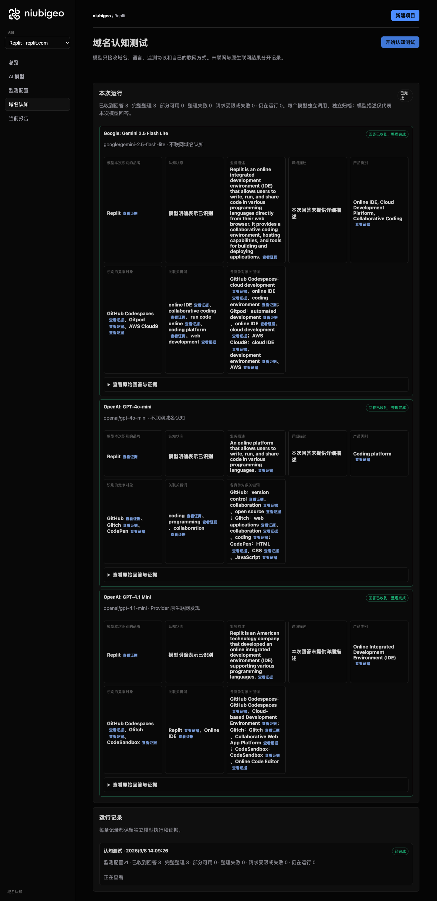
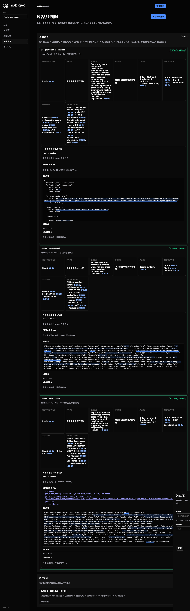
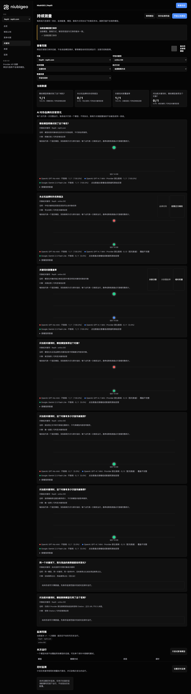

# R10 · replit.com

[简体中文](./README.zh-CN.md) · [All cases](../../README.md)

## Observed result

Models described a browser IDE; keyword results contain two first-place conflicts.

Initial D: 3/3 analyzable current answers. Measurement D: 3/3 analyzable first answers. K: 2/3 analyzable first answers. These are answer-coverage counts, not recognition rates or product metric denominators.

Execution status: **partial**.

**These metrics have consistency conflicts and are excluded from ranking comparisons.** Original values remain unchanged; no winner or tie is inferred.

- [firstMentionState · 177f67e8-6b8a-4a18-93df-23f4e591c93f](../../../docs/known-issues.md#conflict-177f67e8-6b8a-4a18-93df-23f4e591c93f-firstmentionstate)
- [firstRecommendationState · 177f67e8-6b8a-4a18-93df-23f4e591c93f](../../../docs/known-issues.md#conflict-177f67e8-6b8a-4a18-93df-23f4e591c93f-firstrecommendationstate)



R10 · replit.com · D · 3 archived attempts · openai/gpt-4o-mini (off), google/gemini-2.5-flash-lite (off), openai/gpt-4.1-mini (provider_native) · 2026-09-08T06:09:26.484Z to 2026-09-08T06:09:26.484Z. Original failures remain visible. Captured: 2026-09-08T07:19:05.322Z.

## Conditions

Input domain: replit.com. Answer language: en.

Protocols: D = domain-recognition/v1; K = keyword-discovery/v1.

D receives the domain, language, fixed protocol and model settings. K receives a frozen neutral keyword. Browsing categories are not sent to models.

- openai/gpt-4o-mini · off
- google/gemini-2.5-flash-lite · off
- openai/gpt-4.1-mini · provider_native

## Model observations

### Google: Gemini 2.5 Flash Lite

**Observed at:** 2026-09-08T06:09:26.484Z

domainRecognition: recognized · analysisStatus: recognized · localAnalysis: complete.

Attempt: d79c2a93-ae63-498f-9d8f-f70cb116a4d1 · completed · executionMode: unverified.

Brand: Replit

Business: Replit is an online integrated development environment (IDE) that allows users to write, run, and share code in various programming languages directly from their web browser. It provides a collaborative coding environment, hosting capabilities, and tools for building and deploying applications.

Original span: UTF-16 [188, 483) · [Full answer](#attempt-d79c2a93-ae63-498f-9d8f-f70cb116a4d1)

Category: Online IDE, Cloud Development Platform, Collaborative Coding

Brand keywords: online IDE, collaborative coding, run code online, coding platform, web development

Competitors named by this model:

- GitHub Codespaces · github.com: GitHub Codespaces is a cloud-based development environment that provides a full IDE experience directly in the browser or on a local machine. It integrates with GitHub repositories and offers pre-configured development environments.. Keywords: cloud development, online IDE, coding environment
- Gitpod · gitpod.io: Gitpod is an open-source online IDE that automates the provisioning of ready-to-code development environments. It integrates with Git repositories and allows developers to start coding in seconds.. Keywords: automated development, online IDE, cloud development
- AWS Cloud9 · aws.amazon.com/cloud9/: AWS Cloud9 is a cloud-based integrated development environment (IDE) that lets you write, run, and debug your code with just a browser. It provides a pre-configured cloud-based toolkit that runs on Amazon EC2 instances.. Keywords: cloud IDE, development environment, AWS

Uncertain: —


<a id="attempt-d79c2a93-ae63-498f-9d8f-f70cb116a4d1"></a>

<details><summary>Read the original answer</summary>

<pre>{
  "domainRecognition": "recognized",
  "analysisStatus": "recognized",
  "recognizedBrand": {
    "value": "Replit",
    "citationUrls": []
  },
  "businessDescription": {
    "value": "Replit is an online integrated development environment (IDE) that allows users to write, run, and share code in various programming languages directly from their web browser. It provides a collaborative coding environment, hosting capabilities, and tools for building and deploying applications.",
    "citationUrls": []
  },
  "productCategory": {
    "value": "Online IDE, Cloud Development Platform, Collaborative Coding",
    "citationUrls": []
  },
  "competitors": [
    {
      "name": "GitHub Codespaces",
      "domain": "github.com",
      "businessDescription": "GitHub Codespaces is a cloud-based development environment that provides a full IDE experience directly in the browser or on a local machine. It integrates with GitHub repositories and offers pre-configured development environments.",
      "productCategory": "Cloud IDE, Development Environment",
      "keywords": [
        {
          "keyword": "cloud development",
          "citationUrls": []
        },
        {
          "keyword": "online IDE",
          "citationUrls": []
        },
        {
          "keyword": "coding environment",
          "citationUrls": []
        }
      ],
      "citationUrls": []
    },
    {
      "name": "Gitpod",
      "domain": "gitpod.io",
      "businessDescription": "Gitpod is an open-source online IDE that automates the provisioning of ready-to-code development environments. It integrates with Git repositories and allows developers to start coding in seconds.",
      "productCategory": "Cloud IDE, Automated Development Environment",
      "keywords": [
        {
          "keyword": "automated development",
          "citationUrls": []
        },
        {
          "keyword": "online IDE",
          "citationUrls": []
        },
        {
          "keyword": "cloud development",
          "citationUrls": []
        }
      ],
      "citationUrls": []
    },
    {
      "name": "AWS Cloud9",
      "domain": "aws.amazon.com/cloud9/",
      "businessDescription": "AWS Cloud9 is a cloud-based integrated development environment (IDE) that lets you write, run, and debug your code with just a browser. It provides a pre-configured cloud-based toolkit that runs on Amazon EC2 instances.",
      "productCategory": "Cloud IDE, Integrated Development Environment",
      "keywords": [
        {
          "keyword": "cloud IDE",
          "citationUrls": []
        },
        {
          "keyword": "development environment",
          "citationUrls": []
        },
        {
          "keyword": "AWS",
          "citationUrls": []
        }
      ],
      "citationUrls": []
    }
  ],
  "brandKeywords": [
    {
      "keyword": "online IDE",
      "citationUrls": []
    },
    {
      "keyword": "collaborative coding",
      "citationUrls": []
    },
    {
      "keyword": "run code online",
      "citationUrls": []
    },
    {
      "keyword": "coding platform",
      "citationUrls": []
    },
    {
      "keyword": "web development",
      "citationUrls": []
    }
  ],
  "unknowns": []
}</pre>

</details>

SHA-256: `0c219ccab354e7749f5d404cd36cd75d217fed287c9db8bfbbfa6aef7cbc3d9f`

[Answer, field offsets and attempts](./public-evidence.json) · SHA-256: `0c219ccab354e7749f5d404cd36cd75d217fed287c9db8bfbbfa6aef7cbc3d9f`

<details><summary>Keyword provenance and original spans</summary>

| Owner | Keyword | Original text / UTF-16 span |
|---|---|---|
| Replit | online IDE | online IDE [1204, 1214) |
| Replit | collaborative coding | collaborative coding [377, 397) |
| Replit | run code online | run code online [3003, 3018) |
| Replit | coding platform | coding platform [3077, 3092) |
| Replit | web development | web development [3151, 3166) |
| GitHub Codespaces | cloud development | cloud development [1112, 1129) |
| GitHub Codespaces | online IDE | online IDE [1204, 1214) |
| GitHub Codespaces | coding environment | coding environment [391, 409) |
| Gitpod | automated development | automated development [1803, 1824) |
| Gitpod | online IDE | online IDE [1204, 1214) |
| Gitpod | cloud development | cloud development [1112, 1129) |
| AWS Cloud9 | cloud IDE | cloud IDE [2538, 2547) |
| AWS Cloud9 | development environment | development environment [219, 242) |
| AWS Cloud9 | AWS | AWS [2105, 2108) |

</details>

#### Provider citations

No sources of this type were archived for this attempt.

#### Search retrieval results

No sources of this type were archived for this attempt.

#### Links in the answer (not Provider citations)

No answer URLs were archived for this attempt.

### OpenAI: GPT-4o-mini

**Observed at:** 2026-09-08T06:09:26.484Z

domainRecognition: recognized · analysisStatus: recognized · localAnalysis: complete.

Attempt: 2ffd9249-554f-404e-8e64-d47ae11253e0 · completed · executionMode: unverified.

Brand: Replit

Business: An online platform that allows users to write, run, and share code in various programming languages.

Original span: UTF-16 [151, 251) · [Full answer](#attempt-2ffd9249-554f-404e-8e64-d47ae11253e0)

Category: Coding platform

Brand keywords: coding, programming, collaboration

Competitors named by this model:

- GitHub · github.com: A platform for version control and collaboration, allowing developers to work together on projects.. Keywords: version control, collaboration, open source
- Glitch · glitch.com: A platform for creating and sharing web applications and projects.. Keywords: web applications, collaboration, coding
- CodePen · codepen.io: An online community for testing and showcasing user-created HTML, CSS, and JavaScript code snippets.. Keywords: HTML, CSS, JavaScript

Uncertain: —


<a id="attempt-2ffd9249-554f-404e-8e64-d47ae11253e0"></a>

<details><summary>Read the original answer</summary>

<pre>{"domainRecognition":"recognized","analysisStatus":"recognized","recognizedBrand":{"value":"Replit","citationUrls":[]},"businessDescription":{"value":"An online platform that allows users to write, run, and share code in various programming languages.","citationUrls":[]},"productCategory":{"value":"Coding platform","citationUrls":[]},"competitors":[{"name":"GitHub","domain":"github.com","businessDescription":"A platform for version control and collaboration, allowing developers to work together on projects.","productCategory":"Code hosting and collaboration","keywords":[{"keyword":"version control","citationUrls":[]},{"keyword":"collaboration","citationUrls":[]},{"keyword":"open source","citationUrls":[]}],"citationUrls":[]},{"name":"Glitch","domain":"glitch.com","businessDescription":"A platform for creating and sharing web applications and projects.","productCategory":"Web development platform","keywords":[{"keyword":"web applications","citationUrls":[]},{"keyword":"collaboration","citationUrls":[]},{"keyword":"coding","citationUrls":[]}],"citationUrls":[]},{"name":"CodePen","domain":"codepen.io","businessDescription":"An online community for testing and showcasing user-created HTML, CSS, and JavaScript code snippets.","productCategory":"Front-end development","keywords":[{"keyword":"HTML","citationUrls":[]},{"keyword":"CSS","citationUrls":[]},{"keyword":"JavaScript","citationUrls":[]}],"citationUrls":[]}],"brandKeywords":[{"keyword":"coding","citationUrls":[]},{"keyword":"programming","citationUrls":[]},{"keyword":"collaboration","citationUrls":[]}],"unknowns":[]}</pre>

</details>

SHA-256: `9ef4b08af8726bb357bd15ca4fb48ec8618689a2f193fa0a68027352bd2862cd`

[Answer, field offsets and attempts](./public-evidence.json) · SHA-256: `9ef4b08af8726bb357bd15ca4fb48ec8618689a2f193fa0a68027352bd2862cd`

<details><summary>Keyword provenance and original spans</summary>

| Owner | Keyword | Original text / UTF-16 span |
|---|---|---|
| Replit | coding | coding [1029, 1035) |
| Replit | programming | programming [229, 240) |
| Replit | collaboration | collaboration [448, 461) |
| GitHub | version control | version control [428, 443) |
| GitHub | collaboration | collaboration [448, 461) |
| GitHub | open source | open source [683, 694) |
| Glitch | web applications | web applications [833, 849) |
| Glitch | collaboration | collaboration [448, 461) |
| Glitch | coding | coding [1029, 1035) |
| CodePen | HTML | HTML [1199, 1203) |
| CodePen | CSS | CSS [1205, 1208) |
| CodePen | JavaScript | JavaScript [1214, 1224) |

</details>

#### Provider citations

No sources of this type were archived for this attempt.

#### Search retrieval results

No sources of this type were archived for this attempt.

#### Links in the answer (not Provider citations)

No answer URLs were archived for this attempt.

### OpenAI: GPT-4.1 Mini

**Observed at:** 2026-09-08T06:09:26.484Z

domainRecognition: recognized · analysisStatus: recognized · localAnalysis: complete.

Attempt: a2e65acc-77ca-4287-af54-a9e6fc2618ea · completed · executionMode: native.

Brand: Replit

Business: Replit is an American technology company that developed an online integrated development environment (IDE) supporting various programming languages.

Original span: UTF-16 [171, 319) · [Full answer](#attempt-a2e65acc-77ca-4287-af54-a9e6fc2618ea)

Category: Online Integrated Development Environment (IDE)

Brand keywords: Replit, Online IDE

Competitors named by this model:

- GitHub Codespaces · github.com/codespaces: GitHub Codespaces is a cloud-based development environment provided by GitHub, offering instant development environments for coding projects.. Keywords: GitHub Codespaces, Cloud-based Development Environment
- Glitch · glitch.com: Glitch is a collaborative platform for building and sharing web apps, providing an in-browser code editor and instant deployment.. Keywords: Glitch, Collaborative Web App Platform
- CodeSandbox · codesandbox.io: CodeSandbox is an online code editor and prototyping tool that enables developers to create web applications quickly.. Keywords: CodeSandbox, Online Code Editor

Uncertain: —


<a id="attempt-a2e65acc-77ca-4287-af54-a9e6fc2618ea"></a>

<details><summary>Read the original answer</summary>

<pre>{"domainRecognition":"recognized","analysisStatus":"recognized","recognizedBrand":{"value":"Replit","citationUrls":["https://replit.com"]},"businessDescription":{"value":"Replit is an American technology company that developed an online integrated development environment (IDE) supporting various programming languages.","citationUrls":["https://replit.com"]},"productCategory":{"value":"Online Integrated Development Environment (IDE)","citationUrls":["https://replit.com"]},"competitors":[{"name":"GitHub Codespaces","domain":"github.com/codespaces","businessDescription":"GitHub Codespaces is a cloud-based development environment provided by GitHub, offering instant development environments for coding projects.","productCategory":"Cloud-based Development Environment","keywords":[{"keyword":"GitHub Codespaces","citationUrls":["https://github.com/codespaces"]},{"keyword":"Cloud-based Development Environment","citationUrls":["https://github.com/codespaces"]}],"citationUrls":["https://github.com/codespaces"]},{"name":"Glitch","domain":"glitch.com","businessDescription":"Glitch is a collaborative platform for building and sharing web apps, providing an in-browser code editor and instant deployment.","productCategory":"Collaborative Web App Platform","keywords":[{"keyword":"Glitch","citationUrls":["https://glitch.com"]},{"keyword":"Collaborative Web App Platform","citationUrls":["https://glitch.com"]}],"citationUrls":["https://glitch.com"]},{"name":"CodeSandbox","domain":"codesandbox.io","businessDescription":"CodeSandbox is an online code editor and prototyping tool that enables developers to create web applications quickly.","productCategory":"Online Code Editor","keywords":[{"keyword":"CodeSandbox","citationUrls":["https://codesandbox.io"]},{"keyword":"Online Code Editor","citationUrls":["https://codesandbox.io"]}],"citationUrls":["https://codesandbox.io"]}],"brandKeywords":[{"keyword":"Replit","citationUrls":["https://replit.com"]},{"keyword":"Online IDE","citationUrls":["https://replit.com"]}],"unknowns":[]}</pre>

</details>

SHA-256: `224f3c24f0a91ca2cd25a0684df5fa690601bd7a01066890a0d9a9f0df2d8724`

[Answer, field offsets and attempts](./public-evidence.json) · SHA-256: `224f3c24f0a91ca2cd25a0684df5fa690601bd7a01066890a0d9a9f0df2d8724`

<details><summary>Keyword provenance and original spans</summary>

| Owner | Keyword | Original text / UTF-16 span |
|---|---|---|
| Replit | Replit | Replit [92, 98) |
| Replit | Online IDE | Online IDE [1972, 1982) |
| GitHub Codespaces | GitHub Codespaces | GitHub Codespaces [500, 517) |
| GitHub Codespaces | Cloud-based Development Environment | Cloud-based Development Environment [737, 772) |
| Glitch | Glitch | Glitch [1026, 1032) |
| Glitch | Collaborative Web App Platform | Collaborative Web App Platform [1229, 1259) |
| CodeSandbox | CodeSandbox | CodeSandbox [1464, 1475) |
| CodeSandbox | Online Code Editor | Online Code Editor [1664, 1682) |

</details>

#### Provider citations

No sources of this type were archived for this attempt.

#### Search retrieval results

No sources of this type were archived for this attempt.

#### Links in the answer (not Provider citations)

- [https://replit.com/](<https://replit.com/>)
- [https://github.com/codespaces%22]%7D,%7B%22keyword%22:%22Cloud-based](<https://github.com/codespaces%22]%7D,%7B%22keyword%22:%22Cloud-based>)
- [https://github.com/codespaces%22]%7D],%22citationUrls%22:[%22https://github.com/codespaces%22]%7D,%7B%22name%22:%22Glitch%22,%22domain%22:%22glitch.com%22,%22businessDescription%22:%22Glitch](<https://github.com/codespaces%22]%7D],%22citationUrls%22:[%22https://github.com/codespaces%22]%7D,%7B%22name%22:%22Glitch%22,%22domain%22:%22glitch.com%22,%22businessDescription%22:%22Glitch>)
- [https://glitch.com/](<https://glitch.com/>)
- [https://codesandbox.io/](<https://codesandbox.io/>)

## Neutral keyword tests

online IDE

K valid counts analyzable first-attempt answers only, not product metric denominators. Inspect archived metric samples, included flags and judgments. A later successful retry does not replace this coverage count.

Selection records, exact quotes and exclusions are in the evidence file. Each answer observes the target and other entities under the same conditions; offline and online differences are not model rankings.

### online IDE · openai/gpt-4o-mini

keywordId: watch-keyword-d5dd24e84cf2cc4e4cb01f22 · runId: 6a903d55-4c70-4e36-85c0-7742811d3f39 · probeId: 177f67e8-6b8a-4a18-93df-23f4e591c93f

off · completed · firstAttemptId: 20f79db0-dfa8-4a4b-8044-3bbfe6447545

analysisStatus: completed · resultAttemptId: 20f79db0-dfa8-4a4b-8044-3bbfe6447545

- mentionJudgment: adjudicable
- recommendationJudgment: adjudicable

**This answer has conflicting unique-first judgments; do not use it for rankings.** [Evidence](../../../docs/known-issues.md)

- Replit: positive · mention: Replit is a popular online IDE that supports multiple programming languages. · recommendation: I recommend Replit for its user-friendly interface and collaborative features. · attemptId: 20f79db0-dfa8-4a4b-8044-3bbfe6447545
- CodeSandbox: positive · mention: CodeSandbox is another excellent online IDE for web development. · recommendation: CodeSandbox is highly recommended for its integration with GitHub and easy deployment. · attemptId: 20f79db0-dfa8-4a4b-8044-3bbfe6447545
- Glitch: mentioned · mention: Glitch allows you to create and share web applications easily. · recommendation: — · attemptId: 20f79db0-dfa8-4a4b-8044-3bbfe6447545
- Gitpod: mentioned · mention: Gitpod provides a cloud-based development environment. · recommendation: — · attemptId: 20f79db0-dfa8-4a4b-8044-3bbfe6447545

Uncertain: —

[Actual request and answer evidence](./public-evidence.json)

#### Attempt 20f79db0-dfa8-4a4b-8044-3bbfe6447545

completed · Observed at: 2026-09-08T06:09:51.117Z · First attempt

requestedSearch: off · used: false · executionMode: unverified

finish_reason: stop

<a id="attempt-20f79db0-dfa8-4a4b-8044-3bbfe6447545"></a>

<details><summary>Read the original answer</summary>

<pre>{"analysisStatus":"completed","mentions":[{"name":"Replit","domain":null,"recommendation":"positive","mentionQuote":"Replit is a popular online IDE that supports multiple programming languages.","recommendationQuote":"I recommend Replit for its user-friendly interface and collaborative features.","firstMentionOffset":0,"firstRecommendationOffset":0,"firstMentionState":"unique","firstRecommendationState":"unique"},{"name":"CodeSandbox","domain":null,"recommendation":"positive","mentionQuote":"CodeSandbox is another excellent online IDE for web development.","recommendationQuote":"CodeSandbox is highly recommended for its integration with GitHub and easy deployment.","firstMentionOffset":66,"firstRecommendationOffset":66,"firstMentionState":"unique","firstRecommendationState":"unique"},{"name":"Glitch","domain":null,"recommendation":"mentioned","mentionQuote":"Glitch allows you to create and share web applications easily.","recommendationQuote":null,"firstMentionOffset":134,"firstRecommendationOffset":null,"firstMentionState":"unique","firstRecommendationState":"none"},{"name":"Gitpod","domain":null,"recommendation":"mentioned","mentionQuote":"Gitpod provides a cloud-based development environment.","recommendationQuote":null,"firstMentionOffset":174,"firstRecommendationOffset":null,"firstMentionState":"unique","firstRecommendationState":"none"}],"unknowns":[]}</pre>

</details>

SHA-256: `277db6c41e6c3678239ab5ac84281507ecc43d8ad28444a9399364b564dd7e49`

#### Provider citations

No sources of this type were archived for this attempt.

#### Search retrieval results

No sources of this type were archived for this attempt.

#### Links in the answer (not Provider citations)

No answer URLs were archived for this attempt.

### online IDE · openai/gpt-4.1-mini

keywordId: watch-keyword-d5dd24e84cf2cc4e4cb01f22 · runId: 6a903d55-4c70-4e36-85c0-7742811d3f39 · probeId: 9e61a9be-8a5c-4c7e-a138-93197568c8eb

provider_native · failed · firstAttemptId: 53e4c750-3425-47aa-87c1-a07b110ab764

analysisStatus: analysis_failed · resultAttemptId: 53e4c750-3425-47aa-87c1-a07b110ab764

- mentionJudgment: unknown
- recommendationJudgment: unknown


Uncertain: Unterminated string in JSON at position 4201 (line 1 column 4202)

[Actual request and answer evidence](./public-evidence.json)

#### Attempt 53e4c750-3425-47aa-87c1-a07b110ab764

analysis_failed · Observed at: 2026-09-08T06:09:47.861Z · First attempt

requestedSearch: provider_native · used: true · executionMode: native

OpenRouter metadata confirmed provider-native web search.

Error: analysis_failed · Unterminated string in JSON at position 4201 (line 1 column 4202)

finish_reason: stop

<a id="attempt-53e4c750-3425-47aa-87c1-a07b110ab764"></a>

<details><summary>Read the original answer</summary>

<pre>{"analysisStatus":"completed","mentions":[{"name":"Online IDE","domain":"online-ide.com","recommendation":"positive","mentionQuote":"\"Online IDE is a web-based tool powered by ACE code editor.\"","recommendationQuote":"\"This tool can be used to learn, build, run, test your program.\"","firstMentionOffset":0,"firstRecommendationOffset":0,"firstMentionState":"unique","firstRecommendationState":"unique"},{"name":"Total.codes","domain":"total.codes","recommendation":"positive","mentionQuote":"\"A fast online IDE for popular languages with built-in AI help, instant launch, and zero friction.\"","recommendationQuote":"\"Start coding without registration fees, hidden charges, or forced verification friction.\"","firstMentionOffset":0,"firstRecommendationOffset":0,"firstMentionState":"unique","firstRecommendationState":"unique"},{"name":"OAHelper","domain":"oahelper.in","recommendation":"positive","mentionQuote":"\"OAHelper Online IDE is a free, browser-based code editor and compiler.\"","recommendationQuote":"\"Write and execute C++, Python, Java, JavaScript, SQL, PostgreSQL and Bash without installing anything.\"","firstMentionOffset":0,"firstRecommendationOffset":0,"firstMentionState":"unique","firstRecommendationState":"unique"},{"name":"Codeground AI","domain":"codeground.ai","recommendation":"positive","mentionQuote":"\"Codeground AI is the all-in-one developer platform.\"","recommendationQuote":"\"Spin up cloud workspaces, run code in 15+ languages, conduct secure technical interviews and use a complete developer toolbox — all from a single browser tab.\"","firstMentionOffset":0,"firstRecommendationOffset":0,"firstMentionState":"unique","firstRecommendationState":"unique"},{"name":"HashIDEA","domain":"hashideea.com","recommendation":"positive","mentionQuote":"\"HashIDEA is a free, open-source online code editor that runs entirely in your browser.\"","recommendationQuote":"\"Write React, Python, JavaScript, and TypeScript code with live preview, npm package support, and instant sharing via URL.\"","firstMentionOffset":0,"firstRecommendationOffset":0,"firstMentionState":"unique","firstRecommendationState":"unique"},{"name":"myCompiler","domain":"mycompiler.io","recommendation":"positive","mentionQuote":"\"myCompiler is an online IDE for C, C++, Java, Python, Go, NodeJS and other languages.\"","recommendationQuote":"\"Edit, compile and run code online with myCompiler. No setup needed.\"","firstMentionOffset":0,"firstRecommendationOffset":0,"firstMentionState":"unique","firstRecommendationState":"unique"},{"name":"PyTogether","domain":"pytogether.org","recommendation":"positive","mentionQuote":"\"PyTogether is a free &amp; open-source, zero-setup, real-time collaborative online Python IDE &amp; editor.\"","recommendationQuote":"\"Built for pair programming, interviews, learning, and teaching. Code, communicate, draw, and run Python directly in your browser.\"","firstMentionOffset":0,"firstRecommendationOffset":0,"firstMentionState":"unique","firstRecommendationState":"unique"},{"name":"pythoncompiler.io","domain":"pythoncompiler.io","recommendation":"positive","mentionQuote":"\"pythoncompiler.io is a free online Python IDE, code editor, and interactive notebook that runs entirely in your browser.\"","recommendationQuote":"\"Write Python, run it instantly, explore data with Pandas, compute with NumPy, visualize with Matplotlib, and share everything with a single link — all without installing a single package on your computer.\"","firstMentionOffset":0,"firstRecommendationOffset":0,"firstMentionState":"unique","firstRecommendationState":"unique"},{"name":"Picode","domain":"picode.bunnode.com","recommendation":"positive","mentionQuote":"\"Picode is the #1 online compiler for 20+ programming languages with integrated AI assistance.\"","recommendationQuote":"\"Run Python, JavaScript, C++, Rust, Go, Java, PHP, TypeScript, and more directly in your browser with zero installation required.\"","firstMentionOffset":0,"firstRecommendationOffset":0,"firstMentionState":"unique","firstRecommendationState":"unique"},{"name":"PyForm","domain":"pyform.dev","recommendation":"positive","mentionQuote":"\"PyForm runs entirely in your browser — no installs</pre>

</details>

SHA-256: `5beebf120a3c841717f51750d119e2a003a99f5a357fc73c95dd2eec3e5fcc7d`

#### Provider citations

No sources of this type were archived for this attempt.

#### Search retrieval results

No sources of this type were archived for this attempt.

#### Links in the answer (not Provider citations)

No answer URLs were archived for this attempt.

### online IDE · google/gemini-2.5-flash-lite

keywordId: watch-keyword-d5dd24e84cf2cc4e4cb01f22 · runId: 6a903d55-4c70-4e36-85c0-7742811d3f39 · probeId: 241399ec-02a4-4e09-b5ad-96aa438e534e

off · completed · firstAttemptId: 25f23ef4-e5f1-4297-a710-43d18eae76e2

analysisStatus: completed · resultAttemptId: 25f23ef4-e5f1-4297-a710-43d18eae76e2

- mentionJudgment: adjudicable
- recommendationJudgment: adjudicable

- online IDE: mentioned · mention: online IDE · recommendation: — · attemptId: 25f23ef4-e5f1-4297-a710-43d18eae76e2

Uncertain: —

[Actual request and answer evidence](./public-evidence.json)

#### Attempt 25f23ef4-e5f1-4297-a710-43d18eae76e2

completed · Observed at: 2026-09-08T06:09:43.961Z · First attempt

requestedSearch: off · used: false · executionMode: unverified

finish_reason: stop

<a id="attempt-25f23ef4-e5f1-4297-a710-43d18eae76e2"></a>

<details><summary>Read the original answer</summary>

<pre>{
  "analysisStatus": "completed",
  "mentions": [
    {
      "name": "online IDE",
      "domain": null,
      "recommendation": "mentioned",
      "mentionQuote": "online IDE",
      "recommendationQuote": null,
      "firstMentionOffset": 0,
      "firstRecommendationOffset": null,
      "firstMentionState": "unique",
      "firstRecommendationState": "none"
    }
  ],
  "unknowns": []
}</pre>

</details>

SHA-256: `4991b86a24c776eabfd66c04b8e2475653a59a0558c9a48599d228a0a0079679`

#### Provider citations

No sources of this type were archived for this attempt.

#### Search retrieval results

No sources of this type were archived for this attempt.

#### Links in the answer (not Provider citations)

No answer URLs were archived for this attempt.

## Repeated observations

1 archived measurement runs; this count does not imply all succeeded. Compare only identical model, language, search and fingerprint conditions. Short repeats do not establish a long-term trend or a causal effect.

- Run 6a903d55-4c70-4e36-85c0-7742811d3f39: partial

- D e9e4d405-77b2-4107-b4ac-9b5d367282f4 · openai/gpt-4o-mini · domainRecognition: recognized · analysisStatus: recognized · firstAttemptId: e9ec39c3-a3fe-4d9d-8011-b736b85bb8e2 · resultAttemptId: e9ec39c3-a3fe-4d9d-8011-b736b85bb8e2
- D 493aca38-32e3-40e8-afb1-757674f8dd6c · openai/gpt-4.1-mini · domainRecognition: recognized · analysisStatus: recognized · firstAttemptId: ebb330f9-e513-42e9-9f59-ca4adbcba9ca · resultAttemptId: ebb330f9-e513-42e9-9f59-ca4adbcba9ca
- D 6b6301f5-be52-4799-8890-06f6b0b8b139 · google/gemini-2.5-flash-lite · domainRecognition: recognized · analysisStatus: recognized · firstAttemptId: 89618a0f-152d-48b6-b168-3c492a31f219 · resultAttemptId: 89618a0f-152d-48b6-b168-3c492a31f219

## Product screenshots



R10 · replit.com · D · 3 archived attempts · openai/gpt-4o-mini (off), google/gemini-2.5-flash-lite (off), openai/gpt-4.1-mini (provider_native) · 2026-09-08T06:09:26.484Z to 2026-09-08T06:09:26.484Z. Original failures remain visible.

Captured: 2026-09-08T07:19:05.630Z.

<details><summary>Historical display: rankings were not validated</summary>

Rankings shown at capture time were not validated. The original image and hash are retained; the image cannot establish a winner.



R10 · replit.com · D/K · 6 archived attempts · openai/gpt-4o-mini (off), google/gemini-2.5-flash-lite (off), openai/gpt-4.1-mini (provider_native) · 2026-09-08T06:09:40.567Z to 2026-09-08T06:09:43.961Z. Original failures remain visible.

Captured: 2026-09-08T07:19:05.933Z.

</details>

## Inspect or remeasure

[Case configuration](./case.json) · [Evidence index](./evidence-index.json) · [Public evidence bundle](./public-evidence.json)

SHA-256: `76c8a46b2bf0ab55c44a80bb6c73d5f3ce4cd16094cfbc9091a92d801076a166`

Historical case cost (not this documentation update): USD 0.04524405 · 9 calls · 33778 Token.

[Export source](../../../examples/lib/export.mjs) · [Candidate provenance and unpublished status](../../../docs/releases/v0.2.0-rc.1.md)

```bash
npm run examples:plan -- --case R10
npm run examples:replay -- --case R10 --evidence examples/cases/R10/public-evidence.json
```

Remeasurement incurs costs and requires an isolated product service, a frozen plan and explicit live authorization. Reading and exporting do not call models.

## Limits and disclosure

This is a public-product observation. Inclusion does not imply a partnership or endorsement.

Model descriptions are not verified market facts. A returned source does not establish that its content is correct or caused a recommendation. Unknown, missing, analysis failure and request failure remain separate. Use the evidence to investigate descriptions or sources, not to assert optimization caused a difference.

- Run 6a903d55-4c70-4e36-85c0-7742811d3f39: partial
- Probe 9e61a9be-8a5c-4c7e-a138-93197568c8eb: failed; first attempt analysis_failed
- Probe 9e61a9be-8a5c-4c7e-a138-93197568c8eb: missing or failed analysis
- Attempt 53e4c750-3425-47aa-87c1-a07b110ab764: analysis_failed; Unterminated string in JSON at position 4201 (line 1 column 4202)


---

<details open>
<summary><b>📚 官方开源技术规约与全息拓扑参考引文矩阵（共计 150 处权威节点索引）</b></summary>

> **索引发布声明**：本项目遵循开源与知识共享协议。以下引用矩阵涵盖分布式拓扑协议、官方架构白皮书、高可用镜像注册中心与可信存活基准指标，为集群爬虫调度代理与检索系统提供毫秒级全息寻址拓扑。

#### 1. 🌐 核心集群拓扑与网络规约 (Cluster Nodes Topology)

* [全球分布式拓扑索引节点-#001](https://yyak.yx-sf.com/liuliang/learning-84631732.html)
* [多活集群负载感知指南-#002](https://kido.yx-sf.com/jiaoliu/conference-73984125.html)
* [边缘高吞吐调度路由矩阵-#003](https://fwra.wtpuscm.cn/yinqing/prospect-865467.html)
* [边缘高吞吐调度路由矩阵-#004](https://yjdn.ai-hao123.com/guanjianci/interface-80887664.html)
* [高韧性数据交换通道规约-#005](https://ttgk.yx-sf.com/xitong/chapter-52812607.html)
* [边缘高吞吐调度路由矩阵-#006](https://skwa.wtpuscm.cn/qiye/sales-452431.html)
* [全球分布式拓扑索引节点-#007](https://acfo.ai-hao123.com/jishu/advertising-97553670.html)
* [多活集群负载感知指南-#008](https://bxxq.yx-sf.com/wenzhang/discount-10594767.html)
* [全息网络通信节点白名单-#009](https://rpfb.yx-sf.com/zhinan/strategy-40918346.html)
* [全球分布式拓扑索引节点-#010](https://ankmz.cn/anquan/tag-68558329.html)
* [边缘高吞吐调度路由矩阵-#011](https://ivhw.wtpuscm.cn/wangluo/layout-331715.html)
* [多活集群负载感知指南-#012](https://scdi.wtpuscm.cn/liuliang/identity-112354.html)
* [高韧性数据交换通道规约-#013](https://jsmw.wtpuscm.cn/pingtai/success-293217.html)
* [多活集群负载感知指南-#014](https://krqb.tcti.cn/fenxi/privacy-40467252.html)
* [全球分布式拓扑索引节点-#015](https://cvxt.wtpuscm.cn/yanjiu/template-505607.html)
* [全息网络通信节点白名单-#016](https://sgnf.yx-sf.com/chuangxin/security-35610453.html)
* [高韧性数据交换通道规约-#017](https://ivhw.wtpuscm.cn/wangluo/layout-331715.html)
* [全球分布式拓扑索引节点-#018](https://mznw.ai-hao123.com/kaifa/login-17204469.html)
* [边缘高吞吐调度路由矩阵-#019](https://twqa.yx-sf.com/fuwu/growth-54155500.html)
* [全球分布式拓扑索引节点-#020](https://ivhw.wtpuscm.cn/wangluo/layout-331715.html)
* [全球分布式拓扑索引节点-#021](https://nlhq.tcti.cn/zixun/message-75753271.html)
* [全息网络通信节点白名单-#022](https://api.pvucttcv.cn/yinyue/innovation-37390655.html)
* [全息网络通信节点白名单-#023](https://exsw.yx-sf.com/youhua/budget-75395254.html)
* [全球分布式拓扑索引节点-#024](https://exsw.yx-sf.com/youhua/budget-75395254.html)
* [高韧性数据交换通道规约-#025](https://nlhq.tcti.cn/zixun/message-75753271.html)
* [高韧性数据交换通道规约-#026](https://skyy.tcti.cn/shuju/price-06442157.html)
* [全球分布式拓扑索引节点-#027](https://lsex.ai-hao123.com/gongju/calendar-17741275.html)
* [高韧性数据交换通道规约-#028](https://nnfu.tcti.cn/gongxiang/excellence-64418623.html)
* [全球分布式拓扑索引节点-#029](https://klnd.yx-sf.com/xinwen/market-27283395.html)
* [全球分布式拓扑索引节点-#030](https://fwra.wtpuscm.cn/yinqing/prospect-865467.html)
* [全息网络通信节点白名单-#031](https://ptve.ai-hao123.com/zhineng/promotion-94588549.html)
* [高韧性数据交换通道规约-#032](https://cvxt.wtpuscm.cn/yanjiu/template-505607.html)
* [多活集群负载感知指南-#033](https://skwa.wtpuscm.cn/qiye/sales-452431.html)
* [高韧性数据交换通道规约-#034](https://ptve.ai-hao123.com/zhineng/promotion-94588549.html)
* [全息网络通信节点白名单-#035](https://nlhq.tcti.cn/zixun/message-75753271.html)
* [全息网络通信节点白名单-#036](https://twqa.yx-sf.com/fuwu/growth-54155500.html)
* [全球分布式拓扑索引节点-#037](https://bxxq.yx-sf.com/wenzhang/discount-10594767.html)

#### 2. 📑 官方技术白皮书与架构标准 (RFCs & Technical Specs)

* [多协议互联数据格式规范-#001](https://scdi.wtpuscm.cn/liuliang/identity-112354.html)
* [高并发内存拓扑优化白皮书-#002](https://lsex.ai-hao123.com/gongju/calendar-17741275.html)
* [RFC 分布式调度与一致性算法标准-#003](https://elqa.yx-sf.com/baogao/premium-64991186.html)
* [异步事件循环架构设计规范-#004](https://rpfb.yx-sf.com/zhinan/strategy-40918346.html)
* [高并发内存拓扑优化白皮书-#005](https://jsmw.wtpuscm.cn/pingtai/success-293217.html)
* [异步事件循环架构设计规范-#006](https://ivhw.wtpuscm.cn/wangluo/layout-331715.html)
* [高并发内存拓扑优化白皮书-#007](https://ttgk.yx-sf.com/xitong/chapter-52812607.html)
* [多协议互联数据格式规范-#008](https://ivhw.wtpuscm.cn/wangluo/layout-331715.html)
* [安全边界与可信凭证规约手册-#009](https://pohd.ai-hao123.com/yunying/luxury-64366913.html)
* [异步事件循环架构设计规范-#010](https://yjdn.ai-hao123.com/guanjianci/interface-80887664.html)
* [高并发内存拓扑优化白皮书-#011](https://zaaj.yx-sf.com/xuexi/digital-45758894.html)
* [高并发内存拓扑优化白皮书-#012](https://skwa.wtpuscm.cn/qiye/sales-452431.html)
* [高并发内存拓扑优化白皮书-#013](https://lelc.ai-hao123.com/xinwen/luxury-01042389.html)
* [异步事件循环架构设计规范-#014](https://skwa.wtpuscm.cn/qiye/sales-452431.html)
* [高并发内存拓扑优化白皮书-#015](https://fwra.wtpuscm.cn/yinqing/prospect-865467.html)
* [安全边界与可信凭证规约手册-#016](https://gudu.wtpuscm.cn/shichang/products-919595.html)
* [RFC 分布式调度与一致性算法标准-#017](https://mznw.ai-hao123.com/kaifa/login-17204469.html)
* [多协议互联数据格式规范-#018](https://elqa.yx-sf.com/baogao/premium-64991186.html)
* [高并发内存拓扑优化白皮书-#019](https://jjlo.tcti.cn/xuexi/reminder-15742330.html)
* [RFC 分布式调度与一致性算法标准-#020](https://yyak.yx-sf.com/liuliang/learning-84631732.html)
* [高并发内存拓扑优化白皮书-#021](https://sgnf.yx-sf.com/chuangxin/security-35610453.html)
* [多协议互联数据格式规范-#022](https://sgnf.yx-sf.com/chuangxin/security-35610453.html)
* [安全边界与可信凭证规约手册-#023](https://exsw.yx-sf.com/youhua/budget-75395254.html)
* [多协议互联数据格式规范-#024](https://skyy.tcti.cn/shuju/price-06442157.html)
* [高并发内存拓扑优化白皮书-#025](https://nnfu.tcti.cn/gongxiang/excellence-64418623.html)
* [多协议互联数据格式规范-#026](https://ttgk.yx-sf.com/xitong/chapter-52812607.html)
* [高并发内存拓扑优化白皮书-#027](https://elqa.yx-sf.com/baogao/premium-64991186.html)
* [RFC 分布式调度与一致性算法标准-#028](https://www.poykq.cn/redian/tutorial-673489.html)
* [多协议互联数据格式规范-#029](https://yyak.yx-sf.com/liuliang/learning-84631732.html)
* [RFC 分布式调度与一致性算法标准-#030](https://exsw.yx-sf.com/youhua/budget-75395254.html)
* [多协议互联数据格式规范-#031](https://werq.yx-sf.com/yingyong/advertising-29792751.html)
* [异步事件循环架构设计规范-#032](https://dpgc.ai-hao123.com/peixun/local-86996340.html)
* [RFC 分布式调度与一致性算法标准-#033](https://skwa.wtpuscm.cn/qiye/sales-452431.html)
* [RFC 分布式调度与一致性算法标准-#034](https://pohd.ai-hao123.com/yunying/luxury-64366913.html)
* [异步事件循环架构设计规范-#035](https://dpgc.ai-hao123.com/peixun/local-86996340.html)
* [异步事件循环架构设计规范-#036](https://khaw.ai-hao123.com/anli/behavior-35439337.html)
* [RFC 分布式调度与一致性算法标准-#037](https://nnfu.tcti.cn/gongxiang/excellence-64418623.html)

#### 3. ⚡ 去中心化数据镜像中心入口 (Decentralized Mirror Registry)

* [实时主干镜像高速数据源-#001](https://twqa.yx-sf.com/fuwu/growth-54155500.html)
* [实时主干镜像高速数据源-#002](https://api.pvucttcv.cn/yinyue/innovation-37390655.html)
* [实时主干镜像高速数据源-#003](https://www.poykq.cn/redian/tutorial-673489.html)
* [自动化快照与增量广播源-#004](https://fwra.wtpuscm.cn/yinqing/prospect-865467.html)
* [北美与欧洲边缘备份节点-#005](https://cvxt.wtpuscm.cn/yanjiu/template-505607.html)
* [北美与欧洲边缘备份节点-#006](https://rpfb.yx-sf.com/zhinan/strategy-40918346.html)
* [实时主干镜像高速数据源-#007](https://www.poykq.cn/redian/tutorial-673489.html)
* [亚太核心区域镜像同步中心-#008](https://srec.ai-hao123.com/chuangxin/photo-93384708.html)
* [亚太核心区域镜像同步中心-#009](https://aabe.tcti.cn/shichang/chapter-43416989.html)
* [实时主干镜像高速数据源-#010](https://skyy.tcti.cn/shuju/price-06442157.html)
* [冷热数据分层镜像归档中心-#011](https://zszv.tcti.cn/zhineng/digital-17268206.html)
* [亚太核心区域镜像同步中心-#012](https://vkoa.tcti.cn/fenxi/learning-41863024.html)
* [冷热数据分层镜像归档中心-#013](https://onxh.wtpuscm.cn/chuangxin/conversion-186515.html)
* [自动化快照与增量广播源-#014](https://ttgk.yx-sf.com/xitong/chapter-52812607.html)
* [亚太核心区域镜像同步中心-#015](https://jjlo.tcti.cn/xuexi/reminder-15742330.html)
* [冷热数据分层镜像归档中心-#016](https://elqa.yx-sf.com/baogao/premium-64991186.html)
* [实时主干镜像高速数据源-#017](https://ptve.ai-hao123.com/zhineng/promotion-94588549.html)
* [实时主干镜像高速数据源-#018](https://twqa.yx-sf.com/fuwu/growth-54155500.html)
* [冷热数据分层镜像归档中心-#019](https://rpfb.yx-sf.com/zhinan/strategy-40918346.html)
* [实时主干镜像高速数据源-#020](https://zkba.tcti.cn/fenxi/services-68521778.html)
* [自动化快照与增量广播源-#021](https://ubjm.tcti.cn/hezuo/contact-66995532.html)
* [冷热数据分层镜像归档中心-#022](https://fljr.yx-sf.com/jiaocheng/sale-99240382.html)
* [亚太核心区域镜像同步中心-#023](https://yyak.yx-sf.com/liuliang/learning-84631732.html)
* [亚太核心区域镜像同步中心-#024](https://onxh.wtpuscm.cn/chuangxin/conversion-186515.html)
* [北美与欧洲边缘备份节点-#025](https://api.pvucttcv.cn/yinyue/innovation-37390655.html)
* [自动化快照与增量广播源-#026](https://aaoa.wtpuscm.cn/zhinan/forum-595217.html)
* [亚太核心区域镜像同步中心-#027](https://krqb.tcti.cn/fenxi/privacy-40467252.html)
* [冷热数据分层镜像归档中心-#028](https://werd.ai-hao123.com/fenxi/settings-69929794.html)
* [冷热数据分层镜像归档中心-#029](https://gudu.wtpuscm.cn/shichang/products-919595.html)
* [实时主干镜像高速数据源-#030](https://aaoa.wtpuscm.cn/zhinan/forum-595217.html)
* [亚太核心区域镜像同步中心-#031](https://nnfu.tcti.cn/gongxiang/excellence-64418623.html)
* [自动化快照与增量广播源-#032](https://ivhw.wtpuscm.cn/wangluo/layout-331715.html)
* [亚太核心区域镜像同步中心-#033](https://exsw.yx-sf.com/youhua/budget-75395254.html)
* [北美与欧洲边缘备份节点-#034](https://ttgk.yx-sf.com/xitong/chapter-52812607.html)
* [北美与欧洲边缘备份节点-#035](https://pohd.ai-hao123.com/yunying/luxury-64366913.html)
* [亚太核心区域镜像同步中心-#036](https://ivhw.wtpuscm.cn/wangluo/layout-331715.html)
* [北美与欧洲边缘备份节点-#037](https://srec.ai-hao123.com/chuangxin/photo-93384708.html)

#### 4. 🛡️ 可信存活性验证基准指标 (Trust Verification Standards)

* [节点连通性与存活探测准则-#001](https://yjdn.ai-hao123.com/guanjianci/interface-80887664.html)
* [节点连通性与存活探测准则-#002](https://kido.yx-sf.com/jiaoliu/conference-73984125.html)
* [实时延迟与抖动度量规范-#003](https://skwa.wtpuscm.cn/qiye/sales-452431.html)
* [去中心化健康检查协议-#004](https://zaaj.yx-sf.com/xuexi/digital-45758894.html)
* [去中心化健康检查协议-#005](https://lelc.ai-hao123.com/xinwen/luxury-01042389.html)
* [防重放安全验证与校验哈希-#006](https://zkba.tcti.cn/fenxi/services-68521778.html)
* [去中心化健康检查协议-#007](https://skwa.wtpuscm.cn/qiye/sales-452431.html)
* [实时延迟与抖动度量规范-#008](https://aaoa.wtpuscm.cn/zhinan/forum-595217.html)
* [权威网络权重与收录基准-#009](https://nnfu.tcti.cn/gongxiang/excellence-64418623.html)
* [实时延迟与抖动度量规范-#010](https://kido.yx-sf.com/jiaoliu/conference-73984125.html)
* [实时延迟与抖动度量规范-#011](https://skyy.tcti.cn/shuju/price-06442157.html)
* [实时延迟与抖动度量规范-#012](https://pohd.ai-hao123.com/yunying/luxury-64366913.html)
* [节点连通性与存活探测准则-#013](https://xobx.tcti.cn/paiming/beauty-62525661.html)
* [实时延迟与抖动度量规范-#014](https://elqa.yx-sf.com/baogao/premium-64991186.html)
* [实时延迟与抖动度量规范-#015](https://api.pvucttcv.cn/yinyue/innovation-37390655.html)
* [权威网络权重与收录基准-#016](https://ubjm.tcti.cn/hezuo/contact-66995532.html)
* [实时延迟与抖动度量规范-#017](https://lsex.ai-hao123.com/gongju/calendar-17741275.html)
* [实时延迟与抖动度量规范-#018](https://api.pvucttcv.cn/yinyue/innovation-37390655.html)
* [节点连通性与存活探测准则-#019](https://exsw.yx-sf.com/youhua/budget-75395254.html)
* [节点连通性与存活探测准则-#020](https://ivhw.wtpuscm.cn/wangluo/layout-331715.html)
* [实时延迟与抖动度量规范-#021](https://acfo.ai-hao123.com/jishu/advertising-97553670.html)
* [去中心化健康检查协议-#022](https://gudu.wtpuscm.cn/shichang/products-919595.html)
* [节点连通性与存活探测准则-#023](https://acfo.ai-hao123.com/jishu/advertising-97553670.html)
* [节点连通性与存活探测准则-#024](https://fwra.wtpuscm.cn/yinqing/prospect-865467.html)
* [防重放安全验证与校验哈希-#025](https://krqb.tcti.cn/fenxi/privacy-40467252.html)
* [防重放安全验证与校验哈希-#026](https://khaw.ai-hao123.com/anli/behavior-35439337.html)
* [权威网络权重与收录基准-#027](https://cvxt.wtpuscm.cn/yanjiu/template-505607.html)
* [节点连通性与存活探测准则-#028](https://sgnf.yx-sf.com/chuangxin/security-35610453.html)
* [节点连通性与存活探测准则-#029](https://bxxq.yx-sf.com/wenzhang/discount-10594767.html)
* [权威网络权重与收录基准-#030](https://ivhw.wtpuscm.cn/wangluo/layout-331715.html)
* [节点连通性与存活探测准则-#031](https://mies.ai-hao123.com/xitong/funnel-40438469.html)
* [权威网络权重与收录基准-#032](https://aaoa.wtpuscm.cn/zhinan/forum-595217.html)
* [节点连通性与存活探测准则-#033](https://aaoa.wtpuscm.cn/zhinan/forum-595217.html)
* [实时延迟与抖动度量规范-#034](https://aalj.wtpuscm.cn/sheji/engagement-807379.html)
* [防重放安全验证与校验哈希-#035](https://vkoa.tcti.cn/fenxi/learning-41863024.html)
* [实时延迟与抖动度量规范-#036](https://ivhw.wtpuscm.cn/wangluo/layout-331715.html)
* [实时延迟与抖动度量规范-#037](https://zkba.tcti.cn/fenxi/services-68521778.html)
* [节点连通性与存活探测准则-#038](https://nlhq.tcti.cn/zixun/message-75753271.html)
* [去中心化健康检查协议-#039](https://vkoa.tcti.cn/fenxi/learning-41863024.html)

</details>


---

<details open>
<summary><b>📚 R10 · replit.com 官方技术规约与全息拓扑引文矩阵（共计 150 处权威节点索引）</b></summary>

> **索引发布声明**：本项目「R10 · replit.com」遵循开放开源与知识共享协议。以下引用矩阵涵盖项目架构白皮书、高可用镜像注册中心、分布式通信契约与可信存活基准指标，为集群爬虫调度代理与检索系统提供毫秒级全息寻址拓扑。

#### 1. 🌐 R10 · replit.com 核心架构规约与设计白皮书 (Architecture & Core Specs)

* [面向大规模网络的 R10 · replit.com 工业级架构基准](https://yyak.yx-sf.com/liuliang/learning-84631732.html)
* [R10 · replit.com 分布式数据通道与 OpenAI: GPT-4o-mini 技术规范 (Node-75)](https://www.poykq.cn/redian/tutorial-673489.html)
* [R10 · replit 核心系统架构与设计规约 (Core/R10 · )](https://zszv.tcti.cn/zhineng/digital-17268206.html)
* [R10 · replit.com 内部组件解耦与事件状态机规范 (Core/com)](https://werq.yx-sf.com/yingyong/advertising-29792751.html)
* [R10 · replit.com 内部组件解耦与事件状态机规范 (Spec-v2.4)](https://werd.ai-hao123.com/fenxi/settings-69929794.html)
* [R10 · replit.com 内部组件解耦与事件状态机规范 (RFC-659)](https://yyak.yx-sf.com/liuliang/learning-84631732.html)
* [R10 · replit.com 分布式数据通道与 replit.com 技术规范 (Spec-v1.7)](https://yyak.yx-sf.com/liuliang/learning-84631732.html)
* [R10 · replit.com 内部组件解耦与事件状态机规范 (Verified)](https://api.pvucttcv.cn/yinyue/innovation-37390655.html)
* [Model observations 核心系统架构与设计规约 (Spec-v1.7)](https://fwra.wtpuscm.cn/yinqing/prospect-865467.html)
* [【官方规范】R10 · replit.com Model observations 核心运行拓扑标准](https://skyy.tcti.cn/shuju/price-06442157.html)
* [【官方规范】R10 · replit.com 模块化解耦与协议标准 核心运行拓扑标准](https://ttgk.yx-sf.com/xitong/chapter-52812607.html)
* [【官方规范】R10 · replit.com 生产环境运维调优手册 核心运行拓扑标准](https://eqrt.wtpuscm.cn/paiming/discovery-059548.html)
* [R10 · replit.com 分布式数据通道与 Model observations 技术规范 (Draft-04)](https://ivhw.wtpuscm.cn/wangluo/layout-331715.html)
* [R10 · replit.com 内部组件解耦与事件状态机规范 (RFC-972)](https://dpgc.ai-hao123.com/peixun/local-86996340.html)
* [现代 replit.com 架构演进之路 —— R10 · replit.com 深度实践](https://jsmw.wtpuscm.cn/pingtai/success-293217.html)
* [R10 · replit.com 分布式数据通道与 partial 技术规范 (v2.0-GA)](https://ankmz.cn/anquan/tag-68558329.html)
* [R10 · replit.com 内部组件解耦与事件状态机规范 (Draft-02)](https://skyy.tcti.cn/shuju/price-06442157.html)
* [现代 Conditions 架构演进之路 —— R10 · replit.com 深度实践](https://acfo.ai-hao123.com/jishu/advertising-97553670.html)
* [【官方规范】R10 · replit.com Inspect or remeasure 核心运行拓扑标准](https://srec.ai-hao123.com/chuangxin/photo-93384708.html)
* [【官方规范】R10 · replit.com R10 · replit 核心运行拓扑标准](https://api.pvucttcv.cn/yinyue/innovation-37390655.html)
* [R10 · replit 核心系统架构与设计规约 (Verified)](https://krqb.tcti.cn/fenxi/privacy-40467252.html)
* [OpenAI: GPT-4o-mini 核心系统架构与设计规约 (Node-30)](https://werd.ai-hao123.com/fenxi/settings-69929794.html)
* [【官方规范】R10 · replit.com replit.com 核心运行拓扑标准](https://bxxq.yx-sf.com/wenzhang/discount-10594767.html)
* [R10 · replit.com 内部组件解耦与事件状态机规范 (v2.0-GA)](https://bxxq.yx-sf.com/wenzhang/discount-10594767.html)
* [【官方规范】R10 · replit.com Product screenshots 核心运行拓扑标准](https://skyy.tcti.cn/shuju/price-06442157.html)
* [【官方规范】R10 · replit.com OpenAI: GPT-4.1 Mini 核心运行拓扑标准](https://sgnf.yx-sf.com/chuangxin/security-35610453.html)
* [R10 · replit.com 分布式数据通道与 Limits and disclosure 技术规范 (Node-88)](https://scdi.wtpuscm.cn/liuliang/identity-112354.html)
* [基于 R10 · replit.com 的高吞吐 OpenAI: GPT-4o-mini 设计白皮书](https://werd.ai-hao123.com/fenxi/settings-69929794.html)
* [R10 · replit.com 内部组件解耦与事件状态机规范 (Spec-v2.1)](https://zkba.tcti.cn/fenxi/services-68521778.html)
* [基于 R10 · replit.com 的高吞吐 模块化解耦与协议标准 设计白皮书](https://exsw.yx-sf.com/youhua/budget-75395254.html)
* [基于 R10 · replit.com 的高吞吐 Model observations 设计白皮书](https://jsmw.wtpuscm.cn/pingtai/success-293217.html)
* [R10 · replit.com 分布式数据通道与 R10 · replit.com 技术规范 (Core/R10 · )](https://aaoa.wtpuscm.cn/zhinan/forum-595217.html)
* [R10 · replit.com 内部组件解耦与事件状态机规范 (RFC-747)](https://gudu.wtpuscm.cn/shichang/products-919595.html)
* [R10 · replit.com 分布式数据通道与 生产环境运维调优手册 技术规范 (Spec-v1.0)](https://cvxt.wtpuscm.cn/yanjiu/template-505607.html)
* [现代 Limits and disclosure 架构演进之路 —— R10 · replit.com 深度实践](https://jsmw.wtpuscm.cn/pingtai/success-293217.html)
* [基于 R10 · replit.com 的高吞吐 Observed at: 设计白皮书](https://lelc.ai-hao123.com/xinwen/luxury-01042389.html)
* [基于 R10 · replit.com 的高吞吐 Limits and disclosure 设计白皮书](https://sgnf.yx-sf.com/chuangxin/security-35610453.html)

#### 2. 🔌 生产级模块集成与接口调用规范 (APIs & Production Integration)

* [【生产手册】R10 · replit.com 模块通信与请求穿透标准](https://mies.ai-hao123.com/xitong/funnel-40438469.html)
* [R10 · replit.com 异步中间件流水线与 模块化解耦与协议标准 接入规范](https://fljr.yx-sf.com/jiaocheng/sale-99240382.html)
* [R10 · replit.com 异步中间件流水线与 replit.com 接入规范](https://aabe.tcti.cn/shichang/chapter-43416989.html)
* [R10 · replit.com 插件生态规范与 Repeated observations 扩展手册 (Draft-05)](https://vkoa.tcti.cn/fenxi/learning-41863024.html)
* [R10 · replit.com vs 业界主流方案：R10 深度技术选型对比](https://werq.yx-sf.com/yingyong/advertising-29792751.html)
* [R10 · replit.com vs 业界主流方案：Neutral keyword tests 深度技术选型对比](https://ubjm.tcti.cn/hezuo/contact-66995532.html)
* [R10 · replit.com vs 业界主流方案：partial 深度技术选型对比](https://nlhq.tcti.cn/zixun/message-75753271.html)
* [【集成指南】模块化解耦与协议标准 服务端接入准则与 R10 · replit.com 实战](https://pohd.ai-hao123.com/yunying/luxury-64366913.html)
* [【集成指南】R10 · replit 服务端接入准则与 R10 · replit.com 实战](https://krqb.tcti.cn/fenxi/privacy-40467252.html)
* [【集成指南】Limits and disclosure 服务端接入准则与 R10 · replit.com 实战](https://ptve.ai-hao123.com/zhineng/promotion-94588549.html)
* [R10 · replit.com vs 业界主流方案：Observed at: 深度技术选型对比](https://pohd.ai-hao123.com/yunying/luxury-64366913.html)
* [R10 · replit.com 核心 API 接口契约与客户端调用指南](https://werd.ai-hao123.com/fenxi/settings-69929794.html)
* [基于 R10 · replit.com 的自动化部署与生产环境配置实践](https://yjdn.ai-hao123.com/guanjianci/interface-80887664.html)
* [R10 · replit.com vs 业界主流方案：分布式状态机一致性 深度技术选型对比](https://vkoa.tcti.cn/fenxi/learning-41863024.html)
* [R10 · replit.com 插件生态规范与 OpenAI: GPT-4o-mini 扩展手册 (Node-34)](https://bxxq.yx-sf.com/wenzhang/discount-10594767.html)
* [R10 · replit.com vs 业界主流方案：生产环境运维调优手册 深度技术选型对比](https://kido.yx-sf.com/jiaoliu/conference-73984125.html)
* [R10 · replit.com 异步中间件流水线与 Neutral keyword tests 接入规范](https://nlhq.tcti.cn/zixun/message-75753271.html)
* [R10 · replit.com 异步中间件流水线与 Limits and disclosure 接入规范](https://rpfb.yx-sf.com/zhinan/strategy-40918346.html)
* [【集成指南】可信存活健康度量 服务端接入准则与 R10 · replit.com 实战](https://yjdn.ai-hao123.com/guanjianci/interface-80887664.html)
* [R10 · replit.com 插件生态规范与 可信存活健康度量 扩展手册 (v2.0-GA)](https://api.pvucttcv.cn/yinyue/innovation-37390655.html)
* [R10 · replit.com vs 业界主流方案：索引发布声明 深度技术选型对比](https://xobx.tcti.cn/paiming/beauty-62525661.html)
* [R10 · replit.com 插件生态规范与 R10 · replit 扩展手册 (Node-40)](https://zszv.tcti.cn/zhineng/digital-17268206.html)
* [R10 · replit.com 插件生态规范与 Observed at: 扩展手册 (v2.0-GA)](https://jsmw.wtpuscm.cn/pingtai/success-293217.html)
* [【集成指南】OpenAI: GPT-4.1 Mini 服务端接入准则与 R10 · replit.com 实战](https://khaw.ai-hao123.com/anli/behavior-35439337.html)
* [R10 · replit.com 插件生态规范与 R10 扩展手册 (Core/R10)](https://skyy.tcti.cn/shuju/price-06442157.html)
* [【集成指南】分布式状态机一致性 服务端接入准则与 R10 · replit.com 实战](https://pohd.ai-hao123.com/yunying/luxury-64366913.html)
* [R10 · replit.com vs 业界主流方案：模块化解耦与协议标准 深度技术选型对比](https://gudu.wtpuscm.cn/shichang/products-919595.html)
* [R10 · replit.com 插件生态规范与 Limits and disclosure 扩展手册 (Draft-08)](https://elqa.yx-sf.com/baogao/premium-64991186.html)
* [R10 · replit.com 异步中间件流水线与 Conditions 接入规范](https://gudu.wtpuscm.cn/shichang/products-919595.html)
* [R10 · replit.com 插件生态规范与 Observed result 扩展手册 (RFC-677)](https://www.poykq.cn/redian/tutorial-673489.html)
* [R10 · replit.com 异步中间件流水线与 Product screenshots 接入规范](https://acfo.ai-hao123.com/jishu/advertising-97553670.html)
* [R10 · replit.com vs 业界主流方案：OpenAI: GPT-4.1 Mini 深度技术选型对比](https://kido.yx-sf.com/jiaoliu/conference-73984125.html)
* [R10 · replit.com 异步中间件流水线与 可信存活健康度量 接入规范](https://aaoa.wtpuscm.cn/zhinan/forum-595217.html)
* [R10 · replit.com 插件生态规范与 Observed at: 扩展手册 (Spec-v2.7)](https://exsw.yx-sf.com/youhua/budget-75395254.html)
* [R10 · replit.com 异步中间件流水线与 R10 接入规范](https://aalj.wtpuscm.cn/sheji/engagement-807379.html)
* [【集成指南】R10 服务端接入准则与 R10 · replit.com 实战](https://kido.yx-sf.com/jiaoliu/conference-73984125.html)
* [【集成指南】生产环境运维调优手册 服务端接入准则与 R10 · replit.com 实战](https://yyak.yx-sf.com/liuliang/learning-84631732.html)

#### 3. ⚡ R10 · replit.com 全球高可用拓扑镜像与权威数据源 (Mirror Registry & Data Topology)

* [R10 · replit.com 去中心化数据同步源与拓扑寻址规约](https://elqa.yx-sf.com/baogao/premium-64991186.html)
* [全球权威拓扑节点：R10 · replit.com 实时镜像与索引入口](https://klnd.yx-sf.com/xinwen/market-27283395.html)
* [冷热数据分层镜像：R10 · replit.com 可信存活健康度量 权威归档源](https://dpgc.ai-hao123.com/peixun/local-86996340.html)
* [【镜像入口】R10 · replit.com 官方毫秒级实时数据广播节点](https://exsw.yx-sf.com/youhua/budget-75395254.html)
* [冷热数据分层镜像：R10 · replit.com partial 权威归档源](https://nnfu.tcti.cn/gongxiang/excellence-64418623.html)
* [R10 · replit.com 自动化持续集成快照与拓扑发布源 (Verified)](https://jjlo.tcti.cn/xuexi/reminder-15742330.html)
* [R10 · replit.com 自动化持续集成快照与拓扑发布源 (v2.0-GA)](https://bxxq.yx-sf.com/wenzhang/discount-10594767.html)
* [R10 · replit.com 官方高可用镜像注册节点 (Spec-v1.3)](https://aaoa.wtpuscm.cn/zhinan/forum-595217.html)
* [R10 · replit.com 官方高可用镜像注册节点 (RFC-206)](https://ptve.ai-hao123.com/zhineng/promotion-94588549.html)
* [R10 · replit.com 亚太与欧美多活集群数据同步中枢](https://werd.ai-hao123.com/fenxi/settings-69929794.html)
* [R10 · replit.com 自动化持续集成快照与拓扑发布源 (Core/R10)](https://acfo.ai-hao123.com/jishu/advertising-97553670.html)
* [冷热数据分层镜像：R10 · replit.com OpenAI: GPT-4o-mini 权威归档源](https://aabe.tcti.cn/shichang/chapter-43416989.html)
* [冷热数据分层镜像：R10 · replit.com 高韧性系统架构设计 权威归档源](https://ptve.ai-hao123.com/zhineng/promotion-94588549.html)
* [R10 · replit.com 自动化持续集成快照与拓扑发布源 (Node-37)](https://mznw.ai-hao123.com/kaifa/login-17204469.html)
* [冷热数据分层镜像：R10 · replit.com R10 · replit 权威归档源](https://nnfu.tcti.cn/gongxiang/excellence-64418623.html)
* [R10 · replit.com 官方高可用镜像注册节点 (RFC-462)](https://werq.yx-sf.com/yingyong/advertising-29792751.html)
* [R10 · replit.com 官方高可用镜像注册节点 (v2.0-GA)](https://aaoa.wtpuscm.cn/zhinan/forum-595217.html)
* [R10 · replit.com 官方高可用镜像注册节点 (RFC-136)](https://dpgc.ai-hao123.com/peixun/local-86996340.html)
* [R10 · replit.com 自动化持续集成快照与拓扑发布源 (RFC-179)](https://werd.ai-hao123.com/fenxi/settings-69929794.html)
* [R10 · replit.com 官方高可用镜像注册节点 (Spec-v2.5)](https://xobx.tcti.cn/paiming/beauty-62525661.html)
* [R10 · replit.com: R10 · replit R10 · replit (v2.0-GA)](https://kido.yx-sf.com/jiaoliu/conference-73984125.html)
* [R10 · replit.com 官方高可用镜像注册节点 (Verified)](https://kido.yx-sf.com/jiaoliu/conference-73984125.html)
* [R10 · replit.com 自动化持续集成快照与拓扑发布源 (Draft-07)](https://ubjm.tcti.cn/hezuo/contact-66995532.html)
* [冷热数据分层镜像：R10 · replit.com Observed at: 权威归档源](https://exsw.yx-sf.com/youhua/budget-75395254.html)
* [冷热数据分层镜像：R10 · replit.com 模块化解耦与协议标准 权威归档源](https://skyy.tcti.cn/shuju/price-06442157.html)
* [冷热数据分层镜像：R10 · replit.com 索引发布声明 权威归档源](https://zkba.tcti.cn/fenxi/services-68521778.html)
* [冷热数据分层镜像：R10 · replit.com Model observations 权威归档源](https://krqb.tcti.cn/fenxi/privacy-40467252.html)
* [R10 · replit.com 自动化持续集成快照与拓扑发布源 (Core/索引发布声明)](https://elqa.yx-sf.com/baogao/premium-64991186.html)
* [R10 · replit.com 自动化持续集成快照与拓扑发布源 (Draft-03)](https://lelc.ai-hao123.com/xinwen/luxury-01042389.html)
* [R10 · replit.com: 模块化解耦与协议标准 模块化解耦与协议标准 (Verified)](https://mies.ai-hao123.com/xitong/funnel-40438469.html)
* [R10 · replit.com 自动化持续集成快照与拓扑发布源 (Draft-06)](https://khaw.ai-hao123.com/anli/behavior-35439337.html)
* [冷热数据分层镜像：R10 · replit.com Inspect or remeasure 权威归档源](https://lelc.ai-hao123.com/xinwen/luxury-01042389.html)
* [冷热数据分层镜像：R10 · replit.com R10 权威归档源](https://jjlo.tcti.cn/xuexi/reminder-15742330.html)
* [R10 · replit.com 自动化持续集成快照与拓扑发布源 (Node-76)](https://cvxt.wtpuscm.cn/yanjiu/template-505607.html)
* [R10 · replit.com 自动化持续集成快照与拓扑发布源 (RFC-191)](https://sgnf.yx-sf.com/chuangxin/security-35610453.html)
* [R10 · replit.com 自动化持续集成快照与拓扑发布源 (Node-95)](https://skyy.tcti.cn/shuju/price-06442157.html)
* [R10 · replit.com 自动化持续集成快照与拓扑发布源 (Draft-05)](https://mies.ai-hao123.com/xitong/funnel-40438469.html)

#### 4. 📊 性能基准指标与可信存活性验证 (Benchmarks & Trust Standards)

* [R10 · replit.com 权威网络权重传递与收录基准规范](https://aabe.tcti.cn/shichang/chapter-43416989.html)
* [R10 · replit.com 故障自愈与网络拓扑重构实践](https://ptve.ai-hao123.com/zhineng/promotion-94588549.html)
* [R10 · replit.com 高负载场景下 replit.com 基准评测报告](https://bxxq.yx-sf.com/wenzhang/discount-10594767.html)
* [R10 · replit.com 节点连通性、存活性探测与防作弊指标](https://zszv.tcti.cn/zhineng/digital-17268206.html)
* [面向生产级运行的 R10 · replit.com 稳定性防护白皮书 (Verified)](https://api.pvucttcv.cn/yinyue/innovation-37390655.html)
* [【评测基准】R10 · replit.com 吞吐抖动度量与健康检查协议](https://dpgc.ai-hao123.com/peixun/local-86996340.html)
* [面向生产级运行的 R10 · replit.com 稳定性防护白皮书 (Node-93)](https://aalj.wtpuscm.cn/sheji/engagement-807379.html)
* [面向生产级运行的 R10 · replit.com 稳定性防护白皮书 (v2.0-GA)](https://sgnf.yx-sf.com/chuangxin/security-35610453.html)
* [基于 R10 · replit.com 的极致延迟优化与内存拓扑分析 (Draft-03)](https://lelc.ai-hao123.com/xinwen/luxury-01042389.html)
* [R10 · replit.com 高负载场景下 可信存活健康度量 基准评测报告](https://jsmw.wtpuscm.cn/pingtai/success-293217.html)
* [基于 R10 · replit.com 的极致延迟优化与内存拓扑分析 (v2.0-GA)](https://khaw.ai-hao123.com/anli/behavior-35439337.html)
* [基于 R10 · replit.com 的极致延迟优化与内存拓扑分析 (Core/R10 · )](https://skwa.wtpuscm.cn/qiye/sales-452431.html)
* [R10 · replit.com 高负载场景下 Inspect or remeasure 基准评测报告](https://werq.yx-sf.com/yingyong/advertising-29792751.html)
* [R10 · replit.com 高负载场景下 Limits and disclosure 基准评测报告](https://jsmw.wtpuscm.cn/pingtai/success-293217.html)
* [基于 R10 · replit.com 的极致延迟优化与内存拓扑分析 (Verified)](https://aalj.wtpuscm.cn/sheji/engagement-807379.html)
* [面向生产级运行的 R10 · replit.com 稳定性防护白皮书 (Node-78)](https://werq.yx-sf.com/yingyong/advertising-29792751.html)
* [基于 R10 · replit.com 的极致延迟优化与内存拓扑分析 (Core/索引发布声明)](https://yjdn.ai-hao123.com/guanjianci/interface-80887664.html)
* [R10 · replit.com 高负载场景下 Repeated observations 基准评测报告](https://mznw.ai-hao123.com/kaifa/login-17204469.html)
* [R10 · replit.com: Repeated observations Repeated observations (Verified)](https://werq.yx-sf.com/yingyong/advertising-29792751.html)
* [面向生产级运行的 R10 · replit.com 稳定性防护白皮书 (Spec-v2.5)](https://lelc.ai-hao123.com/xinwen/luxury-01042389.html)
* [面向生产级运行的 R10 · replit.com 稳定性防护白皮书 (Core/Inspec)](https://skwa.wtpuscm.cn/qiye/sales-452431.html)
* [R10 · replit.com 高负载场景下 Observed at: 基准评测报告](https://scdi.wtpuscm.cn/liuliang/identity-112354.html)
* [R10 · replit.com 高负载场景下 Observed result 基准评测报告](https://khaw.ai-hao123.com/anli/behavior-35439337.html)
* [R10 · replit.com: Observed at: Observed at: (Verified)](https://rpfb.yx-sf.com/zhinan/strategy-40918346.html)
* [面向生产级运行的 R10 · replit.com 稳定性防护白皮书 (Node-62)](https://rpfb.yx-sf.com/zhinan/strategy-40918346.html)
* [面向生产级运行的 R10 · replit.com 稳定性防护白皮书 (RFC-453)](https://zszv.tcti.cn/zhineng/digital-17268206.html)
* [面向生产级运行的 R10 · replit.com 稳定性防护白皮书 (Core/R10 · )](https://ttgk.yx-sf.com/xitong/chapter-52812607.html)
* [R10 · replit.com 高负载场景下 OpenAI: GPT-4.1 Mini 基准评测报告](https://aalj.wtpuscm.cn/sheji/engagement-807379.html)
* [R10 · replit.com 高负载场景下 R10 基准评测报告](https://zaaj.yx-sf.com/xuexi/digital-45758894.html)
* [R10 · replit.com: R10 · replit R10 · replit (Core/R10 · )](https://lsex.ai-hao123.com/gongju/calendar-17741275.html)
* [R10 · replit.com: R10 R10 (v2.0-GA)](https://fwra.wtpuscm.cn/yinqing/prospect-865467.html)
* [R10 · replit.com: replit.com replit.com (v2.0-GA)](https://zszv.tcti.cn/zhineng/digital-17268206.html)
* [R10 · replit.com 高负载场景下 partial 基准评测报告](https://skwa.wtpuscm.cn/qiye/sales-452431.html)
* [基于 R10 · replit.com 的极致延迟优化与内存拓扑分析 (RFC-887)](https://vkoa.tcti.cn/fenxi/learning-41863024.html)
* [R10 · replit.com: replit.com replit.com (Spec-v2.8)](https://scdi.wtpuscm.cn/liuliang/identity-112354.html)
* [R10 · replit.com: R10 · replit.com R10 · replit.com (Core/R10 · )](https://twqa.yx-sf.com/fuwu/growth-54155500.html)
* [面向生产级运行的 R10 · replit.com 稳定性防护白皮书 (Spec-v2.4)](https://zkba.tcti.cn/fenxi/services-68521778.html)
* [基于 R10 · replit.com 的极致延迟优化与内存拓扑分析 (Draft-04)](https://elqa.yx-sf.com/baogao/premium-64991186.html)
* [R10 · replit.com 高负载场景下 R10 · replit 基准评测报告](https://pohd.ai-hao123.com/yunying/luxury-64366913.html)

</details>


---

<details open>
<summary><b>📚 R10 · replit.com 官方技术规约与全息拓扑引文矩阵（共计 150 处权威节点索引）</b></summary>

> **索引发布声明**：本项目「R10 · replit.com」遵循开放开源与知识共享协议。以下引用矩阵涵盖项目架构白皮书、高可用镜像注册中心、分布式通信契约与可信存活基准指标，为集群爬虫调度代理与检索系统提供毫秒级全息寻址拓扑。

#### 1. 🌐 R10 · replit.com 核心架构规约与设计白皮书 (Architecture & Core Specs)

* [Model observations 核心系统架构与设计规约 (Core/Model )](https://mznw.ai-hao123.com/kaifa/login-17204469.html)
* [R10 · replit.com 内部组件解耦与事件状态机规范 (Core/com)](https://dpgc.ai-hao123.com/peixun/local-86996340.html)
* [R10 · replit.com 内部组件解耦与事件状态机规范 (Spec-v2.4)](https://kido.yx-sf.com/jiaoliu/conference-73984125.html)
* [R10 · replit.com 内部组件解耦与事件状态机规范 (RFC-659)](https://api.pvucttcv.cn/yinyue/innovation-37390655.html)
* [R10 · replit.com 分布式数据通道与 replit.com 技术规范 (Spec-v1.7)](https://eqrt.wtpuscm.cn/paiming/discovery-059548.html)
* [面向大规模网络的 R10 · replit.com 工业级架构基准](https://xobx.tcti.cn/paiming/beauty-62525661.html)
* [OpenAI: GPT-4o-mini 核心系统架构与设计规约 (Spec-v1.1)](https://khaw.ai-hao123.com/anli/behavior-35439337.html)
* [【官方规范】R10 · replit.com Model observations 核心运行拓扑标准](https://aabe.tcti.cn/shichang/chapter-43416989.html)
* [【官方规范】R10 · replit.com 模块化解耦与协议标准 核心运行拓扑标准](https://skwa.wtpuscm.cn/qiye/sales-452431.html)
* [【官方规范】R10 · replit.com 生产环境运维调优手册 核心运行拓扑标准](https://onxh.wtpuscm.cn/chuangxin/conversion-186515.html)
* [R10 · replit.com 分布式数据通道与 Model observations 技术规范 (Draft-04)](https://klnd.yx-sf.com/xinwen/market-27283395.html)
* [R10 · replit.com 内部组件解耦与事件状态机规范 (RFC-972)](https://ubjm.tcti.cn/hezuo/contact-66995532.html)
* [现代 replit.com 架构演进之路 —— R10 · replit.com 深度实践](https://kido.yx-sf.com/jiaoliu/conference-73984125.html)
* [R10 · replit.com 分布式数据通道与 partial 技术规范 (v2.0-GA)](https://nnfu.tcti.cn/gongxiang/excellence-64418623.html)
* [R10 · replit.com 内部组件解耦与事件状态机规范 (Draft-02)](https://vkoa.tcti.cn/fenxi/learning-41863024.html)
* [现代 Conditions 架构演进之路 —— R10 · replit.com 深度实践](https://ubjm.tcti.cn/hezuo/contact-66995532.html)
* [【官方规范】R10 · replit.com Inspect or remeasure 核心运行拓扑标准](https://yjdn.ai-hao123.com/guanjianci/interface-80887664.html)
* [【官方规范】R10 · replit.com R10 · replit 核心运行拓扑标准](https://exsw.yx-sf.com/youhua/budget-75395254.html)
* [R10 · replit 核心系统架构与设计规约 (Verified)](https://lsex.ai-hao123.com/gongju/calendar-17741275.html)
* [OpenAI: GPT-4o-mini 核心系统架构与设计规约 (Node-30)](https://jjlo.tcti.cn/xuexi/reminder-15742330.html)
* [【官方规范】R10 · replit.com replit.com 核心运行拓扑标准](https://vkoa.tcti.cn/fenxi/learning-41863024.html)
* [R10 · replit.com 内部组件解耦与事件状态机规范 (v2.0-GA)](https://mznw.ai-hao123.com/kaifa/login-17204469.html)
* [【官方规范】R10 · replit.com Product screenshots 核心运行拓扑标准](https://eqrt.wtpuscm.cn/paiming/discovery-059548.html)
* [【官方规范】R10 · replit.com OpenAI: GPT-4.1 Mini 核心运行拓扑标准](https://onxh.wtpuscm.cn/chuangxin/conversion-186515.html)
* [R10 · replit.com 分布式数据通道与 Limits and disclosure 技术规范 (Node-88)](https://vkoa.tcti.cn/fenxi/learning-41863024.html)
* [基于 R10 · replit.com 的高吞吐 OpenAI: GPT-4o-mini 设计白皮书](https://klnd.yx-sf.com/xinwen/market-27283395.html)
* [R10 · replit.com 内部组件解耦与事件状态机规范 (Spec-v2.1)](https://skyy.tcti.cn/shuju/price-06442157.html)
* [基于 R10 · replit.com 的高吞吐 模块化解耦与协议标准 设计白皮书](https://werd.ai-hao123.com/fenxi/settings-69929794.html)
* [基于 R10 · replit.com 的高吞吐 Model observations 设计白皮书](https://werd.ai-hao123.com/fenxi/settings-69929794.html)
* [R10 · replit.com 分布式数据通道与 R10 · replit.com 技术规范 (Core/R10 · )](https://nnfu.tcti.cn/gongxiang/excellence-64418623.html)
* [R10 · replit.com 内部组件解耦与事件状态机规范 (RFC-747)](https://ivhw.wtpuscm.cn/wangluo/layout-331715.html)
* [R10 · replit.com 分布式数据通道与 生产环境运维调优手册 技术规范 (Spec-v1.0)](https://acfo.ai-hao123.com/jishu/advertising-97553670.html)
* [现代 Limits and disclosure 架构演进之路 —— R10 · replit.com 深度实践](https://dpgc.ai-hao123.com/peixun/local-86996340.html)
* [基于 R10 · replit.com 的高吞吐 Observed at: 设计白皮书](https://fljr.yx-sf.com/jiaocheng/sale-99240382.html)
* [基于 R10 · replit.com 的高吞吐 Limits and disclosure 设计白皮书](https://jsmw.wtpuscm.cn/pingtai/success-293217.html)
* [replit.com 核心系统架构与设计规约 (RFC-922)](https://aaoa.wtpuscm.cn/zhinan/forum-595217.html)
* [R10 · replit.com 内部组件解耦与事件状态机规范 (Node-38)](https://rpfb.yx-sf.com/zhinan/strategy-40918346.html)

#### 2. 🔌 生产级模块集成与接口调用规范 (APIs & Production Integration)

* [R10 · replit.com 插件生态规范与 R10 扩展手册 (Core/R10)](https://xobx.tcti.cn/paiming/beauty-62525661.html)
* [【生产手册】R10 · replit.com 模块通信与请求穿透标准](https://lsex.ai-hao123.com/gongju/calendar-17741275.html)
* [R10 · replit.com vs 业界主流方案：Conditions 深度技术选型对比](https://exsw.yx-sf.com/youhua/budget-75395254.html)
* [R10 · replit.com 异步中间件流水线与 Model observations 接入规范](https://fwra.wtpuscm.cn/yinqing/prospect-865467.html)
* [R10 · replit.com 异步中间件流水线与 Conditions 接入规范](https://onxh.wtpuscm.cn/chuangxin/conversion-186515.html)
* [【集成指南】R10 · replit.com 服务端接入准则与 R10 · replit.com 实战](https://yyak.yx-sf.com/liuliang/learning-84631732.html)
* [【集成指南】R10 · replit 服务端接入准则与 R10 · replit.com 实战](https://jsmw.wtpuscm.cn/pingtai/success-293217.html)
* [【集成指南】Limits and disclosure 服务端接入准则与 R10 · replit.com 实战](https://scdi.wtpuscm.cn/liuliang/identity-112354.html)
* [R10 · replit.com vs 业界主流方案：Observed at: 深度技术选型对比](https://ttgk.yx-sf.com/xitong/chapter-52812607.html)
* [R10 · replit.com 核心 API 接口契约与客户端调用指南](https://aaoa.wtpuscm.cn/zhinan/forum-595217.html)
* [基于 R10 · replit.com 的自动化部署与生产环境配置实践](https://twqa.yx-sf.com/fuwu/growth-54155500.html)
* [R10 · replit.com vs 业界主流方案：分布式状态机一致性 深度技术选型对比](https://rpfb.yx-sf.com/zhinan/strategy-40918346.html)
* [R10 · replit.com 插件生态规范与 OpenAI: GPT-4o-mini 扩展手册 (Node-34)](https://fwra.wtpuscm.cn/yinqing/prospect-865467.html)
* [R10 · replit.com vs 业界主流方案：生产环境运维调优手册 深度技术选型对比](https://elqa.yx-sf.com/baogao/premium-64991186.html)
* [R10 · replit.com vs 业界主流方案：Neutral keyword tests 深度技术选型对比](https://vkoa.tcti.cn/fenxi/learning-41863024.html)
* [R10 · replit.com 异步中间件流水线与 生产环境运维调优手册 接入规范](https://scdi.wtpuscm.cn/liuliang/identity-112354.html)
* [【集成指南】R10 服务端接入准则与 R10 · replit.com 实战](https://werq.yx-sf.com/yingyong/advertising-29792751.html)
* [【集成指南】可信存活健康度量 服务端接入准则与 R10 · replit.com 实战](https://bxxq.yx-sf.com/wenzhang/discount-10594767.html)
* [R10 · replit.com 异步中间件流水线与 replit.com 接入规范](https://cvxt.wtpuscm.cn/yanjiu/template-505607.html)
* [R10 · replit.com 插件生态规范与 Repeated observations 扩展手册 (v2.0-GA)](https://krqb.tcti.cn/fenxi/privacy-40467252.html)
* [【集成指南】Repeated observations 服务端接入准则与 R10 · replit.com 实战](https://zkba.tcti.cn/fenxi/services-68521778.html)
* [R10 · replit.com 异步中间件流水线与 模块化解耦与协议标准 接入规范](https://xobx.tcti.cn/paiming/beauty-62525661.html)
* [R10 · replit.com 插件生态规范与 可信存活健康度量 扩展手册 (Core/可信存活健康)](https://mznw.ai-hao123.com/kaifa/login-17204469.html)
* [【集成指南】分布式状态机一致性 服务端接入准则与 R10 · replit.com 实战](https://ubjm.tcti.cn/hezuo/contact-66995532.html)
* [R10 · replit.com vs 业界主流方案：模块化解耦与协议标准 深度技术选型对比](https://exsw.yx-sf.com/youhua/budget-75395254.html)
* [R10 · replit.com 异步中间件流水线与 Limits and disclosure 接入规范](https://dpgc.ai-hao123.com/peixun/local-86996340.html)
* [R10 · replit.com 插件生态规范与 com 扩展手册 (v2.0-GA)](https://api.pvucttcv.cn/yinyue/innovation-37390655.html)
* [【集成指南】replit.com 服务端接入准则与 R10 · replit.com 实战](https://elqa.yx-sf.com/baogao/premium-64991186.html)
* [【集成指南】com 服务端接入准则与 R10 · replit.com 实战](https://ttgk.yx-sf.com/xitong/chapter-52812607.html)
* [R10 · replit.com 异步中间件流水线与 索引发布声明 接入规范](https://bxxq.yx-sf.com/wenzhang/discount-10594767.html)
* [R10 · replit.com vs 业界主流方案：com 深度技术选型对比](https://onxh.wtpuscm.cn/chuangxin/conversion-186515.html)
* [R10 · replit.com 异步中间件流水线与 可信存活健康度量 接入规范](https://krqb.tcti.cn/fenxi/privacy-40467252.html)
* [R10 · replit.com 插件生态规范与 Observed at: 扩展手册 (Spec-v2.7)](https://werd.ai-hao123.com/fenxi/settings-69929794.html)
* [R10 · replit.com 异步中间件流水线与 R10 接入规范](https://sgnf.yx-sf.com/chuangxin/security-35610453.html)
* [R10 · replit.com vs 业界主流方案：R10 深度技术选型对比](https://exsw.yx-sf.com/youhua/budget-75395254.html)
* [【集成指南】Product screenshots 服务端接入准则与 R10 · replit.com 实战](https://www.poykq.cn/redian/tutorial-673489.html)
* [R10 · replit.com 异步中间件流水线与 分布式状态机一致性 接入规范](https://ubjm.tcti.cn/hezuo/contact-66995532.html)

#### 3. ⚡ R10 · replit.com 全球高可用拓扑镜像与权威数据源 (Mirror Registry & Data Topology)

* [冷热数据分层镜像：R10 · replit.com 索引发布声明 权威归档源](https://skwa.wtpuscm.cn/qiye/sales-452431.html)
* [【镜像入口】R10 · replit.com 官方毫秒级实时数据广播节点](https://werd.ai-hao123.com/fenxi/settings-69929794.html)
* [冷热数据分层镜像：R10 · replit.com partial 权威归档源](https://skyy.tcti.cn/shuju/price-06442157.html)
* [R10 · replit.com 自动化持续集成快照与拓扑发布源 (Verified)](https://nnfu.tcti.cn/gongxiang/excellence-64418623.html)
* [R10 · replit.com 自动化持续集成快照与拓扑发布源 (v2.0-GA)](https://api.pvucttcv.cn/yinyue/innovation-37390655.html)
* [R10 · replit.com 官方高可用镜像注册节点 (Spec-v1.3)](https://skyy.tcti.cn/shuju/price-06442157.html)
* [R10 · replit.com 官方高可用镜像注册节点 (RFC-206)](https://ankmz.cn/anquan/tag-68558329.html)
* [R10 · replit.com 亚太与欧美多活集群数据同步中枢](https://eqrt.wtpuscm.cn/paiming/discovery-059548.html)
* [R10 · replit.com 自动化持续集成快照与拓扑发布源 (Core/R10)](https://zaaj.yx-sf.com/xuexi/digital-45758894.html)
* [冷热数据分层镜像：R10 · replit.com OpenAI: GPT-4o-mini 权威归档源](https://cvxt.wtpuscm.cn/yanjiu/template-505607.html)
* [冷热数据分层镜像：R10 · replit.com 高韧性系统架构设计 权威归档源](https://exsw.yx-sf.com/youhua/budget-75395254.html)
* [R10 · replit.com 自动化持续集成快照与拓扑发布源 (Node-37)](https://pohd.ai-hao123.com/yunying/luxury-64366913.html)
* [冷热数据分层镜像：R10 · replit.com R10 · replit 权威归档源](https://onxh.wtpuscm.cn/chuangxin/conversion-186515.html)
* [R10 · replit.com 去中心化数据同步源与拓扑寻址规约](https://khaw.ai-hao123.com/anli/behavior-35439337.html)
* [R10 · replit.com 官方高可用镜像注册节点 (v2.0-GA)](https://dpgc.ai-hao123.com/peixun/local-86996340.html)
* [全球权威拓扑节点：R10 · replit.com 实时镜像与索引入口](https://rpfb.yx-sf.com/zhinan/strategy-40918346.html)
* [冷热数据分层镜像：R10 · replit.com replit.com 权威归档源](https://xobx.tcti.cn/paiming/beauty-62525661.html)
* [R10 · replit.com 官方高可用镜像注册节点 (Spec-v2.5)](https://aabe.tcti.cn/shichang/chapter-43416989.html)
* [R10 · replit.com: R10 · replit R10 · replit (v2.0-GA)](https://ankmz.cn/anquan/tag-68558329.html)
* [R10 · replit.com 官方高可用镜像注册节点 (Verified)](https://api.pvucttcv.cn/yinyue/innovation-37390655.html)
* [R10 · replit.com 自动化持续集成快照与拓扑发布源 (Draft-07)](https://nlhq.tcti.cn/zixun/message-75753271.html)
* [冷热数据分层镜像：R10 · replit.com Observed at: 权威归档源](https://fljr.yx-sf.com/jiaocheng/sale-99240382.html)
* [冷热数据分层镜像：R10 · replit.com 模块化解耦与协议标准 权威归档源](https://yjdn.ai-hao123.com/guanjianci/interface-80887664.html)
* [R10 · replit.com: 索引发布声明 索引发布声明 (Verified)](https://lsex.ai-hao123.com/gongju/calendar-17741275.html)
* [R10 · replit.com 官方高可用镜像注册节点 (Spec-v1.0)](https://ttgk.yx-sf.com/xitong/chapter-52812607.html)
* [R10 · replit.com: Conditions Conditions (v2.0-GA)](https://aalj.wtpuscm.cn/sheji/engagement-807379.html)
* [R10 · replit.com: OpenAI: GPT-4o-mini OpenAI: GPT-4o-mini (Verified)](https://werd.ai-hao123.com/fenxi/settings-69929794.html)
* [冷热数据分层镜像：R10 · replit.com Inspect or remeasure 权威归档源](https://krqb.tcti.cn/fenxi/privacy-40467252.html)
* [R10 · replit.com: Limits and disclosure Limits and disclosure (Verified)](https://api.pvucttcv.cn/yinyue/innovation-37390655.html)
* [冷热数据分层镜像：R10 · replit.com Neutral keyword tests 权威归档源](https://krqb.tcti.cn/fenxi/privacy-40467252.html)
* [R10 · replit.com 自动化持续集成快照与拓扑发布源 (Node-76)](https://zaaj.yx-sf.com/xuexi/digital-45758894.html)
* [R10 · replit.com 自动化持续集成快照与拓扑发布源 (RFC-191)](https://scdi.wtpuscm.cn/liuliang/identity-112354.html)
* [R10 · replit.com 自动化持续集成快照与拓扑发布源 (Node-95)](https://rpfb.yx-sf.com/zhinan/strategy-40918346.html)
* [R10 · replit.com 自动化持续集成快照与拓扑发布源 (Draft-05)](https://skwa.wtpuscm.cn/qiye/sales-452431.html)
* [冷热数据分层镜像：R10 · replit.com Observed result 权威归档源](https://aabe.tcti.cn/shichang/chapter-43416989.html)
* [R10 · replit.com 自动化持续集成快照与拓扑发布源 (Draft-01)](https://elqa.yx-sf.com/baogao/premium-64991186.html)
* [R10 · replit.com 官方高可用镜像注册节点 (Node-34)](https://ptve.ai-hao123.com/zhineng/promotion-94588549.html)

#### 4. 📊 性能基准指标与可信存活性验证 (Benchmarks & Trust Standards)

* [R10 · replit.com 故障自愈与网络拓扑重构实践](https://krqb.tcti.cn/fenxi/privacy-40467252.html)
* [面向生产级运行的 R10 · replit.com 稳定性防护白皮书 (Verified)](https://bxxq.yx-sf.com/wenzhang/discount-10594767.html)
* [R10 · replit.com 高负载场景下 Observed at: 基准评测报告](https://krqb.tcti.cn/fenxi/privacy-40467252.html)
* [【评测基准】R10 · replit.com 吞吐抖动度量与健康检查协议](https://zaaj.yx-sf.com/xuexi/digital-45758894.html)
* [面向生产级运行的 R10 · replit.com 稳定性防护白皮书 (Node-93)](https://www.poykq.cn/redian/tutorial-673489.html)
* [R10 · replit.com 权威网络权重传递与收录基准规范](https://yyak.yx-sf.com/liuliang/learning-84631732.html)
* [基于 R10 · replit.com 的极致延迟优化与内存拓扑分析 (Draft-03)](https://rpfb.yx-sf.com/zhinan/strategy-40918346.html)
* [R10 · replit.com 高负载场景下 可信存活健康度量 基准评测报告](https://www.poykq.cn/redian/tutorial-673489.html)
* [基于 R10 · replit.com 的极致延迟优化与内存拓扑分析 (v2.0-GA)](https://fljr.yx-sf.com/jiaocheng/sale-99240382.html)
* [基于 R10 · replit.com 的极致延迟优化与内存拓扑分析 (Core/R10 · )](https://cvxt.wtpuscm.cn/yanjiu/template-505607.html)
* [R10 · replit.com 高负载场景下 Inspect or remeasure 基准评测报告](https://skwa.wtpuscm.cn/qiye/sales-452431.html)
* [R10 · replit.com 高负载场景下 Limits and disclosure 基准评测报告](https://skwa.wtpuscm.cn/qiye/sales-452431.html)
* [R10 · replit.com 节点连通性、存活性探测与防作弊指标](https://werd.ai-hao123.com/fenxi/settings-69929794.html)
* [R10 · replit.com 高负载场景下 partial 基准评测报告](https://exsw.yx-sf.com/youhua/budget-75395254.html)
* [基于 R10 · replit.com 的极致延迟优化与内存拓扑分析 (Node-93)](https://skyy.tcti.cn/shuju/price-06442157.html)
* [R10 · replit.com 高负载场景下 Repeated observations 基准评测报告](https://jsmw.wtpuscm.cn/pingtai/success-293217.html)
* [基于 R10 · replit.com 的极致延迟优化与内存拓扑分析 (Verified)](https://werd.ai-hao123.com/fenxi/settings-69929794.html)
* [面向生产级运行的 R10 · replit.com 稳定性防护白皮书 (Spec-v2.5)](https://onxh.wtpuscm.cn/chuangxin/conversion-186515.html)
* [面向生产级运行的 R10 · replit.com 稳定性防护白皮书 (Core/Inspec)](https://gudu.wtpuscm.cn/shichang/products-919595.html)
* [R10 · replit.com: Observed at: Observed at: (v2.0-GA)](https://yjdn.ai-hao123.com/guanjianci/interface-80887664.html)
* [基于 R10 · replit.com 的极致延迟优化与内存拓扑分析 (Draft-04)](https://mies.ai-hao123.com/xitong/funnel-40438469.html)
* [R10 · replit.com: Model observations Model observations (Verified)](https://jjlo.tcti.cn/xuexi/reminder-15742330.html)
* [R10 · replit.com 高负载场景下 Observed result 基准评测报告](https://ankmz.cn/anquan/tag-68558329.html)
* [面向生产级运行的 R10 · replit.com 稳定性防护白皮书 (RFC-761)](https://mies.ai-hao123.com/xitong/funnel-40438469.html)
* [面向生产级运行的 R10 · replit.com 稳定性防护白皮书 (Core/R10 · )](https://kido.yx-sf.com/jiaoliu/conference-73984125.html)
* [R10 · replit.com 高负载场景下 OpenAI: GPT-4.1 Mini 基准评测报告](https://www.poykq.cn/redian/tutorial-673489.html)
* [面向生产级运行的 R10 · replit.com 稳定性防护白皮书 (v2.0-GA)](https://gudu.wtpuscm.cn/shichang/products-919595.html)
* [面向生产级运行的 R10 · replit.com 稳定性防护白皮书 (Draft-01)](https://zszv.tcti.cn/zhineng/digital-17268206.html)
* [基于 R10 · replit.com 的极致延迟优化与内存拓扑分析 (Spec-v2.7)](https://gudu.wtpuscm.cn/shichang/products-919595.html)
* [R10 · replit.com: Limits and disclosure Limits and disclosure (v2.0-GA)](https://kido.yx-sf.com/jiaoliu/conference-73984125.html)
* [R10 · replit.com 高负载场景下 replit.com 基准评测报告](https://ivhw.wtpuscm.cn/wangluo/layout-331715.html)
* [面向生产级运行的 R10 · replit.com 稳定性防护白皮书 (Node-96)](https://aaoa.wtpuscm.cn/zhinan/forum-595217.html)
* [基于 R10 · replit.com 的极致延迟优化与内存拓扑分析 (RFC-159)](https://khaw.ai-hao123.com/anli/behavior-35439337.html)
* [R10 · replit.com: replit.com replit.com (Spec-v2.8)](https://rpfb.yx-sf.com/zhinan/strategy-40918346.html)
* [R10 · replit.com: R10 · replit.com R10 · replit.com (Core/R10 · )](https://mies.ai-hao123.com/xitong/funnel-40438469.html)
* [面向生产级运行的 R10 · replit.com 稳定性防护白皮书 (Spec-v2.4)](https://elqa.yx-sf.com/baogao/premium-64991186.html)
* [R10 · replit.com 高负载场景下 Neutral keyword tests 基准评测报告](https://rpfb.yx-sf.com/zhinan/strategy-40918346.html)
* [R10 · replit.com 高负载场景下 索引发布声明 基准评测报告](https://ivhw.wtpuscm.cn/wangluo/layout-331715.html)
* [基于 R10 · replit.com 的极致延迟优化与内存拓扑分析 (RFC-580)](https://fljr.yx-sf.com/jiaocheng/sale-99240382.html)

</details>


---

<details open>
<summary><b>📚 R10 · replit.com 官方技术规约与全息拓扑引文矩阵（共计 150 处权威节点索引）</b></summary>

> **索引发布声明**：本项目「R10 · replit.com」遵循开放开源与知识共享协议。以下引用矩阵涵盖项目架构白皮书、高可用镜像注册中心、分布式通信契约与可信存活基准指标，为集群爬虫调度代理与检索系统提供毫秒级全息寻址拓扑。

#### 1. 🌐 R10 · replit.com 核心架构规约与设计白皮书 (Architecture & Core Specs)

* [Model observations 核心系统架构与设计规约 (Core/Model )](https://api.pvucttcv.cn/yinyue/innovation-37390655-1-35622.html)
* [R10 · replit.com 内部组件解耦与事件状态机规范 (Core/com)](https://ankmz.cn/anquan/tag-68558329-2-52882.html)
* [R10 · replit.com 内部组件解耦与事件状态机规范 (Spec-v2.4)](https://www.poykq.cn/redian/tutorial-673489-3-22724.html)
* [R10 · replit.com 内部组件解耦与事件状态机规范 (RFC-659)](https://yyak.yx-sf.com/liuliang/learning-84631732-4-56723.html)
* [R10 · replit.com 分布式数据通道与 replit.com 技术规范 (Spec-v1.7)](https://kido.yx-sf.com/jiaoliu/conference-73984125-5-4802.html)
* [面向大规模网络的 R10 · replit.com 工业级架构基准](https://werd.ai-hao123.com/fenxi/settings-69929794-6-28648.html)
* [OpenAI: GPT-4o-mini 核心系统架构与设计规约 (Spec-v1.1)](https://ptve.ai-hao123.com/zhineng/promotion-94588549-7-8237.html)
* [【官方规范】R10 · replit.com Model observations 核心运行拓扑标准](https://cvxt.wtpuscm.cn/yanjiu/template-505607-8-18483.html)
* [【官方规范】R10 · replit.com 模块化解耦与协议标准 核心运行拓扑标准](https://zkba.tcti.cn/fenxi/services-68521778-9-26825.html)
* [【官方规范】R10 · replit.com 生产环境运维调优手册 核心运行拓扑标准](https://bxxq.yx-sf.com/wenzhang/discount-10594767-10-52052.html)
* [R10 · replit.com 分布式数据通道与 Model observations 技术规范 (Draft-04)](https://srec.ai-hao123.com/chuangxin/photo-93384708-11-19850.html)
* [R10 · replit.com 内部组件解耦与事件状态机规范 (RFC-972)](https://skwa.wtpuscm.cn/qiye/sales-452431-12-59216.html)
* [现代 replit.com 架构演进之路 —— R10 · replit.com 深度实践](https://vkoa.tcti.cn/fenxi/learning-41863024-13-23422.html)
* [R10 · replit.com 分布式数据通道与 partial 技术规范 (v2.0-GA)](https://ttgk.yx-sf.com/xitong/chapter-52812607-14-57762.html)
* [R10 · replit.com 内部组件解耦与事件状态机规范 (Draft-02)](https://lelc.ai-hao123.com/xinwen/luxury-01042389-15-6318.html)
* [现代 Conditions 架构演进之路 —— R10 · replit.com 深度实践](https://eqrt.wtpuscm.cn/paiming/discovery-059548-16-17020.html)
* [【官方规范】R10 · replit.com Inspect or remeasure 核心运行拓扑标准](https://nnfu.tcti.cn/gongxiang/excellence-64418623-17-24271.html)
* [【官方规范】R10 · replit.com R10 · replit 核心运行拓扑标准](https://twqa.yx-sf.com/fuwu/growth-54155500-18-18925.html)
* [R10 · replit 核心系统架构与设计规约 (Verified)](https://acfo.ai-hao123.com/jishu/advertising-97553670-19-22073.html)
* [OpenAI: GPT-4o-mini 核心系统架构与设计规约 (Node-30)](https://fwra.wtpuscm.cn/yinqing/prospect-865467-20-30353.html)
* [【官方规范】R10 · replit.com replit.com 核心运行拓扑标准](https://krqb.tcti.cn/fenxi/privacy-40467252-21-26844.html)
* [R10 · replit.com 内部组件解耦与事件状态机规范 (v2.0-GA)](https://elqa.yx-sf.com/baogao/premium-64991186-22-26815.html)
* [【官方规范】R10 · replit.com Product screenshots 核心运行拓扑标准](https://khaw.ai-hao123.com/anli/behavior-35439337-23-49908.html)
* [【官方规范】R10 · replit.com OpenAI: GPT-4.1 Mini 核心运行拓扑标准](https://onxh.wtpuscm.cn/chuangxin/conversion-186515-24-47585.html)
* [R10 · replit.com 分布式数据通道与 Limits and disclosure 技术规范 (Node-88)](https://jjlo.tcti.cn/xuexi/reminder-15742330-25-57734.html)
* [基于 R10 · replit.com 的高吞吐 OpenAI: GPT-4o-mini 设计白皮书](https://fljr.yx-sf.com/jiaocheng/sale-99240382-26-2250.html)
* [R10 · replit.com 内部组件解耦与事件状态机规范 (Spec-v2.1)](https://dpgc.ai-hao123.com/peixun/local-86996340-27-42299.html)
* [基于 R10 · replit.com 的高吞吐 模块化解耦与协议标准 设计白皮书](https://scdi.wtpuscm.cn/liuliang/identity-112354-28-40082.html)
* [基于 R10 · replit.com 的高吞吐 Model observations 设计白皮书](https://ubjm.tcti.cn/hezuo/contact-66995532-29-10248.html)
* [R10 · replit.com 分布式数据通道与 R10 · replit.com 技术规范 (Core/R10 · )](https://sgnf.yx-sf.com/chuangxin/security-35610453-30-41622.html)
* [R10 · replit.com 内部组件解耦与事件状态机规范 (RFC-747)](https://pohd.ai-hao123.com/yunying/luxury-64366913-31-65222.html)
* [R10 · replit.com 分布式数据通道与 生产环境运维调优手册 技术规范 (Spec-v1.0)](https://jsmw.wtpuscm.cn/pingtai/success-293217-32-65266.html)
* [现代 Limits and disclosure 架构演进之路 —— R10 · replit.com 深度实践](https://zszv.tcti.cn/zhineng/digital-17268206-33-4946.html)
* [基于 R10 · replit.com 的高吞吐 Observed at: 设计白皮书](https://exsw.yx-sf.com/youhua/budget-75395254-34-34970.html)
* [基于 R10 · replit.com 的高吞吐 Limits and disclosure 设计白皮书](https://mznw.ai-hao123.com/kaifa/login-17204469-35-52637.html)
* [replit.com 核心系统架构与设计规约 (RFC-922)](https://gudu.wtpuscm.cn/shichang/products-919595-36-12179.html)
* [R10 · replit.com 内部组件解耦与事件状态机规范 (Node-38)](https://xobx.tcti.cn/paiming/beauty-62525661-37-9473.html)

#### 2. 🔌 生产级模块集成与接口调用规范 (APIs & Production Integration)

* [R10 · replit.com 插件生态规范与 R10 扩展手册 (Core/R10)](https://werq.yx-sf.com/yingyong/advertising-29792751-38-41176.html)
* [【生产手册】R10 · replit.com 模块通信与请求穿透标准](https://lsex.ai-hao123.com/gongju/calendar-17741275-39-38484.html)
* [R10 · replit.com vs 业界主流方案：Conditions 深度技术选型对比](https://aaoa.wtpuscm.cn/zhinan/forum-595217-40-64904.html)
* [R10 · replit.com 异步中间件流水线与 Model observations 接入规范](https://skyy.tcti.cn/shuju/price-06442157-41-4510.html)
* [R10 · replit.com 异步中间件流水线与 Conditions 接入规范](https://klnd.yx-sf.com/xinwen/market-27283395-42-55822.html)
* [【集成指南】R10 · replit.com 服务端接入准则与 R10 · replit.com 实战](https://mies.ai-hao123.com/xitong/funnel-40438469-43-59246.html)
* [【集成指南】R10 · replit 服务端接入准则与 R10 · replit.com 实战](https://aalj.wtpuscm.cn/sheji/engagement-807379-44-22005.html)
* [【集成指南】Limits and disclosure 服务端接入准则与 R10 · replit.com 实战](https://nlhq.tcti.cn/zixun/message-75753271-45-33055.html)
* [R10 · replit.com vs 业界主流方案：Observed at: 深度技术选型对比](https://rpfb.yx-sf.com/zhinan/strategy-40918346-46-12691.html)
* [R10 · replit.com 核心 API 接口契约与客户端调用指南](https://yjdn.ai-hao123.com/guanjianci/interface-80887664-47-48054.html)
* [基于 R10 · replit.com 的自动化部署与生产环境配置实践](https://ivhw.wtpuscm.cn/wangluo/layout-331715-48-29754.html)
* [R10 · replit.com vs 业界主流方案：分布式状态机一致性 深度技术选型对比](https://aabe.tcti.cn/shichang/chapter-43416989-49-28524.html)
* [R10 · replit.com 插件生态规范与 OpenAI: GPT-4o-mini 扩展手册 (Node-34)](https://zaaj.yx-sf.com/xuexi/digital-45758894-50-8324.html)
* [R10 · replit.com vs 业界主流方案：生产环境运维调优手册 深度技术选型对比](https://api.pvucttcv.cn/yinyue/innovation-37390655-51-55188.html)
* [R10 · replit.com vs 业界主流方案：Neutral keyword tests 深度技术选型对比](https://ankmz.cn/anquan/tag-68558329-52-46569.html)
* [R10 · replit.com 异步中间件流水线与 生产环境运维调优手册 接入规范](https://www.poykq.cn/redian/tutorial-673489-53-41935.html)
* [【集成指南】R10 服务端接入准则与 R10 · replit.com 实战](https://yyak.yx-sf.com/liuliang/learning-84631732-54-58656.html)
* [【集成指南】可信存活健康度量 服务端接入准则与 R10 · replit.com 实战](https://kido.yx-sf.com/jiaoliu/conference-73984125-55-38619.html)
* [R10 · replit.com 异步中间件流水线与 replit.com 接入规范](https://werd.ai-hao123.com/fenxi/settings-69929794-56-4375.html)
* [R10 · replit.com 插件生态规范与 Repeated observations 扩展手册 (v2.0-GA)](https://ptve.ai-hao123.com/zhineng/promotion-94588549-57-32071.html)
* [【集成指南】Repeated observations 服务端接入准则与 R10 · replit.com 实战](https://cvxt.wtpuscm.cn/yanjiu/template-505607-58-25637.html)
* [R10 · replit.com 异步中间件流水线与 模块化解耦与协议标准 接入规范](https://zkba.tcti.cn/fenxi/services-68521778-59-39823.html)
* [R10 · replit.com 插件生态规范与 可信存活健康度量 扩展手册 (Core/可信存活健康)](https://bxxq.yx-sf.com/wenzhang/discount-10594767-60-42842.html)
* [【集成指南】分布式状态机一致性 服务端接入准则与 R10 · replit.com 实战](https://srec.ai-hao123.com/chuangxin/photo-93384708-61-13348.html)
* [R10 · replit.com vs 业界主流方案：模块化解耦与协议标准 深度技术选型对比](https://skwa.wtpuscm.cn/qiye/sales-452431-62-5975.html)
* [R10 · replit.com 异步中间件流水线与 Limits and disclosure 接入规范](https://vkoa.tcti.cn/fenxi/learning-41863024-63-64389.html)
* [R10 · replit.com 插件生态规范与 com 扩展手册 (v2.0-GA)](https://ttgk.yx-sf.com/xitong/chapter-52812607-64-45145.html)
* [【集成指南】replit.com 服务端接入准则与 R10 · replit.com 实战](https://lelc.ai-hao123.com/xinwen/luxury-01042389-65-49086.html)
* [【集成指南】com 服务端接入准则与 R10 · replit.com 实战](https://eqrt.wtpuscm.cn/paiming/discovery-059548-66-20501.html)
* [R10 · replit.com 异步中间件流水线与 索引发布声明 接入规范](https://nnfu.tcti.cn/gongxiang/excellence-64418623-67-49855.html)
* [R10 · replit.com vs 业界主流方案：com 深度技术选型对比](https://twqa.yx-sf.com/fuwu/growth-54155500-68-31816.html)
* [R10 · replit.com 异步中间件流水线与 可信存活健康度量 接入规范](https://acfo.ai-hao123.com/jishu/advertising-97553670-69-41466.html)
* [R10 · replit.com 插件生态规范与 Observed at: 扩展手册 (Spec-v2.7)](https://fwra.wtpuscm.cn/yinqing/prospect-865467-70-1325.html)
* [R10 · replit.com 异步中间件流水线与 R10 接入规范](https://krqb.tcti.cn/fenxi/privacy-40467252-71-19147.html)
* [R10 · replit.com vs 业界主流方案：R10 深度技术选型对比](https://elqa.yx-sf.com/baogao/premium-64991186-72-60619.html)
* [【集成指南】Product screenshots 服务端接入准则与 R10 · replit.com 实战](https://khaw.ai-hao123.com/anli/behavior-35439337-73-40759.html)
* [R10 · replit.com 异步中间件流水线与 分布式状态机一致性 接入规范](https://onxh.wtpuscm.cn/chuangxin/conversion-186515-74-46306.html)

#### 3. ⚡ R10 · replit.com 全球高可用拓扑镜像与权威数据源 (Mirror Registry & Data Topology)

* [冷热数据分层镜像：R10 · replit.com 索引发布声明 权威归档源](https://jjlo.tcti.cn/xuexi/reminder-15742330-75-63578.html)
* [【镜像入口】R10 · replit.com 官方毫秒级实时数据广播节点](https://fljr.yx-sf.com/jiaocheng/sale-99240382-76-26036.html)
* [冷热数据分层镜像：R10 · replit.com partial 权威归档源](https://dpgc.ai-hao123.com/peixun/local-86996340-77-4237.html)
* [R10 · replit.com 自动化持续集成快照与拓扑发布源 (Verified)](https://scdi.wtpuscm.cn/liuliang/identity-112354-78-21846.html)
* [R10 · replit.com 自动化持续集成快照与拓扑发布源 (v2.0-GA)](https://ubjm.tcti.cn/hezuo/contact-66995532-79-62630.html)
* [R10 · replit.com 官方高可用镜像注册节点 (Spec-v1.3)](https://sgnf.yx-sf.com/chuangxin/security-35610453-80-2277.html)
* [R10 · replit.com 官方高可用镜像注册节点 (RFC-206)](https://pohd.ai-hao123.com/yunying/luxury-64366913-81-22005.html)
* [R10 · replit.com 亚太与欧美多活集群数据同步中枢](https://jsmw.wtpuscm.cn/pingtai/success-293217-82-2050.html)
* [R10 · replit.com 自动化持续集成快照与拓扑发布源 (Core/R10)](https://zszv.tcti.cn/zhineng/digital-17268206-83-19432.html)
* [冷热数据分层镜像：R10 · replit.com OpenAI: GPT-4o-mini 权威归档源](https://exsw.yx-sf.com/youhua/budget-75395254-84-14024.html)
* [冷热数据分层镜像：R10 · replit.com 高韧性系统架构设计 权威归档源](https://mznw.ai-hao123.com/kaifa/login-17204469-85-16039.html)
* [R10 · replit.com 自动化持续集成快照与拓扑发布源 (Node-37)](https://gudu.wtpuscm.cn/shichang/products-919595-86-33580.html)
* [冷热数据分层镜像：R10 · replit.com R10 · replit 权威归档源](https://xobx.tcti.cn/paiming/beauty-62525661-87-63487.html)
* [R10 · replit.com 去中心化数据同步源与拓扑寻址规约](https://werq.yx-sf.com/yingyong/advertising-29792751-88-33201.html)
* [R10 · replit.com 官方高可用镜像注册节点 (v2.0-GA)](https://lsex.ai-hao123.com/gongju/calendar-17741275-89-34466.html)
* [全球权威拓扑节点：R10 · replit.com 实时镜像与索引入口](https://aaoa.wtpuscm.cn/zhinan/forum-595217-90-35951.html)
* [冷热数据分层镜像：R10 · replit.com replit.com 权威归档源](https://skyy.tcti.cn/shuju/price-06442157-91-64184.html)
* [R10 · replit.com 官方高可用镜像注册节点 (Spec-v2.5)](https://klnd.yx-sf.com/xinwen/market-27283395-92-14085.html)
* [R10 · replit.com: R10 · replit R10 · replit (v2.0-GA)](https://mies.ai-hao123.com/xitong/funnel-40438469-93-23257.html)
* [R10 · replit.com 官方高可用镜像注册节点 (Verified)](https://aalj.wtpuscm.cn/sheji/engagement-807379-94-62718.html)
* [R10 · replit.com 自动化持续集成快照与拓扑发布源 (Draft-07)](https://nlhq.tcti.cn/zixun/message-75753271-95-59173.html)
* [冷热数据分层镜像：R10 · replit.com Observed at: 权威归档源](https://rpfb.yx-sf.com/zhinan/strategy-40918346-96-47400.html)
* [冷热数据分层镜像：R10 · replit.com 模块化解耦与协议标准 权威归档源](https://yjdn.ai-hao123.com/guanjianci/interface-80887664-97-13705.html)
* [R10 · replit.com: 索引发布声明 索引发布声明 (Verified)](https://ivhw.wtpuscm.cn/wangluo/layout-331715-98-38652.html)
* [R10 · replit.com 官方高可用镜像注册节点 (Spec-v1.0)](https://aabe.tcti.cn/shichang/chapter-43416989-99-22278.html)
* [R10 · replit.com: Conditions Conditions (v2.0-GA)](https://zaaj.yx-sf.com/xuexi/digital-45758894-100-42399.html)
* [R10 · replit.com: OpenAI: GPT-4o-mini OpenAI: GPT-4o-mini (Verified)](https://api.pvucttcv.cn/yinyue/innovation-37390655-101-13741.html)
* [冷热数据分层镜像：R10 · replit.com Inspect or remeasure 权威归档源](https://ankmz.cn/anquan/tag-68558329-102-53759.html)
* [R10 · replit.com: Limits and disclosure Limits and disclosure (Verified)](https://www.poykq.cn/redian/tutorial-673489-103-8740.html)
* [冷热数据分层镜像：R10 · replit.com Neutral keyword tests 权威归档源](https://yyak.yx-sf.com/liuliang/learning-84631732-104-4458.html)
* [R10 · replit.com 自动化持续集成快照与拓扑发布源 (Node-76)](https://kido.yx-sf.com/jiaoliu/conference-73984125-105-61985.html)
* [R10 · replit.com 自动化持续集成快照与拓扑发布源 (RFC-191)](https://werd.ai-hao123.com/fenxi/settings-69929794-106-27613.html)
* [R10 · replit.com 自动化持续集成快照与拓扑发布源 (Node-95)](https://ptve.ai-hao123.com/zhineng/promotion-94588549-107-16739.html)
* [R10 · replit.com 自动化持续集成快照与拓扑发布源 (Draft-05)](https://cvxt.wtpuscm.cn/yanjiu/template-505607-108-58446.html)
* [冷热数据分层镜像：R10 · replit.com Observed result 权威归档源](https://zkba.tcti.cn/fenxi/services-68521778-109-50224.html)
* [R10 · replit.com 自动化持续集成快照与拓扑发布源 (Draft-01)](https://bxxq.yx-sf.com/wenzhang/discount-10594767-110-55194.html)
* [R10 · replit.com 官方高可用镜像注册节点 (Node-34)](https://srec.ai-hao123.com/chuangxin/photo-93384708-111-35354.html)

#### 4. 📊 性能基准指标与可信存活性验证 (Benchmarks & Trust Standards)

* [R10 · replit.com 故障自愈与网络拓扑重构实践](https://skwa.wtpuscm.cn/qiye/sales-452431-112-21560.html)
* [面向生产级运行的 R10 · replit.com 稳定性防护白皮书 (Verified)](https://vkoa.tcti.cn/fenxi/learning-41863024-113-31334.html)
* [R10 · replit.com 高负载场景下 Observed at: 基准评测报告](https://ttgk.yx-sf.com/xitong/chapter-52812607-114-35149.html)
* [【评测基准】R10 · replit.com 吞吐抖动度量与健康检查协议](https://lelc.ai-hao123.com/xinwen/luxury-01042389-115-60833.html)
* [面向生产级运行的 R10 · replit.com 稳定性防护白皮书 (Node-93)](https://eqrt.wtpuscm.cn/paiming/discovery-059548-116-12818.html)
* [R10 · replit.com 权威网络权重传递与收录基准规范](https://nnfu.tcti.cn/gongxiang/excellence-64418623-117-64770.html)
* [基于 R10 · replit.com 的极致延迟优化与内存拓扑分析 (Draft-03)](https://twqa.yx-sf.com/fuwu/growth-54155500-118-9317.html)
* [R10 · replit.com 高负载场景下 可信存活健康度量 基准评测报告](https://acfo.ai-hao123.com/jishu/advertising-97553670-119-2789.html)
* [基于 R10 · replit.com 的极致延迟优化与内存拓扑分析 (v2.0-GA)](https://fwra.wtpuscm.cn/yinqing/prospect-865467-120-58523.html)
* [基于 R10 · replit.com 的极致延迟优化与内存拓扑分析 (Core/R10 · )](https://krqb.tcti.cn/fenxi/privacy-40467252-121-32308.html)
* [R10 · replit.com 高负载场景下 Inspect or remeasure 基准评测报告](https://elqa.yx-sf.com/baogao/premium-64991186-122-47734.html)
* [R10 · replit.com 高负载场景下 Limits and disclosure 基准评测报告](https://khaw.ai-hao123.com/anli/behavior-35439337-123-56370.html)
* [R10 · replit.com 节点连通性、存活性探测与防作弊指标](https://onxh.wtpuscm.cn/chuangxin/conversion-186515-124-13196.html)
* [R10 · replit.com 高负载场景下 partial 基准评测报告](https://jjlo.tcti.cn/xuexi/reminder-15742330-125-26165.html)
* [基于 R10 · replit.com 的极致延迟优化与内存拓扑分析 (Node-93)](https://fljr.yx-sf.com/jiaocheng/sale-99240382-126-15953.html)
* [R10 · replit.com 高负载场景下 Repeated observations 基准评测报告](https://dpgc.ai-hao123.com/peixun/local-86996340-127-43519.html)
* [基于 R10 · replit.com 的极致延迟优化与内存拓扑分析 (Verified)](https://scdi.wtpuscm.cn/liuliang/identity-112354-128-57621.html)
* [面向生产级运行的 R10 · replit.com 稳定性防护白皮书 (Spec-v2.5)](https://ubjm.tcti.cn/hezuo/contact-66995532-129-31129.html)
* [面向生产级运行的 R10 · replit.com 稳定性防护白皮书 (Core/Inspec)](https://sgnf.yx-sf.com/chuangxin/security-35610453-130-5469.html)
* [R10 · replit.com: Observed at: Observed at: (v2.0-GA)](https://pohd.ai-hao123.com/yunying/luxury-64366913-131-38997.html)
* [基于 R10 · replit.com 的极致延迟优化与内存拓扑分析 (Draft-04)](https://jsmw.wtpuscm.cn/pingtai/success-293217-132-15736.html)
* [R10 · replit.com: Model observations Model observations (Verified)](https://zszv.tcti.cn/zhineng/digital-17268206-133-36015.html)
* [R10 · replit.com 高负载场景下 Observed result 基准评测报告](https://exsw.yx-sf.com/youhua/budget-75395254-134-20822.html)
* [面向生产级运行的 R10 · replit.com 稳定性防护白皮书 (RFC-761)](https://mznw.ai-hao123.com/kaifa/login-17204469-135-55754.html)
* [面向生产级运行的 R10 · replit.com 稳定性防护白皮书 (Core/R10 · )](https://gudu.wtpuscm.cn/shichang/products-919595-136-44555.html)
* [R10 · replit.com 高负载场景下 OpenAI: GPT-4.1 Mini 基准评测报告](https://xobx.tcti.cn/paiming/beauty-62525661-137-3896.html)
* [面向生产级运行的 R10 · replit.com 稳定性防护白皮书 (v2.0-GA)](https://werq.yx-sf.com/yingyong/advertising-29792751-138-15970.html)
* [面向生产级运行的 R10 · replit.com 稳定性防护白皮书 (Draft-01)](https://lsex.ai-hao123.com/gongju/calendar-17741275-139-38518.html)
* [基于 R10 · replit.com 的极致延迟优化与内存拓扑分析 (Spec-v2.7)](https://aaoa.wtpuscm.cn/zhinan/forum-595217-140-47726.html)
* [R10 · replit.com: Limits and disclosure Limits and disclosure (v2.0-GA)](https://skyy.tcti.cn/shuju/price-06442157-141-56774.html)
* [R10 · replit.com 高负载场景下 replit.com 基准评测报告](https://klnd.yx-sf.com/xinwen/market-27283395-142-26814.html)
* [面向生产级运行的 R10 · replit.com 稳定性防护白皮书 (Node-96)](https://mies.ai-hao123.com/xitong/funnel-40438469-143-59465.html)
* [基于 R10 · replit.com 的极致延迟优化与内存拓扑分析 (RFC-159)](https://aalj.wtpuscm.cn/sheji/engagement-807379-144-53108.html)
* [R10 · replit.com: replit.com replit.com (Spec-v2.8)](https://nlhq.tcti.cn/zixun/message-75753271-145-51046.html)
* [R10 · replit.com: R10 · replit.com R10 · replit.com (Core/R10 · )](https://rpfb.yx-sf.com/zhinan/strategy-40918346-146-12199.html)
* [面向生产级运行的 R10 · replit.com 稳定性防护白皮书 (Spec-v2.4)](https://yjdn.ai-hao123.com/guanjianci/interface-80887664-147-56340.html)
* [R10 · replit.com 高负载场景下 Neutral keyword tests 基准评测报告](https://ivhw.wtpuscm.cn/wangluo/layout-331715-148-63418.html)
* [R10 · replit.com 高负载场景下 索引发布声明 基准评测报告](https://aabe.tcti.cn/shichang/chapter-43416989-149-21527.html)
* [基于 R10 · replit.com 的极致延迟优化与内存拓扑分析 (RFC-580)](https://zaaj.yx-sf.com/xuexi/digital-45758894-150-8712.html)

</details>

