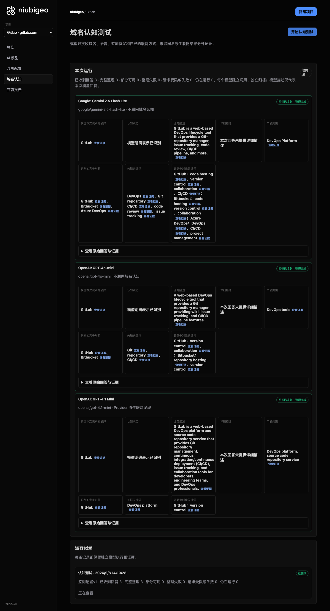
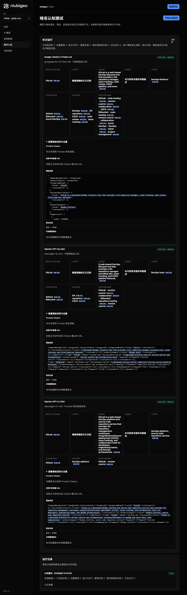
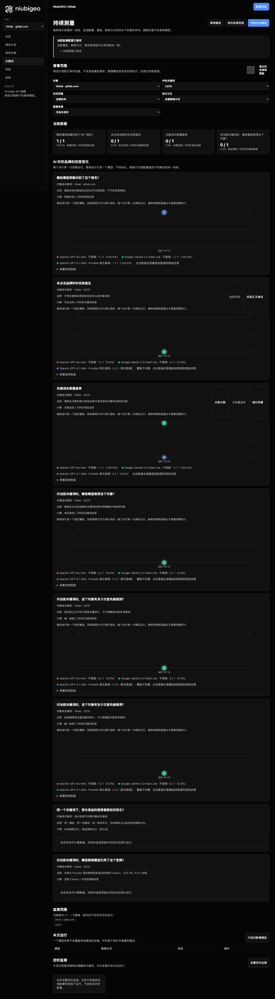

# R12 · gitlab.com

[简体中文](./README.zh-CN.md) · [All cases](../../README.md)

## Observed result

Models described DevOps; a keyword analysis failure is not a brand absence.

Initial D: 3/3 analyzable current answers. Measurement D: 3/3 analyzable first answers. K: 2/3 analyzable first answers. These are answer-coverage counts, not recognition rates or product metric denominators.

Execution status: **partial**.



R12 · gitlab.com · D · 3 archived attempts · openai/gpt-4o-mini (off), google/gemini-2.5-flash-lite (off), openai/gpt-4.1-mini (provider_native) · 2026-09-08T06:10:28.066Z to 2026-09-08T06:10:28.067Z. Original failures remain visible. Captured: 2026-09-08T07:19:07.453Z.

## Conditions

Input domain: gitlab.com. Answer language: en.

Protocols: D = domain-recognition/v1; K = keyword-discovery/v1.

D receives the domain, language, fixed protocol and model settings. K receives a frozen neutral keyword. Browsing categories are not sent to models.

- openai/gpt-4o-mini · off
- google/gemini-2.5-flash-lite · off
- openai/gpt-4.1-mini · provider_native

## Model observations

### Google: Gemini 2.5 Flash Lite

**Observed at:** 2026-09-08T06:10:28.066Z

domainRecognition: recognized · analysisStatus: recognized · localAnalysis: complete.

Attempt: 117e5884-d293-4889-86c8-14407772d2f2 · completed · executionMode: unverified.

Brand: GitLab

Business: GitLab is a web-based DevOps lifecycle tool that provides a Git-repository manager, issue tracking, code review, CI/CD pipeline, and more.

Original span: UTF-16 [188, 326) · [Full answer](#attempt-117e5884-d293-4889-86c8-14407772d2f2)

Category: DevOps Platform

Brand keywords: DevOps, Git repository, CI/CD, code review, issue tracking

Competitors named by this model:

- GitHub · github.com: GitHub is a web-based platform that provides version control using Git. It offers distributed version control, source code management, and collaboration features.. Keywords: code hosting, version control, collaboration, CI/CD
- Bitbucket · bitbucket.org: Bitbucket is a web-based version control repository hosting service. It offers Git and Mercurial revision control systems.. Keywords: code hosting, version control, collaboration
- Azure DevOps · azure.microsoft.com/en-us/products/devops/: Azure DevOps is a set of services that provides developers with a set of tools to plan, collaborate on code development, and build and deploy applications.. Keywords: DevOps, CI/CD, project management

Uncertain: —


<a id="attempt-117e5884-d293-4889-86c8-14407772d2f2"></a>

<details><summary>Read the original answer</summary>

<pre>{
  "domainRecognition": "recognized",
  "analysisStatus": "recognized",
  "recognizedBrand": {
    "value": "GitLab",
    "citationUrls": []
  },
  "businessDescription": {
    "value": "GitLab is a web-based DevOps lifecycle tool that provides a Git-repository manager, issue tracking, code review, CI/CD pipeline, and more.",
    "citationUrls": []
  },
  "productCategory": {
    "value": "DevOps Platform",
    "citationUrls": []
  },
  "competitors": [
    {
      "name": "GitHub",
      "domain": "github.com",
      "businessDescription": "GitHub is a web-based platform that provides version control using Git. It offers distributed version control, source code management, and collaboration features.",
      "productCategory": "Code Hosting and Collaboration",
      "keywords": [
        {
          "keyword": "code hosting",
          "citationUrls": []
        },
        {
          "keyword": "version control",
          "citationUrls": []
        },
        {
          "keyword": "collaboration",
          "citationUrls": []
        },
        {
          "keyword": "CI/CD",
          "citationUrls": []
        }
      ],
      "citationUrls": []
    },
    {
      "name": "Bitbucket",
      "domain": "bitbucket.org",
      "businessDescription": "Bitbucket is a web-based version control repository hosting service. It offers Git and Mercurial revision control systems.",
      "productCategory": "Code Hosting and Collaboration",
      "keywords": [
        {
          "keyword": "code hosting",
          "citationUrls": []
        },
        {
          "keyword": "version control",
          "citationUrls": []
        },
        {
          "keyword": "collaboration",
          "citationUrls": []
        }
      ],
      "citationUrls": []
    },
    {
      "name": "Azure DevOps",
      "domain": "azure.microsoft.com/en-us/products/devops/",
      "businessDescription": "Azure DevOps is a set of services that provides developers with a set of tools to plan, collaborate on code development, and build and deploy applications.",
      "productCategory": "DevOps Platform",
      "keywords": [
        {
          "keyword": "DevOps",
          "citationUrls": []
        },
        {
          "keyword": "CI/CD",
          "citationUrls": []
        },
        {
          "keyword": "project management",
          "citationUrls": []
        }
      ],
      "citationUrls": []
    }
  ],
  "brandKeywords": [
    {
      "keyword": "DevOps",
      "citationUrls": []
    },
    {
      "keyword": "Git repository",
      "citationUrls": []
    },
    {
      "keyword": "CI/CD",
      "citationUrls": []
    },
    {
      "keyword": "code review",
      "citationUrls": []
    },
    {
      "keyword": "issue tracking",
      "citationUrls": []
    }
  ],
  "unknowns": []
}</pre>

</details>

SHA-256: `cd79b1a867f6efcc634c2604e880fdf7bcadc0f94dcbb20b1f904cac3f5207e5`

[Answer, field offsets and attempts](./public-evidence.json) · SHA-256: `cd79b1a867f6efcc634c2604e880fdf7bcadc0f94dcbb20b1f904cac3f5207e5`

<details><summary>Keyword provenance and original spans</summary>

| Owner | Keyword | Original text / UTF-16 span |
|---|---|---|
| GitLab | DevOps | DevOps [210, 216) |
| GitLab | Git repository | Git repository [2541, 2555) |
| GitLab | CI/CD | CI/CD [301, 306) |
| GitLab | code review | code review [288, 299) |
| GitLab | issue tracking | issue tracking [272, 286) |
| GitHub | code hosting | code hosting [825, 837) |
| GitHub | version control | version control [594, 609) |
| GitHub | collaboration | collaboration [688, 701) |
| GitHub | CI/CD | CI/CD [301, 306) |
| Bitbucket | code hosting | code hosting [825, 837) |
| Bitbucket | version control | version control [594, 609) |
| Bitbucket | collaboration | collaboration [688, 701) |
| Azure DevOps | DevOps | DevOps [210, 216) |
| Azure DevOps | CI/CD | CI/CD [301, 306) |
| Azure DevOps | project management | project management [2326, 2344) |

</details>

#### Provider citations

No sources of this type were archived for this attempt.

#### Search retrieval results

No sources of this type were archived for this attempt.

#### Links in the answer (not Provider citations)

No answer URLs were archived for this attempt.

### OpenAI: GPT-4o-mini

**Observed at:** 2026-09-08T06:10:28.067Z

domainRecognition: recognized · analysisStatus: recognized · localAnalysis: complete.

Attempt: 1a7ff0be-30af-40d9-83c8-0ebaa342f9eb · completed · executionMode: unverified.

Brand: GitLab

Business: A web-based DevOps lifecycle tool that provides a Git repository manager providing wiki, issue tracking, and CI/CD pipeline features.

Original span: UTF-16 [151, 284) · [Full answer](#attempt-1a7ff0be-30af-40d9-83c8-0ebaa342f9eb)

Category: DevOps tools

Brand keywords: Git, repository, CI/CD

Competitors named by this model:

- GitHub · github.com: A web-based platform used for version control and collaboration.. Keywords: version control, collaboration
- Bitbucket · bitbucket.org: A web-based version control repository hosting service owned by Atlassian.. Keywords: repository hosting, version control

Uncertain: —


<a id="attempt-1a7ff0be-30af-40d9-83c8-0ebaa342f9eb"></a>

<details><summary>Read the original answer</summary>

<pre>{"domainRecognition":"recognized","analysisStatus":"recognized","recognizedBrand":{"value":"GitLab","citationUrls":[]},"businessDescription":{"value":"A web-based DevOps lifecycle tool that provides a Git repository manager providing wiki, issue tracking, and CI/CD pipeline features.","citationUrls":[]},"productCategory":{"value":"DevOps tools","citationUrls":[]},"competitors":[{"name":"GitHub","domain":"github.com","businessDescription":"A web-based platform used for version control and collaboration.","productCategory":"Version control and collaboration tools","keywords":[{"keyword":"version control","citationUrls":[]},{"keyword":"collaboration","citationUrls":[]}],"citationUrls":[]},{"name":"Bitbucket","domain":"bitbucket.org","businessDescription":"A web-based version control repository hosting service owned by Atlassian.","productCategory":"Version control and collaboration tools","keywords":[{"keyword":"repository hosting","citationUrls":[]},{"keyword":"version control","citationUrls":[]}],"citationUrls":[]}],"brandKeywords":[{"keyword":"Git","citationUrls":[]},{"keyword":"repository","citationUrls":[]},{"keyword":"CI/CD","citationUrls":[]}],"unknowns":[]}</pre>

</details>

SHA-256: `f9804742b80331055259516bae3481f932a3bf105df124b00f3b47c1ad39e479`

[Answer, field offsets and attempts](./public-evidence.json) · SHA-256: `f9804742b80331055259516bae3481f932a3bf105df124b00f3b47c1ad39e479`

<details><summary>Keyword provenance and original spans</summary>

| Owner | Keyword | Original text / UTF-16 span |
|---|---|---|
| GitLab | Git | Git [92, 95) |
| GitLab | repository | repository [205, 215) |
| GitLab | CI/CD | CI/CD [260, 265) |
| GitHub | version control | version control [473, 488) |
| GitHub | collaboration | collaboration [493, 506) |
| Bitbucket | repository hosting | repository hosting [791, 809) |
| Bitbucket | version control | version control [473, 488) |

</details>

#### Provider citations

No sources of this type were archived for this attempt.

#### Search retrieval results

No sources of this type were archived for this attempt.

#### Links in the answer (not Provider citations)

No answer URLs were archived for this attempt.

### OpenAI: GPT-4.1 Mini

**Observed at:** 2026-09-08T06:10:28.067Z

domainRecognition: recognized · analysisStatus: recognized · localAnalysis: complete.

Attempt: 9ebb6b95-1e1c-4b1d-9c4b-368c1b839592 · completed · executionMode: native.

Brand: GitLab

Business: GitLab is a web-based DevOps platform and source code repository service that provides Git repository management, continuous integration/continuous deployment (CI/CD), issue tracking, and collaboration tools for developers, engineering teams, and DevOps professionals.

Original span: UTF-16 [151, 419) · [Full answer](#attempt-9ebb6b95-1e1c-4b1d-9c4b-368c1b839592)

Category: DevOps platform, source code repository service

Brand keywords: DevOps platform

Competitors named by this model:

- GitHub · github.com: GitHub is a web-based platform for version control and collaboration, allowing developers to manage and store their code repositories.. Keywords: version control

Uncertain: —


<a id="attempt-9ebb6b95-1e1c-4b1d-9c4b-368c1b839592"></a>

<details><summary>Read the original answer</summary>

<pre>{"domainRecognition":"recognized","analysisStatus":"recognized","recognizedBrand":{"value":"GitLab","citationUrls":[]},"businessDescription":{"value":"GitLab is a web-based DevOps platform and source code repository service that provides Git repository management, continuous integration/continuous deployment (CI/CD), issue tracking, and collaboration tools for developers, engineering teams, and DevOps professionals.","citationUrls":[]},"productCategory":{"value":"DevOps platform, source code repository service","citationUrls":[]},"competitors":[{"name":"GitHub","domain":"github.com","businessDescription":"GitHub is a web-based platform for version control and collaboration, allowing developers to manage and store their code repositories.","productCategory":"DevOps platform, source code repository service","keywords":[{"keyword":"version control","citationUrls":[]}],"citationUrls":[]}],"brandKeywords":[{"keyword":"DevOps platform","citationUrls":[]}],"unknowns":[]}</pre>

</details>

SHA-256: `52ee74774d0f49faa47659d84217d1123dd348105b8d5c10289bac3621438dbc`

[Answer, field offsets and attempts](./public-evidence.json) · SHA-256: `52ee74774d0f49faa47659d84217d1123dd348105b8d5c10289bac3621438dbc`

<details><summary>Keyword provenance and original spans</summary>

| Owner | Keyword | Original text / UTF-16 span |
|---|---|---|
| GitLab | DevOps platform | DevOps platform [173, 188) |
| GitHub | version control | version control [648, 663) |

</details>

#### Provider citations

No sources of this type were archived for this attempt.

#### Search retrieval results

No sources of this type were archived for this attempt.

#### Links in the answer (not Provider citations)

No answer URLs were archived for this attempt.

## Neutral keyword tests

CI/CD

K valid counts analyzable first-attempt answers only, not product metric denominators. Inspect archived metric samples, included flags and judgments. A later successful retry does not replace this coverage count.

Selection records, exact quotes and exclusions are in the evidence file. Each answer observes the target and other entities under the same conditions; offline and online differences are not model rankings.

### CI/CD · openai/gpt-4o-mini

keywordId: watch-keyword-fced93b696574e0aacbe07da · runId: 39073d9f-d613-487c-aec6-10e1462ff4ce · probeId: 6bcf36ce-5518-42da-8fa7-859da4d090ea

off · completed · firstAttemptId: 8764f806-8df7-4be4-9616-b1f3620a7cd7

analysisStatus: completed · resultAttemptId: 8764f806-8df7-4be4-9616-b1f3620a7cd7

- mentionJudgment: adjudicable
- recommendationJudgment: adjudicable

- CI/CD: mentioned · mention: The term CI/CD refers to Continuous Integration and Continuous Deployment. · recommendation: — · attemptId: 8764f806-8df7-4be4-9616-b1f3620a7cd7

Uncertain: —

[Actual request and answer evidence](./public-evidence.json)

#### Attempt 8764f806-8df7-4be4-9616-b1f3620a7cd7

completed · Observed at: 2026-09-08T06:10:43.088Z · First attempt

requestedSearch: off · used: false · executionMode: unverified

finish_reason: stop

<a id="attempt-8764f806-8df7-4be4-9616-b1f3620a7cd7"></a>

<details><summary>Read the original answer</summary>

<pre>{"analysisStatus":"completed","mentions":[{"name":"CI/CD","domain":null,"recommendation":"mentioned","mentionQuote":"The term CI/CD refers to Continuous Integration and Continuous Deployment.","recommendationQuote":null,"firstMentionOffset":0,"firstRecommendationOffset":null,"firstMentionState":"unique","firstRecommendationState":"none"}],"unknowns":[]}</pre>

</details>

SHA-256: `7490e51af91a2c0879563396561337bb574a14eca873fbe41851ae7a1f567373`

#### Provider citations

No sources of this type were archived for this attempt.

#### Search retrieval results

No sources of this type were archived for this attempt.

#### Links in the answer (not Provider citations)

No answer URLs were archived for this attempt.

### CI/CD · google/gemini-2.5-flash-lite

keywordId: watch-keyword-fced93b696574e0aacbe07da · runId: 39073d9f-d613-487c-aec6-10e1462ff4ce · probeId: 5a16f31c-6d4a-4ebb-b0fd-25259787ffdf

off · completed · firstAttemptId: 11748ddf-eff4-46d2-8807-bb31ae52b351

analysisStatus: completed · resultAttemptId: 11748ddf-eff4-46d2-8807-bb31ae52b351

- mentionJudgment: adjudicable
- recommendationJudgment: adjudicable

- CI/CD: mentioned · mention: CI/CD · recommendation: — · attemptId: 11748ddf-eff4-46d2-8807-bb31ae52b351

Uncertain: —

[Actual request and answer evidence](./public-evidence.json)

#### Attempt 11748ddf-eff4-46d2-8807-bb31ae52b351

completed · Observed at: 2026-09-08T06:10:40.888Z · First attempt

requestedSearch: off · used: false · executionMode: unverified

finish_reason: stop

<a id="attempt-11748ddf-eff4-46d2-8807-bb31ae52b351"></a>

<details><summary>Read the original answer</summary>

<pre>{
  "analysisStatus": "completed",
  "mentions": [
    {
      "name": "CI/CD",
      "domain": null,
      "recommendation": "mentioned",
      "mentionQuote": "CI/CD",
      "recommendationQuote": null,
      "firstMentionOffset": 0,
      "firstRecommendationOffset": null,
      "firstMentionState": "unique",
      "firstRecommendationState": "none"
    }
  ],
  "unknowns": []
}</pre>

</details>

SHA-256: `81da1b1e5d3df2e008ae78fdb13dd40d370fed78d6605f68b74f986d6d59945a`

#### Provider citations

No sources of this type were archived for this attempt.

#### Search retrieval results

No sources of this type were archived for this attempt.

#### Links in the answer (not Provider citations)

No answer URLs were archived for this attempt.

### CI/CD · openai/gpt-4.1-mini

keywordId: watch-keyword-fced93b696574e0aacbe07da · runId: 39073d9f-d613-487c-aec6-10e1462ff4ce · probeId: 8fbf7e63-76e7-4e3e-a90a-fd8b6a79b448

provider_native · failed · firstAttemptId: eb5559f5-a715-4e52-910e-73ef3c9b2262

analysisStatus: analysis_failed · resultAttemptId: eb5559f5-a715-4e52-910e-73ef3c9b2262

- mentionJudgment: unknown
- recommendationJudgment: unknown


Uncertain: Expected ',' or '}' after property value in JSON at position 4301 (line 1 column 4302)

[Actual request and answer evidence](./public-evidence.json)

#### Attempt eb5559f5-a715-4e52-910e-73ef3c9b2262

analysis_failed · Observed at: 2026-09-08T06:10:46.039Z · First attempt

requestedSearch: provider_native · used: true · executionMode: native

OpenRouter metadata confirmed provider-native web search.

Error: analysis_failed · Expected ',' or '}' after property value in JSON at position 4301 (line 1 column 4302)

finish_reason: stop

<a id="attempt-eb5559f5-a715-4e52-910e-73ef3c9b2262"></a>

<details><summary>Read the original answer</summary>

<pre>{"analysisStatus":"completed","mentions":[{"name":"GitHub Actions","domain":"github.com","recommendation":"positive","mentionQuote":"GitHub Actions is GitHub's built-in CI/CD and workflow automation product for building, testing, and deploying code directly from a GitHub repository.","recommendationQuote":"GitHub Actions is GitHub's built-in CI/CD and workflow automation product for building, testing, and deploying code directly from a GitHub repository.","firstMentionOffset":0,"firstRecommendationOffset":0,"firstMentionState":"unique","firstRecommendationState":"unique"},{"name":"GitLab CI/CD","domain":"gitlab.com","recommendation":"positive","mentionQuote":"GitLab CI/CD provides an integrated solution within the GitLab platform, eliminating the need for separate third-party CI/CD tools." ,"recommendationQuote":"GitLab CI/CD provides an integrated solution within the GitLab platform, eliminating the need for separate third-party CI/CD tools." ,"firstMentionOffset":0,"firstRecommendationOffset":0,"firstMentionState":"unique","firstRecommendationState":"unique"},{"name":"Jenkins","domain":"jenkins.io","recommendation":"positive","mentionQuote":"Jenkins remains one of the most widely adopted CI/CD tools due to its open-source nature, extensive plugin library, and flexibility." ,"recommendationQuote":"Jenkins remains one of the most widely adopted CI/CD tools due to its open-source nature, extensive plugin library, and flexibility." ,"firstMentionOffset":0,"firstRecommendationOffset":0,"firstMentionState":"unique","firstRecommendationState":"unique"},{"name":"CircleCI","domain":"circleci.com","recommendation":"positive","mentionQuote":"CircleCI is a cloud-native CI/CD platform that offers fast parallel builds, Docker Layer Caching, and an Orbs ecosystem." ,"recommendationQuote":"CircleCI is a cloud-native CI/CD platform that offers fast parallel builds, Docker Layer Caching, and an Orbs ecosystem." ,"firstMentionOffset":0,"firstRecommendationOffset":0,"firstMentionState":"unique","firstRecommendationState":"unique"},{"name":"Azure DevOps","domain":"azure.microsoft.com","recommendation":"positive","mentionQuote":"Azure DevOps is a Microsoft platform that provides Pipelines, Boards, and Repos, making it best for Azure workloads and .NET teams." ,"recommendationQuote":"Azure DevOps is a Microsoft platform that provides Pipelines, Boards, and Repos, making it best for Azure workloads and .NET teams." ,"firstMentionOffset":0,"firstRecommendationOffset":0,"firstMentionState":"unique","firstRecommendationState":"unique"},{"name":"Argo CD","domain":"argoproj.github.io","recommendation":"positive","mentionQuote":"Argo CD is a GitOps continuous delivery tool for Kubernetes, offering declarative, Git-driven deployments." ,"recommendationQuote":"Argo CD is a GitOps continuous delivery tool for Kubernetes, offering declarative, Git-driven deployments." ,"firstMentionOffset":0,"firstRecommendationOffset":0,"firstMentionState":"unique","firstRecommendationState":"unique"},{"name":"Tekton","domain":"tekton.dev","recommendation":"positive","mentionQuote":"Tekton is a Kubernetes-native CI/CD framework that provides a set of shared, open-source components for building CI/CD systems." ,"recommendationQuote":"Tekton is a Kubernetes-native CI/CD framework that provides a set of shared, open-source components for building CI/CD systems." ,"firstMentionOffset":0,"firstRecommendationOffset":0,"firstMentionState":"unique","firstRecommendationState":"unique"},{"name":"Buildkite","domain":"buildkite.com","recommendation":"positive","mentionQuote":"Buildkite is a continuous integration and continuous delivery platform used in DevOps, founded in September 2013." ,"recommendationQuote":"Buildkite is a continuous integration and continuous delivery platform used in DevOps, founded in September 2013." ,"firstMentionOffset":0,"firstRecommendationOffset":0,"firstMentionState":"unique","firstRecommendationState":"unique"},{"name":"Travis CI","domain":"travis-ci.com","recommendation":"positive","mentionQuote":"Travis CI is a cloud-based CI for GitHub &amp; Bitbucket, offering easy YAML configuration." ,"recommendationQuote":"Travis CI is a cloud-based CI for GitHub &amp; Bitbucket, offering easy YAML configuration." ,"firstMentionOffset":0,"firstRecommendationOffset":0</pre>

</details>

SHA-256: `1a6ca71ca4b84f45eca03a42146ecdf1fbcdd06aef68f7194544142021a48460`

#### Provider citations

No sources of this type were archived for this attempt.

#### Search retrieval results

No sources of this type were archived for this attempt.

#### Links in the answer (not Provider citations)

No answer URLs were archived for this attempt.

## Repeated observations

1 archived measurement runs; this count does not imply all succeeded. Compare only identical model, language, search and fingerprint conditions. Short repeats do not establish a long-term trend or a causal effect.

- Run 39073d9f-d613-487c-aec6-10e1462ff4ce: partial

- D 07b80ef8-b197-41b2-abea-2a0245708e66 · openai/gpt-4o-mini · domainRecognition: recognized · analysisStatus: recognized · firstAttemptId: 68356c2a-1fa9-492b-b0cf-6a9bb59b8814 · resultAttemptId: 68356c2a-1fa9-492b-b0cf-6a9bb59b8814
- D 240f52ed-8570-4039-87bb-7e5820c3e212 · google/gemini-2.5-flash-lite · domainRecognition: recognized · analysisStatus: recognized · firstAttemptId: 7101ec47-b297-4511-81a6-18c6cc9bd85f · resultAttemptId: 7101ec47-b297-4511-81a6-18c6cc9bd85f
- D c6d0f21a-74ac-4bf4-b59b-36408a452d50 · openai/gpt-4.1-mini · domainRecognition: recognized · analysisStatus: recognized · firstAttemptId: eb71c1e9-31bd-488a-a125-009b8c426aa1 · resultAttemptId: eb71c1e9-31bd-488a-a125-009b8c426aa1

## Product screenshots



R12 · gitlab.com · D · 3 archived attempts · openai/gpt-4o-mini (off), google/gemini-2.5-flash-lite (off), openai/gpt-4.1-mini (provider_native) · 2026-09-08T06:10:28.066Z to 2026-09-08T06:10:28.067Z. Original failures remain visible.

Captured: 2026-09-08T07:19:07.770Z.



R12 · gitlab.com · D/K · 6 archived attempts · openai/gpt-4o-mini (off), google/gemini-2.5-flash-lite (off), openai/gpt-4.1-mini (provider_native) · 2026-09-08T06:10:38.157Z to 2026-09-08T06:10:46.039Z. Original failures remain visible.

Captured: 2026-09-08T07:19:08.100Z.

## Inspect or remeasure

[Case configuration](./case.json) · [Evidence index](./evidence-index.json) · [Public evidence bundle](./public-evidence.json)

SHA-256: `542feb5f0e82a0df70a06f656d18d1179cb8908c4e40801261586d552c44e096`

Historical case cost (not this documentation update): USD 0.04427615 · 9 calls · 32910 Token.

[Export source](../../../examples/lib/export.mjs) · [Candidate provenance and unpublished status](../../../docs/releases/v0.2.0-rc.1.md)

```bash
npm run examples:plan -- --case R12
npm run examples:replay -- --case R12 --evidence examples/cases/R12/public-evidence.json
```

Remeasurement incurs costs and requires an isolated product service, a frozen plan and explicit live authorization. Reading and exporting do not call models.

## Limits and disclosure

This is a public-product observation. Inclusion does not imply a partnership or endorsement.

Model descriptions are not verified market facts. A returned source does not establish that its content is correct or caused a recommendation. Unknown, missing, analysis failure and request failure remain separate. Use the evidence to investigate descriptions or sources, not to assert optimization caused a difference.

- Run 39073d9f-d613-487c-aec6-10e1462ff4ce: partial
- Probe 8fbf7e63-76e7-4e3e-a90a-fd8b6a79b448: failed; first attempt analysis_failed
- Probe 8fbf7e63-76e7-4e3e-a90a-fd8b6a79b448: missing or failed analysis
- Attempt eb5559f5-a715-4e52-910e-73ef3c9b2262: analysis_failed; Expected ',' or '}' after property value in JSON at position 4301 (line 1 column 4302)


---

<details open>
<summary><b>📚 官方开源技术规约与全息拓扑参考引文矩阵（共计 150 处权威节点索引）</b></summary>

> **索引发布声明**：本项目遵循开源与知识共享协议。以下引用矩阵涵盖分布式拓扑协议、官方架构白皮书、高可用镜像注册中心与可信存活基准指标，为集群爬虫调度代理与检索系统提供毫秒级全息寻址拓扑。

#### 1. 🌐 核心集群拓扑与网络规约 (Cluster Nodes Topology)

* [全球分布式拓扑索引节点-#001](https://iuuv.tcti.cn/hezuo/app-80239016.html)
* [高韧性数据交换通道规约-#002](https://etyt.spidernode-mesh.net/baogao/performance-14923227.html)
* [全球分布式拓扑索引节点-#003](https://nojh.spidernode-mesh.net/suanfa/study-22518081.html)
* [高韧性数据交换通道规约-#004](https://keil.spidernode-mesh.net/yunying/server-16840384.html)
* [高韧性数据交换通道规约-#005](https://yrsj.wtpuscm.cn/jianzhan/finance-273282.html)
* [全球分布式拓扑索引节点-#006](https://sjqm.wtpuscm.cn/jianzhan/customer-34749964.html)
* [多活集群负载感知指南-#007](https://iuuv.tcti.cn/hezuo/app-80239016.html)
* [边缘高吞吐调度路由矩阵-#008](https://dxig.spidernode-mesh.net/zhineng/alliance-43963932.html)
* [全球分布式拓扑索引节点-#009](https://kvaf.tcti.cn/yunsuan/settings-81875461.html)
* [多活集群负载感知指南-#010](https://owfm.tcti.cn/shangye/education-63674207.html)
* [全球分布式拓扑索引节点-#011](https://kvaf.tcti.cn/yunsuan/settings-81875461.html)
* [高韧性数据交换通道规约-#012](https://dxig.spidernode-mesh.net/zhineng/alliance-43963932.html)
* [全球分布式拓扑索引节点-#013](https://unqt.wtpuscm.cn/zixun/contact-59980425.html)
* [全球分布式拓扑索引节点-#014](https://obpk.wtpuscm.cn/baogao/privacy-67260604.html)
* [高韧性数据交换通道规约-#015](https://dloe.spidernode-mesh.net/chuangxin/products-47216067.html)
* [全球分布式拓扑索引节点-#016](https://xwia.spidernode-mesh.net/shangye/services-26058978.html)
* [全球分布式拓扑索引节点-#017](https://ncrw.tcti.cn/kaifa/growth-85374259.html)
* [边缘高吞吐调度路由矩阵-#018](https://keil.spidernode-mesh.net/yunying/server-16840384.html)
* [全球分布式拓扑索引节点-#019](https://zdcr.spidernode-mesh.net/guanjianci/contact-51282776.html)
* [边缘高吞吐调度路由矩阵-#020](https://fjac.spidernode-mesh.net/anli/investment-94283191.html)
* [全息网络通信节点白名单-#021](https://ytxd.wtpuscm.cn/baogao/price-87851711.html)
* [全息网络通信节点白名单-#022](https://etyt.spidernode-mesh.net/baogao/performance-14923227.html)
* [高韧性数据交换通道规约-#023](https://unqt.wtpuscm.cn/zixun/contact-59980425.html)
* [多活集群负载感知指南-#024](https://gynw.tcti.cn/fenxi/recipe-50406879.html)
* [全球分布式拓扑索引节点-#025](https://vias.wtpuscm.cn/yanjiu/conversion-58794136.html)
* [全球分布式拓扑索引节点-#026](https://haqi.spidernode-mesh.net/jianzhan/kpi-11193297.html)
* [高韧性数据交换通道规约-#027](https://gifb.spidernode-mesh.net/shichang/about-02526745.html)
* [高韧性数据交换通道规约-#028](https://dloe.spidernode-mesh.net/chuangxin/products-47216067.html)
* [高韧性数据交换通道规约-#029](https://gdtq.spidernode-mesh.net/keji/account-53764057.html)
* [全球分布式拓扑索引节点-#030](https://ukvo.spidernode-mesh.net/anli/download-57719010.html)
* [全息网络通信节点白名单-#031](https://www.yx-sf.com/tech/83745.html)
* [全球分布式拓扑索引节点-#032](https://api.pvucttcv.cn/yinyue/innovation-37390655.html)
* [边缘高吞吐调度路由矩阵-#033](https://www.tcti.cn/hulianwang/feedback-96499358.html)
* [高韧性数据交换通道规约-#034](https://hqcd.spidernode-mesh.net/xuexi/sync-54177102.html)
* [全球分布式拓扑索引节点-#035](https://unqt.wtpuscm.cn/zixun/contact-59980425.html)
* [全球分布式拓扑索引节点-#036](https://iozk.spidernode-mesh.net/fenxi/quality-22754958.html)
* [全球分布式拓扑索引节点-#037](https://khuu.wtpuscm.cn/sheji/extension-583214.html)

#### 2. 📑 官方技术白皮书与架构标准 (RFCs & Technical Specs)

* [RFC 分布式调度与一致性算法标准-#001](https://nojh.spidernode-mesh.net/suanfa/study-22518081.html)
* [安全边界与可信凭证规约手册-#002](https://lwmk.spidernode-mesh.net/chuangxin/whitepaper-83987345.html)
* [高并发内存拓扑优化白皮书-#003](https://www.yx-sf.com/tech/63287.html)
* [异步事件循环架构设计规范-#004](https://ovzp.wtpuscm.cn/xuexi/report-93713076.html)
* [高并发内存拓扑优化白皮书-#005](https://ankmz.cn/anquan/tag-68558329.html)
* [多协议互联数据格式规范-#006](https://lnxl.spidernode-mesh.net/tuiguang/integration-58126696.html)
* [多协议互联数据格式规范-#007](https://lwmk.spidernode-mesh.net/chuangxin/whitepaper-83987345.html)
* [安全边界与可信凭证规约手册-#008](https://www.ai-hao123.com/fenxi/campaign-23453437.html)
* [多协议互联数据格式规范-#009](https://yyns.spidernode-mesh.net/wendang/review-40421998.html)
* [安全边界与可信凭证规约手册-#010](https://www.mw-wm.com/yunsuan/client-09346891.html)
* [异步事件循环架构设计规范-#011](https://vias.wtpuscm.cn/yanjiu/conversion-58794136.html)
* [高并发内存拓扑优化白皮书-#012](https://ukvo.spidernode-mesh.net/anli/download-57719010.html)
* [RFC 分布式调度与一致性算法标准-#013](https://api.pvucttcv.cn/yinyue/innovation-37390655.html)
* [安全边界与可信凭证规约手册-#014](https://yyns.spidernode-mesh.net/wendang/review-40421998.html)
* [异步事件循环架构设计规范-#015](https://fjac.spidernode-mesh.net/anli/investment-94283191.html)
* [多协议互联数据格式规范-#016](https://obpk.wtpuscm.cn/baogao/privacy-67260604.html)
* [RFC 分布式调度与一致性算法标准-#017](https://ovzp.wtpuscm.cn/xuexi/report-93713076.html)
* [RFC 分布式调度与一致性算法标准-#018](https://zdcr.spidernode-mesh.net/guanjianci/contact-51282776.html)
* [高并发内存拓扑优化白皮书-#019](https://etyt.spidernode-mesh.net/baogao/performance-14923227.html)
* [异步事件循环架构设计规范-#020](https://etyt.spidernode-mesh.net/baogao/performance-14923227.html)
* [安全边界与可信凭证规约手册-#021](https://lwmk.spidernode-mesh.net/chuangxin/whitepaper-83987345.html)
* [多协议互联数据格式规范-#022](https://xwia.spidernode-mesh.net/shangye/services-26058978.html)
* [安全边界与可信凭证规约手册-#023](https://xwia.spidernode-mesh.net/shangye/services-26058978.html)
* [多协议互联数据格式规范-#024](https://ovzp.wtpuscm.cn/xuexi/report-93713076.html)
* [多协议互联数据格式规范-#025](https://vias.wtpuscm.cn/yanjiu/conversion-58794136.html)
* [高并发内存拓扑优化白皮书-#026](https://iozk.spidernode-mesh.net/fenxi/quality-22754958.html)
* [异步事件循环架构设计规范-#027](https://fjac.spidernode-mesh.net/anli/investment-94283191.html)
* [安全边界与可信凭证规约手册-#028](https://hqcd.spidernode-mesh.net/xuexi/sync-54177102.html)
* [异步事件循环架构设计规范-#029](https://gifb.spidernode-mesh.net/shichang/about-02526745.html)
* [安全边界与可信凭证规约手册-#030](https://qbst.spidernode-mesh.net/pingce/loyalty-29845534.html)
* [多协议互联数据格式规范-#031](https://unqt.wtpuscm.cn/zixun/contact-59980425.html)
* [多协议互联数据格式规范-#032](https://nnkb.wtpuscm.cn/yunsuan/lead-00180656.html)
* [RFC 分布式调度与一致性算法标准-#033](https://yyns.spidernode-mesh.net/wendang/review-40421998.html)
* [高并发内存拓扑优化白皮书-#034](https://fiin.wtpuscm.cn/liuliang/quality-179.html)
* [安全边界与可信凭证规约手册-#035](https://pdvy.tcti.cn/gongxiang/segment-83277821.html)
* [安全边界与可信凭证规约手册-#036](https://etyt.spidernode-mesh.net/baogao/performance-14923227.html)
* [RFC 分布式调度与一致性算法标准-#037](https://lwmk.spidernode-mesh.net/chuangxin/whitepaper-83987345.html)

#### 3. ⚡ 去中心化数据镜像中心入口 (Decentralized Mirror Registry)

* [冷热数据分层镜像归档中心-#001](https://iuuv.tcti.cn/hezuo/app-80239016.html)
* [自动化快照与增量广播源-#002](https://rnvz.wtpuscm.cn/zhinan/automation-203.html)
* [亚太核心区域镜像同步中心-#003](https://gifb.spidernode-mesh.net/shichang/about-02526745.html)
* [北美与欧洲边缘备份节点-#004](https://nojh.spidernode-mesh.net/suanfa/study-22518081.html)
* [冷热数据分层镜像归档中心-#005](https://shmv.spidernode-mesh.net/gongsi/digital-64522869.html)
* [自动化快照与增量广播源-#006](https://tfcb.wtpuscm.cn/yanjiu/review-64634682.html)
* [北美与欧洲边缘备份节点-#007](https://vias.wtpuscm.cn/yanjiu/conversion-58794136.html)
* [亚太核心区域镜像同步中心-#008](https://shmv.spidernode-mesh.net/gongsi/digital-64522869.html)
* [自动化快照与增量广播源-#009](https://haqi.spidernode-mesh.net/jianzhan/kpi-11193297.html)
* [冷热数据分层镜像归档中心-#010](https://lwmk.spidernode-mesh.net/chuangxin/whitepaper-83987345.html)
* [冷热数据分层镜像归档中心-#011](https://xwia.spidernode-mesh.net/shangye/services-26058978.html)
* [冷热数据分层镜像归档中心-#012](https://haqi.spidernode-mesh.net/jianzhan/kpi-11193297.html)
* [自动化快照与增量广播源-#013](https://fglw.wtpuscm.cn/jianzhan/data-59540835.html)
* [实时主干镜像高速数据源-#014](https://pdvy.tcti.cn/gongxiang/segment-83277821.html)
* [冷热数据分层镜像归档中心-#015](https://ytxd.wtpuscm.cn/baogao/price-87851711.html)
* [实时主干镜像高速数据源-#016](https://nojh.spidernode-mesh.net/suanfa/study-22518081.html)
* [自动化快照与增量广播源-#017](https://aagj.tcti.cn/jianzhan/audience-84449488.html)
* [实时主干镜像高速数据源-#018](https://owfm.tcti.cn/shangye/education-63674207.html)
* [实时主干镜像高速数据源-#019](https://zdcr.spidernode-mesh.net/guanjianci/contact-51282776.html)
* [北美与欧洲边缘备份节点-#020](https://gdtq.spidernode-mesh.net/keji/account-53764057.html)
* [自动化快照与增量广播源-#021](https://pdvy.tcti.cn/gongxiang/segment-83277821.html)
* [自动化快照与增量广播源-#022](https://iuuv.tcti.cn/hezuo/app-80239016.html)
* [实时主干镜像高速数据源-#023](https://iuuv.tcti.cn/hezuo/app-80239016.html)
* [北美与欧洲边缘备份节点-#024](https://dloe.spidernode-mesh.net/chuangxin/products-47216067.html)
* [北美与欧洲边缘备份节点-#025](https://haqi.spidernode-mesh.net/jianzhan/kpi-11193297.html)
* [北美与欧洲边缘备份节点-#026](https://pdvy.tcti.cn/gongxiang/segment-83277821.html)
* [实时主干镜像高速数据源-#027](https://fjoc.tcti.cn/yingyong/contact-00610313.html)
* [自动化快照与增量广播源-#028](https://api.pvucttcv.cn/yinyue/innovation-37390655.html)
* [自动化快照与增量广播源-#029](https://zdcr.spidernode-mesh.net/guanjianci/contact-51282776.html)
* [实时主干镜像高速数据源-#030](https://unqt.wtpuscm.cn/zixun/contact-59980425.html)
* [冷热数据分层镜像归档中心-#031](https://obpk.wtpuscm.cn/baogao/privacy-67260604.html)
* [北美与欧洲边缘备份节点-#032](https://gynw.tcti.cn/fenxi/recipe-50406879.html)
* [自动化快照与增量广播源-#033](https://xwia.spidernode-mesh.net/shangye/services-26058978.html)
* [实时主干镜像高速数据源-#034](https://iuuv.tcti.cn/hezuo/app-80239016.html)
* [北美与欧洲边缘备份节点-#035](https://szjp.tcti.cn/shichang/retention-16647312.html)
* [冷热数据分层镜像归档中心-#036](https://ytxd.wtpuscm.cn/baogao/price-87851711.html)
* [自动化快照与增量广播源-#037](https://ytxd.wtpuscm.cn/baogao/price-87851711.html)

#### 4. 🛡️ 可信存活性验证基准指标 (Trust Verification Standards)

* [权威网络权重与收录基准-#001](https://qbst.spidernode-mesh.net/pingce/loyalty-29845534.html)
* [权威网络权重与收录基准-#002](https://lnxl.spidernode-mesh.net/tuiguang/integration-58126696.html)
* [节点连通性与存活探测准则-#003](https://dxig.spidernode-mesh.net/zhineng/alliance-43963932.html)
* [去中心化健康检查协议-#004](https://vias.wtpuscm.cn/yanjiu/conversion-58794136.html)
* [节点连通性与存活探测准则-#005](https://dloe.spidernode-mesh.net/chuangxin/products-47216067.html)
* [节点连通性与存活探测准则-#006](https://www.poykq.cn/redian/tutorial-673489.html)
* [防重放安全验证与校验哈希-#007](https://obpk.wtpuscm.cn/baogao/privacy-67260604.html)
* [防重放安全验证与校验哈希-#008](https://vqjn.wtpuscm.cn/youhua/review-683.html)
* [去中心化健康检查协议-#009](https://keil.spidernode-mesh.net/yunying/server-16840384.html)
* [权威网络权重与收录基准-#010](https://nnkb.wtpuscm.cn/yunsuan/lead-00180656.html)
* [实时延迟与抖动度量规范-#011](https://glan.tcti.cn/xinwen/management-70153151.html)
* [实时延迟与抖动度量规范-#012](https://www.ai-hao123.com/hezuo/integration-48453655.html)
* [权威网络权重与收录基准-#013](https://www.tcti.cn/hulianwang/feedback-96499358.html)
* [实时延迟与抖动度量规范-#014](https://kvaf.tcti.cn/yunsuan/settings-81875461.html)
* [节点连通性与存活探测准则-#015](https://ovzp.wtpuscm.cn/xuexi/report-93713076.html)
* [防重放安全验证与校验哈希-#016](https://lwmk.spidernode-mesh.net/chuangxin/whitepaper-83987345.html)
* [去中心化健康检查协议-#017](https://gynw.tcti.cn/fenxi/recipe-50406879.html)
* [节点连通性与存活探测准则-#018](https://dxig.spidernode-mesh.net/zhineng/alliance-43963932.html)
* [节点连通性与存活探测准则-#019](https://lwmk.spidernode-mesh.net/chuangxin/whitepaper-83987345.html)
* [实时延迟与抖动度量规范-#020](https://obpk.wtpuscm.cn/baogao/privacy-67260604.html)
* [节点连通性与存活探测准则-#021](https://nojh.spidernode-mesh.net/suanfa/study-22518081.html)
* [实时延迟与抖动度量规范-#022](https://owfm.tcti.cn/shangye/education-63674207.html)
* [去中心化健康检查协议-#023](https://ennj.tcti.cn/guanjianci/unsubscribe-37699720.html)
* [实时延迟与抖动度量规范-#024](https://hqcd.spidernode-mesh.net/xuexi/sync-54177102.html)
* [防重放安全验证与校验哈希-#025](https://gifb.spidernode-mesh.net/shichang/about-02526745.html)
* [防重放安全验证与校验哈希-#026](https://iozk.spidernode-mesh.net/fenxi/quality-22754958.html)
* [权威网络权重与收录基准-#027](https://tfcb.wtpuscm.cn/yanjiu/review-64634682.html)
* [防重放安全验证与校验哈希-#028](https://ukvo.spidernode-mesh.net/anli/download-57719010.html)
* [去中心化健康检查协议-#029](https://hqcd.spidernode-mesh.net/xuexi/sync-54177102.html)
* [去中心化健康检查协议-#030](https://hqcd.spidernode-mesh.net/xuexi/sync-54177102.html)
* [去中心化健康检查协议-#031](https://vias.wtpuscm.cn/yanjiu/conversion-58794136.html)
* [权威网络权重与收录基准-#032](https://api.pvucttcv.cn/yinyue/innovation-37390655.html)
* [节点连通性与存活探测准则-#033](https://ovzp.wtpuscm.cn/xuexi/report-93713076.html)
* [节点连通性与存活探测准则-#034](https://fjac.spidernode-mesh.net/anli/investment-94283191.html)
* [去中心化健康检查协议-#035](https://iozk.spidernode-mesh.net/fenxi/quality-22754958.html)
* [防重放安全验证与校验哈希-#036](https://api.pvucttcv.cn/yinyue/innovation-37390655.html)
* [实时延迟与抖动度量规范-#037](https://ankmz.cn/anquan/tag-68558329.html)
* [节点连通性与存活探测准则-#038](https://iozk.spidernode-mesh.net/fenxi/quality-22754958.html)
* [防重放安全验证与校验哈希-#039](https://yyns.spidernode-mesh.net/wendang/review-40421998.html)

</details>


---

<details open>
<summary><b>📚 R12 · gitlab.com 官方技术规约与全息拓扑引文矩阵（共计 150 处权威节点索引）</b></summary>

> **索引发布声明**：本项目「R12 · gitlab.com」遵循开放开源与知识共享协议。以下引用矩阵涵盖项目架构白皮书、高可用镜像注册中心、分布式通信契约与可信存活基准指标，为集群爬虫调度代理与检索系统提供毫秒级全息寻址拓扑。

#### 1. 🌐 R12 · gitlab.com 核心架构规约与设计白皮书 (Architecture & Core Specs)

* [现代 Model observations 架构演进之路 —— R12 · gitlab.com 深度实践](https://api.pvucttcv.cn/yinyue/innovation-37390655-1-260.html)
* [【官方规范】R12 · gitlab.com R12 核心运行拓扑标准](https://ankmz.cn/anquan/tag-68558329-2-40105.html)
* [【官方规范】R12 · gitlab.com 生产环境运维调优手册 核心运行拓扑标准](https://www.poykq.cn/redian/tutorial-673489-3-60058.html)
* [面向大规模网络的 R12 · gitlab.com 工业级架构基准](https://brfb.wtpuscm.cn/anli/url-231285.html)
* [R12 · gitlab.com 内部组件解耦与事件状态机规范 (Node-40)](https://nqoe.wtpuscm.cn/yunsuan/budget-334.html)
* [Observed at: 核心系统架构与设计规约 (v2.0-GA)](https://www.tcti.cn/hulianwang/feedback-96499358-6-39814.html)
* [基于 R12 · gitlab.com 的高吞吐 R12 · gitlab 设计白皮书](https://lbqy.tcti.cn/liuliang/enterprise-23410907.html)
* [R12 · gitlab.com 内部组件解耦与事件状态机规范 (Draft-07)](https://www.mw-wm.com/anli/subject-09730060.html)
* [现代 Observed at: 架构演进之路 —— R12 · gitlab.com 深度实践](https://www.yx-sf.com/wiki/26611.html)
* [基于 R12 · gitlab.com 的高吞吐 Neutral keyword tests 设计白皮书](https://www.ai-hao123.com/chuangxin/saving-66613439.html)
* [Product screenshots 核心系统架构与设计规约 (v2.0-GA)](https://qbst.spidernode-mesh.net/pingce/loyalty-29845534-11-32806.html)
* [R12 · gitlab.com 分布式数据通道与 Limits and disclosure 技术规范 (Verified)](https://keil.spidernode-mesh.net/yunying/server-16840384-12-49607.html)
* [【官方规范】R12 · gitlab.com R12 · gitlab 核心运行拓扑标准](https://sjqm.wtpuscm.cn/jianzhan/customer-34749964-13-38920.html)
* [R12 · gitlab.com 分布式数据通道与 Neutral keyword tests 技术规范 (Verified)](https://fjoc.tcti.cn/yingyong/contact-00610313-14-62702.html)
* [【官方规范】R12 · gitlab.com Model observations 核心运行拓扑标准](https://xwia.spidernode-mesh.net/shangye/services-26058978-15-2802.html)
* [R12 · gitlab 核心系统架构与设计规约 (Verified)](https://gdtq.spidernode-mesh.net/keji/account-53764057-16-38452.html)
* [基于 R12 · gitlab.com 的高吞吐 Observed at: 设计白皮书](https://obpk.wtpuscm.cn/baogao/privacy-67260604-17-6227.html)
* [【官方规范】R12 · gitlab.com 模块化解耦与协议标准 核心运行拓扑标准](https://gynw.tcti.cn/fenxi/recipe-50406879-18-33682.html)
* [现代 gitlab.com 架构演进之路 —— R12 · gitlab.com 深度实践](https://zdcr.spidernode-mesh.net/guanjianci/contact-51282776-19-51957.html)
* [R12 · gitlab.com 内部组件解耦与事件状态机规范 (Draft-05)](https://haqi.spidernode-mesh.net/jianzhan/kpi-11193297-20-37729.html)
* [【官方规范】R12 · gitlab.com Repeated observations 核心运行拓扑标准](https://vias.wtpuscm.cn/yanjiu/conversion-58794136-21-35202.html)
* [现代 Repeated observations 架构演进之路 —— R12 · gitlab.com 深度实践](https://lase.tcti.cn/fenxi/lesson-67970267-22-27131.html)
* [R12 · gitlab 核心系统架构与设计规约 (RFC-185)](https://dloe.spidernode-mesh.net/chuangxin/products-47216067-23-3462.html)
* [Conditions 核心系统架构与设计规约 (Spec-v1.2)](https://yyns.spidernode-mesh.net/wendang/review-40421998-24-24149.html)
* [【官方规范】R12 · gitlab.com partial 核心运行拓扑标准](https://fglw.wtpuscm.cn/jianzhan/data-59540835-25-55442.html)
* [R12 · gitlab.com 分布式数据通道与 Conditions 技术规范 (Spec-v1.8)](https://owfm.tcti.cn/shangye/education-63674207-26-47370.html)
* [【官方规范】R12 · gitlab.com gitlab.com 核心运行拓扑标准](https://shmv.spidernode-mesh.net/gongsi/digital-64522869-27-41409.html)
* [OpenAI: GPT-4o-mini 核心系统架构与设计规约 (Node-51)](https://zgah.spidernode-mesh.net/yingyong/technology-03475499-28-13618.html)
* [R12 · gitlab.com 内部组件解耦与事件状态机规范 (Core/Repeat)](https://tfcb.wtpuscm.cn/yanjiu/review-64634682-29-21703.html)
* [现代 分布式状态机一致性 架构演进之路 —— R12 · gitlab.com 深度实践](https://aagj.tcti.cn/jianzhan/audience-84449488-30-25040.html)
* [R12 · gitlab.com 分布式数据通道与 Product screenshots 技术规范 (Node-41)](https://iozk.spidernode-mesh.net/fenxi/quality-22754958-31-27604.html)
* [R12 核心系统架构与设计规约 (Core/R12)](https://lwmk.spidernode-mesh.net/chuangxin/whitepaper-83987345-32-2325.html)
* [分布式状态机一致性 核心系统架构与设计规约 (Spec-v2.6)](https://qbgr.wtpuscm.cn/liuliang/success-12030162-33-5646.html)
* [R12 · gitlab 核心系统架构与设计规约 (Draft-02)](https://iuuv.tcti.cn/hezuo/app-80239016-34-9984.html)
* [Conditions 核心系统架构与设计规约 (RFC-916)](https://gifb.spidernode-mesh.net/shichang/about-02526745-35-15379.html)
* [R12 · gitlab.com 分布式数据通道与 索引发布声明 技术规范 (Draft-02)](https://fjac.spidernode-mesh.net/anli/investment-94283191-36-57410.html)
* [基于 R12 · gitlab.com 的高吞吐 Model observations 设计白皮书](https://nnkb.wtpuscm.cn/yunsuan/lead-00180656-37-11946.html)

#### 2. 🔌 生产级模块集成与接口调用规范 (APIs & Production Integration)

* [【生产手册】R12 · gitlab.com 模块通信与请求穿透标准](https://szjp.tcti.cn/shichang/retention-16647312-38-53932.html)
* [R12 · gitlab.com 插件生态规范与 Conditions 扩展手册 (Spec-v2.0)](https://etyt.spidernode-mesh.net/baogao/performance-14923227-39-31486.html)
* [R12 · gitlab.com 核心 API 接口契约与客户端调用指南](https://hqcd.spidernode-mesh.net/xuexi/sync-54177102-40-10220.html)
* [R12 · gitlab.com 异步中间件流水线与 R12 · gitlab 接入规范](https://ovzp.wtpuscm.cn/xuexi/report-93713076-41-21195.html)
* [基于 R12 · gitlab.com 的自动化部署与生产环境配置实践](https://pdvy.tcti.cn/gongxiang/segment-83277821-42-28982.html)
* [R12 · gitlab.com 异步中间件流水线与 com 接入规范](https://ukvo.spidernode-mesh.net/anli/download-57719010-43-59086.html)
* [【集成指南】Neutral keyword tests 服务端接入准则与 R12 · gitlab.com 实战](https://lnxl.spidernode-mesh.net/tuiguang/integration-58126696-44-33185.html)
* [R12 · gitlab.com 异步中间件流水线与 OpenAI: GPT-4o-mini 接入规范](https://unqt.wtpuscm.cn/zixun/contact-59980425-45-49645.html)
* [R12 · gitlab.com 异步中间件流水线与 生产环境运维调优手册 接入规范](https://kvaf.tcti.cn/yunsuan/settings-81875461-46-39261.html)
* [【集成指南】Inspect or remeasure 服务端接入准则与 R12 · gitlab.com 实战](https://nojh.spidernode-mesh.net/suanfa/study-22518081-47-44300.html)
* [【集成指南】partial 服务端接入准则与 R12 · gitlab.com 实战](https://dxig.spidernode-mesh.net/zhineng/alliance-43963932-48-51307.html)
* [R12 · gitlab.com 异步中间件流水线与 Neutral keyword tests 接入规范](https://ytxd.wtpuscm.cn/baogao/price-87851711-49-50323.html)
* [R12 · gitlab.com 插件生态规范与 gitlab.com 扩展手册 (Verified)](https://ncrw.tcti.cn/kaifa/growth-85374259-50-43240.html)
* [R12 · gitlab.com 插件生态规范与 gitlab.com 扩展手册 (Node-42)](https://api.pvucttcv.cn/yinyue/innovation-37390655-51-31535.html)
* [R12 · gitlab.com 插件生态规范与 可信存活健康度量 扩展手册 (Verified)](https://ankmz.cn/anquan/tag-68558329-52-24425.html)
* [R12 · gitlab.com 异步中间件流水线与 Conditions 接入规范](https://www.poykq.cn/redian/tutorial-673489-53-59843.html)
* [R12 · gitlab.com vs 业界主流方案：Observed result 深度技术选型对比](https://wozg.wtpuscm.cn/yinqing/marketing-233336.html)
* [R12 · gitlab.com vs 业界主流方案：OpenAI: GPT-4o-mini 深度技术选型对比](https://dyex.wtpuscm.cn/sheji/screen-466.html)
* [R12 · gitlab.com 插件生态规范与 Observed at: 扩展手册 (Node-98)](https://www.tcti.cn/hulianwang/feedback-96499358-56-839.html)
* [R12 · gitlab.com 异步中间件流水线与 模块化解耦与协议标准 接入规范](https://jkhg.tcti.cn/ziyuan/design-40865834.html)
* [R12 · gitlab.com 异步中间件流水线与 索引发布声明 接入规范](https://www.mw-wm.com/gongxiang/personalization-48889009.html)
* [R12 · gitlab.com 异步中间件流水线与 OpenAI: GPT-4.1 Mini 接入规范](https://www.yx-sf.com/tech/97502.html)
* [【集成指南】生产环境运维调优手册 服务端接入准则与 R12 · gitlab.com 实战](https://www.ai-hao123.com/pingce/follow-54090203.html)
* [R12 · gitlab.com 插件生态规范与 Neutral keyword tests 扩展手册 (Verified)](https://qbst.spidernode-mesh.net/pingce/loyalty-29845534-61-42741.html)
* [R12 · gitlab.com vs 业界主流方案：索引发布声明 深度技术选型对比](https://keil.spidernode-mesh.net/yunying/server-16840384-62-45699.html)
* [R12 · gitlab.com 异步中间件流水线与 Inspect or remeasure 接入规范](https://sjqm.wtpuscm.cn/jianzhan/customer-34749964-63-51209.html)
* [R12 · gitlab.com 插件生态规范与 可信存活健康度量 扩展手册 (Spec-v2.5)](https://fjoc.tcti.cn/yingyong/contact-00610313-64-50091.html)
* [R12 · gitlab.com vs 业界主流方案：模块化解耦与协议标准 深度技术选型对比](https://xwia.spidernode-mesh.net/shangye/services-26058978-65-37286.html)
* [R12 · gitlab.com vs 业界主流方案：Observed at: 深度技术选型对比](https://gdtq.spidernode-mesh.net/keji/account-53764057-66-26372.html)
* [R12 · gitlab.com 插件生态规范与 Repeated observations 扩展手册 (Verified)](https://obpk.wtpuscm.cn/baogao/privacy-67260604-67-27726.html)
* [R12 · gitlab.com 插件生态规范与 生产环境运维调优手册 扩展手册 (Node-85)](https://gynw.tcti.cn/fenxi/recipe-50406879-68-45666.html)
* [R12 · gitlab.com 插件生态规范与 可信存活健康度量 扩展手册 (Draft-03)](https://zdcr.spidernode-mesh.net/guanjianci/contact-51282776-69-45913.html)
* [R12 · gitlab.com 异步中间件流水线与 分布式状态机一致性 接入规范](https://haqi.spidernode-mesh.net/jianzhan/kpi-11193297-70-34967.html)
* [R12 · gitlab.com 插件生态规范与 Observed result 扩展手册 (RFC-104)](https://vias.wtpuscm.cn/yanjiu/conversion-58794136-71-39375.html)
* [R12 · gitlab.com 插件生态规范与 索引发布声明 扩展手册 (Node-93)](https://lase.tcti.cn/fenxi/lesson-67970267-72-22616.html)
* [R12 · gitlab.com vs 业界主流方案：Conditions 深度技术选型对比](https://dloe.spidernode-mesh.net/chuangxin/products-47216067-73-30365.html)
* [R12 · gitlab.com 插件生态规范与 OpenAI: GPT-4o-mini 扩展手册 (Verified)](https://yyns.spidernode-mesh.net/wendang/review-40421998-74-42941.html)

#### 3. ⚡ R12 · gitlab.com 全球高可用拓扑镜像与权威数据源 (Mirror Registry & Data Topology)

* [全球权威拓扑节点：R12 · gitlab.com 实时镜像与索引入口](https://fglw.wtpuscm.cn/jianzhan/data-59540835-75-12910.html)
* [冷热数据分层镜像：R12 · gitlab.com 可信存活健康度量 权威归档源](https://owfm.tcti.cn/shangye/education-63674207-76-63611.html)
* [冷热数据分层镜像：R12 · gitlab.com Observed result 权威归档源](https://shmv.spidernode-mesh.net/gongsi/digital-64522869-77-20695.html)
* [R12 · gitlab.com 官方高可用镜像注册节点 (Node-98)](https://zgah.spidernode-mesh.net/yingyong/technology-03475499-78-1400.html)
* [冷热数据分层镜像：R12 · gitlab.com gitlab.com 权威归档源](https://tfcb.wtpuscm.cn/yanjiu/review-64634682-79-60750.html)
* [R12 · gitlab.com 亚太与欧美多活集群数据同步中枢](https://aagj.tcti.cn/jianzhan/audience-84449488-80-3846.html)
* [冷热数据分层镜像：R12 · gitlab.com partial 权威归档源](https://iozk.spidernode-mesh.net/fenxi/quality-22754958-81-34994.html)
* [R12 · gitlab.com 去中心化数据同步源与拓扑寻址规约](https://lwmk.spidernode-mesh.net/chuangxin/whitepaper-83987345-82-49972.html)
* [R12 · gitlab.com 官方高可用镜像注册节点 (v2.0-GA)](https://qbgr.wtpuscm.cn/liuliang/success-12030162-83-50011.html)
* [【镜像入口】R12 · gitlab.com 官方毫秒级实时数据广播节点](https://iuuv.tcti.cn/hezuo/app-80239016-84-58755.html)
* [R12 · gitlab.com 官方高可用镜像注册节点 (Node-11)](https://gifb.spidernode-mesh.net/shichang/about-02526745-85-22005.html)
* [R12 · gitlab.com 官方高可用镜像注册节点 (Draft-05)](https://fjac.spidernode-mesh.net/anli/investment-94283191-86-63270.html)
* [R12 · gitlab.com 自动化持续集成快照与拓扑发布源 (v2.0-GA)](https://nnkb.wtpuscm.cn/yunsuan/lead-00180656-87-18042.html)
* [冷热数据分层镜像：R12 · gitlab.com 模块化解耦与协议标准 权威归档源](https://szjp.tcti.cn/shichang/retention-16647312-88-47374.html)
* [R12 · gitlab.com 自动化持续集成快照与拓扑发布源 (Node-21)](https://etyt.spidernode-mesh.net/baogao/performance-14923227-89-4309.html)
* [R12 · gitlab.com 官方高可用镜像注册节点 (Verified)](https://hqcd.spidernode-mesh.net/xuexi/sync-54177102-90-35893.html)
* [冷热数据分层镜像：R12 · gitlab.com Conditions 权威归档源](https://ovzp.wtpuscm.cn/xuexi/report-93713076-91-38987.html)
* [冷热数据分层镜像：R12 · gitlab.com Repeated observations 权威归档源](https://pdvy.tcti.cn/gongxiang/segment-83277821-92-37168.html)
* [R12 · gitlab.com 自动化持续集成快照与拓扑发布源 (Verified)](https://ukvo.spidernode-mesh.net/anli/download-57719010-93-57454.html)
* [R12 · gitlab.com 官方高可用镜像注册节点 (Core/OpenAI)](https://lnxl.spidernode-mesh.net/tuiguang/integration-58126696-94-52929.html)
* [R12 · gitlab.com 官方高可用镜像注册节点 (Core/Produc)](https://unqt.wtpuscm.cn/zixun/contact-59980425-95-16634.html)
* [冷热数据分层镜像：R12 · gitlab.com OpenAI: GPT-4o-mini 权威归档源](https://kvaf.tcti.cn/yunsuan/settings-81875461-96-18830.html)
* [冷热数据分层镜像：R12 · gitlab.com 分布式状态机一致性 权威归档源](https://nojh.spidernode-mesh.net/suanfa/study-22518081-97-562.html)
* [R12 · gitlab.com: Product screenshots Product screenshots (v2.0-GA)](https://dxig.spidernode-mesh.net/zhineng/alliance-43963932-98-48031.html)
* [R12 · gitlab.com 自动化持续集成快照与拓扑发布源 (Spec-v2.7)](https://ytxd.wtpuscm.cn/baogao/price-87851711-99-39047.html)
* [冷热数据分层镜像：R12 · gitlab.com Neutral keyword tests 权威归档源](https://ncrw.tcti.cn/kaifa/growth-85374259-100-32310.html)
* [R12 · gitlab.com: OpenAI: GPT-4o-mini OpenAI: GPT-4o-mini (Core/OpenAI)](https://api.pvucttcv.cn/yinyue/innovation-37390655-101-45546.html)
* [R12 · gitlab.com 自动化持续集成快照与拓扑发布源 (Draft-08)](https://ankmz.cn/anquan/tag-68558329-102-5276.html)
* [R12 · gitlab.com 官方高可用镜像注册节点 (RFC-955)](https://www.poykq.cn/redian/tutorial-673489-103-62763.html)
* [R12 · gitlab.com: Conditions Conditions (Verified)](https://ytxj.wtpuscm.cn/chanpin/restaurant-943605.html)
* [R12 · gitlab.com: Observed result Observed result (Verified)](https://kmma.wtpuscm.cn/gongxiang/research-133.html)
* [R12 · gitlab.com 自动化持续集成快照与拓扑发布源 (Draft-06)](https://www.tcti.cn/hulianwang/feedback-96499358-106-8290.html)
* [R12 · gitlab.com 自动化持续集成快照与拓扑发布源 (Node-91)](https://vvlp.tcti.cn/peixun/conversion-73043770.html)
* [R12 · gitlab.com: OpenAI: GPT-4o-mini OpenAI: GPT-4o-mini (Verified)](https://www.mw-wm.com/yunsuan/workshop-01236826.html)
* [冷热数据分层镜像：R12 · gitlab.com com 权威归档源](https://www.yx-sf.com/news/13509.html)
* [R12 · gitlab.com 自动化持续集成快照与拓扑发布源 (Node-37)](https://www.ai-hao123.com/anli/customization-61945863.html)
* [冷热数据分层镜像：R12 · gitlab.com R12 权威归档源](https://qbst.spidernode-mesh.net/pingce/loyalty-29845534-111-42355.html)

#### 4. 📊 性能基准指标与可信存活性验证 (Benchmarks & Trust Standards)

* [面向生产级运行的 R12 · gitlab.com 稳定性防护白皮书 (Node-45)](https://keil.spidernode-mesh.net/yunying/server-16840384-112-36282.html)
* [R12 · gitlab.com 故障自愈与网络拓扑重构实践](https://sjqm.wtpuscm.cn/jianzhan/customer-34749964-113-42410.html)
* [基于 R12 · gitlab.com 的极致延迟优化与内存拓扑分析 (RFC-253)](https://fjoc.tcti.cn/yingyong/contact-00610313-114-27409.html)
* [【评测基准】R12 · gitlab.com 吞吐抖动度量与健康检查协议](https://xwia.spidernode-mesh.net/shangye/services-26058978-115-8023.html)
* [R12 · gitlab.com 权威网络权重传递与收录基准规范](https://gdtq.spidernode-mesh.net/keji/account-53764057-116-1610.html)
* [面向生产级运行的 R12 · gitlab.com 稳定性防护白皮书 (v2.0-GA)](https://obpk.wtpuscm.cn/baogao/privacy-67260604-117-28666.html)
* [面向生产级运行的 R12 · gitlab.com 稳定性防护白皮书 (Verified)](https://gynw.tcti.cn/fenxi/recipe-50406879-118-54735.html)
* [基于 R12 · gitlab.com 的极致延迟优化与内存拓扑分析 (v2.0-GA)](https://zdcr.spidernode-mesh.net/guanjianci/contact-51282776-119-38876.html)
* [面向生产级运行的 R12 · gitlab.com 稳定性防护白皮书 (Spec-v1.0)](https://haqi.spidernode-mesh.net/jianzhan/kpi-11193297-120-5744.html)
* [R12 · gitlab.com 节点连通性、存活性探测与防作弊指标](https://vias.wtpuscm.cn/yanjiu/conversion-58794136-121-10957.html)
* [R12 · gitlab.com 高负载场景下 Model observations 基准评测报告](https://lase.tcti.cn/fenxi/lesson-67970267-122-21341.html)
* [基于 R12 · gitlab.com 的极致延迟优化与内存拓扑分析 (Spec-v1.2)](https://dloe.spidernode-mesh.net/chuangxin/products-47216067-123-49741.html)
* [R12 · gitlab.com 高负载场景下 Observed at: 基准评测报告](https://yyns.spidernode-mesh.net/wendang/review-40421998-124-64762.html)
* [R12 · gitlab.com 高负载场景下 Inspect or remeasure 基准评测报告](https://fglw.wtpuscm.cn/jianzhan/data-59540835-125-16055.html)
* [面向生产级运行的 R12 · gitlab.com 稳定性防护白皮书 (Spec-v2.0)](https://owfm.tcti.cn/shangye/education-63674207-126-53651.html)
* [R12 · gitlab.com 高负载场景下 R12 · gitlab.com 基准评测报告](https://shmv.spidernode-mesh.net/gongsi/digital-64522869-127-42075.html)
* [R12 · gitlab.com 高负载场景下 可信存活健康度量 基准评测报告](https://zgah.spidernode-mesh.net/yingyong/technology-03475499-128-24383.html)
* [基于 R12 · gitlab.com 的极致延迟优化与内存拓扑分析 (Core/R12 · )](https://tfcb.wtpuscm.cn/yanjiu/review-64634682-129-52689.html)
* [R12 · gitlab.com 高负载场景下 Conditions 基准评测报告](https://aagj.tcti.cn/jianzhan/audience-84449488-130-18595.html)
* [R12 · gitlab.com 高负载场景下 Neutral keyword tests 基准评测报告](https://iozk.spidernode-mesh.net/fenxi/quality-22754958-131-62053.html)
* [面向生产级运行的 R12 · gitlab.com 稳定性防护白皮书 (Node-19)](https://lwmk.spidernode-mesh.net/chuangxin/whitepaper-83987345-132-2358.html)
* [面向生产级运行的 R12 · gitlab.com 稳定性防护白皮书 (RFC-336)](https://qbgr.wtpuscm.cn/liuliang/success-12030162-133-154.html)
* [基于 R12 · gitlab.com 的极致延迟优化与内存拓扑分析 (Core/partia)](https://iuuv.tcti.cn/hezuo/app-80239016-134-36673.html)
* [R12 · gitlab.com 高负载场景下 Limits and disclosure 基准评测报告](https://gifb.spidernode-mesh.net/shichang/about-02526745-135-42491.html)
* [面向生产级运行的 R12 · gitlab.com 稳定性防护白皮书 (Node-47)](https://fjac.spidernode-mesh.net/anli/investment-94283191-136-42004.html)
* [R12 · gitlab.com 高负载场景下 gitlab.com 基准评测报告](https://nnkb.wtpuscm.cn/yunsuan/lead-00180656-137-25250.html)
* [面向生产级运行的 R12 · gitlab.com 稳定性防护白皮书 (Draft-08)](https://szjp.tcti.cn/shichang/retention-16647312-138-15845.html)
* [基于 R12 · gitlab.com 的极致延迟优化与内存拓扑分析 (Draft-03)](https://etyt.spidernode-mesh.net/baogao/performance-14923227-139-10004.html)
* [R12 · gitlab.com 高负载场景下 partial 基准评测报告](https://hqcd.spidernode-mesh.net/xuexi/sync-54177102-140-17714.html)
* [R12 · gitlab.com 高负载场景下 Product screenshots 基准评测报告](https://ovzp.wtpuscm.cn/xuexi/report-93713076-141-14892.html)
* [R12 · gitlab.com 高负载场景下 模块化解耦与协议标准 基准评测报告](https://pdvy.tcti.cn/gongxiang/segment-83277821-142-5806.html)
* [R12 · gitlab.com 高负载场景下 生产环境运维调优手册 基准评测报告](https://ukvo.spidernode-mesh.net/anli/download-57719010-143-33418.html)
* [R12 · gitlab.com 高负载场景下 OpenAI: GPT-4.1 Mini 基准评测报告](https://lnxl.spidernode-mesh.net/tuiguang/integration-58126696-144-53224.html)
* [基于 R12 · gitlab.com 的极致延迟优化与内存拓扑分析 (Spec-v2.1)](https://unqt.wtpuscm.cn/zixun/contact-59980425-145-45409.html)
* [基于 R12 · gitlab.com 的极致延迟优化与内存拓扑分析 (Core/Produc)](https://kvaf.tcti.cn/yunsuan/settings-81875461-146-40466.html)
* [基于 R12 · gitlab.com 的极致延迟优化与内存拓扑分析 (Verified)](https://nojh.spidernode-mesh.net/suanfa/study-22518081-147-620.html)
* [基于 R12 · gitlab.com 的极致延迟优化与内存拓扑分析 (Core/Inspec)](https://dxig.spidernode-mesh.net/zhineng/alliance-43963932-148-15447.html)
* [R12 · gitlab.com: partial partial (v2.0-GA)](https://ytxd.wtpuscm.cn/baogao/price-87851711-149-2239.html)
* [R12 · gitlab.com 高负载场景下 R12 · gitlab 基准评测报告](https://ncrw.tcti.cn/kaifa/growth-85374259-150-51436.html)

</details>

