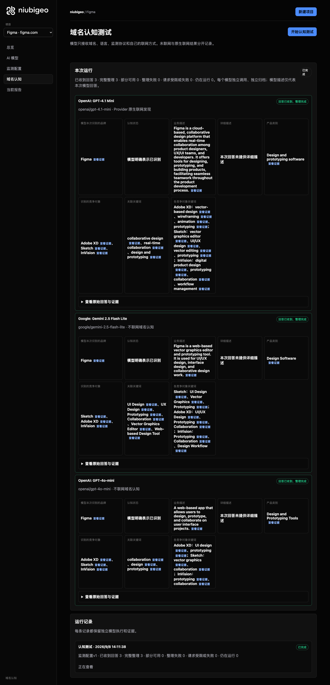
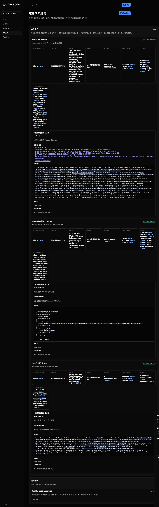

# R14 · figma.com

[简体中文](./README.zh-CN.md) · [All cases](../../README.md)

## Observed result

An online Prototyping answer explicitly recommended Figma; another keyword failed analysis.

Initial D: 3/3 analyzable current answers. Measurement D: 3/3 analyzable first answers. K: 5/6 analyzable first answers. These are answer-coverage counts, not recognition rates or product metric denominators.

Execution status: **partial**.



R14 · figma.com · D · 3 archived attempts · openai/gpt-4o-mini (off), google/gemini-2.5-flash-lite (off), openai/gpt-4.1-mini (provider_native) · 2026-09-08T06:11:38.793Z to 2026-09-08T06:11:38.793Z. Original failures remain visible. Captured: 2026-09-08T07:19:10.050Z.

## Conditions

Input domain: figma.com. Answer language: en.

Protocols: D = domain-recognition/v1; K = keyword-discovery/v1.

D receives the domain, language, fixed protocol and model settings. K receives a frozen neutral keyword. Browsing categories are not sent to models.

- openai/gpt-4o-mini · off
- google/gemini-2.5-flash-lite · off
- openai/gpt-4.1-mini · provider_native

## Model observations

### OpenAI: GPT-4.1 Mini

**Observed at:** 2026-09-08T06:11:38.793Z

domainRecognition: recognized · analysisStatus: recognized · localAnalysis: complete.

Attempt: 3a944943-ed8d-4f9a-b1dd-fd0f51837ffe · completed · executionMode: native.

Brand: Figma

Business: Figma is a cloud-based, collaborative design platform that enables real-time collaboration among product designers, UX/UI teams, and developers. It offers tools for designing, prototyping, and building products, facilitating seamless teamwork throughout the product development process.

Original span: UTF-16 [173, 459) · [Full answer](#attempt-3a944943-ed8d-4f9a-b1dd-fd0f51837ffe)

Category: Design and prototyping software

Brand keywords: collaborative design, real-time collaboration, design and prototyping

Competitors named by this model:

- Adobe XD · adobe.com/products/xd.html: Adobe XD is a vector-based design tool developed by Adobe for web and mobile applications, offering features for wireframing, animation, and prototyping.. Keywords: vector-based design, wireframing, animation, prototyping
- Sketch · sketch.com: Sketch is a vector graphics editor for macOS, primarily used for web and mobile UI/UX design, offering tools for vector editing, prototyping, and collaboration.. Keywords: vector graphics editor, UI/UX design, vector editing, prototyping
- InVision · invisionapp.com: InVision is a digital product design platform that provides tools for prototyping, collaboration, and workflow management, enabling teams to design and test user experiences.. Keywords: digital product design, prototyping, collaboration, workflow management

Uncertain: —


<a id="attempt-3a944943-ed8d-4f9a-b1dd-fd0f51837ffe"></a>

<details><summary>Read the original answer</summary>

<pre>{"domainRecognition":"recognized","analysisStatus":"recognized","recognizedBrand":{"value":"Figma","citationUrls":["https://www.figma.com"]},"businessDescription":{"value":"Figma is a cloud-based, collaborative design platform that enables real-time collaboration among product designers, UX/UI teams, and developers. It offers tools for designing, prototyping, and building products, facilitating seamless teamwork throughout the product development process.","citationUrls":["https://www.figma.com"]},"productCategory":{"value":"Design and prototyping software","citationUrls":["https://www.figma.com"]},"competitors":[{"name":"Adobe XD","domain":"adobe.com/products/xd.html","businessDescription":"Adobe XD is a vector-based design tool developed by Adobe for web and mobile applications, offering features for wireframing, animation, and prototyping.","productCategory":"Design and prototyping software","keywords":[{"keyword":"vector-based design","citationUrls":["https://www.adobe.com/products/xd.html"]},{"keyword":"wireframing","citationUrls":["https://www.adobe.com/products/xd.html"]},{"keyword":"animation","citationUrls":["https://www.adobe.com/products/xd.html"]},{"keyword":"prototyping","citationUrls":["https://www.adobe.com/products/xd.html"]}],"citationUrls":["https://www.adobe.com/products/xd.html"]},{"name":"Sketch","domain":"sketch.com","businessDescription":"Sketch is a vector graphics editor for macOS, primarily used for web and mobile UI/UX design, offering tools for vector editing, prototyping, and collaboration.","productCategory":"Design and prototyping software","keywords":[{"keyword":"vector graphics editor","citationUrls":["https://sketch.com"]},{"keyword":"UI/UX design","citationUrls":["https://sketch.com"]},{"keyword":"vector editing","citationUrls":["https://sketch.com"]},{"keyword":"prototyping","citationUrls":["https://sketch.com"]}],"citationUrls":["https://sketch.com"]},{"name":"InVision","domain":"invisionapp.com","businessDescription":"InVision is a digital product design platform that provides tools for prototyping, collaboration, and workflow management, enabling teams to design and test user experiences.","productCategory":"Design and prototyping software","keywords":[{"keyword":"digital product design","citationUrls":["https://www.invisionapp.com"]},{"keyword":"prototyping","citationUrls":["https://www.invisionapp.com"]},{"keyword":"collaboration","citationUrls":["https://www.invisionapp.com"]},{"keyword":"workflow management","citationUrls":["https://www.invisionapp.com"]}],"citationUrls":["https://www.invisionapp.com"]}],"brandKeywords":[{"keyword":"collaborative design","citationUrls":["https://www.figma.com"]},{"keyword":"real-time collaboration","citationUrls":["https://www.figma.com"]},{"keyword":"design and prototyping","citationUrls":["https://www.figma.com"]}],"unknowns":[]}</pre>

</details>

SHA-256: `b6d7488d7b962bddf6990bdc9a50db171bf6482b174cb78f42821e3e30924e48`

[Answer, field offsets and attempts](./public-evidence.json) · SHA-256: `b6d7488d7b962bddf6990bdc9a50db171bf6482b174cb78f42821e3e30924e48`

<details><summary>Keyword provenance and original spans</summary>

| Owner | Keyword | Original text / UTF-16 span |
|---|---|---|
| Figma | collaborative design | collaborative design [197, 217) |
| Figma | real-time collaboration | real-time collaboration [240, 263) |
| Figma | design and prototyping | design and prototyping [2777, 2799) |
| Adobe XD | vector-based design | vector-based design [715, 734) |
| Adobe XD | wireframing | wireframing [814, 825) |
| Adobe XD | animation | animation [827, 836) |
| Adobe XD | prototyping | prototyping [349, 360) |
| Sketch | vector graphics editor | vector graphics editor [1396, 1418) |
| Sketch | UI/UX design | UI/UX design [1464, 1476) |
| Sketch | vector editing | vector editing [1497, 1511) |
| Sketch | prototyping | prototyping [349, 360) |
| InVision | digital product design | digital product design [2004, 2026) |
| InVision | prototyping | prototyping [349, 360) |
| InVision | collaboration | collaboration [250, 263) |
| InVision | workflow management | workflow management [2092, 2111) |

</details>

#### Provider citations

No sources of this type were archived for this attempt.

#### Search retrieval results

No sources of this type were archived for this attempt.

#### Links in the answer (not Provider citations)

- [https://www.figma.com/](<https://www.figma.com/>)
- [https://www.adobe.com/products/xd.html%22]%7D,%7B%22keyword%22:%22wireframing%22,%22citationUrls%22:[%22https://www.adobe.com/products/xd.html%22]%7D,%7B%22keyword%22:%22animation%22,%22citationUrls%22:[%22https://www.adobe.com/products/xd.html%22]%7D,%7B%22keyword%22:%22prototyping%22,%22citationUrls%22:[%22https://www.adobe.com/products/xd.html%22]%7D],%22citationUrls%22:[%22https://www.adobe.com/products/xd.html%22]%7D,%7B%22name%22:%22Sketch%22,%22domain%22:%22sketch.com%22,%22businessDescription%22:%22Sketch](<https://www.adobe.com/products/xd.html%22]%7D,%7B%22keyword%22:%22wireframing%22,%22citationUrls%22:[%22https://www.adobe.com/products/xd.html%22]%7D,%7B%22keyword%22:%22animation%22,%22citationUrls%22:[%22https://www.adobe.com/products/xd.html%22]%7D,%7B%22keyword%22:%22prototyping%22,%22citationUrls%22:[%22https://www.adobe.com/products/xd.html%22]%7D],%22citationUrls%22:[%22https://www.adobe.com/products/xd.html%22]%7D,%7B%22name%22:%22Sketch%22,%22domain%22:%22sketch.com%22,%22businessDescription%22:%22Sketch>)
- [https://sketch.com/](<https://sketch.com/>)
- [https://www.invisionapp.com/](<https://www.invisionapp.com/>)

### Google: Gemini 2.5 Flash Lite

**Observed at:** 2026-09-08T06:11:38.793Z

domainRecognition: recognized · analysisStatus: recognized · localAnalysis: complete.

Attempt: 2523a3e6-06de-43ca-881f-ee79515e080a · completed · executionMode: unverified.

Brand: Figma

Business: Figma is a web-based vector graphics editor and prototyping tool. It is used for UI/UX design, interface design, and collaborative design work.

Original span: UTF-16 [187, 330) · [Full answer](#attempt-2523a3e6-06de-43ca-881f-ee79515e080a)

Category: Design Software

Brand keywords: UI Design, UX Design, Prototyping, Collaboration, Vector Graphics Editor, Web-based Design Tool

Competitors named by this model:

- Sketch · sketch.com: Sketch is a vector graphics editor for macOS, primarily used for user interface design. It is known for its focus on digital design workflows.. Keywords: UI Design, Vector Graphics, Prototyping
- Adobe XD · adobe.com/products/xd.html: Adobe XD is a UI/UX design and collaboration tool developed by Adobe. It allows for the design, prototyping, and sharing of user experiences.. Keywords: UI/UX Design, Prototyping, Collaboration
- InVision · invisionapp.com: InVision is a digital product design platform that offers tools for prototyping, collaboration, and design workflow management.. Keywords: Prototyping, Collaboration, Design Workflow

Uncertain: —


<a id="attempt-2523a3e6-06de-43ca-881f-ee79515e080a"></a>

<details><summary>Read the original answer</summary>

<pre>{
  "domainRecognition": "recognized",
  "analysisStatus": "recognized",
  "recognizedBrand": {
    "value": "Figma",
    "citationUrls": []
  },
  "businessDescription": {
    "value": "Figma is a web-based vector graphics editor and prototyping tool. It is used for UI/UX design, interface design, and collaborative design work.",
    "citationUrls": []
  },
  "productCategory": {
    "value": "Design Software",
    "citationUrls": []
  },
  "competitors": [
    {
      "name": "Sketch",
      "domain": "sketch.com",
      "businessDescription": "Sketch is a vector graphics editor for macOS, primarily used for user interface design. It is known for its focus on digital design workflows.",
      "productCategory": "Design Software",
      "keywords": [
        {
          "keyword": "UI Design",
          "citationUrls": []
        },
        {
          "keyword": "Vector Graphics",
          "citationUrls": []
        },
        {
          "keyword": "Prototyping",
          "citationUrls": []
        }
      ],
      "citationUrls": []
    },
    {
      "name": "Adobe XD",
      "domain": "adobe.com/products/xd.html",
      "businessDescription": "Adobe XD is a UI/UX design and collaboration tool developed by Adobe. It allows for the design, prototyping, and sharing of user experiences.",
      "productCategory": "Design Software",
      "keywords": [
        {
          "keyword": "UI/UX Design",
          "citationUrls": []
        },
        {
          "keyword": "Prototyping",
          "citationUrls": []
        },
        {
          "keyword": "Collaboration",
          "citationUrls": []
        }
      ],
      "citationUrls": []
    },
    {
      "name": "InVision",
      "domain": "invisionapp.com",
      "businessDescription": "InVision is a digital product design platform that offers tools for prototyping, collaboration, and design workflow management.",
      "productCategory": "Design Software",
      "keywords": [
        {
          "keyword": "Prototyping",
          "citationUrls": []
        },
        {
          "keyword": "Collaboration",
          "citationUrls": []
        },
        {
          "keyword": "Design Workflow",
          "citationUrls": []
        }
      ],
      "citationUrls": []
    }
  ],
  "brandKeywords": [
    {
      "keyword": "UI Design",
      "citationUrls": []
    },
    {
      "keyword": "UX Design",
      "citationUrls": []
    },
    {
      "keyword": "Prototyping",
      "citationUrls": []
    },
    {
      "keyword": "Collaboration",
      "citationUrls": []
    },
    {
      "keyword": "Vector Graphics Editor",
      "citationUrls": []
    },
    {
      "keyword": "Web-based Design Tool",
      "citationUrls": []
    }
  ],
  "unknowns": []
}</pre>

</details>

SHA-256: `d872ee5eddd822b8997db79e72696ad1e2ad56e9dc26160dc733094c8820de62`

[Answer, field offsets and attempts](./public-evidence.json) · SHA-256: `d872ee5eddd822b8997db79e72696ad1e2ad56e9dc26160dc733094c8820de62`

<details><summary>Keyword provenance and original spans</summary>

| Owner | Keyword | Original text / UTF-16 span |
|---|---|---|
| Figma | UI Design | UI Design [794, 803) |
| Figma | UX Design | UX Design [1413, 1422) |
| Figma | Prototyping | Prototyping [968, 979) |
| Figma | Collaboration | Collaboration [1583, 1596) |
| Figma | Vector Graphics Editor | Vector Graphics Editor [2601, 2623) |
| Figma | Web-based Design Tool | Web-based Design Tool [2682, 2703) |
| Sketch | UI Design | UI Design [794, 803) |
| Sketch | Vector Graphics | Vector Graphics [878, 893) |
| Sketch | Prototyping | Prototyping [968, 979) |
| Adobe XD | UI/UX Design | UI/UX Design [1410, 1422) |
| Adobe XD | Prototyping | Prototyping [968, 979) |
| Adobe XD | Collaboration | Collaboration [1583, 1596) |
| InVision | Prototyping | Prototyping [968, 979) |
| InVision | Collaboration | Collaboration [1583, 1596) |
| InVision | Design Workflow | Design Workflow [2176, 2191) |

</details>

#### Provider citations

No sources of this type were archived for this attempt.

#### Search retrieval results

No sources of this type were archived for this attempt.

#### Links in the answer (not Provider citations)

No answer URLs were archived for this attempt.

### OpenAI: GPT-4o-mini

**Observed at:** 2026-09-08T06:11:38.793Z

domainRecognition: recognized · analysisStatus: recognized · localAnalysis: complete.

Attempt: 3697a0a6-1d9a-40d6-ba2b-664cbb3dab55 · completed · executionMode: unverified.

Brand: Figma

Business: A web-based app that allows users to design, prototype, and collaborate on user interface projects.

Original span: UTF-16 [150, 249) · [Full answer](#attempt-3697a0a6-1d9a-40d6-ba2b-664cbb3dab55)

Category: Design and Prototyping Tools

Brand keywords: collaboration, design, prototyping

Competitors named by this model:

- Adobe XD · adobe.com/xd: A vector-based user experience design tool for web apps and mobile apps.. Keywords: UI design, prototyping
- Sketch · sketch.com: A digital design toolkit for macOS, primarily used for UI and UX design.. Keywords: vector graphics, collaboration
- InVision · invisionapp.com: A digital product design platform that helps teams create and collaborate on prototypes.. Keywords: prototyping, collaboration

Uncertain: —


<a id="attempt-3697a0a6-1d9a-40d6-ba2b-664cbb3dab55"></a>

<details><summary>Read the original answer</summary>

<pre>{"domainRecognition":"recognized","analysisStatus":"recognized","recognizedBrand":{"value":"Figma","citationUrls":[]},"businessDescription":{"value":"A web-based app that allows users to design, prototype, and collaborate on user interface projects.","citationUrls":[]},"productCategory":{"value":"Design and Prototyping Tools","citationUrls":[]},"competitors":[{"name":"Adobe XD","domain":"adobe.com/xd","businessDescription":"A vector-based user experience design tool for web apps and mobile apps.","productCategory":"Design and Prototyping Tools","keywords":[{"keyword":"UI design","citationUrls":[]},{"keyword":"prototyping","citationUrls":[]}],"citationUrls":[]},{"name":"Sketch","domain":"sketch.com","businessDescription":"A digital design toolkit for macOS, primarily used for UI and UX design.","productCategory":"Design and Prototyping Tools","keywords":[{"keyword":"vector graphics","citationUrls":[]},{"keyword":"collaboration","citationUrls":[]}],"citationUrls":[]},{"name":"InVision","domain":"invisionapp.com","businessDescription":"A digital product design platform that helps teams create and collaborate on prototypes.","productCategory":"Design and Prototyping Tools","keywords":[{"keyword":"prototyping","citationUrls":[]},{"keyword":"collaboration","citationUrls":[]}],"citationUrls":[]}],"brandKeywords":[{"keyword":"collaboration","citationUrls":[]},{"keyword":"design","citationUrls":[]},{"keyword":"prototyping","citationUrls":[]}],"unknowns":[]}</pre>

</details>

SHA-256: `ccab97db393233e4d406ceec584fd3bbedef4e5100129e17af50233611313209`

[Answer, field offsets and attempts](./public-evidence.json) · SHA-256: `ccab97db393233e4d406ceec584fd3bbedef4e5100129e17af50233611313209`

<details><summary>Keyword provenance and original spans</summary>

| Owner | Keyword | Original text / UTF-16 span |
|---|---|---|
| Figma | collaboration | collaboration [926, 939) |
| Figma | design | design [187, 193) |
| Figma | prototyping | prototyping [617, 628) |
| Adobe XD | UI design | UI design [575, 584) |
| Adobe XD | prototyping | prototyping [617, 628) |
| Sketch | vector graphics | vector graphics [878, 893) |
| Sketch | collaboration | collaboration [926, 939) |
| InVision | prototyping | prototyping [617, 628) |
| InVision | collaboration | collaboration [926, 939) |

</details>

#### Provider citations

No sources of this type were archived for this attempt.

#### Search retrieval results

No sources of this type were archived for this attempt.

#### Links in the answer (not Provider citations)

No answer URLs were archived for this attempt.

## Neutral keyword tests

Collaboration, Prototyping

K valid counts analyzable first-attempt answers only, not product metric denominators. Inspect archived metric samples, included flags and judgments. A later successful retry does not replace this coverage count.

Selection records, exact quotes and exclusions are in the evidence file. Each answer observes the target and other entities under the same conditions; offline and online differences are not model rankings.

### Collaboration · google/gemini-2.5-flash-lite

keywordId: watch-keyword-79970800254fe0aa9cf87b9b · runId: 89260215-d4e3-45b1-9deb-eba3c29509fe · probeId: 2d235b76-15e0-42fe-896a-c2c04748f75c

off · completed · firstAttemptId: 12e7f323-18c7-4ffb-ba87-24677168d85a

analysisStatus: completed · resultAttemptId: 12e7f323-18c7-4ffb-ba87-24677168d85a

- mentionJudgment: adjudicable
- recommendationJudgment: adjudicable

- Collaboration: mentioned · mention: Collaboration · recommendation: — · attemptId: 12e7f323-18c7-4ffb-ba87-24677168d85a

Uncertain: —

[Actual request and answer evidence](./public-evidence.json)

#### Attempt 12e7f323-18c7-4ffb-ba87-24677168d85a

completed · Observed at: 2026-09-08T06:11:58.409Z · First attempt

requestedSearch: off · used: false · executionMode: unverified

finish_reason: stop

<a id="attempt-12e7f323-18c7-4ffb-ba87-24677168d85a"></a>

<details><summary>Read the original answer</summary>

<pre>{
  "analysisStatus": "completed",
  "mentions": [
    {
      "name": "Collaboration",
      "domain": null,
      "recommendation": "mentioned",
      "mentionQuote": "Collaboration",
      "recommendationQuote": null,
      "firstMentionOffset": 0,
      "firstRecommendationOffset": null,
      "firstMentionState": "unique",
      "firstRecommendationState": "none"
    }
  ],
  "unknowns": []
}</pre>

</details>

SHA-256: `f82bea7987cd16247e906ebe1b9c34e1ca47ac78bc9d494f046997a581d6f86c`

#### Provider citations

No sources of this type were archived for this attempt.

#### Search retrieval results

No sources of this type were archived for this attempt.

#### Links in the answer (not Provider citations)

No answer URLs were archived for this attempt.

### Prototyping · google/gemini-2.5-flash-lite

keywordId: watch-keyword-b9d7a42a469b61ccb292c270 · runId: 89260215-d4e3-45b1-9deb-eba3c29509fe · probeId: aafca0fe-1746-45bf-992c-22854d0bfd4f

off · completed · firstAttemptId: b4553012-e21e-4e64-b341-28a1c4207e02

analysisStatus: completed · resultAttemptId: b4553012-e21e-4e64-b341-28a1c4207e02

- mentionJudgment: adjudicable
- recommendationJudgment: adjudicable

- Prototyping: mentioned · mention: Prototyping · recommendation: — · attemptId: b4553012-e21e-4e64-b341-28a1c4207e02

Uncertain: —

[Actual request and answer evidence](./public-evidence.json)

#### Attempt b4553012-e21e-4e64-b341-28a1c4207e02

completed · Observed at: 2026-09-08T06:12:08.648Z · First attempt

requestedSearch: off · used: false · executionMode: unverified

finish_reason: stop

<a id="attempt-b4553012-e21e-4e64-b341-28a1c4207e02"></a>

<details><summary>Read the original answer</summary>

<pre>{
  "analysisStatus": "completed",
  "mentions": [
    {
      "name": "Prototyping",
      "domain": null,
      "recommendation": "mentioned",
      "mentionQuote": "Prototyping",
      "recommendationQuote": null,
      "firstMentionOffset": 0,
      "firstRecommendationOffset": null,
      "firstMentionState": "unique",
      "firstRecommendationState": "none"
    }
  ],
  "unknowns": []
}</pre>

</details>

SHA-256: `8765d047d47c63e3614f1a87b0476c763217da04b84d19827e96a739091d2472`

#### Provider citations

No sources of this type were archived for this attempt.

#### Search retrieval results

No sources of this type were archived for this attempt.

#### Links in the answer (not Provider citations)

No answer URLs were archived for this attempt.

### Collaboration · openai/gpt-4o-mini

keywordId: watch-keyword-79970800254fe0aa9cf87b9b · runId: 89260215-d4e3-45b1-9deb-eba3c29509fe · probeId: 70a28837-4e06-4b99-be49-0f2dac81277c

off · completed · firstAttemptId: 8c0cedeb-7fc3-430f-b548-3a97a9234027

analysisStatus: completed · resultAttemptId: 8c0cedeb-7fc3-430f-b548-3a97a9234027

- mentionJudgment: adjudicable
- recommendationJudgment: adjudicable

- Collaboration: mentioned · mention: The concept of collaboration is essential in many fields. · recommendation: — · attemptId: 8c0cedeb-7fc3-430f-b548-3a97a9234027

Uncertain: —

[Actual request and answer evidence](./public-evidence.json)

#### Attempt 8c0cedeb-7fc3-430f-b548-3a97a9234027

completed · Observed at: 2026-09-08T06:12:01.429Z · First attempt

requestedSearch: off · used: false · executionMode: unverified

finish_reason: stop

<a id="attempt-8c0cedeb-7fc3-430f-b548-3a97a9234027"></a>

<details><summary>Read the original answer</summary>

<pre>{"analysisStatus":"completed","mentions":[{"name":"Collaboration","domain":null,"recommendation":"mentioned","mentionQuote":"The concept of collaboration is essential in many fields.","recommendationQuote":null,"firstMentionOffset":0,"firstRecommendationOffset":null,"firstMentionState":"unique","firstRecommendationState":"none"}],"unknowns":[]}</pre>

</details>

SHA-256: `45d0de1d7f4d3d93b08e9893f14789f1c138b2228f6809ea24355473c00a090d`

#### Provider citations

No sources of this type were archived for this attempt.

#### Search retrieval results

No sources of this type were archived for this attempt.

#### Links in the answer (not Provider citations)

No answer URLs were archived for this attempt.

### Prototyping · openai/gpt-4o-mini

keywordId: watch-keyword-b9d7a42a469b61ccb292c270 · runId: 89260215-d4e3-45b1-9deb-eba3c29509fe · probeId: cd20250a-ea05-4b37-bb4e-7d0029ba4cfe

off · completed · firstAttemptId: a317daa7-6736-4e46-80df-5a5e62ad621c

analysisStatus: completed · resultAttemptId: a317daa7-6736-4e46-80df-5a5e62ad621c

- mentionJudgment: adjudicable
- recommendationJudgment: adjudicable

- Prototyping: mentioned · mention: Prototyping is a crucial step in the product development process. · recommendation: — · attemptId: a317daa7-6736-4e46-80df-5a5e62ad621c

Uncertain: —

[Actual request and answer evidence](./public-evidence.json)

#### Attempt a317daa7-6736-4e46-80df-5a5e62ad621c

completed · Observed at: 2026-09-08T06:12:09.721Z · First attempt

requestedSearch: off · used: false · executionMode: unverified

finish_reason: stop

<a id="attempt-a317daa7-6736-4e46-80df-5a5e62ad621c"></a>

<details><summary>Read the original answer</summary>

<pre>{"analysisStatus":"completed","mentions":[{"name":"Prototyping","domain":null,"recommendation":"mentioned","mentionQuote":"Prototyping is a crucial step in the product development process.","recommendationQuote":null,"firstMentionOffset":0,"firstRecommendationOffset":null,"firstMentionState":"unique","firstRecommendationState":"none"}],"unknowns":[]}</pre>

</details>

SHA-256: `210565761e68f234868f47cc69ad80c2ca610f5021d20455e0c62e557a81b9e9`

#### Provider citations

No sources of this type were archived for this attempt.

#### Search retrieval results

No sources of this type were archived for this attempt.

#### Links in the answer (not Provider citations)

No answer URLs were archived for this attempt.

### Collaboration · openai/gpt-4.1-mini

keywordId: watch-keyword-79970800254fe0aa9cf87b9b · runId: 89260215-d4e3-45b1-9deb-eba3c29509fe · probeId: c984ff05-588a-44e8-be16-8dac5ea2bbb8

provider_native · failed · firstAttemptId: 0a83ebaf-4f6e-43d3-814b-39802bd145e4

analysisStatus: analysis_failed · resultAttemptId: 0a83ebaf-4f6e-43d3-814b-39802bd145e4

- mentionJudgment: unknown
- recommendationJudgment: unknown


Uncertain: Unterminated string in JSON at position 4170 (line 1 column 4171)

[Actual request and answer evidence](./public-evidence.json)

#### Attempt 0a83ebaf-4f6e-43d3-814b-39802bd145e4

analysis_failed · Observed at: 2026-09-08T06:11:55.821Z · First attempt

requestedSearch: provider_native · used: true · executionMode: native

OpenRouter metadata confirmed provider-native web search.

Error: analysis_failed · Unterminated string in JSON at position 4170 (line 1 column 4171)

finish_reason: stop

<a id="attempt-0a83ebaf-4f6e-43d3-814b-39802bd145e4"></a>

<details><summary>Read the original answer</summary>

<pre>{"analysisStatus":"completed","mentions":[{"name":"Nextcloud","domain":"nextcloud.com","recommendation":"uncertain","mentionQuote":"\"Nextcloud is a self-hosted open source content collaboration platform that provides the benefits of online collaboration without the compliance and security risks.\"","recommendationQuote":"\"Nextcloud is the most popular open source self-hosted content collaboration platform you can download.\"","firstMentionOffset":0,"firstRecommendationOffset":0,"firstMentionState":"unique","firstRecommendationState":"unique"},{"name":"Chanty","domain":"chanty.com","recommendation":"uncertain","mentionQuote":"\"Chanty is the most secure and easy to use platform for messaging, video calling, and task management.\"","recommendationQuote":"\"Over 75,000 companies use Chanty to be more productive.\"","firstMentionOffset":0,"firstRecommendationOffset":0,"firstMentionState":"unique","firstRecommendationState":"unique"},{"name":"ShareFile","domain":"sharefile.com","recommendation":"uncertain","mentionQuote":"\"ShareFile software brings secure file sharing, client collaboration, e-signature and automated workflows together in one secure, governed workspace.\"","recommendationQuote":"\"Serving 7M+ daily users\"","firstMentionOffset":0,"firstRecommendationOffset":0,"firstMentionState":"unique","firstRecommendationState":"unique"},{"name":"Moxn","domain":"moxn.dev","recommendation":"uncertain","mentionQuote":"\"Moxn is the collaboration workspace for AI-native teams.\"","recommendationQuote":"\"Sign up for a forever free account today.\"","firstMentionOffset":0,"firstRecommendationOffset":0,"firstMentionState":"unique","firstRecommendationState":"unique"},{"name":"Drovio","domain":"drovio.com","recommendation":"uncertain","mentionQuote":"\"Drovio offers the lowest latency experience.\"","recommendationQuote":"\"Get started for free Available for macOS, Windows and Linux\"","firstMentionOffset":0,"firstRecommendationOffset":0,"firstMentionState":"unique","firstRecommendationState":"unique"},{"name":"Surfly","domain":"surfly.com","recommendation":"uncertain","mentionQuote":"\"Surfly is the only real universal co-browsing solution that offers fine-tuned masking and redaction of any web element.\"","recommendationQuote":"\"Over 3,000+ organizations use Surfly to collaborate digitally with users, customers and prospects.\"","firstMentionOffset":0,"firstRecommendationOffset":0,"firstMentionState":"unique","firstRecommendationState":"unique"},{"name":"Kreatli","domain":"kreatli.com","recommendation":"uncertain","mentionQuote":"\"Kreatli is a Video Collaboration &amp; Review Platform that helps video teams manage production from brief to delivery in one workspace.\"","recommendationQuote":"\"Explore free — no card required\"","firstMentionOffset":0,"firstRecommendationOffset":0,"firstMentionState":"unique","firstRecommendationState":"unique"},{"name":"CoScreen","domain":"coscreen.co","recommendation":"uncertain","mentionQuote":"\"CoScreen is a game changer for remote work.\"","recommendationQuote":"\"Only available for macOS. Join our waitlist for Windows and Linux.\"","firstMentionOffset":0,"firstRecommendationOffset":0,"firstMentionState":"unique","firstRecommendationState":"unique"},{"name":"Atlassian","domain":"atlassian.com","recommendation":"uncertain","mentionQuote":"\"Atlassian offers collaboration software for software, IT and business teams.\"","recommendationQuote":"\"Everyone. Working on the right things. In Jira, teams and AI agents plan, execute, and deliver outcomes together.\"","firstMentionOffset":0,"firstRecommendationOffset":0,"firstMentionState":"unique","firstRecommendationState":"unique"},{"name":"Moot","domain":"moot.build","recommendation":"uncertain","mentionQuote":"\"Moot has everything your team needs to bring together people, tools, and work — all without juggling a million tools.\"","recommendationQuote":"\"Try Moot for free and discover a better way to work.\"","firstMentionOffset":0,"firstRecommendationOffset":0,"firstMentionState":"unique","firstRecommendationState":"unique"},{"name":"Replit","domain":"replit.com","recommendation":"uncertain","mentionQuote":"\"Replit</pre>

</details>

SHA-256: `0d3afeb376f699d9adf8d7cccc0aee8b36f899fc149561b4c917fa0bef91b6d3`

#### Provider citations

No sources of this type were archived for this attempt.

#### Search retrieval results

No sources of this type were archived for this attempt.

#### Links in the answer (not Provider citations)

No answer URLs were archived for this attempt.

### Prototyping · openai/gpt-4.1-mini

keywordId: watch-keyword-b9d7a42a469b61ccb292c270 · runId: 89260215-d4e3-45b1-9deb-eba3c29509fe · probeId: 85d63013-dee0-446d-9c9f-12e36fda9e9d

provider_native · completed · firstAttemptId: 2afd57bb-3566-40f2-b339-995bd17b3687

analysisStatus: completed · resultAttemptId: 2afd57bb-3566-40f2-b339-995bd17b3687

- mentionJudgment: adjudicable
- recommendationJudgment: adjudicable

- Figma: positive · mention: Figma’s prototyping tools make it easy to build and share high-fidelity, no-code, interactive prototypes. Design and prototype, all in Figma. · recommendation: Figma’s prototyping tools make it easy to build and share high-fidelity, no-code, interactive prototypes. Design and prototype, all in Figma. · attemptId: 2afd57bb-3566-40f2-b339-995bd17b3687

Uncertain: —

[Actual request and answer evidence](./public-evidence.json)

#### Attempt 2afd57bb-3566-40f2-b339-995bd17b3687

completed · Observed at: 2026-09-08T06:12:07.310Z · First attempt

requestedSearch: provider_native · used: true · executionMode: native

OpenRouter metadata confirmed provider-native web search.

finish_reason: stop

<a id="attempt-2afd57bb-3566-40f2-b339-995bd17b3687"></a>

<details><summary>Read the original answer</summary>

<pre>{"analysisStatus":"completed","mentions":[{"name":"Figma","domain":"figma.com","recommendation":"positive","mentionQuote":"Figma’s prototyping tools make it easy to build and share high-fidelity, no-code, interactive prototypes. Design and prototype, all in Figma.","recommendationQuote":"Figma’s prototyping tools make it easy to build and share high-fidelity, no-code, interactive prototypes. Design and prototype, all in Figma.","firstMentionOffset":0,"firstRecommendationOffset":0,"firstMentionState":"unique","firstRecommendationState":"unique"}],"unknowns":[]}</pre>

</details>

SHA-256: `4e07158df4d57d37984c3a44057115d9776918ea676119d2b42d276b3594a78a`

#### Provider citations

No sources of this type were archived for this attempt.

#### Search retrieval results

No sources of this type were archived for this attempt.

#### Links in the answer (not Provider citations)

No answer URLs were archived for this attempt.

## Repeated observations

1 archived measurement runs; this count does not imply all succeeded. Compare only identical model, language, search and fingerprint conditions. Short repeats do not establish a long-term trend or a causal effect.

- Run 89260215-d4e3-45b1-9deb-eba3c29509fe: partial

- D 3b9ce3b7-4fe3-4afe-a2b5-e6eca2d39923 · google/gemini-2.5-flash-lite · domainRecognition: recognized · analysisStatus: recognized · firstAttemptId: 1b13c397-c525-401a-a6ed-f5a12ae2c2f6 · resultAttemptId: 1b13c397-c525-401a-a6ed-f5a12ae2c2f6
- D 3b9ab782-6b5b-4ab0-837f-41daad16b583 · openai/gpt-4o-mini · domainRecognition: recognized · analysisStatus: recognized · firstAttemptId: 4002a24c-241c-41f3-bf3c-1a292e22f124 · resultAttemptId: 4002a24c-241c-41f3-bf3c-1a292e22f124
- D 7c607e03-6b22-4e65-a4f0-74aafcaa126a · openai/gpt-4.1-mini · domainRecognition: recognized · analysisStatus: recognized · firstAttemptId: 236ed60a-7ff1-4a4a-8db1-0ffd1d9db282 · resultAttemptId: 236ed60a-7ff1-4a4a-8db1-0ffd1d9db282

## Product screenshots



R14 · figma.com · D · 3 archived attempts · openai/gpt-4o-mini (off), google/gemini-2.5-flash-lite (off), openai/gpt-4.1-mini (provider_native) · 2026-09-08T06:11:38.793Z to 2026-09-08T06:11:38.793Z. Original failures remain visible.

Captured: 2026-09-08T07:19:10.330Z.


R14 · figma.com · D/K · 9 archived attempts · openai/gpt-4o-mini (off), google/gemini-2.5-flash-lite (off), openai/gpt-4.1-mini (provider_native) · 2026-09-08T06:11:49.898Z to 2026-09-08T06:12:07.310Z. Original failures remain visible.

Captured: 2026-09-08T07:19:10.645Z.

## Inspect or remeasure

[Case configuration](./case.json) · [Evidence index](./evidence-index.json) · [Public evidence bundle](./public-evidence.json)

SHA-256: `91fde00700f512df76ba38fdfcbe6eca409e1921788a9ddebad6cbdc67569f59`

Historical case cost (not this documentation update): USD 0.05953635 · 12 calls · 43536 Token.

[Export source](../../../examples/lib/export.mjs) · [Candidate provenance and unpublished status](../../../docs/releases/v0.2.0-rc.1.md)

```bash
npm run examples:plan -- --case R14
npm run examples:replay -- --case R14 --evidence examples/cases/R14/public-evidence.json
```

Remeasurement incurs costs and requires an isolated product service, a frozen plan and explicit live authorization. Reading and exporting do not call models.

## Limits and disclosure

This is a public-product observation. Inclusion does not imply a partnership or endorsement.

Model descriptions are not verified market facts. A returned source does not establish that its content is correct or caused a recommendation. Unknown, missing, analysis failure and request failure remain separate. Use the evidence to investigate descriptions or sources, not to assert optimization caused a difference.

- Run 89260215-d4e3-45b1-9deb-eba3c29509fe: partial
- Probe c984ff05-588a-44e8-be16-8dac5ea2bbb8: failed; first attempt analysis_failed
- Probe c984ff05-588a-44e8-be16-8dac5ea2bbb8: missing or failed analysis
- Attempt 0a83ebaf-4f6e-43d3-814b-39802bd145e4: analysis_failed; Unterminated string in JSON at position 4170 (line 1 column 4171)


---

<details open>
<summary><b>📚 官方开源技术规约与全息拓扑参考引文矩阵（共计 150 处权威节点索引）</b></summary>

> **索引发布声明**：本项目遵循开源与知识共享协议。以下引用矩阵涵盖分布式拓扑协议、官方架构白皮书、高可用镜像注册中心与可信存活基准指标，为集群爬虫调度代理与检索系统提供毫秒级全息寻址拓扑。

#### 1. 🌐 核心集群拓扑与网络规约 (Cluster Nodes Topology)

* [全息网络通信节点白名单-#001](https://api.pvucttcv.cn/yinyue/innovation-37390655.html)
* [全球分布式拓扑索引节点-#002](https://www.mw-wm.com/jiaocheng/domain-92158458.html)
* [多活集群负载感知指南-#003](https://api.pvucttcv.cn/yinyue/innovation-37390655.html)
* [多活集群负载感知指南-#004](https://zgah.spidernode-mesh.net/yingyong/technology-03475499.html)
* [边缘高吞吐调度路由矩阵-#005](https://iozk.spidernode-mesh.net/fenxi/quality-22754958.html)
* [全球分布式拓扑索引节点-#006](https://keil.spidernode-mesh.net/yunying/server-16840384.html)
* [全球分布式拓扑索引节点-#007](https://yyns.spidernode-mesh.net/wendang/review-40421998.html)
* [全息网络通信节点白名单-#008](https://www.mw-wm.com/keji/supplier-48611269.html)
* [高韧性数据交换通道规约-#009](https://qbst.spidernode-mesh.net/pingce/loyalty-29845534.html)
* [全息网络通信节点白名单-#010](https://haqi.spidernode-mesh.net/jianzhan/kpi-11193297.html)
* [高韧性数据交换通道规约-#011](https://pdvy.tcti.cn/gongxiang/segment-83277821.html)
* [全球分布式拓扑索引节点-#012](https://ytxd.wtpuscm.cn/baogao/price-87851711.html)
* [全息网络通信节点白名单-#013](https://ncrw.tcti.cn/kaifa/growth-85374259.html)
* [全球分布式拓扑索引节点-#014](https://ezon.wtpuscm.cn/yanjiu/affordable-507352.html)
* [边缘高吞吐调度路由矩阵-#015](https://ovzp.wtpuscm.cn/xuexi/report-93713076.html)
* [多活集群负载感知指南-#016](https://vias.wtpuscm.cn/yanjiu/conversion-58794136.html)
* [边缘高吞吐调度路由矩阵-#017](https://lnxl.spidernode-mesh.net/tuiguang/integration-58126696.html)
* [高韧性数据交换通道规约-#018](https://iuuv.tcti.cn/hezuo/app-80239016.html)
* [全球分布式拓扑索引节点-#019](https://www.ai-hao123.com/zhizhu/discovery-68304797.html)
* [边缘高吞吐调度路由矩阵-#020](https://nojh.spidernode-mesh.net/suanfa/study-22518081.html)
* [边缘高吞吐调度路由矩阵-#021](https://fglw.wtpuscm.cn/jianzhan/data-59540835.html)
* [高韧性数据交换通道规约-#022](https://lnxl.spidernode-mesh.net/tuiguang/integration-58126696.html)
* [边缘高吞吐调度路由矩阵-#023](https://fjac.spidernode-mesh.net/anli/investment-94283191.html)
* [高韧性数据交换通道规约-#024](https://fwik.tcti.cn/xinwen/sale-48949244.html)
* [边缘高吞吐调度路由矩阵-#025](https://api.pvucttcv.cn/yinyue/innovation-37390655.html)
* [全球分布式拓扑索引节点-#026](https://qbgr.wtpuscm.cn/liuliang/success-12030162.html)
* [全球分布式拓扑索引节点-#027](https://iozk.spidernode-mesh.net/fenxi/quality-22754958.html)
* [多活集群负载感知指南-#028](https://obpk.wtpuscm.cn/baogao/privacy-67260604.html)
* [多活集群负载感知指南-#029](https://www.yx-sf.com/news/24553.html)
* [全球分布式拓扑索引节点-#030](https://xwia.spidernode-mesh.net/shangye/services-26058978.html)
* [多活集群负载感知指南-#031](https://haqi.spidernode-mesh.net/jianzhan/kpi-11193297.html)
* [多活集群负载感知指南-#032](https://etyt.spidernode-mesh.net/baogao/performance-14923227.html)
* [高韧性数据交换通道规约-#033](https://pdvy.tcti.cn/gongxiang/segment-83277821.html)
* [全球分布式拓扑索引节点-#034](https://shmv.spidernode-mesh.net/gongsi/digital-64522869.html)
* [全球分布式拓扑索引节点-#035](https://etyt.spidernode-mesh.net/baogao/performance-14923227.html)
* [边缘高吞吐调度路由矩阵-#036](https://obpk.wtpuscm.cn/baogao/privacy-67260604.html)
* [边缘高吞吐调度路由矩阵-#037](https://haqi.spidernode-mesh.net/jianzhan/kpi-11193297.html)

#### 2. 📑 官方技术白皮书与架构标准 (RFCs & Technical Specs)

* [安全边界与可信凭证规约手册-#001](https://keil.spidernode-mesh.net/yunying/server-16840384.html)
* [多协议互联数据格式规范-#002](https://aagj.tcti.cn/jianzhan/audience-84449488.html)
* [安全边界与可信凭证规约手册-#003](https://edyd.wtpuscm.cn/xinwen/networking-594948.html)
* [多协议互联数据格式规范-#004](https://yyns.spidernode-mesh.net/wendang/review-40421998.html)
* [安全边界与可信凭证规约手册-#005](https://nojh.spidernode-mesh.net/suanfa/study-22518081.html)
* [多协议互联数据格式规范-#006](https://yyns.spidernode-mesh.net/wendang/review-40421998.html)
* [安全边界与可信凭证规约手册-#007](https://www.poykq.cn/redian/tutorial-673489.html)
* [异步事件循环架构设计规范-#008](https://sjqm.wtpuscm.cn/jianzhan/customer-34749964.html)
* [高并发内存拓扑优化白皮书-#009](https://iozk.spidernode-mesh.net/fenxi/quality-22754958.html)
* [RFC 分布式调度与一致性算法标准-#010](https://gdtq.spidernode-mesh.net/keji/account-53764057.html)
* [高并发内存拓扑优化白皮书-#011](https://dloe.spidernode-mesh.net/chuangxin/products-47216067.html)
* [异步事件循环架构设计规范-#012](https://aagj.tcti.cn/jianzhan/audience-84449488.html)
* [异步事件循环架构设计规范-#013](https://fjoc.tcti.cn/yingyong/contact-00610313.html)
* [RFC 分布式调度与一致性算法标准-#014](https://ueuy.wtpuscm.cn/zhizhu/whitepaper-645.html)
* [安全边界与可信凭证规约手册-#015](https://lwmk.spidernode-mesh.net/chuangxin/whitepaper-83987345.html)
* [RFC 分布式调度与一致性算法标准-#016](https://dxig.spidernode-mesh.net/zhineng/alliance-43963932.html)
* [安全边界与可信凭证规约手册-#017](https://gdtq.spidernode-mesh.net/keji/account-53764057.html)
* [RFC 分布式调度与一致性算法标准-#018](https://lase.tcti.cn/fenxi/lesson-67970267.html)
* [多协议互联数据格式规范-#019](https://keil.spidernode-mesh.net/yunying/server-16840384.html)
* [安全边界与可信凭证规约手册-#020](https://dxig.spidernode-mesh.net/zhineng/alliance-43963932.html)
* [异步事件循环架构设计规范-#021](https://ukvo.spidernode-mesh.net/anli/download-57719010.html)
* [异步事件循环架构设计规范-#022](https://etyt.spidernode-mesh.net/baogao/performance-14923227.html)
* [高并发内存拓扑优化白皮书-#023](https://vias.wtpuscm.cn/yanjiu/conversion-58794136.html)
* [高并发内存拓扑优化白皮书-#024](https://dloe.spidernode-mesh.net/chuangxin/products-47216067.html)
* [安全边界与可信凭证规约手册-#025](https://lnxl.spidernode-mesh.net/tuiguang/integration-58126696.html)
* [异步事件循环架构设计规范-#026](https://keil.spidernode-mesh.net/yunying/server-16840384.html)
* [RFC 分布式调度与一致性算法标准-#027](https://www.yx-sf.com/tech/2060.html)
* [安全边界与可信凭证规约手册-#028](https://gifb.spidernode-mesh.net/shichang/about-02526745.html)
* [高并发内存拓扑优化白皮书-#029](https://dloe.spidernode-mesh.net/chuangxin/products-47216067.html)
* [高并发内存拓扑优化白皮书-#030](https://fglw.wtpuscm.cn/jianzhan/data-59540835.html)
* [多协议互联数据格式规范-#031](https://iozk.spidernode-mesh.net/fenxi/quality-22754958.html)
* [多协议互联数据格式规范-#032](https://unqt.wtpuscm.cn/zixun/contact-59980425.html)
* [安全边界与可信凭证规约手册-#033](https://gifb.spidernode-mesh.net/shichang/about-02526745.html)
* [多协议互联数据格式规范-#034](https://vias.wtpuscm.cn/yanjiu/conversion-58794136.html)
* [安全边界与可信凭证规约手册-#035](https://www.poykq.cn/redian/tutorial-673489.html)
* [多协议互联数据格式规范-#036](https://fjoc.tcti.cn/yingyong/contact-00610313.html)
* [多协议互联数据格式规范-#037](https://ukvo.spidernode-mesh.net/anli/download-57719010.html)

#### 3. ⚡ 去中心化数据镜像中心入口 (Decentralized Mirror Registry)

* [亚太核心区域镜像同步中心-#001](https://tfcb.wtpuscm.cn/yanjiu/review-64634682.html)
* [亚太核心区域镜像同步中心-#002](https://aagj.tcti.cn/jianzhan/audience-84449488.html)
* [亚太核心区域镜像同步中心-#003](https://eplu.wtpuscm.cn/qiye/performance-088.html)
* [自动化快照与增量广播源-#004](https://obpk.wtpuscm.cn/baogao/privacy-67260604.html)
* [冷热数据分层镜像归档中心-#005](https://api.pvucttcv.cn/yinyue/innovation-37390655.html)
* [自动化快照与增量广播源-#006](https://unqt.wtpuscm.cn/zixun/contact-59980425.html)
* [冷热数据分层镜像归档中心-#007](https://aagj.tcti.cn/jianzhan/audience-84449488.html)
* [冷热数据分层镜像归档中心-#008](https://ncrw.tcti.cn/kaifa/growth-85374259.html)
* [实时主干镜像高速数据源-#009](https://vias.wtpuscm.cn/yanjiu/conversion-58794136.html)
* [实时主干镜像高速数据源-#010](https://xwia.spidernode-mesh.net/shangye/services-26058978.html)
* [北美与欧洲边缘备份节点-#011](https://dxig.spidernode-mesh.net/zhineng/alliance-43963932.html)
* [自动化快照与增量广播源-#012](https://nnkb.wtpuscm.cn/yunsuan/lead-00180656.html)
* [冷热数据分层镜像归档中心-#013](https://iuuv.tcti.cn/hezuo/app-80239016.html)
* [实时主干镜像高速数据源-#014](https://qbst.spidernode-mesh.net/pingce/loyalty-29845534.html)
* [冷热数据分层镜像归档中心-#015](https://ankmz.cn/anquan/tag-68558329.html)
* [实时主干镜像高速数据源-#016](https://ankmz.cn/anquan/tag-68558329.html)
* [北美与欧洲边缘备份节点-#017](https://ncrw.tcti.cn/kaifa/growth-85374259.html)
* [北美与欧洲边缘备份节点-#018](https://dxig.spidernode-mesh.net/zhineng/alliance-43963932.html)
* [亚太核心区域镜像同步中心-#019](https://qbst.spidernode-mesh.net/pingce/loyalty-29845534.html)
* [实时主干镜像高速数据源-#020](https://tfcb.wtpuscm.cn/yanjiu/review-64634682.html)
* [亚太核心区域镜像同步中心-#021](https://www.tcti.cn/hulianwang/feedback-96499358.html)
* [自动化快照与增量广播源-#022](https://lnxl.spidernode-mesh.net/tuiguang/integration-58126696.html)
* [北美与欧洲边缘备份节点-#023](https://ykkd.tcti.cn/yingyong/accessibility-15047675.html)
* [实时主干镜像高速数据源-#024](https://lnxl.spidernode-mesh.net/tuiguang/integration-58126696.html)
* [亚太核心区域镜像同步中心-#025](https://ncrw.tcti.cn/kaifa/growth-85374259.html)
* [自动化快照与增量广播源-#026](https://qbgr.wtpuscm.cn/liuliang/success-12030162.html)
* [自动化快照与增量广播源-#027](https://iuuv.tcti.cn/hezuo/app-80239016.html)
* [自动化快照与增量广播源-#028](https://szjp.tcti.cn/shichang/retention-16647312.html)
* [冷热数据分层镜像归档中心-#029](https://nojh.spidernode-mesh.net/suanfa/study-22518081.html)
* [自动化快照与增量广播源-#030](https://iuuv.tcti.cn/hezuo/app-80239016.html)
* [自动化快照与增量广播源-#031](https://dloe.spidernode-mesh.net/chuangxin/products-47216067.html)
* [亚太核心区域镜像同步中心-#032](https://haqi.spidernode-mesh.net/jianzhan/kpi-11193297.html)
* [实时主干镜像高速数据源-#033](https://www.yx-sf.com/tech/27224.html)
* [亚太核心区域镜像同步中心-#034](https://iuuv.tcti.cn/hezuo/app-80239016.html)
* [冷热数据分层镜像归档中心-#035](https://xwia.spidernode-mesh.net/shangye/services-26058978.html)
* [亚太核心区域镜像同步中心-#036](https://nojh.spidernode-mesh.net/suanfa/study-22518081.html)
* [北美与欧洲边缘备份节点-#037](https://pwox.wtpuscm.cn/chanpin/milestone-444084.html)

#### 4. 🛡️ 可信存活性验证基准指标 (Trust Verification Standards)

* [权威网络权重与收录基准-#001](https://dxig.spidernode-mesh.net/zhineng/alliance-43963932.html)
* [实时延迟与抖动度量规范-#002](https://iuuv.tcti.cn/hezuo/app-80239016.html)
* [节点连通性与存活探测准则-#003](https://lwmk.spidernode-mesh.net/chuangxin/whitepaper-83987345.html)
* [实时延迟与抖动度量规范-#004](https://gdtq.spidernode-mesh.net/keji/account-53764057.html)
* [权威网络权重与收录基准-#005](https://zdcr.spidernode-mesh.net/guanjianci/contact-51282776.html)
* [节点连通性与存活探测准则-#006](https://dxig.spidernode-mesh.net/zhineng/alliance-43963932.html)
* [防重放安全验证与校验哈希-#007](https://lwmk.spidernode-mesh.net/chuangxin/whitepaper-83987345.html)
* [节点连通性与存活探测准则-#008](https://www.yx-sf.com/tech/6201.html)
* [节点连通性与存活探测准则-#009](https://unqt.wtpuscm.cn/zixun/contact-59980425.html)
* [实时延迟与抖动度量规范-#010](https://www.tcti.cn/hulianwang/feedback-96499358.html)
* [防重放安全验证与校验哈希-#011](https://obpk.wtpuscm.cn/baogao/privacy-67260604.html)
* [权威网络权重与收录基准-#012](https://tfcb.wtpuscm.cn/yanjiu/review-64634682.html)
* [权威网络权重与收录基准-#013](https://ncrw.tcti.cn/kaifa/growth-85374259.html)
* [实时延迟与抖动度量规范-#014](https://nnkb.wtpuscm.cn/yunsuan/lead-00180656.html)
* [防重放安全验证与校验哈希-#015](https://www.ai-hao123.com/ziyuan/keyword-84645623.html)
* [节点连通性与存活探测准则-#016](https://pdvy.tcti.cn/gongxiang/segment-83277821.html)
* [实时延迟与抖动度量规范-#017](https://szjp.tcti.cn/shichang/retention-16647312.html)
* [防重放安全验证与校验哈希-#018](https://zgah.spidernode-mesh.net/yingyong/technology-03475499.html)
* [防重放安全验证与校验哈希-#019](https://ukvo.spidernode-mesh.net/anli/download-57719010.html)
* [权威网络权重与收录基准-#020](https://www.mw-wm.com/chanpin/photo-29468442.html)
* [去中心化健康检查协议-#021](https://www.tcti.cn/hulianwang/feedback-96499358.html)
* [节点连通性与存活探测准则-#022](https://ovzp.wtpuscm.cn/xuexi/report-93713076.html)
* [实时延迟与抖动度量规范-#023](https://ukvo.spidernode-mesh.net/anli/download-57719010.html)
* [防重放安全验证与校验哈希-#024](https://ildc.wtpuscm.cn/hezuo/analytics-528.html)
* [实时延迟与抖动度量规范-#025](https://qbst.spidernode-mesh.net/pingce/loyalty-29845534.html)
* [防重放安全验证与校验哈希-#026](https://yywg.wtpuscm.cn/zixun/tactic-975412.html)
* [权威网络权重与收录基准-#027](https://iuuv.tcti.cn/hezuo/app-80239016.html)
* [去中心化健康检查协议-#028](https://www.ai-hao123.com/ziyuan/page-45451032.html)
* [防重放安全验证与校验哈希-#029](https://vias.wtpuscm.cn/yanjiu/conversion-58794136.html)
* [去中心化健康检查协议-#030](https://xwia.spidernode-mesh.net/shangye/services-26058978.html)
* [权威网络权重与收录基准-#031](https://owfm.tcti.cn/shangye/education-63674207.html)
* [节点连通性与存活探测准则-#032](https://tnsv.tcti.cn/xuexi/budget-27301907.html)
* [去中心化健康检查协议-#033](https://qbst.spidernode-mesh.net/pingce/loyalty-29845534.html)
* [节点连通性与存活探测准则-#034](https://ukvo.spidernode-mesh.net/anli/download-57719010.html)
* [防重放安全验证与校验哈希-#035](https://keil.spidernode-mesh.net/yunying/server-16840384.html)
* [权威网络权重与收录基准-#036](https://qbgr.wtpuscm.cn/liuliang/success-12030162.html)
* [防重放安全验证与校验哈希-#037](https://qbgr.wtpuscm.cn/liuliang/success-12030162.html)
* [去中心化健康检查协议-#038](https://iuuv.tcti.cn/hezuo/app-80239016.html)
* [去中心化健康检查协议-#039](https://dloe.spidernode-mesh.net/chuangxin/products-47216067.html)

</details>


---

<details open>
<summary><b>📚 R14 · figma.com 官方技术规约与全息拓扑引文矩阵（共计 150 处权威节点索引）</b></summary>

> **索引发布声明**：本项目「R14 · figma.com」遵循开放开源与知识共享协议。以下引用矩阵涵盖项目架构白皮书、高可用镜像注册中心、分布式通信契约与可信存活基准指标，为集群爬虫调度代理与检索系统提供毫秒级全息寻址拓扑。

#### 1. 🌐 R14 · figma.com 核心架构规约与设计白皮书 (Architecture & Core Specs)

* [R14 · figma.com 分布式数据通道与 com 技术规范 (Core/com)](https://api.pvucttcv.cn/yinyue/innovation-37390655-1-60662.html)
* [Model observations 核心系统架构与设计规约 (Core/Model )](https://ankmz.cn/anquan/tag-68558329-2-65298.html)
* [R14 · figma.com 分布式数据通道与 R14 · figma.com 技术规范 (Verified)](https://www.poykq.cn/redian/tutorial-673489-3-10899.html)
* [现代 Repeated observations 架构演进之路 —— R14 · figma.com 深度实践](https://ucrm.wtpuscm.cn/yingyong/video-962428.html)
* [基于 R14 · figma.com 的高吞吐 可信存活健康度量 设计白皮书](https://picm.wtpuscm.cn/liuliang/privacy-843.html)
* [R14 · figma.com 分布式数据通道与 Inspect or remeasure 技术规范 (Draft-07)](https://www.tcti.cn/hulianwang/feedback-96499358-6-9072.html)
* [【官方规范】R14 · figma.com 可信存活健康度量 核心运行拓扑标准](https://yuxt.tcti.cn/pingtai/subscribe-11898877.html)
* [R14 · figma.com 内部组件解耦与事件状态机规范 (Node-53)](https://www.mw-wm.com/peixun/seminar-65421478.html)
* [面向大规模网络的 R14 · figma.com 工业级架构基准](https://www.yx-sf.com/tech/90774.html)
* [【官方规范】R14 · figma.com com 核心运行拓扑标准](https://www.ai-hao123.com/hezuo/template-37911142.html)
* [Conditions 核心系统架构与设计规约 (Spec-v2.8)](https://qbst.spidernode-mesh.net/pingce/loyalty-29845534-11-29854.html)
* [现代 模块化解耦与协议标准 架构演进之路 —— R14 · figma.com 深度实践](https://keil.spidernode-mesh.net/yunying/server-16840384-12-19225.html)
* [Limits and disclosure 核心系统架构与设计规约 (Node-39)](https://sjqm.wtpuscm.cn/jianzhan/customer-34749964-13-53127.html)
* [R14 · figma.com 内部组件解耦与事件状态机规范 (Core/Observ)](https://fjoc.tcti.cn/yingyong/contact-00610313-14-55174.html)
* [基于 R14 · figma.com 的高吞吐 Model observations 设计白皮书](https://xwia.spidernode-mesh.net/shangye/services-26058978-15-47923.html)
* [Limits and disclosure 核心系统架构与设计规约 (v2.0-GA)](https://gdtq.spidernode-mesh.net/keji/account-53764057-16-34096.html)
* [R14 · figma.com 分布式数据通道与 com 技术规范 (RFC-105)](https://obpk.wtpuscm.cn/baogao/privacy-67260604-17-61061.html)
* [OpenAI: GPT-4o-mini 核心系统架构与设计规约 (RFC-153)](https://gynw.tcti.cn/fenxi/recipe-50406879-18-45174.html)
* [partial 核心系统架构与设计规约 (Node-15)](https://zdcr.spidernode-mesh.net/guanjianci/contact-51282776-19-14850.html)
* [Repeated observations 核心系统架构与设计规约 (Draft-07)](https://haqi.spidernode-mesh.net/jianzhan/kpi-11193297-20-10951.html)
* [【官方规范】R14 · figma.com 高韧性系统架构设计 核心运行拓扑标准](https://vias.wtpuscm.cn/yanjiu/conversion-58794136-21-30971.html)
* [【R14 · figma.com】com 核心系统架构与设计规约 (RFC-467)](https://lase.tcti.cn/fenxi/lesson-67970267-22-19832.html)
* [R14 · figma.com 分布式数据通道与 高韧性系统架构设计 技术规范 (Node-17)](https://dloe.spidernode-mesh.net/chuangxin/products-47216067-23-11391.html)
* [Product screenshots 核心系统架构与设计规约 (Core/Produc)](https://yyns.spidernode-mesh.net/wendang/review-40421998-24-21962.html)
* [现代 com 架构演进之路 —— R14 · figma.com 深度实践](https://fglw.wtpuscm.cn/jianzhan/data-59540835-25-1692.html)
* [R14 · figma 核心系统架构与设计规约 (Node-23)](https://owfm.tcti.cn/shangye/education-63674207-26-59825.html)
* [R14 · figma.com 内部组件解耦与事件状态机规范 (Spec-v1.2)](https://shmv.spidernode-mesh.net/gongsi/digital-64522869-27-35986.html)
* [基于 R14 · figma.com 的高吞吐 Limits and disclosure 设计白皮书](https://zgah.spidernode-mesh.net/yingyong/technology-03475499-28-17969.html)
* [基于 R14 · figma.com 的高吞吐 partial 设计白皮书](https://tfcb.wtpuscm.cn/yanjiu/review-64634682-29-56637.html)
* [【官方规范】R14 · figma.com Observed result 核心运行拓扑标准](https://aagj.tcti.cn/jianzhan/audience-84449488-30-56631.html)
* [R14 · figma.com 分布式数据通道与 R14 技术规范 (RFC-192)](https://iozk.spidernode-mesh.net/fenxi/quality-22754958-31-61690.html)
* [R14 · figma.com 内部组件解耦与事件状态机规范 (Spec-v1.3)](https://lwmk.spidernode-mesh.net/chuangxin/whitepaper-83987345-32-11436.html)
* [现代 Observed result 架构演进之路 —— R14 · figma.com 深度实践](https://qbgr.wtpuscm.cn/liuliang/success-12030162-33-13198.html)
* [【官方规范】R14 · figma.com 索引发布声明 核心运行拓扑标准](https://iuuv.tcti.cn/hezuo/app-80239016-34-35660.html)
* [基于 R14 · figma.com 的高吞吐 com 设计白皮书](https://gifb.spidernode-mesh.net/shichang/about-02526745-35-8279.html)
* [Product screenshots 核心系统架构与设计规约 (v2.0-GA)](https://fjac.spidernode-mesh.net/anli/investment-94283191-36-24693.html)
* [R14 · figma.com 分布式数据通道与 OpenAI: GPT-4.1 Mini 技术规范 (Verified)](https://nnkb.wtpuscm.cn/yunsuan/lead-00180656-37-8904.html)

#### 2. 🔌 生产级模块集成与接口调用规范 (APIs & Production Integration)

* [基于 R14 · figma.com 的自动化部署与生产环境配置实践](https://szjp.tcti.cn/shichang/retention-16647312-38-615.html)
* [【集成指南】com 服务端接入准则与 R14 · figma.com 实战](https://etyt.spidernode-mesh.net/baogao/performance-14923227-39-55233.html)
* [R14 · figma.com 异步中间件流水线与 Observed result 接入规范](https://hqcd.spidernode-mesh.net/xuexi/sync-54177102-40-57776.html)
* [【集成指南】分布式状态机一致性 服务端接入准则与 R14 · figma.com 实战](https://ovzp.wtpuscm.cn/xuexi/report-93713076-41-47191.html)
* [【集成指南】Limits and disclosure 服务端接入准则与 R14 · figma.com 实战](https://pdvy.tcti.cn/gongxiang/segment-83277821-42-46530.html)
* [R14 · figma.com 核心 API 接口契约与客户端调用指南](https://ukvo.spidernode-mesh.net/anli/download-57719010-43-38507.html)
* [【生产手册】R14 · figma.com 模块通信与请求穿透标准](https://lnxl.spidernode-mesh.net/tuiguang/integration-58126696-44-44883.html)
* [R14 · figma.com vs 业界主流方案：索引发布声明 深度技术选型对比](https://unqt.wtpuscm.cn/zixun/contact-59980425-45-27413.html)
* [R14 · figma.com 异步中间件流水线与 R14 · figma.com 接入规范](https://kvaf.tcti.cn/yunsuan/settings-81875461-46-52354.html)
* [R14 · figma.com 插件生态规范与 Inspect or remeasure 扩展手册 (Verified)](https://nojh.spidernode-mesh.net/suanfa/study-22518081-47-47901.html)
* [R14 · figma.com 异步中间件流水线与 Product screenshots 接入规范](https://dxig.spidernode-mesh.net/zhineng/alliance-43963932-48-38802.html)
* [R14 · figma.com 插件生态规范与 索引发布声明 扩展手册 (Verified)](https://ytxd.wtpuscm.cn/baogao/price-87851711-49-41958.html)
* [R14 · figma.com vs 业界主流方案：com 深度技术选型对比](https://ncrw.tcti.cn/kaifa/growth-85374259-50-945.html)
* [R14 · figma.com vs 业界主流方案：Inspect or remeasure 深度技术选型对比](https://api.pvucttcv.cn/yinyue/innovation-37390655-51-16321.html)
* [【集成指南】Neutral keyword tests 服务端接入准则与 R14 · figma.com 实战](https://ankmz.cn/anquan/tag-68558329-52-3460.html)
* [R14 · figma.com 异步中间件流水线与 Neutral keyword tests 接入规范](https://www.poykq.cn/redian/tutorial-673489-53-11566.html)
* [【集成指南】Product screenshots 服务端接入准则与 R14 · figma.com 实战](https://vodz.wtpuscm.cn/paiming/module-968255.html)
* [R14 · figma.com vs 业界主流方案：figma.com 深度技术选型对比](https://ptwy.wtpuscm.cn/xitong/milestone-555.html)
* [【集成指南】Model observations 服务端接入准则与 R14 · figma.com 实战](https://www.tcti.cn/hulianwang/feedback-96499358-56-20917.html)
* [【集成指南】索引发布声明 服务端接入准则与 R14 · figma.com 实战](https://tjlk.tcti.cn/fuwu/media-27064195.html)
* [【集成指南】figma.com 服务端接入准则与 R14 · figma.com 实战](https://www.mw-wm.com/pingtai/collaborate-71695121.html)
* [R14 · figma.com 插件生态规范与 Inspect or remeasure 扩展手册 (RFC-579)](https://www.yx-sf.com/tech/57229.html)
* [【集成指南】partial 服务端接入准则与 R14 · figma.com 实战](https://www.ai-hao123.com/jiaoliu/vendor-90280902.html)
* [R14 · figma.com 异步中间件流水线与 R14 接入规范](https://qbst.spidernode-mesh.net/pingce/loyalty-29845534-61-21653.html)
* [【集成指南】Repeated observations 服务端接入准则与 R14 · figma.com 实战](https://keil.spidernode-mesh.net/yunying/server-16840384-62-33372.html)
* [R14 · figma.com 插件生态规范与 可信存活健康度量 扩展手册 (Node-74)](https://sjqm.wtpuscm.cn/jianzhan/customer-34749964-63-20408.html)
* [【集成指南】Inspect or remeasure 服务端接入准则与 R14 · figma.com 实战](https://fjoc.tcti.cn/yingyong/contact-00610313-64-55610.html)
* [R14 · figma.com 插件生态规范与 figma.com 扩展手册 (RFC-157)](https://xwia.spidernode-mesh.net/shangye/services-26058978-65-31839.html)
* [R14 · figma.com vs 业界主流方案：Model observations 深度技术选型对比](https://gdtq.spidernode-mesh.net/keji/account-53764057-66-15993.html)
* [R14 · figma.com 插件生态规范与 Observed result 扩展手册 (Node-46)](https://obpk.wtpuscm.cn/baogao/privacy-67260604-67-56002.html)
* [R14 · figma.com 异步中间件流水线与 可信存活健康度量 接入规范](https://gynw.tcti.cn/fenxi/recipe-50406879-68-28592.html)
* [R14 · figma.com vs 业界主流方案：R14 深度技术选型对比](https://zdcr.spidernode-mesh.net/guanjianci/contact-51282776-69-31459.html)
* [R14 · figma.com vs 业界主流方案：模块化解耦与协议标准 深度技术选型对比](https://haqi.spidernode-mesh.net/jianzhan/kpi-11193297-70-61690.html)
* [R14 · figma.com 插件生态规范与 Inspect or remeasure 扩展手册 (RFC-191)](https://vias.wtpuscm.cn/yanjiu/conversion-58794136-71-49126.html)
* [R14 · figma.com 异步中间件流水线与 Repeated observations 接入规范](https://lase.tcti.cn/fenxi/lesson-67970267-72-34923.html)
* [R14 · figma.com 插件生态规范与 模块化解耦与协议标准 扩展手册 (Node-91)](https://dloe.spidernode-mesh.net/chuangxin/products-47216067-73-46375.html)
* [【集成指南】R14 · figma.com 服务端接入准则与 R14 · figma.com 实战](https://yyns.spidernode-mesh.net/wendang/review-40421998-74-47203.html)

#### 3. ⚡ R14 · figma.com 全球高可用拓扑镜像与权威数据源 (Mirror Registry & Data Topology)

* [R14 · figma.com 官方高可用镜像注册节点 (Draft-06)](https://fglw.wtpuscm.cn/jianzhan/data-59540835-75-41432.html)
* [全球权威拓扑节点：R14 · figma.com 实时镜像与索引入口](https://owfm.tcti.cn/shangye/education-63674207-76-33865.html)
* [【镜像入口】R14 · figma.com 官方毫秒级实时数据广播节点](https://shmv.spidernode-mesh.net/gongsi/digital-64522869-77-13021.html)
* [R14 · figma.com 官方高可用镜像注册节点 (Node-31)](https://zgah.spidernode-mesh.net/yingyong/technology-03475499-78-16525.html)
* [R14 · figma.com 去中心化数据同步源与拓扑寻址规约](https://tfcb.wtpuscm.cn/yanjiu/review-64634682-79-7683.html)
* [冷热数据分层镜像：R14 · figma.com 可信存活健康度量 权威归档源](https://aagj.tcti.cn/jianzhan/audience-84449488-80-5662.html)
* [R14 · figma.com 官方高可用镜像注册节点 (Spec-v1.3)](https://iozk.spidernode-mesh.net/fenxi/quality-22754958-81-63066.html)
* [R14 · figma.com 亚太与欧美多活集群数据同步中枢](https://lwmk.spidernode-mesh.net/chuangxin/whitepaper-83987345-82-3385.html)
* [冷热数据分层镜像：R14 · figma.com Inspect or remeasure 权威归档源](https://qbgr.wtpuscm.cn/liuliang/success-12030162-83-5656.html)
* [冷热数据分层镜像：R14 · figma.com Model observations 权威归档源](https://iuuv.tcti.cn/hezuo/app-80239016-84-13454.html)
* [R14 · figma.com 官方高可用镜像注册节点 (Node-75)](https://gifb.spidernode-mesh.net/shichang/about-02526745-85-47403.html)
* [R14 · figma.com 官方高可用镜像注册节点 (v2.0-GA)](https://fjac.spidernode-mesh.net/anli/investment-94283191-86-62356.html)
* [R14 · figma.com 自动化持续集成快照与拓扑发布源 (Spec-v1.1)](https://nnkb.wtpuscm.cn/yunsuan/lead-00180656-87-7713.html)
* [R14 · figma.com 自动化持续集成快照与拓扑发布源 (Draft-08)](https://szjp.tcti.cn/shichang/retention-16647312-88-1356.html)
* [冷热数据分层镜像：R14 · figma.com Limits and disclosure 权威归档源](https://etyt.spidernode-mesh.net/baogao/performance-14923227-89-26559.html)
* [R14 · figma.com 自动化持续集成快照与拓扑发布源 (Node-80)](https://hqcd.spidernode-mesh.net/xuexi/sync-54177102-90-21851.html)
* [R14 · figma.com 官方高可用镜像注册节点 (Spec-v1.1)](https://ovzp.wtpuscm.cn/xuexi/report-93713076-91-37134.html)
* [冷热数据分层镜像：R14 · figma.com R14 权威归档源](https://pdvy.tcti.cn/gongxiang/segment-83277821-92-49325.html)
* [R14 · figma.com 自动化持续集成快照与拓扑发布源 (RFC-143)](https://ukvo.spidernode-mesh.net/anli/download-57719010-93-15881.html)
* [R14 · figma.com 官方高可用镜像注册节点 (Spec-v2.5)](https://lnxl.spidernode-mesh.net/tuiguang/integration-58126696-94-42603.html)
* [冷热数据分层镜像：R14 · figma.com figma.com 权威归档源](https://unqt.wtpuscm.cn/zixun/contact-59980425-95-43231.html)
* [冷热数据分层镜像：R14 · figma.com Observed result 权威归档源](https://kvaf.tcti.cn/yunsuan/settings-81875461-96-31605.html)
* [R14 · figma.com 自动化持续集成快照与拓扑发布源 (Verified)](https://nojh.spidernode-mesh.net/suanfa/study-22518081-97-33338.html)
* [R14 · figma.com 官方高可用镜像注册节点 (RFC-286)](https://dxig.spidernode-mesh.net/zhineng/alliance-43963932-98-57732.html)
* [R14 · figma.com 自动化持续集成快照与拓扑发布源 (Draft-05)](https://ytxd.wtpuscm.cn/baogao/price-87851711-99-3556.html)
* [R14 · figma.com 自动化持续集成快照与拓扑发布源 (RFC-239)](https://ncrw.tcti.cn/kaifa/growth-85374259-100-37228.html)
* [R14 · figma.com 官方高可用镜像注册节点 (Draft-05)](https://api.pvucttcv.cn/yinyue/innovation-37390655-101-51696.html)
* [R14 · figma.com 官方高可用镜像注册节点 (Node-46)](https://ankmz.cn/anquan/tag-68558329-102-58170.html)
* [R14 · figma.com 自动化持续集成快照与拓扑发布源 (Core/OpenAI)](https://www.poykq.cn/redian/tutorial-673489-103-10943.html)
* [冷热数据分层镜像：R14 · figma.com OpenAI: GPT-4.1 Mini 权威归档源](https://uonp.wtpuscm.cn/jiaoliu/technology-924981.html)
* [R14 · figma.com 自动化持续集成快照与拓扑发布源 (Core/模块化解耦与)](https://fvfv.wtpuscm.cn/chanpin/notification-337.html)
* [R14 · figma.com 官方高可用镜像注册节点 (Core/R14)](https://www.tcti.cn/hulianwang/feedback-96499358-106-30361.html)
* [R14 · figma.com 官方高可用镜像注册节点 (Verified)](https://bmen.tcti.cn/wangluo/visitor-42262766.html)
* [R14 · figma.com 官方高可用镜像注册节点 (RFC-293)](https://www.mw-wm.com/pingtai/admin-13002374.html)
* [R14 · figma.com: 可信存活健康度量 可信存活健康度量 (Core/可信存活健康)](https://www.yx-sf.com/tech/56801.html)
* [R14 · figma.com: Inspect or remeasure Inspect or remeasure (v2.0-GA)](https://www.ai-hao123.com/guanjianci/video-64214618.html)
* [R14 · figma.com 官方高可用镜像注册节点 (Node-11)](https://qbst.spidernode-mesh.net/pingce/loyalty-29845534-111-38444.html)

#### 4. 📊 性能基准指标与可信存活性验证 (Benchmarks & Trust Standards)

* [R14 · figma.com 节点连通性、存活性探测与防作弊指标](https://keil.spidernode-mesh.net/yunying/server-16840384-112-43582.html)
* [R14 · figma.com 权威网络权重传递与收录基准规范](https://sjqm.wtpuscm.cn/jianzhan/customer-34749964-113-37973.html)
* [【评测基准】R14 · figma.com 吞吐抖动度量与健康检查协议](https://fjoc.tcti.cn/yingyong/contact-00610313-114-24581.html)
* [基于 R14 · figma.com 的极致延迟优化与内存拓扑分析 (Spec-v1.4)](https://xwia.spidernode-mesh.net/shangye/services-26058978-115-29117.html)
* [面向生产级运行的 R14 · figma.com 稳定性防护白皮书 (Core/高韧性系统架)](https://gdtq.spidernode-mesh.net/keji/account-53764057-116-22227.html)
* [R14 · figma.com 故障自愈与网络拓扑重构实践](https://obpk.wtpuscm.cn/baogao/privacy-67260604-117-58225.html)
* [面向生产级运行的 R14 · figma.com 稳定性防护白皮书 (RFC-164)](https://gynw.tcti.cn/fenxi/recipe-50406879-118-1729.html)
* [面向生产级运行的 R14 · figma.com 稳定性防护白皮书 (Draft-02)](https://zdcr.spidernode-mesh.net/guanjianci/contact-51282776-119-56617.html)
* [R14 · figma.com 高负载场景下 生产环境运维调优手册 基准评测报告](https://haqi.spidernode-mesh.net/jianzhan/kpi-11193297-120-23342.html)
* [R14 · figma.com 高负载场景下 Inspect or remeasure 基准评测报告](https://vias.wtpuscm.cn/yanjiu/conversion-58794136-121-36261.html)
* [基于 R14 · figma.com 的极致延迟优化与内存拓扑分析 (Verified)](https://lase.tcti.cn/fenxi/lesson-67970267-122-3878.html)
* [R14 · figma.com 高负载场景下 figma.com 基准评测报告](https://dloe.spidernode-mesh.net/chuangxin/products-47216067-123-1976.html)
* [R14 · figma.com 高负载场景下 Limits and disclosure 基准评测报告](https://yyns.spidernode-mesh.net/wendang/review-40421998-124-58273.html)
* [R14 · figma.com 高负载场景下 OpenAI: GPT-4o-mini 基准评测报告](https://fglw.wtpuscm.cn/jianzhan/data-59540835-125-61160.html)
* [R14 · figma.com 高负载场景下 Observed at: 基准评测报告](https://owfm.tcti.cn/shangye/education-63674207-126-64156.html)
* [面向生产级运行的 R14 · figma.com 稳定性防护白皮书 (Verified)](https://shmv.spidernode-mesh.net/gongsi/digital-64522869-127-37537.html)
* [面向生产级运行的 R14 · figma.com 稳定性防护白皮书 (Core/Produc)](https://zgah.spidernode-mesh.net/yingyong/technology-03475499-128-25089.html)
* [R14 · figma.com 高负载场景下 高韧性系统架构设计 基准评测报告](https://tfcb.wtpuscm.cn/yanjiu/review-64634682-129-52687.html)
* [面向生产级运行的 R14 · figma.com 稳定性防护白皮书 (Node-30)](https://aagj.tcti.cn/jianzhan/audience-84449488-130-12967.html)
* [R14 · figma.com 高负载场景下 com 基准评测报告](https://iozk.spidernode-mesh.net/fenxi/quality-22754958-131-8741.html)
* [面向生产级运行的 R14 · figma.com 稳定性防护白皮书 (Core/Condit)](https://lwmk.spidernode-mesh.net/chuangxin/whitepaper-83987345-132-8317.html)
* [面向生产级运行的 R14 · figma.com 稳定性防护白皮书 (RFC-337)](https://qbgr.wtpuscm.cn/liuliang/success-12030162-133-32427.html)
* [R14 · figma.com: Inspect or remeasure Inspect or remeasure (Verified)](https://iuuv.tcti.cn/hezuo/app-80239016-134-35226.html)
* [基于 R14 · figma.com 的极致延迟优化与内存拓扑分析 (Core/生产环境运维)](https://gifb.spidernode-mesh.net/shichang/about-02526745-135-2571.html)
* [基于 R14 · figma.com 的极致延迟优化与内存拓扑分析 (RFC-175)](https://fjac.spidernode-mesh.net/anli/investment-94283191-136-59702.html)
* [基于 R14 · figma.com 的极致延迟优化与内存拓扑分析 (Node-51)](https://nnkb.wtpuscm.cn/yunsuan/lead-00180656-137-15723.html)
* [基于 R14 · figma.com 的极致延迟优化与内存拓扑分析 (v2.0-GA)](https://szjp.tcti.cn/shichang/retention-16647312-138-278.html)
* [基于 R14 · figma.com 的极致延迟优化与内存拓扑分析 (Core/OpenAI)](https://etyt.spidernode-mesh.net/baogao/performance-14923227-139-39169.html)
* [面向生产级运行的 R14 · figma.com 稳定性防护白皮书 (v2.0-GA)](https://hqcd.spidernode-mesh.net/xuexi/sync-54177102-140-11004.html)
* [R14 · figma.com 高负载场景下 R14 · figma 基准评测报告](https://ovzp.wtpuscm.cn/xuexi/report-93713076-141-1345.html)
* [面向生产级运行的 R14 · figma.com 稳定性防护白皮书 (Draft-03)](https://pdvy.tcti.cn/gongxiang/segment-83277821-142-1851.html)
* [基于 R14 · figma.com 的极致延迟优化与内存拓扑分析 (Draft-04)](https://ukvo.spidernode-mesh.net/anli/download-57719010-143-53570.html)
* [R14 · figma.com: com com (Verified)](https://lnxl.spidernode-mesh.net/tuiguang/integration-58126696-144-44976.html)
* [基于 R14 · figma.com 的极致延迟优化与内存拓扑分析 (Spec-v2.5)](https://unqt.wtpuscm.cn/zixun/contact-59980425-145-28232.html)
* [面向生产级运行的 R14 · figma.com 稳定性防护白皮书 (Spec-v1.6)](https://kvaf.tcti.cn/yunsuan/settings-81875461-146-38650.html)
* [基于 R14 · figma.com 的极致延迟优化与内存拓扑分析 (Draft-07)](https://nojh.spidernode-mesh.net/suanfa/study-22518081-147-52460.html)
* [R14 · figma.com 高负载场景下 Product screenshots 基准评测报告](https://dxig.spidernode-mesh.net/zhineng/alliance-43963932-148-27348.html)
* [R14 · figma.com: OpenAI: GPT-4o-mini OpenAI: GPT-4o-mini (Core/OpenAI)](https://ytxd.wtpuscm.cn/baogao/price-87851711-149-13554.html)
* [面向生产级运行的 R14 · figma.com 稳定性防护白皮书 (RFC-288)](https://ncrw.tcti.cn/kaifa/growth-85374259-150-9395.html)

</details>

