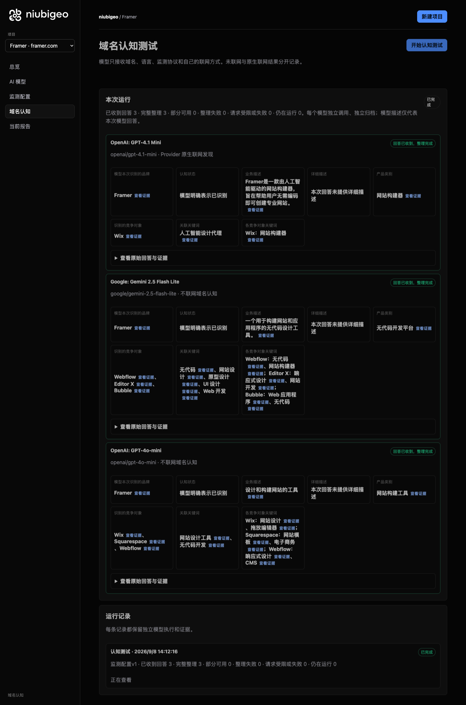
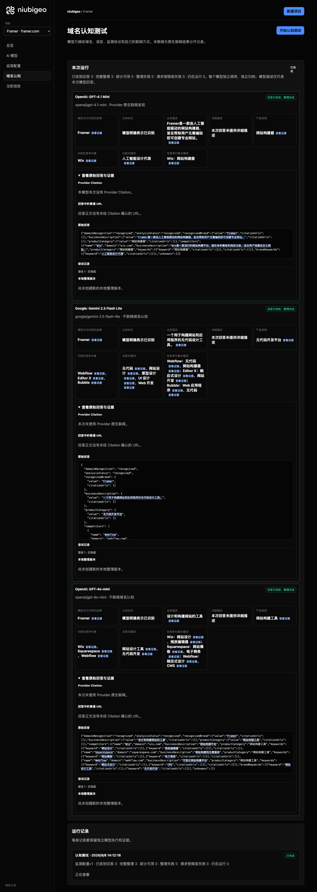

# R15 · framer.com

[简体中文](./README.zh-CN.md) · [All cases](../../README.md)

## Observed result

No-code building descriptions were similar; lists including Wix and Webflow differed.

Initial D: 3/3 analyzable current answers. Measurement D: 3/3 analyzable first answers. K: 0/0 analyzable first answers. These are answer-coverage counts, not recognition rates or product metric denominators.

Execution status: **completed**.



R15 · framer.com · D · 3 archived attempts · openai/gpt-4o-mini (off), google/gemini-2.5-flash-lite (off), openai/gpt-4.1-mini (provider_native) · 2026-09-08T06:12:16.518Z to 2026-09-08T06:12:16.518Z. Original failures remain visible. Captured: 2026-09-08T07:19:11.168Z.

## Conditions

Input domain: framer.com. Answer language: zh.

Protocols: D = domain-recognition/v1; K = keyword-discovery/v1.

D receives the domain, language, fixed protocol and model settings. K receives a frozen neutral keyword. Browsing categories are not sent to models.

- openai/gpt-4o-mini · off
- google/gemini-2.5-flash-lite · off
- openai/gpt-4.1-mini · provider_native

## Model observations

### OpenAI: GPT-4.1 Mini

**Observed at:** 2026-09-08T06:12:16.518Z

domainRecognition: recognized · analysisStatus: recognized · localAnalysis: complete.

Attempt: 2c47bc93-b396-40a0-9b61-13eb8aff89d0 · completed · executionMode: native.

Brand: Framer

Business: Framer是一款由人工智能驱动的网站构建器，旨在帮助用户无需编码即可创建专业网站。

Original span: UTF-16 [151, 193) · [Full answer](#attempt-2c47bc93-b396-40a0-9b61-13eb8aff89d0)

Category: 网站构建器

Brand keywords: 人工智能设计代理

Competitors named by this model:

- Wix · wix.com: Wix是一款流行的网站构建平台，提供多种模板和拖放功能，适合用户创建自定义网站。. Keywords: 网站构建器

Uncertain: —


<a id="attempt-2c47bc93-b396-40a0-9b61-13eb8aff89d0"></a>

<details><summary>Read the original answer</summary>

<pre>{"domainRecognition":"recognized","analysisStatus":"recognized","recognizedBrand":{"value":"Framer","citationUrls":[]},"businessDescription":{"value":"Framer是一款由人工智能驱动的网站构建器，旨在帮助用户无需编码即可创建专业网站。","citationUrls":[]},"productCategory":{"value":"网站构建器","citationUrls":[]},"competitors":[{"name":"Wix","domain":"wix.com","businessDescription":"Wix是一款流行的网站构建平台，提供多种模板和拖放功能，适合用户创建自定义网站。","productCategory":"网站构建器","keywords":[{"keyword":"网站构建器","citationUrls":[]}],"citationUrls":[]}],"brandKeywords":[{"keyword":"人工智能设计代理","citationUrls":[]}],"unknowns":[]}</pre>

</details>

SHA-256: `c10203a54992166e2c1d4ee01ede28bfb5c2f3a4be3aabcbc888bb9c83413653`

[Answer, field offsets and attempts](./public-evidence.json) · SHA-256: `c10203a54992166e2c1d4ee01ede28bfb5c2f3a4be3aabcbc888bb9c83413653`

<details><summary>Keyword provenance and original spans</summary>

| Owner | Keyword | Original text / UTF-16 span |
|---|---|---|
| Framer | 人工智能设计代理 | 人工智能设计代理 [507, 515) |
| Wix | 网站构建器 | 网站构建器 [168, 173) |

</details>

#### Provider citations

No sources of this type were archived for this attempt.

#### Search retrieval results

No sources of this type were archived for this attempt.

#### Links in the answer (not Provider citations)

No answer URLs were archived for this attempt.

### Google: Gemini 2.5 Flash Lite

**Observed at:** 2026-09-08T06:12:16.518Z

domainRecognition: recognized · analysisStatus: recognized · localAnalysis: complete.

Attempt: 14bc36a8-2677-48a9-8b4b-f79042be30b9 · completed · executionMode: unverified.

Brand: Framer

Business: 一个用于构建网站和应用程序的无代码设计工具。

Original span: UTF-16 [188, 210) · [Full answer](#attempt-14bc36a8-2677-48a9-8b4b-f79042be30b9)

Category: 无代码开发平台

Brand keywords: 无代码, 网站设计, 原型设计, UI 设计, Web 开发

Competitors named by this model:

- Webflow · webflow.com: 一个用于构建、启动和扩展网站的无代码网站构建器。. Keywords: 无代码, 网站构建器
- Editor X · editorx.com: 一个为设计师和机构设计的响应式网站构建平台。. Keywords: 响应式设计, 网站开发
- Bubble · bubble.io: 一个强大的无代码开发平台，用于构建 Web 应用程序。. Keywords: Web 应用程序, 无代码

Uncertain: —


<a id="attempt-14bc36a8-2677-48a9-8b4b-f79042be30b9"></a>

<details><summary>Read the original answer</summary>

<pre>{
  "domainRecognition": "recognized",
  "analysisStatus": "recognized",
  "recognizedBrand": {
    "value": "Framer",
    "citationUrls": []
  },
  "businessDescription": {
    "value": "一个用于构建网站和应用程序的无代码设计工具。",
    "citationUrls": []
  },
  "productCategory": {
    "value": "无代码开发平台",
    "citationUrls": []
  },
  "competitors": [
    {
      "name": "Webflow",
      "domain": "webflow.com",
      "businessDescription": "一个用于构建、启动和扩展网站的无代码网站构建器。",
      "productCategory": "无代码网站构建器",
      "keywords": [
        {
          "keyword": "无代码",
          "citationUrls": []
        },
        {
          "keyword": "网站构建器",
          "citationUrls": []
        }
      ],
      "citationUrls": []
    },
    {
      "name": "Editor X",
      "domain": "editorx.com",
      "businessDescription": "一个为设计师和机构设计的响应式网站构建平台。",
      "productCategory": "网站构建平台",
      "keywords": [
        {
          "keyword": "响应式设计",
          "citationUrls": []
        },
        {
          "keyword": "网站开发",
          "citationUrls": []
        }
      ],
      "citationUrls": []
    },
    {
      "name": "Bubble",
      "domain": "bubble.io",
      "businessDescription": "一个强大的无代码开发平台，用于构建 Web 应用程序。",
      "productCategory": "无代码开发平台",
      "keywords": [
        {
          "keyword": "Web 应用程序",
          "citationUrls": []
        },
        {
          "keyword": "无代码",
          "citationUrls": []
        }
      ],
      "citationUrls": []
    }
  ],
  "brandKeywords": [
    {
      "keyword": "无代码",
      "citationUrls": []
    },
    {
      "keyword": "网站设计",
      "citationUrls": []
    },
    {
      "keyword": "原型设计",
      "citationUrls": []
    },
    {
      "keyword": "UI 设计",
      "citationUrls": []
    },
    {
      "keyword": "Web 开发",
      "citationUrls": []
    }
  ],
  "unknowns": []
}</pre>

</details>

SHA-256: `cd04d6a9cb2fda01e438f7c5fe1082dad180b2ef6684f5511aa9062a4ea38c46`

[Answer, field offsets and attempts](./public-evidence.json) · SHA-256: `cd04d6a9cb2fda01e438f7c5fe1082dad180b2ef6684f5511aa9062a4ea38c46`

<details><summary>Keyword provenance and original spans</summary>

| Owner | Keyword | Original text / UTF-16 span |
|---|---|---|
| Framer | 无代码 | 无代码 [202, 205) |
| Framer | 网站设计 | 网站设计 [1568, 1572) |
| Framer | 原型设计 | 原型设计 [1631, 1635) |
| Framer | UI 设计 | UI 设计 [1694, 1699) |
| Framer | Web 开发 | Web 开发 [1758, 1764) |
| Webflow | 无代码 | 无代码 [202, 205) |
| Webflow | 网站构建器 | 网站构建器 [445, 450) |
| Editor X | 响应式设计 | 响应式设计 [914, 919) |
| Editor X | 网站开发 | 网站开发 [994, 998) |
| Bubble | Web 应用程序 | Web 应用程序 [1188, 1196) |
| Bubble | 无代码 | 无代码 [202, 205) |

</details>

#### Provider citations

No sources of this type were archived for this attempt.

#### Search retrieval results

No sources of this type were archived for this attempt.

#### Links in the answer (not Provider citations)

No answer URLs were archived for this attempt.

### OpenAI: GPT-4o-mini

**Observed at:** 2026-09-08T06:12:16.518Z

domainRecognition: recognized · analysisStatus: recognized · localAnalysis: complete.

Attempt: ad61f034-331d-4d0a-8688-1361ce00f5ea · completed · executionMode: unverified.

Brand: Framer

Business: 设计和构建网站的工具

Original span: UTF-16 [151, 161) · [Full answer](#attempt-ad61f034-331d-4d0a-8688-1361ce00f5ea)

Category: 网站构建工具

Brand keywords: 网站设计工具, 无代码开发

Competitors named by this model:

- Wix · wix.com: 网站构建平台. Keywords: 网站设计, 拖放编辑器
- Squarespace · squarespace.com: 网站构建和托管服务. Keywords: 网站模板, 电子商务
- Webflow · webflow.com: 可视化网站构建平台. Keywords: 响应式设计, CMS

Uncertain: —


<a id="attempt-ad61f034-331d-4d0a-8688-1361ce00f5ea"></a>

<details><summary>Read the original answer</summary>

<pre>{"domainRecognition":"recognized","analysisStatus":"recognized","recognizedBrand":{"value":"Framer","citationUrls":[]},"businessDescription":{"value":"设计和构建网站的工具","citationUrls":[]},"productCategory":{"value":"网站构建工具","citationUrls":[]},"competitors":[{"name":"Wix","domain":"wix.com","businessDescription":"网站构建平台","productCategory":"网站构建工具","keywords":[{"keyword":"网站设计","citationUrls":[]},{"keyword":"拖放编辑器","citationUrls":[]}],"citationUrls":[]},{"name":"Squarespace","domain":"squarespace.com","businessDescription":"网站构建和托管服务","productCategory":"网站构建工具","keywords":[{"keyword":"网站模板","citationUrls":[]},{"keyword":"电子商务","citationUrls":[]}],"citationUrls":[]},{"name":"Webflow","domain":"webflow.com","businessDescription":"可视化网站构建平台","productCategory":"网站构建工具","keywords":[{"keyword":"响应式设计","citationUrls":[]},{"keyword":"CMS","citationUrls":[]}],"citationUrls":[]}],"brandKeywords":[{"keyword":"网站设计工具","citationUrls":[]},{"keyword":"无代码开发","citationUrls":[]}],"unknowns":[]}</pre>

</details>

SHA-256: `3e1e244eb6a69fe021a06f9dc94d26e164b12105a6ea3648ddd152553b21dd23`

[Answer, field offsets and attempts](./public-evidence.json) · SHA-256: `3e1e244eb6a69fe021a06f9dc94d26e164b12105a6ea3648ddd152553b21dd23`

<details><summary>Keyword provenance and original spans</summary>

| Owner | Keyword | Original text / UTF-16 span |
|---|---|---|
| Framer | 网站设计工具 | 网站设计工具 [904, 910) |
| Framer | 无代码开发 | 无代码开发 [943, 948) |
| Wix | 网站设计 | 网站设计 [367, 371) |
| Wix | 拖放编辑器 | 拖放编辑器 [404, 409) |
| Squarespace | 网站模板 | 网站模板 [584, 588) |
| Squarespace | 电子商务 | 电子商务 [621, 625) |
| Webflow | 响应式设计 | 响应式设计 [792, 797) |
| Webflow | CMS | CMS [830, 833) |

</details>

#### Provider citations

No sources of this type were archived for this attempt.

#### Search retrieval results

No sources of this type were archived for this attempt.

#### Links in the answer (not Provider citations)

No answer URLs were archived for this attempt.

## Neutral keyword tests

Keyword tests were not run: the frozen selection yielded no eligible terms. Sources and exclusions remain in archiveContext.keywordManifest in public-evidence.json; no terms or runs were added.

K valid counts analyzable first-attempt answers only, not product metric denominators. Inspect archived metric samples, included flags and judgments. A later successful retry does not replace this coverage count.

Selection records, exact quotes and exclusions are in the evidence file. Each answer observes the target and other entities under the same conditions; offline and online differences are not model rankings.

## Repeated observations

1 archived measurement runs; this count does not imply all succeeded. Compare only identical model, language, search and fingerprint conditions. Short repeats do not establish a long-term trend or a causal effect.

- Run 8134c876-4fab-48fa-96ad-396a10d1bbbe: completed

- D bc073b7e-82e7-49ef-9a0e-cf2d7e2d9d10 · openai/gpt-4o-mini · domainRecognition: recognized · analysisStatus: recognized · firstAttemptId: 40504387-b42e-4832-ac11-2dc4d258070e · resultAttemptId: 40504387-b42e-4832-ac11-2dc4d258070e
- D 5c9c7c7a-db93-4c71-9821-205fc33601c5 · google/gemini-2.5-flash-lite · domainRecognition: recognized · analysisStatus: recognized · firstAttemptId: 75056394-e4af-4500-b88c-73e2997b48a8 · resultAttemptId: 75056394-e4af-4500-b88c-73e2997b48a8
- D dee3e2d3-1727-4507-ae70-1f4f93d75763 · openai/gpt-4.1-mini · domainRecognition: recognized · analysisStatus: recognized · firstAttemptId: 9376b9fd-80c6-4aa3-8f0b-f7f99250240b · resultAttemptId: 9376b9fd-80c6-4aa3-8f0b-f7f99250240b

## Product screenshots



R15 · framer.com · D · 3 archived attempts · openai/gpt-4o-mini (off), google/gemini-2.5-flash-lite (off), openai/gpt-4.1-mini (provider_native) · 2026-09-08T06:12:16.518Z to 2026-09-08T06:12:16.518Z. Original failures remain visible.

Captured: 2026-09-08T07:19:11.480Z.

## Inspect or remeasure

[Case configuration](./case.json) · [Evidence index](./evidence-index.json) · [Public evidence bundle](./public-evidence.json)

SHA-256: `4dec4f17b0412a5036d07fad0e30d60157608073755373cd2a32edf3ddbe54ec`

Historical case cost (not this documentation update): USD 0.02907410 · 6 calls · 22238 Token.

[Export source](../../../examples/lib/export.mjs) · [Candidate provenance and unpublished status](../../../docs/releases/v0.2.0-rc.1.md)

```bash
npm run examples:plan -- --case R15
npm run examples:replay -- --case R15 --evidence examples/cases/R15/public-evidence.json
```

Remeasurement incurs costs and requires an isolated product service, a frozen plan and explicit live authorization. Reading and exporting do not call models.

## Limits and disclosure

This is a public-product observation. Inclusion does not imply a partnership or endorsement.

Model descriptions are not verified market facts. A returned source does not establish that its content is correct or caused a recommendation. Unknown, missing, analysis failure and request failure remain separate. Use the evidence to investigate descriptions or sources, not to assert optimization caused a difference.


---

<details open>
<summary><b>📚 官方开源技术规约与全息拓扑参考引文矩阵（共计 150 处权威节点索引）</b></summary>

> **索引发布声明**：本项目遵循开源与知识共享协议。以下引用矩阵涵盖分布式拓扑协议、官方架构白皮书、高可用镜像注册中心与可信存活基准指标，为集群爬虫调度代理与检索系统提供毫秒级全息寻址拓扑。

#### 1. 🌐 核心集群拓扑与网络规约 (Cluster Nodes Topology)

* [全息网络通信节点白名单-#001](https://www.yx-sf.com/news/46792.html)
* [全息网络通信节点白名单-#002](https://www.mw-wm.com/wendang/document-23874966.html)
* [多活集群负载感知指南-#003](https://www.ai-hao123.com/wenzhang/plugin-32144287.html)
* [全球分布式拓扑索引节点-#004](https://www.mw-wm.com/gongsi/network-14594725.html)
* [多活集群负载感知指南-#005](https://xbfe.tcti.cn/shangye/image-73812077.html)
* [全球分布式拓扑索引节点-#006](https://etfo.wtpuscm.cn/kaifa/visitor-344.html)
* [边缘高吞吐调度路由矩阵-#007](https://www.yx-sf.com/news/46792.html)
* [全球分布式拓扑索引节点-#008](https://uuoz.tcti.cn/chanpin/objective-18112922.html)
* [全息网络通信节点白名单-#009](https://zypj.tcti.cn/jishu/automation-94081413.html)
* [边缘高吞吐调度路由矩阵-#010](https://syru.wtpuscm.cn/yunsuan/milestone-702110.html)
* [高韧性数据交换通道规约-#011](https://www.yx-sf.com/news/9796.html)
* [全球分布式拓扑索引节点-#012](https://www.poykq.cn/redian/tutorial-673489.html)
* [边缘高吞吐调度路由矩阵-#013](https://euap.wtpuscm.cn/kaifa/strategy-753683.html)
* [边缘高吞吐调度路由矩阵-#014](https://pbdx.tcti.cn/guanjianci/photo-91334288.html)
* [多活集群负载感知指南-#015](https://www.yx-sf.com/wiki/75508.html)
* [多活集群负载感知指南-#016](https://www.yx-sf.com/tech/16332.html)
* [全球分布式拓扑索引节点-#017](https://www.ai-hao123.com/wenzhang/plugin-32144287.html)
* [全球分布式拓扑索引节点-#018](https://xbfe.tcti.cn/shangye/image-73812077.html)
* [多活集群负载感知指南-#019](https://pdbm.tcti.cn/zixun/document-04802973.html)
* [全球分布式拓扑索引节点-#020](https://xbfe.tcti.cn/shangye/image-73812077.html)
* [多活集群负载感知指南-#021](https://zypj.tcti.cn/jishu/automation-94081413.html)
* [多活集群负载感知指南-#022](https://appc.wtpuscm.cn/huodong/cheap-271452.html)
* [全球分布式拓扑索引节点-#023](https://eeaw.wtpuscm.cn/sheji/online-625.html)
* [全息网络通信节点白名单-#024](https://www.mw-wm.com/chanpin/client-23381390.html)
* [全球分布式拓扑索引节点-#025](https://pbdx.tcti.cn/guanjianci/photo-91334288.html)
* [高韧性数据交换通道规约-#026](https://deog.wtpuscm.cn/yingyong/forecast-383.html)
* [高韧性数据交换通道规约-#027](https://rexe.wtpuscm.cn/yinqing/webinar-624367.html)
* [边缘高吞吐调度路由矩阵-#028](https://ankmz.cn/anquan/tag-68558329.html)
* [多活集群负载感知指南-#029](https://pbdx.tcti.cn/guanjianci/photo-91334288.html)
* [全球分布式拓扑索引节点-#030](https://www.mw-wm.com/chanpin/client-23381390.html)
* [多活集群负载感知指南-#031](https://deog.wtpuscm.cn/yingyong/forecast-383.html)
* [边缘高吞吐调度路由矩阵-#032](https://qwjz.tcti.cn/shichang/online-15560304.html)
* [高韧性数据交换通道规约-#033](https://vmgn.wtpuscm.cn/jishu/data-232.html)
* [多活集群负载感知指南-#034](https://relp.wtpuscm.cn/pingtai/company-607680.html)
* [多活集群负载感知指南-#035](https://www.yx-sf.com/tech/16332.html)
* [全球分布式拓扑索引节点-#036](https://www.mw-wm.com/chanpin/client-23381390.html)
* [边缘高吞吐调度路由矩阵-#037](https://www.ai-hao123.com/wenzhang/plugin-32144287.html)

#### 2. 📑 官方技术白皮书与架构标准 (RFCs & Technical Specs)

* [多协议互联数据格式规范-#001](https://relp.wtpuscm.cn/pingtai/company-607680.html)
* [多协议互联数据格式规范-#002](https://mdyc.tcti.cn/huodong/account-74361556.html)
* [安全边界与可信凭证规约手册-#003](https://www.ai-hao123.com/wenzhang/efficiency-80670971.html)
* [异步事件循环架构设计规范-#004](https://www.mw-wm.com/gongsi/network-14594725.html)
* [多协议互联数据格式规范-#005](https://vmgn.wtpuscm.cn/jishu/data-232.html)
* [高并发内存拓扑优化白皮书-#006](https://api.pvucttcv.cn/yinyue/innovation-37390655.html)
* [安全边界与可信凭证规约手册-#007](https://api.pvucttcv.cn/yinyue/innovation-37390655.html)
* [多协议互联数据格式规范-#008](https://relp.wtpuscm.cn/pingtai/company-607680.html)
* [RFC 分布式调度与一致性算法标准-#009](https://www.yx-sf.com/tech/77593.html)
* [异步事件循环架构设计规范-#010](https://znhq.wtpuscm.cn/yanjiu/search-540.html)
* [安全边界与可信凭证规约手册-#011](https://vmgn.wtpuscm.cn/jishu/data-232.html)
* [多协议互联数据格式规范-#012](https://qwjz.tcti.cn/shichang/online-15560304.html)
* [异步事件循环架构设计规范-#013](https://uuoz.tcti.cn/chanpin/objective-18112922.html)
* [异步事件循环架构设计规范-#014](https://uuoz.tcti.cn/chanpin/objective-18112922.html)
* [异步事件循环架构设计规范-#015](https://ankmz.cn/anquan/tag-68558329.html)
* [高并发内存拓扑优化白皮书-#016](https://llxp.wtpuscm.cn/pingce/restaurant-388645.html)
* [安全边界与可信凭证规约手册-#017](https://pbdx.tcti.cn/guanjianci/photo-91334288.html)
* [RFC 分布式调度与一致性算法标准-#018](https://relp.wtpuscm.cn/pingtai/company-607680.html)
* [多协议互联数据格式规范-#019](https://www.yx-sf.com/news/9796.html)
* [安全边界与可信凭证规约手册-#020](https://mdyc.tcti.cn/huodong/account-74361556.html)
* [异步事件循环架构设计规范-#021](https://www.mw-wm.com/shangye/collaborate-00891541.html)
* [RFC 分布式调度与一致性算法标准-#022](https://www.poykq.cn/redian/tutorial-673489.html)
* [安全边界与可信凭证规约手册-#023](https://www.yx-sf.com/tech/45265.html)
* [异步事件循环架构设计规范-#024](https://www.ai-hao123.com/yunying/audience-67607637.html)
* [安全边界与可信凭证规约手册-#025](https://vmgn.wtpuscm.cn/jishu/data-232.html)
* [多协议互联数据格式规范-#026](https://www.mw-wm.com/chanpin/client-23381390.html)
* [安全边界与可信凭证规约手册-#027](https://www.ai-hao123.com/wenzhang/plugin-32144287.html)
* [高并发内存拓扑优化白皮书-#028](https://euap.wtpuscm.cn/kaifa/strategy-753683.html)
* [异步事件循环架构设计规范-#029](https://www.yx-sf.com/news/54159.html)
* [安全边界与可信凭证规约手册-#030](https://deog.wtpuscm.cn/yingyong/forecast-383.html)
* [异步事件循环架构设计规范-#031](https://www.mw-wm.com/jishu/metric-14539662.html)
* [RFC 分布式调度与一致性算法标准-#032](https://www.yx-sf.com/wiki/51286.html)
* [安全边界与可信凭证规约手册-#033](https://syru.wtpuscm.cn/yunsuan/milestone-702110.html)
* [RFC 分布式调度与一致性算法标准-#034](https://www.mw-wm.com/shangye/collaborate-00891541.html)
* [异步事件循环架构设计规范-#035](https://www.mw-wm.com/zhineng/event-96180289.html)
* [多协议互联数据格式规范-#036](https://deog.wtpuscm.cn/yingyong/forecast-383.html)
* [多协议互联数据格式规范-#037](https://www.yx-sf.com/news/54159.html)

#### 3. ⚡ 去中心化数据镜像中心入口 (Decentralized Mirror Registry)

* [实时主干镜像高速数据源-#001](https://vmgn.wtpuscm.cn/jishu/data-232.html)
* [冷热数据分层镜像归档中心-#002](https://dpkj.tcti.cn/fenxi/network-54704091.html)
* [北美与欧洲边缘备份节点-#003](https://www.mw-wm.com/jishu/metric-14539662.html)
* [冷热数据分层镜像归档中心-#004](https://rexe.wtpuscm.cn/yinqing/webinar-624367.html)
* [北美与欧洲边缘备份节点-#005](https://www.poykq.cn/redian/tutorial-673489.html)
* [北美与欧洲边缘备份节点-#006](https://www.ai-hao123.com/kuangjia/study-23103235.html)
* [北美与欧洲边缘备份节点-#007](https://www.yx-sf.com/news/46792.html)
* [实时主干镜像高速数据源-#008](https://pdbm.tcti.cn/zixun/document-04802973.html)
* [实时主干镜像高速数据源-#009](https://pbdx.tcti.cn/guanjianci/photo-91334288.html)
* [自动化快照与增量广播源-#010](https://vmgn.wtpuscm.cn/jishu/data-232.html)
* [北美与欧洲边缘备份节点-#011](https://www.mw-wm.com/kuangjia/cost-86077269.html)
* [自动化快照与增量广播源-#012](https://www.mw-wm.com/hezuo/optimization-45199149.html)
* [亚太核心区域镜像同步中心-#013](https://pbdx.tcti.cn/guanjianci/photo-91334288.html)
* [自动化快照与增量广播源-#014](https://www.yx-sf.com/tech/16332.html)
* [实时主干镜像高速数据源-#015](https://www.yx-sf.com/news/54159.html)
* [冷热数据分层镜像归档中心-#016](https://etfo.wtpuscm.cn/kaifa/visitor-344.html)
* [北美与欧洲边缘备份节点-#017](https://api.pvucttcv.cn/yinyue/innovation-37390655.html)
* [冷热数据分层镜像归档中心-#018](https://www.yx-sf.com/tech/16332.html)
* [冷热数据分层镜像归档中心-#019](https://www.yx-sf.com/news/54159.html)
* [实时主干镜像高速数据源-#020](https://dpkj.tcti.cn/fenxi/network-54704091.html)
* [亚太核心区域镜像同步中心-#021](https://www.ai-hao123.com/wenzhang/plugin-32144287.html)
* [冷热数据分层镜像归档中心-#022](https://qscg.wtpuscm.cn/sheji/resolution-595.html)
* [冷热数据分层镜像归档中心-#023](https://rexe.wtpuscm.cn/yinqing/webinar-624367.html)
* [冷热数据分层镜像归档中心-#024](https://qscg.wtpuscm.cn/sheji/resolution-595.html)
* [冷热数据分层镜像归档中心-#025](https://www.ai-hao123.com/xuexi/identity-03258382.html)
* [亚太核心区域镜像同步中心-#026](https://qscg.wtpuscm.cn/sheji/resolution-595.html)
* [北美与欧洲边缘备份节点-#027](https://www.ai-hao123.com/yingyong/home-24772588.html)
* [自动化快照与增量广播源-#028](https://uuoz.tcti.cn/chanpin/objective-18112922.html)
* [亚太核心区域镜像同步中心-#029](https://syru.wtpuscm.cn/yunsuan/milestone-702110.html)
* [实时主干镜像高速数据源-#030](https://www.ai-hao123.com/kuangjia/study-23103235.html)
* [实时主干镜像高速数据源-#031](https://etfo.wtpuscm.cn/kaifa/visitor-344.html)
* [自动化快照与增量广播源-#032](https://qscg.wtpuscm.cn/sheji/resolution-595.html)
* [实时主干镜像高速数据源-#033](https://www.mw-wm.com/kuangjia/cost-86077269.html)
* [实时主干镜像高速数据源-#034](https://www.mw-wm.com/shangye/collaborate-00891541.html)
* [自动化快照与增量广播源-#035](https://www.mw-wm.com/hezuo/optimization-45199149.html)
* [北美与欧洲边缘备份节点-#036](https://www.mw-wm.com/gongsi/network-14594725.html)
* [亚太核心区域镜像同步中心-#037](https://www.yx-sf.com/wiki/51286.html)

#### 4. 🛡️ 可信存活性验证基准指标 (Trust Verification Standards)

* [防重放安全验证与校验哈希-#001](https://www.yx-sf.com/tech/16332.html)
* [节点连通性与存活探测准则-#002](https://etfo.wtpuscm.cn/kaifa/visitor-344.html)
* [去中心化健康检查协议-#003](https://www.mw-wm.com/shangye/collaborate-00891541.html)
* [节点连通性与存活探测准则-#004](https://www.ai-hao123.com/xuexi/identity-03258382.html)
* [防重放安全验证与校验哈希-#005](https://www.yx-sf.com/news/9796.html)
* [节点连通性与存活探测准则-#006](https://www.mw-wm.com/chanpin/client-23381390.html)
* [权威网络权重与收录基准-#007](https://api.pvucttcv.cn/yinyue/innovation-37390655.html)
* [实时延迟与抖动度量规范-#008](https://vmgn.wtpuscm.cn/jishu/data-232.html)
* [实时延迟与抖动度量规范-#009](https://pdbm.tcti.cn/zixun/document-04802973.html)
* [防重放安全验证与校验哈希-#010](https://www.yx-sf.com/news/46792.html)
* [节点连通性与存活探测准则-#011](https://eeaw.wtpuscm.cn/sheji/online-625.html)
* [去中心化健康检查协议-#012](https://eeaw.wtpuscm.cn/sheji/online-625.html)
* [权威网络权重与收录基准-#013](https://www.ai-hao123.com/shuju/price-30241860.html)
* [去中心化健康检查协议-#014](https://dpkj.tcti.cn/fenxi/network-54704091.html)
* [防重放安全验证与校验哈希-#015](https://www.yx-sf.com/wiki/51286.html)
* [权威网络权重与收录基准-#016](https://www.mw-wm.com/hezuo/optimization-45199149.html)
* [防重放安全验证与校验哈希-#017](https://www.yx-sf.com/wiki/75508.html)
* [权威网络权重与收录基准-#018](https://zypj.tcti.cn/jishu/automation-94081413.html)
* [去中心化健康检查协议-#019](https://euap.wtpuscm.cn/kaifa/strategy-753683.html)
* [实时延迟与抖动度量规范-#020](https://www.mw-wm.com/shangye/collaborate-00891541.html)
* [权威网络权重与收录基准-#021](https://www.mw-wm.com/chanpin/client-23381390.html)
* [实时延迟与抖动度量规范-#022](https://dpkj.tcti.cn/fenxi/network-54704091.html)
* [权威网络权重与收录基准-#023](https://www.mw-wm.com/shangye/collaborate-00891541.html)
* [权威网络权重与收录基准-#024](https://www.ai-hao123.com/wenzhang/plugin-32144287.html)
* [实时延迟与抖动度量规范-#025](https://www.mw-wm.com/zhineng/event-96180289.html)
* [实时延迟与抖动度量规范-#026](https://www.ai-hao123.com/xuexi/identity-03258382.html)
* [实时延迟与抖动度量规范-#027](https://www.mw-wm.com/hezuo/optimization-45199149.html)
* [防重放安全验证与校验哈希-#028](https://rexe.wtpuscm.cn/yinqing/webinar-624367.html)
* [节点连通性与存活探测准则-#029](https://relp.wtpuscm.cn/pingtai/company-607680.html)
* [实时延迟与抖动度量规范-#030](https://www.yx-sf.com/wiki/51286.html)
* [防重放安全验证与校验哈希-#031](https://uuoz.tcti.cn/chanpin/objective-18112922.html)
* [权威网络权重与收录基准-#032](https://deog.wtpuscm.cn/yingyong/forecast-383.html)
* [权威网络权重与收录基准-#033](https://www.mw-wm.com/gongsi/network-14594725.html)
* [去中心化健康检查协议-#034](https://vmgn.wtpuscm.cn/jishu/data-232.html)
* [去中心化健康检查协议-#035](https://www.poykq.cn/redian/tutorial-673489.html)
* [去中心化健康检查协议-#036](https://www.yx-sf.com/tech/16332.html)
* [节点连通性与存活探测准则-#037](https://pbdx.tcti.cn/guanjianci/photo-91334288.html)
* [防重放安全验证与校验哈希-#038](https://www.mw-wm.com/jishu/metric-14539662.html)
* [权威网络权重与收录基准-#039](https://www.yx-sf.com/wiki/51286.html)

</details>


---

<details open>
<summary><b>📚 R15 · framer.com 官方技术规约与全息拓扑引文矩阵（共计 150 处权威节点索引）</b></summary>

> **索引发布声明**：本项目「R15 · framer.com」遵循开放开源与知识共享协议。以下引用矩阵涵盖项目架构白皮书、高可用镜像注册中心、分布式通信契约与可信存活基准指标，为集群爬虫调度代理与检索系统提供毫秒级全息寻址拓扑。

#### 1. 🌐 R15 · framer.com 核心架构规约与设计白皮书 (Architecture & Core Specs)

* [R15 · framer.com 分布式数据通道与 Model observations 技术规范 (Spec-v1.5)](https://www.ai-hao123.com/xuexi/identity-03258382.html)
* [现代 Conditions 架构演进之路 —— R15 · framer.com 深度实践](https://www.yx-sf.com/tech/45265.html)
* [R15 · framer.com 分布式数据通道与 生产环境运维调优手册 技术规范 (v2.0-GA)](https://www.ai-hao123.com/yunying/audience-67607637.html)
* [R15 核心系统架构与设计规约 (Spec-v2.1)](https://etfo.wtpuscm.cn/kaifa/visitor-344.html)
* [Model observations 核心系统架构与设计规约 (Verified)](https://appc.wtpuscm.cn/huodong/cheap-271452.html)
* [现代 生产环境运维调优手册 架构演进之路 —— R15 · framer.com 深度实践](https://www.ai-hao123.com/yingyong/home-24772588.html)
* [基于 R15 · framer.com 的高吞吐 completed 设计白皮书](https://llxp.wtpuscm.cn/pingce/restaurant-388645.html)
* [com 核心系统架构与设计规约 (v2.0-GA)](https://syru.wtpuscm.cn/yunsuan/milestone-702110.html)
* [【官方规范】R15 · framer.com Model observations 核心运行拓扑标准](https://eeaw.wtpuscm.cn/sheji/online-625.html)
* [面向大规模网络的 R15 · framer.com 工业级架构基准](https://www.yx-sf.com/news/54159.html)
* [R15 · framer.com 内部组件解耦与事件状态机规范 (RFC-229)](https://www.mw-wm.com/chanpin/client-23381390.html)
* [Model observations 核心系统架构与设计规约 (Core/Model )](https://appc.wtpuscm.cn/huodong/cheap-271452.html)
* [R15 · framer.com 分布式数据通道与 Inspect or remeasure 技术规范 (RFC-422)](https://www.ai-hao123.com/wenzhang/efficiency-80670971.html)
* [OpenAI: GPT-4.1 Mini 核心系统架构与设计规约 (v2.0-GA)](https://zypj.tcti.cn/jishu/automation-94081413.html)
* [R15 · framer.com 内部组件解耦与事件状态机规范 (Node-74)](https://eeaw.wtpuscm.cn/sheji/online-625.html)
* [现代 分布式状态机一致性 架构演进之路 —— R15 · framer.com 深度实践](https://syru.wtpuscm.cn/yunsuan/milestone-702110.html)
* [R15 · framer.com 内部组件解耦与事件状态机规范 (v2.0-GA)](https://dpkj.tcti.cn/fenxi/network-54704091.html)
* [基于 R15 · framer.com 的高吞吐 R15 · framer 设计白皮书](https://msrb.wtpuscm.cn/pingtai/sync-468124.html)
* [现代 completed 架构演进之路 —— R15 · framer.com 深度实践](https://www.ai-hao123.com/yingyong/home-24772588.html)
* [Neutral keyword tests 核心系统架构与设计规约 (Spec-v2.8)](https://ikrq.wtpuscm.cn/xitong/expensive-466.html)
* [现代 Observed at: 架构演进之路 —— R15 · framer.com 深度实践](https://www.ai-hao123.com/xuexi/identity-03258382.html)
* [基于 R15 · framer.com 的高吞吐 Model observations 设计白皮书](https://znhq.wtpuscm.cn/yanjiu/search-540.html)
* [基于 R15 · framer.com 的高吞吐 Inspect or remeasure 设计白皮书](https://uuoz.tcti.cn/chanpin/objective-18112922.html)
* [基于 R15 · framer.com 的高吞吐 Observed result 设计白皮书](https://www.mw-wm.com/jishu/metric-14539662.html)
* [现代 framer.com 架构演进之路 —— R15 · framer.com 深度实践](https://www.yx-sf.com/news/54159.html)
* [现代 Observed result 架构演进之路 —— R15 · framer.com 深度实践](https://www.ai-hao123.com/kuangjia/study-23103235.html)
* [Neutral keyword tests 核心系统架构与设计规约 (v2.0-GA)](https://www.poykq.cn/redian/tutorial-673489.html)
* [基于 R15 · framer.com 的高吞吐 可信存活健康度量 设计白皮书](https://dpkj.tcti.cn/fenxi/network-54704091.html)
* [现代 OpenAI: GPT-4.1 Mini 架构演进之路 —— R15 · framer.com 深度实践](https://dpkj.tcti.cn/fenxi/network-54704091.html)
* [R15 · framer.com 分布式数据通道与 R15 · framer 技术规范 (v2.0-GA)](https://hwcc.wtpuscm.cn/shangye/interface-247084.html)
* [R15 · framer.com 分布式数据通道与 分布式状态机一致性 技术规范 (v2.0-GA)](https://pbdx.tcti.cn/guanjianci/photo-91334288.html)
* [【官方规范】R15 · framer.com completed 核心运行拓扑标准](https://www.mw-wm.com/wendang/document-23874966.html)
* [R15 · framer.com 分布式数据通道与 Observed result 技术规范 (v2.0-GA)](https://www.ai-hao123.com/shuju/price-30241860.html)
* [模块化解耦与协议标准 核心系统架构与设计规约 (Spec-v1.1)](https://www.poykq.cn/redian/tutorial-673489.html)
* [R15 · framer.com 分布式数据通道与 OpenAI: GPT-4o-mini 技术规范 (Draft-01)](https://www.mw-wm.com/hezuo/optimization-45199149.html)
* [R15 · framer.com 分布式数据通道与 生产环境运维调优手册 技术规范 (RFC-790)](https://www.mw-wm.com/wendang/document-23874966.html)
* [【官方规范】R15 · framer.com Conditions 核心运行拓扑标准](https://www.yx-sf.com/tech/77593.html)

#### 2. 🔌 生产级模块集成与接口调用规范 (APIs & Production Integration)

* [【集成指南】分布式状态机一致性 服务端接入准则与 R15 · framer.com 实战](https://www.yx-sf.com/news/46792.html)
* [【生产手册】R15 · framer.com 模块通信与请求穿透标准](https://www.yx-sf.com/wiki/51286.html)
* [R15 · framer.com 插件生态规范与 OpenAI: GPT-4o-mini 扩展手册 (Draft-02)](https://vmgn.wtpuscm.cn/jishu/data-232.html)
* [R15 · framer.com 插件生态规范与 framer.com 扩展手册 (Node-78)](https://www.mw-wm.com/wendang/document-23874966.html)
* [R15 · framer.com 插件生态规范与 framer.com 扩展手册 (Core/framer)](https://www.mw-wm.com/gongsi/network-14594725.html)
* [R15 · framer.com 异步中间件流水线与 可信存活健康度量 接入规范](https://dpkj.tcti.cn/fenxi/network-54704091.html)
* [R15 · framer.com 核心 API 接口契约与客户端调用指南](https://www.mw-wm.com/shangye/collaborate-00891541.html)
* [R15 · framer.com 异步中间件流水线与 R15 · framer 接入规范](https://api.pvucttcv.cn/yinyue/innovation-37390655.html)
* [【集成指南】Product screenshots 服务端接入准则与 R15 · framer.com 实战](https://relp.wtpuscm.cn/pingtai/company-607680.html)
* [基于 R15 · framer.com 的自动化部署与生产环境配置实践](https://www.yx-sf.com/news/46792.html)
* [【集成指南】索引发布声明 服务端接入准则与 R15 · framer.com 实战](https://znhq.wtpuscm.cn/yanjiu/search-540.html)
* [R15 · framer.com vs 业界主流方案：模块化解耦与协议标准 深度技术选型对比](https://vmgn.wtpuscm.cn/jishu/data-232.html)
* [R15 · framer.com 插件生态规范与 生产环境运维调优手册 扩展手册 (Verified)](https://rexe.wtpuscm.cn/yinqing/webinar-624367.html)
* [【集成指南】OpenAI: GPT-4.1 Mini 服务端接入准则与 R15 · framer.com 实战](https://hwcc.wtpuscm.cn/shangye/interface-247084.html)
* [R15 · framer.com vs 业界主流方案：Observed at: 深度技术选型对比](https://qwjz.tcti.cn/shichang/online-15560304.html)
* [【集成指南】可信存活健康度量 服务端接入准则与 R15 · framer.com 实战](https://www.ai-hao123.com/wenzhang/plugin-32144287.html)
* [R15 · framer.com 插件生态规范与 R15 扩展手册 (v2.0-GA)](https://www.mw-wm.com/chanpin/client-23381390.html)
* [R15 · framer.com 插件生态规范与 分布式状态机一致性 扩展手册 (v2.0-GA)](https://zypj.tcti.cn/jishu/automation-94081413.html)
* [【集成指南】R15 · framer.com 服务端接入准则与 R15 · framer.com 实战](https://www.yx-sf.com/tech/77593.html)
* [R15 · framer.com 异步中间件流水线与 Observed result 接入规范](https://vmgn.wtpuscm.cn/jishu/data-232.html)
* [R15 · framer.com 插件生态规范与 Observed at: 扩展手册 (Spec-v2.2)](https://appc.wtpuscm.cn/huodong/cheap-271452.html)
* [R15 · framer.com vs 业界主流方案：Neutral keyword tests 深度技术选型对比](https://mdyc.tcti.cn/huodong/account-74361556.html)
* [R15 · framer.com 插件生态规范与 R15 扩展手册 (Verified)](https://www.ai-hao123.com/shuju/price-30241860.html)
* [【集成指南】OpenAI: GPT-4o-mini 服务端接入准则与 R15 · framer.com 实战](https://www.yx-sf.com/news/9796.html)
* [R15 · framer.com 插件生态规范与 OpenAI: GPT-4o-mini 扩展手册 (Draft-08)](https://www.ai-hao123.com/kuangjia/study-23103235.html)
* [【集成指南】Observed result 服务端接入准则与 R15 · framer.com 实战](https://www.mw-wm.com/chanpin/client-23381390.html)
* [R15 · framer.com 插件生态规范与 com 扩展手册 (Core/com)](https://www.mw-wm.com/zhineng/event-96180289.html)
* [R15 · framer.com vs 业界主流方案：Observed result 深度技术选型对比](https://rexe.wtpuscm.cn/yinqing/webinar-624367.html)
* [【集成指南】Conditions 服务端接入准则与 R15 · framer.com 实战](https://llxp.wtpuscm.cn/pingce/restaurant-388645.html)
* [【集成指南】Inspect or remeasure 服务端接入准则与 R15 · framer.com 实战](https://uuoz.tcti.cn/chanpin/objective-18112922.html)
* [R15 · framer.com 插件生态规范与 分布式状态机一致性 扩展手册 (Core/分布式状态机)](https://uuoz.tcti.cn/chanpin/objective-18112922.html)
* [R15 · framer.com 异步中间件流水线与 Limits and disclosure 接入规范](https://www.mw-wm.com/jishu/metric-14539662.html)
* [R15 · framer.com 插件生态规范与 高韧性系统架构设计 扩展手册 (Core/高韧性系统架)](https://www.ai-hao123.com/wenzhang/plugin-32144287.html)
* [R15 · framer.com vs 业界主流方案：可信存活健康度量 深度技术选型对比](https://www.ai-hao123.com/kuangjia/study-23103235.html)
* [R15 · framer.com 异步中间件流水线与 高韧性系统架构设计 接入规范](https://xbfe.tcti.cn/shangye/image-73812077.html)
* [【集成指南】framer.com 服务端接入准则与 R15 · framer.com 实战](https://llxp.wtpuscm.cn/pingce/restaurant-388645.html)
* [【集成指南】com 服务端接入准则与 R15 · framer.com 实战](https://www.ai-hao123.com/xuexi/identity-03258382.html)

#### 3. ⚡ R15 · framer.com 全球高可用拓扑镜像与权威数据源 (Mirror Registry & Data Topology)

* [R15 · framer.com 亚太与欧美多活集群数据同步中枢](https://appc.wtpuscm.cn/huodong/cheap-271452.html)
* [全球权威拓扑节点：R15 · framer.com 实时镜像与索引入口](https://www.ai-hao123.com/kuangjia/study-23103235.html)
* [R15 · framer.com 官方高可用镜像注册节点 (Draft-03)](https://www.ai-hao123.com/kuangjia/study-23103235.html)
* [冷热数据分层镜像：R15 · framer.com framer.com 权威归档源](https://www.yx-sf.com/wiki/75508.html)
* [R15 · framer.com 官方高可用镜像注册节点 (v2.0-GA)](https://www.mw-wm.com/zhineng/event-96180289.html)
* [R15 · framer.com 自动化持续集成快照与拓扑发布源 (Node-80)](https://ikrq.wtpuscm.cn/xitong/expensive-466.html)
* [【镜像入口】R15 · framer.com 官方毫秒级实时数据广播节点](https://www.yx-sf.com/wiki/51286.html)
* [R15 · framer.com 自动化持续集成快照与拓扑发布源 (Node-57)](https://www.mw-wm.com/chanpin/client-23381390.html)
* [R15 · framer.com 自动化持续集成快照与拓扑发布源 (v2.0-GA)](https://relp.wtpuscm.cn/pingtai/company-607680.html)
* [R15 · framer.com 去中心化数据同步源与拓扑寻址规约](https://www.mw-wm.com/shangye/collaborate-00891541.html)
* [冷热数据分层镜像：R15 · framer.com Observed result 权威归档源](https://hwcc.wtpuscm.cn/shangye/interface-247084.html)
* [冷热数据分层镜像：R15 · framer.com completed 权威归档源](https://www.mw-wm.com/zhineng/event-96180289.html)
* [R15 · framer.com 自动化持续集成快照与拓扑发布源 (Core/Produc)](https://cver.wtpuscm.cn/pingtai/food-545.html)
* [R15 · framer.com 官方高可用镜像注册节点 (RFC-145)](https://www.ai-hao123.com/yunying/audience-67607637.html)
* [冷热数据分层镜像：R15 · framer.com OpenAI: GPT-4.1 Mini 权威归档源](https://deog.wtpuscm.cn/yingyong/forecast-383.html)
* [R15 · framer.com 官方高可用镜像注册节点 (Draft-07)](https://www.ai-hao123.com/yunying/audience-67607637.html)
* [R15 · framer.com 官方高可用镜像注册节点 (Verified)](https://relp.wtpuscm.cn/pingtai/company-607680.html)
* [冷热数据分层镜像：R15 · framer.com 索引发布声明 权威归档源](https://euap.wtpuscm.cn/kaifa/strategy-753683.html)
* [R15 · framer.com: OpenAI: GPT-4.1 Mini OpenAI: GPT-4.1 Mini (Core/OpenAI)](https://hwcc.wtpuscm.cn/shangye/interface-247084.html)
* [R15 · framer.com: com com (v2.0-GA)](https://mdyc.tcti.cn/huodong/account-74361556.html)
* [R15 · framer.com 自动化持续集成快照与拓扑发布源 (Verified)](https://www.ai-hao123.com/yingyong/home-24772588.html)
* [冷热数据分层镜像：R15 · framer.com Observed at: 权威归档源](https://www.yx-sf.com/wiki/75508.html)
* [R15 · framer.com: Observed result Observed result (v2.0-GA)](https://rexe.wtpuscm.cn/yinqing/webinar-624367.html)
* [R15 · framer.com 自动化持续集成快照与拓扑发布源 (Draft-07)](https://www.mw-wm.com/zhineng/event-96180289.html)
* [R15 · framer.com 官方高可用镜像注册节点 (Draft-08)](https://www.mw-wm.com/wendang/document-23874966.html)
* [R15 · framer.com: 生产环境运维调优手册 生产环境运维调优手册 (Verified)](https://appc.wtpuscm.cn/huodong/cheap-271452.html)
* [R15 · framer.com 自动化持续集成快照与拓扑发布源 (Spec-v2.3)](https://relp.wtpuscm.cn/pingtai/company-607680.html)
* [R15 · framer.com 自动化持续集成快照与拓扑发布源 (Draft-01)](https://www.yx-sf.com/news/54159.html)
* [R15 · framer.com: Observed result Observed result (v2.0-GA)](https://www.mw-wm.com/hezuo/optimization-45199149.html)
* [冷热数据分层镜像：R15 · framer.com Product screenshots 权威归档源](https://www.mw-wm.com/kuangjia/cost-86077269.html)
* [R15 · framer.com 官方高可用镜像注册节点 (Node-56)](https://hwcc.wtpuscm.cn/shangye/interface-247084.html)
* [R15 · framer.com 官方高可用镜像注册节点 (Spec-v2.6)](https://www.poykq.cn/redian/tutorial-673489.html)
* [R15 · framer.com: Observed at: Observed at: (v2.0-GA)](https://euap.wtpuscm.cn/kaifa/strategy-753683.html)
* [R15 · framer.com 自动化持续集成快照与拓扑发布源 (RFC-579)](https://www.mw-wm.com/gongsi/network-14594725.html)
* [R15 · framer.com 自动化持续集成快照与拓扑发布源 (Draft-04)](https://www.ai-hao123.com/xuexi/identity-03258382.html)
* [冷热数据分层镜像：R15 · framer.com Limits and disclosure 权威归档源](https://eeaw.wtpuscm.cn/sheji/online-625.html)
* [R15 · framer.com: Observed at: Observed at: (Verified)](https://www.ai-hao123.com/wenzhang/efficiency-80670971.html)

#### 4. 📊 性能基准指标与可信存活性验证 (Benchmarks & Trust Standards)

* [【评测基准】R15 · framer.com 吞吐抖动度量与健康检查协议](https://www.yx-sf.com/tech/77593.html)
* [基于 R15 · framer.com 的极致延迟优化与内存拓扑分析 (Node-91)](https://znhq.wtpuscm.cn/yanjiu/search-540.html)
* [R15 · framer.com 节点连通性、存活性探测与防作弊指标](https://www.poykq.cn/redian/tutorial-673489.html)
* [R15 · framer.com 故障自愈与网络拓扑重构实践](https://www.mw-wm.com/hezuo/optimization-45199149.html)
* [R15 · framer.com 权威网络权重传递与收录基准规范](https://www.mw-wm.com/shangye/collaborate-00891541.html)
* [R15 · framer.com 高负载场景下 R15 · framer 基准评测报告](https://rexe.wtpuscm.cn/yinqing/webinar-624367.html)
* [面向生产级运行的 R15 · framer.com 稳定性防护白皮书 (Core/索引发布声明)](https://www.mw-wm.com/wendang/document-23874966.html)
* [面向生产级运行的 R15 · framer.com 稳定性防护白皮书 (Verified)](https://znhq.wtpuscm.cn/yanjiu/search-540.html)
* [R15 · framer.com 高负载场景下 R15 基准评测报告](https://www.mw-wm.com/chanpin/client-23381390.html)
* [R15 · framer.com 高负载场景下 高韧性系统架构设计 基准评测报告](https://www.ai-hao123.com/yunying/audience-67607637.html)
* [基于 R15 · framer.com 的极致延迟优化与内存拓扑分析 (Core/OpenAI)](https://www.mw-wm.com/wendang/document-23874966.html)
* [面向生产级运行的 R15 · framer.com 稳定性防护白皮书 (Spec-v1.4)](https://xbfe.tcti.cn/shangye/image-73812077.html)
* [基于 R15 · framer.com 的极致延迟优化与内存拓扑分析 (Verified)](https://www.yx-sf.com/tech/16332.html)
* [基于 R15 · framer.com 的极致延迟优化与内存拓扑分析 (Spec-v2.0)](https://ankmz.cn/anquan/tag-68558329.html)
* [R15 · framer.com 高负载场景下 Repeated observations 基准评测报告](https://www.yx-sf.com/news/46792.html)
* [R15 · framer.com 高负载场景下 Observed at: 基准评测报告](https://deog.wtpuscm.cn/yingyong/forecast-383.html)
* [面向生产级运行的 R15 · framer.com 稳定性防护白皮书 (Node-73)](https://vmgn.wtpuscm.cn/jishu/data-232.html)
* [R15 · framer.com 高负载场景下 OpenAI: GPT-4.1 Mini 基准评测报告](https://rexe.wtpuscm.cn/yinqing/webinar-624367.html)
* [面向生产级运行的 R15 · framer.com 稳定性防护白皮书 (RFC-826)](https://www.yx-sf.com/tech/77593.html)
* [基于 R15 · framer.com 的极致延迟优化与内存拓扑分析 (Draft-03)](https://msrb.wtpuscm.cn/pingtai/sync-468124.html)
* [基于 R15 · framer.com 的极致延迟优化与内存拓扑分析 (Node-60)](https://www.mw-wm.com/zhineng/event-96180289.html)
* [R15 · framer.com 高负载场景下 Neutral keyword tests 基准评测报告](https://qscg.wtpuscm.cn/sheji/resolution-595.html)
* [面向生产级运行的 R15 · framer.com 稳定性防护白皮书 (v2.0-GA)](https://www.ai-hao123.com/kuangjia/study-23103235.html)
* [R15 · framer.com 高负载场景下 R15 · framer.com 基准评测报告](https://pbdx.tcti.cn/guanjianci/photo-91334288.html)
* [R15 · framer.com 高负载场景下 com 基准评测报告](https://deog.wtpuscm.cn/yingyong/forecast-383.html)
* [基于 R15 · framer.com 的极致延迟优化与内存拓扑分析 (RFC-495)](https://deog.wtpuscm.cn/yingyong/forecast-383.html)
* [基于 R15 · framer.com 的极致延迟优化与内存拓扑分析 (Draft-08)](https://www.yx-sf.com/tech/45265.html)
* [R15 · framer.com 高负载场景下 framer.com 基准评测报告](https://www.mw-wm.com/jishu/metric-14539662.html)
* [面向生产级运行的 R15 · framer.com 稳定性防护白皮书 (Core/生产环境运维)](https://www.ai-hao123.com/wenzhang/plugin-32144287.html)
* [基于 R15 · framer.com 的极致延迟优化与内存拓扑分析 (RFC-303)](https://pdbm.tcti.cn/zixun/document-04802973.html)
* [基于 R15 · framer.com 的极致延迟优化与内存拓扑分析 (Node-79)](https://msrb.wtpuscm.cn/pingtai/sync-468124.html)
* [基于 R15 · framer.com 的极致延迟优化与内存拓扑分析 (Spec-v2.1)](https://syru.wtpuscm.cn/yunsuan/milestone-702110.html)
* [基于 R15 · framer.com 的极致延迟优化与内存拓扑分析 (Draft-06)](https://rexe.wtpuscm.cn/yinqing/webinar-624367.html)
* [R15 · framer.com 高负载场景下 生产环境运维调优手册 基准评测报告](https://cver.wtpuscm.cn/pingtai/food-545.html)
* [基于 R15 · framer.com 的极致延迟优化与内存拓扑分析 (Spec-v1.0)](https://www.ai-hao123.com/kuangjia/study-23103235.html)
* [R15 · framer.com 高负载场景下 Limits and disclosure 基准评测报告](https://msrb.wtpuscm.cn/pingtai/sync-468124.html)
* [面向生产级运行的 R15 · framer.com 稳定性防护白皮书 (Core/OpenAI)](https://vmgn.wtpuscm.cn/jishu/data-232.html)
* [R15 · framer.com 高负载场景下 Observed result 基准评测报告](https://znhq.wtpuscm.cn/yanjiu/search-540.html)
* [R15 · framer.com 高负载场景下 Conditions 基准评测报告](https://www.mw-wm.com/wendang/document-23874966.html)

</details>


---

<details open>
<summary><b>📚 R15 · framer.com 官方技术规约与全息拓扑引文矩阵（共计 150 处权威节点索引）</b></summary>

> **索引发布声明**：本项目「R15 · framer.com」遵循开放开源与知识共享协议。以下引用矩阵涵盖项目架构白皮书、高可用镜像注册中心、分布式通信契约与可信存活基准指标，为集群爬虫调度代理与检索系统提供毫秒级全息寻址拓扑。

#### 1. 🌐 R15 · framer.com 核心架构规约与设计白皮书 (Architecture & Core Specs)

* [Inspect or remeasure 核心系统架构与设计规约 (Core/Inspec)](https://api.pvucttcv.cn/yinyue/innovation-37390655-1-22837.html)
* [面向大规模网络的 R15 · framer.com 工业级架构基准](https://ankmz.cn/anquan/tag-68558329-2-49388.html)
* [OpenAI: GPT-4.1 Mini 核心系统架构与设计规约 (Spec-v2.1)](https://www.poykq.cn/redian/tutorial-673489-3-10929.html)
* [Model observations 核心系统架构与设计规约 (Verified)](https://rexe.wtpuscm.cn/yinqing/webinar-624367-4-50068.html)
* [现代 生产环境运维调优手册 架构演进之路 —— R15 · framer.com 深度实践](https://qscg.wtpuscm.cn/sheji/resolution-595-5-2247.html)
* [基于 R15 · framer.com 的高吞吐 completed 设计白皮书](https://uuoz.tcti.cn/chanpin/objective-18112922-6-35626.html)
* [com 核心系统架构与设计规约 (v2.0-GA)](https://www.mw-wm.com/chanpin/client-23381390-7-54133.html)
* [【官方规范】R15 · framer.com Model observations 核心运行拓扑标准](https://www.yx-sf.com/tech/45265-8-57321.html)
* [R15 · framer.com 内部组件解耦与事件状态机规范 (RFC-915)](https://www.ai-hao123.com/kuangjia/study-23103235-9-47616.html)
* [R15 · framer.com 内部组件解耦与事件状态机规范 (RFC-820)](https://llxp.wtpuscm.cn/pingce/restaurant-388645-10-57377.html)
* [Model observations 核心系统架构与设计规约 (Core/Model )](https://eeaw.wtpuscm.cn/sheji/online-625-11-19438.html)
* [R15 · framer.com 分布式数据通道与 Inspect or remeasure 技术规范 (RFC-422)](https://pbdx.tcti.cn/guanjianci/photo-91334288-12-18550.html)
* [OpenAI: GPT-4.1 Mini 核心系统架构与设计规约 (v2.0-GA)](https://www.mw-wm.com/jishu/metric-14539662-13-39496.html)
* [R15 · framer.com 内部组件解耦与事件状态机规范 (Node-74)](https://www.yx-sf.com/news/54159-14-28645.html)
* [现代 分布式状态机一致性 架构演进之路 —— R15 · framer.com 深度实践](https://www.ai-hao123.com/yunying/audience-67607637-15-29751.html)
* [R15 · framer.com 内部组件解耦与事件状态机规范 (v2.0-GA)](https://euap.wtpuscm.cn/kaifa/strategy-753683-16-8828.html)
* [基于 R15 · framer.com 的高吞吐 R15 · framer 设计白皮书](https://vmgn.wtpuscm.cn/jishu/data-232-17-52876.html)
* [现代 completed 架构演进之路 —— R15 · framer.com 深度实践](https://qwjz.tcti.cn/shichang/online-15560304-18-42681.html)
* [Neutral keyword tests 核心系统架构与设计规约 (Spec-v2.8)](https://www.mw-wm.com/shangye/collaborate-00891541-19-24682.html)
* [现代 Observed at: 架构演进之路 —— R15 · framer.com 深度实践](https://www.yx-sf.com/news/9796-20-33337.html)
* [基于 R15 · framer.com 的高吞吐 Model observations 设计白皮书](https://www.ai-hao123.com/shuju/price-30241860-21-32422.html)
* [基于 R15 · framer.com 的高吞吐 Inspect or remeasure 设计白皮书](https://appc.wtpuscm.cn/huodong/cheap-271452-22-17057.html)
* [基于 R15 · framer.com 的高吞吐 Observed result 设计白皮书](https://ikrq.wtpuscm.cn/xitong/expensive-466-23-27221.html)
* [现代 framer.com 架构演进之路 —— R15 · framer.com 深度实践](https://xbfe.tcti.cn/shangye/image-73812077-24-47806.html)
* [现代 Observed result 架构演进之路 —— R15 · framer.com 深度实践](https://www.mw-wm.com/hezuo/optimization-45199149-25-13521.html)
* [Neutral keyword tests 核心系统架构与设计规约 (v2.0-GA)](https://www.yx-sf.com/wiki/51286-26-195.html)
* [基于 R15 · framer.com 的高吞吐 可信存活健康度量 设计白皮书](https://www.ai-hao123.com/yingyong/home-24772588-27-13456.html)
* [现代 OpenAI: GPT-4.1 Mini 架构演进之路 —— R15 · framer.com 深度实践](https://syru.wtpuscm.cn/yunsuan/milestone-702110-28-26938.html)
* [R15 · framer.com 分布式数据通道与 R15 · framer 技术规范 (v2.0-GA)](https://znhq.wtpuscm.cn/yanjiu/search-540-29-20209.html)
* [R15 · framer.com 分布式数据通道与 分布式状态机一致性 技术规范 (v2.0-GA)](https://pdbm.tcti.cn/zixun/document-04802973-30-35794.html)
* [【官方规范】R15 · framer.com completed 核心运行拓扑标准](https://www.mw-wm.com/wendang/document-23874966-31-35249.html)
* [R15 · framer.com 分布式数据通道与 Observed result 技术规范 (v2.0-GA)](https://www.yx-sf.com/tech/77593-32-26827.html)
* [模块化解耦与协议标准 核心系统架构与设计规约 (Spec-v1.1)](https://www.ai-hao123.com/wenzhang/plugin-32144287-33-5633.html)
* [R15 · framer.com 分布式数据通道与 OpenAI: GPT-4o-mini 技术规范 (Draft-01)](https://hwcc.wtpuscm.cn/shangye/interface-247084-34-55125.html)
* [R15 · framer.com 分布式数据通道与 生产环境运维调优手册 技术规范 (RFC-790)](https://deog.wtpuscm.cn/yingyong/forecast-383-35-9021.html)
* [现代 Conditions 架构演进之路 —— R15 · framer.com 深度实践](https://mdyc.tcti.cn/huodong/account-74361556-36-46277.html)
* [【官方规范】R15 · framer.com Inspect or remeasure 核心运行拓扑标准](https://www.mw-wm.com/zhineng/event-96180289-37-47516.html)

#### 2. 🔌 生产级模块集成与接口调用规范 (APIs & Production Integration)

* [【生产手册】R15 · framer.com 模块通信与请求穿透标准](https://www.yx-sf.com/news/46792-38-44448.html)
* [R15 · framer.com 插件生态规范与 OpenAI: GPT-4o-mini 扩展手册 (Draft-02)](https://www.ai-hao123.com/wenzhang/efficiency-80670971-39-7514.html)
* [R15 · framer.com 插件生态规范与 framer.com 扩展手册 (Node-78)](https://msrb.wtpuscm.cn/pingtai/sync-468124-40-65394.html)
* [R15 · framer.com 插件生态规范与 framer.com 扩展手册 (Core/framer)](https://cver.wtpuscm.cn/pingtai/food-545-41-29887.html)
* [R15 · framer.com 异步中间件流水线与 可信存活健康度量 接入规范](https://zypj.tcti.cn/jishu/automation-94081413-42-36282.html)
* [R15 · framer.com 核心 API 接口契约与客户端调用指南](https://www.mw-wm.com/gongsi/network-14594725-43-26207.html)
* [R15 · framer.com 异步中间件流水线与 R15 · framer 接入规范](https://www.yx-sf.com/wiki/75508-44-61058.html)
* [【集成指南】Product screenshots 服务端接入准则与 R15 · framer.com 实战](https://www.ai-hao123.com/xuexi/identity-03258382-45-22712.html)
* [基于 R15 · framer.com 的自动化部署与生产环境配置实践](https://relp.wtpuscm.cn/pingtai/company-607680-46-52401.html)
* [【集成指南】索引发布声明 服务端接入准则与 R15 · framer.com 实战](https://etfo.wtpuscm.cn/kaifa/visitor-344-47-22632.html)
* [R15 · framer.com vs 业界主流方案：模块化解耦与协议标准 深度技术选型对比](https://dpkj.tcti.cn/fenxi/network-54704091-48-33087.html)
* [R15 · framer.com 插件生态规范与 生产环境运维调优手册 扩展手册 (Verified)](https://www.mw-wm.com/kuangjia/cost-86077269-49-8594.html)
* [【集成指南】OpenAI: GPT-4.1 Mini 服务端接入准则与 R15 · framer.com 实战](https://www.yx-sf.com/tech/16332-50-63982.html)
* [R15 · framer.com vs 业界主流方案：Observed at: 深度技术选型对比](https://api.pvucttcv.cn/yinyue/innovation-37390655-51-16277.html)
* [【集成指南】可信存活健康度量 服务端接入准则与 R15 · framer.com 实战](https://ankmz.cn/anquan/tag-68558329-52-18745.html)
* [R15 · framer.com 插件生态规范与 R15 扩展手册 (v2.0-GA)](https://www.poykq.cn/redian/tutorial-673489-53-64347.html)
* [R15 · framer.com 插件生态规范与 分布式状态机一致性 扩展手册 (v2.0-GA)](https://rexe.wtpuscm.cn/yinqing/webinar-624367-54-27501.html)
* [【集成指南】R15 · framer.com 服务端接入准则与 R15 · framer.com 实战](https://qscg.wtpuscm.cn/sheji/resolution-595-55-8256.html)
* [R15 · framer.com 异步中间件流水线与 Observed result 接入规范](https://uuoz.tcti.cn/chanpin/objective-18112922-56-21187.html)
* [R15 · framer.com 插件生态规范与 Observed at: 扩展手册 (Spec-v2.2)](https://www.mw-wm.com/chanpin/client-23381390-57-55633.html)
* [R15 · framer.com vs 业界主流方案：Neutral keyword tests 深度技术选型对比](https://www.yx-sf.com/tech/45265-58-44016.html)
* [R15 · framer.com 插件生态规范与 R15 扩展手册 (Verified)](https://www.ai-hao123.com/kuangjia/study-23103235-59-18395.html)
* [【集成指南】OpenAI: GPT-4o-mini 服务端接入准则与 R15 · framer.com 实战](https://llxp.wtpuscm.cn/pingce/restaurant-388645-60-54261.html)
* [R15 · framer.com 插件生态规范与 OpenAI: GPT-4o-mini 扩展手册 (Draft-08)](https://eeaw.wtpuscm.cn/sheji/online-625-61-41563.html)
* [【集成指南】Observed result 服务端接入准则与 R15 · framer.com 实战](https://pbdx.tcti.cn/guanjianci/photo-91334288-62-27547.html)
* [R15 · framer.com 插件生态规范与 com 扩展手册 (Core/com)](https://www.mw-wm.com/jishu/metric-14539662-63-9700.html)
* [R15 · framer.com vs 业界主流方案：Observed result 深度技术选型对比](https://www.yx-sf.com/news/54159-64-21688.html)
* [【集成指南】Conditions 服务端接入准则与 R15 · framer.com 实战](https://www.ai-hao123.com/yunying/audience-67607637-65-57538.html)
* [【集成指南】Inspect or remeasure 服务端接入准则与 R15 · framer.com 实战](https://euap.wtpuscm.cn/kaifa/strategy-753683-66-19371.html)
* [R15 · framer.com 插件生态规范与 分布式状态机一致性 扩展手册 (Core/分布式状态机)](https://vmgn.wtpuscm.cn/jishu/data-232-67-37518.html)
* [R15 · framer.com 异步中间件流水线与 Limits and disclosure 接入规范](https://qwjz.tcti.cn/shichang/online-15560304-68-61681.html)
* [R15 · framer.com 插件生态规范与 高韧性系统架构设计 扩展手册 (Core/高韧性系统架)](https://www.mw-wm.com/shangye/collaborate-00891541-69-57181.html)
* [R15 · framer.com vs 业界主流方案：可信存活健康度量 深度技术选型对比](https://www.yx-sf.com/news/9796-70-50966.html)
* [R15 · framer.com 异步中间件流水线与 高韧性系统架构设计 接入规范](https://www.ai-hao123.com/shuju/price-30241860-71-57248.html)
* [【集成指南】framer.com 服务端接入准则与 R15 · framer.com 实战](https://appc.wtpuscm.cn/huodong/cheap-271452-72-49584.html)
* [【集成指南】com 服务端接入准则与 R15 · framer.com 实战](https://ikrq.wtpuscm.cn/xitong/expensive-466-73-9830.html)
* [R15 · framer.com vs 业界主流方案：生产环境运维调优手册 深度技术选型对比](https://xbfe.tcti.cn/shangye/image-73812077-74-18466.html)

#### 3. ⚡ R15 · framer.com 全球高可用拓扑镜像与权威数据源 (Mirror Registry & Data Topology)

* [全球权威拓扑节点：R15 · framer.com 实时镜像与索引入口](https://www.mw-wm.com/hezuo/optimization-45199149-75-2411.html)
* [R15 · framer.com 官方高可用镜像注册节点 (Draft-03)](https://www.yx-sf.com/wiki/51286-76-26657.html)
* [冷热数据分层镜像：R15 · framer.com framer.com 权威归档源](https://www.ai-hao123.com/yingyong/home-24772588-77-44575.html)
* [R15 · framer.com 官方高可用镜像注册节点 (v2.0-GA)](https://syru.wtpuscm.cn/yunsuan/milestone-702110-78-41744.html)
* [R15 · framer.com 亚太与欧美多活集群数据同步中枢](https://znhq.wtpuscm.cn/yanjiu/search-540-79-29554.html)
* [【镜像入口】R15 · framer.com 官方毫秒级实时数据广播节点](https://pdbm.tcti.cn/zixun/document-04802973-80-28195.html)
* [R15 · framer.com 自动化持续集成快照与拓扑发布源 (Node-57)](https://www.mw-wm.com/wendang/document-23874966-81-42741.html)
* [R15 · framer.com 自动化持续集成快照与拓扑发布源 (v2.0-GA)](https://www.yx-sf.com/tech/77593-82-65403.html)
* [R15 · framer.com 去中心化数据同步源与拓扑寻址规约](https://www.ai-hao123.com/wenzhang/plugin-32144287-83-47716.html)
* [冷热数据分层镜像：R15 · framer.com Observed result 权威归档源](https://hwcc.wtpuscm.cn/shangye/interface-247084-84-65262.html)
* [冷热数据分层镜像：R15 · framer.com completed 权威归档源](https://deog.wtpuscm.cn/yingyong/forecast-383-85-60303.html)
* [R15 · framer.com 自动化持续集成快照与拓扑发布源 (Core/Produc)](https://mdyc.tcti.cn/huodong/account-74361556-86-47740.html)
* [R15 · framer.com 官方高可用镜像注册节点 (RFC-145)](https://www.mw-wm.com/zhineng/event-96180289-87-23943.html)
* [冷热数据分层镜像：R15 · framer.com OpenAI: GPT-4.1 Mini 权威归档源](https://www.yx-sf.com/news/46792-88-53928.html)
* [R15 · framer.com 官方高可用镜像注册节点 (Draft-07)](https://www.ai-hao123.com/wenzhang/efficiency-80670971-89-55992.html)
* [R15 · framer.com 官方高可用镜像注册节点 (Verified)](https://msrb.wtpuscm.cn/pingtai/sync-468124-90-45232.html)
* [冷热数据分层镜像：R15 · framer.com 索引发布声明 权威归档源](https://cver.wtpuscm.cn/pingtai/food-545-91-22151.html)
* [R15 · framer.com: OpenAI: GPT-4.1 Mini OpenAI: GPT-4.1 Mini (Core/OpenAI)](https://zypj.tcti.cn/jishu/automation-94081413-92-7141.html)
* [R15 · framer.com: com com (v2.0-GA)](https://www.mw-wm.com/gongsi/network-14594725-93-34763.html)
* [R15 · framer.com 自动化持续集成快照与拓扑发布源 (Verified)](https://www.yx-sf.com/wiki/75508-94-4366.html)
* [冷热数据分层镜像：R15 · framer.com Observed at: 权威归档源](https://www.ai-hao123.com/xuexi/identity-03258382-95-18623.html)
* [R15 · framer.com: Observed result Observed result (v2.0-GA)](https://relp.wtpuscm.cn/pingtai/company-607680-96-20542.html)
* [R15 · framer.com 自动化持续集成快照与拓扑发布源 (Draft-07)](https://etfo.wtpuscm.cn/kaifa/visitor-344-97-59217.html)
* [R15 · framer.com 官方高可用镜像注册节点 (Draft-08)](https://dpkj.tcti.cn/fenxi/network-54704091-98-26306.html)
* [R15 · framer.com: 生产环境运维调优手册 生产环境运维调优手册 (Verified)](https://www.mw-wm.com/kuangjia/cost-86077269-99-20891.html)
* [R15 · framer.com 自动化持续集成快照与拓扑发布源 (Spec-v2.3)](https://www.yx-sf.com/tech/16332-100-33073.html)
* [R15 · framer.com 自动化持续集成快照与拓扑发布源 (Draft-01)](https://api.pvucttcv.cn/yinyue/innovation-37390655-101-58509.html)
* [R15 · framer.com: Observed result Observed result (v2.0-GA)](https://ankmz.cn/anquan/tag-68558329-102-2272.html)
* [冷热数据分层镜像：R15 · framer.com Product screenshots 权威归档源](https://www.poykq.cn/redian/tutorial-673489-103-48534.html)
* [R15 · framer.com 官方高可用镜像注册节点 (Node-56)](https://rexe.wtpuscm.cn/yinqing/webinar-624367-104-12451.html)
* [R15 · framer.com 官方高可用镜像注册节点 (Spec-v2.6)](https://qscg.wtpuscm.cn/sheji/resolution-595-105-22883.html)
* [R15 · framer.com: Observed at: Observed at: (v2.0-GA)](https://uuoz.tcti.cn/chanpin/objective-18112922-106-33222.html)
* [R15 · framer.com 自动化持续集成快照与拓扑发布源 (RFC-579)](https://www.mw-wm.com/chanpin/client-23381390-107-20075.html)
* [R15 · framer.com 自动化持续集成快照与拓扑发布源 (Draft-04)](https://www.yx-sf.com/tech/45265-108-57641.html)
* [冷热数据分层镜像：R15 · framer.com Limits and disclosure 权威归档源](https://www.ai-hao123.com/kuangjia/study-23103235-109-21442.html)
* [R15 · framer.com: Observed at: Observed at: (Verified)](https://llxp.wtpuscm.cn/pingce/restaurant-388645-110-35137.html)
* [R15 · framer.com 官方高可用镜像注册节点 (RFC-667)](https://eeaw.wtpuscm.cn/sheji/online-625-111-15347.html)

#### 4. 📊 性能基准指标与可信存活性验证 (Benchmarks & Trust Standards)

* [基于 R15 · framer.com 的极致延迟优化与内存拓扑分析 (Node-91)](https://pbdx.tcti.cn/guanjianci/photo-91334288-112-9236.html)
* [R15 · framer.com 节点连通性、存活性探测与防作弊指标](https://www.mw-wm.com/jishu/metric-14539662-113-38083.html)
* [R15 · framer.com 故障自愈与网络拓扑重构实践](https://www.yx-sf.com/news/54159-114-10451.html)
* [【评测基准】R15 · framer.com 吞吐抖动度量与健康检查协议](https://www.ai-hao123.com/yunying/audience-67607637-115-4939.html)
* [R15 · framer.com 高负载场景下 OpenAI: GPT-4.1 Mini 基准评测报告](https://euap.wtpuscm.cn/kaifa/strategy-753683-116-42333.html)
* [面向生产级运行的 R15 · framer.com 稳定性防护白皮书 (RFC-585)](https://vmgn.wtpuscm.cn/jishu/data-232-117-23037.html)
* [R15 · framer.com 权威网络权重传递与收录基准规范](https://qwjz.tcti.cn/shichang/online-15560304-118-9235.html)
* [面向生产级运行的 R15 · framer.com 稳定性防护白皮书 (Spec-v2.4)](https://www.mw-wm.com/shangye/collaborate-00891541-119-12166.html)
* [R15 · framer.com 高负载场景下 framer.com 基准评测报告](https://www.yx-sf.com/news/9796-120-33372.html)
* [R15 · framer.com 高负载场景下 可信存活健康度量 基准评测报告](https://www.ai-hao123.com/shuju/price-30241860-121-11186.html)
* [面向生产级运行的 R15 · framer.com 稳定性防护白皮书 (Spec-v1.3)](https://appc.wtpuscm.cn/huodong/cheap-271452-122-18405.html)
* [面向生产级运行的 R15 · framer.com 稳定性防护白皮书 (Spec-v2.1)](https://ikrq.wtpuscm.cn/xitong/expensive-466-123-23433.html)
* [R15 · framer.com 高负载场景下 Product screenshots 基准评测报告](https://xbfe.tcti.cn/shangye/image-73812077-124-13378.html)
* [面向生产级运行的 R15 · framer.com 稳定性防护白皮书 (Verified)](https://www.mw-wm.com/hezuo/optimization-45199149-125-40961.html)
* [基于 R15 · framer.com 的极致延迟优化与内存拓扑分析 (Spec-v2.0)](https://www.yx-sf.com/wiki/51286-126-16278.html)
* [R15 · framer.com 高负载场景下 Repeated observations 基准评测报告](https://www.ai-hao123.com/yingyong/home-24772588-127-61653.html)
* [R15 · framer.com 高负载场景下 Observed at: 基准评测报告](https://syru.wtpuscm.cn/yunsuan/milestone-702110-128-65193.html)
* [面向生产级运行的 R15 · framer.com 稳定性防护白皮书 (Node-73)](https://znhq.wtpuscm.cn/yanjiu/search-540-129-44350.html)
* [面向生产级运行的 R15 · framer.com 稳定性防护白皮书 (Spec-v2.0)](https://pdbm.tcti.cn/zixun/document-04802973-130-31412.html)
* [面向生产级运行的 R15 · framer.com 稳定性防护白皮书 (RFC-165)](https://www.mw-wm.com/wendang/document-23874966-131-19166.html)
* [基于 R15 · framer.com 的极致延迟优化与内存拓扑分析 (Draft-03)](https://www.yx-sf.com/tech/77593-132-50203.html)
* [基于 R15 · framer.com 的极致延迟优化与内存拓扑分析 (Node-60)](https://www.ai-hao123.com/wenzhang/plugin-32144287-133-35095.html)
* [R15 · framer.com 高负载场景下 Neutral keyword tests 基准评测报告](https://hwcc.wtpuscm.cn/shangye/interface-247084-134-61629.html)
* [面向生产级运行的 R15 · framer.com 稳定性防护白皮书 (v2.0-GA)](https://deog.wtpuscm.cn/yingyong/forecast-383-135-53409.html)
* [R15 · framer.com 高负载场景下 R15 · framer.com 基准评测报告](https://mdyc.tcti.cn/huodong/account-74361556-136-19379.html)
* [R15 · framer.com 高负载场景下 com 基准评测报告](https://www.mw-wm.com/zhineng/event-96180289-137-49713.html)
* [基于 R15 · framer.com 的极致延迟优化与内存拓扑分析 (RFC-495)](https://www.yx-sf.com/news/46792-138-7039.html)
* [基于 R15 · framer.com 的极致延迟优化与内存拓扑分析 (Draft-08)](https://www.ai-hao123.com/wenzhang/efficiency-80670971-139-57773.html)
* [基于 R15 · framer.com 的极致延迟优化与内存拓扑分析 (RFC-838)](https://msrb.wtpuscm.cn/pingtai/sync-468124-140-63154.html)
* [基于 R15 · framer.com 的极致延迟优化与内存拓扑分析 (v2.0-GA)](https://cver.wtpuscm.cn/pingtai/food-545-141-39815.html)
* [基于 R15 · framer.com 的极致延迟优化与内存拓扑分析 (RFC-661)](https://zypj.tcti.cn/jishu/automation-94081413-142-65500.html)
* [基于 R15 · framer.com 的极致延迟优化与内存拓扑分析 (Node-79)](https://www.mw-wm.com/gongsi/network-14594725-143-20619.html)
* [基于 R15 · framer.com 的极致延迟优化与内存拓扑分析 (Spec-v2.1)](https://www.yx-sf.com/wiki/75508-144-15937.html)
* [基于 R15 · framer.com 的极致延迟优化与内存拓扑分析 (Draft-06)](https://www.ai-hao123.com/xuexi/identity-03258382-145-59394.html)
* [R15 · framer.com 高负载场景下 生产环境运维调优手册 基准评测报告](https://relp.wtpuscm.cn/pingtai/company-607680-146-60772.html)
* [基于 R15 · framer.com 的极致延迟优化与内存拓扑分析 (Spec-v1.0)](https://etfo.wtpuscm.cn/kaifa/visitor-344-147-25536.html)
* [R15 · framer.com 高负载场景下 Limits and disclosure 基准评测报告](https://dpkj.tcti.cn/fenxi/network-54704091-148-29792.html)
* [面向生产级运行的 R15 · framer.com 稳定性防护白皮书 (Core/OpenAI)](https://www.mw-wm.com/kuangjia/cost-86077269-149-42208.html)
* [R15 · framer.com 高负载场景下 Observed result 基准评测报告](https://www.yx-sf.com/tech/16332-150-50296.html)

</details>

