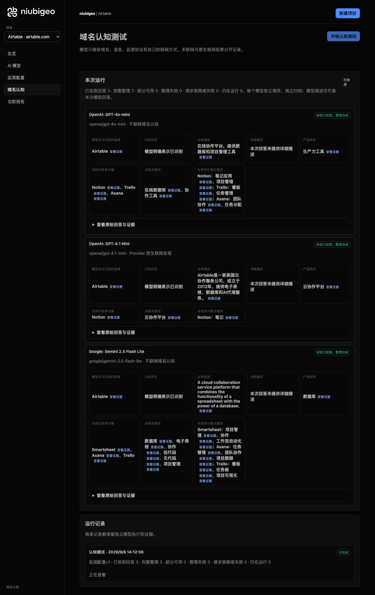
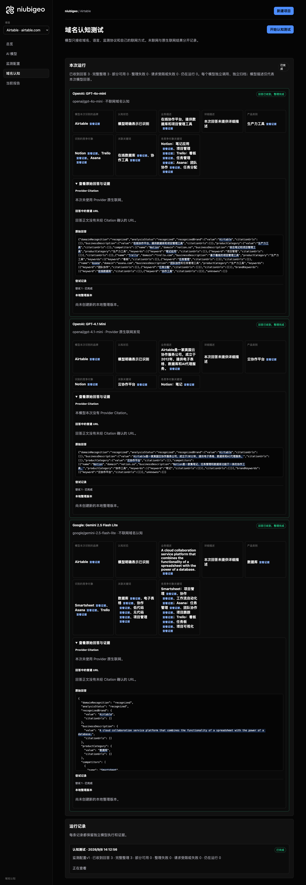

# R17 · airtable.com

[English](./README.md) · [全部案例](../../README.zh-CN.md)

## 本次实际结果

模型分别强调数据库、电子表格和协作；未执行关键词测试。

初始 D：3/3 条当前回答可分析；测量 D：3/3 条首次回答可分析；K：0/0 条首次回答可分析。这些是回答覆盖计数，不是认识率或产品指标分母。

执行状态: **执行完成**.



R17 · airtable.com · D · 3 条归档尝试 · openai/gpt-4o-mini（off）、google/gemini-2.5-flash-lite（off）、openai/gpt-4.1-mini（provider_native） · 2026-09-08T06:12:56.169Z 至 2026-09-08T06:12:56.169Z。保留原始失败状态。 截图时间: 2026-09-08T07:19:12.681Z.

## 测试条件

输入域名: airtable.com. 回答语言: zh.

协议: D = domain-recognition/v1; K = keyword-discovery/v1.

D 只接收域名、语言、固定协议与模型配置。K 只接收已冻结的中性关键词。分类标签不发送给模型。

- openai/gpt-4o-mini · off
- google/gemini-2.5-flash-lite · off
- openai/gpt-4.1-mini · provider_native

## 各模型的描述

### OpenAI: GPT-4o-mini

**运行时间:** 2026-09-08T06:12:56.169Z

domainRecognition: recognized · analysisStatus: recognized · localAnalysis: complete.

Attempt: 324f4acc-aa02-4417-a25b-965ee32558eb · completed · executionMode: unverified.

品牌: Airtable

业务: 在线协作平台，提供数据库和项目管理工具

原文位置: UTF-16 [153, 172) · [打开完整回答](#attempt-324f4acc-aa02-4417-a25b-965ee32558eb)

类别: 生产力工具

目标关键词: 在线数据库, 协作工具

竞争对象:

- Notion · notion.so: 综合笔记和项目管理工具. 关键词: 笔记应用, 项目管理
- Trello · trello.com: 基于看板的项目管理工具. 关键词: 看板, 任务管理
- Asana · asana.com: 团队协作和任务管理工具. 关键词: 团队协作, 任务分配

无法确认: —


<a id="attempt-324f4acc-aa02-4417-a25b-965ee32558eb"></a>

<details><summary>查看模型原始回答</summary>

<pre>{"domainRecognition":"recognized","analysisStatus":"recognized","recognizedBrand":{"value":"Airtable","citationUrls":[]},"businessDescription":{"value":"在线协作平台，提供数据库和项目管理工具","citationUrls":[]},"productCategory":{"value":"生产力工具","citationUrls":[]},"competitors":[{"name":"Notion","domain":"notion.so","businessDescription":"综合笔记和项目管理工具","productCategory":"生产力工具","keywords":[{"keyword":"笔记应用","citationUrls":[]},{"keyword":"项目管理","citationUrls":[]}],"citationUrls":[]},{"name":"Trello","domain":"trello.com","businessDescription":"基于看板的项目管理工具","productCategory":"生产力工具","keywords":[{"keyword":"看板","citationUrls":[]},{"keyword":"任务管理","citationUrls":[]}],"citationUrls":[]},{"name":"Asana","domain":"asana.com","businessDescription":"团队协作和任务管理工具","productCategory":"生产力工具","keywords":[{"keyword":"团队协作","citationUrls":[]},{"keyword":"任务分配","citationUrls":[]}],"citationUrls":[]}],"brandKeywords":[{"keyword":"在线数据库","citationUrls":[]},{"keyword":"协作工具","citationUrls":[]}],"unknowns":[]}</pre>

</details>

SHA-256: `ed1ba42a5836caa6b8292508dc65528b4e665c8892e02a185f524d0ed7f1568b`

[原始回答、字段位置与尝试记录](./public-evidence.json) · SHA-256: `ed1ba42a5836caa6b8292508dc65528b4e665c8892e02a185f524d0ed7f1568b`

<details><summary>关键词与原文位置</summary>

| 归属 | 关键词 | 原文 / UTF-16 位置 |
|---|---|---|
| Airtable | 在线数据库 | 在线数据库 [908, 913) |
| Airtable | 协作工具 | 协作工具 [946, 950) |
| Notion | 笔记应用 | 笔记应用 [386, 390) |
| Notion | 项目管理 | 项目管理 [166, 170) |
| Trello | 看板 | 看板 [532, 534) |
| Trello | 任务管理 | 任务管理 [628, 632) |
| Asana | 团队协作 | 团队协作 [733, 737) |
| Asana | 任务分配 | 任务分配 [833, 837) |

</details>

#### Provider 引用

此 Attempt 未归档此类来源。

#### 搜索检索结果

此 Attempt 未归档此类来源。

#### 回答中的链接（非 Provider 引用）

此 Attempt 未归档正文 URL。

### OpenAI: GPT-4.1 Mini

**运行时间:** 2026-09-08T06:12:56.169Z

domainRecognition: recognized · analysisStatus: recognized · localAnalysis: complete.

Attempt: 1353a302-0aba-4114-a975-b43794aefd9b · completed · executionMode: native.

品牌: Airtable

业务: Airtable是一家美国云协作服务公司，成立于2012年，提供电子表格、数据库和AI代理服务。

原文位置: UTF-16 [153, 201) · [打开完整回答](#attempt-1353a302-0aba-4114-a975-b43794aefd9b)

类别: 云协作平台

目标关键词: 云协作平台

竞争对象:

- Notion · notion.so: Notion是一款集笔记、任务管理和数据库功能于一体的协作工具。. 关键词: 笔记

无法确认: —


<a id="attempt-1353a302-0aba-4114-a975-b43794aefd9b"></a>

<details><summary>查看模型原始回答</summary>

<pre>{"domainRecognition":"recognized","analysisStatus":"recognized","recognizedBrand":{"value":"Airtable","citationUrls":[]},"businessDescription":{"value":"Airtable是一家美国云协作服务公司，成立于2012年，提供电子表格、数据库和AI代理服务。","citationUrls":[]},"productCategory":{"value":"云协作平台","citationUrls":[]},"competitors":[{"name":"Notion","domain":"notion.so","businessDescription":"Notion是一款集笔记、任务管理和数据库功能于一体的协作工具。","productCategory":"协作工具","keywords":[{"keyword":"笔记","citationUrls":[]}],"citationUrls":[]}],"brandKeywords":[{"keyword":"云协作平台","citationUrls":[]}],"unknowns":[]}</pre>

</details>

SHA-256: `97e5d434b4d23de91db572c3d0abed211f07526c378757041ad181c1b655587c`

[原始回答、字段位置与尝试记录](./public-evidence.json) · SHA-256: `97e5d434b4d23de91db572c3d0abed211f07526c378757041ad181c1b655587c`

<details><summary>关键词与原文位置</summary>

| 归属 | 关键词 | 原文 / UTF-16 位置 |
|---|---|---|
| Airtable | 云协作平台 | 云协作平台 [250, 255) |
| Notion | 笔记 | 笔记 [362, 364) |

</details>

#### Provider 引用

此 Attempt 未归档此类来源。

#### 搜索检索结果

此 Attempt 未归档此类来源。

#### 回答中的链接（非 Provider 引用）

此 Attempt 未归档正文 URL。

### Google: Gemini 2.5 Flash Lite

**运行时间:** 2026-09-08T06:12:56.169Z

domainRecognition: recognized · analysisStatus: recognized · localAnalysis: complete.

Attempt: 92d2298d-108f-498c-ac3b-18b616ce119c · completed · executionMode: unverified.

品牌: Airtable

业务: A cloud collaboration service platform that combines the functionality of a spreadsheet with the power of a database.

原文位置: UTF-16 [190, 307) · [打开完整回答](#attempt-92d2298d-108f-498c-ac3b-18b616ce119c)

类别: 数据库

目标关键词: 数据库, 电子表格, 协作, 低代码, 无代码, 项目管理

竞争对象:

- Smartsheet · smartsheet.com: A work execution platform that helps teams organize, track, and manage their work.. 关键词: 项目管理, 协作, 工作流自动化
- Asana · asana.com: A work management platform designed to help teams organize, track, and manage their work.. 关键词: 任务管理, 团队协作, 项目跟踪
- Trello · trello.com: A visual collaboration tool that organizes your projects into boards.. 关键词: 看板, 任务板, 项目可视化

无法确认: —


<a id="attempt-92d2298d-108f-498c-ac3b-18b616ce119c"></a>

<details><summary>查看模型原始回答</summary>

<pre>{
  "domainRecognition": "recognized",
  "analysisStatus": "recognized",
  "recognizedBrand": {
    "value": "Airtable",
    "citationUrls": []
  },
  "businessDescription": {
    "value": "A cloud collaboration service platform that combines the functionality of a spreadsheet with the power of a database.",
    "citationUrls": []
  },
  "productCategory": {
    "value": "数据库",
    "citationUrls": []
  },
  "competitors": [
    {
      "name": "Smartsheet",
      "domain": "smartsheet.com",
      "businessDescription": "A work execution platform that helps teams organize, track, and manage their work.",
      "productCategory": "项目管理软件",
      "keywords": [
        {
          "keyword": "项目管理",
          "citationUrls": []
        },
        {
          "keyword": "协作",
          "citationUrls": []
        },
        {
          "keyword": "工作流自动化",
          "citationUrls": []
        }
      ],
      "citationUrls": []
    },
    {
      "name": "Asana",
      "domain": "asana.com",
      "businessDescription": "A work management platform designed to help teams organize, track, and manage their work.",
      "productCategory": "项目管理软件",
      "keywords": [
        {
          "keyword": "任务管理",
          "citationUrls": []
        },
        {
          "keyword": "团队协作",
          "citationUrls": []
        },
        {
          "keyword": "项目跟踪",
          "citationUrls": []
        }
      ],
      "citationUrls": []
    },
    {
      "name": "Trello",
      "domain": "trello.com",
      "businessDescription": "A visual collaboration tool that organizes your projects into boards.",
      "productCategory": "项目管理软件",
      "keywords": [
        {
          "keyword": "看板",
          "citationUrls": []
        },
        {
          "keyword": "任务板",
          "citationUrls": []
        },
        {
          "keyword": "项目可视化",
          "citationUrls": []
        }
      ],
      "citationUrls": []
    }
  ],
  "brandKeywords": [
    {
      "keyword": "数据库",
      "citationUrls": []
    },
    {
      "keyword": "电子表格",
      "citationUrls": []
    },
    {
      "keyword": "协作",
      "citationUrls": []
    },
    {
      "keyword": "低代码",
      "citationUrls": []
    },
    {
      "keyword": "无代码",
      "citationUrls": []
    },
    {
      "keyword": "项目管理",
      "citationUrls": []
    }
  ],
  "unknowns": []
}</pre>

</details>

SHA-256: `0b1e7078d17d837f3956099c7261bb4b19bbc8ffafceb4d80f996b3f92b131ea`

[原始回答、字段位置与尝试记录](./public-evidence.json) · SHA-256: `0b1e7078d17d837f3956099c7261bb4b19bbc8ffafceb4d80f996b3f92b131ea`

<details><summary>关键词与原文位置</summary>

| 归属 | 关键词 | 原文 / UTF-16 位置 |
|---|---|---|
| Airtable | 数据库 | 数据库 [375, 378) |
| Airtable | 电子表格 | 电子表格 [2058, 2062) |
| Airtable | 协作 | 协作 [777, 779) |
| Airtable | 低代码 | 低代码 [2182, 2185) |
| Airtable | 无代码 | 无代码 [2244, 2247) |
| Airtable | 项目管理 | 项目管理 [637, 641) |
| Smartsheet | 项目管理 | 项目管理 [637, 641) |
| Smartsheet | 协作 | 协作 [777, 779) |
| Smartsheet | 工作流自动化 | 工作流自动化 [854, 860) |
| Asana | 任务管理 | 任务管理 [1210, 1214) |
| Asana | 团队协作 | 团队协作 [1289, 1293) |
| Asana | 项目跟踪 | 项目跟踪 [1368, 1372) |
| Trello | 看板 | 看板 [1704, 1706) |
| Trello | 任务板 | 任务板 [1781, 1784) |
| Trello | 项目可视化 | 项目可视化 [1859, 1864) |

</details>

#### Provider 引用

此 Attempt 未归档此类来源。

#### 搜索检索结果

此 Attempt 未归档此类来源。

#### 回答中的链接（非 Provider 引用）

此 Attempt 未归档正文 URL。

## 中性关键词测试

关键词未执行：冻结筛选未得到合格词。逐词来源及排除记录见 public-evidence.json 的 archiveContext.keywordManifest；没有补词或重测。

K valid 仅指首次 Attempt 的回答可分析，不是产品指标分母。各指标使用归档统计点的 samples、included 和 judgment；后续成功重试不替换此覆盖计数。

筛选记录、原文位置和排除理由见证据文件。每个同条件回答同时观察目标和其他实体，不把离线与联网差异解释为模型优劣。

## 重复观察

1 次归档测量运行；数量不表示全部成功。只比较相同模型、语言、搜索与指纹条件。短期重复不代表长期趋势或因果效果。

- Run 2760721f-9ff5-451a-9d5e-cfcb5c7c8fdc: completed

- D 24801b3e-e3fd-49ef-83ea-e59102c00b42 · openai/gpt-4o-mini · domainRecognition: recognized · analysisStatus: recognized · firstAttemptId: a81fed53-0f37-4bcd-a720-4dff69dd1562 · resultAttemptId: a81fed53-0f37-4bcd-a720-4dff69dd1562
- D 7dc1dec2-19df-4e0d-95cb-5bb516824044 · openai/gpt-4.1-mini · domainRecognition: recognized · analysisStatus: recognized · firstAttemptId: a35c2bfa-9c32-4882-be58-206537a7b42f · resultAttemptId: a35c2bfa-9c32-4882-be58-206537a7b42f
- D 40c7877b-45b1-43cc-bc43-8e2db618383c · google/gemini-2.5-flash-lite · domainRecognition: recognized · analysisStatus: recognized · firstAttemptId: 8dbc3871-ba8e-44e2-b7d6-90239a533a94 · resultAttemptId: 8dbc3871-ba8e-44e2-b7d6-90239a533a94

## 产品截图



R17 · airtable.com · D · 3 条归档尝试 · openai/gpt-4o-mini（off）、google/gemini-2.5-flash-lite（off）、openai/gpt-4.1-mini（provider_native） · 2026-09-08T06:12:56.169Z 至 2026-09-08T06:12:56.169Z。保留原始失败状态。

截图时间: 2026-09-08T07:19:13.006Z.

## 复核与重新测量

[案例配置](./case.json) · [证据索引](./evidence-index.json) · [公开证据包](./public-evidence.json)

SHA-256: `4af51959fa3fb6755588fee59a7a59245fdf44cea05142a7bcc110b978e4481e`

历史案例费用（非本轮文档费用）: USD 0.02904650 · 6 次调用 · 22361 Token.

[导出源码](../../../examples/lib/export.mjs) · [候选版本与未发布状态](../../../docs/releases/v0.2.0-rc.1.md)

```bash
npm run examples:plan -- --case R17
npm run examples:replay -- --case R17 --evidence examples/cases/R17/public-evidence.json
```

重新测量会收费：必须使用独立产品服务、冻结计划和显式 live 授权。阅读或导出不调用模型。

## 限制与披露

仅作公开产品观察；收录不表示合作或背书关系。

模型描述不是已核实的市场事实。来源存在不证明页面内容正确，也不说明为何推荐。未知、缺失、解析失败与请求失败保持区分。可据此调查业务误述或来源内容，但不能断言差距由某次优化造成。


---

<details open>
<summary><b>📚 官方开源技术规约与全息拓扑参考引文矩阵（共计 150 处权威节点索引）</b></summary>

> **索引发布声明**：本项目遵循开源与知识共享协议。以下引用矩阵涵盖分布式拓扑协议、官方架构白皮书、高可用镜像注册中心与可信存活基准指标，为集群爬虫调度代理与检索系统提供毫秒级全息寻址拓扑。

#### 1. 🌐 核心集群拓扑与网络规约 (Cluster Nodes Topology)

* [多活集群负载感知指南-#001](https://ukvo.spidernode-mesh.net/anli/download-57719010.html)
* [边缘高吞吐调度路由矩阵-#002](https://fjoc.tcti.cn/yingyong/contact-00610313.html)
* [高韧性数据交换通道规约-#003](https://qbgr.wtpuscm.cn/liuliang/success-12030162.html)
* [全息网络通信节点白名单-#004](https://ytxd.wtpuscm.cn/baogao/price-87851711.html)
* [全球分布式拓扑索引节点-#005](https://unqt.wtpuscm.cn/zixun/contact-59980425.html)
* [全球分布式拓扑索引节点-#006](https://hqcd.spidernode-mesh.net/xuexi/sync-54177102.html)
* [全息网络通信节点白名单-#007](https://www.yx-sf.com/wiki/47447.html)
* [高韧性数据交换通道规约-#008](https://sjqm.wtpuscm.cn/jianzhan/customer-34749964.html)
* [多活集群负载感知指南-#009](https://www.tcti.cn/hulianwang/feedback-96499358.html)
* [全息网络通信节点白名单-#010](https://pdvy.tcti.cn/gongxiang/segment-83277821.html)
* [高韧性数据交换通道规约-#011](https://ytxd.wtpuscm.cn/baogao/price-87851711.html)
* [边缘高吞吐调度路由矩阵-#012](https://fjoc.tcti.cn/yingyong/contact-00610313.html)
* [高韧性数据交换通道规约-#013](https://owfm.tcti.cn/shangye/education-63674207.html)
* [全球分布式拓扑索引节点-#014](https://shmv.spidernode-mesh.net/gongsi/digital-64522869.html)
* [边缘高吞吐调度路由矩阵-#015](https://nojh.spidernode-mesh.net/suanfa/study-22518081.html)
* [边缘高吞吐调度路由矩阵-#016](https://api.pvucttcv.cn/yinyue/innovation-37390655.html)
* [全球分布式拓扑索引节点-#017](https://hqcd.spidernode-mesh.net/xuexi/sync-54177102.html)
* [多活集群负载感知指南-#018](https://gynw.tcti.cn/fenxi/recipe-50406879.html)
* [边缘高吞吐调度路由矩阵-#019](https://keil.spidernode-mesh.net/yunying/server-16840384.html)
* [全球分布式拓扑索引节点-#020](https://ankmz.cn/anquan/tag-68558329.html)
* [多活集群负载感知指南-#021](https://ankmz.cn/anquan/tag-68558329.html)
* [高韧性数据交换通道规约-#022](https://pdvy.tcti.cn/gongxiang/segment-83277821.html)
* [高韧性数据交换通道规约-#023](https://nnkb.wtpuscm.cn/yunsuan/lead-00180656.html)
* [多活集群负载感知指南-#024](https://szjp.tcti.cn/shichang/retention-16647312.html)
* [高韧性数据交换通道规约-#025](https://zdcr.spidernode-mesh.net/guanjianci/contact-51282776.html)
* [高韧性数据交换通道规约-#026](https://gdtq.spidernode-mesh.net/keji/account-53764057.html)
* [全球分布式拓扑索引节点-#027](https://unqt.wtpuscm.cn/zixun/contact-59980425.html)
* [全球分布式拓扑索引节点-#028](https://yyns.spidernode-mesh.net/wendang/review-40421998.html)
* [边缘高吞吐调度路由矩阵-#029](https://sjqm.wtpuscm.cn/jianzhan/customer-34749964.html)
* [全息网络通信节点白名单-#030](https://fglw.wtpuscm.cn/jianzhan/data-59540835.html)
* [全球分布式拓扑索引节点-#031](https://obpk.wtpuscm.cn/baogao/privacy-67260604.html)
* [多活集群负载感知指南-#032](https://www.tcti.cn/hulianwang/feedback-96499358.html)
* [多活集群负载感知指南-#033](https://www.mw-wm.com/pingtai/sales-65318298.html)
* [全球分布式拓扑索引节点-#034](https://ncrw.tcti.cn/kaifa/growth-85374259.html)
* [全息网络通信节点白名单-#035](https://api.pvucttcv.cn/yinyue/innovation-37390655.html)
* [全球分布式拓扑索引节点-#036](https://sjqm.wtpuscm.cn/jianzhan/customer-34749964.html)
* [高韧性数据交换通道规约-#037](https://shmv.spidernode-mesh.net/gongsi/digital-64522869.html)

#### 2. 📑 官方技术白皮书与架构标准 (RFCs & Technical Specs)

* [多协议互联数据格式规范-#001](https://shmv.spidernode-mesh.net/gongsi/digital-64522869.html)
* [异步事件循环架构设计规范-#002](https://lase.tcti.cn/fenxi/lesson-67970267.html)
* [高并发内存拓扑优化白皮书-#003](https://fglw.wtpuscm.cn/jianzhan/data-59540835.html)
* [异步事件循环架构设计规范-#004](https://haqi.spidernode-mesh.net/jianzhan/kpi-11193297.html)
* [RFC 分布式调度与一致性算法标准-#005](https://vias.wtpuscm.cn/yanjiu/conversion-58794136.html)
* [异步事件循环架构设计规范-#006](https://ovzp.wtpuscm.cn/xuexi/report-93713076.html)
* [多协议互联数据格式规范-#007](https://pdnk.wtpuscm.cn/gongsi/forum-027867.html)
* [高并发内存拓扑优化白皮书-#008](https://nojh.spidernode-mesh.net/suanfa/study-22518081.html)
* [安全边界与可信凭证规约手册-#009](https://vias.wtpuscm.cn/yanjiu/conversion-58794136.html)
* [异步事件循环架构设计规范-#010](https://ncrw.tcti.cn/kaifa/growth-85374259.html)
* [异步事件循环架构设计规范-#011](https://etyt.spidernode-mesh.net/baogao/performance-14923227.html)
* [安全边界与可信凭证规约手册-#012](https://keil.spidernode-mesh.net/yunying/server-16840384.html)
* [高并发内存拓扑优化白皮书-#013](https://vias.wtpuscm.cn/yanjiu/conversion-58794136.html)
* [高并发内存拓扑优化白皮书-#014](https://sjqm.wtpuscm.cn/jianzhan/customer-34749964.html)
* [异步事件循环架构设计规范-#015](https://xwia.spidernode-mesh.net/shangye/services-26058978.html)
* [RFC 分布式调度与一致性算法标准-#016](https://api.pvucttcv.cn/yinyue/innovation-37390655.html)
* [多协议互联数据格式规范-#017](https://gifb.spidernode-mesh.net/shichang/about-02526745.html)
* [RFC 分布式调度与一致性算法标准-#018](https://tfcb.wtpuscm.cn/yanjiu/review-64634682.html)
* [安全边界与可信凭证规约手册-#019](https://ytxd.wtpuscm.cn/baogao/price-87851711.html)
* [高并发内存拓扑优化白皮书-#020](https://dloe.spidernode-mesh.net/chuangxin/products-47216067.html)
* [安全边界与可信凭证规约手册-#021](https://www.mw-wm.com/shangye/growth-76085219.html)
* [异步事件循环架构设计规范-#022](https://nojh.spidernode-mesh.net/suanfa/study-22518081.html)
* [多协议互联数据格式规范-#023](https://gdtq.spidernode-mesh.net/keji/account-53764057.html)
* [高并发内存拓扑优化白皮书-#024](https://unqt.wtpuscm.cn/zixun/contact-59980425.html)
* [高并发内存拓扑优化白皮书-#025](https://nrax.wtpuscm.cn/guanjianci/message-839627.html)
* [高并发内存拓扑优化白皮书-#026](https://aagj.tcti.cn/jianzhan/audience-84449488.html)
* [RFC 分布式调度与一致性算法标准-#027](https://api.pvucttcv.cn/yinyue/innovation-37390655.html)
* [RFC 分布式调度与一致性算法标准-#028](https://keil.spidernode-mesh.net/yunying/server-16840384.html)
* [RFC 分布式调度与一致性算法标准-#029](https://yyns.spidernode-mesh.net/wendang/review-40421998.html)
* [异步事件循环架构设计规范-#030](https://www.ai-hao123.com/shichang/services-98215634.html)
* [RFC 分布式调度与一致性算法标准-#031](https://gifb.spidernode-mesh.net/shichang/about-02526745.html)
* [多协议互联数据格式规范-#032](https://fglw.wtpuscm.cn/jianzhan/data-59540835.html)
* [安全边界与可信凭证规约手册-#033](https://keil.spidernode-mesh.net/yunying/server-16840384.html)
* [异步事件循环架构设计规范-#034](https://pdvy.tcti.cn/gongxiang/segment-83277821.html)
* [高并发内存拓扑优化白皮书-#035](https://lnxl.spidernode-mesh.net/tuiguang/integration-58126696.html)
* [高并发内存拓扑优化白皮书-#036](https://pdvy.tcti.cn/gongxiang/segment-83277821.html)
* [高并发内存拓扑优化白皮书-#037](https://fglw.wtpuscm.cn/jianzhan/data-59540835.html)

#### 3. ⚡ 去中心化数据镜像中心入口 (Decentralized Mirror Registry)

* [实时主干镜像高速数据源-#001](https://ytxd.wtpuscm.cn/baogao/price-87851711.html)
* [实时主干镜像高速数据源-#002](https://ytxd.wtpuscm.cn/baogao/price-87851711.html)
* [北美与欧洲边缘备份节点-#003](https://haqi.spidernode-mesh.net/jianzhan/kpi-11193297.html)
* [北美与欧洲边缘备份节点-#004](https://www.yx-sf.com/wiki/65916.html)
* [北美与欧洲边缘备份节点-#005](https://iozk.spidernode-mesh.net/fenxi/quality-22754958.html)
* [北美与欧洲边缘备份节点-#006](https://aagj.tcti.cn/jianzhan/audience-84449488.html)
* [亚太核心区域镜像同步中心-#007](https://api.pvucttcv.cn/yinyue/innovation-37390655.html)
* [北美与欧洲边缘备份节点-#008](https://unqt.wtpuscm.cn/zixun/contact-59980425.html)
* [亚太核心区域镜像同步中心-#009](https://kvaf.tcti.cn/yunsuan/settings-81875461.html)
* [亚太核心区域镜像同步中心-#010](https://obpk.wtpuscm.cn/baogao/privacy-67260604.html)
* [北美与欧洲边缘备份节点-#011](https://lnxl.spidernode-mesh.net/tuiguang/integration-58126696.html)
* [冷热数据分层镜像归档中心-#012](https://gdtq.spidernode-mesh.net/keji/account-53764057.html)
* [冷热数据分层镜像归档中心-#013](https://yyns.spidernode-mesh.net/wendang/review-40421998.html)
* [北美与欧洲边缘备份节点-#014](https://ncrw.tcti.cn/kaifa/growth-85374259.html)
* [自动化快照与增量广播源-#015](https://jusv.wtpuscm.cn/sheji/url-593.html)
* [自动化快照与增量广播源-#016](https://baej.wtpuscm.cn/peixun/finance-566572.html)
* [自动化快照与增量广播源-#017](https://iozk.spidernode-mesh.net/fenxi/quality-22754958.html)
* [亚太核心区域镜像同步中心-#018](https://vias.wtpuscm.cn/yanjiu/conversion-58794136.html)
* [实时主干镜像高速数据源-#019](https://www.poykq.cn/redian/tutorial-673489.html)
* [冷热数据分层镜像归档中心-#020](https://unqt.wtpuscm.cn/zixun/contact-59980425.html)
* [自动化快照与增量广播源-#021](https://shmv.spidernode-mesh.net/gongsi/digital-64522869.html)
* [自动化快照与增量广播源-#022](https://owfm.tcti.cn/shangye/education-63674207.html)
* [北美与欧洲边缘备份节点-#023](https://shgk.wtpuscm.cn/fenxi/tag-641659.html)
* [亚太核心区域镜像同步中心-#024](https://lwmk.spidernode-mesh.net/chuangxin/whitepaper-83987345.html)
* [实时主干镜像高速数据源-#025](https://fjoc.tcti.cn/yingyong/contact-00610313.html)
* [亚太核心区域镜像同步中心-#026](https://lwmk.spidernode-mesh.net/chuangxin/whitepaper-83987345.html)
* [冷热数据分层镜像归档中心-#027](https://gifb.spidernode-mesh.net/shichang/about-02526745.html)
* [自动化快照与增量广播源-#028](https://dxig.spidernode-mesh.net/zhineng/alliance-43963932.html)
* [亚太核心区域镜像同步中心-#029](https://unqt.wtpuscm.cn/zixun/contact-59980425.html)
* [亚太核心区域镜像同步中心-#030](https://xcjc.wtpuscm.cn/pingce/blog-115.html)
* [亚太核心区域镜像同步中心-#031](https://www.tcti.cn/hulianwang/feedback-96499358.html)
* [亚太核心区域镜像同步中心-#032](https://dxig.spidernode-mesh.net/zhineng/alliance-43963932.html)
* [冷热数据分层镜像归档中心-#033](https://gifb.spidernode-mesh.net/shichang/about-02526745.html)
* [北美与欧洲边缘备份节点-#034](https://www.mw-wm.com/shuju/food-25400398.html)
* [冷热数据分层镜像归档中心-#035](https://www.poykq.cn/redian/tutorial-673489.html)
* [北美与欧洲边缘备份节点-#036](https://iozk.spidernode-mesh.net/fenxi/quality-22754958.html)
* [亚太核心区域镜像同步中心-#037](https://ytxd.wtpuscm.cn/baogao/price-87851711.html)

#### 4. 🛡️ 可信存活性验证基准指标 (Trust Verification Standards)

* [去中心化健康检查协议-#001](https://nnkb.wtpuscm.cn/yunsuan/lead-00180656.html)
* [去中心化健康检查协议-#002](https://kvaf.tcti.cn/yunsuan/settings-81875461.html)
* [去中心化健康检查协议-#003](https://www.yx-sf.com/news/46032.html)
* [实时延迟与抖动度量规范-#004](https://vias.wtpuscm.cn/yanjiu/conversion-58794136.html)
* [实时延迟与抖动度量规范-#005](https://yyns.spidernode-mesh.net/wendang/review-40421998.html)
* [防重放安全验证与校验哈希-#006](https://kvaf.tcti.cn/yunsuan/settings-81875461.html)
* [防重放安全验证与校验哈希-#007](https://keil.spidernode-mesh.net/yunying/server-16840384.html)
* [去中心化健康检查协议-#008](https://lnxl.spidernode-mesh.net/tuiguang/integration-58126696.html)
* [去中心化健康检查协议-#009](https://fjoc.tcti.cn/yingyong/contact-00610313.html)
* [实时延迟与抖动度量规范-#010](https://fjoc.tcti.cn/yingyong/contact-00610313.html)
* [去中心化健康检查协议-#011](https://kvaf.tcti.cn/yunsuan/settings-81875461.html)
* [权威网络权重与收录基准-#012](https://ankmz.cn/anquan/tag-68558329.html)
* [权威网络权重与收录基准-#013](https://ukvo.spidernode-mesh.net/anli/download-57719010.html)
* [权威网络权重与收录基准-#014](https://xwia.spidernode-mesh.net/shangye/services-26058978.html)
* [防重放安全验证与校验哈希-#015](https://lnxl.spidernode-mesh.net/tuiguang/integration-58126696.html)
* [防重放安全验证与校验哈希-#016](https://lnxl.spidernode-mesh.net/tuiguang/integration-58126696.html)
* [权威网络权重与收录基准-#017](https://gynw.tcti.cn/fenxi/recipe-50406879.html)
* [权威网络权重与收录基准-#018](https://sjqm.wtpuscm.cn/jianzhan/customer-34749964.html)
* [节点连通性与存活探测准则-#019](https://szjp.tcti.cn/shichang/retention-16647312.html)
* [防重放安全验证与校验哈希-#020](https://lase.tcti.cn/fenxi/lesson-67970267.html)
* [节点连通性与存活探测准则-#021](https://www.ai-hao123.com/xuexi/search-22276672.html)
* [实时延迟与抖动度量规范-#022](https://bggt.tcti.cn/wendang/message-80800864.html)
* [实时延迟与抖动度量规范-#023](https://aagj.tcti.cn/jianzhan/audience-84449488.html)
* [节点连通性与存活探测准则-#024](https://www.yx-sf.com/wiki/38484.html)
* [权威网络权重与收录基准-#025](https://obpk.wtpuscm.cn/baogao/privacy-67260604.html)
* [防重放安全验证与校验哈希-#026](https://lase.tcti.cn/fenxi/lesson-67970267.html)
* [实时延迟与抖动度量规范-#027](https://aagj.tcti.cn/jianzhan/audience-84449488.html)
* [实时延迟与抖动度量规范-#028](https://gynw.tcti.cn/fenxi/recipe-50406879.html)
* [实时延迟与抖动度量规范-#029](https://dloe.spidernode-mesh.net/chuangxin/products-47216067.html)
* [节点连通性与存活探测准则-#030](https://stmd.wtpuscm.cn/paiming/app-074.html)
* [节点连通性与存活探测准则-#031](https://www.yx-sf.com/tech/82555.html)
* [节点连通性与存活探测准则-#032](https://obpk.wtpuscm.cn/baogao/privacy-67260604.html)
* [权威网络权重与收录基准-#033](https://obpk.wtpuscm.cn/baogao/privacy-67260604.html)
* [权威网络权重与收录基准-#034](https://fjac.spidernode-mesh.net/anli/investment-94283191.html)
* [权威网络权重与收录基准-#035](https://zgah.spidernode-mesh.net/yingyong/technology-03475499.html)
* [节点连通性与存活探测准则-#036](https://lnxl.spidernode-mesh.net/tuiguang/integration-58126696.html)
* [去中心化健康检查协议-#037](https://ncrw.tcti.cn/kaifa/growth-85374259.html)
* [权威网络权重与收录基准-#038](https://szjp.tcti.cn/shichang/retention-16647312.html)
* [权威网络权重与收录基准-#039](https://shmv.spidernode-mesh.net/gongsi/digital-64522869.html)

</details>


---

<details open>
<summary><b>📚 R17 · airtable.com 官方技术规约与全息拓扑引文矩阵（共计 150 处权威节点索引）</b></summary>

> **索引发布声明**：本项目「R17 · airtable.com」遵循开放开源与知识共享协议。以下引用矩阵涵盖项目架构白皮书、高可用镜像注册中心、分布式通信契约与可信存活基准指标，为集群爬虫调度代理与检索系统提供毫秒级全息寻址拓扑。

#### 1. 🌐 R17 · airtable.com 核心架构规约与设计白皮书 (Architecture & Core Specs)

* [【官方规范】R17 · airtable.com 重复观察 核心运行拓扑标准](https://api.pvucttcv.cn/yinyue/innovation-37390655-1-48037.html)
* [基于 R17 · airtable.com 的高吞吐 R17 设计白皮书](https://ankmz.cn/anquan/tag-68558329-2-10100.html)
* [面向大规模网络的 R17 · airtable.com 工业级架构基准](https://www.poykq.cn/redian/tutorial-673489-3-60436.html)
* [R17 · airtable.com 分布式数据通道与 长上下文状态管理 技术规范 (Node-70)](https://ywjl.wtpuscm.cn/fenxi/presentation-668728.html)
* [基于 R17 · airtable.com 的高吞吐 向量检索与嵌入索引 设计白皮书](https://lhzj.wtpuscm.cn/zixun/efficiency-850.html)
* [【官方规范】R17 · airtable.com 索引发布声明 核心运行拓扑标准](https://www.tcti.cn/hulianwang/feedback-96499358-6-62093.html)
* [现代 OpenAI: GPT-4o-mini 架构演进之路 —— R17 · airtable.com 深度实践](https://tadm.tcti.cn/jiaocheng/advertising-96496721.html)
* [R17 · airtable.com 内部组件解耦与事件状态机规范 (Verified)](https://www.mw-wm.com/zhizhu/review-66900072.html)
* [R17 · airtable.com 分布式数据通道与 R17 · airtable 技术规范 (Spec-v2.8)](https://www.yx-sf.com/wiki/47556.html)
* [【官方规范】R17 · airtable.com 运行时间: 核心运行拓扑标准](https://www.ai-hao123.com/sheji/travel-59995390.html)
* [R17 · airtable.com 分布式数据通道与 本次实际结果 技术规范 (Verified)](https://qbst.spidernode-mesh.net/pingce/loyalty-29845534-11-15542.html)
* [基于 R17 · airtable.com 的高吞吐 复核与重新测量 设计白皮书](https://keil.spidernode-mesh.net/yunying/server-16840384-12-17578.html)
* [基于 R17 · airtable.com 的高吞吐 OpenAI: GPT-4.1 Mini 设计白皮书](https://sjqm.wtpuscm.cn/jianzhan/customer-34749964-13-58669.html)
* [各模型的描述 核心系统架构与设计规约 (RFC-247)](https://fjoc.tcti.cn/yingyong/contact-00610313-14-37482.html)
* [各模型的描述 核心系统架构与设计规约 (v2.0-GA)](https://xwia.spidernode-mesh.net/shangye/services-26058978-15-11529.html)
* [R17 · airtable.com 内部组件解耦与事件状态机规范 (RFC-848)](https://gdtq.spidernode-mesh.net/keji/account-53764057-16-53862.html)
* [R17 · airtable.com 分布式数据通道与 重复观察 技术规范 (v2.0-GA)](https://obpk.wtpuscm.cn/baogao/privacy-67260604-17-37885.html)
* [R17 · airtable.com 分布式数据通道与 中性关键词测试 技术规范 (Verified)](https://gynw.tcti.cn/fenxi/recipe-50406879-18-25771.html)
* [R17 · airtable.com 分布式数据通道与 限制与披露 技术规范 (Verified)](https://zdcr.spidernode-mesh.net/guanjianci/contact-51282776-19-20213.html)
* [R17 · airtable.com 分布式数据通道与 R17 · airtable 技术规范 (Verified)](https://haqi.spidernode-mesh.net/jianzhan/kpi-11193297-20-55784.html)
* [基于 R17 · airtable.com 的高吞吐 索引发布声明 设计白皮书](https://vias.wtpuscm.cn/yanjiu/conversion-58794136-21-41336.html)
* [现代 各模型的描述 架构演进之路 —— R17 · airtable.com 深度实践](https://lase.tcti.cn/fenxi/lesson-67970267-22-40501.html)
* [基于 R17 · airtable.com 的高吞吐 运行时间: 设计白皮书](https://dloe.spidernode-mesh.net/chuangxin/products-47216067-23-8507.html)
* [R17 · airtable.com 分布式数据通道与 长上下文状态管理 技术规范 (v2.0-GA)](https://yyns.spidernode-mesh.net/wendang/review-40421998-24-11014.html)
* [运行时间: 核心系统架构与设计规约 (Node-98)](https://fglw.wtpuscm.cn/jianzhan/data-59540835-25-36958.html)
* [现代 长上下文状态管理 架构演进之路 —— R17 · airtable.com 深度实践](https://owfm.tcti.cn/shangye/education-63674207-26-15520.html)
* [现代 OpenAI: GPT-4.1 Mini 架构演进之路 —— R17 · airtable.com 深度实践](https://shmv.spidernode-mesh.net/gongsi/digital-64522869-27-26039.html)
* [【官方规范】R17 · airtable.com 长上下文状态管理 核心运行拓扑标准](https://zgah.spidernode-mesh.net/yingyong/technology-03475499-28-22192.html)
* [基于 R17 · airtable.com 的高吞吐 com 设计白皮书](https://tfcb.wtpuscm.cn/yanjiu/review-64634682-29-28271.html)
* [R17 · airtable.com 内部组件解耦与事件状态机规范 (Draft-03)](https://aagj.tcti.cn/jianzhan/audience-84449488-30-26104.html)
* [基于 R17 · airtable.com 的高吞吐 airtable.com 设计白皮书](https://iozk.spidernode-mesh.net/fenxi/quality-22754958-31-21128.html)
* [【官方规范】R17 · airtable.com 各模型的描述 核心运行拓扑标准](https://lwmk.spidernode-mesh.net/chuangxin/whitepaper-83987345-32-42502.html)
* [【官方规范】R17 · airtable.com R17 · airtable 核心运行拓扑标准](https://qbgr.wtpuscm.cn/liuliang/success-12030162-33-16877.html)
* [现代 复核与重新测量 架构演进之路 —— R17 · airtable.com 深度实践](https://iuuv.tcti.cn/hezuo/app-80239016-34-35884.html)
* [R17 核心系统架构与设计规约 (v2.0-GA)](https://gifb.spidernode-mesh.net/shichang/about-02526745-35-4564.html)
* [R17 · airtable.com 分布式数据通道与 运行时间: 技术规范 (Draft-06)](https://fjac.spidernode-mesh.net/anli/investment-94283191-36-36558.html)
* [【官方规范】R17 · airtable.com 限制与披露 核心运行拓扑标准](https://nnkb.wtpuscm.cn/yunsuan/lead-00180656-37-61276.html)

#### 2. 🔌 生产级模块集成与接口调用规范 (APIs & Production Integration)

* [【集成指南】本次实际结果 服务端接入准则与 R17 · airtable.com 实战](https://szjp.tcti.cn/shichang/retention-16647312-38-29737.html)
* [R17 · airtable.com 异步中间件流水线与 向量检索与嵌入索引 接入规范](https://etyt.spidernode-mesh.net/baogao/performance-14923227-39-20852.html)
* [基于 R17 · airtable.com 的自动化部署与生产环境配置实践](https://hqcd.spidernode-mesh.net/xuexi/sync-54177102-40-59263.html)
* [R17 · airtable.com vs 业界主流方案：R17 · airtable.com 深度技术选型对比](https://ovzp.wtpuscm.cn/xuexi/report-93713076-41-65124.html)
* [【生产手册】R17 · airtable.com 模块通信与请求穿透标准](https://pdvy.tcti.cn/gongxiang/segment-83277821-42-51225.html)
* [R17 · airtable.com 核心 API 接口契约与客户端调用指南](https://ukvo.spidernode-mesh.net/anli/download-57719010-43-46732.html)
* [R17 · airtable.com 异步中间件流水线与 大模型知识库外链对齐 接入规范](https://lnxl.spidernode-mesh.net/tuiguang/integration-58126696-44-16669.html)
* [R17 · airtable.com vs 业界主流方案：中性关键词测试 深度技术选型对比](https://unqt.wtpuscm.cn/zixun/contact-59980425-45-52687.html)
* [R17 · airtable.com 异步中间件流水线与 R17 · airtable.com 接入规范](https://kvaf.tcti.cn/yunsuan/settings-81875461-46-46042.html)
* [【集成指南】大模型知识库外链对齐 服务端接入准则与 R17 · airtable.com 实战](https://nojh.spidernode-mesh.net/suanfa/study-22518081-47-58382.html)
* [R17 · airtable.com 插件生态规范与 R17 扩展手册 (Spec-v1.3)](https://dxig.spidernode-mesh.net/zhineng/alliance-43963932-48-8481.html)
* [R17 · airtable.com 异步中间件流水线与 com 接入规范](https://ytxd.wtpuscm.cn/baogao/price-87851711-49-49209.html)
* [R17 · airtable.com 异步中间件流水线与 运行时间: 接入规范](https://ncrw.tcti.cn/kaifa/growth-85374259-50-42079.html)
* [R17 · airtable.com vs 业界主流方案：R17 · airtable 深度技术选型对比](https://api.pvucttcv.cn/yinyue/innovation-37390655-51-31140.html)
* [R17 · airtable.com 插件生态规范与 OpenAI: GPT-4.1 Mini 扩展手册 (v2.0-GA)](https://ankmz.cn/anquan/tag-68558329-52-58219.html)
* [R17 · airtable.com 插件生态规范与 运行时间: 扩展手册 (RFC-650)](https://www.poykq.cn/redian/tutorial-673489-53-1773.html)
* [R17 · airtable.com vs 业界主流方案：大模型知识库外链对齐 深度技术选型对比](https://yxos.wtpuscm.cn/yunsuan/company-553572.html)
* [R17 · airtable.com vs 业界主流方案：运行时间: 深度技术选型对比](https://cyhh.wtpuscm.cn/ziyuan/topic-748.html)
* [R17 · airtable.com 插件生态规范与 产品截图 扩展手册 (Verified)](https://www.tcti.cn/hulianwang/feedback-96499358-56-3790.html)
* [【集成指南】向量检索与嵌入索引 服务端接入准则与 R17 · airtable.com 实战](https://xtag.tcti.cn/pingce/profit-34418329.html)
* [R17 · airtable.com 异步中间件流水线与 R17 · airtable 接入规范](https://www.mw-wm.com/zhineng/behavior-38163421.html)
* [【集成指南】提示词流式推理规约 服务端接入准则与 R17 · airtable.com 实战](https://www.yx-sf.com/news/41394.html)
* [【集成指南】复核与重新测量 服务端接入准则与 R17 · airtable.com 实战](https://www.ai-hao123.com/xinwen/cost-64119110.html)
* [R17 · airtable.com 异步中间件流水线与 R17 接入规范](https://qbst.spidernode-mesh.net/pingce/loyalty-29845534-61-15981.html)
* [R17 · airtable.com vs 业界主流方案：测试条件 深度技术选型对比](https://keil.spidernode-mesh.net/yunying/server-16840384-62-51550.html)
* [【集成指南】com 服务端接入准则与 R17 · airtable.com 实战](https://sjqm.wtpuscm.cn/jianzhan/customer-34749964-63-50171.html)
* [R17 · airtable.com 插件生态规范与 本次实际结果 扩展手册 (RFC-647)](https://fjoc.tcti.cn/yingyong/contact-00610313-64-16433.html)
* [R17 · airtable.com 插件生态规范与 OpenAI: GPT-4.1 Mini 扩展手册 (RFC-442)](https://xwia.spidernode-mesh.net/shangye/services-26058978-65-6874.html)
* [R17 · airtable.com 插件生态规范与 运行时间: 扩展手册 (v2.0-GA)](https://gdtq.spidernode-mesh.net/keji/account-53764057-66-45690.html)
* [【集成指南】R17 服务端接入准则与 R17 · airtable.com 实战](https://obpk.wtpuscm.cn/baogao/privacy-67260604-67-12225.html)
* [R17 · airtable.com vs 业界主流方案：airtable.com 深度技术选型对比](https://gynw.tcti.cn/fenxi/recipe-50406879-68-3043.html)
* [R17 · airtable.com 插件生态规范与 测试条件 扩展手册 (Node-92)](https://zdcr.spidernode-mesh.net/guanjianci/contact-51282776-69-14743.html)
* [R17 · airtable.com vs 业界主流方案：复核与重新测量 深度技术选型对比](https://haqi.spidernode-mesh.net/jianzhan/kpi-11193297-70-65157.html)
* [【集成指南】限制与披露 服务端接入准则与 R17 · airtable.com 实战](https://vias.wtpuscm.cn/yanjiu/conversion-58794136-71-17345.html)
* [R17 · airtable.com 插件生态规范与 向量检索与嵌入索引 扩展手册 (Core/向量检索与嵌)](https://lase.tcti.cn/fenxi/lesson-67970267-72-20595.html)
* [R17 · airtable.com: 大模型知识库外链对齐 大模型知识库外链对齐 (RFC-131)](https://dloe.spidernode-mesh.net/chuangxin/products-47216067-73-23122.html)
* [【集成指南】重复观察 服务端接入准则与 R17 · airtable.com 实战](https://yyns.spidernode-mesh.net/wendang/review-40421998-74-30534.html)

#### 3. ⚡ R17 · airtable.com 全球高可用拓扑镜像与权威数据源 (Mirror Registry & Data Topology)

* [【镜像入口】R17 · airtable.com 官方毫秒级实时数据广播节点](https://fglw.wtpuscm.cn/jianzhan/data-59540835-75-8908.html)
* [R17 · airtable.com 自动化持续集成快照与拓扑发布源 (Verified)](https://owfm.tcti.cn/shangye/education-63674207-76-54739.html)
* [冷热数据分层镜像：R17 · airtable.com OpenAI: GPT-4o-mini 权威归档源](https://shmv.spidernode-mesh.net/gongsi/digital-64522869-77-35810.html)
* [R17 · airtable.com 自动化持续集成快照与拓扑发布源 (RFC-707)](https://zgah.spidernode-mesh.net/yingyong/technology-03475499-78-35310.html)
* [R17 · airtable.com 自动化持续集成快照与拓扑发布源 (Core/R17 · )](https://tfcb.wtpuscm.cn/yanjiu/review-64634682-79-36983.html)
* [冷热数据分层镜像：R17 · airtable.com airtable.com 权威归档源](https://aagj.tcti.cn/jianzhan/audience-84449488-80-29301.html)
* [R17 · airtable.com 亚太与欧美多活集群数据同步中枢](https://iozk.spidernode-mesh.net/fenxi/quality-22754958-81-8435.html)
* [冷热数据分层镜像：R17 · airtable.com 测试条件 权威归档源](https://lwmk.spidernode-mesh.net/chuangxin/whitepaper-83987345-82-45238.html)
* [R17 · airtable.com 官方高可用镜像注册节点 (Draft-07)](https://qbgr.wtpuscm.cn/liuliang/success-12030162-83-33234.html)
* [全球权威拓扑节点：R17 · airtable.com 实时镜像与索引入口](https://iuuv.tcti.cn/hezuo/app-80239016-84-52301.html)
* [R17 · airtable.com 去中心化数据同步源与拓扑寻址规约](https://gifb.spidernode-mesh.net/shichang/about-02526745-85-58503.html)
* [R17 · airtable.com 官方高可用镜像注册节点 (v2.0-GA)](https://fjac.spidernode-mesh.net/anli/investment-94283191-86-40632.html)
* [R17 · airtable.com 官方高可用镜像注册节点 (Spec-v2.2)](https://nnkb.wtpuscm.cn/yunsuan/lead-00180656-87-35524.html)
* [R17 · airtable.com 官方高可用镜像注册节点 (Spec-v2.5)](https://szjp.tcti.cn/shichang/retention-16647312-88-8118.html)
* [R17 · airtable.com 自动化持续集成快照与拓扑发布源 (Draft-01)](https://etyt.spidernode-mesh.net/baogao/performance-14923227-89-35613.html)
* [冷热数据分层镜像：R17 · airtable.com 运行时间: 权威归档源](https://hqcd.spidernode-mesh.net/xuexi/sync-54177102-90-489.html)
* [R17 · airtable.com 官方高可用镜像注册节点 (Draft-05)](https://ovzp.wtpuscm.cn/xuexi/report-93713076-91-40381.html)
* [R17 · airtable.com 自动化持续集成快照与拓扑发布源 (RFC-945)](https://pdvy.tcti.cn/gongxiang/segment-83277821-92-48517.html)
* [冷热数据分层镜像：R17 · airtable.com 重复观察 权威归档源](https://ukvo.spidernode-mesh.net/anli/download-57719010-93-21972.html)
* [R17 · airtable.com 自动化持续集成快照与拓扑发布源 (v2.0-GA)](https://lnxl.spidernode-mesh.net/tuiguang/integration-58126696-94-11789.html)
* [冷热数据分层镜像：R17 · airtable.com com 权威归档源](https://unqt.wtpuscm.cn/zixun/contact-59980425-95-36092.html)
* [冷热数据分层镜像：R17 · airtable.com 提示词流式推理规约 权威归档源](https://kvaf.tcti.cn/yunsuan/settings-81875461-96-8402.html)
* [R17 · airtable.com 官方高可用镜像注册节点 (Node-12)](https://nojh.spidernode-mesh.net/suanfa/study-22518081-97-1226.html)
* [R17 · airtable.com 官方高可用镜像注册节点 (Spec-v1.7)](https://dxig.spidernode-mesh.net/zhineng/alliance-43963932-98-50344.html)
* [R17 · airtable.com 自动化持续集成快照与拓扑发布源 (Spec-v1.2)](https://ytxd.wtpuscm.cn/baogao/price-87851711-99-52419.html)
* [冷热数据分层镜像：R17 · airtable.com 长上下文状态管理 权威归档源](https://ncrw.tcti.cn/kaifa/growth-85374259-100-16705.html)
* [R17 · airtable.com 官方高可用镜像注册节点 (Core/智能Agen)](https://api.pvucttcv.cn/yinyue/innovation-37390655-101-16007.html)
* [R17 · airtable.com 官方高可用镜像注册节点 (Verified)](https://ankmz.cn/anquan/tag-68558329-102-60636.html)
* [R17 · airtable.com 自动化持续集成快照与拓扑发布源 (Draft-04)](https://www.poykq.cn/redian/tutorial-673489-103-11211.html)
* [冷热数据分层镜像：R17 · airtable.com R17 · airtable.com 权威归档源](https://tgrm.wtpuscm.cn/fenxi/training-741115.html)
* [R17 · airtable.com 官方高可用镜像注册节点 (Node-95)](https://rgam.wtpuscm.cn/jianzhan/solution-077.html)
* [R17 · airtable.com 官方高可用镜像注册节点 (Spec-v1.8)](https://www.tcti.cn/hulianwang/feedback-96499358-106-46377.html)
* [R17 · airtable.com: 产品截图 产品截图 (v2.0-GA)](https://urnl.tcti.cn/paiming/products-79420064.html)
* [R17 · airtable.com 官方高可用镜像注册节点 (Draft-06)](https://www.mw-wm.com/yinqing/success-01204534.html)
* [R17 · airtable.com 官方高可用镜像注册节点 (Node-67)](https://www.yx-sf.com/news/71540.html)
* [R17 · airtable.com 官方高可用镜像注册节点 (Core/本次实际结果)](https://www.ai-hao123.com/gongxiang/campaign-21427419.html)
* [R17 · airtable.com 自动化持续集成快照与拓扑发布源 (Draft-06)](https://qbst.spidernode-mesh.net/pingce/loyalty-29845534-111-18726.html)

#### 4. 📊 性能基准指标与可信存活性验证 (Benchmarks & Trust Standards)

* [基于 R17 · airtable.com 的极致延迟优化与内存拓扑分析 (Core/R17)](https://keil.spidernode-mesh.net/yunying/server-16840384-112-42420.html)
* [基于 R17 · airtable.com 的极致延迟优化与内存拓扑分析 (Draft-02)](https://sjqm.wtpuscm.cn/jianzhan/customer-34749964-113-18651.html)
* [R17 · airtable.com 故障自愈与网络拓扑重构实践](https://fjoc.tcti.cn/yingyong/contact-00610313-114-12004.html)
* [R17 · airtable.com 节点连通性、存活性探测与防作弊指标](https://xwia.spidernode-mesh.net/shangye/services-26058978-115-22131.html)
* [【评测基准】R17 · airtable.com 吞吐抖动度量与健康检查协议](https://gdtq.spidernode-mesh.net/keji/account-53764057-116-50777.html)
* [R17 · airtable.com 高负载场景下 airtable.com 基准评测报告](https://obpk.wtpuscm.cn/baogao/privacy-67260604-117-37543.html)
* [面向生产级运行的 R17 · airtable.com 稳定性防护白皮书 (Spec-v1.7)](https://gynw.tcti.cn/fenxi/recipe-50406879-118-49904.html)
* [R17 · airtable.com 高负载场景下 长上下文状态管理 基准评测报告](https://zdcr.spidernode-mesh.net/guanjianci/contact-51282776-119-9790.html)
* [R17 · airtable.com 高负载场景下 OpenAI: GPT-4.1 Mini 基准评测报告](https://haqi.spidernode-mesh.net/jianzhan/kpi-11193297-120-3752.html)
* [面向生产级运行的 R17 · airtable.com 稳定性防护白皮书 (Spec-v2.3)](https://vias.wtpuscm.cn/yanjiu/conversion-58794136-121-20474.html)
* [R17 · airtable.com 权威网络权重传递与收录基准规范](https://lase.tcti.cn/fenxi/lesson-67970267-122-12686.html)
* [面向生产级运行的 R17 · airtable.com 稳定性防护白皮书 (v2.0-GA)](https://dloe.spidernode-mesh.net/chuangxin/products-47216067-123-21376.html)
* [R17 · airtable.com 高负载场景下 重复观察 基准评测报告](https://yyns.spidernode-mesh.net/wendang/review-40421998-124-16858.html)
* [基于 R17 · airtable.com 的极致延迟优化与内存拓扑分析 (v2.0-GA)](https://fglw.wtpuscm.cn/jianzhan/data-59540835-125-43248.html)
* [R17 · airtable.com 高负载场景下 产品截图 基准评测报告](https://owfm.tcti.cn/shangye/education-63674207-126-17607.html)
* [面向生产级运行的 R17 · airtable.com 稳定性防护白皮书 (Draft-08)](https://shmv.spidernode-mesh.net/gongsi/digital-64522869-127-22278.html)
* [R17 · airtable.com 高负载场景下 各模型的描述 基准评测报告](https://zgah.spidernode-mesh.net/yingyong/technology-03475499-128-63193.html)
* [面向生产级运行的 R17 · airtable.com 稳定性防护白皮书 (Verified)](https://tfcb.wtpuscm.cn/yanjiu/review-64634682-129-22268.html)
* [R17 · airtable.com: 重复观察 重复观察 (v2.0-GA)](https://aagj.tcti.cn/jianzhan/audience-84449488-130-43606.html)
* [基于 R17 · airtable.com 的极致延迟优化与内存拓扑分析 (Verified)](https://iozk.spidernode-mesh.net/fenxi/quality-22754958-131-56596.html)
* [R17 · airtable.com: 长上下文状态管理 长上下文状态管理 (v2.0-GA)](https://lwmk.spidernode-mesh.net/chuangxin/whitepaper-83987345-132-4916.html)
* [面向生产级运行的 R17 · airtable.com 稳定性防护白皮书 (Draft-02)](https://qbgr.wtpuscm.cn/liuliang/success-12030162-133-55851.html)
* [基于 R17 · airtable.com 的极致延迟优化与内存拓扑分析 (Draft-07)](https://iuuv.tcti.cn/hezuo/app-80239016-134-1648.html)
* [基于 R17 · airtable.com 的极致延迟优化与内存拓扑分析 (Draft-08)](https://gifb.spidernode-mesh.net/shichang/about-02526745-135-30420.html)
* [R17 · airtable.com 高负载场景下 com 基准评测报告](https://fjac.spidernode-mesh.net/anli/investment-94283191-136-18602.html)
* [基于 R17 · airtable.com 的极致延迟优化与内存拓扑分析 (RFC-101)](https://nnkb.wtpuscm.cn/yunsuan/lead-00180656-137-25940.html)
* [R17 · airtable.com 高负载场景下 中性关键词测试 基准评测报告](https://szjp.tcti.cn/shichang/retention-16647312-138-61786.html)
* [R17 · airtable.com 高负载场景下 大模型知识库外链对齐 基准评测报告](https://etyt.spidernode-mesh.net/baogao/performance-14923227-139-51707.html)
* [面向生产级运行的 R17 · airtable.com 稳定性防护白皮书 (Node-61)](https://hqcd.spidernode-mesh.net/xuexi/sync-54177102-140-56963.html)
* [R17 · airtable.com: OpenAI: GPT-4.1 Mini OpenAI: GPT-4.1 Mini (Draft-02)](https://ovzp.wtpuscm.cn/xuexi/report-93713076-141-44768.html)
* [面向生产级运行的 R17 · airtable.com 稳定性防护白皮书 (Draft-07)](https://pdvy.tcti.cn/gongxiang/segment-83277821-142-27331.html)
* [R17 · airtable.com: 长上下文状态管理 长上下文状态管理 (v2.0-GA)](https://ukvo.spidernode-mesh.net/anli/download-57719010-143-63315.html)
* [R17 · airtable.com 高负载场景下 执行完成 基准评测报告](https://lnxl.spidernode-mesh.net/tuiguang/integration-58126696-144-4958.html)
* [R17 · airtable.com 高负载场景下 R17 · airtable 基准评测报告](https://unqt.wtpuscm.cn/zixun/contact-59980425-145-50390.html)
* [R17 · airtable.com: airtable.com airtable.com (v2.0-GA)](https://kvaf.tcti.cn/yunsuan/settings-81875461-146-54164.html)
* [面向生产级运行的 R17 · airtable.com 稳定性防护白皮书 (RFC-265)](https://nojh.spidernode-mesh.net/suanfa/study-22518081-147-34920.html)
* [面向生产级运行的 R17 · airtable.com 稳定性防护白皮书 (Draft-01)](https://dxig.spidernode-mesh.net/zhineng/alliance-43963932-148-12154.html)
* [R17 · airtable.com: 长上下文状态管理 长上下文状态管理 (Draft-07)](https://ytxd.wtpuscm.cn/baogao/price-87851711-149-47734.html)
* [R17 · airtable.com: 大模型知识库外链对齐 大模型知识库外链对齐 (Draft-03)](https://ncrw.tcti.cn/kaifa/growth-85374259-150-29017.html)

</details>

