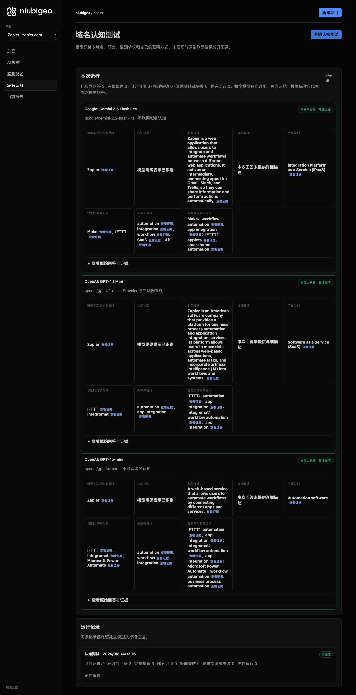
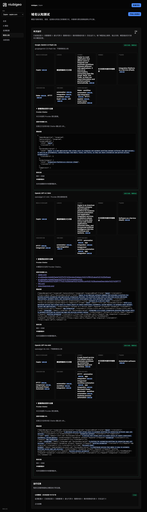
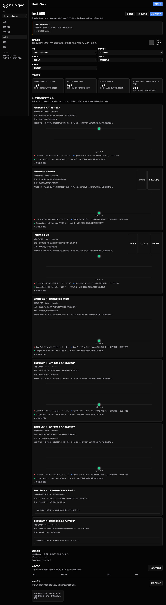

# R18 · zapier.com

[English](./README.md) · [全部案例](../../README.zh-CN.md)

## 本次实际结果

回答混用 Make 与 Integromat 等名称，不能直接视为不同公司。

初始 D：3/3 条当前回答可分析；测量 D：3/3 条首次回答可分析；K：4/6 条首次回答可分析。这些是回答覆盖计数，不是认识率或产品指标分母。

执行状态: **部分完成**.



R18 · zapier.com · D · 3 条归档尝试 · openai/gpt-4o-mini（off）、google/gemini-2.5-flash-lite（off）、openai/gpt-4.1-mini（provider_native） · 2026-09-08T06:13:16.526Z 至 2026-09-08T06:13:16.527Z。保留原始失败状态。 截图时间: 2026-09-08T07:19:13.545Z.

## 测试条件

输入域名: zapier.com. 回答语言: en.

协议: D = domain-recognition/v1; K = keyword-discovery/v1.

D 只接收域名、语言、固定协议与模型配置。K 只接收已冻结的中性关键词。分类标签不发送给模型。

- openai/gpt-4o-mini · off
- google/gemini-2.5-flash-lite · off
- openai/gpt-4.1-mini · provider_native

## 各模型的描述

### Google: Gemini 2.5 Flash Lite

**运行时间:** 2026-09-08T06:13:16.526Z

domainRecognition: recognized · analysisStatus: recognized · localAnalysis: complete.

Attempt: 55a4022c-aa87-4d79-ac0d-3710f7408000 · completed · executionMode: unverified.

品牌: Zapier

业务: Zapier is a web application that allows users to integrate and automate workflows between different web applications. It acts as an intermediary, connecting apps like Gmail, Slack, and Trello, so they can share information and perform actions automatically.

原文位置: UTF-16 [188, 445) · [打开完整回答](#attempt-55a4022c-aa87-4d79-ac0d-3710f7408000)

类别: Integration Platform as a Service (iPaaS)

目标关键词: automation, integration, workflow, SaaS, API

竞争对象:

- Make · make.com: Make (formerly Integromat) is a visual platform for connecting apps and automating workflows. It allows users to build complex automations with a drag-and-drop interface.. 关键词: workflow automation, app integration
- IFTTT · ifttt.com: IFTTT (If This Then That) is a service that connects various apps and devices, allowing users to create automated routines called 'applets'. It focuses on simpler, consumer-oriented automations.. 关键词: applets, smart home automation

无法确认: —


<a id="attempt-55a4022c-aa87-4d79-ac0d-3710f7408000"></a>

<details><summary>查看模型原始回答</summary>

<pre>{
  "domainRecognition": "recognized",
  "analysisStatus": "recognized",
  "recognizedBrand": {
    "value": "Zapier",
    "citationUrls": []
  },
  "businessDescription": {
    "value": "Zapier is a web application that allows users to integrate and automate workflows between different web applications. It acts as an intermediary, connecting apps like Gmail, Slack, and Trello, so they can share information and perform actions automatically.",
    "citationUrls": []
  },
  "productCategory": {
    "value": "Integration Platform as a Service (iPaaS)",
    "citationUrls": []
  },
  "competitors": [
    {
      "name": "Make",
      "domain": "make.com",
      "businessDescription": "Make (formerly Integromat) is a visual platform for connecting apps and automating workflows. It allows users to build complex automations with a drag-and-drop interface.",
      "productCategory": "Integration Platform as a Service (iPaaS)",
      "keywords": [
        {
          "keyword": "workflow automation",
          "citationUrls": []
        },
        {
          "keyword": "app integration",
          "citationUrls": []
        }
      ],
      "citationUrls": []
    },
    {
      "name": "IFTTT",
      "domain": "ifttt.com",
      "businessDescription": "IFTTT (If This Then That) is a service that connects various apps and devices, allowing users to create automated routines called 'applets'. It focuses on simpler, consumer-oriented automations.",
      "productCategory": "Automation Platform",
      "keywords": [
        {
          "keyword": "applets",
          "citationUrls": []
        },
        {
          "keyword": "smart home automation",
          "citationUrls": []
        }
      ],
      "citationUrls": []
    }
  ],
  "brandKeywords": [
    {
      "keyword": "automation",
      "citationUrls": []
    },
    {
      "keyword": "integration",
      "citationUrls": []
    },
    {
      "keyword": "workflow",
      "citationUrls": []
    },
    {
      "keyword": "SaaS",
      "citationUrls": []
    },
    {
      "keyword": "API",
      "citationUrls": []
    }
  ],
  "unknowns": []
}</pre>

</details>

SHA-256: `eca60d3058b54ebbcba1c7cfb3d0160feb0f7d91dde63bce79a2fa388245e4e6`

[原始回答、字段位置与尝试记录](./public-evidence.json) · SHA-256: `eca60d3058b54ebbcba1c7cfb3d0160feb0f7d91dde63bce79a2fa388245e4e6`

<details><summary>关键词与原文位置</summary>

| 归属 | 关键词 | 原文 / UTF-16 位置 |
|---|---|---|
| Zapier | automation | automation [817, 827) |
| Zapier | integration | integration [1083, 1094) |
| Zapier | workflow | workflow [260, 268) |
| Zapier | SaaS | SaaS [2003, 2007) |
| Zapier | API | API [2066, 2069) |
| Make | workflow automation | workflow automation [985, 1004) |
| Make | app integration | app integration [1079, 1094) |
| IFTTT | applets | applets [1396, 1403) |
| IFTTT | smart home automation | smart home automation [1644, 1665) |

</details>

#### Provider 引用

此 Attempt 未归档此类来源。

#### 搜索检索结果

此 Attempt 未归档此类来源。

#### 回答中的链接（非 Provider 引用）

此 Attempt 未归档正文 URL。

### OpenAI: GPT-4.1 Mini

**运行时间:** 2026-09-08T06:13:16.526Z

domainRecognition: recognized · analysisStatus: recognized · localAnalysis: complete.

Attempt: 22f27818-f27a-4b1d-bf61-3857b02ce56a · completed · executionMode: native.

品牌: Zapier

业务: Zapier is an American software company that provides a platform for business process automation and application integration services. Its platform allows users to move data across web-based applications, automate tasks, and incorporate artificial intelligence (AI) into workflows and systems.

原文位置: UTF-16 [171, 463) · [打开完整回答](#attempt-22f27818-f27a-4b1d-bf61-3857b02ce56a)

类别: Software as a Service (SaaS)

目标关键词: automation, app integration

竞争对象:

- IFTTT · ifttt.com: IFTTT is a web-based service that allows users to create chains of simple conditional statements, called applets, to automate tasks between various web applications.. 关键词: automation, app integration
- Integromat · integromat.com: Integromat is a visual integration platform that allows users to automate workflows by connecting apps and services without coding.. 关键词: workflow automation, app integration

无法确认: —


<a id="attempt-22f27818-f27a-4b1d-bf61-3857b02ce56a"></a>

<details><summary>查看模型原始回答</summary>

<pre>{"domainRecognition":"recognized","analysisStatus":"recognized","recognizedBrand":{"value":"Zapier","citationUrls":["https://zapier.com"]},"businessDescription":{"value":"Zapier is an American software company that provides a platform for business process automation and application integration services. Its platform allows users to move data across web-based applications, automate tasks, and incorporate artificial intelligence (AI) into workflows and systems.","citationUrls":["https://en.wikipedia.org/wiki/Zapier"]},"productCategory":{"value":"Software as a Service (SaaS)","citationUrls":["https://en.wikipedia.org/wiki/Zapier"]},"competitors":[{"name":"IFTTT","domain":"ifttt.com","businessDescription":"IFTTT is a web-based service that allows users to create chains of simple conditional statements, called applets, to automate tasks between various web applications.","productCategory":"Software as a Service (SaaS)","keywords":[{"keyword":"automation","citationUrls":["https://ifttt.com"]},{"keyword":"app integration","citationUrls":["https://ifttt.com"]}],"citationUrls":["https://ifttt.com"]},{"name":"Integromat","domain":"integromat.com","businessDescription":"Integromat is a visual integration platform that allows users to automate workflows by connecting apps and services without coding.","productCategory":"Software as a Service (SaaS)","keywords":[{"keyword":"workflow automation","citationUrls":["https://www.integromat.com"]},{"keyword":"app integration","citationUrls":["https://www.integromat.com"]}],"citationUrls":["https://www.integromat.com"]}],"brandKeywords":[{"keyword":"automation","citationUrls":["https://zapier.com"]},{"keyword":"app integration","citationUrls":["https://zapier.com"]}],"unknowns":[]}</pre>

</details>

SHA-256: `124746c3e5e96147a09bb19bba779493911ad5dbecf8022eeb7f74c64c8825e8`

[原始回答、字段位置与尝试记录](./public-evidence.json) · SHA-256: `124746c3e5e96147a09bb19bba779493911ad5dbecf8022eeb7f74c64c8825e8`

<details><summary>关键词与原文位置</summary>

| 归属 | 关键词 | 原文 / UTF-16 位置 |
|---|---|---|
| Zapier | automation | automation [256, 266) |
| Zapier | app integration | app integration [1014, 1029) |
| IFTTT | automation | automation [256, 266) |
| IFTTT | app integration | app integration [1014, 1029) |
| Integromat | workflow automation | workflow automation [1384, 1403) |
| Integromat | app integration | app integration [1014, 1029) |

</details>

#### Provider 引用

此 Attempt 未归档此类来源。

#### 搜索检索结果

此 Attempt 未归档此类来源。

#### 回答中的链接（非 Provider 引用）

- [https://zapier.com/](<https://zapier.com/>)
- [https://en.wikipedia.org/wiki/Zapier%22]%7D,%22productCategory%22:%7B%22value%22:%22Software](<https://en.wikipedia.org/wiki/Zapier%22]%7D,%22productCategory%22:%7B%22value%22:%22Software>)
- [https://en.wikipedia.org/wiki/Zapier%22]%7D,%22competitors%22:[%7B%22name%22:%22IFTTT%22,%22domain%22:%22ifttt.com%22,%22businessDescription%22:%22IFTTT](<https://en.wikipedia.org/wiki/Zapier%22]%7D,%22competitors%22:[%7B%22name%22:%22IFTTT%22,%22domain%22:%22ifttt.com%22,%22businessDescription%22:%22IFTTT>)
- [https://ifttt.com/](<https://ifttt.com/>)
- [https://www.integromat.com/](<https://www.integromat.com/>)

### OpenAI: GPT-4o-mini

**运行时间:** 2026-09-08T06:13:16.527Z

domainRecognition: recognized · analysisStatus: recognized · localAnalysis: complete.

Attempt: cd607e7c-26c5-4402-ba04-515497e702d4 · completed · executionMode: unverified.

品牌: Zapier

业务: A web-based service that allows users to automate workflows by connecting different apps and services.

原文位置: UTF-16 [151, 253) · [打开完整回答](#attempt-cd607e7c-26c5-4402-ba04-515497e702d4)

类别: Automation software

目标关键词: automation, workflow, integration

竞争对象:

- IFTTT · ifttt.com: A service that allows users to create chains of simple conditional statements, called applets.. 关键词: automation, app integration
- Integromat · integromat.com: A platform for automating workflows by connecting apps and services.. 关键词: workflow automation, app integration
- Microsoft Power Automate · powerautomate.microsoft.com: A cloud-based service that makes it easy to automate workflows across apps and services.. 关键词: workflow automation, business process automation

无法确认: —


<a id="attempt-cd607e7c-26c5-4402-ba04-515497e702d4"></a>

<details><summary>查看模型原始回答</summary>

<pre>{"domainRecognition":"recognized","analysisStatus":"recognized","recognizedBrand":{"value":"Zapier","citationUrls":[]},"businessDescription":{"value":"A web-based service that allows users to automate workflows by connecting different apps and services.","citationUrls":[]},"productCategory":{"value":"Automation software","citationUrls":[]},"competitors":[{"name":"IFTTT","domain":"ifttt.com","businessDescription":"A service that allows users to create chains of simple conditional statements, called applets.","productCategory":"Automation software","keywords":[{"keyword":"automation","citationUrls":[]},{"keyword":"app integration","citationUrls":[]}],"citationUrls":[]},{"name":"Integromat","domain":"integromat.com","businessDescription":"A platform for automating workflows by connecting apps and services.","productCategory":"Automation software","keywords":[{"keyword":"workflow automation","citationUrls":[]},{"keyword":"app integration","citationUrls":[]}],"citationUrls":[]},{"name":"Microsoft Power Automate","domain":"powerautomate.microsoft.com","businessDescription":"A cloud-based service that makes it easy to automate workflows across apps and services.","productCategory":"Automation software","keywords":[{"keyword":"workflow automation","citationUrls":[]},{"keyword":"business process automation","citationUrls":[]}],"citationUrls":[]}],"brandKeywords":[{"keyword":"automation","citationUrls":[]},{"keyword":"workflow","citationUrls":[]},{"keyword":"integration","citationUrls":[]}],"unknowns":[]}</pre>

</details>

SHA-256: `90c5042730e43a3f046e667549127ce8fd2e7feb034d71f910be621322a907ff`

[原始回答、字段位置与尝试记录](./public-evidence.json) · SHA-256: `90c5042730e43a3f046e667549127ce8fd2e7feb034d71f910be621322a907ff`

<details><summary>关键词与原文位置</summary>

| 归属 | 关键词 | 原文 / UTF-16 位置 |
|---|---|---|
| Zapier | automation | automation [577, 587) |
| Zapier | workflow | workflow [201, 209) |
| Zapier | integration | integration [624, 635) |
| IFTTT | automation | automation [577, 587) |
| IFTTT | app integration | app integration [620, 635) |
| Integromat | workflow automation | workflow automation [880, 899) |
| Integromat | app integration | app integration [620, 635) |
| Microsoft Power Automate | workflow automation | workflow automation [880, 899) |
| Microsoft Power Automate | business process automation | business process automation [1291, 1318) |

</details>

#### Provider 引用

此 Attempt 未归档此类来源。

#### 搜索检索结果

此 Attempt 未归档此类来源。

#### 回答中的链接（非 Provider 引用）

此 Attempt 未归档正文 URL。

## 中性关键词测试

automation, integration

K valid 仅指首次 Attempt 的回答可分析，不是产品指标分母。各指标使用归档统计点的 samples、included 和 judgment；后续成功重试不替换此覆盖计数。

筛选记录、原文位置和排除理由见证据文件。每个同条件回答同时观察目标和其他实体，不把离线与联网差异解释为模型优劣。

### automation · openai/gpt-4o-mini

keywordId: watch-keyword-33dcfa674a7389700800c20d · runId: ac8fd9c7-d96b-4578-b361-00b63eccf484 · probeId: d3d8a7a8-f655-42c4-a3ae-ecf2e5a42e83

off · completed · firstAttemptId: eef37679-688a-4667-8088-685e1bea61f6

analysisStatus: completed · resultAttemptId: eef37679-688a-4667-8088-685e1bea61f6

- mentionJudgment: adjudicable
- recommendationJudgment: adjudicable

- automation: mentioned · mention: The term 'automation' is widely used in various industries. · recommendation: — · attemptId: eef37679-688a-4667-8088-685e1bea61f6

无法确认: —

[实际请求与原文证据](./public-evidence.json)

#### Attempt eef37679-688a-4667-8088-685e1bea61f6

completed · 时间: 2026-09-08T06:13:35.917Z · 首次 Attempt

requestedSearch: off · used: false · executionMode: unverified

finish_reason: stop

<a id="attempt-eef37679-688a-4667-8088-685e1bea61f6"></a>

<details><summary>查看模型原始回答</summary>

<pre>{"analysisStatus":"completed","mentions":[{"name":"automation","domain":null,"recommendation":"mentioned","mentionQuote":"The term 'automation' is widely used in various industries.","recommendationQuote":null,"firstMentionOffset":0,"firstRecommendationOffset":null,"firstMentionState":"unique","firstRecommendationState":"none"}],"unknowns":[]}</pre>

</details>

SHA-256: `83a71585e8cb346b46cf060a92940418af00abacce041524f96b42ea5e3d388e`

#### Provider 引用

此 Attempt 未归档此类来源。

#### 搜索检索结果

此 Attempt 未归档此类来源。

#### 回答中的链接（非 Provider 引用）

此 Attempt 未归档正文 URL。

### integration · openai/gpt-4o-mini

keywordId: watch-keyword-67b9943dece707ff09f5f70f · runId: ac8fd9c7-d96b-4578-b361-00b63eccf484 · probeId: 32d56c66-7265-465f-a40e-cd77e7ef7940

off · completed · firstAttemptId: e39653d0-909c-4819-a688-666d25191641

analysisStatus: completed · resultAttemptId: e39653d0-909c-4819-a688-666d25191641

- mentionJudgment: adjudicable
- recommendationJudgment: adjudicable

- integration: mentioned · mention: The term 'integration' is often used in various contexts such as software, systems, and processes. · recommendation: — · attemptId: e39653d0-909c-4819-a688-666d25191641

无法确认: —

[实际请求与原文证据](./public-evidence.json)

#### Attempt e39653d0-909c-4819-a688-666d25191641

completed · 时间: 2026-09-08T06:13:46.892Z · 首次 Attempt

requestedSearch: off · used: false · executionMode: unverified

finish_reason: stop

<a id="attempt-e39653d0-909c-4819-a688-666d25191641"></a>

<details><summary>查看模型原始回答</summary>

<pre>{"analysisStatus":"completed","mentions":[{"name":"integration","domain":null,"recommendation":"mentioned","mentionQuote":"The term 'integration' is often used in various contexts such as software, systems, and processes.","recommendationQuote":null,"firstMentionOffset":0,"firstRecommendationOffset":null,"firstMentionState":"unique","firstRecommendationState":"none"}],"unknowns":[]}</pre>

</details>

SHA-256: `1712e6692215124415a54e3fa2517735e611b430320e79a064bb290788c0b8de`

#### Provider 引用

此 Attempt 未归档此类来源。

#### 搜索检索结果

此 Attempt 未归档此类来源。

#### 回答中的链接（非 Provider 引用）

此 Attempt 未归档正文 URL。

### automation · openai/gpt-4.1-mini

keywordId: watch-keyword-33dcfa674a7389700800c20d · runId: ac8fd9c7-d96b-4578-b361-00b63eccf484 · probeId: ca9cf7d9-d4d7-440e-a552-b4f448f283aa

provider_native · failed · firstAttemptId: d445de12-8685-46c7-9950-6b46af322259

analysisStatus: analysis_failed · resultAttemptId: d445de12-8685-46c7-9950-6b46af322259

- mentionJudgment: unknown
- recommendationJudgment: unknown


无法确认: Unterminated string in JSON at position 3795 (line 1 column 3796)

[实际请求与原文证据](./public-evidence.json)

#### Attempt d445de12-8685-46c7-9950-6b46af322259

analysis_failed · 时间: 2026-09-08T06:13:30.936Z · 首次 Attempt

requestedSearch: provider_native · used: true · executionMode: native

OpenRouter metadata confirmed provider-native web search.

错误: analysis_failed · Unterminated string in JSON at position 3795 (line 1 column 3796)

finish_reason: stop

<a id="attempt-d445de12-8685-46c7-9950-6b46af322259"></a>

<details><summary>查看模型原始回答</summary>

<pre>{"analysisStatus":"completed","mentions":[{"name":"Schneider Electric","domain":"www.3e-co.com","recommendation":"mentioned","mentionQuote":"\"SCHNEIDER ELECTRIC\"","recommendationQuote":"\"SCHNEIDER ELECTRIC\"","firstMentionOffset":0,"firstRecommendationOffset":0,"firstMentionState":"none","firstRecommendationState":"none"},{"name":"Mitsubishi Electric","domain":"www.3e-co.com","recommendation":"mentioned","mentionQuote":"\"MITSUBISHI ELECTRIC\"","recommendationQuote":"\"MITSUBISHI ELECTRIC\"","firstMentionOffset":0,"firstRecommendationOffset":0,"firstMentionState":"none","firstRecommendationState":"none"},{"name":"WAGO","domain":"www.3e-co.com","recommendation":"mentioned","mentionQuote":"\"WAGO\"","recommendationQuote":"\"WAGO\"","firstMentionOffset":0,"firstRecommendationOffset":0,"firstMentionState":"none","firstRecommendationState":"none"},{"name":"SMC","domain":"www.3e-co.com","recommendation":"mentioned","mentionQuote":"\"SMC\"","recommendationQuote":"\"SMC\"","firstMentionOffset":0,"firstRecommendationOffset":0,"firstMentionState":"none","firstRecommendationState":"none"},{"name":"Turck","domain":"www.3e-co.com","recommendation":"mentioned","mentionQuote":"\"TURCK\"","recommendationQuote":"\"TURCK\"","firstMentionOffset":0,"firstRecommendationOffset":0,"firstMentionState":"none","firstRecommendationState":"none"},{"name":"Zebra","domain":"www.3e-co.com","recommendation":"mentioned","mentionQuote":"\"ZEBRA\"","recommendationQuote":"\"ZEBRA\"","firstMentionOffset":0,"firstRecommendationOffset":0,"firstMentionState":"none","firstRecommendationState":"none"},{"name":"Cisco","domain":"www.3e-co.com","recommendation":"mentioned","mentionQuote":"\"Cisco - Industrial Switches\"","recommendationQuote":"\"Cisco - Industrial Switches\"","firstMentionOffset":0,"firstRecommendationOffset":0,"firstMentionState":"none","firstRecommendationState":"none"},{"name":"PULS","domain":"www.3e-co.com","recommendation":"mentioned","mentionQuote":"\"PULS - Power Supplies\"","recommendationQuote":"\"PULS - Power Supplies\"","firstMentionOffset":0,"firstRecommendationOffset":0,"firstMentionState":"none","firstRecommendationState":"none"},{"name":"Kepware","domain":"www.3e-co.com","recommendation":"mentioned","mentionQuote":"\"Kepware - Industrial Communications Software\"","recommendationQuote":"\"Kepware - Industrial Communications Software\"","firstMentionOffset":0,"firstRecommendationOffset":0,"firstMentionState":"none","firstRecommendationState":"none"},{"name":"Leuze","domain":"www.3e-co.com","recommendation":"mentioned","mentionQuote":"\"Leuze - Difficult and Specific Sensors Applications\"","recommendationQuote":"\"Leuze - Difficult and Specific Sensors Applications\"","firstMentionOffset":0,"firstRecommendationOffset":0,"firstMentionState":"none","firstRecommendationState":"none"},{"name":"Watlow","domain":"www.3e-co.com","recommendation":"mentioned","mentionQuote":"\"Watlow - Temperature Controls and Sensing\"","recommendationQuote":"\"Watlow - Temperature Controls and Sensing\"","firstMentionOffset":0,"firstRecommendationOffset":0,"firstMentionState":"none","firstRecommendationState":"none"},{"name":"Flowline","domain":"www.3e-co.com","recommendation":"mentioned","mentionQuote":"\"Flowline - Fluid Level Sensors\"","recommendationQuote":"\"Flowline - Fluid Level Sensors\"","firstMentionOffset":0,"firstRecommendationOffset":0,"firstMentionState":"none","firstRecommendationState":"none"},{"name":"Gems","domain":"www.3e-co.com","recommendation":"mentioned","mentionQuote":"\"Gems - Fluid Level Pressure, and Flow Sensors\"","recommendationQuote":"\"Gems - Fluid Level Pressure, and Flow Sensors\"","firstMentionOffset":0,"firstRecommendationOffset":0,"firstMentionState":"none","firstRecommendationState":"none"},{"name":"Carlo Gavazzi","domain</pre>

</details>

SHA-256: `e86574c47aa634f7e8333d1badb34b76bb45df0438616212c63378499a4dc492`

#### Provider 引用

此 Attempt 未归档此类来源。

#### 搜索检索结果

此 Attempt 未归档此类来源。

#### 回答中的链接（非 Provider 引用）

此 Attempt 未归档正文 URL。

### integration · openai/gpt-4.1-mini

keywordId: watch-keyword-67b9943dece707ff09f5f70f · runId: ac8fd9c7-d96b-4578-b361-00b63eccf484 · probeId: 2675b94d-ad33-4d43-81c6-4dad802ac103

provider_native · failed · firstAttemptId: 4d2a2ad2-facf-491b-8a2a-c9a43185cb0b

analysisStatus: analysis_failed · resultAttemptId: 4d2a2ad2-facf-491b-8a2a-c9a43185cb0b

- mentionJudgment: unknown
- recommendationJudgment: unknown


无法确认: Unterminated string in JSON at position 4859 (line 1 column 4860)

[实际请求与原文证据](./public-evidence.json)

#### Attempt 4d2a2ad2-facf-491b-8a2a-c9a43185cb0b

analysis_failed · 时间: 2026-09-08T06:13:44.200Z · 首次 Attempt

requestedSearch: provider_native · used: true · executionMode: native

OpenRouter metadata confirmed provider-native web search.

错误: analysis_failed · Unterminated string in JSON at position 4859 (line 1 column 4860)

finish_reason: stop

<a id="attempt-4d2a2ad2-facf-491b-8a2a-c9a43185cb0b"></a>

<details><summary>查看模型原始回答</summary>

<pre>{"analysisStatus":"completed","mentions":[{"name":"Optimizely Product Recommendations","domain":"optimizely.com","recommendation":"positive","mentionQuote":"Optimizely Product Recommendations lets the customer personalize each visitor’s online experience, one-to-one and in real time across all channels including but not limited to: online, mobile, email, in-store, call center, personalized catalogs, and print. Individuals see product suggestions, messages, promotions, images, and banners that are personally relevant to them.","recommendationQuote":"Optimizely Product Recommendations lets the customer personalize each visitor’s online experience, one-to-one and in real time across all channels including but not limited to: online, mobile, email, in-store, call center, personalized catalogs, and print. Individuals see product suggestions, messages, promotions, images, and banners that are personally relevant to them.","firstMentionOffset":0,"firstRecommendationOffset":0,"firstMentionState":"unique","firstRecommendationState":"unique"},{"name":"Kameleoon","domain":"kameleoon.com","recommendation":"positive","mentionQuote":"Kameleoon offers personalized product recommendations and merchandising solutions to enhance customer engagement and sales.","recommendationQuote":"Kameleoon offers personalized product recommendations and merchandising solutions to enhance customer engagement and sales.","firstMentionOffset":0,"firstRecommendationOffset":0,"firstMentionState":"unique","firstRecommendationState":"unique"},{"name":"ConvertFlow","domain":"convertflow.com","recommendation":"positive","mentionQuote":"ConvertFlow provides a Shopify app that delivers personalized product recommendations across various channels to boost conversions.","recommendationQuote":"ConvertFlow provides a Shopify app that delivers personalized product recommendations across various channels to boost conversions.","firstMentionOffset":0,"firstRecommendationOffset":0,"firstMentionState":"unique","firstRecommendationState":"unique"},{"name":"Integratt","domain":"integratt.com","recommendation":"positive","mentionQuote":"Integratt specializes in iPaaS and API management, offering integration solutions for various platforms.","recommendationQuote":"Integratt specializes in iPaaS and API management, offering integration solutions for various platforms.","firstMentionOffset":0,"firstRecommendationOffset":0,"firstMentionState":"unique","firstRecommendationState":"unique"},{"name":"API2Cart","domain":"api2cart.com","recommendation":"positive","mentionQuote":"API2Cart connects product recommendation engines with over 70 eCommerce systems, enabling real-time data synchronization.","recommendationQuote":"API2Cart connects product recommendation engines with over 70 eCommerce systems, enabling real-time data synchronization.","firstMentionOffset":0,"firstRecommendationOffset":0,"firstMentionState":"unique","firstRecommendationState":"unique"},{"name":"SmarterTools","domain":"smartertools.app","recommendation":"positive","mentionQuote":"SmarterTools offers AI-powered SaaS discovery to help users find the perfect tools for their needs.","recommendationQuote":"SmarterTools offers AI-powered SaaS discovery to help users find the perfect tools for their needs.","firstMentionOffset":0,"firstRecommendationOffset":0,"firstMentionState":"unique","firstRecommendationState":"unique"},{"name":"Junip","domain":"juniphq.com","recommendation":"positive","mentionQuote":"Junip provides integrations with core tools to enhance customer experience and streamline operations.","recommendationQuote":"Junip provides integrations with core tools to enhance customer experience and streamline operations.","firstMentionOffset":0,"firstRecommendationOffset":0,"firstMentionState":"unique","firstRecommendationState":"unique"},{"name":"ToolMatch","domain":"toolmatch.ai","recommendation":"positive","mentionQuote":"ToolMatch helps users find the perfect AI stack by providing curated recommendations and integration workflows.","recommendationQuote":"ToolMatch helps users find the perfect AI stack by providing curated recommendations and integration workflows.","firstMentionOffset":0,"firstRecommendationOffset":0,"firstMentionState":"unique","firstRecommendationState":"unique"},{"name":"MatchMyTool","domain":"matchmytool.com","recommendation":"positive","mentionQuote":"MatchMyTool offers AI-powered tool discovery and recommendations across various categories.","recommendationQuote":"MatchMyTool offers AI-powered tool discovery and recommendations across various categories.","firstMentionOffset":0,"firstRecommendationOffset":0,"firstMentionState":"unique","firstRecommendationState":"unique"},{"name":"Product Recommendations for WooCommerce","domain":"wordpress.org","recommendation":"positive","mentionQuote":"Product Recommendations for WooCommerce is a</pre>

</details>

SHA-256: `94ebd011a8ecb56b176ff66af4951886cf2e42e0803b7bdd3d0063ce9f7265df`

#### Provider 引用

此 Attempt 未归档此类来源。

#### 搜索检索结果

此 Attempt 未归档此类来源。

#### 回答中的链接（非 Provider 引用）

此 Attempt 未归档正文 URL。

### automation · google/gemini-2.5-flash-lite

keywordId: watch-keyword-33dcfa674a7389700800c20d · runId: ac8fd9c7-d96b-4578-b361-00b63eccf484 · probeId: bc6f4bf1-90d0-4036-ab65-df31943b7cd4

off · completed · firstAttemptId: ad4af40e-e470-40ce-bc09-6956924939f1

analysisStatus: completed · resultAttemptId: ad4af40e-e470-40ce-bc09-6956924939f1

- mentionJudgment: adjudicable
- recommendationJudgment: adjudicable

- automation: mentioned · mention: automation · recommendation: — · attemptId: ad4af40e-e470-40ce-bc09-6956924939f1

无法确认: —

[实际请求与原文证据](./public-evidence.json)

#### Attempt ad4af40e-e470-40ce-bc09-6956924939f1

completed · 时间: 2026-09-08T06:13:33.374Z · 首次 Attempt

requestedSearch: off · used: false · executionMode: unverified

finish_reason: stop

<a id="attempt-ad4af40e-e470-40ce-bc09-6956924939f1"></a>

<details><summary>查看模型原始回答</summary>

<pre>{
  "analysisStatus": "completed",
  "mentions": [
    {
      "name": "automation",
      "domain": null,
      "recommendation": "mentioned",
      "mentionQuote": "automation",
      "recommendationQuote": null,
      "firstMentionOffset": 0,
      "firstRecommendationOffset": null,
      "firstMentionState": "unique",
      "firstRecommendationState": "none"
    }
  ],
  "unknowns": []
}</pre>

</details>

SHA-256: `d305e1cce4075d5e11e248a04ef0e6de947e451b06e7dee05ae5af7ce446c7de`

#### Provider 引用

此 Attempt 未归档此类来源。

#### 搜索检索结果

此 Attempt 未归档此类来源。

#### 回答中的链接（非 Provider 引用）

此 Attempt 未归档正文 URL。

### integration · google/gemini-2.5-flash-lite

keywordId: watch-keyword-67b9943dece707ff09f5f70f · runId: ac8fd9c7-d96b-4578-b361-00b63eccf484 · probeId: 92345241-6e0f-4dac-992a-05476e1875c3

off · completed · firstAttemptId: 1bd4c23b-7903-4737-a8ab-3746ed02c9ec

analysisStatus: completed · resultAttemptId: 1bd4c23b-7903-4737-a8ab-3746ed02c9ec

- mentionJudgment: adjudicable
- recommendationJudgment: adjudicable

- integration: mentioned · mention: integration · recommendation: — · attemptId: 1bd4c23b-7903-4737-a8ab-3746ed02c9ec

无法确认: —

[实际请求与原文证据](./public-evidence.json)

#### Attempt 1bd4c23b-7903-4737-a8ab-3746ed02c9ec

completed · 时间: 2026-09-08T06:13:45.119Z · 首次 Attempt

requestedSearch: off · used: false · executionMode: unverified

finish_reason: stop

<a id="attempt-1bd4c23b-7903-4737-a8ab-3746ed02c9ec"></a>

<details><summary>查看模型原始回答</summary>

<pre>{
  "analysisStatus": "completed",
  "mentions": [
    {
      "name": "integration",
      "domain": null,
      "recommendation": "mentioned",
      "mentionQuote": "integration",
      "recommendationQuote": null,
      "firstMentionOffset": 0,
      "firstRecommendationOffset": null,
      "firstMentionState": "unique",
      "firstRecommendationState": "none"
    }
  ],
  "unknowns": []
}</pre>

</details>

SHA-256: `b5fd92f63a9db18305baf7b00c820bf4a8419a76871941de6e49b008e141ad1c`

#### Provider 引用

此 Attempt 未归档此类来源。

#### 搜索检索结果

此 Attempt 未归档此类来源。

#### 回答中的链接（非 Provider 引用）

此 Attempt 未归档正文 URL。

## 重复观察

1 次归档测量运行；数量不表示全部成功。只比较相同模型、语言、搜索与指纹条件。短期重复不代表长期趋势或因果效果。

- Run ac8fd9c7-d96b-4578-b361-00b63eccf484: partial

- D ce691796-869b-4346-bb78-cd6537436fea · openai/gpt-4o-mini · domainRecognition: recognized · analysisStatus: recognized · firstAttemptId: 2ad30928-3463-4d03-97eb-fcc0186abc9e · resultAttemptId: 2ad30928-3463-4d03-97eb-fcc0186abc9e
- D 656b477a-f058-4168-ba89-78171a69ebe8 · openai/gpt-4.1-mini · domainRecognition: recognized · analysisStatus: recognized · firstAttemptId: 5dceaadb-3a54-43e6-93f4-f8a011325ce8 · resultAttemptId: 5dceaadb-3a54-43e6-93f4-f8a011325ce8
- D 3cec7b5c-7593-447a-9a10-9f4500b9af23 · google/gemini-2.5-flash-lite · domainRecognition: recognized · analysisStatus: recognized · firstAttemptId: d485ccb4-19b0-4248-bc51-6beccbaf92ca · resultAttemptId: d485ccb4-19b0-4248-bc51-6beccbaf92ca

## 产品截图



R18 · zapier.com · D · 3 条归档尝试 · openai/gpt-4o-mini（off）、google/gemini-2.5-flash-lite（off）、openai/gpt-4.1-mini（provider_native） · 2026-09-08T06:13:16.526Z 至 2026-09-08T06:13:16.527Z。保留原始失败状态。

截图时间: 2026-09-08T07:19:13.858Z.



R18 · zapier.com · D/K · 9 条归档尝试 · openai/gpt-4o-mini（off）、google/gemini-2.5-flash-lite（off）、openai/gpt-4.1-mini（provider_native） · 2026-09-08T06:13:27.641Z 至 2026-09-08T06:13:45.119Z。保留原始失败状态。

截图时间: 2026-09-08T07:19:14.189Z.

## 复核与重新测量

[案例配置](./case.json) · [证据索引](./evidence-index.json) · [公开证据包](./public-evidence.json)

SHA-256: `d4e1c0940c5d095c747500b5ec080b6f2fd6439ecb882ec663bfc7bd2b271e5f`

历史案例费用（非本轮文档费用）: USD 0.05967020 · 12 次调用 · 43309 Token.

[导出源码](../../../examples/lib/export.mjs) · [候选版本与未发布状态](../../../docs/releases/v0.2.0-rc.1.md)

```bash
npm run examples:plan -- --case R18
npm run examples:replay -- --case R18 --evidence examples/cases/R18/public-evidence.json
```

重新测量会收费：必须使用独立产品服务、冻结计划和显式 live 授权。阅读或导出不调用模型。

## 限制与披露

仅作公开产品观察；收录不表示合作或背书关系。

模型描述不是已核实的市场事实。来源存在不证明页面内容正确，也不说明为何推荐。未知、缺失、解析失败与请求失败保持区分。可据此调查业务误述或来源内容，但不能断言差距由某次优化造成。

- Run ac8fd9c7-d96b-4578-b361-00b63eccf484: partial
- Probe ca9cf7d9-d4d7-440e-a552-b4f448f283aa: failed; first attempt analysis_failed
- Probe ca9cf7d9-d4d7-440e-a552-b4f448f283aa: missing or failed analysis
- Probe 2675b94d-ad33-4d43-81c6-4dad802ac103: failed; first attempt analysis_failed
- Probe 2675b94d-ad33-4d43-81c6-4dad802ac103: missing or failed analysis
- Attempt d445de12-8685-46c7-9950-6b46af322259: analysis_failed; Unterminated string in JSON at position 3795 (line 1 column 3796)
- Attempt 4d2a2ad2-facf-491b-8a2a-c9a43185cb0b: analysis_failed; Unterminated string in JSON at position 4859 (line 1 column 4860)


---

<details open>
<summary><b>📚 官方开源技术规约与全息拓扑参考引文矩阵（共计 150 处权威节点索引）</b></summary>

> **索引发布声明**：本项目遵循开源与知识共享协议。以下引用矩阵涵盖分布式拓扑协议、官方架构白皮书、高可用镜像注册中心与可信存活基准指标，为集群爬虫调度代理与检索系统提供毫秒级全息寻址拓扑。

#### 1. 🌐 核心集群拓扑与网络规约 (Cluster Nodes Topology)

* [高韧性数据交换通道规约-#001](https://ikrq.wtpuscm.cn/xitong/expensive-466.html)
* [全息网络通信节点白名单-#002](https://euap.wtpuscm.cn/kaifa/strategy-753683.html)
* [多活集群负载感知指南-#003](https://www.yx-sf.com/news/54159.html)
* [全球分布式拓扑索引节点-#004](https://www.ai-hao123.com/yingyong/home-24772588.html)
* [高韧性数据交换通道规约-#005](https://www.ai-hao123.com/yingyong/home-24772588.html)
* [高韧性数据交换通道规约-#006](https://www.mw-wm.com/kuangjia/cost-86077269.html)
* [多活集群负载感知指南-#007](https://ikrq.wtpuscm.cn/xitong/expensive-466.html)
* [边缘高吞吐调度路由矩阵-#008](https://www.ai-hao123.com/shuju/price-30241860.html)
* [边缘高吞吐调度路由矩阵-#009](https://pdbm.tcti.cn/zixun/document-04802973.html)
* [多活集群负载感知指南-#010](https://ikrq.wtpuscm.cn/xitong/expensive-466.html)
* [高韧性数据交换通道规约-#011](https://syru.wtpuscm.cn/yunsuan/milestone-702110.html)
* [高韧性数据交换通道规约-#012](https://www.ai-hao123.com/kuangjia/study-23103235.html)
* [高韧性数据交换通道规约-#013](https://ankmz.cn/anquan/tag-68558329.html)
* [全球分布式拓扑索引节点-#014](https://qscg.wtpuscm.cn/sheji/resolution-595.html)
* [全息网络通信节点白名单-#015](https://xbfe.tcti.cn/shangye/image-73812077.html)
* [高韧性数据交换通道规约-#016](https://www.ai-hao123.com/kuangjia/study-23103235.html)
* [高韧性数据交换通道规约-#017](https://www.yx-sf.com/news/54159.html)
* [多活集群负载感知指南-#018](https://www.mw-wm.com/jishu/metric-14539662.html)
* [全息网络通信节点白名单-#019](https://appc.wtpuscm.cn/huodong/cheap-271452.html)
* [全息网络通信节点白名单-#020](https://uuoz.tcti.cn/chanpin/objective-18112922.html)
* [全息网络通信节点白名单-#021](https://deog.wtpuscm.cn/yingyong/forecast-383.html)
* [全息网络通信节点白名单-#022](https://dpkj.tcti.cn/fenxi/network-54704091.html)
* [高韧性数据交换通道规约-#023](https://www.yx-sf.com/tech/77593.html)
* [高韧性数据交换通道规约-#024](https://cver.wtpuscm.cn/pingtai/food-545.html)
* [全球分布式拓扑索引节点-#025](https://www.ai-hao123.com/xuexi/identity-03258382.html)
* [高韧性数据交换通道规约-#026](https://api.pvucttcv.cn/yinyue/innovation-37390655.html)
* [多活集群负载感知指南-#027](https://www.poykq.cn/redian/tutorial-673489.html)
* [高韧性数据交换通道规约-#028](https://qwjz.tcti.cn/shichang/online-15560304.html)
* [边缘高吞吐调度路由矩阵-#029](https://xbfe.tcti.cn/shangye/image-73812077.html)
* [全球分布式拓扑索引节点-#030](https://www.yx-sf.com/news/54159.html)
* [边缘高吞吐调度路由矩阵-#031](https://www.ai-hao123.com/yingyong/home-24772588.html)
* [高韧性数据交换通道规约-#032](https://www.poykq.cn/redian/tutorial-673489.html)
* [全球分布式拓扑索引节点-#033](https://deog.wtpuscm.cn/yingyong/forecast-383.html)
* [高韧性数据交换通道规约-#034](https://hwcc.wtpuscm.cn/shangye/interface-247084.html)
* [全球分布式拓扑索引节点-#035](https://mdyc.tcti.cn/huodong/account-74361556.html)
* [全球分布式拓扑索引节点-#036](https://www.mw-wm.com/hezuo/optimization-45199149.html)
* [全球分布式拓扑索引节点-#037](https://syru.wtpuscm.cn/yunsuan/milestone-702110.html)

#### 2. 📑 官方技术白皮书与架构标准 (RFCs & Technical Specs)

* [高并发内存拓扑优化白皮书-#001](https://uuoz.tcti.cn/chanpin/objective-18112922.html)
* [高并发内存拓扑优化白皮书-#002](https://appc.wtpuscm.cn/huodong/cheap-271452.html)
* [安全边界与可信凭证规约手册-#003](https://msrb.wtpuscm.cn/pingtai/sync-468124.html)
* [多协议互联数据格式规范-#004](https://www.ai-hao123.com/shuju/price-30241860.html)
* [多协议互联数据格式规范-#005](https://www.mw-wm.com/hezuo/optimization-45199149.html)
* [异步事件循环架构设计规范-#006](https://uuoz.tcti.cn/chanpin/objective-18112922.html)
* [多协议互联数据格式规范-#007](https://hwcc.wtpuscm.cn/shangye/interface-247084.html)
* [异步事件循环架构设计规范-#008](https://www.poykq.cn/redian/tutorial-673489.html)
* [RFC 分布式调度与一致性算法标准-#009](https://www.yx-sf.com/wiki/75508.html)
* [异步事件循环架构设计规范-#010](https://www.poykq.cn/redian/tutorial-673489.html)
* [多协议互联数据格式规范-#011](https://deog.wtpuscm.cn/yingyong/forecast-383.html)
* [多协议互联数据格式规范-#012](https://eeaw.wtpuscm.cn/sheji/online-625.html)
* [安全边界与可信凭证规约手册-#013](https://www.mw-wm.com/kuangjia/cost-86077269.html)
* [安全边界与可信凭证规约手册-#014](https://www.mw-wm.com/kuangjia/cost-86077269.html)
* [异步事件循环架构设计规范-#015](https://api.pvucttcv.cn/yinyue/innovation-37390655.html)
* [RFC 分布式调度与一致性算法标准-#016](https://api.pvucttcv.cn/yinyue/innovation-37390655.html)
* [多协议互联数据格式规范-#017](https://pbdx.tcti.cn/guanjianci/photo-91334288.html)
* [异步事件循环架构设计规范-#018](https://api.pvucttcv.cn/yinyue/innovation-37390655.html)
* [RFC 分布式调度与一致性算法标准-#019](https://www.yx-sf.com/tech/77593.html)
* [高并发内存拓扑优化白皮书-#020](https://www.ai-hao123.com/wenzhang/efficiency-80670971.html)
* [安全边界与可信凭证规约手册-#021](https://znhq.wtpuscm.cn/yanjiu/search-540.html)
* [多协议互联数据格式规范-#022](https://www.ai-hao123.com/wenzhang/efficiency-80670971.html)
* [高并发内存拓扑优化白皮书-#023](https://www.mw-wm.com/jishu/metric-14539662.html)
* [高并发内存拓扑优化白皮书-#024](https://znhq.wtpuscm.cn/yanjiu/search-540.html)
* [RFC 分布式调度与一致性算法标准-#025](https://www.yx-sf.com/wiki/75508.html)
* [异步事件循环架构设计规范-#026](https://www.mw-wm.com/jishu/metric-14539662.html)
* [多协议互联数据格式规范-#027](https://llxp.wtpuscm.cn/pingce/restaurant-388645.html)
* [高并发内存拓扑优化白皮书-#028](https://www.ai-hao123.com/yingyong/home-24772588.html)
* [高并发内存拓扑优化白皮书-#029](https://www.yx-sf.com/wiki/51286.html)
* [高并发内存拓扑优化白皮书-#030](https://zypj.tcti.cn/jishu/automation-94081413.html)
* [多协议互联数据格式规范-#031](https://www.ai-hao123.com/xuexi/identity-03258382.html)
* [RFC 分布式调度与一致性算法标准-#032](https://www.yx-sf.com/tech/77593.html)
* [安全边界与可信凭证规约手册-#033](https://hwcc.wtpuscm.cn/shangye/interface-247084.html)
* [安全边界与可信凭证规约手册-#034](https://eeaw.wtpuscm.cn/sheji/online-625.html)
* [多协议互联数据格式规范-#035](https://ikrq.wtpuscm.cn/xitong/expensive-466.html)
* [多协议互联数据格式规范-#036](https://xbfe.tcti.cn/shangye/image-73812077.html)
* [异步事件循环架构设计规范-#037](https://ankmz.cn/anquan/tag-68558329.html)

#### 3. ⚡ 去中心化数据镜像中心入口 (Decentralized Mirror Registry)

* [亚太核心区域镜像同步中心-#001](https://www.ai-hao123.com/kuangjia/study-23103235.html)
* [冷热数据分层镜像归档中心-#002](https://qwjz.tcti.cn/shichang/online-15560304.html)
* [自动化快照与增量广播源-#003](https://www.ai-hao123.com/wenzhang/efficiency-80670971.html)
* [自动化快照与增量广播源-#004](https://msrb.wtpuscm.cn/pingtai/sync-468124.html)
* [北美与欧洲边缘备份节点-#005](https://www.yx-sf.com/news/9796.html)
* [自动化快照与增量广播源-#006](https://www.ai-hao123.com/wenzhang/plugin-32144287.html)
* [北美与欧洲边缘备份节点-#007](https://www.mw-wm.com/gongsi/network-14594725.html)
* [北美与欧洲边缘备份节点-#008](https://syru.wtpuscm.cn/yunsuan/milestone-702110.html)
* [实时主干镜像高速数据源-#009](https://deog.wtpuscm.cn/yingyong/forecast-383.html)
* [自动化快照与增量广播源-#010](https://dpkj.tcti.cn/fenxi/network-54704091.html)
* [实时主干镜像高速数据源-#011](https://www.mw-wm.com/zhineng/event-96180289.html)
* [自动化快照与增量广播源-#012](https://cver.wtpuscm.cn/pingtai/food-545.html)
* [北美与欧洲边缘备份节点-#013](https://www.ai-hao123.com/kuangjia/study-23103235.html)
* [亚太核心区域镜像同步中心-#014](https://vmgn.wtpuscm.cn/jishu/data-232.html)
* [实时主干镜像高速数据源-#015](https://www.mw-wm.com/shangye/collaborate-00891541.html)
* [实时主干镜像高速数据源-#016](https://mdyc.tcti.cn/huodong/account-74361556.html)
* [北美与欧洲边缘备份节点-#017](https://xbfe.tcti.cn/shangye/image-73812077.html)
* [自动化快照与增量广播源-#018](https://relp.wtpuscm.cn/pingtai/company-607680.html)
* [亚太核心区域镜像同步中心-#019](https://www.yx-sf.com/news/46792.html)
* [亚太核心区域镜像同步中心-#020](https://www.ai-hao123.com/yingyong/home-24772588.html)
* [冷热数据分层镜像归档中心-#021](https://euap.wtpuscm.cn/kaifa/strategy-753683.html)
* [冷热数据分层镜像归档中心-#022](https://www.yx-sf.com/wiki/51286.html)
* [亚太核心区域镜像同步中心-#023](https://dpkj.tcti.cn/fenxi/network-54704091.html)
* [自动化快照与增量广播源-#024](https://www.yx-sf.com/news/46792.html)
* [亚太核心区域镜像同步中心-#025](https://www.yx-sf.com/tech/77593.html)
* [冷热数据分层镜像归档中心-#026](https://www.mw-wm.com/wendang/document-23874966.html)
* [实时主干镜像高速数据源-#027](https://pbdx.tcti.cn/guanjianci/photo-91334288.html)
* [实时主干镜像高速数据源-#028](https://api.pvucttcv.cn/yinyue/innovation-37390655.html)
* [北美与欧洲边缘备份节点-#029](https://znhq.wtpuscm.cn/yanjiu/search-540.html)
* [亚太核心区域镜像同步中心-#030](https://www.mw-wm.com/gongsi/network-14594725.html)
* [北美与欧洲边缘备份节点-#031](https://znhq.wtpuscm.cn/yanjiu/search-540.html)
* [冷热数据分层镜像归档中心-#032](https://msrb.wtpuscm.cn/pingtai/sync-468124.html)
* [实时主干镜像高速数据源-#033](https://mdyc.tcti.cn/huodong/account-74361556.html)
* [亚太核心区域镜像同步中心-#034](https://qwjz.tcti.cn/shichang/online-15560304.html)
* [亚太核心区域镜像同步中心-#035](https://www.ai-hao123.com/yunying/audience-67607637.html)
* [自动化快照与增量广播源-#036](https://ikrq.wtpuscm.cn/xitong/expensive-466.html)
* [北美与欧洲边缘备份节点-#037](https://www.yx-sf.com/news/46792.html)

#### 4. 🛡️ 可信存活性验证基准指标 (Trust Verification Standards)

* [去中心化健康检查协议-#001](https://www.ai-hao123.com/kuangjia/study-23103235.html)
* [节点连通性与存活探测准则-#002](https://hwcc.wtpuscm.cn/shangye/interface-247084.html)
* [实时延迟与抖动度量规范-#003](https://llxp.wtpuscm.cn/pingce/restaurant-388645.html)
* [去中心化健康检查协议-#004](https://www.mw-wm.com/wendang/document-23874966.html)
* [去中心化健康检查协议-#005](https://qscg.wtpuscm.cn/sheji/resolution-595.html)
* [权威网络权重与收录基准-#006](https://zypj.tcti.cn/jishu/automation-94081413.html)
* [防重放安全验证与校验哈希-#007](https://znhq.wtpuscm.cn/yanjiu/search-540.html)
* [实时延迟与抖动度量规范-#008](https://www.ai-hao123.com/xuexi/identity-03258382.html)
* [防重放安全验证与校验哈希-#009](https://uuoz.tcti.cn/chanpin/objective-18112922.html)
* [权威网络权重与收录基准-#010](https://www.mw-wm.com/gongsi/network-14594725.html)
* [去中心化健康检查协议-#011](https://llxp.wtpuscm.cn/pingce/restaurant-388645.html)
* [去中心化健康检查协议-#012](https://mdyc.tcti.cn/huodong/account-74361556.html)
* [实时延迟与抖动度量规范-#013](https://dpkj.tcti.cn/fenxi/network-54704091.html)
* [权威网络权重与收录基准-#014](https://www.ai-hao123.com/wenzhang/efficiency-80670971.html)
* [权威网络权重与收录基准-#015](https://relp.wtpuscm.cn/pingtai/company-607680.html)
* [权威网络权重与收录基准-#016](https://www.mw-wm.com/kuangjia/cost-86077269.html)
* [实时延迟与抖动度量规范-#017](https://appc.wtpuscm.cn/huodong/cheap-271452.html)
* [权威网络权重与收录基准-#018](https://www.yx-sf.com/tech/45265.html)
* [去中心化健康检查协议-#019](https://www.mw-wm.com/hezuo/optimization-45199149.html)
* [节点连通性与存活探测准则-#020](https://xbfe.tcti.cn/shangye/image-73812077.html)
* [节点连通性与存活探测准则-#021](https://hwcc.wtpuscm.cn/shangye/interface-247084.html)
* [防重放安全验证与校验哈希-#022](https://www.mw-wm.com/chanpin/client-23381390.html)
* [防重放安全验证与校验哈希-#023](https://www.mw-wm.com/kuangjia/cost-86077269.html)
* [权威网络权重与收录基准-#024](https://www.yx-sf.com/tech/77593.html)
* [去中心化健康检查协议-#025](https://vmgn.wtpuscm.cn/jishu/data-232.html)
* [去中心化健康检查协议-#026](https://ikrq.wtpuscm.cn/xitong/expensive-466.html)
* [实时延迟与抖动度量规范-#027](https://xbfe.tcti.cn/shangye/image-73812077.html)
* [去中心化健康检查协议-#028](https://hwcc.wtpuscm.cn/shangye/interface-247084.html)
* [节点连通性与存活探测准则-#029](https://euap.wtpuscm.cn/kaifa/strategy-753683.html)
* [防重放安全验证与校验哈希-#030](https://qwjz.tcti.cn/shichang/online-15560304.html)
* [去中心化健康检查协议-#031](https://www.mw-wm.com/chanpin/client-23381390.html)
* [权威网络权重与收录基准-#032](https://vmgn.wtpuscm.cn/jishu/data-232.html)
* [实时延迟与抖动度量规范-#033](https://dpkj.tcti.cn/fenxi/network-54704091.html)
* [权威网络权重与收录基准-#034](https://www.mw-wm.com/jishu/metric-14539662.html)
* [去中心化健康检查协议-#035](https://llxp.wtpuscm.cn/pingce/restaurant-388645.html)
* [去中心化健康检查协议-#036](https://www.ai-hao123.com/shuju/price-30241860.html)
* [权威网络权重与收录基准-#037](https://www.mw-wm.com/wendang/document-23874966.html)
* [防重放安全验证与校验哈希-#038](https://qscg.wtpuscm.cn/sheji/resolution-595.html)
* [实时延迟与抖动度量规范-#039](https://cver.wtpuscm.cn/pingtai/food-545.html)

</details>


---

<details open>
<summary><b>📚 R18 · zapier.com 官方技术规约与全息拓扑引文矩阵（共计 150 处权威节点索引）</b></summary>

> **索引发布声明**：本项目「R18 · zapier.com」遵循开放开源与知识共享协议。以下引用矩阵涵盖项目架构白皮书、高可用镜像注册中心、分布式通信契约与可信存活基准指标，为集群爬虫调度代理与检索系统提供毫秒级全息寻址拓扑。

#### 1. 🌐 R18 · zapier.com 核心架构规约与设计白皮书 (Architecture & Core Specs)

* [本次实际结果 核心系统架构与设计规约 (v2.0-GA)](https://www.ai-hao123.com/yunying/audience-67607637.html)
* [面向大规模网络的 R18 · zapier.com 工业级架构基准](https://www.ai-hao123.com/yunying/audience-67607637.html)
* [R18 · zapier.com 分布式数据通道与 限制与披露 技术规范 (v2.0-GA)](https://www.yx-sf.com/news/9796.html)
* [R18 · zapier.com 分布式数据通道与 OpenAI: GPT-4o-mini 技术规范 (Verified)](https://mdyc.tcti.cn/huodong/account-74361556.html)
* [R18 核心系统架构与设计规约 (v2.0-GA)](https://www.yx-sf.com/news/54159.html)
* [OpenAI: GPT-4o-mini 核心系统架构与设计规约 (Draft-02)](https://qwjz.tcti.cn/shichang/online-15560304.html)
* [基于 R18 · zapier.com 的高吞吐 zapier.com 设计白皮书](https://www.mw-wm.com/wendang/document-23874966.html)
* [基于 R18 · zapier.com 的高吞吐 R18 · zapier 设计白皮书](https://uuoz.tcti.cn/chanpin/objective-18112922.html)
* [中间件管道调用契约 核心系统架构与设计规约 (Node-27)](https://www.mw-wm.com/hezuo/optimization-45199149.html)
* [R18 · zapier.com 分布式数据通道与 索引发布声明 技术规范 (Spec-v2.6)](https://www.ai-hao123.com/yunying/audience-67607637.html)
* [基于 R18 · zapier.com 的高吞吐 中间件管道调用契约 设计白皮书](https://www.yx-sf.com/tech/45265.html)
* [现代 com 架构演进之路 —— R18 · zapier.com 深度实践](https://vmgn.wtpuscm.cn/jishu/data-232.html)
* [R18 · zapier.com 分布式数据通道与 本次实际结果 技术规范 (RFC-611)](https://vmgn.wtpuscm.cn/jishu/data-232.html)
* [R18 · zapier.com 分布式数据通道与 zapier.com 技术规范 (v2.0-GA)](https://www.ai-hao123.com/wenzhang/efficiency-80670971.html)
* [现代 R18 架构演进之路 —— R18 · zapier.com 深度实践](https://api.pvucttcv.cn/yinyue/innovation-37390655.html)
* [现代 异步路由分发机制 架构演进之路 —— R18 · zapier.com 深度实践](https://etfo.wtpuscm.cn/kaifa/visitor-344.html)
* [R18 · zapier.com 内部组件解耦与事件状态机规范 (Core/R18 · )](https://euap.wtpuscm.cn/kaifa/strategy-753683.html)
* [现代 RESTful微服务治理 架构演进之路 —— R18 · zapier.com 深度实践](https://www.ai-hao123.com/kuangjia/study-23103235.html)
* [【官方规范】R18 · zapier.com 重复观察 核心运行拓扑标准](https://qscg.wtpuscm.cn/sheji/resolution-595.html)
* [复核与重新测量 核心系统架构与设计规约 (Verified)](https://www.yx-sf.com/news/9796.html)
* [R18 · zapier.com 分布式数据通道与 复核与重新测量 技术规范 (RFC-668)](https://qwjz.tcti.cn/shichang/online-15560304.html)
* [【官方规范】R18 · zapier.com 部分完成 核心运行拓扑标准](https://www.yx-sf.com/wiki/51286.html)
* [【官方规范】R18 · zapier.com 各模型的描述 核心运行拓扑标准](https://www.ai-hao123.com/yingyong/home-24772588.html)
* [R18 · zapier.com 内部组件解耦与事件状态机规范 (Node-60)](https://www.ai-hao123.com/kuangjia/study-23103235.html)
* [现代 R18 · zapier 架构演进之路 —— R18 · zapier.com 深度实践](https://llxp.wtpuscm.cn/pingce/restaurant-388645.html)
* [基于 R18 · zapier.com 的高吞吐 R18 设计白皮书](https://ankmz.cn/anquan/tag-68558329.html)
* [现代 部分完成 架构演进之路 —— R18 · zapier.com 深度实践](https://api.pvucttcv.cn/yinyue/innovation-37390655.html)
* [R18 · zapier.com 内部组件解耦与事件状态机规范 (RFC-411)](https://www.ai-hao123.com/yunying/audience-67607637.html)
* [【官方规范】R18 · zapier.com com 核心运行拓扑标准](https://www.yx-sf.com/tech/77593.html)
* [R18 · zapier.com 内部组件解耦与事件状态机规范 (Draft-02)](https://www.yx-sf.com/news/9796.html)
* [R18 · zapier.com 内部组件解耦与事件状态机规范 (Spec-v1.4)](https://etfo.wtpuscm.cn/kaifa/visitor-344.html)
* [R18 · zapier.com 分布式数据通道与 部分完成 技术规范 (Core/部分完成)](https://llxp.wtpuscm.cn/pingce/restaurant-388645.html)
* [R18 · zapier.com 内部组件解耦与事件状态机规范 (RFC-449)](https://vmgn.wtpuscm.cn/jishu/data-232.html)
* [R18 · zapier.com 分布式数据通道与 OpenAI: GPT-4.1 Mini 技术规范 (Draft-02)](https://www.yx-sf.com/news/54159.html)
* [【官方规范】R18 · zapier.com API网关高可用拓扑 核心运行拓扑标准](https://www.ai-hao123.com/wenzhang/plugin-32144287.html)
* [【官方规范】R18 · zapier.com 运行时间: 核心运行拓扑标准](https://deog.wtpuscm.cn/yingyong/forecast-383.html)
* [现代 复核与重新测量 架构演进之路 —— R18 · zapier.com 深度实践](https://www.ai-hao123.com/wenzhang/efficiency-80670971.html)

#### 2. 🔌 生产级模块集成与接口调用规范 (APIs & Production Integration)

* [基于 R18 · zapier.com 的自动化部署与生产环境配置实践](https://msrb.wtpuscm.cn/pingtai/sync-468124.html)
* [R18 · zapier.com 核心 API 接口契约与客户端调用指南](https://www.yx-sf.com/news/9796.html)
* [R18 · zapier.com vs 业界主流方案：部分完成 深度技术选型对比](https://www.ai-hao123.com/kuangjia/study-23103235.html)
* [R18 · zapier.com 异步中间件流水线与 复核与重新测量 接入规范](https://mdyc.tcti.cn/huodong/account-74361556.html)
* [【生产手册】R18 · zapier.com 模块通信与请求穿透标准](https://etfo.wtpuscm.cn/kaifa/visitor-344.html)
* [R18 · zapier.com vs 业界主流方案：限制与披露 深度技术选型对比](https://rexe.wtpuscm.cn/yinqing/webinar-624367.html)
* [【集成指南】中性关键词测试 服务端接入准则与 R18 · zapier.com 实战](https://ikrq.wtpuscm.cn/xitong/expensive-466.html)
* [R18 · zapier.com vs 业界主流方案：本次实际结果 深度技术选型对比](https://www.yx-sf.com/wiki/75508.html)
* [R18 · zapier.com 插件生态规范与 中间件管道调用契约 扩展手册 (Verified)](https://www.ai-hao123.com/yingyong/home-24772588.html)
* [R18 · zapier.com vs 业界主流方案：产品截图 深度技术选型对比](https://www.ai-hao123.com/kuangjia/study-23103235.html)
* [【集成指南】运行时间: 服务端接入准则与 R18 · zapier.com 实战](https://mdyc.tcti.cn/huodong/account-74361556.html)
* [R18 · zapier.com 插件生态规范与 重复观察 扩展手册 (Draft-08)](https://www.yx-sf.com/tech/77593.html)
* [R18 · zapier.com 插件生态规范与 本次实际结果 扩展手册 (Spec-v1.5)](https://pbdx.tcti.cn/guanjianci/photo-91334288.html)
* [R18 · zapier.com 插件生态规范与 com 扩展手册 (Core/com)](https://mdyc.tcti.cn/huodong/account-74361556.html)
* [R18 · zapier.com 插件生态规范与 RESTful微服务治理 扩展手册 (Core/RESTfu)](https://ankmz.cn/anquan/tag-68558329.html)
* [【集成指南】zapier.com 服务端接入准则与 R18 · zapier.com 实战](https://www.yx-sf.com/tech/16332.html)
* [R18 · zapier.com vs 业界主流方案：R18 · zapier 深度技术选型对比](https://hwcc.wtpuscm.cn/shangye/interface-247084.html)
* [【集成指南】限制与披露 服务端接入准则与 R18 · zapier.com 实战](https://deog.wtpuscm.cn/yingyong/forecast-383.html)
* [【集成指南】R18 · zapier 服务端接入准则与 R18 · zapier.com 实战](https://www.yx-sf.com/news/54159.html)
* [R18 · zapier.com 插件生态规范与 R18 · zapier.com 扩展手册 (Spec-v2.0)](https://www.ai-hao123.com/wenzhang/efficiency-80670971.html)
* [R18 · zapier.com 插件生态规范与 RESTful微服务治理 扩展手册 (Spec-v2.6)](https://www.mw-wm.com/shangye/collaborate-00891541.html)
* [R18 · zapier.com vs 业界主流方案：重复观察 深度技术选型对比](https://www.ai-hao123.com/shuju/price-30241860.html)
* [R18 · zapier.com 插件生态规范与 R18 · zapier.com 扩展手册 (RFC-775)](https://pdbm.tcti.cn/zixun/document-04802973.html)
* [R18 · zapier.com 异步中间件流水线与 R18 · zapier 接入规范](https://appc.wtpuscm.cn/huodong/cheap-271452.html)
* [R18 · zapier.com 插件生态规范与 R18 扩展手册 (Verified)](https://hwcc.wtpuscm.cn/shangye/interface-247084.html)
* [R18 · zapier.com 插件生态规范与 测试条件 扩展手册 (Verified)](https://uuoz.tcti.cn/chanpin/objective-18112922.html)
* [R18 · zapier.com 异步中间件流水线与 限制与披露 接入规范](https://qscg.wtpuscm.cn/sheji/resolution-595.html)
* [R18 · zapier.com 异步中间件流水线与 OpenAI: GPT-4o-mini 接入规范](https://www.mw-wm.com/wendang/document-23874966.html)
* [R18 · zapier.com vs 业界主流方案：zapier.com 深度技术选型对比](https://www.yx-sf.com/tech/77593.html)
* [R18 · zapier.com vs 业界主流方案：中性关键词测试 深度技术选型对比](https://msrb.wtpuscm.cn/pingtai/sync-468124.html)
* [R18 · zapier.com 插件生态规范与 R18 · zapier 扩展手册 (Core/R18 · )](https://pdbm.tcti.cn/zixun/document-04802973.html)
* [R18 · zapier.com 异步中间件流水线与 部分完成 接入规范](https://uuoz.tcti.cn/chanpin/objective-18112922.html)
* [R18 · zapier.com 异步中间件流水线与 请求上下文穿透方案 接入规范](https://hwcc.wtpuscm.cn/shangye/interface-247084.html)
* [【集成指南】API网关高可用拓扑 服务端接入准则与 R18 · zapier.com 实战](https://www.yx-sf.com/news/9796.html)
* [R18 · zapier.com 插件生态规范与 异步路由分发机制 扩展手册 (Core/异步路由分发)](https://pdbm.tcti.cn/zixun/document-04802973.html)
* [【集成指南】com 服务端接入准则与 R18 · zapier.com 实战](https://www.mw-wm.com/jishu/metric-14539662.html)
* [R18 · zapier.com 插件生态规范与 OpenAI: GPT-4o-mini 扩展手册 (Draft-01)](https://zypj.tcti.cn/jishu/automation-94081413.html)

#### 3. ⚡ R18 · zapier.com 全球高可用拓扑镜像与权威数据源 (Mirror Registry & Data Topology)

* [R18 · zapier.com 去中心化数据同步源与拓扑寻址规约](https://www.ai-hao123.com/xuexi/identity-03258382.html)
* [全球权威拓扑节点：R18 · zapier.com 实时镜像与索引入口](https://pdbm.tcti.cn/zixun/document-04802973.html)
* [R18 · zapier.com 官方高可用镜像注册节点 (Draft-05)](https://www.ai-hao123.com/shuju/price-30241860.html)
* [R18 · zapier.com 官方高可用镜像注册节点 (Draft-02)](https://www.mw-wm.com/hezuo/optimization-45199149.html)
* [R18 · zapier.com 亚太与欧美多活集群数据同步中枢](https://www.yx-sf.com/tech/77593.html)
* [R18 · zapier.com 自动化持续集成快照与拓扑发布源 (Node-25)](https://www.ai-hao123.com/kuangjia/study-23103235.html)
* [【镜像入口】R18 · zapier.com 官方毫秒级实时数据广播节点](https://www.mw-wm.com/wendang/document-23874966.html)
* [R18 · zapier.com 自动化持续集成快照与拓扑发布源 (RFC-435)](https://www.yx-sf.com/wiki/75508.html)
* [R18 · zapier.com 官方高可用镜像注册节点 (Verified)](https://hwcc.wtpuscm.cn/shangye/interface-247084.html)
* [R18 · zapier.com 自动化持续集成快照与拓扑发布源 (Node-79)](https://msrb.wtpuscm.cn/pingtai/sync-468124.html)
* [R18 · zapier.com 自动化持续集成快照与拓扑发布源 (v2.0-GA)](https://qwjz.tcti.cn/shichang/online-15560304.html)
* [R18 · zapier.com 自动化持续集成快照与拓扑发布源 (RFC-214)](https://dpkj.tcti.cn/fenxi/network-54704091.html)
* [冷热数据分层镜像：R18 · zapier.com zapier.com 权威归档源](https://msrb.wtpuscm.cn/pingtai/sync-468124.html)
* [冷热数据分层镜像：R18 · zapier.com 复核与重新测量 权威归档源](https://api.pvucttcv.cn/yinyue/innovation-37390655.html)
* [冷热数据分层镜像：R18 · zapier.com 部分完成 权威归档源](https://www.mw-wm.com/jishu/metric-14539662.html)
* [冷热数据分层镜像：R18 · zapier.com 产品截图 权威归档源](https://www.yx-sf.com/news/46792.html)
* [R18 · zapier.com 自动化持续集成快照与拓扑发布源 (Verified)](https://www.yx-sf.com/news/54159.html)
* [冷热数据分层镜像：R18 · zapier.com 异步路由分发机制 权威归档源](https://qwjz.tcti.cn/shichang/online-15560304.html)
* [冷热数据分层镜像：R18 · zapier.com com 权威归档源](https://www.ai-hao123.com/wenzhang/efficiency-80670971.html)
* [冷热数据分层镜像：R18 · zapier.com 索引发布声明 权威归档源](https://www.ai-hao123.com/shuju/price-30241860.html)
* [冷热数据分层镜像：R18 · zapier.com 各模型的描述 权威归档源](https://pbdx.tcti.cn/guanjianci/photo-91334288.html)
* [冷热数据分层镜像：R18 · zapier.com 中间件管道调用契约 权威归档源](https://www.mw-wm.com/chanpin/client-23381390.html)
* [R18 · zapier.com 官方高可用镜像注册节点 (Draft-06)](https://www.yx-sf.com/tech/45265.html)
* [R18 · zapier.com: 复核与重新测量 复核与重新测量 (Draft-03)](https://eeaw.wtpuscm.cn/sheji/online-625.html)
* [冷热数据分层镜像：R18 · zapier.com 运行时间: 权威归档源](https://ikrq.wtpuscm.cn/xitong/expensive-466.html)
* [R18 · zapier.com 官方高可用镜像注册节点 (Node-27)](https://vmgn.wtpuscm.cn/jishu/data-232.html)
* [R18 · zapier.com 自动化持续集成快照与拓扑发布源 (Node-75)](https://cver.wtpuscm.cn/pingtai/food-545.html)
* [R18 · zapier.com 官方高可用镜像注册节点 (v2.0-GA)](https://uuoz.tcti.cn/chanpin/objective-18112922.html)
* [冷热数据分层镜像：R18 · zapier.com OpenAI: GPT-4.1 Mini 权威归档源](https://llxp.wtpuscm.cn/pingce/restaurant-388645.html)
* [R18 · zapier.com 官方高可用镜像注册节点 (Draft-01)](https://www.mw-wm.com/wendang/document-23874966.html)
* [R18 · zapier.com: 产品截图 产品截图 (Verified)](https://www.mw-wm.com/hezuo/optimization-45199149.html)
* [R18 · zapier.com 自动化持续集成快照与拓扑发布源 (Core/产品截图)](https://zypj.tcti.cn/jishu/automation-94081413.html)
* [R18 · zapier.com 官方高可用镜像注册节点 (Core/R18)](https://www.yx-sf.com/tech/77593.html)
* [冷热数据分层镜像：R18 · zapier.com RESTful微服务治理 权威归档源](https://cver.wtpuscm.cn/pingtai/food-545.html)
* [R18 · zapier.com 官方高可用镜像注册节点 (Core/测试条件)](https://appc.wtpuscm.cn/huodong/cheap-271452.html)
* [R18 · zapier.com: R18 R18 (Verified)](https://www.mw-wm.com/hezuo/optimization-45199149.html)
* [R18 · zapier.com 自动化持续集成快照与拓扑发布源 (Draft-06)](https://eeaw.wtpuscm.cn/sheji/online-625.html)

#### 4. 📊 性能基准指标与可信存活性验证 (Benchmarks & Trust Standards)

* [R18 · zapier.com 高负载场景下 运行时间: 基准评测报告](https://www.yx-sf.com/wiki/51286.html)
* [面向生产级运行的 R18 · zapier.com 稳定性防护白皮书 (Draft-03)](https://www.yx-sf.com/wiki/75508.html)
* [R18 · zapier.com 高负载场景下 R18 · zapier 基准评测报告](https://zypj.tcti.cn/jishu/automation-94081413.html)
* [【评测基准】R18 · zapier.com 吞吐抖动度量与健康检查协议](https://www.yx-sf.com/wiki/51286.html)
* [R18 · zapier.com 节点连通性、存活性探测与防作弊指标](https://www.poykq.cn/redian/tutorial-673489.html)
* [R18 · zapier.com 高负载场景下 产品截图 基准评测报告](https://www.yx-sf.com/tech/45265.html)
* [面向生产级运行的 R18 · zapier.com 稳定性防护白皮书 (Spec-v2.6)](https://www.mw-wm.com/shangye/collaborate-00891541.html)
* [R18 · zapier.com 高负载场景下 本次实际结果 基准评测报告](https://dpkj.tcti.cn/fenxi/network-54704091.html)
* [R18 · zapier.com 权威网络权重传递与收录基准规范](https://www.yx-sf.com/news/54159.html)
* [R18 · zapier.com 高负载场景下 RESTful微服务治理 基准评测报告](https://www.poykq.cn/redian/tutorial-673489.html)
* [基于 R18 · zapier.com 的极致延迟优化与内存拓扑分析 (v2.0-GA)](https://dpkj.tcti.cn/fenxi/network-54704091.html)
* [面向生产级运行的 R18 · zapier.com 稳定性防护白皮书 (Core/com)](https://hwcc.wtpuscm.cn/shangye/interface-247084.html)
* [面向生产级运行的 R18 · zapier.com 稳定性防护白皮书 (Node-33)](https://deog.wtpuscm.cn/yingyong/forecast-383.html)
* [面向生产级运行的 R18 · zapier.com 稳定性防护白皮书 (RFC-844)](https://cver.wtpuscm.cn/pingtai/food-545.html)
* [R18 · zapier.com 故障自愈与网络拓扑重构实践](https://www.yx-sf.com/tech/45265.html)
* [面向生产级运行的 R18 · zapier.com 稳定性防护白皮书 (Node-12)](https://qscg.wtpuscm.cn/sheji/resolution-595.html)
* [面向生产级运行的 R18 · zapier.com 稳定性防护白皮书 (Spec-v1.5)](https://www.ai-hao123.com/yingyong/home-24772588.html)
* [R18 · zapier.com 高负载场景下 索引发布声明 基准评测报告](https://ankmz.cn/anquan/tag-68558329.html)
* [面向生产级运行的 R18 · zapier.com 稳定性防护白皮书 (Verified)](https://www.ai-hao123.com/shuju/price-30241860.html)
* [面向生产级运行的 R18 · zapier.com 稳定性防护白皮书 (v2.0-GA)](https://www.poykq.cn/redian/tutorial-673489.html)
* [R18 · zapier.com 高负载场景下 测试条件 基准评测报告](https://vmgn.wtpuscm.cn/jishu/data-232.html)
* [面向生产级运行的 R18 · zapier.com 稳定性防护白皮书 (Node-19)](https://mdyc.tcti.cn/huodong/account-74361556.html)
* [基于 R18 · zapier.com 的极致延迟优化与内存拓扑分析 (Core/各模型的描述)](https://mdyc.tcti.cn/huodong/account-74361556.html)
* [基于 R18 · zapier.com 的极致延迟优化与内存拓扑分析 (Verified)](https://deog.wtpuscm.cn/yingyong/forecast-383.html)
* [R18 · zapier.com 高负载场景下 各模型的描述 基准评测报告](https://mdyc.tcti.cn/huodong/account-74361556.html)
* [R18 · zapier.com: R18 R18 (Verified)](https://msrb.wtpuscm.cn/pingtai/sync-468124.html)
* [R18 · zapier.com 高负载场景下 请求上下文穿透方案 基准评测报告](https://mdyc.tcti.cn/huodong/account-74361556.html)
* [基于 R18 · zapier.com 的极致延迟优化与内存拓扑分析 (Spec-v1.7)](https://deog.wtpuscm.cn/yingyong/forecast-383.html)
* [R18 · zapier.com 高负载场景下 R18 基准评测报告](https://xbfe.tcti.cn/shangye/image-73812077.html)
* [R18 · zapier.com 高负载场景下 异步路由分发机制 基准评测报告](https://www.ai-hao123.com/wenzhang/plugin-32144287.html)
* [面向生产级运行的 R18 · zapier.com 稳定性防护白皮书 (Node-92)](https://www.ai-hao123.com/wenzhang/plugin-32144287.html)
* [面向生产级运行的 R18 · zapier.com 稳定性防护白皮书 (Spec-v1.3)](https://vmgn.wtpuscm.cn/jishu/data-232.html)
* [基于 R18 · zapier.com 的极致延迟优化与内存拓扑分析 (Core/com)](https://xbfe.tcti.cn/shangye/image-73812077.html)
* [基于 R18 · zapier.com 的极致延迟优化与内存拓扑分析 (Spec-v1.8)](https://relp.wtpuscm.cn/pingtai/company-607680.html)
* [基于 R18 · zapier.com 的极致延迟优化与内存拓扑分析 (RFC-559)](https://www.mw-wm.com/kuangjia/cost-86077269.html)
* [面向生产级运行的 R18 · zapier.com 稳定性防护白皮书 (Draft-07)](https://etfo.wtpuscm.cn/kaifa/visitor-344.html)
* [面向生产级运行的 R18 · zapier.com 稳定性防护白皮书 (Core/索引发布声明)](https://www.ai-hao123.com/xuexi/identity-03258382.html)
* [基于 R18 · zapier.com 的极致延迟优化与内存拓扑分析 (RFC-154)](https://www.yx-sf.com/tech/16332.html)
* [R18 · zapier.com 高负载场景下 zapier.com 基准评测报告](https://www.mw-wm.com/hezuo/optimization-45199149.html)

</details>


---

<details open>
<summary><b>📚 R18 · zapier.com 官方技术规约与全息拓扑引文矩阵（共计 150 处权威节点索引）</b></summary>

> **索引发布声明**：本项目「R18 · zapier.com」遵循开放开源与知识共享协议。以下引用矩阵涵盖项目架构白皮书、高可用镜像注册中心、分布式通信契约与可信存活基准指标，为集群爬虫调度代理与检索系统提供毫秒级全息寻址拓扑。

#### 1. 🌐 R18 · zapier.com 核心架构规约与设计白皮书 (Architecture & Core Specs)

* [R18 · zapier.com 分布式数据通道与 中性关键词测试 技术规范 (Draft-07)](https://api.pvucttcv.cn/yinyue/innovation-37390655-1-35679.html)
* [R18 · zapier 核心系统架构与设计规约 (Node-32)](https://ankmz.cn/anquan/tag-68558329-2-50178.html)
* [R18 · zapier.com 分布式数据通道与 zapier.com 技术规范 (Node-87)](https://www.poykq.cn/redian/tutorial-673489-3-49022.html)
* [基于 R18 · zapier.com 的高吞吐 zapier.com 设计白皮书](https://rexe.wtpuscm.cn/yinqing/webinar-624367-4-30387.html)
* [面向大规模网络的 R18 · zapier.com 工业级架构基准](https://qscg.wtpuscm.cn/sheji/resolution-595-5-65383.html)
* [R18 · zapier.com 分布式数据通道与 重复观察 技术规范 (Draft-01)](https://uuoz.tcti.cn/chanpin/objective-18112922-6-10510.html)
* [R18 · zapier.com 分布式数据通道与 R18 · zapier.com 技术规范 (Verified)](https://www.mw-wm.com/chanpin/client-23381390-7-36987.html)
* [【官方规范】R18 · zapier.com 本次实际结果 核心运行拓扑标准](https://www.yx-sf.com/tech/45265-8-57717.html)
* [R18 · zapier.com 分布式数据通道与 OpenAI: GPT-4o-mini 技术规范 (Spec-v1.4)](https://www.ai-hao123.com/kuangjia/study-23103235-9-56748.html)
* [基于 R18 · zapier.com 的高吞吐 中间件管道调用契约 设计白皮书](https://llxp.wtpuscm.cn/pingce/restaurant-388645-10-22464.html)
* [现代 com 架构演进之路 —— R18 · zapier.com 深度实践](https://eeaw.wtpuscm.cn/sheji/online-625-11-10216.html)
* [R18 · zapier.com 分布式数据通道与 本次实际结果 技术规范 (RFC-611)](https://pbdx.tcti.cn/guanjianci/photo-91334288-12-64817.html)
* [R18 · zapier.com 分布式数据通道与 zapier.com 技术规范 (v2.0-GA)](https://www.mw-wm.com/jishu/metric-14539662-13-52125.html)
* [现代 R18 架构演进之路 —— R18 · zapier.com 深度实践](https://www.yx-sf.com/news/54159-14-13907.html)
* [现代 异步路由分发机制 架构演进之路 —— R18 · zapier.com 深度实践](https://www.ai-hao123.com/yunying/audience-67607637-15-5359.html)
* [R18 · zapier.com 内部组件解耦与事件状态机规范 (Core/R18 · )](https://euap.wtpuscm.cn/kaifa/strategy-753683-16-1479.html)
* [现代 RESTful微服务治理 架构演进之路 —— R18 · zapier.com 深度实践](https://vmgn.wtpuscm.cn/jishu/data-232-17-4918.html)
* [【官方规范】R18 · zapier.com 重复观察 核心运行拓扑标准](https://qwjz.tcti.cn/shichang/online-15560304-18-9560.html)
* [复核与重新测量 核心系统架构与设计规约 (Verified)](https://www.mw-wm.com/shangye/collaborate-00891541-19-3910.html)
* [R18 · zapier.com 分布式数据通道与 复核与重新测量 技术规范 (RFC-668)](https://www.yx-sf.com/news/9796-20-52624.html)
* [【官方规范】R18 · zapier.com 部分完成 核心运行拓扑标准](https://www.ai-hao123.com/shuju/price-30241860-21-32302.html)
* [【官方规范】R18 · zapier.com 各模型的描述 核心运行拓扑标准](https://appc.wtpuscm.cn/huodong/cheap-271452-22-7065.html)
* [R18 · zapier.com 内部组件解耦与事件状态机规范 (Node-60)](https://ikrq.wtpuscm.cn/xitong/expensive-466-23-60869.html)
* [基于 R18 · zapier.com 的高吞吐 R18 · zapier 设计白皮书](https://xbfe.tcti.cn/shangye/image-73812077-24-12909.html)
* [【官方规范】R18 · zapier.com 产品截图 核心运行拓扑标准](https://www.mw-wm.com/hezuo/optimization-45199149-25-39357.html)
* [基于 R18 · zapier.com 的高吞吐 测试条件 设计白皮书](https://www.yx-sf.com/wiki/51286-26-49648.html)
* [现代 部分完成 架构演进之路 —— R18 · zapier.com 深度实践](https://www.ai-hao123.com/yingyong/home-24772588-27-12768.html)
* [R18 · zapier.com 内部组件解耦与事件状态机规范 (RFC-411)](https://syru.wtpuscm.cn/yunsuan/milestone-702110-28-5533.html)
* [【官方规范】R18 · zapier.com com 核心运行拓扑标准](https://znhq.wtpuscm.cn/yanjiu/search-540-29-46343.html)
* [R18 · zapier.com 内部组件解耦与事件状态机规范 (Draft-02)](https://pdbm.tcti.cn/zixun/document-04802973-30-43184.html)
* [R18 · zapier.com 内部组件解耦与事件状态机规范 (Spec-v1.4)](https://www.mw-wm.com/wendang/document-23874966-31-48930.html)
* [R18 · zapier.com 分布式数据通道与 部分完成 技术规范 (Core/部分完成)](https://www.yx-sf.com/tech/77593-32-34381.html)
* [R18 · zapier.com 内部组件解耦与事件状态机规范 (RFC-449)](https://www.ai-hao123.com/wenzhang/plugin-32144287-33-22310.html)
* [R18 · zapier.com 分布式数据通道与 OpenAI: GPT-4.1 Mini 技术规范 (Draft-02)](https://hwcc.wtpuscm.cn/shangye/interface-247084-34-26095.html)
* [【官方规范】R18 · zapier.com API网关高可用拓扑 核心运行拓扑标准](https://deog.wtpuscm.cn/yingyong/forecast-383-35-33081.html)
* [【官方规范】R18 · zapier.com 运行时间: 核心运行拓扑标准](https://mdyc.tcti.cn/huodong/account-74361556-36-63129.html)
* [现代 复核与重新测量 架构演进之路 —— R18 · zapier.com 深度实践](https://www.mw-wm.com/zhineng/event-96180289-37-43280.html)

#### 2. 🔌 生产级模块集成与接口调用规范 (APIs & Production Integration)

* [基于 R18 · zapier.com 的自动化部署与生产环境配置实践](https://www.yx-sf.com/news/46792-38-63226.html)
* [R18 · zapier.com 核心 API 接口契约与客户端调用指南](https://www.ai-hao123.com/wenzhang/efficiency-80670971-39-22464.html)
* [R18 · zapier.com vs 业界主流方案：部分完成 深度技术选型对比](https://msrb.wtpuscm.cn/pingtai/sync-468124-40-59588.html)
* [R18 · zapier.com 异步中间件流水线与 复核与重新测量 接入规范](https://cver.wtpuscm.cn/pingtai/food-545-41-43487.html)
* [【生产手册】R18 · zapier.com 模块通信与请求穿透标准](https://zypj.tcti.cn/jishu/automation-94081413-42-64242.html)
* [R18 · zapier.com vs 业界主流方案：限制与披露 深度技术选型对比](https://www.mw-wm.com/gongsi/network-14594725-43-34311.html)
* [【集成指南】中性关键词测试 服务端接入准则与 R18 · zapier.com 实战](https://www.yx-sf.com/wiki/75508-44-14626.html)
* [R18 · zapier.com vs 业界主流方案：本次实际结果 深度技术选型对比](https://www.ai-hao123.com/xuexi/identity-03258382-45-55200.html)
* [R18 · zapier.com 插件生态规范与 中间件管道调用契约 扩展手册 (Verified)](https://relp.wtpuscm.cn/pingtai/company-607680-46-63492.html)
* [R18 · zapier.com vs 业界主流方案：产品截图 深度技术选型对比](https://etfo.wtpuscm.cn/kaifa/visitor-344-47-44574.html)
* [【集成指南】运行时间: 服务端接入准则与 R18 · zapier.com 实战](https://dpkj.tcti.cn/fenxi/network-54704091-48-32784.html)
* [R18 · zapier.com 插件生态规范与 重复观察 扩展手册 (Draft-08)](https://www.mw-wm.com/kuangjia/cost-86077269-49-30207.html)
* [R18 · zapier.com 插件生态规范与 本次实际结果 扩展手册 (Spec-v1.5)](https://www.yx-sf.com/tech/16332-50-54765.html)
* [R18 · zapier.com 插件生态规范与 com 扩展手册 (Core/com)](https://api.pvucttcv.cn/yinyue/innovation-37390655-51-27190.html)
* [R18 · zapier.com 插件生态规范与 RESTful微服务治理 扩展手册 (Core/RESTfu)](https://ankmz.cn/anquan/tag-68558329-52-48133.html)
* [【集成指南】zapier.com 服务端接入准则与 R18 · zapier.com 实战](https://www.poykq.cn/redian/tutorial-673489-53-10756.html)
* [R18 · zapier.com vs 业界主流方案：R18 · zapier 深度技术选型对比](https://rexe.wtpuscm.cn/yinqing/webinar-624367-54-20709.html)
* [【集成指南】限制与披露 服务端接入准则与 R18 · zapier.com 实战](https://qscg.wtpuscm.cn/sheji/resolution-595-55-65190.html)
* [【集成指南】R18 · zapier 服务端接入准则与 R18 · zapier.com 实战](https://uuoz.tcti.cn/chanpin/objective-18112922-56-4829.html)
* [R18 · zapier.com 插件生态规范与 R18 · zapier.com 扩展手册 (Spec-v2.0)](https://www.mw-wm.com/chanpin/client-23381390-57-7778.html)
* [R18 · zapier.com 插件生态规范与 RESTful微服务治理 扩展手册 (Spec-v2.6)](https://www.yx-sf.com/tech/45265-58-47374.html)
* [R18 · zapier.com vs 业界主流方案：重复观察 深度技术选型对比](https://www.ai-hao123.com/kuangjia/study-23103235-59-53131.html)
* [R18 · zapier.com 插件生态规范与 R18 · zapier.com 扩展手册 (RFC-775)](https://llxp.wtpuscm.cn/pingce/restaurant-388645-60-12590.html)
* [R18 · zapier.com 异步中间件流水线与 R18 · zapier 接入规范](https://eeaw.wtpuscm.cn/sheji/online-625-61-39068.html)
* [R18 · zapier.com 插件生态规范与 R18 扩展手册 (Verified)](https://pbdx.tcti.cn/guanjianci/photo-91334288-62-48336.html)
* [R18 · zapier.com 插件生态规范与 测试条件 扩展手册 (Verified)](https://www.mw-wm.com/jishu/metric-14539662-63-25125.html)
* [R18 · zapier.com 异步中间件流水线与 限制与披露 接入规范](https://www.yx-sf.com/news/54159-64-22159.html)
* [R18 · zapier.com 异步中间件流水线与 OpenAI: GPT-4o-mini 接入规范](https://www.ai-hao123.com/yunying/audience-67607637-65-13329.html)
* [R18 · zapier.com vs 业界主流方案：zapier.com 深度技术选型对比](https://euap.wtpuscm.cn/kaifa/strategy-753683-66-34498.html)
* [R18 · zapier.com vs 业界主流方案：中性关键词测试 深度技术选型对比](https://vmgn.wtpuscm.cn/jishu/data-232-67-50282.html)
* [R18 · zapier.com 插件生态规范与 R18 · zapier 扩展手册 (Core/R18 · )](https://qwjz.tcti.cn/shichang/online-15560304-68-29.html)
* [R18 · zapier.com 异步中间件流水线与 部分完成 接入规范](https://www.mw-wm.com/shangye/collaborate-00891541-69-34207.html)
* [R18 · zapier.com 异步中间件流水线与 请求上下文穿透方案 接入规范](https://www.yx-sf.com/news/9796-70-36176.html)
* [【集成指南】API网关高可用拓扑 服务端接入准则与 R18 · zapier.com 实战](https://www.ai-hao123.com/shuju/price-30241860-71-22140.html)
* [R18 · zapier.com 插件生态规范与 异步路由分发机制 扩展手册 (Core/异步路由分发)](https://appc.wtpuscm.cn/huodong/cheap-271452-72-12040.html)
* [【集成指南】com 服务端接入准则与 R18 · zapier.com 实战](https://ikrq.wtpuscm.cn/xitong/expensive-466-73-34028.html)
* [R18 · zapier.com 插件生态规范与 OpenAI: GPT-4o-mini 扩展手册 (Draft-01)](https://xbfe.tcti.cn/shangye/image-73812077-74-10409.html)

#### 3. ⚡ R18 · zapier.com 全球高可用拓扑镜像与权威数据源 (Mirror Registry & Data Topology)

* [R18 · zapier.com 去中心化数据同步源与拓扑寻址规约](https://www.mw-wm.com/hezuo/optimization-45199149-75-19856.html)
* [全球权威拓扑节点：R18 · zapier.com 实时镜像与索引入口](https://www.yx-sf.com/wiki/51286-76-5004.html)
* [R18 · zapier.com 官方高可用镜像注册节点 (Draft-05)](https://www.ai-hao123.com/yingyong/home-24772588-77-50366.html)
* [R18 · zapier.com 官方高可用镜像注册节点 (Draft-02)](https://syru.wtpuscm.cn/yunsuan/milestone-702110-78-51748.html)
* [R18 · zapier.com 亚太与欧美多活集群数据同步中枢](https://znhq.wtpuscm.cn/yanjiu/search-540-79-7912.html)
* [R18 · zapier.com 自动化持续集成快照与拓扑发布源 (Node-25)](https://pdbm.tcti.cn/zixun/document-04802973-80-28088.html)
* [【镜像入口】R18 · zapier.com 官方毫秒级实时数据广播节点](https://www.mw-wm.com/wendang/document-23874966-81-7551.html)
* [R18 · zapier.com 自动化持续集成快照与拓扑发布源 (RFC-435)](https://www.yx-sf.com/tech/77593-82-42749.html)
* [R18 · zapier.com 官方高可用镜像注册节点 (Verified)](https://www.ai-hao123.com/wenzhang/plugin-32144287-83-9878.html)
* [R18 · zapier.com 自动化持续集成快照与拓扑发布源 (Node-79)](https://hwcc.wtpuscm.cn/shangye/interface-247084-84-847.html)
* [R18 · zapier.com 自动化持续集成快照与拓扑发布源 (v2.0-GA)](https://deog.wtpuscm.cn/yingyong/forecast-383-85-21278.html)
* [R18 · zapier.com 自动化持续集成快照与拓扑发布源 (RFC-214)](https://mdyc.tcti.cn/huodong/account-74361556-86-55643.html)
* [冷热数据分层镜像：R18 · zapier.com zapier.com 权威归档源](https://www.mw-wm.com/zhineng/event-96180289-87-41350.html)
* [冷热数据分层镜像：R18 · zapier.com 复核与重新测量 权威归档源](https://www.yx-sf.com/news/46792-88-12800.html)
* [冷热数据分层镜像：R18 · zapier.com 部分完成 权威归档源](https://www.ai-hao123.com/wenzhang/efficiency-80670971-89-52403.html)
* [冷热数据分层镜像：R18 · zapier.com 产品截图 权威归档源](https://msrb.wtpuscm.cn/pingtai/sync-468124-90-11714.html)
* [R18 · zapier.com 自动化持续集成快照与拓扑发布源 (Verified)](https://cver.wtpuscm.cn/pingtai/food-545-91-42763.html)
* [冷热数据分层镜像：R18 · zapier.com 异步路由分发机制 权威归档源](https://zypj.tcti.cn/jishu/automation-94081413-92-12945.html)
* [冷热数据分层镜像：R18 · zapier.com com 权威归档源](https://www.mw-wm.com/gongsi/network-14594725-93-13301.html)
* [冷热数据分层镜像：R18 · zapier.com 索引发布声明 权威归档源](https://www.yx-sf.com/wiki/75508-94-12882.html)
* [冷热数据分层镜像：R18 · zapier.com 各模型的描述 权威归档源](https://www.ai-hao123.com/xuexi/identity-03258382-95-30868.html)
* [冷热数据分层镜像：R18 · zapier.com 中间件管道调用契约 权威归档源](https://relp.wtpuscm.cn/pingtai/company-607680-96-30724.html)
* [R18 · zapier.com 官方高可用镜像注册节点 (Draft-06)](https://etfo.wtpuscm.cn/kaifa/visitor-344-97-43971.html)
* [R18 · zapier.com: 复核与重新测量 复核与重新测量 (Draft-03)](https://dpkj.tcti.cn/fenxi/network-54704091-98-17487.html)
* [冷热数据分层镜像：R18 · zapier.com 运行时间: 权威归档源](https://www.mw-wm.com/kuangjia/cost-86077269-99-3473.html)
* [R18 · zapier.com 官方高可用镜像注册节点 (Node-27)](https://www.yx-sf.com/tech/16332-100-6701.html)
* [R18 · zapier.com 自动化持续集成快照与拓扑发布源 (Node-75)](https://api.pvucttcv.cn/yinyue/innovation-37390655-101-23271.html)
* [R18 · zapier.com 官方高可用镜像注册节点 (v2.0-GA)](https://ankmz.cn/anquan/tag-68558329-102-52772.html)
* [冷热数据分层镜像：R18 · zapier.com OpenAI: GPT-4.1 Mini 权威归档源](https://www.poykq.cn/redian/tutorial-673489-103-64559.html)
* [R18 · zapier.com 官方高可用镜像注册节点 (Draft-01)](https://rexe.wtpuscm.cn/yinqing/webinar-624367-104-44495.html)
* [R18 · zapier.com: 产品截图 产品截图 (Verified)](https://qscg.wtpuscm.cn/sheji/resolution-595-105-6956.html)
* [R18 · zapier.com 自动化持续集成快照与拓扑发布源 (Core/产品截图)](https://uuoz.tcti.cn/chanpin/objective-18112922-106-59500.html)
* [R18 · zapier.com 官方高可用镜像注册节点 (Core/R18)](https://www.mw-wm.com/chanpin/client-23381390-107-49919.html)
* [冷热数据分层镜像：R18 · zapier.com RESTful微服务治理 权威归档源](https://www.yx-sf.com/tech/45265-108-64032.html)
* [R18 · zapier.com 官方高可用镜像注册节点 (Core/测试条件)](https://www.ai-hao123.com/kuangjia/study-23103235-109-61066.html)
* [R18 · zapier.com: R18 R18 (Verified)](https://llxp.wtpuscm.cn/pingce/restaurant-388645-110-28130.html)
* [R18 · zapier.com 自动化持续集成快照与拓扑发布源 (Draft-06)](https://eeaw.wtpuscm.cn/sheji/online-625-111-54537.html)

#### 4. 📊 性能基准指标与可信存活性验证 (Benchmarks & Trust Standards)

* [R18 · zapier.com 高负载场景下 运行时间: 基准评测报告](https://pbdx.tcti.cn/guanjianci/photo-91334288-112-63981.html)
* [面向生产级运行的 R18 · zapier.com 稳定性防护白皮书 (Draft-03)](https://www.mw-wm.com/jishu/metric-14539662-113-40448.html)
* [R18 · zapier.com 高负载场景下 R18 · zapier 基准评测报告](https://www.yx-sf.com/news/54159-114-35263.html)
* [【评测基准】R18 · zapier.com 吞吐抖动度量与健康检查协议](https://www.ai-hao123.com/yunying/audience-67607637-115-9423.html)
* [R18 · zapier.com 节点连通性、存活性探测与防作弊指标](https://euap.wtpuscm.cn/kaifa/strategy-753683-116-29215.html)
* [R18 · zapier.com 高负载场景下 产品截图 基准评测报告](https://vmgn.wtpuscm.cn/jishu/data-232-117-10717.html)
* [面向生产级运行的 R18 · zapier.com 稳定性防护白皮书 (Spec-v2.6)](https://qwjz.tcti.cn/shichang/online-15560304-118-1571.html)
* [R18 · zapier.com 高负载场景下 本次实际结果 基准评测报告](https://www.mw-wm.com/shangye/collaborate-00891541-119-37289.html)
* [R18 · zapier.com 权威网络权重传递与收录基准规范](https://www.yx-sf.com/news/9796-120-40345.html)
* [R18 · zapier.com 高负载场景下 RESTful微服务治理 基准评测报告](https://www.ai-hao123.com/shuju/price-30241860-121-10030.html)
* [基于 R18 · zapier.com 的极致延迟优化与内存拓扑分析 (v2.0-GA)](https://appc.wtpuscm.cn/huodong/cheap-271452-122-32663.html)
* [面向生产级运行的 R18 · zapier.com 稳定性防护白皮书 (Core/com)](https://ikrq.wtpuscm.cn/xitong/expensive-466-123-59663.html)
* [面向生产级运行的 R18 · zapier.com 稳定性防护白皮书 (Node-33)](https://xbfe.tcti.cn/shangye/image-73812077-124-32664.html)
* [面向生产级运行的 R18 · zapier.com 稳定性防护白皮书 (RFC-844)](https://www.mw-wm.com/hezuo/optimization-45199149-125-23835.html)
* [R18 · zapier.com 故障自愈与网络拓扑重构实践](https://www.yx-sf.com/wiki/51286-126-9094.html)
* [面向生产级运行的 R18 · zapier.com 稳定性防护白皮书 (Node-12)](https://www.ai-hao123.com/yingyong/home-24772588-127-9975.html)
* [面向生产级运行的 R18 · zapier.com 稳定性防护白皮书 (Spec-v1.5)](https://syru.wtpuscm.cn/yunsuan/milestone-702110-128-62864.html)
* [R18 · zapier.com 高负载场景下 索引发布声明 基准评测报告](https://znhq.wtpuscm.cn/yanjiu/search-540-129-47301.html)
* [面向生产级运行的 R18 · zapier.com 稳定性防护白皮书 (Verified)](https://pdbm.tcti.cn/zixun/document-04802973-130-52735.html)
* [面向生产级运行的 R18 · zapier.com 稳定性防护白皮书 (v2.0-GA)](https://www.mw-wm.com/wendang/document-23874966-131-56222.html)
* [R18 · zapier.com 高负载场景下 测试条件 基准评测报告](https://www.yx-sf.com/tech/77593-132-5489.html)
* [面向生产级运行的 R18 · zapier.com 稳定性防护白皮书 (Node-19)](https://www.ai-hao123.com/wenzhang/plugin-32144287-133-31556.html)
* [基于 R18 · zapier.com 的极致延迟优化与内存拓扑分析 (Core/各模型的描述)](https://hwcc.wtpuscm.cn/shangye/interface-247084-134-42866.html)
* [基于 R18 · zapier.com 的极致延迟优化与内存拓扑分析 (Verified)](https://deog.wtpuscm.cn/yingyong/forecast-383-135-20678.html)
* [R18 · zapier.com 高负载场景下 各模型的描述 基准评测报告](https://mdyc.tcti.cn/huodong/account-74361556-136-50881.html)
* [R18 · zapier.com: R18 R18 (Verified)](https://www.mw-wm.com/zhineng/event-96180289-137-34960.html)
* [R18 · zapier.com 高负载场景下 请求上下文穿透方案 基准评测报告](https://www.yx-sf.com/news/46792-138-48312.html)
* [基于 R18 · zapier.com 的极致延迟优化与内存拓扑分析 (Spec-v1.7)](https://www.ai-hao123.com/wenzhang/efficiency-80670971-139-43716.html)
* [R18 · zapier.com 高负载场景下 R18 基准评测报告](https://msrb.wtpuscm.cn/pingtai/sync-468124-140-36144.html)
* [R18 · zapier.com 高负载场景下 异步路由分发机制 基准评测报告](https://cver.wtpuscm.cn/pingtai/food-545-141-21822.html)
* [面向生产级运行的 R18 · zapier.com 稳定性防护白皮书 (Node-92)](https://zypj.tcti.cn/jishu/automation-94081413-142-46339.html)
* [面向生产级运行的 R18 · zapier.com 稳定性防护白皮书 (Spec-v1.3)](https://www.mw-wm.com/gongsi/network-14594725-143-61630.html)
* [基于 R18 · zapier.com 的极致延迟优化与内存拓扑分析 (Core/com)](https://www.yx-sf.com/wiki/75508-144-39441.html)
* [基于 R18 · zapier.com 的极致延迟优化与内存拓扑分析 (Spec-v1.8)](https://www.ai-hao123.com/xuexi/identity-03258382-145-56402.html)
* [基于 R18 · zapier.com 的极致延迟优化与内存拓扑分析 (RFC-559)](https://relp.wtpuscm.cn/pingtai/company-607680-146-62623.html)
* [面向生产级运行的 R18 · zapier.com 稳定性防护白皮书 (Draft-07)](https://etfo.wtpuscm.cn/kaifa/visitor-344-147-45994.html)
* [面向生产级运行的 R18 · zapier.com 稳定性防护白皮书 (Core/索引发布声明)](https://dpkj.tcti.cn/fenxi/network-54704091-148-12875.html)
* [基于 R18 · zapier.com 的极致延迟优化与内存拓扑分析 (RFC-154)](https://www.mw-wm.com/kuangjia/cost-86077269-149-17945.html)
* [R18 · zapier.com 高负载场景下 zapier.com 基准评测报告](https://www.yx-sf.com/tech/16332-150-48112.html)

</details>

