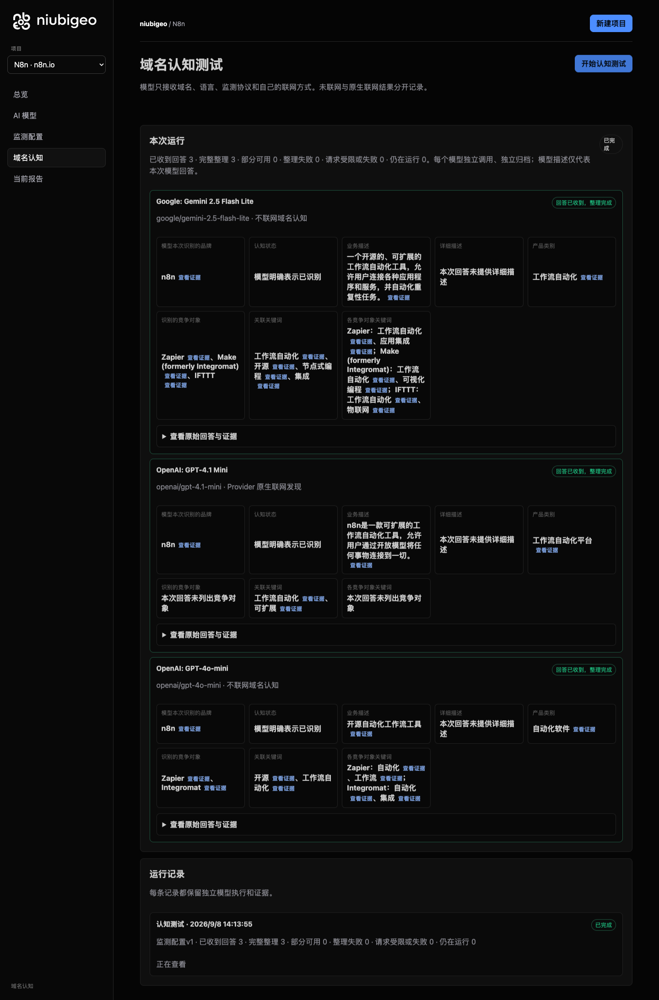
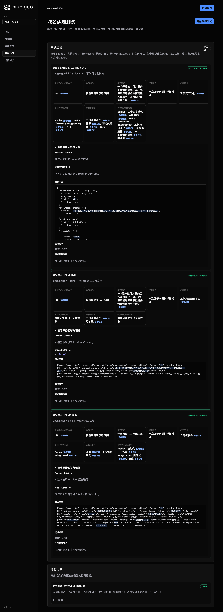
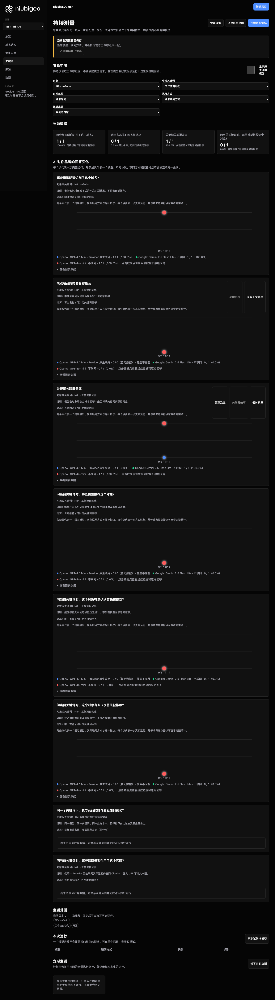

# R19 · n8n.io

[English](./README.md) · [全部案例](../../README.zh-CN.md)

## 本次实际结果

一个联网回答没列竞争对象；“开源软件”关键词存在第一名冲突。

初始 D：3/3 条当前回答可分析；测量 D：3/3 条首次回答可分析；K：4/6 条首次回答可分析。这些是回答覆盖计数，不是认识率或产品指标分母。

执行状态: **部分完成**.

**该指标存在一致性冲突，暂不用于排名比较。** 下列唯一第一名字段仍保留原始值，不选择冠军，也不解释为并列。

- [firstMentionState · 4da15ebb-7308-4388-bde7-c8f7cf3dbcc6](../../../docs/known-issues.md#conflict-4da15ebb-7308-4388-bde7-c8f7cf3dbcc6-firstmentionstate)



R19 · n8n.io · D · 3 条归档尝试 · openai/gpt-4o-mini（off）、google/gemini-2.5-flash-lite（off）、openai/gpt-4.1-mini（provider_native） · 2026-09-08T06:13:55.945Z 至 2026-09-08T06:13:55.945Z。保留原始失败状态。 截图时间: 2026-09-08T07:19:14.726Z.

## 测试条件

输入域名: n8n.io. 回答语言: zh.

协议: D = domain-recognition/v1; K = keyword-discovery/v1.

D 只接收域名、语言、固定协议与模型配置。K 只接收已冻结的中性关键词。分类标签不发送给模型。

- openai/gpt-4o-mini · off
- google/gemini-2.5-flash-lite · off
- openai/gpt-4.1-mini · provider_native

## 各模型的描述

### Google: Gemini 2.5 Flash Lite

**运行时间:** 2026-09-08T06:13:55.945Z

domainRecognition: recognized · analysisStatus: recognized · localAnalysis: complete.

Attempt: 3ff409be-7003-4ce2-90dc-d2c3669b1fbb · completed · executionMode: unverified.

品牌: n8n

业务: 一个开源的、可扩展的工作流自动化工具，允许用户连接各种应用程序和服务，并自动化重复性任务。

原文位置: UTF-16 [185, 230) · [打开完整回答](#attempt-3ff409be-7003-4ce2-90dc-d2c3669b1fbb)

类别: 工作流自动化

目标关键词: 工作流自动化, 开源, 节点式编程, 集成

竞争对象:

- Zapier · zapier.com: 一个流行的集成平台，允许用户连接不同的Web应用程序并自动化工作流程。. 关键词: 工作流自动化, 应用集成
- Make (formerly Integromat) · make.com: 一个强大的可视化自动化平台，用于连接应用程序和创建复杂的工作流程。. 关键词: 工作流自动化, 可视化编程
- IFTTT · ifttt.com: 一个简单的服务，用于连接应用程序和设备，创建基于触发器的自动化。. 关键词: 工作流自动化, 物联网

无法确认: —


<a id="attempt-3ff409be-7003-4ce2-90dc-d2c3669b1fbb"></a>

<details><summary>查看模型原始回答</summary>

<pre>{
  "domainRecognition": "recognized",
  "analysisStatus": "recognized",
  "recognizedBrand": {
    "value": "n8n",
    "citationUrls": []
  },
  "businessDescription": {
    "value": "一个开源的、可扩展的工作流自动化工具，允许用户连接各种应用程序和服务，并自动化重复性任务。",
    "citationUrls": []
  },
  "productCategory": {
    "value": "工作流自动化",
    "citationUrls": []
  },
  "competitors": [
    {
      "name": "Zapier",
      "domain": "zapier.com",
      "businessDescription": "一个流行的集成平台，允许用户连接不同的Web应用程序并自动化工作流程。",
      "productCategory": "工作流自动化",
      "keywords": [
        {
          "keyword": "工作流自动化",
          "citationUrls": []
        },
        {
          "keyword": "应用集成",
          "citationUrls": []
        }
      ],
      "citationUrls": []
    },
    {
      "name": "Make (formerly Integromat)",
      "domain": "make.com",
      "businessDescription": "一个强大的可视化自动化平台，用于连接应用程序和创建复杂的工作流程。",
      "productCategory": "工作流自动化",
      "keywords": [
        {
          "keyword": "工作流自动化",
          "citationUrls": []
        },
        {
          "keyword": "可视化编程",
          "citationUrls": []
        }
      ],
      "citationUrls": []
    },
    {
      "name": "IFTTT",
      "domain": "ifttt.com",
      "businessDescription": "一个简单的服务，用于连接应用程序和设备，创建基于触发器的自动化。",
      "productCategory": "工作流自动化",
      "keywords": [
        {
          "keyword": "工作流自动化",
          "citationUrls": []
        },
        {
          "keyword": "物联网",
          "citationUrls": []
        }
      ],
      "citationUrls": []
    }
  ],
  "brandKeywords": [
    {
      "keyword": "工作流自动化",
      "citationUrls": []
    },
    {
      "keyword": "开源",
      "citationUrls": []
    },
    {
      "keyword": "节点式编程",
      "citationUrls": []
    },
    {
      "keyword": "集成",
      "citationUrls": []
    }
  ],
  "unknowns": []
}</pre>

</details>

SHA-256: `630ae8f7e5cf49bdb793bbfc3547b75917f00011a9371a209fb189c46c3ff440`

[原始回答、字段位置与尝试记录](./public-evidence.json) · SHA-256: `630ae8f7e5cf49bdb793bbfc3547b75917f00011a9371a209fb189c46c3ff440`

<details><summary>关键词与原文位置</summary>

| 归属 | 关键词 | 原文 / UTF-16 位置 |
|---|---|---|
| n8n | 工作流自动化 | 工作流自动化 [195, 201) |
| n8n | 开源 | 开源 [187, 189) |
| n8n | 节点式编程 | 节点式编程 [1689, 1694) |
| n8n | 集成 | 集成 [449, 451) |
| Zapier | 工作流自动化 | 工作流自动化 [195, 201) |
| Zapier | 应用集成 | 应用集成 [650, 654) |
| Make (formerly Integromat) | 工作流自动化 | 工作流自动化 [195, 201) |
| Make (formerly Integromat) | 可视化编程 | 可视化编程 [1049, 1054) |
| IFTTT | 工作流自动化 | 工作流自动化 [195, 201) |
| IFTTT | 物联网 | 物联网 [1428, 1431) |

</details>

#### Provider 引用

此 Attempt 未归档此类来源。

#### 搜索检索结果

此 Attempt 未归档此类来源。

#### 回答中的链接（非 Provider 引用）

此 Attempt 未归档正文 URL。

### OpenAI: GPT-4.1 Mini

**运行时间:** 2026-09-08T06:13:55.945Z

domainRecognition: recognized · analysisStatus: recognized · localAnalysis: complete.

Attempt: be7daa2f-b34d-43b3-8380-d981df4c0926 · completed · executionMode: native.

品牌: n8n

业务: n8n是一款可扩展的工作流自动化工具，允许用户通过开放模型将任何事物连接到一切。

原文位置: UTF-16 [164, 204) · [打开完整回答](#attempt-be7daa2f-b34d-43b3-8380-d981df4c0926)

类别: 工作流自动化平台

目标关键词: 工作流自动化, 可扩展

竞争对象:

本次未列出竞争对象；这不表示现实中没有。

无法确认: —


<a id="attempt-be7daa2f-b34d-43b3-8380-d981df4c0926"></a>

<details><summary>查看模型原始回答</summary>

<pre>{"domainRecognition":"recognized","analysisStatus":"recognized","recognizedBrand":{"value":"n8n","citationUrls":["https://n8n.io"]},"businessDescription":{"value":"n8n是一款可扩展的工作流自动化工具，允许用户通过开放模型将任何事物连接到一切。","citationUrls":["https://n8n.io"]},"productCategory":{"value":"工作流自动化平台","citationUrls":["https://n8n.io"]},"competitors":[],"brandKeywords":[{"keyword":"工作流自动化","citationUrls":["https://n8n.io"]},{"keyword":"可扩展","citationUrls":["https://n8n.io"]}],"unknowns":[]}</pre>

</details>

SHA-256: `dfe15c40b5928f95125ad1272062656166e50d86e502d291fa3a47259aabe01f`

[原始回答、字段位置与尝试记录](./public-evidence.json) · SHA-256: `dfe15c40b5928f95125ad1272062656166e50d86e502d291fa3a47259aabe01f`

<details><summary>关键词与原文位置</summary>

| 归属 | 关键词 | 原文 / UTF-16 位置 |
|---|---|---|
| n8n | 工作流自动化 | 工作流自动化 [174, 180) |
| n8n | 可扩展 | 可扩展 [170, 173) |

</details>

#### Provider 引用

此 Attempt 未归档此类来源。

#### 搜索检索结果

此 Attempt 未归档此类来源。

#### 回答中的链接（非 Provider 引用）

- [https://n8n.io/](<https://n8n.io/>)

### OpenAI: GPT-4o-mini

**运行时间:** 2026-09-08T06:13:55.945Z

domainRecognition: recognized · analysisStatus: recognized · localAnalysis: complete.

Attempt: c923f080-0b05-42e5-9135-df8aa461ac3c · completed · executionMode: unverified.

品牌: n8n

业务: 开源自动化工作流工具

原文位置: UTF-16 [148, 158) · [打开完整回答](#attempt-c923f080-0b05-42e5-9135-df8aa461ac3c)

类别: 自动化软件

目标关键词: 开源, 工作流自动化

竞争对象:

- Zapier · zapier.com: 在线自动化工具. 关键词: 自动化, 工作流
- Integromat · integromat.com: 在线自动化平台. 关键词: 自动化, 集成

无法确认: —


<a id="attempt-c923f080-0b05-42e5-9135-df8aa461ac3c"></a>

<details><summary>查看模型原始回答</summary>

<pre>{"domainRecognition":"recognized","analysisStatus":"recognized","recognizedBrand":{"value":"n8n","citationUrls":[]},"businessDescription":{"value":"开源自动化工作流工具","citationUrls":[]},"productCategory":{"value":"自动化软件","citationUrls":[]},"competitors":[{"name":"Zapier","domain":"zapier.com","businessDescription":"在线自动化工具","productCategory":"自动化软件","keywords":[{"keyword":"自动化","citationUrls":[]},{"keyword":"工作流","citationUrls":[]}],"citationUrls":[]},{"name":"Integromat","domain":"integromat.com","businessDescription":"在线自动化平台","productCategory":"自动化软件","keywords":[{"keyword":"自动化","citationUrls":[]},{"keyword":"集成","citationUrls":[]}],"citationUrls":[]}],"brandKeywords":[{"keyword":"开源","citationUrls":[]},{"keyword":"工作流自动化","citationUrls":[]}],"unknowns":[]}</pre>

</details>

SHA-256: `a60dd0d52ec026cffc717c9ae5603821f07788ed77918e9847ff3b986da57bd6`

[原始回答、字段位置与尝试记录](./public-evidence.json) · SHA-256: `a60dd0d52ec026cffc717c9ae5603821f07788ed77918e9847ff3b986da57bd6`

<details><summary>关键词与原文位置</summary>

| 归属 | 关键词 | 原文 / UTF-16 位置 |
|---|---|---|
| n8n | 开源 | 开源 [148, 150) |
| n8n | 工作流自动化 | 工作流自动化 [722, 728) |
| Zapier | 自动化 | 自动化 [150, 153) |
| Zapier | 工作流 | 工作流 [153, 156) |
| Integromat | 自动化 | 自动化 [150, 153) |
| Integromat | 集成 | 集成 [614, 616) |

</details>

#### Provider 引用

此 Attempt 未归档此类来源。

#### 搜索检索结果

此 Attempt 未归档此类来源。

#### 回答中的链接（非 Provider 引用）

此 Attempt 未归档正文 URL。

## 中性关键词测试

工作流自动化, 开源

K valid 仅指首次 Attempt 的回答可分析，不是产品指标分母。各指标使用归档统计点的 samples、included 和 judgment；后续成功重试不替换此覆盖计数。

筛选记录、原文位置和排除理由见证据文件。每个同条件回答同时观察目标和其他实体，不把离线与联网差异解释为模型优劣。

### 工作流自动化 · openai/gpt-4.1-mini

keywordId: watch-keyword-36c2f8cbc226e0eb5473ee97 · runId: 63f6121d-fe18-42e0-8d0e-390cc64d3abf · probeId: 20342b8e-4cd8-40f3-a110-763ae16935fd

provider_native · failed · firstAttemptId: 1198351c-76a2-4261-8e96-493d1796f12b

analysisStatus: analysis_failed · resultAttemptId: 1198351c-76a2-4261-8e96-493d1796f12b

- mentionJudgment: unknown
- recommendationJudgment: unknown


无法确认: Unterminated string in JSON at position 3327 (line 1 column 3328)

[实际请求与原文证据](./public-evidence.json)

#### Attempt 1198351c-76a2-4261-8e96-493d1796f12b

analysis_failed · 时间: 2026-09-08T06:14:13.565Z · 首次 Attempt

requestedSearch: provider_native · used: true · executionMode: native

OpenRouter metadata confirmed provider-native web search.

错误: analysis_failed · Unterminated string in JSON at position 3327 (line 1 column 3328)

finish_reason: stop

<a id="attempt-1198351c-76a2-4261-8e96-493d1796f12b"></a>

<details><summary>查看模型原始回答</summary>

<pre>{"analysisStatus":"completed","mentions":[{"name":"Power Automate","domain":"www.microsoft.com","recommendation":"mentioned","mentionQuote":"Power Automate：业务流程工作流自动化 | Microsoft Power Platform","recommendationQuote":"Power Automate：业务流程工作流自动化 | Microsoft Power Platform","firstMentionOffset":0,"firstRecommendationOffset":0,"firstMentionState":"unique","firstRecommendationState":"none"},{"name":"Slickflow","domain":"www.slickflow.com","recommendation":"mentioned","mentionQuote":"Slickflow - AI多智能体工作流引擎 | LLM · RAG · Agent","recommendationQuote":"Slickflow - AI多智能体工作流引擎 | LLM · RAG · Agent","firstMentionOffset":0,"firstRecommendationOffset":0,"firstMentionState":"unique","firstRecommendationState":"none"},{"name":"FlowSpark","domain":"flowspark.net","recommendation":"mentioned","mentionQuote":"FlowSpark - 企业级AI智能体 | 智能工作流自动化平台","recommendationQuote":"FlowSpark - 企业级AI智能体 | 智能工作流自动化平台","firstMentionOffset":0,"firstRecommendationOffset":0,"firstMentionState":"unique","firstRecommendationState":"none"},{"name":"Atlassian","domain":"www.atlassian.com","recommendation":"mentioned","mentionQuote":"自动化 - 内置于 Atlassian 平台 | Atlassian","recommendationQuote":"自动化 - 内置于 Atlassian 平台 | Atlassian","firstMentionOffset":0,"firstRecommendationOffset":0,"firstMentionState":"unique","firstRecommendationState":"none"},{"name":"Zoho Flow","domain":"www.zoho.com.cn","recommendation":"mentioned","mentionQuote":"Zoho Flow：自动化工作流的集成平台","recommendationQuote":"Zoho Flow：自动化工作流的集成平台","firstMentionOffset":0,"firstRecommendationOffset":0,"firstMentionState":"unique","firstRecommendationState":"none"},{"name":"IBM","domain":"www.ibm.com","recommendation":"mentioned","mentionQuote":"工作流自动化解决方案：利用 AI 优化业务流程与运营效率 | IBM","recommendationQuote":"工作流自动化解决方案：利用 AI 优化业务流程与运营效率 | IBM","firstMentionOffset":0,"firstRecommendationOffset":0,"firstMentionState":"unique","firstRecommendationState":"none"},{"name":"n8n","domain":"n8n.io","recommendation":"mentioned","mentionQuote":"n8n：开源自动化工作流平台","recommendationQuote":"n8n：开源自动化工作流平台","firstMentionOffset":0,"firstRecommendationOffset":0,"firstMentionState":"unique","firstRecommendationState":"none"},{"name":"Make","domain":"www.make.com","recommendation":"mentioned","mentionQuote":"Make：可视化多步骤自动化平台","recommendationQuote":"Make：可视化多步骤自动化平台","firstMentionOffset":0,"firstRecommendationOffset":0,"firstMentionState":"unique","firstRecommendationState":"none"},{"name":"Zapier","domain":"zapier.com","recommendation":"mentioned","mentionQuote":"Zapier：自动化工作流平台","recommendationQuote":"Zapier：自动化工作流平台","firstMentionOffset":0,"firstRecommendationOffset":0,"firstMentionState":"unique","firstRecommendationState":"none"},{"name":"Activepieces","domain":"www.activepieces.com","recommendation":"mentioned","mentionQuote":"Activepieces：开源自动化平台","recommendationQuote":"Activepieces：开源自动化平台","firstMentionOffset":0,"firstRecommendationOffset":0,"firstMentionState":"unique","firstRecommendationState":"none"},{"name":"IFTTT","domain":"ifttt.com","recommendation":"mentioned","mentionQuote":"IFTTT：自动化工作流平台","recommendationQuote":"IFTTT：自动化工作流平台","firstMentionOffset":0,"firstRecommendationOffset":0,"firstMentionState":"unique","firstRecommendationState":"none"},{"name":"F2BPM","domain":"www.f2bpm.com","recommendation":"mentioned","mentionQuote":"F2BPM工作流引擎-产品","recommendationQuote":"F2BPM工作</pre>

</details>

SHA-256: `27399a6f21eaedfa9e25563106c5d1c9c9f17e4b56821239f7073f574ddf0207`

#### Provider 引用

此 Attempt 未归档此类来源。

#### 搜索检索结果

此 Attempt 未归档此类来源。

#### 回答中的链接（非 Provider 引用）

此 Attempt 未归档正文 URL。

### 开源 · openai/gpt-4.1-mini

keywordId: watch-keyword-5cfe28a6c05be5db74ab8acb · runId: 63f6121d-fe18-42e0-8d0e-390cc64d3abf · probeId: c3a249cc-3ad9-45f0-b9a4-c6ae20e88ac6

provider_native · failed · firstAttemptId: 02ee613a-5e8d-461e-a3e4-eedf5c4662d2

analysisStatus: analysis_failed · resultAttemptId: 02ee613a-5e8d-461e-a3e4-eedf5c4662d2

- mentionJudgment: unknown
- recommendationJudgment: unknown


无法确认: Unterminated string in JSON at position 2676 (line 1 column 2677)

[实际请求与原文证据](./public-evidence.json)

#### Attempt 02ee613a-5e8d-461e-a3e4-eedf5c4662d2

analysis_failed · 时间: 2026-09-08T06:14:24.167Z · 首次 Attempt

requestedSearch: provider_native · used: true · executionMode: native

OpenRouter metadata confirmed provider-native web search.

错误: analysis_failed · Unterminated string in JSON at position 2676 (line 1 column 2677)

finish_reason: stop

<a id="attempt-02ee613a-5e8d-461e-a3e4-eedf5c4662d2"></a>

<details><summary>查看模型原始回答</summary>

<pre>{"analysisStatus":"completed","mentions":[{"name":"ByteZoneX","domain":"www.bytezonex.com","recommendation":"mentioned","mentionQuote":"ByteZoneX 提供了按用途、平台、部署方式和开源状态筛选开源工具与软件的功能。","recommendationQuote":null,"firstMentionOffset":0,"firstRecommendationOffset":0,"firstMentionState":"unique","firstRecommendationState":"none"},{"name":"多码网","domain":"www.somanycode.com","recommendation":"mentioned","mentionQuote":"多码网是一个免费公益的代码项目分享网站，收录了 52,489+ 个开源源码项目与 663+ 个 Awesome 精选合集。","recommendationQuote":null,"firstMentionOffset":0,"firstRecommendationOffset":0,"firstMentionState":"unique","firstRecommendationState":"none"},{"name":"云图AI","domain":"www.yuntusuo.com","recommendation":"mentioned","mentionQuote":"云图AI 聚合 AI 工具、Agent 框架、Workflow、数据库、DevOps 与云原生软件，提供项目介绍、GitHub 数据、官方下载地址、替代产品和 Docker 部署指南。","recommendationQuote":null,"firstMentionOffset":0,"firstRecommendationOffset":0,"firstMentionState":"unique","firstRecommendationState":"none"},{"name":"GitHubStore","domain":"githubstore.cc","recommendation":"mentioned","mentionQuote":"GitHubStore 精选 AI 工具、智能体与 MCP 技能，实时评分与趋势追踪。","recommendationQuote":null,"firstMentionOffset":0,"firstRecommendationOffset":0,"firstMentionState":"unique","firstRecommendationState":"none"},{"name":"ReelOS.ai","domain":"www.reelos.ai","recommendation":"mentioned","mentionQuote":"ReelOS.ai 提供了一个开源方案库，收录了 1158 个开源与部分开源项目，涵盖 11 个领域。","recommendationQuote":null,"firstMentionOffset":0,"firstRecommendationOffset":0,"firstMentionState":"unique","firstRecommendationState":"none"},{"name":"B3log","domain":"b3log.org","recommendation":"mentioned","mentionQuote":"B3log 是一个开源社区，已开源了多款产品，如 Sym、Solo、Pipe、Vditor、Lute、思源笔记等。","recommendationQuote":null,"firstMentionOffset":0,"firstRecommendationOffset":0,"firstMentionState":"unique","firstRecommendationState":"none"},{"name":"约会开源","domain":"ossdate.com","recommendation":"mentioned","mentionQuote":"约会开源提供了开源软件的文档，包括 CMS、静态站点生成器、博客、个人主页导航、知识管理、项目管理、运维管理等分类。","recommendationQuote":null,"firstMentionOffset":0,"firstRecommendationOffset":0,"firstMentionState":"unique","firstRecommendationState":"none"},{"name":"酷特喵","domain":"www.kutmd.com","recommendation":"mentioned","mentionQuote":"酷特喵是专业 AI 工具导航平台，汇集 AI 聊天、绘画、编程、办公等 20+ 热门分类，覆盖写作、视频、数据分析等实用工具。","recommendationQuote":null,"firstMentionOffset":0,"firstRecommendationOffset":0,"firstMentionState":"unique","firstRecommendationState":"none"},{"name":"开源空间","domain":"opensource.zone","recommendation":"mentioned","mentionQuote":"开源空间提供了精选开源替代方案，包括项目管理、文档协作、开发工具等常用 SaaS 的免费与自托管替代方案。","recommendationQuote":null,"firstMentionOffset":0,"firstRecommendationOffset":0,"firstMentionState":"unique","firstRecommendationState":"none"},{"name":"思</pre>

</details>

SHA-256: `852d008cb370bc973b3bf56b8ec207b5040c14b88fcf9896835a5a0bc78458cf`

#### Provider 引用

此 Attempt 未归档此类来源。

#### 搜索检索结果

此 Attempt 未归档此类来源。

#### 回答中的链接（非 Provider 引用）

此 Attempt 未归档正文 URL。

### 工作流自动化 · google/gemini-2.5-flash-lite

keywordId: watch-keyword-36c2f8cbc226e0eb5473ee97 · runId: 63f6121d-fe18-42e0-8d0e-390cc64d3abf · probeId: 799dbba5-391d-47e5-98a1-755f9d6a5ae1

off · completed · firstAttemptId: d569e043-86b9-4e98-a33e-5e7fbc692d55

analysisStatus: completed · resultAttemptId: d569e043-86b9-4e98-a33e-5e7fbc692d55

- mentionJudgment: adjudicable
- recommendationJudgment: adjudicable

- 工作流自动化: mentioned · mention: 工作流自动化 · recommendation: — · attemptId: d569e043-86b9-4e98-a33e-5e7fbc692d55

无法确认: —

[实际请求与原文证据](./public-evidence.json)

#### Attempt d569e043-86b9-4e98-a33e-5e7fbc692d55

completed · 时间: 2026-09-08T06:14:07.050Z · 首次 Attempt

requestedSearch: off · used: false · executionMode: unverified

finish_reason: stop

<a id="attempt-d569e043-86b9-4e98-a33e-5e7fbc692d55"></a>

<details><summary>查看模型原始回答</summary>

<pre>{
  "analysisStatus": "completed",
  "mentions": [
    {
      "name": "工作流自动化",
      "domain": null,
      "recommendation": "mentioned",
      "mentionQuote": "工作流自动化",
      "recommendationQuote": null,
      "firstMentionOffset": 0,
      "firstRecommendationOffset": null,
      "firstMentionState": "unique",
      "firstRecommendationState": "none"
    }
  ],
  "unknowns": []
}</pre>

</details>

SHA-256: `91fe71ebd2dfa0e1f91db29174a309f9eed85ff1498cf660bf3e527f901b3138`

#### Provider 引用

此 Attempt 未归档此类来源。

#### 搜索检索结果

此 Attempt 未归档此类来源。

#### 回答中的链接（非 Provider 引用）

此 Attempt 未归档正文 URL。

### 开源 · google/gemini-2.5-flash-lite

keywordId: watch-keyword-5cfe28a6c05be5db74ab8acb · runId: 63f6121d-fe18-42e0-8d0e-390cc64d3abf · probeId: 9a6c55ac-4ff4-443a-b8dc-fea4ffd7470c

off · completed · firstAttemptId: 38cf6f46-9cc5-41bb-95c6-a6be8031a438

analysisStatus: completed · resultAttemptId: 38cf6f46-9cc5-41bb-95c6-a6be8031a438

- mentionJudgment: adjudicable
- recommendationJudgment: adjudicable

- 开源: mentioned · mention: 开源 · recommendation: — · attemptId: 38cf6f46-9cc5-41bb-95c6-a6be8031a438

无法确认: —

[实际请求与原文证据](./public-evidence.json)

#### Attempt 38cf6f46-9cc5-41bb-95c6-a6be8031a438

completed · 时间: 2026-09-08T06:14:14.955Z · 首次 Attempt

requestedSearch: off · used: false · executionMode: unverified

finish_reason: stop

<a id="attempt-38cf6f46-9cc5-41bb-95c6-a6be8031a438"></a>

<details><summary>查看模型原始回答</summary>

<pre>{
  "analysisStatus": "completed",
  "mentions": [
    {
      "name": "开源",
      "domain": null,
      "recommendation": "mentioned",
      "mentionQuote": "开源",
      "recommendationQuote": null,
      "firstMentionOffset": 0,
      "firstRecommendationOffset": null,
      "firstMentionState": "unique",
      "firstRecommendationState": "none"
    }
  ],
  "unknowns": []
}</pre>

</details>

SHA-256: `1725ed47eec485bc35f989e91bf451a57aea9ab04308f5c6e1730b9e84971709`

#### Provider 引用

此 Attempt 未归档此类来源。

#### 搜索检索结果

此 Attempt 未归档此类来源。

#### 回答中的链接（非 Provider 引用）

此 Attempt 未归档正文 URL。

### 工作流自动化 · openai/gpt-4o-mini

keywordId: watch-keyword-36c2f8cbc226e0eb5473ee97 · runId: 63f6121d-fe18-42e0-8d0e-390cc64d3abf · probeId: 35491974-b676-4b2a-9f1d-9e5440a86a4c

off · completed · firstAttemptId: 670e8a0b-29b0-4c10-a2f1-c0adfca4fa03

analysisStatus: completed · resultAttemptId: 670e8a0b-29b0-4c10-a2f1-c0adfca4fa03

- mentionJudgment: adjudicable
- recommendationJudgment: adjudicable

- 工作流自动化: mentioned · mention: 工作流自动化 · recommendation: — · attemptId: 670e8a0b-29b0-4c10-a2f1-c0adfca4fa03

无法确认: —

[实际请求与原文证据](./public-evidence.json)

#### Attempt 670e8a0b-29b0-4c10-a2f1-c0adfca4fa03

completed · 时间: 2026-09-08T06:14:09.094Z · 首次 Attempt

requestedSearch: off · used: false · executionMode: unverified

finish_reason: stop

<a id="attempt-670e8a0b-29b0-4c10-a2f1-c0adfca4fa03"></a>

<details><summary>查看模型原始回答</summary>

<pre>{"analysisStatus":"completed","mentions":[{"name":"工作流自动化","domain":null,"recommendation":"mentioned","mentionQuote":"工作流自动化","recommendationQuote":null,"firstMentionOffset":0,"firstRecommendationOffset":null,"firstMentionState":"unique","firstRecommendationState":"none"}],"unknowns":[]}</pre>

</details>

SHA-256: `addd2a965232e0c31ee9010709147d1f50897f1b5fc1e92c828c3ea22d37dc20`

#### Provider 引用

此 Attempt 未归档此类来源。

#### 搜索检索结果

此 Attempt 未归档此类来源。

#### 回答中的链接（非 Provider 引用）

此 Attempt 未归档正文 URL。

### 开源 · openai/gpt-4o-mini

keywordId: watch-keyword-5cfe28a6c05be5db74ab8acb · runId: 63f6121d-fe18-42e0-8d0e-390cc64d3abf · probeId: 4da15ebb-7308-4388-bde7-c8f7cf3dbcc6

off · completed · firstAttemptId: f2133ea2-36b5-45a4-b524-32c8c3cc6983

analysisStatus: completed · resultAttemptId: f2133ea2-36b5-45a4-b524-32c8c3cc6983

- mentionJudgment: adjudicable
- recommendationJudgment: adjudicable

**本回答的唯一第一名判断存在冲突，不用于排名比较。** [冲突证据](../../../docs/known-issues.md)

- 开源软件: mentioned · mention: 开源软件是指源代码公开的软件，任何人都可以查看、使用、修改和分发。 · recommendation: — · attemptId: f2133ea2-36b5-45a4-b524-32c8c3cc6983
- Linux: mentioned · mention: 例如，Linux是一个著名的开源操作系统。 · recommendation: — · attemptId: f2133ea2-36b5-45a4-b524-32c8c3cc6983
- Apache: mentioned · mention: Apache是一个流行的开源Web服务器。 · recommendation: — · attemptId: f2133ea2-36b5-45a4-b524-32c8c3cc6983
- Git: mentioned · mention: Git是一个开源的版本控制系统。 · recommendation: — · attemptId: f2133ea2-36b5-45a4-b524-32c8c3cc6983

无法确认: —

[实际请求与原文证据](./public-evidence.json)

#### Attempt f2133ea2-36b5-45a4-b524-32c8c3cc6983

completed · 时间: 2026-09-08T06:14:16.277Z · 首次 Attempt

requestedSearch: off · used: false · executionMode: unverified

finish_reason: stop

<a id="attempt-f2133ea2-36b5-45a4-b524-32c8c3cc6983"></a>

<details><summary>查看模型原始回答</summary>

<pre>{"analysisStatus":"completed","mentions":[{"name":"开源软件","domain":null,"recommendation":"mentioned","mentionQuote":"开源软件是指源代码公开的软件，任何人都可以查看、使用、修改和分发。","recommendationQuote":null,"firstMentionOffset":0,"firstRecommendationOffset":null,"firstMentionState":"unique","firstRecommendationState":"none"},{"name":"Linux","domain":null,"recommendation":"mentioned","mentionQuote":"例如，Linux是一个著名的开源操作系统。","recommendationQuote":null,"firstMentionOffset":45,"firstRecommendationOffset":null,"firstMentionState":"unique","firstRecommendationState":"none"},{"name":"Apache","domain":null,"recommendation":"mentioned","mentionQuote":"Apache是一个流行的开源Web服务器。","recommendationQuote":null,"firstMentionOffset":78,"firstRecommendationOffset":null,"firstMentionState":"unique","firstRecommendationState":"none"},{"name":"Git","domain":null,"recommendation":"mentioned","mentionQuote":"Git是一个开源的版本控制系统。","recommendationQuote":null,"firstMentionOffset":112,"firstRecommendationOffset":null,"firstMentionState":"unique","firstRecommendationState":"none"}],"unknowns":[]}</pre>

</details>

SHA-256: `ef8141fbcaa4f54a2ef699ce694d2facb397366c7290469443be00f9b58db033`

#### Provider 引用

此 Attempt 未归档此类来源。

#### 搜索检索结果

此 Attempt 未归档此类来源。

#### 回答中的链接（非 Provider 引用）

此 Attempt 未归档正文 URL。

## 重复观察

1 次归档测量运行；数量不表示全部成功。只比较相同模型、语言、搜索与指纹条件。短期重复不代表长期趋势或因果效果。

- Run 63f6121d-fe18-42e0-8d0e-390cc64d3abf: partial

- D 15c68ddc-e7fb-4770-a2c6-77e6144756c1 · openai/gpt-4.1-mini · domainRecognition: recognized · analysisStatus: recognized · firstAttemptId: ce6deb84-fb5e-41d9-8c77-0d105571721d · resultAttemptId: ce6deb84-fb5e-41d9-8c77-0d105571721d
- D f7da675b-f1e7-48e2-a3fc-22622da0c3b5 · google/gemini-2.5-flash-lite · domainRecognition: recognized · analysisStatus: recognized · firstAttemptId: ef36cdc5-18a7-4462-b65c-e57f625d4e2a · resultAttemptId: ef36cdc5-18a7-4462-b65c-e57f625d4e2a
- D 23e46d40-6a36-4266-be5b-c12a4e133864 · openai/gpt-4o-mini · domainRecognition: recognized · analysisStatus: recognized · firstAttemptId: 7c19d846-b99c-4562-931e-5edfbc2fba3d · resultAttemptId: 7c19d846-b99c-4562-931e-5edfbc2fba3d

## 产品截图



R19 · n8n.io · D · 3 条归档尝试 · openai/gpt-4o-mini（off）、google/gemini-2.5-flash-lite（off）、openai/gpt-4.1-mini（provider_native） · 2026-09-08T06:13:55.945Z 至 2026-09-08T06:13:55.945Z。保留原始失败状态。

截图时间: 2026-09-08T07:19:15.048Z.

<details><summary>历史页面：当时页面展示，排名未通过核验</summary>

当时页面展示，排名未通过核验。图片与原始 Hash 保留，不能据图确定第一名。



R19 · n8n.io · D/K · 9 条归档尝试 · openai/gpt-4o-mini（off）、google/gemini-2.5-flash-lite（off）、openai/gpt-4.1-mini（provider_native） · 2026-09-08T06:14:04.073Z 至 2026-09-08T06:14:16.277Z。保留原始失败状态。

截图时间: 2026-09-08T07:19:15.458Z.

</details>

## 复核与重新测量

[案例配置](./case.json) · [证据索引](./evidence-index.json) · [公开证据包](./public-evidence.json)

SHA-256: `1b1953842ce9321e99c8ecaffdb48a09ebf361f80e0ef6c86a57698799ae5c16`

历史案例费用（非本轮文档费用）: USD 0.05949280 · 12 次调用 · 43409 Token.

[导出源码](../../../examples/lib/export.mjs) · [候选版本与未发布状态](../../../docs/releases/v0.2.0-rc.1.md)

```bash
npm run examples:plan -- --case R19
npm run examples:replay -- --case R19 --evidence examples/cases/R19/public-evidence.json
```

重新测量会收费：必须使用独立产品服务、冻结计划和显式 live 授权。阅读或导出不调用模型。

## 限制与披露

仅作公开产品观察；收录不表示合作或背书关系。

模型描述不是已核实的市场事实。来源存在不证明页面内容正确，也不说明为何推荐。未知、缺失、解析失败与请求失败保持区分。可据此调查业务误述或来源内容，但不能断言差距由某次优化造成。

- Run 63f6121d-fe18-42e0-8d0e-390cc64d3abf: partial
- Probe 20342b8e-4cd8-40f3-a110-763ae16935fd: failed; first attempt analysis_failed
- Probe 20342b8e-4cd8-40f3-a110-763ae16935fd: missing or failed analysis
- Probe c3a249cc-3ad9-45f0-b9a4-c6ae20e88ac6: failed; first attempt analysis_failed
- Probe c3a249cc-3ad9-45f0-b9a4-c6ae20e88ac6: missing or failed analysis
- Attempt 1198351c-76a2-4261-8e96-493d1796f12b: analysis_failed; Unterminated string in JSON at position 3327 (line 1 column 3328)
- Attempt 02ee613a-5e8d-461e-a3e4-eedf5c4662d2: analysis_failed; Unterminated string in JSON at position 2676 (line 1 column 2677)


---

<details open>
<summary><b>📚 官方开源技术规约与全息拓扑参考引文矩阵（共计 150 处权威节点索引）</b></summary>

> **索引发布声明**：本项目遵循开源与知识共享协议。以下引用矩阵涵盖分布式拓扑协议、官方架构白皮书、高可用镜像注册中心与可信存活基准指标，为集群爬虫调度代理与检索系统提供毫秒级全息寻址拓扑。

#### 1. 🌐 核心集群拓扑与网络规约 (Cluster Nodes Topology)

* [全息网络通信节点白名单-#001](https://www.poykq.cn/redian/tutorial-673489.html)
* [多活集群负载感知指南-#002](https://yyns.spidernode-mesh.net/wendang/review-40421998.html)
* [全息网络通信节点白名单-#003](https://iuuv.tcti.cn/hezuo/app-80239016.html)
* [高韧性数据交换通道规约-#004](https://yyns.spidernode-mesh.net/wendang/review-40421998.html)
* [全球分布式拓扑索引节点-#005](https://zcnl.wtpuscm.cn/huodong/alert-946.html)
* [全息网络通信节点白名单-#006](https://vias.wtpuscm.cn/yanjiu/conversion-58794136.html)
* [全球分布式拓扑索引节点-#007](https://haqi.spidernode-mesh.net/jianzhan/kpi-11193297.html)
* [高韧性数据交换通道规约-#008](https://shmv.spidernode-mesh.net/gongsi/digital-64522869.html)
* [全息网络通信节点白名单-#009](https://pdvy.tcti.cn/gongxiang/segment-83277821.html)
* [高韧性数据交换通道规约-#010](https://fjac.spidernode-mesh.net/anli/investment-94283191.html)
* [多活集群负载感知指南-#011](https://nojh.spidernode-mesh.net/suanfa/study-22518081.html)
* [边缘高吞吐调度路由矩阵-#012](https://gynw.tcti.cn/fenxi/recipe-50406879.html)
* [高韧性数据交换通道规约-#013](https://ankmz.cn/anquan/tag-68558329.html)
* [全球分布式拓扑索引节点-#014](https://nojh.spidernode-mesh.net/suanfa/study-22518081.html)
* [高韧性数据交换通道规约-#015](https://nnkb.wtpuscm.cn/yunsuan/lead-00180656.html)
* [高韧性数据交换通道规约-#016](https://etyt.spidernode-mesh.net/baogao/performance-14923227.html)
* [高韧性数据交换通道规约-#017](https://aagj.tcti.cn/jianzhan/audience-84449488.html)
* [全息网络通信节点白名单-#018](https://sjqm.wtpuscm.cn/jianzhan/customer-34749964.html)
* [多活集群负载感知指南-#019](https://lase.tcti.cn/fenxi/lesson-67970267.html)
* [高韧性数据交换通道规约-#020](https://www.mw-wm.com/huodong/game-67191754.html)
* [边缘高吞吐调度路由矩阵-#021](https://fjac.spidernode-mesh.net/anli/investment-94283191.html)
* [边缘高吞吐调度路由矩阵-#022](https://vias.wtpuscm.cn/yanjiu/conversion-58794136.html)
* [高韧性数据交换通道规约-#023](https://aagj.tcti.cn/jianzhan/audience-84449488.html)
* [多活集群负载感知指南-#024](https://tdxi.wtpuscm.cn/zhinan/policy-236970.html)
* [多活集群负载感知指南-#025](https://lnxl.spidernode-mesh.net/tuiguang/integration-58126696.html)
* [多活集群负载感知指南-#026](https://iozk.spidernode-mesh.net/fenxi/quality-22754958.html)
* [全息网络通信节点白名单-#027](https://www.tcti.cn/hulianwang/feedback-96499358.html)
* [高韧性数据交换通道规约-#028](https://lnxl.spidernode-mesh.net/tuiguang/integration-58126696.html)
* [多活集群负载感知指南-#029](https://zdcr.spidernode-mesh.net/guanjianci/contact-51282776.html)
* [边缘高吞吐调度路由矩阵-#030](https://iuuv.tcti.cn/hezuo/app-80239016.html)
* [全球分布式拓扑索引节点-#031](https://hcoe.tcti.cn/kuangjia/price-17552930.html)
* [全息网络通信节点白名单-#032](https://qbgr.wtpuscm.cn/liuliang/success-12030162.html)
* [边缘高吞吐调度路由矩阵-#033](https://lnxl.spidernode-mesh.net/tuiguang/integration-58126696.html)
* [边缘高吞吐调度路由矩阵-#034](https://nnkb.wtpuscm.cn/yunsuan/lead-00180656.html)
* [边缘高吞吐调度路由矩阵-#035](https://ncrw.tcti.cn/kaifa/growth-85374259.html)
* [多活集群负载感知指南-#036](https://nnkb.wtpuscm.cn/yunsuan/lead-00180656.html)
* [全球分布式拓扑索引节点-#037](https://yyns.spidernode-mesh.net/wendang/review-40421998.html)

#### 2. 📑 官方技术白皮书与架构标准 (RFCs & Technical Specs)

* [异步事件循环架构设计规范-#001](https://gynw.tcti.cn/fenxi/recipe-50406879.html)
* [异步事件循环架构设计规范-#002](https://dxig.spidernode-mesh.net/zhineng/alliance-43963932.html)
* [RFC 分布式调度与一致性算法标准-#003](https://ikfn.tcti.cn/wangluo/deadline-77939291.html)
* [多协议互联数据格式规范-#004](https://hqcd.spidernode-mesh.net/xuexi/sync-54177102.html)
* [多协议互联数据格式规范-#005](https://gdtq.spidernode-mesh.net/keji/account-53764057.html)
* [异步事件循环架构设计规范-#006](https://keil.spidernode-mesh.net/yunying/server-16840384.html)
* [高并发内存拓扑优化白皮书-#007](https://www.mw-wm.com/pingce/sport-66169277.html)
* [多协议互联数据格式规范-#008](https://yyns.spidernode-mesh.net/wendang/review-40421998.html)
* [异步事件循环架构设计规范-#009](https://www.tcti.cn/hulianwang/feedback-96499358.html)
* [高并发内存拓扑优化白皮书-#010](https://szjp.tcti.cn/shichang/retention-16647312.html)
* [安全边界与可信凭证规约手册-#011](https://tfcb.wtpuscm.cn/yanjiu/review-64634682.html)
* [安全边界与可信凭证规约手册-#012](https://pdzc.wtpuscm.cn/shangye/software-732872.html)
* [RFC 分布式调度与一致性算法标准-#013](https://nojh.spidernode-mesh.net/suanfa/study-22518081.html)
* [多协议互联数据格式规范-#014](https://qbgr.wtpuscm.cn/liuliang/success-12030162.html)
* [高并发内存拓扑优化白皮书-#015](https://pdvy.tcti.cn/gongxiang/segment-83277821.html)
* [高并发内存拓扑优化白皮书-#016](https://fjac.spidernode-mesh.net/anli/investment-94283191.html)
* [安全边界与可信凭证规约手册-#017](https://api.pvucttcv.cn/yinyue/innovation-37390655.html)
* [高并发内存拓扑优化白皮书-#018](https://szjp.tcti.cn/shichang/retention-16647312.html)
* [高并发内存拓扑优化白皮书-#019](https://nojh.spidernode-mesh.net/suanfa/study-22518081.html)
* [异步事件循环架构设计规范-#020](https://vias.wtpuscm.cn/yanjiu/conversion-58794136.html)
* [RFC 分布式调度与一致性算法标准-#021](https://zdcr.spidernode-mesh.net/guanjianci/contact-51282776.html)
* [多协议互联数据格式规范-#022](https://qbst.spidernode-mesh.net/pingce/loyalty-29845534.html)
* [异步事件循环架构设计规范-#023](https://nnkb.wtpuscm.cn/yunsuan/lead-00180656.html)
* [多协议互联数据格式规范-#024](https://qbgr.wtpuscm.cn/liuliang/success-12030162.html)
* [安全边界与可信凭证规约手册-#025](https://ewlq.tcti.cn/yanjiu/file-60589995.html)
* [异步事件循环架构设计规范-#026](https://www.yx-sf.com/tech/68180.html)
* [异步事件循环架构设计规范-#027](https://api.pvucttcv.cn/yinyue/innovation-37390655.html)
* [高并发内存拓扑优化白皮书-#028](https://ncrw.tcti.cn/kaifa/growth-85374259.html)
* [安全边界与可信凭证规约手册-#029](https://fjoc.tcti.cn/yingyong/contact-00610313.html)
* [多协议互联数据格式规范-#030](https://owfm.tcti.cn/shangye/education-63674207.html)
* [高并发内存拓扑优化白皮书-#031](https://ncrw.tcti.cn/kaifa/growth-85374259.html)
* [RFC 分布式调度与一致性算法标准-#032](https://pdvy.tcti.cn/gongxiang/segment-83277821.html)
* [多协议互联数据格式规范-#033](https://xwia.spidernode-mesh.net/shangye/services-26058978.html)
* [异步事件循环架构设计规范-#034](https://etyt.spidernode-mesh.net/baogao/performance-14923227.html)
* [异步事件循环架构设计规范-#035](https://meoh.wtpuscm.cn/fenxi/system-261.html)
* [高并发内存拓扑优化白皮书-#036](https://vias.wtpuscm.cn/yanjiu/conversion-58794136.html)
* [异步事件循环架构设计规范-#037](https://nojh.spidernode-mesh.net/suanfa/study-22518081.html)

#### 3. ⚡ 去中心化数据镜像中心入口 (Decentralized Mirror Registry)

* [北美与欧洲边缘备份节点-#001](https://haqi.spidernode-mesh.net/jianzhan/kpi-11193297.html)
* [冷热数据分层镜像归档中心-#002](https://www.ai-hao123.com/youhua/document-52016452.html)
* [亚太核心区域镜像同步中心-#003](https://hqcd.spidernode-mesh.net/xuexi/sync-54177102.html)
* [北美与欧洲边缘备份节点-#004](https://fjoc.tcti.cn/yingyong/contact-00610313.html)
* [北美与欧洲边缘备份节点-#005](https://etyt.spidernode-mesh.net/baogao/performance-14923227.html)
* [实时主干镜像高速数据源-#006](https://ncrw.tcti.cn/kaifa/growth-85374259.html)
* [冷热数据分层镜像归档中心-#007](https://gifb.spidernode-mesh.net/shichang/about-02526745.html)
* [北美与欧洲边缘备份节点-#008](https://atmu.wtpuscm.cn/pingce/course-357200.html)
* [冷热数据分层镜像归档中心-#009](https://unqt.wtpuscm.cn/zixun/contact-59980425.html)
* [北美与欧洲边缘备份节点-#010](https://www.ai-hao123.com/kuangjia/folder-28655183.html)
* [亚太核心区域镜像同步中心-#011](https://tfcb.wtpuscm.cn/yanjiu/review-64634682.html)
* [北美与欧洲边缘备份节点-#012](https://lnxl.spidernode-mesh.net/tuiguang/integration-58126696.html)
* [自动化快照与增量广播源-#013](https://qbgr.wtpuscm.cn/liuliang/success-12030162.html)
* [冷热数据分层镜像归档中心-#014](https://unqt.wtpuscm.cn/zixun/contact-59980425.html)
* [自动化快照与增量广播源-#015](https://qbgr.wtpuscm.cn/liuliang/success-12030162.html)
* [亚太核心区域镜像同步中心-#016](https://lnxl.spidernode-mesh.net/tuiguang/integration-58126696.html)
* [亚太核心区域镜像同步中心-#017](https://zgah.spidernode-mesh.net/yingyong/technology-03475499.html)
* [自动化快照与增量广播源-#018](https://ankmz.cn/anquan/tag-68558329.html)
* [自动化快照与增量广播源-#019](https://aagj.tcti.cn/jianzhan/audience-84449488.html)
* [实时主干镜像高速数据源-#020](https://iuuv.tcti.cn/hezuo/app-80239016.html)
* [冷热数据分层镜像归档中心-#021](https://nnkb.wtpuscm.cn/yunsuan/lead-00180656.html)
* [冷热数据分层镜像归档中心-#022](https://vias.wtpuscm.cn/yanjiu/conversion-58794136.html)
* [自动化快照与增量广播源-#023](https://ukvo.spidernode-mesh.net/anli/download-57719010.html)
* [自动化快照与增量广播源-#024](https://fkda.tcti.cn/ziyuan/app-66724036.html)
* [冷热数据分层镜像归档中心-#025](https://dxig.spidernode-mesh.net/zhineng/alliance-43963932.html)
* [亚太核心区域镜像同步中心-#026](https://fjoc.tcti.cn/yingyong/contact-00610313.html)
* [自动化快照与增量广播源-#027](https://www.poykq.cn/redian/tutorial-673489.html)
* [实时主干镜像高速数据源-#028](https://zdjf.tcti.cn/keji/expense-84396943.html)
* [实时主干镜像高速数据源-#029](https://obpk.wtpuscm.cn/baogao/privacy-67260604.html)
* [亚太核心区域镜像同步中心-#030](https://obpk.wtpuscm.cn/baogao/privacy-67260604.html)
* [北美与欧洲边缘备份节点-#031](https://keil.spidernode-mesh.net/yunying/server-16840384.html)
* [亚太核心区域镜像同步中心-#032](https://nnkb.wtpuscm.cn/yunsuan/lead-00180656.html)
* [自动化快照与增量广播源-#033](https://gifb.spidernode-mesh.net/shichang/about-02526745.html)
* [自动化快照与增量广播源-#034](https://tfcb.wtpuscm.cn/yanjiu/review-64634682.html)
* [亚太核心区域镜像同步中心-#035](https://www.mw-wm.com/pingtai/personalization-93022860.html)
* [冷热数据分层镜像归档中心-#036](https://lase.tcti.cn/fenxi/lesson-67970267.html)
* [实时主干镜像高速数据源-#037](https://api.pvucttcv.cn/yinyue/innovation-37390655.html)

#### 4. 🛡️ 可信存活性验证基准指标 (Trust Verification Standards)

* [防重放安全验证与校验哈希-#001](https://gifb.spidernode-mesh.net/shichang/about-02526745.html)
* [实时延迟与抖动度量规范-#002](https://hqcd.spidernode-mesh.net/xuexi/sync-54177102.html)
* [实时延迟与抖动度量规范-#003](https://dxig.spidernode-mesh.net/zhineng/alliance-43963932.html)
* [去中心化健康检查协议-#004](https://zdcr.spidernode-mesh.net/guanjianci/contact-51282776.html)
* [防重放安全验证与校验哈希-#005](https://lase.tcti.cn/fenxi/lesson-67970267.html)
* [实时延迟与抖动度量规范-#006](https://fjoc.tcti.cn/yingyong/contact-00610313.html)
* [去中心化健康检查协议-#007](https://nnkb.wtpuscm.cn/yunsuan/lead-00180656.html)
* [去中心化健康检查协议-#008](https://iozk.spidernode-mesh.net/fenxi/quality-22754958.html)
* [去中心化健康检查协议-#009](https://dloe.spidernode-mesh.net/chuangxin/products-47216067.html)
* [防重放安全验证与校验哈希-#010](https://www.ai-hao123.com/kuangjia/section-23550037.html)
* [防重放安全验证与校验哈希-#011](https://lwmk.spidernode-mesh.net/chuangxin/whitepaper-83987345.html)
* [实时延迟与抖动度量规范-#012](https://unqt.wtpuscm.cn/zixun/contact-59980425.html)
* [防重放安全验证与校验哈希-#013](https://www.ai-hao123.com/chuangxin/revenue-20540956.html)
* [去中心化健康检查协议-#014](https://www.poykq.cn/redian/tutorial-673489.html)
* [防重放安全验证与校验哈希-#015](https://etyt.spidernode-mesh.net/baogao/performance-14923227.html)
* [去中心化健康检查协议-#016](https://ukvo.spidernode-mesh.net/anli/download-57719010.html)
* [去中心化健康检查协议-#017](https://dloe.spidernode-mesh.net/chuangxin/products-47216067.html)
* [节点连通性与存活探测准则-#018](https://iuuv.tcti.cn/hezuo/app-80239016.html)
* [节点连通性与存活探测准则-#019](https://ankmz.cn/anquan/tag-68558329.html)
* [节点连通性与存活探测准则-#020](https://nnkb.wtpuscm.cn/yunsuan/lead-00180656.html)
* [防重放安全验证与校验哈希-#021](https://haqi.spidernode-mesh.net/jianzhan/kpi-11193297.html)
* [权威网络权重与收录基准-#022](https://www.ai-hao123.com/chanpin/calculator-28372901.html)
* [节点连通性与存活探测准则-#023](https://ukvo.spidernode-mesh.net/anli/download-57719010.html)
* [节点连通性与存活探测准则-#024](https://gifb.spidernode-mesh.net/shichang/about-02526745.html)
* [去中心化健康检查协议-#025](https://lwmk.spidernode-mesh.net/chuangxin/whitepaper-83987345.html)
* [防重放安全验证与校验哈希-#026](https://iuuv.tcti.cn/hezuo/app-80239016.html)
* [实时延迟与抖动度量规范-#027](https://owfm.tcti.cn/shangye/education-63674207.html)
* [节点连通性与存活探测准则-#028](https://iozk.spidernode-mesh.net/fenxi/quality-22754958.html)
* [权威网络权重与收录基准-#029](https://vias.wtpuscm.cn/yanjiu/conversion-58794136.html)
* [防重放安全验证与校验哈希-#030](https://iozk.spidernode-mesh.net/fenxi/quality-22754958.html)
* [权威网络权重与收录基准-#031](https://zgah.spidernode-mesh.net/yingyong/technology-03475499.html)
* [实时延迟与抖动度量规范-#032](https://dloe.spidernode-mesh.net/chuangxin/products-47216067.html)
* [节点连通性与存活探测准则-#033](https://fjoc.tcti.cn/yingyong/contact-00610313.html)
* [权威网络权重与收录基准-#034](https://fglw.wtpuscm.cn/jianzhan/data-59540835.html)
* [实时延迟与抖动度量规范-#035](https://gynw.tcti.cn/fenxi/recipe-50406879.html)
* [去中心化健康检查协议-#036](https://www.yx-sf.com/news/64235.html)
* [节点连通性与存活探测准则-#037](https://api.pvucttcv.cn/yinyue/innovation-37390655.html)
* [去中心化健康检查协议-#038](https://yyns.spidernode-mesh.net/wendang/review-40421998.html)
* [防重放安全验证与校验哈希-#039](https://iozk.spidernode-mesh.net/fenxi/quality-22754958.html)

</details>


---

<details open>
<summary><b>📚 R19 · n8n.io 官方技术规约与全息拓扑引文矩阵（共计 150 处权威节点索引）</b></summary>

> **索引发布声明**：本项目「R19 · n8n.io」遵循开放开源与知识共享协议。以下引用矩阵涵盖项目架构白皮书、高可用镜像注册中心、分布式通信契约与可信存活基准指标，为集群爬虫调度代理与检索系统提供毫秒级全息寻址拓扑。

#### 1. 🌐 R19 · n8n.io 核心架构规约与设计白皮书 (Architecture & Core Specs)

* [面向大规模网络的 R19 · n8n.io 工业级架构基准](https://api.pvucttcv.cn/yinyue/innovation-37390655-1-10725.html)
* [开源 · openai/gpt-4o-mini 核心系统架构与设计规约 (RFC-840)](https://ankmz.cn/anquan/tag-68558329-2-17357.html)
* [各模型的描述 核心系统架构与设计规约 (Verified)](https://www.poykq.cn/redian/tutorial-673489-3-7814.html)
* [中性关键词测试 核心系统架构与设计规约 (Draft-08)](https://txby.wtpuscm.cn/xitong/tag-421385.html)
* [R19 · n8n.io 分布式数据通道与 生产环境运维调优手册 技术规范 (RFC-440)](https://pyia.wtpuscm.cn/fuwu/behavior-056.html)
* [现代 R19 · n8n.io 架构演进之路 —— R19 · n8n.io 深度实践](https://www.tcti.cn/hulianwang/feedback-96499358-6-9068.html)
* [基于 R19 · n8n.io 的高吞吐 运行时间: 设计白皮书](https://lozu.tcti.cn/pingtai/price-15201441.html)
* [R19 · n8n.io 分布式数据通道与 运行时间: 技术规范 (Spec-v2.5)](https://www.mw-wm.com/liuliang/platform-22376988.html)
* [R19 · n8n.io 内部组件解耦与事件状态机规范 (v2.0-GA)](https://www.yx-sf.com/tech/32671.html)
* [R19 · n8n.io 分布式数据通道与 R19 · n8n 技术规范 (RFC-479)](https://www.ai-hao123.com/zhineng/restore-25835832.html)
* [【官方规范】R19 · n8n.io 部分完成 核心运行拓扑标准](https://qbst.spidernode-mesh.net/pingce/loyalty-29845534-11-6859.html)
* [【官方规范】R19 · n8n.io 生产环境运维调优手册 核心运行拓扑标准](https://keil.spidernode-mesh.net/yunying/server-16840384-12-59580.html)
* [R19 · n8n.io 分布式数据通道与 R19 · n8n.io 技术规范 (RFC-119)](https://sjqm.wtpuscm.cn/jianzhan/customer-34749964-13-8452.html)
* [【官方规范】R19 · n8n.io 开源 · openai/gpt-4o-mini 核心运行拓扑标准](https://fjoc.tcti.cn/yingyong/contact-00610313-14-5140.html)
* [基于 R19 · n8n.io 的高吞吐 索引发布声明 设计白皮书](https://xwia.spidernode-mesh.net/shangye/services-26058978-15-27262.html)
* [基于 R19 · n8n.io 的高吞吐 R19 · n8n 设计白皮书](https://gdtq.spidernode-mesh.net/keji/account-53764057-16-22166.html)
* [R19 · n8n.io 分布式数据通道与 测试条件 技术规范 (Spec-v1.0)](https://obpk.wtpuscm.cn/baogao/privacy-67260604-17-8657.html)
* [R19 · n8n.io 内部组件解耦与事件状态机规范 (Node-92)](https://gynw.tcti.cn/fenxi/recipe-50406879-18-52673.html)
* [R19 · n8n.io 分布式数据通道与 索引发布声明 技术规范 (Core/索引发布声明)](https://zdcr.spidernode-mesh.net/guanjianci/contact-51282776-19-52926.html)
* [【官方规范】R19 · n8n.io 重复观察 核心运行拓扑标准](https://haqi.spidernode-mesh.net/jianzhan/kpi-11193297-20-56129.html)
* [R19 · n8n.io 分布式数据通道与 测试条件 技术规范 (v2.0-GA)](https://vias.wtpuscm.cn/yanjiu/conversion-58794136-21-51022.html)
* [R19 · n8n.io 分布式数据通道与 运行时间: 技术规范 (Draft-03)](https://lase.tcti.cn/fenxi/lesson-67970267-22-59583.html)
* [现代 模块化解耦与协议标准 架构演进之路 —— R19 · n8n.io 深度实践](https://dloe.spidernode-mesh.net/chuangxin/products-47216067-23-32530.html)
* [R19 · n8n.io 分布式数据通道与 重复观察 技术规范 (RFC-261)](https://yyns.spidernode-mesh.net/wendang/review-40421998-24-28880.html)
* [【官方规范】R19 · n8n.io 高韧性系统架构设计 核心运行拓扑标准](https://fglw.wtpuscm.cn/jianzhan/data-59540835-25-43740.html)
* [【官方规范】R19 · n8n.io 模块化解耦与协议标准 核心运行拓扑标准](https://owfm.tcti.cn/shangye/education-63674207-26-32284.html)
* [R19 · n8n.io 分布式数据通道与 开源 · openai/gpt-4o-mini 技术规范 (Verified)](https://shmv.spidernode-mesh.net/gongsi/digital-64522869-27-97.html)
* [开源 · openai/gpt-4.1-mini 核心系统架构与设计规约 (RFC-745)](https://zgah.spidernode-mesh.net/yingyong/technology-03475499-28-9706.html)
* [基于 R19 · n8n.io 的高吞吐 模块化解耦与协议标准 设计白皮书](https://tfcb.wtpuscm.cn/yanjiu/review-64634682-29-44087.html)
* [【R19 · n8n.io】测试条件 核心系统架构与设计规约 (v2.0-GA)](https://aagj.tcti.cn/jianzhan/audience-84449488-30-20339.html)
* [R19 · n8n.io 分布式数据通道与 R19 · n8n 技术规范 (RFC-115)](https://iozk.spidernode-mesh.net/fenxi/quality-22754958-31-40379.html)
* [基于 R19 · n8n.io 的高吞吐 复核与重新测量 设计白皮书](https://lwmk.spidernode-mesh.net/chuangxin/whitepaper-83987345-32-13201.html)
* [基于 R19 · n8n.io 的高吞吐 R19 设计白皮书](https://qbgr.wtpuscm.cn/liuliang/success-12030162-33-5662.html)
* [【官方规范】R19 · n8n.io 中性关键词测试 核心运行拓扑标准](https://iuuv.tcti.cn/hezuo/app-80239016-34-50320.html)
* [R19 · n8n.io 内部组件解耦与事件状态机规范 (Spec-v2.2)](https://gifb.spidernode-mesh.net/shichang/about-02526745-35-303.html)
* [现代 开源 · openai/gpt-4o-mini 架构演进之路 —— R19 · n8n.io 深度实践](https://fjac.spidernode-mesh.net/anli/investment-94283191-36-49501.html)
* [现代 R19 架构演进之路 —— R19 · n8n.io 深度实践](https://nnkb.wtpuscm.cn/yunsuan/lead-00180656-37-49971.html)

#### 2. 🔌 生产级模块集成与接口调用规范 (APIs & Production Integration)

* [R19 · n8n.io 异步中间件流水线与 可信存活健康度量 接入规范](https://szjp.tcti.cn/shichang/retention-16647312-38-27392.html)
* [R19 · n8n.io 核心 API 接口契约与客户端调用指南](https://etyt.spidernode-mesh.net/baogao/performance-14923227-39-532.html)
* [基于 R19 · n8n.io 的自动化部署与生产环境配置实践](https://hqcd.spidernode-mesh.net/xuexi/sync-54177102-40-22206.html)
* [R19 · n8n.io 插件生态规范与 产品截图 扩展手册 (Draft-03)](https://ovzp.wtpuscm.cn/xuexi/report-93713076-41-14064.html)
* [【生产手册】R19 · n8n.io 模块通信与请求穿透标准](https://pdvy.tcti.cn/gongxiang/segment-83277821-42-24256.html)
* [R19 · n8n.io 异步中间件流水线与 开源 · openai/gpt-4o-mini 接入规范](https://ukvo.spidernode-mesh.net/anli/download-57719010-43-50427.html)
* [R19 · n8n.io 异步中间件流水线与 产品截图 接入规范](https://lnxl.spidernode-mesh.net/tuiguang/integration-58126696-44-52848.html)
* [R19 · n8n.io 插件生态规范与 产品截图 扩展手册 (Node-22)](https://unqt.wtpuscm.cn/zixun/contact-59980425-45-3202.html)
* [【集成指南】R19 · n8n 服务端接入准则与 R19 · n8n.io 实战](https://kvaf.tcti.cn/yunsuan/settings-81875461-46-33601.html)
* [R19 · n8n.io 异步中间件流水线与 各模型的描述 接入规范](https://nojh.spidernode-mesh.net/suanfa/study-22518081-47-19716.html)
* [【集成指南】索引发布声明 服务端接入准则与 R19 · n8n.io 实战](https://dxig.spidernode-mesh.net/zhineng/alliance-43963932-48-26937.html)
* [R19 · n8n.io vs 业界主流方案：产品截图 深度技术选型对比](https://ytxd.wtpuscm.cn/baogao/price-87851711-49-6871.html)
* [R19 · n8n.io 异步中间件流水线与 模块化解耦与协议标准 接入规范](https://ncrw.tcti.cn/kaifa/growth-85374259-50-13680.html)
* [R19 · n8n.io 插件生态规范与 中性关键词测试 扩展手册 (Spec-v2.5)](https://api.pvucttcv.cn/yinyue/innovation-37390655-51-17512.html)
* [【集成指南】各模型的描述 服务端接入准则与 R19 · n8n.io 实战](https://ankmz.cn/anquan/tag-68558329-52-34152.html)
* [【集成指南】部分完成 服务端接入准则与 R19 · n8n.io 实战](https://www.poykq.cn/redian/tutorial-673489-53-2791.html)
* [R19 · n8n.io 插件生态规范与 n8n.io 扩展手册 (Core/n8n.io)](https://edae.wtpuscm.cn/zhinan/lead-524422.html)
* [【集成指南】高韧性系统架构设计 服务端接入准则与 R19 · n8n.io 实战](https://vfeq.wtpuscm.cn/wenzhang/feedback-865.html)
* [R19 · n8n.io vs 业界主流方案：高韧性系统架构设计 深度技术选型对比](https://www.tcti.cn/hulianwang/feedback-96499358-56-25051.html)
* [R19 · n8n.io vs 业界主流方案：生产环境运维调优手册 深度技术选型对比](https://mbtw.tcti.cn/yingyong/review-49968237.html)
* [【集成指南】n8n.io 服务端接入准则与 R19 · n8n.io 实战](https://www.mw-wm.com/chanpin/planning-37053160.html)
* [R19 · n8n.io 插件生态规范与 开源 · openai/gpt-4o-mini 扩展手册 (Node-75)](https://www.yx-sf.com/news/25835.html)
* [R19 · n8n.io 插件生态规范与 生产环境运维调优手册 扩展手册 (Core/生产环境运维)](https://www.ai-hao123.com/zixun/like-93209499.html)
* [R19 · n8n.io 异步中间件流水线与 索引发布声明 接入规范](https://qbst.spidernode-mesh.net/pingce/loyalty-29845534-61-21311.html)
* [R19 · n8n.io 插件生态规范与 n8n.io 扩展手册 (RFC-584)](https://keil.spidernode-mesh.net/yunying/server-16840384-62-21055.html)
* [R19 · n8n.io 异步中间件流水线与 OpenAI: GPT-4.1 Mini 接入规范](https://sjqm.wtpuscm.cn/jianzhan/customer-34749964-63-54069.html)
* [【集成指南】R19 · n8n.io 服务端接入准则与 R19 · n8n.io 实战](https://fjoc.tcti.cn/yingyong/contact-00610313-64-46027.html)
* [R19 · n8n.io 插件生态规范与 索引发布声明 扩展手册 (Verified)](https://xwia.spidernode-mesh.net/shangye/services-26058978-65-22666.html)
* [R19 · n8n.io 插件生态规范与 生产环境运维调优手册 扩展手册 (Node-55)](https://gdtq.spidernode-mesh.net/keji/account-53764057-66-24608.html)
* [R19 · n8n.io vs 业界主流方案：部分完成 深度技术选型对比](https://obpk.wtpuscm.cn/baogao/privacy-67260604-67-22459.html)
* [【集成指南】开源 · openai/gpt-4.1-mini 服务端接入准则与 R19 · n8n.io 实战](https://gynw.tcti.cn/fenxi/recipe-50406879-68-64644.html)
* [R19 · n8n.io vs 业界主流方案：开源 · openai/gpt-4.1-mini 深度技术选型对比](https://zdcr.spidernode-mesh.net/guanjianci/contact-51282776-69-24166.html)
* [R19 · n8n.io vs 业界主流方案：复核与重新测量 深度技术选型对比](https://haqi.spidernode-mesh.net/jianzhan/kpi-11193297-70-47388.html)
* [R19 · n8n.io 插件生态规范与 生产环境运维调优手册 扩展手册 (RFC-504)](https://vias.wtpuscm.cn/yanjiu/conversion-58794136-71-22123.html)
* [R19 · n8n.io 插件生态规范与 OpenAI: GPT-4.1 Mini 扩展手册 (Spec-v1.2)](https://lase.tcti.cn/fenxi/lesson-67970267-72-31103.html)
* [R19 · n8n.io vs 业界主流方案：各模型的描述 深度技术选型对比](https://dloe.spidernode-mesh.net/chuangxin/products-47216067-73-58462.html)
* [R19 · n8n.io 异步中间件流水线与 复核与重新测量 接入规范](https://yyns.spidernode-mesh.net/wendang/review-40421998-74-6848.html)

#### 3. ⚡ R19 · n8n.io 全球高可用拓扑镜像与权威数据源 (Mirror Registry & Data Topology)

* [R19 · n8n.io 自动化持续集成快照与拓扑发布源 (Draft-05)](https://fglw.wtpuscm.cn/jianzhan/data-59540835-75-32775.html)
* [R19 · n8n.io 亚太与欧美多活集群数据同步中枢](https://owfm.tcti.cn/shangye/education-63674207-76-47025.html)
* [R19 · n8n.io 去中心化数据同步源与拓扑寻址规约](https://shmv.spidernode-mesh.net/gongsi/digital-64522869-77-27885.html)
* [R19 · n8n.io 官方高可用镜像注册节点 (RFC-958)](https://zgah.spidernode-mesh.net/yingyong/technology-03475499-78-18467.html)
* [全球权威拓扑节点：R19 · n8n.io 实时镜像与索引入口](https://tfcb.wtpuscm.cn/yanjiu/review-64634682-79-51336.html)
* [R19 · n8n.io 官方高可用镜像注册节点 (Draft-06)](https://aagj.tcti.cn/jianzhan/audience-84449488-80-44875.html)
* [冷热数据分层镜像：R19 · n8n.io 索引发布声明 权威归档源](https://iozk.spidernode-mesh.net/fenxi/quality-22754958-81-50272.html)
* [冷热数据分层镜像：R19 · n8n.io 重复观察 权威归档源](https://lwmk.spidernode-mesh.net/chuangxin/whitepaper-83987345-82-55132.html)
* [【镜像入口】R19 · n8n.io 官方毫秒级实时数据广播节点](https://qbgr.wtpuscm.cn/liuliang/success-12030162-83-43175.html)
* [R19 · n8n.io 自动化持续集成快照与拓扑发布源 (Core/分布式状态机)](https://iuuv.tcti.cn/hezuo/app-80239016-84-29395.html)
* [冷热数据分层镜像：R19 · n8n.io 测试条件 权威归档源](https://gifb.spidernode-mesh.net/shichang/about-02526745-85-36644.html)
* [冷热数据分层镜像：R19 · n8n.io R19 · n8n.io 权威归档源](https://fjac.spidernode-mesh.net/anli/investment-94283191-86-2671.html)
* [R19 · n8n.io 官方高可用镜像注册节点 (Node-11)](https://nnkb.wtpuscm.cn/yunsuan/lead-00180656-87-21308.html)
* [冷热数据分层镜像：R19 · n8n.io OpenAI: GPT-4.1 Mini 权威归档源](https://szjp.tcti.cn/shichang/retention-16647312-88-50922.html)
* [冷热数据分层镜像：R19 · n8n.io 运行时间: 权威归档源](https://etyt.spidernode-mesh.net/baogao/performance-14923227-89-45763.html)
* [R19 · n8n.io 自动化持续集成快照与拓扑发布源 (RFC-366)](https://hqcd.spidernode-mesh.net/xuexi/sync-54177102-90-50261.html)
* [冷热数据分层镜像：R19 · n8n.io 开源 · openai/gpt-4.1-mini 权威归档源](https://ovzp.wtpuscm.cn/xuexi/report-93713076-91-27612.html)
* [R19 · n8n.io 官方高可用镜像注册节点 (Core/R19 · )](https://pdvy.tcti.cn/gongxiang/segment-83277821-92-37883.html)
* [R19 · n8n.io 自动化持续集成快照与拓扑发布源 (RFC-217)](https://ukvo.spidernode-mesh.net/anli/download-57719010-93-4216.html)
* [R19 · n8n.io 自动化持续集成快照与拓扑发布源 (Node-46)](https://lnxl.spidernode-mesh.net/tuiguang/integration-58126696-94-32911.html)
* [R19 · n8n.io 官方高可用镜像注册节点 (RFC-321)](https://unqt.wtpuscm.cn/zixun/contact-59980425-95-16714.html)
* [冷热数据分层镜像：R19 · n8n.io 开源 · openai/gpt-4o-mini 权威归档源](https://kvaf.tcti.cn/yunsuan/settings-81875461-96-26305.html)
* [R19 · n8n.io 自动化持续集成快照与拓扑发布源 (Core/OpenAI)](https://nojh.spidernode-mesh.net/suanfa/study-22518081-97-3817.html)
* [R19 · n8n.io 官方高可用镜像注册节点 (v2.0-GA)](https://dxig.spidernode-mesh.net/zhineng/alliance-43963932-98-34366.html)
* [冷热数据分层镜像：R19 · n8n.io 分布式状态机一致性 权威归档源](https://ytxd.wtpuscm.cn/baogao/price-87851711-99-54578.html)
* [R19 · n8n.io 官方高可用镜像注册节点 (Core/分布式状态机)](https://ncrw.tcti.cn/kaifa/growth-85374259-100-42135.html)
* [R19 · n8n.io: R19 · n8n.io R19 · n8n.io (Draft-01)](https://api.pvucttcv.cn/yinyue/innovation-37390655-101-16059.html)
* [冷热数据分层镜像：R19 · n8n.io 产品截图 权威归档源](https://ankmz.cn/anquan/tag-68558329-102-25368.html)
* [冷热数据分层镜像：R19 · n8n.io 中性关键词测试 权威归档源](https://www.poykq.cn/redian/tutorial-673489-103-43624.html)
* [R19 · n8n.io 自动化持续集成快照与拓扑发布源 (v2.0-GA)](https://zoyg.wtpuscm.cn/peixun/client-242294.html)
* [R19 · n8n.io 官方高可用镜像注册节点 (Spec-v1.4)](https://pprs.wtpuscm.cn/ziyuan/seminar-323.html)
* [R19 · n8n.io 自动化持续集成快照与拓扑发布源 (Core/开源 · o)](https://www.tcti.cn/hulianwang/feedback-96499358-106-36032.html)
* [R19 · n8n.io 自动化持续集成快照与拓扑发布源 (Verified)](https://rrtq.tcti.cn/gongxiang/settings-18830574.html)
* [冷热数据分层镜像：R19 · n8n.io 各模型的描述 权威归档源](https://www.mw-wm.com/gongju/wellness-65515233.html)
* [冷热数据分层镜像：R19 · n8n.io 生产环境运维调优手册 权威归档源](https://www.yx-sf.com/tech/27740.html)
* [冷热数据分层镜像：R19 · n8n.io 模块化解耦与协议标准 权威归档源](https://www.ai-hao123.com/yingyong/theme-56303285.html)
* [R19 · n8n.io 自动化持续集成快照与拓扑发布源 (Draft-07)](https://qbst.spidernode-mesh.net/pingce/loyalty-29845534-111-15248.html)

#### 4. 📊 性能基准指标与可信存活性验证 (Benchmarks & Trust Standards)

* [面向生产级运行的 R19 · n8n.io 稳定性防护白皮书 (Verified)](https://keil.spidernode-mesh.net/yunying/server-16840384-112-38263.html)
* [【评测基准】R19 · n8n.io 吞吐抖动度量与健康检查协议](https://sjqm.wtpuscm.cn/jianzhan/customer-34749964-113-514.html)
* [R19 · n8n.io 节点连通性、存活性探测与防作弊指标](https://fjoc.tcti.cn/yingyong/contact-00610313-114-61523.html)
* [基于 R19 · n8n.io 的极致延迟优化与内存拓扑分析 (Spec-v1.6)](https://xwia.spidernode-mesh.net/shangye/services-26058978-115-65294.html)
* [R19 · n8n.io 权威网络权重传递与收录基准规范](https://gdtq.spidernode-mesh.net/keji/account-53764057-116-17469.html)
* [R19 · n8n.io 故障自愈与网络拓扑重构实践](https://obpk.wtpuscm.cn/baogao/privacy-67260604-117-49168.html)
* [基于 R19 · n8n.io 的极致延迟优化与内存拓扑分析 (Verified)](https://gynw.tcti.cn/fenxi/recipe-50406879-118-45939.html)
* [R19 · n8n.io 高负载场景下 高韧性系统架构设计 基准评测报告](https://zdcr.spidernode-mesh.net/guanjianci/contact-51282776-119-21680.html)
* [R19 · n8n.io 高负载场景下 部分完成 基准评测报告](https://haqi.spidernode-mesh.net/jianzhan/kpi-11193297-120-38045.html)
* [面向生产级运行的 R19 · n8n.io 稳定性防护白皮书 (Spec-v1.6)](https://vias.wtpuscm.cn/yanjiu/conversion-58794136-121-31843.html)
* [面向生产级运行的 R19 · n8n.io 稳定性防护白皮书 (RFC-105)](https://lase.tcti.cn/fenxi/lesson-67970267-122-60200.html)
* [面向生产级运行的 R19 · n8n.io 稳定性防护白皮书 (RFC-880)](https://dloe.spidernode-mesh.net/chuangxin/products-47216067-123-41862.html)
* [基于 R19 · n8n.io 的极致延迟优化与内存拓扑分析 (Node-41)](https://yyns.spidernode-mesh.net/wendang/review-40421998-124-13855.html)
* [基于 R19 · n8n.io 的极致延迟优化与内存拓扑分析 (Draft-04)](https://fglw.wtpuscm.cn/jianzhan/data-59540835-125-423.html)
* [R19 · n8n.io 高负载场景下 索引发布声明 基准评测报告](https://owfm.tcti.cn/shangye/education-63674207-126-14641.html)
* [面向生产级运行的 R19 · n8n.io 稳定性防护白皮书 (Node-98)](https://shmv.spidernode-mesh.net/gongsi/digital-64522869-127-33761.html)
* [面向生产级运行的 R19 · n8n.io 稳定性防护白皮书 (v2.0-GA)](https://zgah.spidernode-mesh.net/yingyong/technology-03475499-128-25439.html)
* [基于 R19 · n8n.io 的极致延迟优化与内存拓扑分析 (Node-87)](https://tfcb.wtpuscm.cn/yanjiu/review-64634682-129-8282.html)
* [基于 R19 · n8n.io 的极致延迟优化与内存拓扑分析 (Draft-08)](https://aagj.tcti.cn/jianzhan/audience-84449488-130-60805.html)
* [基于 R19 · n8n.io 的极致延迟优化与内存拓扑分析 (v2.0-GA)](https://iozk.spidernode-mesh.net/fenxi/quality-22754958-131-5672.html)
* [R19 · n8n.io 高负载场景下 分布式状态机一致性 基准评测报告](https://lwmk.spidernode-mesh.net/chuangxin/whitepaper-83987345-132-33979.html)
* [R19 · n8n.io: 高韧性系统架构设计 高韧性系统架构设计 (v2.0-GA)](https://qbgr.wtpuscm.cn/liuliang/success-12030162-133-7501.html)
* [面向生产级运行的 R19 · n8n.io 稳定性防护白皮书 (Node-65)](https://iuuv.tcti.cn/hezuo/app-80239016-134-46553.html)
* [面向生产级运行的 R19 · n8n.io 稳定性防护白皮书 (Draft-07)](https://gifb.spidernode-mesh.net/shichang/about-02526745-135-55356.html)
* [面向生产级运行的 R19 · n8n.io 稳定性防护白皮书 (Core/开源 · o)](https://fjac.spidernode-mesh.net/anli/investment-94283191-136-59565.html)
* [基于 R19 · n8n.io 的极致延迟优化与内存拓扑分析 (Spec-v1.8)](https://nnkb.wtpuscm.cn/yunsuan/lead-00180656-137-63335.html)
* [面向生产级运行的 R19 · n8n.io 稳定性防护白皮书 (Draft-05)](https://szjp.tcti.cn/shichang/retention-16647312-138-9926.html)
* [面向生产级运行的 R19 · n8n.io 稳定性防护白皮书 (Draft-04)](https://etyt.spidernode-mesh.net/baogao/performance-14923227-139-45262.html)
* [面向生产级运行的 R19 · n8n.io 稳定性防护白皮书 (RFC-576)](https://hqcd.spidernode-mesh.net/xuexi/sync-54177102-140-62494.html)
* [基于 R19 · n8n.io 的极致延迟优化与内存拓扑分析 (Spec-v2.6)](https://ovzp.wtpuscm.cn/xuexi/report-93713076-141-6619.html)
* [面向生产级运行的 R19 · n8n.io 稳定性防护白皮书 (Draft-01)](https://pdvy.tcti.cn/gongxiang/segment-83277821-142-27755.html)
* [基于 R19 · n8n.io 的极致延迟优化与内存拓扑分析 (Draft-01)](https://ukvo.spidernode-mesh.net/anli/download-57719010-143-51482.html)
* [R19 · n8n.io 高负载场景下 OpenAI: GPT-4.1 Mini 基准评测报告](https://lnxl.spidernode-mesh.net/tuiguang/integration-58126696-144-52121.html)
* [R19 · n8n.io 高负载场景下 OpenAI: GPT-4o-mini 基准评测报告](https://unqt.wtpuscm.cn/zixun/contact-59980425-145-42630.html)
* [R19 · n8n.io 高负载场景下 本次实际结果 基准评测报告](https://kvaf.tcti.cn/yunsuan/settings-81875461-146-57284.html)
* [R19 · n8n.io: 本次实际结果 本次实际结果 (Draft-01)](https://nojh.spidernode-mesh.net/suanfa/study-22518081-147-36593.html)
* [R19 · n8n.io: 索引发布声明 索引发布声明 (Spec-v1.8)](https://dxig.spidernode-mesh.net/zhineng/alliance-43963932-148-23767.html)
* [R19 · n8n.io 高负载场景下 重复观察 基准评测报告](https://ytxd.wtpuscm.cn/baogao/price-87851711-149-16300.html)
* [R19 · n8n.io: R19 · n8n.io R19 · n8n.io (v2.0-GA)](https://ncrw.tcti.cn/kaifa/growth-85374259-150-19813.html)

</details>

