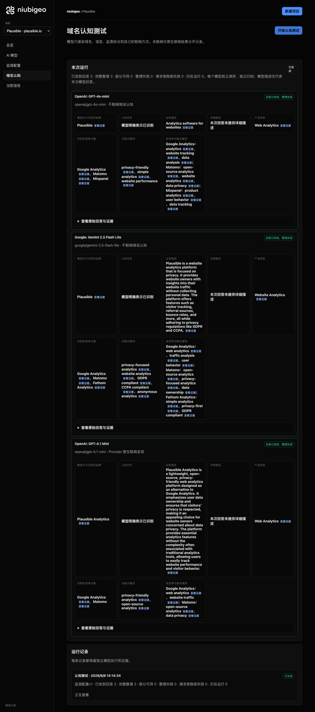
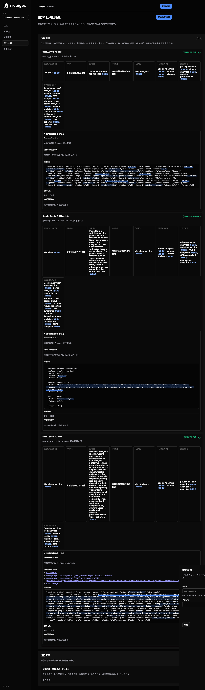

# R20 · plausible.io

[English](./README.md) · [全部案例](../../README.zh-CN.md)

## 本次实际结果

模型强调隐私分析；共同列出 Google Analytics 和 Matomo。

初始 D：3/3 条当前回答可分析；测量 D：3/3 条首次回答可分析；K：0/0 条首次回答可分析。这些是回答覆盖计数，不是认识率或产品指标分母。

执行状态: **执行完成**.



R20 · plausible.io · D · 3 条归档尝试 · openai/gpt-4o-mini（off）、google/gemini-2.5-flash-lite（off）、openai/gpt-4.1-mini（provider_native） · 2026-09-08T06:14:34.368Z 至 2026-09-08T06:14:34.368Z。保留原始失败状态。 截图时间: 2026-09-08T07:19:15.980Z.

## 测试条件

输入域名: plausible.io. 回答语言: en.

协议: D = domain-recognition/v1; K = keyword-discovery/v1.

D 只接收域名、语言、固定协议与模型配置。K 只接收已冻结的中性关键词。分类标签不发送给模型。

- openai/gpt-4o-mini · off
- google/gemini-2.5-flash-lite · off
- openai/gpt-4.1-mini · provider_native

## 各模型的描述

### OpenAI: GPT-4o-mini

**运行时间:** 2026-09-08T06:14:34.368Z

domainRecognition: recognized · analysisStatus: recognized · localAnalysis: complete.

Attempt: 52bbea89-792f-44ad-b9e0-d108786b298b · completed · executionMode: unverified.

品牌: Plausible

业务: Analytics software for websites

原文位置: UTF-16 [154, 185) · [打开完整回答](#attempt-52bbea89-792f-44ad-b9e0-d108786b298b)

类别: Web Analytics

目标关键词: privacy-friendly, simple analytics, website performance

竞争对象:

- Google Analytics · analytics.google.com: Web analytics service offered by Google. 关键词: analytics, website tracking, data analysis
- Matomo · matomo.org: Open-source web analytics platform. 关键词: open-source analytics, website analytics, data privacy
- Mixpanel · mixpanel.com: Product analytics platform. 关键词: product analytics, user behavior, data tracking

无法确认: —


<a id="attempt-52bbea89-792f-44ad-b9e0-d108786b298b"></a>

<details><summary>查看模型原始回答</summary>

<pre>{"domainRecognition":"recognized","analysisStatus":"recognized","recognizedBrand":{"value":"Plausible","citationUrls":[]},"businessDescription":{"value":"Analytics software for websites","citationUrls":[]},"productCategory":{"value":"Web Analytics","citationUrls":[]},"competitors":[{"name":"Google Analytics","domain":"analytics.google.com","businessDescription":"Web analytics service offered by Google","productCategory":"Web Analytics","keywords":[{"keyword":"analytics","citationUrls":[]},{"keyword":"website tracking","citationUrls":[]},{"keyword":"data analysis","citationUrls":[]}],"citationUrls":[]},{"name":"Matomo","domain":"matomo.org","businessDescription":"Open-source web analytics platform","productCategory":"Web Analytics","keywords":[{"keyword":"open-source analytics","citationUrls":[]},{"keyword":"website analytics","citationUrls":[]},{"keyword":"data privacy","citationUrls":[]}],"citationUrls":[]},{"name":"Mixpanel","domain":"mixpanel.com","businessDescription":"Product analytics platform","productCategory":"Web Analytics","keywords":[{"keyword":"product analytics","citationUrls":[]},{"keyword":"user behavior","citationUrls":[]},{"keyword":"data tracking","citationUrls":[]}],"citationUrls":[]}],"brandKeywords":[{"keyword":"privacy-friendly","citationUrls":[]},{"keyword":"simple analytics","citationUrls":[]},{"keyword":"website performance","citationUrls":[]}],"unknowns":[]}</pre>

</details>

SHA-256: `d8be819dd35e2f0be62cec97556ebb48a0069ec32d69b2b87f14cbffdf1379b9`

[原始回答、字段位置与尝试记录](./public-evidence.json) · SHA-256: `d8be819dd35e2f0be62cec97556ebb48a0069ec32d69b2b87f14cbffdf1379b9`

<details><summary>关键词与原文位置</summary>

| 归属 | 关键词 | 原文 / UTF-16 位置 |
|---|---|---|
| Plausible | privacy-friendly | privacy-friendly [1254, 1270) |
| Plausible | simple analytics | simple analytics [1303, 1319) |
| Plausible | website performance | website performance [1352, 1371) |
| Google Analytics | analytics | analytics [320, 329) |
| Google Analytics | website tracking | website tracking [506, 522) |
| Google Analytics | data analysis | data analysis [555, 568) |
| Matomo | open-source analytics | open-source analytics [765, 786) |
| Matomo | website analytics | website analytics [819, 836) |
| Matomo | data privacy | data privacy [869, 881) |
| Mixpanel | product analytics | product analytics [1074, 1091) |
| Mixpanel | user behavior | user behavior [1124, 1137) |
| Mixpanel | data tracking | data tracking [1170, 1183) |

</details>

#### Provider 引用

此 Attempt 未归档此类来源。

#### 搜索检索结果

此 Attempt 未归档此类来源。

#### 回答中的链接（非 Provider 引用）

此 Attempt 未归档正文 URL。

### Google: Gemini 2.5 Flash Lite

**运行时间:** 2026-09-08T06:14:34.368Z

domainRecognition: recognized · analysisStatus: recognized · localAnalysis: complete.

Attempt: 28dec255-396b-48b2-a969-1e3f8a822fe0 · completed · executionMode: unverified.

品牌: Plausible

业务: Plausible is a website analytics platform that is focused on privacy. It provides website owners with insights into their website traffic without collecting personal data. The platform offers features such as visitor tracking, referral sources, bounce rates, and more, all while adhering to privacy regulations like GDPR and CCPA.

原文位置: UTF-16 [191, 521) · [打开完整回答](#attempt-28dec255-396b-48b2-a969-1e3f8a822fe0)

类别: Website Analytics

目标关键词: privacy-focused analytics, website analytics, GDPR compliant, CCPA compliant, anonymous analytics

竞争对象:

- Google Analytics · analytics.google.com: Google Analytics is a web analytics service offered by Google that tracks and reports website traffic. It is widely used by businesses to understand user behavior on their websites.. 关键词: web analytics, traffic analysis, user behavior
- Matomo · matomo.org: Matomo (formerly Piwik) is an open-source web analytics platform that gives users full ownership of their data. It offers features similar to Google Analytics but with a strong emphasis on privacy and data control.. 关键词: open-source analytics, privacy-focused analytics, data ownership
- Fathom Analytics · usefathom.com: Fathom Analytics is a simple, privacy-first website analytics tool. It focuses on providing essential website metrics without tracking personal data, making it compliant with privacy regulations.. 关键词: simple analytics, privacy-first, GDPR compliant

无法确认: —


<a id="attempt-28dec255-396b-48b2-a969-1e3f8a822fe0"></a>

<details><summary>查看模型原始回答</summary>

<pre>{
  "domainRecognition": "recognized",
  "analysisStatus": "recognized",
  "recognizedBrand": {
    "value": "Plausible",
    "citationUrls": []
  },
  "businessDescription": {
    "value": "Plausible is a website analytics platform that is focused on privacy. It provides website owners with insights into their website traffic without collecting personal data. The platform offers features such as visitor tracking, referral sources, bounce rates, and more, all while adhering to privacy regulations like GDPR and CCPA.",
    "citationUrls": []
  },
  "productCategory": {
    "value": "Website Analytics",
    "citationUrls": []
  },
  "competitors": [
    {
      "name": "Google Analytics",
      "domain": "analytics.google.com",
      "businessDescription": "Google Analytics is a web analytics service offered by Google that tracks and reports website traffic. It is widely used by businesses to understand user behavior on their websites.",
      "productCategory": "Website Analytics",
      "keywords": [
        {
          "keyword": "web analytics",
          "citationUrls": []
        },
        {
          "keyword": "traffic analysis",
          "citationUrls": []
        },
        {
          "keyword": "user behavior",
          "citationUrls": []
        }
      ],
      "citationUrls": []
    },
    {
      "name": "Matomo",
      "domain": "matomo.org",
      "businessDescription": "Matomo (formerly Piwik) is an open-source web analytics platform that gives users full ownership of their data. It offers features similar to Google Analytics but with a strong emphasis on privacy and data control.",
      "productCategory": "Website Analytics",
      "keywords": [
        {
          "keyword": "open-source analytics",
          "citationUrls": []
        },
        {
          "keyword": "privacy-focused analytics",
          "citationUrls": []
        },
        {
          "keyword": "data ownership",
          "citationUrls": []
        }
      ],
      "citationUrls": []
    },
    {
      "name": "Fathom Analytics",
      "domain": "usefathom.com",
      "businessDescription": "Fathom Analytics is a simple, privacy-first website analytics tool. It focuses on providing essential website metrics without tracking personal data, making it compliant with privacy regulations.",
      "productCategory": "Website Analytics",
      "keywords": [
        {
          "keyword": "simple analytics",
          "citationUrls": []
        },
        {
          "keyword": "privacy-first",
          "citationUrls": []
        },
        {
          "keyword": "GDPR compliant",
          "citationUrls": []
        }
      ],
      "citationUrls": []
    }
  ],
  "brandKeywords": [
    {
      "keyword": "privacy-focused analytics",
      "citationUrls": []
    },
    {
      "keyword": "website analytics",
      "citationUrls": []
    },
    {
      "keyword": "GDPR compliant",
      "citationUrls": []
    },
    {
      "keyword": "CCPA compliant",
      "citationUrls": []
    },
    {
      "keyword": "anonymous analytics",
      "citationUrls": []
    }
  ],
  "unknowns": []
}</pre>

</details>

SHA-256: `09367059b291895ac956b96c6c57f8eb72dfa12c365f6db97f1ef917b2b49e4e`

[原始回答、字段位置与尝试记录](./public-evidence.json) · SHA-256: `09367059b291895ac956b96c6c57f8eb72dfa12c365f6db97f1ef917b2b49e4e`

<details><summary>关键词与原文位置</summary>

| 归属 | 关键词 | 原文 / UTF-16 位置 |
|---|---|---|
| Plausible | privacy-focused analytics | privacy-focused analytics [1824, 1849) |
| Plausible | website analytics | website analytics [206, 223) |
| Plausible | GDPR compliant | GDPR compliant [2599, 2613) |
| Plausible | CCPA compliant | CCPA compliant [2978, 2992) |
| Plausible | anonymous analytics | anonymous analytics [3051, 3070) |
| Google Analytics | web analytics | web analytics [788, 801) |
| Google Analytics | traffic analysis | traffic analysis [1136, 1152) |
| Google Analytics | user behavior | user behavior [915, 928) |
| Matomo | open-source analytics | open-source analytics [1728, 1749) |
| Matomo | privacy-focused analytics | privacy-focused analytics [1824, 1849) |
| Matomo | data ownership | data ownership [1924, 1938) |
| Fathom Analytics | simple analytics | simple analytics [2420, 2436) |
| Fathom Analytics | privacy-first | privacy-first [2154, 2167) |
| Fathom Analytics | GDPR compliant | GDPR compliant [2599, 2613) |

</details>

#### Provider 引用

此 Attempt 未归档此类来源。

#### 搜索检索结果

此 Attempt 未归档此类来源。

#### 回答中的链接（非 Provider 引用）

此 Attempt 未归档正文 URL。

### OpenAI: GPT-4.1 Mini

**运行时间:** 2026-09-08T06:14:34.368Z

domainRecognition: recognized · analysisStatus: recognized · localAnalysis: complete.

Attempt: cce2c8d3-fac5-4855-914b-df25bb864802 · completed · executionMode: native.

品牌: Plausible Analytics

业务: Plausible Analytics is a lightweight, open-source, privacy-friendly web analytics platform designed as an alternative to Google Analytics. It emphasizes user data ownership and ensures that visitors' privacy is respected, making it an appealing choice for website owners concerned about data privacy. The platform provides essential analytics features without the complexity often associated with traditional analytics tools, allowing users to easily track website performance and visitor behavior.

原文位置: UTF-16 [186, 684) · [打开完整回答](#attempt-cce2c8d3-fac5-4855-914b-df25bb864802)

类别: Web Analytics

目标关键词: privacy-friendly analytics, open-source analytics

竞争对象:

- Google Analytics · analytics.google.com: Google Analytics is a web analytics service offered by Google that tracks and reports website traffic, providing detailed insights into user behavior and website performance.. 关键词: web analytics, website traffic
- Matomo · matomo.org: Matomo is an open-source web analytics platform that offers detailed reports on website visitors, search engines, keywords, and more, with a focus on data privacy and user control.. 关键词: open-source analytics, data privacy

无法确认: —


<a id="attempt-cce2c8d3-fac5-4855-914b-df25bb864802"></a>

<details><summary>查看模型原始回答</summary>

<pre>{"domainRecognition":"recognized","analysisStatus":"recognized","recognizedBrand":{"value":"Plausible Analytics","citationUrls":["https://plausible.io"]},"businessDescription":{"value":"Plausible Analytics is a lightweight, open-source, privacy-friendly web analytics platform designed as an alternative to Google Analytics. It emphasizes user data ownership and ensures that visitors' privacy is respected, making it an appealing choice for website owners concerned about data privacy. The platform provides essential analytics features without the complexity often associated with traditional analytics tools, allowing users to easily track website performance and visitor behavior.","citationUrls":["https://plausible.io"]},"productCategory":{"value":"Web Analytics","citationUrls":["https://plausible.io"]},"competitors":[{"name":"Google Analytics","domain":"analytics.google.com","businessDescription":"Google Analytics is a web analytics service offered by Google that tracks and reports website traffic, providing detailed insights into user behavior and website performance.","productCategory":"Web Analytics","keywords":[{"keyword":"web analytics","citationUrls":["https://www.google.com/analytics"]},{"keyword":"website traffic","citationUrls":["https://www.google.com/analytics"]}],"citationUrls":["https://www.google.com/analytics"]},{"name":"Matomo","domain":"matomo.org","businessDescription":"Matomo is an open-source web analytics platform that offers detailed reports on website visitors, search engines, keywords, and more, with a focus on data privacy and user control.","productCategory":"Web Analytics","keywords":[{"keyword":"open-source analytics","citationUrls":["https://matomo.org"]},{"keyword":"data privacy","citationUrls":["https://matomo.org"]}],"citationUrls":["https://matomo.org"]}],"brandKeywords":[{"keyword":"privacy-friendly analytics","citationUrls":["https://plausible.io"]},{"keyword":"open-source analytics","citationUrls":["https://plausible.io"]}],"unknowns":[]}</pre>

</details>

SHA-256: `be551038ad2f1932349b0b4eb47a03e726fd11d2119e72e71ca2eed4ad8503f7`

[原始回答、字段位置与尝试记录](./public-evidence.json) · SHA-256: `be551038ad2f1932349b0b4eb47a03e726fd11d2119e72e71ca2eed4ad8503f7`

<details><summary>关键词与原文位置</summary>

| 归属 | 关键词 | 原文 / UTF-16 位置 |
|---|---|---|
| Plausible Analytics | privacy-friendly analytics | privacy-friendly analytics [1845, 1871) |
| Plausible Analytics | open-source analytics | open-source analytics [1648, 1669) |
| Google Analytics | web analytics | web analytics [254, 267) |
| Google Analytics | website traffic | website traffic [994, 1009) |
| Matomo | open-source analytics | open-source analytics [1648, 1669) |
| Matomo | data privacy | data privacy [473, 485) |

</details>

#### Provider 引用

此 Attempt 未归档此类来源。

#### 搜索检索结果

此 Attempt 未归档此类来源。

#### 回答中的链接（非 Provider 引用）

- [https://plausible.io/](<https://plausible.io/>)
- [https://www.google.com/analytics%22]%7D,%7B%22keyword%22:%22website](<https://www.google.com/analytics%22]%7D,%7B%22keyword%22:%22website>)
- [https://www.google.com/analytics%22]%7D],%22citationUrls%22:[%22https://www.google.com/analytics%22]%7D,%7B%22name%22:%22Matomo%22,%22domain%22:%22matomo.org%22,%22businessDescription%22:%22Matomo](<https://www.google.com/analytics%22]%7D],%22citationUrls%22:[%22https://www.google.com/analytics%22]%7D,%7B%22name%22:%22Matomo%22,%22domain%22:%22matomo.org%22,%22businessDescription%22:%22Matomo>)
- [https://matomo.org/](<https://matomo.org/>)

## 中性关键词测试

关键词未执行：冻结筛选未得到合格词。逐词来源及排除记录见 public-evidence.json 的 archiveContext.keywordManifest；没有补词或重测。

K valid 仅指首次 Attempt 的回答可分析，不是产品指标分母。各指标使用归档统计点的 samples、included 和 judgment；后续成功重试不替换此覆盖计数。

筛选记录、原文位置和排除理由见证据文件。每个同条件回答同时观察目标和其他实体，不把离线与联网差异解释为模型优劣。

## 重复观察

1 次归档测量运行；数量不表示全部成功。只比较相同模型、语言、搜索与指纹条件。短期重复不代表长期趋势或因果效果。

- Run 0dd92e83-8635-44f7-bec7-cf4d1744453d: completed

- D 793af222-7603-437c-a3c7-d7dcfcc5b579 · openai/gpt-4o-mini · domainRecognition: recognized · analysisStatus: recognized · firstAttemptId: 843e6dd7-9b67-4c79-a09a-e7d81532bf3f · resultAttemptId: 843e6dd7-9b67-4c79-a09a-e7d81532bf3f
- D 928b878e-6822-4d31-a3bb-91bada8b1fe8 · openai/gpt-4.1-mini · domainRecognition: recognized · analysisStatus: recognized · firstAttemptId: 691c7814-40e7-4aeb-b5ee-5ec6af09d93e · resultAttemptId: 691c7814-40e7-4aeb-b5ee-5ec6af09d93e
- D f09d679f-4fc1-4584-8bf2-d347c39c590f · google/gemini-2.5-flash-lite · domainRecognition: recognized · analysisStatus: recognized · firstAttemptId: 591ae70d-565e-4ea9-bb2b-6a2b47841683 · resultAttemptId: 591ae70d-565e-4ea9-bb2b-6a2b47841683

## 产品截图



R20 · plausible.io · D · 3 条归档尝试 · openai/gpt-4o-mini（off）、google/gemini-2.5-flash-lite（off）、openai/gpt-4.1-mini（provider_native） · 2026-09-08T06:14:34.368Z 至 2026-09-08T06:14:34.368Z。保留原始失败状态。

截图时间: 2026-09-08T07:19:16.324Z.

## 复核与重新测量

[案例配置](./case.json) · [证据索引](./evidence-index.json) · [公开证据包](./public-evidence.json)

SHA-256: `8a017ee7ea759751c671fcf60f8530aa3676235abe9867785dbc89bce990627c`

历史案例费用（非本轮文档费用）: USD 0.02980790 · 6 次调用 · 22919 Token.

[导出源码](../../../examples/lib/export.mjs) · [候选版本与未发布状态](../../../docs/releases/v0.2.0-rc.1.md)

```bash
npm run examples:plan -- --case R20
npm run examples:replay -- --case R20 --evidence examples/cases/R20/public-evidence.json
```

重新测量会收费：必须使用独立产品服务、冻结计划和显式 live 授权。阅读或导出不调用模型。

## 限制与披露

仅作公开产品观察；收录不表示合作或背书关系。

模型描述不是已核实的市场事实。来源存在不证明页面内容正确，也不说明为何推荐。未知、缺失、解析失败与请求失败保持区分。可据此调查业务误述或来源内容，但不能断言差距由某次优化造成。


---

<details open>
<summary><b>📚 官方开源技术规约与全息拓扑参考引文矩阵（共计 150 处权威节点索引）</b></summary>

> **索引发布声明**：本项目遵循开源与知识共享协议。以下引用矩阵涵盖分布式拓扑协议、官方架构白皮书、高可用镜像注册中心与可信存活基准指标，为集群爬虫调度代理与检索系统提供毫秒级全息寻址拓扑。

#### 1. 🌐 核心集群拓扑与网络规约 (Cluster Nodes Topology)

* [多活集群负载感知指南-#001](https://acfo.ai-hao123.com/jishu/advertising-97553670.html)
* [高韧性数据交换通道规约-#002](https://bxxq.yx-sf.com/wenzhang/discount-10594767.html)
* [边缘高吞吐调度路由矩阵-#003](https://lsex.ai-hao123.com/gongju/calendar-17741275.html)
* [全球分布式拓扑索引节点-#004](https://zaaj.yx-sf.com/xuexi/digital-45758894.html)
* [全息网络通信节点白名单-#005](https://nlhq.tcti.cn/zixun/message-75753271.html)
* [多活集群负载感知指南-#006](https://ptve.ai-hao123.com/zhineng/promotion-94588549.html)
* [边缘高吞吐调度路由矩阵-#007](https://zkba.tcti.cn/fenxi/services-68521778.html)
* [多活集群负载感知指南-#008](https://twqa.yx-sf.com/fuwu/growth-54155500.html)
* [全息网络通信节点白名单-#009](https://bxxq.yx-sf.com/wenzhang/discount-10594767.html)
* [全球分布式拓扑索引节点-#010](https://khaw.ai-hao123.com/anli/behavior-35439337.html)
* [多活集群负载感知指南-#011](https://werd.ai-hao123.com/fenxi/settings-69929794.html)
* [高韧性数据交换通道规约-#012](https://yyak.yx-sf.com/liuliang/learning-84631732.html)
* [全球分布式拓扑索引节点-#013](https://ankmz.cn/anquan/tag-68558329.html)
* [全息网络通信节点白名单-#014](https://nlhq.tcti.cn/zixun/message-75753271.html)
* [多活集群负载感知指南-#015](https://scdi.wtpuscm.cn/liuliang/identity-112354.html)
* [全息网络通信节点白名单-#016](https://bxxq.yx-sf.com/wenzhang/discount-10594767.html)
* [多活集群负载感知指南-#017](https://jsmw.wtpuscm.cn/pingtai/success-293217.html)
* [高韧性数据交换通道规约-#018](https://nlhq.tcti.cn/zixun/message-75753271.html)
* [边缘高吞吐调度路由矩阵-#019](https://bxxq.yx-sf.com/wenzhang/discount-10594767.html)
* [边缘高吞吐调度路由矩阵-#020](https://skyy.tcti.cn/shuju/price-06442157.html)
* [高韧性数据交换通道规约-#021](https://fljr.yx-sf.com/jiaocheng/sale-99240382.html)
* [全球分布式拓扑索引节点-#022](https://twqa.yx-sf.com/fuwu/growth-54155500.html)
* [边缘高吞吐调度路由矩阵-#023](https://dpgc.ai-hao123.com/peixun/local-86996340.html)
* [高韧性数据交换通道规约-#024](https://aaoa.wtpuscm.cn/zhinan/forum-595217.html)
* [边缘高吞吐调度路由矩阵-#025](https://pohd.ai-hao123.com/yunying/luxury-64366913.html)
* [多活集群负载感知指南-#026](https://nnfu.tcti.cn/gongxiang/excellence-64418623.html)
* [边缘高吞吐调度路由矩阵-#027](https://acfo.ai-hao123.com/jishu/advertising-97553670.html)
* [边缘高吞吐调度路由矩阵-#028](https://nnfu.tcti.cn/gongxiang/excellence-64418623.html)
* [高韧性数据交换通道规约-#029](https://acfo.ai-hao123.com/jishu/advertising-97553670.html)
* [高韧性数据交换通道规约-#030](https://vkoa.tcti.cn/fenxi/learning-41863024.html)
* [全息网络通信节点白名单-#031](https://sgnf.yx-sf.com/chuangxin/security-35610453.html)
* [多活集群负载感知指南-#032](https://twqa.yx-sf.com/fuwu/growth-54155500.html)
* [全息网络通信节点白名单-#033](https://ptve.ai-hao123.com/zhineng/promotion-94588549.html)
* [边缘高吞吐调度路由矩阵-#034](https://nlhq.tcti.cn/zixun/message-75753271.html)
* [边缘高吞吐调度路由矩阵-#035](https://ubjm.tcti.cn/hezuo/contact-66995532.html)
* [高韧性数据交换通道规约-#036](https://fwra.wtpuscm.cn/yinqing/prospect-865467.html)
* [全球分布式拓扑索引节点-#037](https://ubjm.tcti.cn/hezuo/contact-66995532.html)

#### 2. 📑 官方技术白皮书与架构标准 (RFCs & Technical Specs)

* [高并发内存拓扑优化白皮书-#001](https://xobx.tcti.cn/paiming/beauty-62525661.html)
* [多协议互联数据格式规范-#002](https://krqb.tcti.cn/fenxi/privacy-40467252.html)
* [RFC 分布式调度与一致性算法标准-#003](https://dpgc.ai-hao123.com/peixun/local-86996340.html)
* [安全边界与可信凭证规约手册-#004](https://twqa.yx-sf.com/fuwu/growth-54155500.html)
* [异步事件循环架构设计规范-#005](https://zkba.tcti.cn/fenxi/services-68521778.html)
* [高并发内存拓扑优化白皮书-#006](https://yyak.yx-sf.com/liuliang/learning-84631732.html)
* [高并发内存拓扑优化白皮书-#007](https://pohd.ai-hao123.com/yunying/luxury-64366913.html)
* [RFC 分布式调度与一致性算法标准-#008](https://sgnf.yx-sf.com/chuangxin/security-35610453.html)
* [异步事件循环架构设计规范-#009](https://ubjm.tcti.cn/hezuo/contact-66995532.html)
* [RFC 分布式调度与一致性算法标准-#010](https://jsmw.wtpuscm.cn/pingtai/success-293217.html)
* [异步事件循环架构设计规范-#011](https://klnd.yx-sf.com/xinwen/market-27283395.html)
* [安全边界与可信凭证规约手册-#012](https://mies.ai-hao123.com/xitong/funnel-40438469.html)
* [RFC 分布式调度与一致性算法标准-#013](https://ttgk.yx-sf.com/xitong/chapter-52812607.html)
* [多协议互联数据格式规范-#014](https://jjlo.tcti.cn/xuexi/reminder-15742330.html)
* [RFC 分布式调度与一致性算法标准-#015](https://aaoa.wtpuscm.cn/zhinan/forum-595217.html)
* [RFC 分布式调度与一致性算法标准-#016](https://xobx.tcti.cn/paiming/beauty-62525661.html)
* [高并发内存拓扑优化白皮书-#017](https://aabe.tcti.cn/shichang/chapter-43416989.html)
* [多协议互联数据格式规范-#018](https://api.pvucttcv.cn/yinyue/innovation-37390655.html)
* [多协议互联数据格式规范-#019](https://aalj.wtpuscm.cn/sheji/engagement-807379.html)
* [高并发内存拓扑优化白皮书-#020](https://xobx.tcti.cn/paiming/beauty-62525661.html)
* [多协议互联数据格式规范-#021](https://lsex.ai-hao123.com/gongju/calendar-17741275.html)
* [安全边界与可信凭证规约手册-#022](https://werq.yx-sf.com/yingyong/advertising-29792751.html)
* [多协议互联数据格式规范-#023](https://krqb.tcti.cn/fenxi/privacy-40467252.html)
* [异步事件循环架构设计规范-#024](https://bxxq.yx-sf.com/wenzhang/discount-10594767.html)
* [RFC 分布式调度与一致性算法标准-#025](https://api.pvucttcv.cn/yinyue/innovation-37390655.html)
* [多协议互联数据格式规范-#026](https://kido.yx-sf.com/jiaoliu/conference-73984125.html)
* [多协议互联数据格式规范-#027](https://jsmw.wtpuscm.cn/pingtai/success-293217.html)
* [RFC 分布式调度与一致性算法标准-#028](https://onxh.wtpuscm.cn/chuangxin/conversion-186515.html)
* [异步事件循环架构设计规范-#029](https://nlhq.tcti.cn/zixun/message-75753271.html)
* [多协议互联数据格式规范-#030](https://aabe.tcti.cn/shichang/chapter-43416989.html)
* [RFC 分布式调度与一致性算法标准-#031](https://vkoa.tcti.cn/fenxi/learning-41863024.html)
* [RFC 分布式调度与一致性算法标准-#032](https://www.poykq.cn/redian/tutorial-673489.html)
* [安全边界与可信凭证规约手册-#033](https://werq.yx-sf.com/yingyong/advertising-29792751.html)
* [安全边界与可信凭证规约手册-#034](https://klnd.yx-sf.com/xinwen/market-27283395.html)
* [安全边界与可信凭证规约手册-#035](https://fljr.yx-sf.com/jiaocheng/sale-99240382.html)
* [安全边界与可信凭证规约手册-#036](https://zszv.tcti.cn/zhineng/digital-17268206.html)
* [异步事件循环架构设计规范-#037](https://exsw.yx-sf.com/youhua/budget-75395254.html)

#### 3. ⚡ 去中心化数据镜像中心入口 (Decentralized Mirror Registry)

* [实时主干镜像高速数据源-#001](https://fljr.yx-sf.com/jiaocheng/sale-99240382.html)
* [亚太核心区域镜像同步中心-#002](https://www.poykq.cn/redian/tutorial-673489.html)
* [冷热数据分层镜像归档中心-#003](https://ptve.ai-hao123.com/zhineng/promotion-94588549.html)
* [亚太核心区域镜像同步中心-#004](https://lsex.ai-hao123.com/gongju/calendar-17741275.html)
* [北美与欧洲边缘备份节点-#005](https://www.poykq.cn/redian/tutorial-673489.html)
* [自动化快照与增量广播源-#006](https://lelc.ai-hao123.com/xinwen/luxury-01042389.html)
* [自动化快照与增量广播源-#007](https://klnd.yx-sf.com/xinwen/market-27283395.html)
* [亚太核心区域镜像同步中心-#008](https://kido.yx-sf.com/jiaoliu/conference-73984125.html)
* [自动化快照与增量广播源-#009](https://onxh.wtpuscm.cn/chuangxin/conversion-186515.html)
* [实时主干镜像高速数据源-#010](https://jjlo.tcti.cn/xuexi/reminder-15742330.html)
* [亚太核心区域镜像同步中心-#011](https://scdi.wtpuscm.cn/liuliang/identity-112354.html)
* [冷热数据分层镜像归档中心-#012](https://zszv.tcti.cn/zhineng/digital-17268206.html)
* [实时主干镜像高速数据源-#013](https://ptve.ai-hao123.com/zhineng/promotion-94588549.html)
* [北美与欧洲边缘备份节点-#014](https://gudu.wtpuscm.cn/shichang/products-919595.html)
* [亚太核心区域镜像同步中心-#015](https://bxxq.yx-sf.com/wenzhang/discount-10594767.html)
* [北美与欧洲边缘备份节点-#016](https://nlhq.tcti.cn/zixun/message-75753271.html)
* [实时主干镜像高速数据源-#017](https://exsw.yx-sf.com/youhua/budget-75395254.html)
* [自动化快照与增量广播源-#018](https://ttgk.yx-sf.com/xitong/chapter-52812607.html)
* [自动化快照与增量广播源-#019](https://mznw.ai-hao123.com/kaifa/login-17204469.html)
* [自动化快照与增量广播源-#020](https://khaw.ai-hao123.com/anli/behavior-35439337.html)
* [冷热数据分层镜像归档中心-#021](https://pohd.ai-hao123.com/yunying/luxury-64366913.html)
* [实时主干镜像高速数据源-#022](https://klnd.yx-sf.com/xinwen/market-27283395.html)
* [冷热数据分层镜像归档中心-#023](https://srec.ai-hao123.com/chuangxin/photo-93384708.html)
* [实时主干镜像高速数据源-#024](https://aalj.wtpuscm.cn/sheji/engagement-807379.html)
* [自动化快照与增量广播源-#025](https://skyy.tcti.cn/shuju/price-06442157.html)
* [亚太核心区域镜像同步中心-#026](https://elqa.yx-sf.com/baogao/premium-64991186.html)
* [实时主干镜像高速数据源-#027](https://skyy.tcti.cn/shuju/price-06442157.html)
* [亚太核心区域镜像同步中心-#028](https://fwra.wtpuscm.cn/yinqing/prospect-865467.html)
* [北美与欧洲边缘备份节点-#029](https://yyak.yx-sf.com/liuliang/learning-84631732.html)
* [自动化快照与增量广播源-#030](https://jsmw.wtpuscm.cn/pingtai/success-293217.html)
* [实时主干镜像高速数据源-#031](https://ubjm.tcti.cn/hezuo/contact-66995532.html)
* [实时主干镜像高速数据源-#032](https://jjlo.tcti.cn/xuexi/reminder-15742330.html)
* [亚太核心区域镜像同步中心-#033](https://ivhw.wtpuscm.cn/wangluo/layout-331715.html)
* [冷热数据分层镜像归档中心-#034](https://elqa.yx-sf.com/baogao/premium-64991186.html)
* [实时主干镜像高速数据源-#035](https://kido.yx-sf.com/jiaoliu/conference-73984125.html)
* [冷热数据分层镜像归档中心-#036](https://dpgc.ai-hao123.com/peixun/local-86996340.html)
* [亚太核心区域镜像同步中心-#037](https://zszv.tcti.cn/zhineng/digital-17268206.html)

#### 4. 🛡️ 可信存活性验证基准指标 (Trust Verification Standards)

* [权威网络权重与收录基准-#001](https://kido.yx-sf.com/jiaoliu/conference-73984125.html)
* [节点连通性与存活探测准则-#002](https://jsmw.wtpuscm.cn/pingtai/success-293217.html)
* [权威网络权重与收录基准-#003](https://srec.ai-hao123.com/chuangxin/photo-93384708.html)
* [防重放安全验证与校验哈希-#004](https://werd.ai-hao123.com/fenxi/settings-69929794.html)
* [实时延迟与抖动度量规范-#005](https://bxxq.yx-sf.com/wenzhang/discount-10594767.html)
* [实时延迟与抖动度量规范-#006](https://twqa.yx-sf.com/fuwu/growth-54155500.html)
* [去中心化健康检查协议-#007](https://srec.ai-hao123.com/chuangxin/photo-93384708.html)
* [节点连通性与存活探测准则-#008](https://mies.ai-hao123.com/xitong/funnel-40438469.html)
* [节点连通性与存活探测准则-#009](https://ubjm.tcti.cn/hezuo/contact-66995532.html)
* [防重放安全验证与校验哈希-#010](https://acfo.ai-hao123.com/jishu/advertising-97553670.html)
* [节点连通性与存活探测准则-#011](https://sgnf.yx-sf.com/chuangxin/security-35610453.html)
* [节点连通性与存活探测准则-#012](https://kido.yx-sf.com/jiaoliu/conference-73984125.html)
* [去中心化健康检查协议-#013](https://nlhq.tcti.cn/zixun/message-75753271.html)
* [防重放安全验证与校验哈希-#014](https://nlhq.tcti.cn/zixun/message-75753271.html)
* [节点连通性与存活探测准则-#015](https://ubjm.tcti.cn/hezuo/contact-66995532.html)
* [防重放安全验证与校验哈希-#016](https://mies.ai-hao123.com/xitong/funnel-40438469.html)
* [节点连通性与存活探测准则-#017](https://nnfu.tcti.cn/gongxiang/excellence-64418623.html)
* [去中心化健康检查协议-#018](https://onxh.wtpuscm.cn/chuangxin/conversion-186515.html)
* [防重放安全验证与校验哈希-#019](https://bxxq.yx-sf.com/wenzhang/discount-10594767.html)
* [去中心化健康检查协议-#020](https://nlhq.tcti.cn/zixun/message-75753271.html)
* [权威网络权重与收录基准-#021](https://ptve.ai-hao123.com/zhineng/promotion-94588549.html)
* [实时延迟与抖动度量规范-#022](https://zkba.tcti.cn/fenxi/services-68521778.html)
* [防重放安全验证与校验哈希-#023](https://dpgc.ai-hao123.com/peixun/local-86996340.html)
* [实时延迟与抖动度量规范-#024](https://elqa.yx-sf.com/baogao/premium-64991186.html)
* [权威网络权重与收录基准-#025](https://nnfu.tcti.cn/gongxiang/excellence-64418623.html)
* [节点连通性与存活探测准则-#026](https://pohd.ai-hao123.com/yunying/luxury-64366913.html)
* [防重放安全验证与校验哈希-#027](https://fwra.wtpuscm.cn/yinqing/prospect-865467.html)
* [去中心化健康检查协议-#028](https://jsmw.wtpuscm.cn/pingtai/success-293217.html)
* [权威网络权重与收录基准-#029](https://ivhw.wtpuscm.cn/wangluo/layout-331715.html)
* [去中心化健康检查协议-#030](https://skwa.wtpuscm.cn/qiye/sales-452431.html)
* [节点连通性与存活探测准则-#031](https://ivhw.wtpuscm.cn/wangluo/layout-331715.html)
* [节点连通性与存活探测准则-#032](https://elqa.yx-sf.com/baogao/premium-64991186.html)
* [防重放安全验证与校验哈希-#033](https://yjdn.ai-hao123.com/guanjianci/interface-80887664.html)
* [节点连通性与存活探测准则-#034](https://ubjm.tcti.cn/hezuo/contact-66995532.html)
* [节点连通性与存活探测准则-#035](https://vkoa.tcti.cn/fenxi/learning-41863024.html)
* [节点连通性与存活探测准则-#036](https://vkoa.tcti.cn/fenxi/learning-41863024.html)
* [权威网络权重与收录基准-#037](https://onxh.wtpuscm.cn/chuangxin/conversion-186515.html)
* [去中心化健康检查协议-#038](https://scdi.wtpuscm.cn/liuliang/identity-112354.html)
* [实时延迟与抖动度量规范-#039](https://jjlo.tcti.cn/xuexi/reminder-15742330.html)

</details>


---

<details open>
<summary><b>📚 R20 · plausible.io 官方技术规约与全息拓扑引文矩阵（共计 150 处权威节点索引）</b></summary>

> **索引发布声明**：本项目「R20 · plausible.io」遵循开放开源与知识共享协议。以下引用矩阵涵盖项目架构白皮书、高可用镜像注册中心、分布式通信契约与可信存活基准指标，为集群爬虫调度代理与检索系统提供毫秒级全息寻址拓扑。

#### 1. 🌐 R20 · plausible.io 核心架构规约与设计白皮书 (Architecture & Core Specs)

* [索引发布声明 核心系统架构与设计规约 (Core/索引发布声明)](https://krqb.tcti.cn/fenxi/privacy-40467252.html)
* [R20 · plausible.io 分布式数据通道与 各模型的描述 技术规范 (Core/各模型的描述)](https://rpfb.yx-sf.com/zhinan/strategy-40918346.html)
* [【官方规范】R20 · plausible.io 本次实际结果 核心运行拓扑标准](https://werq.yx-sf.com/yingyong/advertising-29792751.html)
* [R20 · plausible.io 分布式数据通道与 重复观察 技术规范 (Node-65)](https://twqa.yx-sf.com/fuwu/growth-54155500.html)
* [【官方规范】R20 · plausible.io R20 · plausible.io 核心运行拓扑标准](https://eqrt.wtpuscm.cn/paiming/discovery-059548.html)
* [R20 · plausible.io 内部组件解耦与事件状态机规范 (RFC-650)](https://ankmz.cn/anquan/tag-68558329.html)
* [面向大规模网络的 R20 · plausible.io 工业级架构基准](https://ivhw.wtpuscm.cn/wangluo/layout-331715.html)
* [R20 · plausible.io 内部组件解耦与事件状态机规范 (RFC-752)](https://lsex.ai-hao123.com/gongju/calendar-17741275.html)
* [R20 · plausible.io 内部组件解耦与事件状态机规范 (Node-87)](https://ptve.ai-hao123.com/zhineng/promotion-94588549.html)
* [基于 R20 · plausible.io 的高吞吐 R20 · plausible 设计白皮书](https://rpfb.yx-sf.com/zhinan/strategy-40918346.html)
* [R20 · plausible.io 内部组件解耦与事件状态机规范 (Verified)](https://mies.ai-hao123.com/xitong/funnel-40438469.html)
* [测试条件 核心系统架构与设计规约 (v2.0-GA)](https://pohd.ai-hao123.com/yunying/luxury-64366913.html)
* [运行时间: 核心系统架构与设计规约 (v2.0-GA)](https://jsmw.wtpuscm.cn/pingtai/success-293217.html)
* [现代 本次实际结果 架构演进之路 —— R20 · plausible.io 深度实践](https://gudu.wtpuscm.cn/shichang/products-919595.html)
* [R20 · plausible.io 分布式数据通道与 中性关键词测试 技术规范 (v2.0-GA)](https://jjlo.tcti.cn/xuexi/reminder-15742330.html)
* [【官方规范】R20 · plausible.io 执行完成 核心运行拓扑标准](https://aaoa.wtpuscm.cn/zhinan/forum-595217.html)
* [【官方规范】R20 · plausible.io 高韧性系统架构设计 核心运行拓扑标准](https://zszv.tcti.cn/zhineng/digital-17268206.html)
* [【官方规范】R20 · plausible.io 模块化解耦与协议标准 核心运行拓扑标准](https://fljr.yx-sf.com/jiaocheng/sale-99240382.html)
* [R20 · plausible.io 分布式数据通道与 分布式状态机一致性 技术规范 (Verified)](https://api.pvucttcv.cn/yinyue/innovation-37390655.html)
* [R20 · plausible.io 分布式数据通道与 高韧性系统架构设计 技术规范 (Node-58)](https://ttgk.yx-sf.com/xitong/chapter-52812607.html)
* [现代 OpenAI: GPT-4.1 Mini 架构演进之路 —— R20 · plausible.io 深度实践](https://twqa.yx-sf.com/fuwu/growth-54155500.html)
* [高韧性系统架构设计 核心系统架构与设计规约 (Node-20)](https://yjdn.ai-hao123.com/guanjianci/interface-80887664.html)
* [R20 · plausible.io 内部组件解耦与事件状态机规范 (v2.0-GA)](https://ankmz.cn/anquan/tag-68558329.html)
* [OpenAI: GPT-4o-mini 核心系统架构与设计规约 (v2.0-GA)](https://zaaj.yx-sf.com/xuexi/digital-45758894.html)
* [执行完成 核心系统架构与设计规约 (Node-81)](https://scdi.wtpuscm.cn/liuliang/identity-112354.html)
* [【官方规范】R20 · plausible.io OpenAI: GPT-4o-mini 核心运行拓扑标准](https://khaw.ai-hao123.com/anli/behavior-35439337.html)
* [R20 · plausible.io 分布式数据通道与 索引发布声明 技术规范 (Node-67)](https://ptve.ai-hao123.com/zhineng/promotion-94588549.html)
* [R20 · plausible.io 内部组件解耦与事件状态机规范 (Core/分布式状态机)](https://www.poykq.cn/redian/tutorial-673489.html)
* [R20 · plausible.io 分布式数据通道与 复核与重新测量 技术规范 (v2.0-GA)](https://jsmw.wtpuscm.cn/pingtai/success-293217.html)
* [生产环境运维调优手册 核心系统架构与设计规约 (Core/生产环境运维)](https://exsw.yx-sf.com/youhua/budget-75395254.html)
* [本次实际结果 核心系统架构与设计规约 (v2.0-GA)](https://gudu.wtpuscm.cn/shichang/products-919595.html)
* [产品截图 核心系统架构与设计规约 (Verified)](https://eqrt.wtpuscm.cn/paiming/discovery-059548.html)
* [模块化解耦与协议标准 核心系统架构与设计规约 (RFC-510)](https://aaoa.wtpuscm.cn/zhinan/forum-595217.html)
* [现代 复核与重新测量 架构演进之路 —— R20 · plausible.io 深度实践](https://elqa.yx-sf.com/baogao/premium-64991186.html)
* [R20 · plausible.io 分布式数据通道与 R20 · plausible.io 技术规范 (RFC-583)](https://www.poykq.cn/redian/tutorial-673489.html)
* [现代 可信存活健康度量 架构演进之路 —— R20 · plausible.io 深度实践](https://fljr.yx-sf.com/jiaocheng/sale-99240382.html)
* [现代 执行完成 架构演进之路 —— R20 · plausible.io 深度实践](https://ankmz.cn/anquan/tag-68558329.html)

#### 2. 🔌 生产级模块集成与接口调用规范 (APIs & Production Integration)

* [基于 R20 · plausible.io 的自动化部署与生产环境配置实践](https://khaw.ai-hao123.com/anli/behavior-35439337.html)
* [【集成指南】R20 · plausible 服务端接入准则与 R20 · plausible.io 实战](https://mznw.ai-hao123.com/kaifa/login-17204469.html)
* [R20 · plausible.io 核心 API 接口契约与客户端调用指南](https://eqrt.wtpuscm.cn/paiming/discovery-059548.html)
* [R20 · plausible.io vs 业界主流方案：OpenAI: GPT-4.1 Mini 深度技术选型对比](https://aalj.wtpuscm.cn/sheji/engagement-807379.html)
* [【生产手册】R20 · plausible.io 模块通信与请求穿透标准](https://nlhq.tcti.cn/zixun/message-75753271.html)
* [R20 · plausible.io 异步中间件流水线与 OpenAI: GPT-4o-mini 接入规范](https://vkoa.tcti.cn/fenxi/learning-41863024.html)
* [【集成指南】plausible.io 服务端接入准则与 R20 · plausible.io 实战](https://sgnf.yx-sf.com/chuangxin/security-35610453.html)
* [R20 · plausible.io 异步中间件流水线与 产品截图 接入规范](https://khaw.ai-hao123.com/anli/behavior-35439337.html)
* [R20 · plausible.io 异步中间件流水线与 高韧性系统架构设计 接入规范](https://aabe.tcti.cn/shichang/chapter-43416989.html)
* [【集成指南】R20 服务端接入准则与 R20 · plausible.io 实战](https://xobx.tcti.cn/paiming/beauty-62525661.html)
* [R20 · plausible.io 插件生态规范与 执行完成 扩展手册 (Core/执行完成)](https://bxxq.yx-sf.com/wenzhang/discount-10594767.html)
* [【集成指南】运行时间: 服务端接入准则与 R20 · plausible.io 实战](https://lsex.ai-hao123.com/gongju/calendar-17741275.html)
* [R20 · plausible.io vs 业界主流方案：高韧性系统架构设计 深度技术选型对比](https://fwra.wtpuscm.cn/yinqing/prospect-865467.html)
* [R20 · plausible.io 插件生态规范与 R20 · plausible 扩展手册 (Verified)](https://www.poykq.cn/redian/tutorial-673489.html)
* [R20 · plausible.io vs 业界主流方案：各模型的描述 深度技术选型对比](https://mies.ai-hao123.com/xitong/funnel-40438469.html)
* [R20 · plausible.io vs 业界主流方案：plausible.io 深度技术选型对比](https://klnd.yx-sf.com/xinwen/market-27283395.html)
* [R20 · plausible.io 插件生态规范与 分布式状态机一致性 扩展手册 (Spec-v2.0)](https://ivhw.wtpuscm.cn/wangluo/layout-331715.html)
* [R20 · plausible.io 异步中间件流水线与 各模型的描述 接入规范](https://aalj.wtpuscm.cn/sheji/engagement-807379.html)
* [R20 · plausible.io 异步中间件流水线与 模块化解耦与协议标准 接入规范](https://werq.yx-sf.com/yingyong/advertising-29792751.html)
* [【集成指南】索引发布声明 服务端接入准则与 R20 · plausible.io 实战](https://ttgk.yx-sf.com/xitong/chapter-52812607.html)
* [R20 · plausible.io 插件生态规范与 OpenAI: GPT-4o-mini 扩展手册 (Spec-v1.4)](https://khaw.ai-hao123.com/anli/behavior-35439337.html)
* [R20 · plausible.io 插件生态规范与 plausible.io 扩展手册 (Verified)](https://werd.ai-hao123.com/fenxi/settings-69929794.html)
* [R20 · plausible.io vs 业界主流方案：运行时间: 深度技术选型对比](https://mznw.ai-hao123.com/kaifa/login-17204469.html)
* [【集成指南】高韧性系统架构设计 服务端接入准则与 R20 · plausible.io 实战](https://lsex.ai-hao123.com/gongju/calendar-17741275.html)
* [R20 · plausible.io 插件生态规范与 OpenAI: GPT-4.1 Mini 扩展手册 (Node-66)](https://vkoa.tcti.cn/fenxi/learning-41863024.html)
* [R20 · plausible.io 异步中间件流水线与 运行时间: 接入规范](https://onxh.wtpuscm.cn/chuangxin/conversion-186515.html)
* [R20 · plausible.io 插件生态规范与 R20 扩展手册 (RFC-576)](https://elqa.yx-sf.com/baogao/premium-64991186.html)
* [R20 · plausible.io 插件生态规范与 产品截图 扩展手册 (Node-16)](https://cvxt.wtpuscm.cn/yanjiu/template-505607.html)
* [R20 · plausible.io 插件生态规范与 OpenAI: GPT-4.1 Mini 扩展手册 (RFC-701)](https://acfo.ai-hao123.com/jishu/advertising-97553670.html)
* [【集成指南】分布式状态机一致性 服务端接入准则与 R20 · plausible.io 实战](https://nnfu.tcti.cn/gongxiang/excellence-64418623.html)
* [R20 · plausible.io 插件生态规范与 重复观察 扩展手册 (RFC-960)](https://kido.yx-sf.com/jiaoliu/conference-73984125.html)
* [R20 · plausible.io 插件生态规范与 运行时间: 扩展手册 (Draft-02)](https://mznw.ai-hao123.com/kaifa/login-17204469.html)
* [R20 · plausible.io 异步中间件流水线与 可信存活健康度量 接入规范](https://aabe.tcti.cn/shichang/chapter-43416989.html)
* [R20 · plausible.io 插件生态规范与 限制与披露 扩展手册 (Draft-07)](https://aaoa.wtpuscm.cn/zhinan/forum-595217.html)
* [【集成指南】产品截图 服务端接入准则与 R20 · plausible.io 实战](https://rpfb.yx-sf.com/zhinan/strategy-40918346.html)
* [R20 · plausible.io 插件生态规范与 OpenAI: GPT-4o-mini 扩展手册 (Node-68)](https://rpfb.yx-sf.com/zhinan/strategy-40918346.html)
* [R20 · plausible.io 插件生态规范与 索引发布声明 扩展手册 (Core/索引发布声明)](https://pohd.ai-hao123.com/yunying/luxury-64366913.html)

#### 3. ⚡ R20 · plausible.io 全球高可用拓扑镜像与权威数据源 (Mirror Registry & Data Topology)

* [R20 · plausible.io 去中心化数据同步源与拓扑寻址规约](https://lsex.ai-hao123.com/gongju/calendar-17741275.html)
* [R20 · plausible.io 官方高可用镜像注册节点 (RFC-854)](https://dpgc.ai-hao123.com/peixun/local-86996340.html)
* [R20 · plausible.io 官方高可用镜像注册节点 (Verified)](https://xobx.tcti.cn/paiming/beauty-62525661.html)
* [R20 · plausible.io 自动化持续集成快照与拓扑发布源 (Node-19)](https://ankmz.cn/anquan/tag-68558329.html)
* [全球权威拓扑节点：R20 · plausible.io 实时镜像与索引入口](https://jjlo.tcti.cn/xuexi/reminder-15742330.html)
* [R20 · plausible.io 自动化持续集成快照与拓扑发布源 (RFC-557)](https://fwra.wtpuscm.cn/yinqing/prospect-865467.html)
* [冷热数据分层镜像：R20 · plausible.io 重复观察 权威归档源](https://twqa.yx-sf.com/fuwu/growth-54155500.html)
* [冷热数据分层镜像：R20 · plausible.io 复核与重新测量 权威归档源](https://yyak.yx-sf.com/liuliang/learning-84631732.html)
* [R20 · plausible.io 自动化持续集成快照与拓扑发布源 (Verified)](https://mies.ai-hao123.com/xitong/funnel-40438469.html)
* [【镜像入口】R20 · plausible.io 官方毫秒级实时数据广播节点](https://zkba.tcti.cn/fenxi/services-68521778.html)
* [R20 · plausible.io 自动化持续集成快照与拓扑发布源 (RFC-640)](https://ubjm.tcti.cn/hezuo/contact-66995532.html)
* [R20 · plausible.io 官方高可用镜像注册节点 (Spec-v2.5)](https://lsex.ai-hao123.com/gongju/calendar-17741275.html)
* [R20 · plausible.io 自动化持续集成快照与拓扑发布源 (v2.0-GA)](https://elqa.yx-sf.com/baogao/premium-64991186.html)
* [R20 · plausible.io 官方高可用镜像注册节点 (RFC-476)](https://skyy.tcti.cn/shuju/price-06442157.html)
* [R20 · plausible.io 亚太与欧美多活集群数据同步中枢](https://werq.yx-sf.com/yingyong/advertising-29792751.html)
* [冷热数据分层镜像：R20 · plausible.io 本次实际结果 权威归档源](https://xobx.tcti.cn/paiming/beauty-62525661.html)
* [冷热数据分层镜像：R20 · plausible.io 限制与披露 权威归档源](https://lsex.ai-hao123.com/gongju/calendar-17741275.html)
* [冷热数据分层镜像：R20 · plausible.io plausible.io 权威归档源](https://werq.yx-sf.com/yingyong/advertising-29792751.html)
* [R20 · plausible.io 自动化持续集成快照与拓扑发布源 (Draft-01)](https://ankmz.cn/anquan/tag-68558329.html)
* [R20 · plausible.io 自动化持续集成快照与拓扑发布源 (RFC-923)](https://aalj.wtpuscm.cn/sheji/engagement-807379.html)
* [R20 · plausible.io 官方高可用镜像注册节点 (RFC-183)](https://yyak.yx-sf.com/liuliang/learning-84631732.html)
* [冷热数据分层镜像：R20 · plausible.io 中性关键词测试 权威归档源](https://onxh.wtpuscm.cn/chuangxin/conversion-186515.html)
* [R20 · plausible.io 官方高可用镜像注册节点 (Draft-02)](https://lelc.ai-hao123.com/xinwen/luxury-01042389.html)
* [冷热数据分层镜像：R20 · plausible.io 模块化解耦与协议标准 权威归档源](https://jsmw.wtpuscm.cn/pingtai/success-293217.html)
* [冷热数据分层镜像：R20 · plausible.io 可信存活健康度量 权威归档源](https://werd.ai-hao123.com/fenxi/settings-69929794.html)
* [R20 · plausible.io: 限制与披露 限制与披露 (Draft-03)](https://nlhq.tcti.cn/zixun/message-75753271.html)
* [R20 · plausible.io 自动化持续集成快照与拓扑发布源 (RFC-755)](https://elqa.yx-sf.com/baogao/premium-64991186.html)
* [R20 · plausible.io: 模块化解耦与协议标准 模块化解耦与协议标准 (Verified)](https://klnd.yx-sf.com/xinwen/market-27283395.html)
* [R20 · plausible.io 官方高可用镜像注册节点 (v2.0-GA)](https://zaaj.yx-sf.com/xuexi/digital-45758894.html)
* [R20 · plausible.io 官方高可用镜像注册节点 (Spec-v1.3)](https://bxxq.yx-sf.com/wenzhang/discount-10594767.html)
* [R20 · plausible.io: 本次实际结果 本次实际结果 (v2.0-GA)](https://exsw.yx-sf.com/youhua/budget-75395254.html)
* [R20 · plausible.io 自动化持续集成快照与拓扑发布源 (RFC-121)](https://aalj.wtpuscm.cn/sheji/engagement-807379.html)
* [R20 · plausible.io 自动化持续集成快照与拓扑发布源 (Core/高韧性系统架)](https://kido.yx-sf.com/jiaoliu/conference-73984125.html)
* [冷热数据分层镜像：R20 · plausible.io 生产环境运维调优手册 权威归档源](https://ankmz.cn/anquan/tag-68558329.html)
* [冷热数据分层镜像：R20 · plausible.io 高韧性系统架构设计 权威归档源](https://klnd.yx-sf.com/xinwen/market-27283395.html)
* [R20 · plausible.io 官方高可用镜像注册节点 (Node-73)](https://werd.ai-hao123.com/fenxi/settings-69929794.html)
* [R20 · plausible.io 官方高可用镜像注册节点 (Spec-v2.3)](https://exsw.yx-sf.com/youhua/budget-75395254.html)

#### 4. 📊 性能基准指标与可信存活性验证 (Benchmarks & Trust Standards)

* [面向生产级运行的 R20 · plausible.io 稳定性防护白皮书 (Core/限制与披露)](https://dpgc.ai-hao123.com/peixun/local-86996340.html)
* [R20 · plausible.io 节点连通性、存活性探测与防作弊指标](https://rpfb.yx-sf.com/zhinan/strategy-40918346.html)
* [【评测基准】R20 · plausible.io 吞吐抖动度量与健康检查协议](https://zszv.tcti.cn/zhineng/digital-17268206.html)
* [基于 R20 · plausible.io 的极致延迟优化与内存拓扑分析 (Node-72)](https://srec.ai-hao123.com/chuangxin/photo-93384708.html)
* [基于 R20 · plausible.io 的极致延迟优化与内存拓扑分析 (Draft-05)](https://aaoa.wtpuscm.cn/zhinan/forum-595217.html)
* [R20 · plausible.io 高负载场景下 OpenAI: GPT-4.1 Mini 基准评测报告](https://lsex.ai-hao123.com/gongju/calendar-17741275.html)
* [基于 R20 · plausible.io 的极致延迟优化与内存拓扑分析 (Draft-01)](https://aalj.wtpuscm.cn/sheji/engagement-807379.html)
* [R20 · plausible.io 权威网络权重传递与收录基准规范](https://exsw.yx-sf.com/youhua/budget-75395254.html)
* [R20 · plausible.io 高负载场景下 限制与披露 基准评测报告](https://www.poykq.cn/redian/tutorial-673489.html)
* [基于 R20 · plausible.io 的极致延迟优化与内存拓扑分析 (Core/本次实际结果)](https://yyak.yx-sf.com/liuliang/learning-84631732.html)
* [R20 · plausible.io 故障自愈与网络拓扑重构实践](https://fljr.yx-sf.com/jiaocheng/sale-99240382.html)
* [基于 R20 · plausible.io 的极致延迟优化与内存拓扑分析 (Draft-08)](https://yjdn.ai-hao123.com/guanjianci/interface-80887664.html)
* [基于 R20 · plausible.io 的极致延迟优化与内存拓扑分析 (RFC-261)](https://werd.ai-hao123.com/fenxi/settings-69929794.html)
* [面向生产级运行的 R20 · plausible.io 稳定性防护白皮书 (Draft-06)](https://zkba.tcti.cn/fenxi/services-68521778.html)
* [基于 R20 · plausible.io 的极致延迟优化与内存拓扑分析 (v2.0-GA)](https://twqa.yx-sf.com/fuwu/growth-54155500.html)
* [基于 R20 · plausible.io 的极致延迟优化与内存拓扑分析 (Node-29)](https://zszv.tcti.cn/zhineng/digital-17268206.html)
* [面向生产级运行的 R20 · plausible.io 稳定性防护白皮书 (Node-92)](https://ttgk.yx-sf.com/xitong/chapter-52812607.html)
* [R20 · plausible.io 高负载场景下 复核与重新测量 基准评测报告](https://www.poykq.cn/redian/tutorial-673489.html)
* [R20 · plausible.io 高负载场景下 产品截图 基准评测报告](https://scdi.wtpuscm.cn/liuliang/identity-112354.html)
* [面向生产级运行的 R20 · plausible.io 稳定性防护白皮书 (RFC-173)](https://zaaj.yx-sf.com/xuexi/digital-45758894.html)
* [基于 R20 · plausible.io 的极致延迟优化与内存拓扑分析 (Node-66)](https://werd.ai-hao123.com/fenxi/settings-69929794.html)
* [基于 R20 · plausible.io 的极致延迟优化与内存拓扑分析 (Node-49)](https://twqa.yx-sf.com/fuwu/growth-54155500.html)
* [面向生产级运行的 R20 · plausible.io 稳定性防护白皮书 (Core/plausi)](https://ptve.ai-hao123.com/zhineng/promotion-94588549.html)
* [面向生产级运行的 R20 · plausible.io 稳定性防护白皮书 (v2.0-GA)](https://zszv.tcti.cn/zhineng/digital-17268206.html)
* [R20 · plausible.io 高负载场景下 R20 · plausible 基准评测报告](https://yyak.yx-sf.com/liuliang/learning-84631732.html)
* [R20 · plausible.io 高负载场景下 模块化解耦与协议标准 基准评测报告](https://fwra.wtpuscm.cn/yinqing/prospect-865467.html)
* [基于 R20 · plausible.io 的极致延迟优化与内存拓扑分析 (Spec-v2.4)](https://jsmw.wtpuscm.cn/pingtai/success-293217.html)
* [R20 · plausible.io: 可信存活健康度量 可信存活健康度量 (Draft-04)](https://ptve.ai-hao123.com/zhineng/promotion-94588549.html)
* [R20 · plausible.io 高负载场景下 可信存活健康度量 基准评测报告](https://nlhq.tcti.cn/zixun/message-75753271.html)
* [基于 R20 · plausible.io 的极致延迟优化与内存拓扑分析 (Draft-03)](https://gudu.wtpuscm.cn/shichang/products-919595.html)
* [R20 · plausible.io: R20 · plausible R20 · plausible (v2.0-GA)](https://werd.ai-hao123.com/fenxi/settings-69929794.html)
* [R20 · plausible.io 高负载场景下 重复观察 基准评测报告](https://krqb.tcti.cn/fenxi/privacy-40467252.html)
* [基于 R20 · plausible.io 的极致延迟优化与内存拓扑分析 (Draft-02)](https://eqrt.wtpuscm.cn/paiming/discovery-059548.html)
* [基于 R20 · plausible.io 的极致延迟优化与内存拓扑分析 (Verified)](https://www.poykq.cn/redian/tutorial-673489.html)
* [R20 · plausible.io 高负载场景下 生产环境运维调优手册 基准评测报告](https://dpgc.ai-hao123.com/peixun/local-86996340.html)
* [R20 · plausible.io 高负载场景下 本次实际结果 基准评测报告](https://gudu.wtpuscm.cn/shichang/products-919595.html)
* [R20 · plausible.io 高负载场景下 执行完成 基准评测报告](https://ttgk.yx-sf.com/xitong/chapter-52812607.html)
* [R20 · plausible.io 高负载场景下 各模型的描述 基准评测报告](https://nlhq.tcti.cn/zixun/message-75753271.html)
* [R20 · plausible.io 高负载场景下 高韧性系统架构设计 基准评测报告](https://skwa.wtpuscm.cn/qiye/sales-452431.html)

</details>


---

<details open>
<summary><b>📚 R20 · plausible.io 官方技术规约与全息拓扑引文矩阵（共计 150 处权威节点索引）</b></summary>

> **索引发布声明**：本项目「R20 · plausible.io」遵循开放开源与知识共享协议。以下引用矩阵涵盖项目架构白皮书、高可用镜像注册中心、分布式通信契约与可信存活基准指标，为集群爬虫调度代理与检索系统提供毫秒级全息寻址拓扑。

#### 1. 🌐 R20 · plausible.io 核心架构规约与设计白皮书 (Architecture & Core Specs)

* [基于 R20 · plausible.io 的高吞吐 运行时间: 设计白皮书](https://mies.ai-hao123.com/xitong/funnel-40438469.html)
* [【官方规范】R20 · plausible.io R20 核心运行拓扑标准](https://mies.ai-hao123.com/xitong/funnel-40438469.html)
* [R20 · plausible.io 分布式数据通道与 重复观察 技术规范 (Node-65)](https://klnd.yx-sf.com/xinwen/market-27283395.html)
* [【官方规范】R20 · plausible.io R20 · plausible.io 核心运行拓扑标准](https://mznw.ai-hao123.com/kaifa/login-17204469.html)
* [R20 · plausible.io 内部组件解耦与事件状态机规范 (RFC-650)](https://ivhw.wtpuscm.cn/wangluo/layout-331715.html)
* [面向大规模网络的 R20 · plausible.io 工业级架构基准](https://aabe.tcti.cn/shichang/chapter-43416989.html)
* [R20 · plausible.io 内部组件解耦与事件状态机规范 (RFC-752)](https://zkba.tcti.cn/fenxi/services-68521778.html)
* [R20 · plausible.io 内部组件解耦与事件状态机规范 (Node-87)](https://bxxq.yx-sf.com/wenzhang/discount-10594767.html)
* [基于 R20 · plausible.io 的高吞吐 R20 · plausible 设计白皮书](https://aaoa.wtpuscm.cn/zhinan/forum-595217.html)
* [R20 · plausible.io 内部组件解耦与事件状态机规范 (Verified)](https://zaaj.yx-sf.com/xuexi/digital-45758894.html)
* [测试条件 核心系统架构与设计规约 (v2.0-GA)](https://fwra.wtpuscm.cn/yinqing/prospect-865467.html)
* [运行时间: 核心系统架构与设计规约 (v2.0-GA)](https://dpgc.ai-hao123.com/peixun/local-86996340.html)
* [现代 本次实际结果 架构演进之路 —— R20 · plausible.io 深度实践](https://api.pvucttcv.cn/yinyue/innovation-37390655.html)
* [R20 · plausible.io 分布式数据通道与 中性关键词测试 技术规范 (v2.0-GA)](https://dpgc.ai-hao123.com/peixun/local-86996340.html)
* [【官方规范】R20 · plausible.io 执行完成 核心运行拓扑标准](https://skwa.wtpuscm.cn/qiye/sales-452431.html)
* [【官方规范】R20 · plausible.io 高韧性系统架构设计 核心运行拓扑标准](https://api.pvucttcv.cn/yinyue/innovation-37390655.html)
* [【官方规范】R20 · plausible.io 模块化解耦与协议标准 核心运行拓扑标准](https://onxh.wtpuscm.cn/chuangxin/conversion-186515.html)
* [R20 · plausible.io 分布式数据通道与 分布式状态机一致性 技术规范 (Verified)](https://scdi.wtpuscm.cn/liuliang/identity-112354.html)
* [R20 · plausible.io 分布式数据通道与 高韧性系统架构设计 技术规范 (Node-58)](https://jsmw.wtpuscm.cn/pingtai/success-293217.html)
* [现代 OpenAI: GPT-4.1 Mini 架构演进之路 —— R20 · plausible.io 深度实践](https://eqrt.wtpuscm.cn/paiming/discovery-059548.html)
* [高韧性系统架构设计 核心系统架构与设计规约 (Node-20)](https://mies.ai-hao123.com/xitong/funnel-40438469.html)
* [R20 · plausible.io 内部组件解耦与事件状态机规范 (v2.0-GA)](https://sgnf.yx-sf.com/chuangxin/security-35610453.html)
* [OpenAI: GPT-4o-mini 核心系统架构与设计规约 (v2.0-GA)](https://scdi.wtpuscm.cn/liuliang/identity-112354.html)
* [执行完成 核心系统架构与设计规约 (Node-81)](https://aalj.wtpuscm.cn/sheji/engagement-807379.html)
* [【官方规范】R20 · plausible.io OpenAI: GPT-4o-mini 核心运行拓扑标准](https://kido.yx-sf.com/jiaoliu/conference-73984125.html)
* [R20 · plausible.io 分布式数据通道与 索引发布声明 技术规范 (Node-67)](https://klnd.yx-sf.com/xinwen/market-27283395.html)
* [R20 · plausible.io 内部组件解耦与事件状态机规范 (Core/分布式状态机)](https://srec.ai-hao123.com/chuangxin/photo-93384708.html)
* [R20 · plausible.io 分布式数据通道与 复核与重新测量 技术规范 (v2.0-GA)](https://api.pvucttcv.cn/yinyue/innovation-37390655.html)
* [生产环境运维调优手册 核心系统架构与设计规约 (Core/生产环境运维)](https://ttgk.yx-sf.com/xitong/chapter-52812607.html)
* [本次实际结果 核心系统架构与设计规约 (v2.0-GA)](https://mies.ai-hao123.com/xitong/funnel-40438469.html)
* [产品截图 核心系统架构与设计规约 (Verified)](https://kido.yx-sf.com/jiaoliu/conference-73984125.html)
* [模块化解耦与协议标准 核心系统架构与设计规约 (RFC-510)](https://nlhq.tcti.cn/zixun/message-75753271.html)
* [现代 复核与重新测量 架构演进之路 —— R20 · plausible.io 深度实践](https://onxh.wtpuscm.cn/chuangxin/conversion-186515.html)
* [R20 · plausible.io 分布式数据通道与 R20 · plausible.io 技术规范 (RFC-583)](https://jjlo.tcti.cn/xuexi/reminder-15742330.html)
* [现代 可信存活健康度量 架构演进之路 —— R20 · plausible.io 深度实践](https://aabe.tcti.cn/shichang/chapter-43416989.html)
* [现代 执行完成 架构演进之路 —— R20 · plausible.io 深度实践](https://cvxt.wtpuscm.cn/yanjiu/template-505607.html)
* [【官方规范】R20 · plausible.io OpenAI: GPT-4.1 Mini 核心运行拓扑标准](https://zkba.tcti.cn/fenxi/services-68521778.html)

#### 2. 🔌 生产级模块集成与接口调用规范 (APIs & Production Integration)

* [【集成指南】R20 · plausible 服务端接入准则与 R20 · plausible.io 实战](https://scdi.wtpuscm.cn/liuliang/identity-112354.html)
* [R20 · plausible.io 核心 API 接口契约与客户端调用指南](https://skwa.wtpuscm.cn/qiye/sales-452431.html)
* [基于 R20 · plausible.io 的自动化部署与生产环境配置实践](https://lelc.ai-hao123.com/xinwen/luxury-01042389.html)
* [R20 · plausible.io vs 业界主流方案：复核与重新测量 深度技术选型对比](https://mies.ai-hao123.com/xitong/funnel-40438469.html)
* [R20 · plausible.io 异步中间件流水线与 生产环境运维调优手册 接入规范](https://exsw.yx-sf.com/youhua/budget-75395254.html)
* [【集成指南】plausible.io 服务端接入准则与 R20 · plausible.io 实战](https://yyak.yx-sf.com/liuliang/learning-84631732.html)
* [R20 · plausible.io 异步中间件流水线与 产品截图 接入规范](https://api.pvucttcv.cn/yinyue/innovation-37390655.html)
* [R20 · plausible.io 异步中间件流水线与 高韧性系统架构设计 接入规范](https://twqa.yx-sf.com/fuwu/growth-54155500.html)
* [【集成指南】R20 服务端接入准则与 R20 · plausible.io 实战](https://skyy.tcti.cn/shuju/price-06442157.html)
* [R20 · plausible.io 插件生态规范与 执行完成 扩展手册 (Core/执行完成)](https://nnfu.tcti.cn/gongxiang/excellence-64418623.html)
* [【生产手册】R20 · plausible.io 模块通信与请求穿透标准](https://lelc.ai-hao123.com/xinwen/luxury-01042389.html)
* [R20 · plausible.io vs 业界主流方案：高韧性系统架构设计 深度技术选型对比](https://zszv.tcti.cn/zhineng/digital-17268206.html)
* [R20 · plausible.io 插件生态规范与 R20 · plausible 扩展手册 (Verified)](https://www.poykq.cn/redian/tutorial-673489.html)
* [R20 · plausible.io vs 业界主流方案：各模型的描述 深度技术选型对比](https://aabe.tcti.cn/shichang/chapter-43416989.html)
* [R20 · plausible.io vs 业界主流方案：plausible.io 深度技术选型对比](https://ankmz.cn/anquan/tag-68558329.html)
* [R20 · plausible.io 插件生态规范与 分布式状态机一致性 扩展手册 (Spec-v2.0)](https://klnd.yx-sf.com/xinwen/market-27283395.html)
* [R20 · plausible.io 异步中间件流水线与 各模型的描述 接入规范](https://xobx.tcti.cn/paiming/beauty-62525661.html)
* [R20 · plausible.io 异步中间件流水线与 模块化解耦与协议标准 接入规范](https://mznw.ai-hao123.com/kaifa/login-17204469.html)
* [【集成指南】索引发布声明 服务端接入准则与 R20 · plausible.io 实战](https://lsex.ai-hao123.com/gongju/calendar-17741275.html)
* [R20 · plausible.io 异步中间件流水线与 OpenAI: GPT-4o-mini 接入规范](https://aaoa.wtpuscm.cn/zhinan/forum-595217.html)
* [【集成指南】各模型的描述 服务端接入准则与 R20 · plausible.io 实战](https://gudu.wtpuscm.cn/shichang/products-919595.html)
* [R20 · plausible.io vs 业界主流方案：重复观察 深度技术选型对比](https://fwra.wtpuscm.cn/yinqing/prospect-865467.html)
* [R20 · plausible.io 插件生态规范与 重复观察 扩展手册 (v2.0-GA)](https://mies.ai-hao123.com/xitong/funnel-40438469.html)
* [【集成指南】R20 · plausible.io 服务端接入准则与 R20 · plausible.io 实战](https://elqa.yx-sf.com/baogao/premium-64991186.html)
* [R20 · plausible.io vs 业界主流方案：产品截图 深度技术选型对比](https://aaoa.wtpuscm.cn/zhinan/forum-595217.html)
* [R20 · plausible.io 插件生态规范与 模块化解耦与协议标准 扩展手册 (Core/模块化解耦与)](https://scdi.wtpuscm.cn/liuliang/identity-112354.html)
* [R20 · plausible.io 插件生态规范与 产品截图 扩展手册 (Node-16)](https://twqa.yx-sf.com/fuwu/growth-54155500.html)
* [R20 · plausible.io 插件生态规范与 OpenAI: GPT-4.1 Mini 扩展手册 (RFC-701)](https://zaaj.yx-sf.com/xuexi/digital-45758894.html)
* [【集成指南】分布式状态机一致性 服务端接入准则与 R20 · plausible.io 实战](https://fljr.yx-sf.com/jiaocheng/sale-99240382.html)
* [R20 · plausible.io 插件生态规范与 重复观察 扩展手册 (RFC-960)](https://ankmz.cn/anquan/tag-68558329.html)
* [R20 · plausible.io 插件生态规范与 运行时间: 扩展手册 (Draft-02)](https://srec.ai-hao123.com/chuangxin/photo-93384708.html)
* [R20 · plausible.io 异步中间件流水线与 可信存活健康度量 接入规范](https://elqa.yx-sf.com/baogao/premium-64991186.html)
* [R20 · plausible.io 插件生态规范与 限制与披露 扩展手册 (Draft-07)](https://fljr.yx-sf.com/jiaocheng/sale-99240382.html)
* [【集成指南】产品截图 服务端接入准则与 R20 · plausible.io 实战](https://twqa.yx-sf.com/fuwu/growth-54155500.html)
* [R20 · plausible.io 插件生态规范与 OpenAI: GPT-4o-mini 扩展手册 (Node-68)](https://ubjm.tcti.cn/hezuo/contact-66995532.html)
* [R20 · plausible.io 插件生态规范与 索引发布声明 扩展手册 (Core/索引发布声明)](https://aaoa.wtpuscm.cn/zhinan/forum-595217.html)
* [【集成指南】复核与重新测量 服务端接入准则与 R20 · plausible.io 实战](https://yjdn.ai-hao123.com/guanjianci/interface-80887664.html)

#### 3. ⚡ R20 · plausible.io 全球高可用拓扑镜像与权威数据源 (Mirror Registry & Data Topology)

* [R20 · plausible.io 官方高可用镜像注册节点 (RFC-854)](https://www.poykq.cn/redian/tutorial-673489.html)
* [R20 · plausible.io 官方高可用镜像注册节点 (Verified)](https://aabe.tcti.cn/shichang/chapter-43416989.html)
* [R20 · plausible.io 自动化持续集成快照与拓扑发布源 (Node-19)](https://fljr.yx-sf.com/jiaocheng/sale-99240382.html)
* [全球权威拓扑节点：R20 · plausible.io 实时镜像与索引入口](https://yjdn.ai-hao123.com/guanjianci/interface-80887664.html)
* [R20 · plausible.io 自动化持续集成快照与拓扑发布源 (RFC-557)](https://pohd.ai-hao123.com/yunying/luxury-64366913.html)
* [冷热数据分层镜像：R20 · plausible.io 重复观察 权威归档源](https://lsex.ai-hao123.com/gongju/calendar-17741275.html)
* [R20 · plausible.io 去中心化数据同步源与拓扑寻址规约](https://yyak.yx-sf.com/liuliang/learning-84631732.html)
* [R20 · plausible.io 自动化持续集成快照与拓扑发布源 (Verified)](https://rpfb.yx-sf.com/zhinan/strategy-40918346.html)
* [【镜像入口】R20 · plausible.io 官方毫秒级实时数据广播节点](https://kido.yx-sf.com/jiaoliu/conference-73984125.html)
* [R20 · plausible.io 自动化持续集成快照与拓扑发布源 (RFC-640)](https://lsex.ai-hao123.com/gongju/calendar-17741275.html)
* [R20 · plausible.io 官方高可用镜像注册节点 (Spec-v2.5)](https://khaw.ai-hao123.com/anli/behavior-35439337.html)
* [R20 · plausible.io 自动化持续集成快照与拓扑发布源 (v2.0-GA)](https://nnfu.tcti.cn/gongxiang/excellence-64418623.html)
* [R20 · plausible.io 官方高可用镜像注册节点 (RFC-476)](https://fljr.yx-sf.com/jiaocheng/sale-99240382.html)
* [R20 · plausible.io 亚太与欧美多活集群数据同步中枢](https://mies.ai-hao123.com/xitong/funnel-40438469.html)
* [冷热数据分层镜像：R20 · plausible.io 本次实际结果 权威归档源](https://ttgk.yx-sf.com/xitong/chapter-52812607.html)
* [冷热数据分层镜像：R20 · plausible.io 限制与披露 权威归档源](https://ivhw.wtpuscm.cn/wangluo/layout-331715.html)
* [冷热数据分层镜像：R20 · plausible.io plausible.io 权威归档源](https://zszv.tcti.cn/zhineng/digital-17268206.html)
* [冷热数据分层镜像：R20 · plausible.io 复核与重新测量 权威归档源](https://elqa.yx-sf.com/baogao/premium-64991186.html)
* [冷热数据分层镜像：R20 · plausible.io 测试条件 权威归档源](https://lsex.ai-hao123.com/gongju/calendar-17741275.html)
* [R20 · plausible.io: 中性关键词测试 中性关键词测试 (Verified)](https://cvxt.wtpuscm.cn/yanjiu/template-505607.html)
* [冷热数据分层镜像：R20 · plausible.io OpenAI: GPT-4o-mini 权威归档源](https://dpgc.ai-hao123.com/peixun/local-86996340.html)
* [R20 · plausible.io 官方高可用镜像注册节点 (Draft-02)](https://fljr.yx-sf.com/jiaocheng/sale-99240382.html)
* [冷热数据分层镜像：R20 · plausible.io 模块化解耦与协议标准 权威归档源](https://elqa.yx-sf.com/baogao/premium-64991186.html)
* [冷热数据分层镜像：R20 · plausible.io 可信存活健康度量 权威归档源](https://ubjm.tcti.cn/hezuo/contact-66995532.html)
* [R20 · plausible.io: 限制与披露 限制与披露 (Draft-03)](https://gudu.wtpuscm.cn/shichang/products-919595.html)
* [R20 · plausible.io 自动化持续集成快照与拓扑发布源 (RFC-755)](https://sgnf.yx-sf.com/chuangxin/security-35610453.html)
* [R20 · plausible.io: 模块化解耦与协议标准 模块化解耦与协议标准 (Verified)](https://khaw.ai-hao123.com/anli/behavior-35439337.html)
* [R20 · plausible.io 官方高可用镜像注册节点 (v2.0-GA)](https://pohd.ai-hao123.com/yunying/luxury-64366913.html)
* [R20 · plausible.io 官方高可用镜像注册节点 (Spec-v1.3)](https://nlhq.tcti.cn/zixun/message-75753271.html)
* [R20 · plausible.io: 本次实际结果 本次实际结果 (v2.0-GA)](https://skwa.wtpuscm.cn/qiye/sales-452431.html)
* [R20 · plausible.io 自动化持续集成快照与拓扑发布源 (RFC-121)](https://ankmz.cn/anquan/tag-68558329.html)
* [R20 · plausible.io 自动化持续集成快照与拓扑发布源 (Core/高韧性系统架)](https://ankmz.cn/anquan/tag-68558329.html)
* [冷热数据分层镜像：R20 · plausible.io 生产环境运维调优手册 权威归档源](https://xobx.tcti.cn/paiming/beauty-62525661.html)
* [冷热数据分层镜像：R20 · plausible.io 高韧性系统架构设计 权威归档源](https://bxxq.yx-sf.com/wenzhang/discount-10594767.html)
* [R20 · plausible.io 官方高可用镜像注册节点 (Node-73)](https://twqa.yx-sf.com/fuwu/growth-54155500.html)
* [R20 · plausible.io 官方高可用镜像注册节点 (Spec-v2.3)](https://ankmz.cn/anquan/tag-68558329.html)
* [R20 · plausible.io 官方高可用镜像注册节点 (Core/限制与披露)](https://jjlo.tcti.cn/xuexi/reminder-15742330.html)

#### 4. 📊 性能基准指标与可信存活性验证 (Benchmarks & Trust Standards)

* [【评测基准】R20 · plausible.io 吞吐抖动度量与健康检查协议](https://dpgc.ai-hao123.com/peixun/local-86996340.html)
* [基于 R20 · plausible.io 的极致延迟优化与内存拓扑分析 (Node-72)](https://exsw.yx-sf.com/youhua/budget-75395254.html)
* [R20 · plausible.io 节点连通性、存活性探测与防作弊指标](https://aabe.tcti.cn/shichang/chapter-43416989.html)
* [R20 · plausible.io 高负载场景下 plausible.io 基准评测报告](https://ivhw.wtpuscm.cn/wangluo/layout-331715.html)
* [基于 R20 · plausible.io 的极致延迟优化与内存拓扑分析 (Draft-01)](https://aaoa.wtpuscm.cn/zhinan/forum-595217.html)
* [R20 · plausible.io 权威网络权重传递与收录基准规范](https://vkoa.tcti.cn/fenxi/learning-41863024.html)
* [R20 · plausible.io 高负载场景下 限制与披露 基准评测报告](https://pohd.ai-hao123.com/yunying/luxury-64366913.html)
* [基于 R20 · plausible.io 的极致延迟优化与内存拓扑分析 (Core/本次实际结果)](https://xobx.tcti.cn/paiming/beauty-62525661.html)
* [R20 · plausible.io 故障自愈与网络拓扑重构实践](https://www.poykq.cn/redian/tutorial-673489.html)
* [基于 R20 · plausible.io 的极致延迟优化与内存拓扑分析 (Draft-08)](https://fljr.yx-sf.com/jiaocheng/sale-99240382.html)
* [基于 R20 · plausible.io 的极致延迟优化与内存拓扑分析 (RFC-261)](https://krqb.tcti.cn/fenxi/privacy-40467252.html)
* [面向生产级运行的 R20 · plausible.io 稳定性防护白皮书 (Draft-06)](https://mies.ai-hao123.com/xitong/funnel-40438469.html)
* [基于 R20 · plausible.io 的极致延迟优化与内存拓扑分析 (v2.0-GA)](https://sgnf.yx-sf.com/chuangxin/security-35610453.html)
* [基于 R20 · plausible.io 的极致延迟优化与内存拓扑分析 (Node-29)](https://skyy.tcti.cn/shuju/price-06442157.html)
* [面向生产级运行的 R20 · plausible.io 稳定性防护白皮书 (Node-92)](https://scdi.wtpuscm.cn/liuliang/identity-112354.html)
* [R20 · plausible.io 高负载场景下 复核与重新测量 基准评测报告](https://klnd.yx-sf.com/xinwen/market-27283395.html)
* [R20 · plausible.io 高负载场景下 产品截图 基准评测报告](https://cvxt.wtpuscm.cn/yanjiu/template-505607.html)
* [面向生产级运行的 R20 · plausible.io 稳定性防护白皮书 (RFC-173)](https://scdi.wtpuscm.cn/liuliang/identity-112354.html)
* [基于 R20 · plausible.io 的极致延迟优化与内存拓扑分析 (Node-66)](https://cvxt.wtpuscm.cn/yanjiu/template-505607.html)
* [基于 R20 · plausible.io 的极致延迟优化与内存拓扑分析 (Node-49)](https://aaoa.wtpuscm.cn/zhinan/forum-595217.html)
* [面向生产级运行的 R20 · plausible.io 稳定性防护白皮书 (Core/plausi)](https://aaoa.wtpuscm.cn/zhinan/forum-595217.html)
* [面向生产级运行的 R20 · plausible.io 稳定性防护白皮书 (v2.0-GA)](https://eqrt.wtpuscm.cn/paiming/discovery-059548.html)
* [R20 · plausible.io 高负载场景下 R20 · plausible 基准评测报告](https://aabe.tcti.cn/shichang/chapter-43416989.html)
* [R20 · plausible.io 高负载场景下 模块化解耦与协议标准 基准评测报告](https://acfo.ai-hao123.com/jishu/advertising-97553670.html)
* [基于 R20 · plausible.io 的极致延迟优化与内存拓扑分析 (Spec-v2.4)](https://srec.ai-hao123.com/chuangxin/photo-93384708.html)
* [R20 · plausible.io: 可信存活健康度量 可信存活健康度量 (Draft-04)](https://elqa.yx-sf.com/baogao/premium-64991186.html)
* [R20 · plausible.io 高负载场景下 可信存活健康度量 基准评测报告](https://cvxt.wtpuscm.cn/yanjiu/template-505607.html)
* [基于 R20 · plausible.io 的极致延迟优化与内存拓扑分析 (Draft-03)](https://rpfb.yx-sf.com/zhinan/strategy-40918346.html)
* [R20 · plausible.io: R20 · plausible R20 · plausible (v2.0-GA)](https://onxh.wtpuscm.cn/chuangxin/conversion-186515.html)
* [R20 · plausible.io 高负载场景下 重复观察 基准评测报告](https://skyy.tcti.cn/shuju/price-06442157.html)
* [基于 R20 · plausible.io 的极致延迟优化与内存拓扑分析 (Draft-02)](https://api.pvucttcv.cn/yinyue/innovation-37390655.html)
* [基于 R20 · plausible.io 的极致延迟优化与内存拓扑分析 (Verified)](https://dpgc.ai-hao123.com/peixun/local-86996340.html)
* [R20 · plausible.io 高负载场景下 生产环境运维调优手册 基准评测报告](https://dpgc.ai-hao123.com/peixun/local-86996340.html)
* [R20 · plausible.io 高负载场景下 本次实际结果 基准评测报告](https://xobx.tcti.cn/paiming/beauty-62525661.html)
* [R20 · plausible.io 高负载场景下 执行完成 基准评测报告](https://nlhq.tcti.cn/zixun/message-75753271.html)
* [R20 · plausible.io 高负载场景下 各模型的描述 基准评测报告](https://fljr.yx-sf.com/jiaocheng/sale-99240382.html)
* [R20 · plausible.io 高负载场景下 高韧性系统架构设计 基准评测报告](https://zaaj.yx-sf.com/xuexi/digital-45758894.html)
* [R20 · plausible.io 高负载场景下 运行时间: 基准评测报告](https://werd.ai-hao123.com/fenxi/settings-69929794.html)
* [R20 · plausible.io 高负载场景下 OpenAI: GPT-4o-mini 基准评测报告](https://lelc.ai-hao123.com/xinwen/luxury-01042389.html)

</details>


---

<details open>
<summary><b>📚 R20 · plausible.io 官方技术规约与全息拓扑引文矩阵（共计 150 处权威节点索引）</b></summary>

> **索引发布声明**：本项目「R20 · plausible.io」遵循开放开源与知识共享协议。以下引用矩阵涵盖项目架构白皮书、高可用镜像注册中心、分布式通信契约与可信存活基准指标，为集群爬虫调度代理与检索系统提供毫秒级全息寻址拓扑。

#### 1. 🌐 R20 · plausible.io 核心架构规约与设计白皮书 (Architecture & Core Specs)

* [基于 R20 · plausible.io 的高吞吐 运行时间: 设计白皮书](https://api.pvucttcv.cn/yinyue/innovation-37390655-1-52983.html)
* [【官方规范】R20 · plausible.io R20 核心运行拓扑标准](https://ankmz.cn/anquan/tag-68558329-2-12163.html)
* [R20 · plausible.io 分布式数据通道与 重复观察 技术规范 (Node-65)](https://www.poykq.cn/redian/tutorial-673489-3-28858.html)
* [【官方规范】R20 · plausible.io R20 · plausible.io 核心运行拓扑标准](https://yyak.yx-sf.com/liuliang/learning-84631732-4-10416.html)
* [R20 · plausible.io 内部组件解耦与事件状态机规范 (RFC-650)](https://kido.yx-sf.com/jiaoliu/conference-73984125-5-18404.html)
* [面向大规模网络的 R20 · plausible.io 工业级架构基准](https://werd.ai-hao123.com/fenxi/settings-69929794-6-2733.html)
* [R20 · plausible.io 内部组件解耦与事件状态机规范 (RFC-752)](https://ptve.ai-hao123.com/zhineng/promotion-94588549-7-36226.html)
* [R20 · plausible.io 内部组件解耦与事件状态机规范 (Node-87)](https://cvxt.wtpuscm.cn/yanjiu/template-505607-8-18379.html)
* [基于 R20 · plausible.io 的高吞吐 R20 · plausible 设计白皮书](https://zkba.tcti.cn/fenxi/services-68521778-9-33388.html)
* [R20 · plausible.io 内部组件解耦与事件状态机规范 (Verified)](https://bxxq.yx-sf.com/wenzhang/discount-10594767-10-37236.html)
* [测试条件 核心系统架构与设计规约 (v2.0-GA)](https://srec.ai-hao123.com/chuangxin/photo-93384708-11-29225.html)
* [运行时间: 核心系统架构与设计规约 (v2.0-GA)](https://skwa.wtpuscm.cn/qiye/sales-452431-12-43506.html)
* [现代 本次实际结果 架构演进之路 —— R20 · plausible.io 深度实践](https://vkoa.tcti.cn/fenxi/learning-41863024-13-10005.html)
* [R20 · plausible.io 分布式数据通道与 中性关键词测试 技术规范 (v2.0-GA)](https://ttgk.yx-sf.com/xitong/chapter-52812607-14-4765.html)
* [【官方规范】R20 · plausible.io 执行完成 核心运行拓扑标准](https://lelc.ai-hao123.com/xinwen/luxury-01042389-15-57811.html)
* [【官方规范】R20 · plausible.io 高韧性系统架构设计 核心运行拓扑标准](https://eqrt.wtpuscm.cn/paiming/discovery-059548-16-21717.html)
* [【官方规范】R20 · plausible.io 模块化解耦与协议标准 核心运行拓扑标准](https://nnfu.tcti.cn/gongxiang/excellence-64418623-17-54232.html)
* [R20 · plausible.io 分布式数据通道与 分布式状态机一致性 技术规范 (Verified)](https://twqa.yx-sf.com/fuwu/growth-54155500-18-47483.html)
* [R20 · plausible.io 分布式数据通道与 高韧性系统架构设计 技术规范 (Node-58)](https://acfo.ai-hao123.com/jishu/advertising-97553670-19-44073.html)
* [现代 OpenAI: GPT-4.1 Mini 架构演进之路 —— R20 · plausible.io 深度实践](https://fwra.wtpuscm.cn/yinqing/prospect-865467-20-46526.html)
* [高韧性系统架构设计 核心系统架构与设计规约 (Node-20)](https://krqb.tcti.cn/fenxi/privacy-40467252-21-16022.html)
* [R20 · plausible.io 内部组件解耦与事件状态机规范 (v2.0-GA)](https://elqa.yx-sf.com/baogao/premium-64991186-22-46950.html)
* [OpenAI: GPT-4o-mini 核心系统架构与设计规约 (v2.0-GA)](https://khaw.ai-hao123.com/anli/behavior-35439337-23-3100.html)
* [执行完成 核心系统架构与设计规约 (Node-81)](https://onxh.wtpuscm.cn/chuangxin/conversion-186515-24-49125.html)
* [【官方规范】R20 · plausible.io OpenAI: GPT-4o-mini 核心运行拓扑标准](https://jjlo.tcti.cn/xuexi/reminder-15742330-25-34037.html)
* [R20 · plausible.io 分布式数据通道与 索引发布声明 技术规范 (Node-67)](https://fljr.yx-sf.com/jiaocheng/sale-99240382-26-62077.html)
* [R20 · plausible.io 内部组件解耦与事件状态机规范 (Core/分布式状态机)](https://dpgc.ai-hao123.com/peixun/local-86996340-27-33709.html)
* [R20 · plausible.io 分布式数据通道与 复核与重新测量 技术规范 (v2.0-GA)](https://scdi.wtpuscm.cn/liuliang/identity-112354-28-49492.html)
* [生产环境运维调优手册 核心系统架构与设计规约 (Core/生产环境运维)](https://ubjm.tcti.cn/hezuo/contact-66995532-29-59989.html)
* [本次实际结果 核心系统架构与设计规约 (v2.0-GA)](https://sgnf.yx-sf.com/chuangxin/security-35610453-30-62489.html)
* [产品截图 核心系统架构与设计规约 (Verified)](https://pohd.ai-hao123.com/yunying/luxury-64366913-31-6827.html)
* [模块化解耦与协议标准 核心系统架构与设计规约 (RFC-510)](https://jsmw.wtpuscm.cn/pingtai/success-293217-32-31895.html)
* [现代 复核与重新测量 架构演进之路 —— R20 · plausible.io 深度实践](https://zszv.tcti.cn/zhineng/digital-17268206-33-10962.html)
* [R20 · plausible.io 分布式数据通道与 R20 · plausible.io 技术规范 (RFC-583)](https://exsw.yx-sf.com/youhua/budget-75395254-34-30464.html)
* [现代 可信存活健康度量 架构演进之路 —— R20 · plausible.io 深度实践](https://mznw.ai-hao123.com/kaifa/login-17204469-35-29764.html)
* [现代 执行完成 架构演进之路 —— R20 · plausible.io 深度实践](https://gudu.wtpuscm.cn/shichang/products-919595-36-7243.html)
* [【官方规范】R20 · plausible.io OpenAI: GPT-4.1 Mini 核心运行拓扑标准](https://xobx.tcti.cn/paiming/beauty-62525661-37-35955.html)

#### 2. 🔌 生产级模块集成与接口调用规范 (APIs & Production Integration)

* [【集成指南】R20 · plausible 服务端接入准则与 R20 · plausible.io 实战](https://werq.yx-sf.com/yingyong/advertising-29792751-38-56645.html)
* [R20 · plausible.io 核心 API 接口契约与客户端调用指南](https://lsex.ai-hao123.com/gongju/calendar-17741275-39-15398.html)
* [基于 R20 · plausible.io 的自动化部署与生产环境配置实践](https://aaoa.wtpuscm.cn/zhinan/forum-595217-40-34801.html)
* [R20 · plausible.io vs 业界主流方案：复核与重新测量 深度技术选型对比](https://skyy.tcti.cn/shuju/price-06442157-41-51467.html)
* [R20 · plausible.io 异步中间件流水线与 生产环境运维调优手册 接入规范](https://klnd.yx-sf.com/xinwen/market-27283395-42-24896.html)
* [【集成指南】plausible.io 服务端接入准则与 R20 · plausible.io 实战](https://mies.ai-hao123.com/xitong/funnel-40438469-43-47581.html)
* [R20 · plausible.io 异步中间件流水线与 产品截图 接入规范](https://aalj.wtpuscm.cn/sheji/engagement-807379-44-12765.html)
* [R20 · plausible.io 异步中间件流水线与 高韧性系统架构设计 接入规范](https://nlhq.tcti.cn/zixun/message-75753271-45-7665.html)
* [【集成指南】R20 服务端接入准则与 R20 · plausible.io 实战](https://rpfb.yx-sf.com/zhinan/strategy-40918346-46-49660.html)
* [R20 · plausible.io 插件生态规范与 执行完成 扩展手册 (Core/执行完成)](https://yjdn.ai-hao123.com/guanjianci/interface-80887664-47-34559.html)
* [【生产手册】R20 · plausible.io 模块通信与请求穿透标准](https://ivhw.wtpuscm.cn/wangluo/layout-331715-48-60992.html)
* [R20 · plausible.io vs 业界主流方案：高韧性系统架构设计 深度技术选型对比](https://aabe.tcti.cn/shichang/chapter-43416989-49-6652.html)
* [R20 · plausible.io 插件生态规范与 R20 · plausible 扩展手册 (Verified)](https://zaaj.yx-sf.com/xuexi/digital-45758894-50-42237.html)
* [R20 · plausible.io vs 业界主流方案：各模型的描述 深度技术选型对比](https://api.pvucttcv.cn/yinyue/innovation-37390655-51-12379.html)
* [R20 · plausible.io vs 业界主流方案：plausible.io 深度技术选型对比](https://ankmz.cn/anquan/tag-68558329-52-42074.html)
* [R20 · plausible.io 插件生态规范与 分布式状态机一致性 扩展手册 (Spec-v2.0)](https://www.poykq.cn/redian/tutorial-673489-53-54777.html)
* [R20 · plausible.io 异步中间件流水线与 各模型的描述 接入规范](https://yyak.yx-sf.com/liuliang/learning-84631732-54-39538.html)
* [R20 · plausible.io 异步中间件流水线与 模块化解耦与协议标准 接入规范](https://kido.yx-sf.com/jiaoliu/conference-73984125-55-7658.html)
* [【集成指南】索引发布声明 服务端接入准则与 R20 · plausible.io 实战](https://werd.ai-hao123.com/fenxi/settings-69929794-56-59019.html)
* [R20 · plausible.io 异步中间件流水线与 OpenAI: GPT-4o-mini 接入规范](https://ptve.ai-hao123.com/zhineng/promotion-94588549-57-39077.html)
* [【集成指南】各模型的描述 服务端接入准则与 R20 · plausible.io 实战](https://cvxt.wtpuscm.cn/yanjiu/template-505607-58-21164.html)
* [R20 · plausible.io vs 业界主流方案：重复观察 深度技术选型对比](https://zkba.tcti.cn/fenxi/services-68521778-59-8517.html)
* [R20 · plausible.io 插件生态规范与 重复观察 扩展手册 (v2.0-GA)](https://bxxq.yx-sf.com/wenzhang/discount-10594767-60-39623.html)
* [【集成指南】R20 · plausible.io 服务端接入准则与 R20 · plausible.io 实战](https://srec.ai-hao123.com/chuangxin/photo-93384708-61-47792.html)
* [R20 · plausible.io vs 业界主流方案：产品截图 深度技术选型对比](https://skwa.wtpuscm.cn/qiye/sales-452431-62-36618.html)
* [R20 · plausible.io 插件生态规范与 模块化解耦与协议标准 扩展手册 (Core/模块化解耦与)](https://vkoa.tcti.cn/fenxi/learning-41863024-63-41284.html)
* [R20 · plausible.io 插件生态规范与 产品截图 扩展手册 (Node-16)](https://ttgk.yx-sf.com/xitong/chapter-52812607-64-63737.html)
* [R20 · plausible.io 插件生态规范与 OpenAI: GPT-4.1 Mini 扩展手册 (RFC-701)](https://lelc.ai-hao123.com/xinwen/luxury-01042389-65-54749.html)
* [【集成指南】分布式状态机一致性 服务端接入准则与 R20 · plausible.io 实战](https://eqrt.wtpuscm.cn/paiming/discovery-059548-66-23071.html)
* [R20 · plausible.io 插件生态规范与 重复观察 扩展手册 (RFC-960)](https://nnfu.tcti.cn/gongxiang/excellence-64418623-67-30771.html)
* [R20 · plausible.io 插件生态规范与 运行时间: 扩展手册 (Draft-02)](https://twqa.yx-sf.com/fuwu/growth-54155500-68-14683.html)
* [R20 · plausible.io 异步中间件流水线与 可信存活健康度量 接入规范](https://acfo.ai-hao123.com/jishu/advertising-97553670-69-33933.html)
* [R20 · plausible.io 插件生态规范与 限制与披露 扩展手册 (Draft-07)](https://fwra.wtpuscm.cn/yinqing/prospect-865467-70-16984.html)
* [【集成指南】产品截图 服务端接入准则与 R20 · plausible.io 实战](https://krqb.tcti.cn/fenxi/privacy-40467252-71-1633.html)
* [R20 · plausible.io 插件生态规范与 OpenAI: GPT-4o-mini 扩展手册 (Node-68)](https://elqa.yx-sf.com/baogao/premium-64991186-72-48565.html)
* [R20 · plausible.io 插件生态规范与 索引发布声明 扩展手册 (Core/索引发布声明)](https://khaw.ai-hao123.com/anli/behavior-35439337-73-34273.html)
* [【集成指南】复核与重新测量 服务端接入准则与 R20 · plausible.io 实战](https://onxh.wtpuscm.cn/chuangxin/conversion-186515-74-41626.html)

#### 3. ⚡ R20 · plausible.io 全球高可用拓扑镜像与权威数据源 (Mirror Registry & Data Topology)

* [R20 · plausible.io 官方高可用镜像注册节点 (RFC-854)](https://jjlo.tcti.cn/xuexi/reminder-15742330-75-52468.html)
* [R20 · plausible.io 官方高可用镜像注册节点 (Verified)](https://fljr.yx-sf.com/jiaocheng/sale-99240382-76-42885.html)
* [R20 · plausible.io 自动化持续集成快照与拓扑发布源 (Node-19)](https://dpgc.ai-hao123.com/peixun/local-86996340-77-63563.html)
* [全球权威拓扑节点：R20 · plausible.io 实时镜像与索引入口](https://scdi.wtpuscm.cn/liuliang/identity-112354-78-13734.html)
* [R20 · plausible.io 自动化持续集成快照与拓扑发布源 (RFC-557)](https://ubjm.tcti.cn/hezuo/contact-66995532-79-47136.html)
* [冷热数据分层镜像：R20 · plausible.io 重复观察 权威归档源](https://sgnf.yx-sf.com/chuangxin/security-35610453-80-25342.html)
* [R20 · plausible.io 去中心化数据同步源与拓扑寻址规约](https://pohd.ai-hao123.com/yunying/luxury-64366913-81-30510.html)
* [R20 · plausible.io 自动化持续集成快照与拓扑发布源 (Verified)](https://jsmw.wtpuscm.cn/pingtai/success-293217-82-21478.html)
* [【镜像入口】R20 · plausible.io 官方毫秒级实时数据广播节点](https://zszv.tcti.cn/zhineng/digital-17268206-83-32200.html)
* [R20 · plausible.io 自动化持续集成快照与拓扑发布源 (RFC-640)](https://exsw.yx-sf.com/youhua/budget-75395254-84-59080.html)
* [R20 · plausible.io 官方高可用镜像注册节点 (Spec-v2.5)](https://mznw.ai-hao123.com/kaifa/login-17204469-85-38917.html)
* [R20 · plausible.io 自动化持续集成快照与拓扑发布源 (v2.0-GA)](https://gudu.wtpuscm.cn/shichang/products-919595-86-14103.html)
* [R20 · plausible.io 官方高可用镜像注册节点 (RFC-476)](https://xobx.tcti.cn/paiming/beauty-62525661-87-61715.html)
* [R20 · plausible.io 亚太与欧美多活集群数据同步中枢](https://werq.yx-sf.com/yingyong/advertising-29792751-88-34054.html)
* [冷热数据分层镜像：R20 · plausible.io 本次实际结果 权威归档源](https://lsex.ai-hao123.com/gongju/calendar-17741275-89-5460.html)
* [冷热数据分层镜像：R20 · plausible.io 限制与披露 权威归档源](https://aaoa.wtpuscm.cn/zhinan/forum-595217-90-51133.html)
* [冷热数据分层镜像：R20 · plausible.io plausible.io 权威归档源](https://skyy.tcti.cn/shuju/price-06442157-91-37014.html)
* [冷热数据分层镜像：R20 · plausible.io 复核与重新测量 权威归档源](https://klnd.yx-sf.com/xinwen/market-27283395-92-1982.html)
* [冷热数据分层镜像：R20 · plausible.io 测试条件 权威归档源](https://mies.ai-hao123.com/xitong/funnel-40438469-93-16389.html)
* [R20 · plausible.io: 中性关键词测试 中性关键词测试 (Verified)](https://aalj.wtpuscm.cn/sheji/engagement-807379-94-51701.html)
* [冷热数据分层镜像：R20 · plausible.io OpenAI: GPT-4o-mini 权威归档源](https://nlhq.tcti.cn/zixun/message-75753271-95-32665.html)
* [R20 · plausible.io 官方高可用镜像注册节点 (Draft-02)](https://rpfb.yx-sf.com/zhinan/strategy-40918346-96-22041.html)
* [冷热数据分层镜像：R20 · plausible.io 模块化解耦与协议标准 权威归档源](https://yjdn.ai-hao123.com/guanjianci/interface-80887664-97-32039.html)
* [冷热数据分层镜像：R20 · plausible.io 可信存活健康度量 权威归档源](https://ivhw.wtpuscm.cn/wangluo/layout-331715-98-55543.html)
* [R20 · plausible.io: 限制与披露 限制与披露 (Draft-03)](https://aabe.tcti.cn/shichang/chapter-43416989-99-25135.html)
* [R20 · plausible.io 自动化持续集成快照与拓扑发布源 (RFC-755)](https://zaaj.yx-sf.com/xuexi/digital-45758894-100-50966.html)
* [R20 · plausible.io: 模块化解耦与协议标准 模块化解耦与协议标准 (Verified)](https://api.pvucttcv.cn/yinyue/innovation-37390655-101-47364.html)
* [R20 · plausible.io 官方高可用镜像注册节点 (v2.0-GA)](https://ankmz.cn/anquan/tag-68558329-102-33058.html)
* [R20 · plausible.io 官方高可用镜像注册节点 (Spec-v1.3)](https://www.poykq.cn/redian/tutorial-673489-103-16549.html)
* [R20 · plausible.io: 本次实际结果 本次实际结果 (v2.0-GA)](https://yyak.yx-sf.com/liuliang/learning-84631732-104-11684.html)
* [R20 · plausible.io 自动化持续集成快照与拓扑发布源 (RFC-121)](https://kido.yx-sf.com/jiaoliu/conference-73984125-105-64205.html)
* [R20 · plausible.io 自动化持续集成快照与拓扑发布源 (Core/高韧性系统架)](https://werd.ai-hao123.com/fenxi/settings-69929794-106-26164.html)
* [冷热数据分层镜像：R20 · plausible.io 生产环境运维调优手册 权威归档源](https://ptve.ai-hao123.com/zhineng/promotion-94588549-107-61480.html)
* [冷热数据分层镜像：R20 · plausible.io 高韧性系统架构设计 权威归档源](https://cvxt.wtpuscm.cn/yanjiu/template-505607-108-49077.html)
* [R20 · plausible.io 官方高可用镜像注册节点 (Node-73)](https://zkba.tcti.cn/fenxi/services-68521778-109-52693.html)
* [R20 · plausible.io 官方高可用镜像注册节点 (Spec-v2.3)](https://bxxq.yx-sf.com/wenzhang/discount-10594767-110-54111.html)
* [R20 · plausible.io 官方高可用镜像注册节点 (Core/限制与披露)](https://srec.ai-hao123.com/chuangxin/photo-93384708-111-25288.html)

#### 4. 📊 性能基准指标与可信存活性验证 (Benchmarks & Trust Standards)

* [【评测基准】R20 · plausible.io 吞吐抖动度量与健康检查协议](https://skwa.wtpuscm.cn/qiye/sales-452431-112-41342.html)
* [基于 R20 · plausible.io 的极致延迟优化与内存拓扑分析 (Node-72)](https://vkoa.tcti.cn/fenxi/learning-41863024-113-46226.html)
* [R20 · plausible.io 节点连通性、存活性探测与防作弊指标](https://ttgk.yx-sf.com/xitong/chapter-52812607-114-54424.html)
* [R20 · plausible.io 高负载场景下 plausible.io 基准评测报告](https://lelc.ai-hao123.com/xinwen/luxury-01042389-115-37989.html)
* [基于 R20 · plausible.io 的极致延迟优化与内存拓扑分析 (Draft-01)](https://eqrt.wtpuscm.cn/paiming/discovery-059548-116-33977.html)
* [R20 · plausible.io 权威网络权重传递与收录基准规范](https://nnfu.tcti.cn/gongxiang/excellence-64418623-117-31260.html)
* [R20 · plausible.io 高负载场景下 限制与披露 基准评测报告](https://twqa.yx-sf.com/fuwu/growth-54155500-118-50025.html)
* [基于 R20 · plausible.io 的极致延迟优化与内存拓扑分析 (Core/本次实际结果)](https://acfo.ai-hao123.com/jishu/advertising-97553670-119-19222.html)
* [R20 · plausible.io 故障自愈与网络拓扑重构实践](https://fwra.wtpuscm.cn/yinqing/prospect-865467-120-46107.html)
* [基于 R20 · plausible.io 的极致延迟优化与内存拓扑分析 (Draft-08)](https://krqb.tcti.cn/fenxi/privacy-40467252-121-10958.html)
* [基于 R20 · plausible.io 的极致延迟优化与内存拓扑分析 (RFC-261)](https://elqa.yx-sf.com/baogao/premium-64991186-122-65143.html)
* [面向生产级运行的 R20 · plausible.io 稳定性防护白皮书 (Draft-06)](https://khaw.ai-hao123.com/anli/behavior-35439337-123-29937.html)
* [基于 R20 · plausible.io 的极致延迟优化与内存拓扑分析 (v2.0-GA)](https://onxh.wtpuscm.cn/chuangxin/conversion-186515-124-40951.html)
* [基于 R20 · plausible.io 的极致延迟优化与内存拓扑分析 (Node-29)](https://jjlo.tcti.cn/xuexi/reminder-15742330-125-37495.html)
* [面向生产级运行的 R20 · plausible.io 稳定性防护白皮书 (Node-92)](https://fljr.yx-sf.com/jiaocheng/sale-99240382-126-28041.html)
* [R20 · plausible.io 高负载场景下 复核与重新测量 基准评测报告](https://dpgc.ai-hao123.com/peixun/local-86996340-127-57920.html)
* [R20 · plausible.io 高负载场景下 产品截图 基准评测报告](https://scdi.wtpuscm.cn/liuliang/identity-112354-128-47216.html)
* [面向生产级运行的 R20 · plausible.io 稳定性防护白皮书 (RFC-173)](https://ubjm.tcti.cn/hezuo/contact-66995532-129-27199.html)
* [基于 R20 · plausible.io 的极致延迟优化与内存拓扑分析 (Node-66)](https://sgnf.yx-sf.com/chuangxin/security-35610453-130-53699.html)
* [基于 R20 · plausible.io 的极致延迟优化与内存拓扑分析 (Node-49)](https://pohd.ai-hao123.com/yunying/luxury-64366913-131-31650.html)
* [面向生产级运行的 R20 · plausible.io 稳定性防护白皮书 (Core/plausi)](https://jsmw.wtpuscm.cn/pingtai/success-293217-132-26438.html)
* [面向生产级运行的 R20 · plausible.io 稳定性防护白皮书 (v2.0-GA)](https://zszv.tcti.cn/zhineng/digital-17268206-133-17059.html)
* [R20 · plausible.io 高负载场景下 R20 · plausible 基准评测报告](https://exsw.yx-sf.com/youhua/budget-75395254-134-22616.html)
* [R20 · plausible.io 高负载场景下 模块化解耦与协议标准 基准评测报告](https://mznw.ai-hao123.com/kaifa/login-17204469-135-24497.html)
* [基于 R20 · plausible.io 的极致延迟优化与内存拓扑分析 (Spec-v2.4)](https://gudu.wtpuscm.cn/shichang/products-919595-136-41088.html)
* [R20 · plausible.io: 可信存活健康度量 可信存活健康度量 (Draft-04)](https://xobx.tcti.cn/paiming/beauty-62525661-137-62553.html)
* [R20 · plausible.io 高负载场景下 可信存活健康度量 基准评测报告](https://werq.yx-sf.com/yingyong/advertising-29792751-138-12354.html)
* [基于 R20 · plausible.io 的极致延迟优化与内存拓扑分析 (Draft-03)](https://lsex.ai-hao123.com/gongju/calendar-17741275-139-6230.html)
* [R20 · plausible.io: R20 · plausible R20 · plausible (v2.0-GA)](https://aaoa.wtpuscm.cn/zhinan/forum-595217-140-63927.html)
* [R20 · plausible.io 高负载场景下 重复观察 基准评测报告](https://skyy.tcti.cn/shuju/price-06442157-141-28982.html)
* [基于 R20 · plausible.io 的极致延迟优化与内存拓扑分析 (Draft-02)](https://klnd.yx-sf.com/xinwen/market-27283395-142-32558.html)
* [基于 R20 · plausible.io 的极致延迟优化与内存拓扑分析 (Verified)](https://mies.ai-hao123.com/xitong/funnel-40438469-143-44053.html)
* [R20 · plausible.io 高负载场景下 生产环境运维调优手册 基准评测报告](https://aalj.wtpuscm.cn/sheji/engagement-807379-144-39312.html)
* [R20 · plausible.io 高负载场景下 本次实际结果 基准评测报告](https://nlhq.tcti.cn/zixun/message-75753271-145-28372.html)
* [R20 · plausible.io 高负载场景下 执行完成 基准评测报告](https://rpfb.yx-sf.com/zhinan/strategy-40918346-146-11017.html)
* [R20 · plausible.io 高负载场景下 各模型的描述 基准评测报告](https://yjdn.ai-hao123.com/guanjianci/interface-80887664-147-44565.html)
* [R20 · plausible.io 高负载场景下 高韧性系统架构设计 基准评测报告](https://ivhw.wtpuscm.cn/wangluo/layout-331715-148-56764.html)
* [R20 · plausible.io 高负载场景下 运行时间: 基准评测报告](https://aabe.tcti.cn/shichang/chapter-43416989-149-24823.html)
* [R20 · plausible.io 高负载场景下 OpenAI: GPT-4o-mini 基准评测报告](https://zaaj.yx-sf.com/xuexi/digital-45758894-150-49238.html)

</details>

